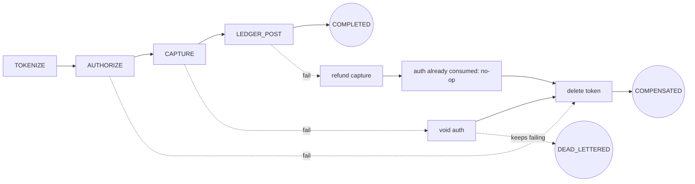

# Payment Orchestration Across Processors

> A saga with real compensations and a dead-letter path.

**Type:** Build
**Languages:** Java, Python, Go
**Prerequisites:** Phase 12 Lesson 02 (The Payment State Machine), Phase 12 Lesson 01 (Designing an Idempotent Payment API), Phase 7 Lesson 12 (The Saga Pattern), Phase 10 Lesson 03 (The Double-Entry Ledger)
**Time:** ~120 minutes

## Learning Objectives

- Decompose a card payment that spans a token vault, an acquirer, and a ledger into an ordered list of steps, each with exactly one compensation
- Persist the saga's progress after every step so that a process crash at any point leaves a record a fresh process can resume from
- Derive each step's idempotency key from the saga id and step name, and show with a test that recovery after a crash replays the downstream's stored response instead of repeating the side effect
- Distinguish three failure classes (business decline, transient outage, process crash) and route each to the right reaction: compensate, retry within a budget, or recover
- Explain why a compensation is semantic rather than mechanical, using the case of an authorization that has already been captured
- Route a saga whose compensation cannot complete to a dead letter that a human redrives, and prove the ledger nets to zero for every compensated saga

## The Problem

A checkout service takes a card payment in four calls to three systems. It sends the card number to a token vault and receives a token. It sends the token and amount to the acquirer and receives an authorization reference. It captures the authorization and receives a capture reference. It writes a ledger entry crediting the merchant's payable account. Each call is an HTTP request that can succeed, fail with a business answer, time out, or succeed while the checkout process dies before it hears the answer. Four calls, four outcomes each, and the service's code is a straight line of four statements wrapped in a single `try`.

On a Tuesday the acquirer's capture endpoint starts returning `auth_expired` for a subset of merchants after an internal deploy on their side. The straight-line code throws at step three, the `catch` logs "capture failed", and the handler returns 500. The authorization from step two is never voided. Each failed checkout leaves a hold on the customer's card for 49.99 USD that falls off after seven days. The token from step one is never deleted, which is a compliance finding at the next PCI assessment because the vault's retention policy assumed tokens are deleted when a payment fails. Four hundred customers see a pending charge for an order the merchant says does not exist.

The same week a pod is OOM-killed between the acquirer accepting an authorization and the service writing `authorization_ref` to its database. The row says the payment is at step one. A retry job picks it up, re-tokenizes (harmless), and re-authorizes. The customer now has two holds. Nothing in the database knows about the first one, so nothing will ever void it. When the merchant captures, they capture the second; the first expires in seven days, after a support ticket and a chargeback threat.

Phase 7 Lesson 08 defined the saga: a sequence of local transactions, each with a compensating transaction, where a failure at step `k` runs the compensations of steps `k-1` down to `1`. That lesson ran on a simulated network. This lesson is the saga as it exists in a payments service: the steps are real payment operations with real compensations (delete token, void authorization, refund capture, reverse ledger entry), the progress is persisted after every step, each step is idempotent so a crash and recovery cannot double-authorize, failures are classified so a decline and a timeout are treated differently, and a compensation that itself keeps failing ends in a dead letter rather than an infinite loop or a silent drop.

## The Concept

### Steps and their compensations

The saga has four forward steps in a fixed order. Each one talks to one downstream and has one compensation that undoes it on the same downstream.

| Step | System | Forward call | Compensation | What the compensation does |
|------|--------|--------------|--------------|----------------------------|
| `TOKENIZE` | vault | `tokenize(pan)` returns a token | `deleteToken(token)` | Removes the card from the vault so a failed payment leaves no cardholder data behind |
| `AUTHORIZE` | acquirer | `authorize(token, amount)` returns an auth reference | `voidAuth(authRef)` | Releases the hold on the customer's card |
| `CAPTURE` | acquirer | `capture(authRef, amount)` returns a capture reference | `refund(captureRef, amount)` | Returns captured funds; a capture cannot be voided |
| `LEDGER_POST` | ledger | debit `acquirer_receivable`, credit `merchant_payable` | `reverse` | Posts the mirror entry so the payment nets to zero |

The order is not arbitrary. Tokenization has no money effect and goes first so a vault outage costs nothing. Authorization goes before capture because the card networks require it (Phase 11, Lesson 02). The ledger post goes last because the ledger should record what happened, and the capture is what happened; posting before capture would mean reversing a ledger entry whenever the acquirer declines, which is noise in the books.



### The saga record is the source of truth

The record that persists between steps has the saga id, the payment id, the amount, a status per step (`PENDING`, `DONE`, `COMPENSATED`), the downstream reference each `DONE` step returned, an attempt counter per step for forward calls and another for compensations, the saga's overall state, and a failure reason. The overall state is one of:

| State | Meaning | Terminal |
|-------|---------|----------|
| `RUNNING` | Forward steps in progress | no |
| `COMPLETED` | Every step `DONE`; the payment happened | yes |
| `COMPENSATING` | A forward step failed; undoing `DONE` steps in reverse order | no |
| `COMPENSATED` | Every `DONE` step has been undone; the payment did not happen and left nothing behind | yes |
| `DEAD_LETTERED` | A compensation could not be completed; a human owns it | no, but not resumed automatically |

Two derived functions drive everything. `nextForward()` returns the first step whose status is `PENDING`, or null if every step is `DONE`. `nextCompensation()` returns the last step whose status is `DONE`, or null if nothing remains to undo. The orchestrator's loop is: load the record, ask which step is next for the current state, do it, write the result to the record, save the record, repeat. There is no in-memory state that is not also in the record. That property is what makes recovery trivial: a fresh process loads the record and runs the same loop.

The store saves and loads *copies*. That detail is what lets the tests model a crash honestly. If the orchestrator mutated the stored object directly, a crash thrown between a downstream call and `save` would leave the mutation visible, which is not what a database does. With copies, an unsaved mutation is lost exactly as a row that was never committed is lost.

### Three kinds of failure, three reactions

Every downstream call has one of four results, and the orchestrator must distinguish them because the right reaction to each is different:

| Result | Example | Downstream state | Reaction |
|--------|---------|------------------|----------|
| Approved | `authorize` returns `acquirer_authorize_0001` | Side effect happened | Mark step `DONE` with the reference, save, continue |
| Declined | `capture` returns code `auth_expired` | No side effect (the downstream said no) | Begin compensation; retrying a decline is pointless and sometimes forbidden |
| Unavailable | connection reset, 503, timeout | Unknown: the call may or may not have happened | Retry with the same idempotency key, up to a budget; past the budget, compensate |
| Process crash | our pod dies after the downstream committed | Side effect happened; we never recorded it | Nothing: the process is gone. `recover()` in the next process resumes from the persisted record |

The decline-versus-unavailable distinction is the one that teams get wrong most often. A decline is an answer. The acquirer looked at the request and refused it; sending it again gets the same answer and, for some codes (`05 do not honor`, `14 invalid card`), the network penalizes repeated attempts (Lesson 04 builds the classification table). An outage is not an answer, and the request may have been processed before the connection dropped. The only safe retry is one that the downstream can recognize as the same request, which is the idempotency key.

### Idempotency keys make retries and recovery the same code path

Each step's downstream call carries an idempotency key that is a pure function of the saga id, the step, and the direction: `saga_5:authorize:fwd` for the forward call, `saga_5:authorize:comp` for the compensation. The key does not include the attempt number. That is deliberate and it is the whole mechanism: whether the orchestrator is retrying after an outage in the same process or recovering after a crash in a new process, it sends the same key, and a downstream that already processed it returns the stored response (Phase 12, Lesson 01 built that server side). The fake processors in this lesson implement the same contract: a map from key to response, consulted before any fault or side effect.

Trace the crash scenario by hand. `saga_5` for 20.00 USD:

```text
start           store: saga_5 RUNNING v1 [T=P A=P C=P L=P]
TOKENIZE        vault.tokenize("saga_5:tokenize:fwd") -> vault_tokenize_0003
                store: saga_5 RUNNING v2 [T=D A=P C=P L=P]
AUTHORIZE       acquirer.authorize("saga_5:authorize:fwd", token, 20.00 USD)
                  acquirer: records key -> approved acquirer_authorize_0005, hold placed on card
                  our process dies before the response is handled
                store: saga_5 RUNNING v2 [T=D A=P C=P L=P]      (unchanged)
--- restart ---
recover()       unfinished() = [saga_5]; run("saga_5")
                nextForward() = AUTHORIZE (still PENDING in the record)
                acquirer.authorize("saga_5:authorize:fwd", ...) -> stored response, replays = 1, no new hold
                store: saga_5 RUNNING v3 [T=D A=D C=P L=P]      reference acquirer_authorize_0005
CAPTURE, LEDGER_POST proceed normally
                store: saga_5 COMPLETED v6
acquirer authorizations placed: 1
```

Without the stable key, recovery would issue a second authorization and the first would be an orphaned hold that nothing in the system knows about: the second incident in the Problem.

### Compensations are semantic, not mechanical

The naive compensation loop undoes every `DONE` step with its listed compensation. That is wrong in one case this lesson exercises: when `CAPTURE` is `DONE` and the saga must unwind (because `LEDGER_POST` failed past its budget), the capture is compensated by a refund, and then the loop reaches `AUTHORIZE`. Its compensation is `voidAuth`. But a captured authorization is consumed; the acquirer will refuse to void it (`already_captured`), and even if it did not, the money was already returned by the refund. The right compensation for `AUTHORIZE` when `CAPTURE` has been compensated is nothing. The orchestrator checks the capture's status and records `noop:auth-consumed-by-capture` in the journal instead of calling the acquirer.

The general rule: a compensation restores the downstream to the state it would be in had the step never run, *given everything else that has happened since*. Sometimes that is a call; sometimes it is a no-op; sometimes (a sent email, a shipped parcel) it is a different action entirely and the saga must have been designed so that step runs last.

### The retry budget and the dead letter

Each step has a budget of `maxAttempts` (three in this lesson) for transient failures. The counter is persisted, so a crash during retries does not reset it. When a forward step exhausts its budget the saga compensates; the reason records the step, the count, and the last error.

Compensations have a budget too, and that is where the design has to make an uncomfortable choice. A compensation that exhausts its budget cannot be compensated in turn, and it cannot be abandoned, because abandoning it is the first incident in the Problem: a hold that is never voided. The saga moves to `DEAD_LETTERED`, a `DeadLetter` record names the saga, the compensation that failed, and the reason, and `recover()` deliberately skips dead-lettered sagas so a restart does not hammer a downstream that is down. A human (or a scheduled job with human-tuned backoff) calls `redrive`, which resets the compensation counters and resumes from the record. The compensations already completed are not repeated; the record remembers them.

A compensation that is *declined* (as opposed to unavailable) dead-letters immediately. `voidAuth` returning `already_captured` means the orchestrator's model of the downstream is wrong, and retrying a wrong model is worse than stopping.

### The invariant and the complexity

The invariant is money conservation across the saga's two terminal states. For a `COMPLETED` saga, the ledger holds exactly one credit to `merchant_payable` for the amount and the acquirer holds exactly one capture. For a `COMPENSATED` saga, the ledger nets to zero for the payment, the acquirer holds no uncompensated authorization or capture, and the vault holds no token. The tests check this by counting side effects on the fake downstreams and summing ledger entries per payment. For a `DEAD_LETTERED` saga the invariant is suspended, which is the point: it is a known, listed exception that someone is accountable for, not an unknown one.

Complexity is trivial and worth stating anyway. `nextForward` and `nextCompensation` are O(steps). A saga makes at most `steps * maxAttempts` forward calls and `steps * maxAttempts` compensation calls. The record is saved once per attempt, so a happy-path saga writes `steps + 2` records (start, one per step, completion). The store grows with the number of sagas; production systems archive terminal records after the dispute window closes (Lesson 07).

### What this orchestrator does not do

- It does not schedule retries with backoff on a clock. Attempts are counted and retried immediately, which is right for a test and wrong for production; Phase 5 Lesson 10 supplies the backoff schedule, and a production orchestrator would persist a `nextAttemptAt` and be driven by a scheduler.
- It does not run steps in parallel. The four steps are strictly dependent (each needs the previous reference), so there is nothing to parallelize here; a saga with independent branches (reserve inventory and authorize card) is Exercise 3.
- It does not choose between acquirers. There is one vault and one acquirer; Lesson 04 adds the routing decision and the cascade to a second acquirer on a soft decline.
- It does not integrate with the payment state machine from Lesson 02. In production the orchestrator's `COMPLETED` is what fires `PROCESSOR_APPROVED` into the payment aggregate, and `COMPENSATED` fires `PROCESSOR_DECLINED`; wiring them together is Exercise 2.

## Build It

The walkthrough is in Java; the full file is `code/java/Main.java`.

### Step 1: The vocabulary

```java
enum SagaStep {
    TOKENIZE("vault", "deleteToken"),
    AUTHORIZE("acquirer", "voidAuth"),
    CAPTURE("acquirer", "refund"),
    LEDGER_POST("ledger", "reverse");

    final String system;
    final String compensation;
    SagaStep(String system, String compensation) { this.system = system; this.compensation = compensation; }
}

enum SagaState {
    RUNNING, COMPLETED, COMPENSATING, COMPENSATED, DEAD_LETTERED;
    boolean isTerminal() { return this == COMPLETED || this == COMPENSATED; }
}

enum StepStatus { PENDING, DONE, COMPENSATED }
```

The enum order of `SagaStep` *is* the saga order; `nextForward` and `nextCompensation` iterate `values()` forwards and backwards. Each step names its compensation so the journal and the dead letter can say "failed at voidAuth" without a lookup table elsewhere. `DEAD_LETTERED` is not terminal: the saga is parked, not finished.

**Predict:** which `SagaState` values does `SagaStore.unfinished()` return, and why is `DEAD_LETTERED` excluded even though it is not terminal?

### Step 2: The persisted record and its two cursors

```java
SagaStep nextForward() {
    for (SagaStep s : SagaStep.values()) if (steps.get(s) == StepStatus.PENDING) return s;
    return null;
}

SagaStep nextCompensation() {
    SagaStep[] all = SagaStep.values();
    for (int i = all.length - 1; i >= 0; i--) if (steps.get(all[i]) == StepStatus.DONE) return all[i];
    return null;
}

void markDone(SagaStep step, String reference) {
    steps.put(step, StepStatus.DONE);
    references.put(step, reference);
    journal.add(step + " done -> " + reference);
}
```

Everything the orchestrator needs to decide the next action is a function of `steps`. There is no "current step index" field that could drift from the per-step statuses. `references` holds what each step returned, because compensations need them: `voidAuth` needs the auth reference, `refund` needs the capture reference.

### Step 3: A store that behaves like a database

```java
final class SagaStore {
    private final Map<String, SagaRecord> records = new LinkedHashMap<>();

    void save(SagaRecord r) {
        r.version++;
        records.put(r.sagaId, r.copy());
    }

    SagaRecord load(String sagaId) {
        SagaRecord r = records.get(sagaId);
        if (r == null) throw new IllegalStateException("unknown saga " + sagaId);
        return r.copy();
    }
}
```

Copy on save, copy on load. A mutation that never reaches `save` does not exist, which is what makes the crash tests meaningful: the test asserts that after a `ProcessCrashException` the stored record still shows `AUTHORIZE` as `PENDING`.

**Predict:** a test calls `store.save(r)`, then `r.markDone(TOKENIZE, "tok")`, then `store.load(r.sagaId)`. What status does the loaded record show for `TOKENIZE`?

### Step 4: Downstreams with idempotency and scripted faults

```java
private ProcessorResponse call(String operation, String key, String declineCode) {
    ProcessorResponse stored = byKey.get(key);
    if (stored != null) { replays++; return stored; }
    Deque<Fault> q = faults.get(operation);
    Fault fault = (q == null || q.isEmpty()) ? null : q.poll();
    if (fault == Fault.OUTAGE) throw new ProcessorUnavailableException(name + "." + operation + ": connection reset");
    ProcessorResponse response;
    if (fault == Fault.DECLINE) {
        response = ProcessorResponse.declined(declineCode);
    } else {
        sideEffects.merge(operation, 1, Integer::sum);
        response = ProcessorResponse.approved(String.format("%s_%s_%04d", name, operation, ++sequence));
    }
    byKey.put(key, response);
    if (fault == Fault.CRASH_AFTER_COMMIT) throw new ProcessCrashException("process died after " + name + "." + operation + " committed");
    return response;
}
```

The order of operations in this fake is the contract a real processor offers. The key lookup comes first: a replay never consults faults and never has a side effect. An `OUTAGE` throws before anything is recorded, so the orchestrator genuinely does not know whether the call happened (here it did not; a variant that records and then throws is Exercise 1). A `DECLINE` is recorded under the key too, so a retried decline replays the decline rather than getting a second chance. `CRASH_AFTER_COMMIT` records the approved response and the side effect, then throws a different exception type that models *our* process dying, not the processor failing. `sideEffects` counts real authorizations, captures, and voids; the tests assert on it.

**Predict:** after `failNext("authorize", CRASH_AFTER_COMMIT)` and one `authorize` call that threw, what does a second `authorize` with the same key return, and what is `sideEffects("authorize")`?

### Step 5: The orchestrator loop, forward direction

```java
case RUNNING -> {
    SagaStep step = r.nextForward();
    if (step == null) { r.state = SagaState.COMPLETED; r.journal.add("completed"); store.save(r); return r; }
    r.forwardAttempts.merge(step, 1, Integer::sum);
    ProcessorResponse response;
    try {
        response = forward(step, r);
    } catch (ProcessorUnavailableException e) {
        r.journal.add(step + " attempt " + r.forwardAttempts.get(step) + " failed: " + e.getMessage());
        if (r.forwardAttempts.get(step) >= maxAttempts) r.beginCompensation(step + " exhausted " + maxAttempts + " attempts: " + e.getMessage());
        store.save(r);
        continue;
    }
    if (!response.approved()) {
        r.beginCompensation(step + " declined with code " + response.code());
        store.save(r);
        continue;
    }
    r.markDone(step, response.reference());
    store.save(r);
}
```

Three paths out of one downstream call, and each ends in `store.save`. The attempt counter is incremented *before* the call and saved on every path, so a crash mid-retry does not grant a fresh budget. `ProcessCrashException` is not caught: it propagates out of `run`, out of `start`, and the test asserts that it does. There is nothing sensible to do in a process that has, by definition, died.

**Predict:** `maxAttempts` is 3 and the acquirer is scripted with two `OUTAGE` faults on `authorize`. What is `forwardAttempts.get(AUTHORIZE)` when the saga completes, and how many authorizations does the acquirer hold?

### Step 6: Compensation, with the semantic no-op

```java
private ProcessorResponse compensate(SagaStep step, SagaRecord r) {
    String k = key(r, step, true);
    return switch (step) {
        case TOKENIZE -> vault.deleteToken(k, r.references.get(SagaStep.TOKENIZE));
        case AUTHORIZE -> r.steps.get(SagaStep.CAPTURE) == StepStatus.COMPENSATED
                ? ProcessorResponse.approved("noop:auth-consumed-by-capture")
                : acquirer.voidAuth(k, r.references.get(SagaStep.AUTHORIZE));
        case CAPTURE -> acquirer.refund(k, r.references.get(SagaStep.CAPTURE), r.amount);
        case LEDGER_POST -> ProcessorResponse.approved(ledger.reverse(k, r.paymentId, r.amount));
    };
}
```

The `AUTHORIZE` arm reads the capture's status. If the capture happened and was refunded, there is no hold to release. The journal records the no-op explicitly so an operator reading the saga's history is not left wondering why the acquirer shows no void.

### Step 7: Dead letters and redrive

```java
case COMPENSATING -> {
    SagaStep step = r.nextCompensation();
    if (step == null) { r.state = SagaState.COMPENSATED; r.journal.add("compensated"); store.save(r); return r; }
    r.compensationAttempts.merge(step, 1, Integer::sum);
    ProcessorResponse response;
    try {
        response = compensate(step, r);
    } catch (ProcessorUnavailableException e) {
        if (r.compensationAttempts.get(step) >= maxAttempts) deadLetter(r, step, e.getMessage());
        store.save(r);
        if (r.state == SagaState.DEAD_LETTERED) return r;
        continue;
    }
    if (!response.approved()) {
        deadLetter(r, step, step.compensation + " refused with code " + response.code());
        store.save(r);
        return r;
    }
    r.markCompensated(step, response.reference().startsWith("noop:") ? response.reference() : step.compensation);
    store.save(r);
}
```

A compensation that is unavailable past the budget dead-letters; a compensation that is declined dead-letters at once. Both leave the step as `DONE` in the record, because it *is* still done at the downstream, and `redrive` needs to know that. `recover()` iterates `store.unfinished()`, which excludes `DEAD_LETTERED`, so a restart does not retry a parked saga; `redrive(sagaId)` resets the compensation counters, flips the state back to `COMPENSATING`, and runs the loop again.

**Predict:** a saga dead-letters at `voidAuth` after three outages, with `TOKENIZE` and `AUTHORIZE` both `DONE`. The operator redrives it and the acquirer is healthy. How many `voidAuth` side effects does the acquirer record in total, and how many `deleteToken`?

### Step 8: Run it

```bash
cd phases/12-payment-systems-design/03-payment-orchestration/code/java
javac -d .out *.java && java -cp .out Main
java -cp .out MainTest
```

Expected output, abbreviated:

```console
== Happy path: tokenize -> authorize -> capture -> ledger post ==
saga_1 COMPLETED v6 [T=D A=D C=D L=D]
merchant_payable for pay_1001: 49.99 USD

== Decline at CAPTURE: compensations run in reverse order (void, delete token) ==
saga_2 COMPENSATED v7 [T=C A=C C=P L=P]  reason: CAPTURE declined with code auth_expired
merchant_payable for pay_1002: 0.00 USD

== Crash after the acquirer committed the authorization but before we saved ==
crash: process died after acquirer.authorize committed
persisted after crash: saga_5 RUNNING v2 [T=D A=P C=P L=P]  (AUTHORIZE still PENDING; acquirer holds 1 auth)
recover() resumed 1 saga(s)
after recovery: saga_5 COMPLETED v6 [T=D A=D C=D L=D]  acquirer authorizations: 1, idempotent replays: 1

== Ledger post fails: the capture must be refunded, not voided ==
saga_6 COMPENSATED v11 [T=C A=C C=C L=P]  reason: LEDGER_POST exhausted 3 attempts: ledger: write timeout
  CAPTURE compensated via refund
  AUTHORIZE compensated via noop:auth-consumed-by-capture
  TOKENIZE compensated via deleteToken

== Compensation itself fails: dead letter, then operator redrive ==
saga_7 DEAD_LETTERED v7 [T=D A=D C=P L=P]
  dead letter: saga_7 at voidAuth (acquirer.voidAuth: connection reset)
after redrive: saga_7 COMPENSATED v11 [T=C A=C C=P L=P]  dead letters remaining: 0
```

The test file runs eleven scenarios in isolated worlds: happy path, decline at each of three steps, outage within and past the budget, crash after commit at the acquirer, at the ledger, and during a compensation, the dead-letter path with redrive, an immediately-refused compensation, and the store's copy semantics. Every scenario asserts on downstream side-effect counts, not just on saga state.

### In Python

```python
class SagaStep(Enum):
    TOKENIZE = ("vault", "deleteToken")
    AUTHORIZE = ("acquirer", "voidAuth")
    CAPTURE = ("acquirer", "refund")
    LEDGER_POST = ("ledger", "reverse")

    def __init__(self, system: str, compensation: str) -> None:
        self.system = system
        self.compensation = compensation
```

Differences, all in `code/python/main.py` and `test_main.py`:

- **Enums carry their fields.** `SagaStep` members are tuples unpacked by `__init__`, so `step.system` and `step.compensation` read like the Java constants. Iterating `SagaStep` yields declaration order, which is what `next_forward` and `next_compensation` (via `reversed(list(SagaStep))`) rely on; the `EnumMap`s become plain `dict[SagaStep, ...]`.
- **Exceptions subclass `RuntimeError`.** `ProcessorUnavailableError` and `ProcessCrashError` replace the two Java runtime exceptions; `IllegalStateException` (unknown saga, redrive of a live saga) becomes a bare `RuntimeError`, and the positive-amount check raises `ValueError`. Tests use `assertRaises` with those classes.
- **The store copies with `copy.deepcopy`.** `SagaRecord.copy()` is one line instead of a field-by-field constructor, and gives the same semantics: a mutation that never reaches `save()` is invisible to `load()`.
- **`ProcessorResponse.approved` is a field**, so the static factory is `approved_with(reference)` to avoid shadowing it; `declined(code)` is unchanged.

```bash
cd phases/12-payment-systems-design/03-payment-orchestration/code/python
python3 main.py
python3 -m unittest -v
```

### In Go

```go
// downstreamError carries the downstream's own message (what the journal records) and matches a
// sentinel through errors.Is, so callers branch on the kind without parsing text.
type downstreamError struct {
    kind error
    msg  string
}

func (e *downstreamError) Error() string        { return e.msg }
func (e *downstreamError) Is(target error) bool { return target == e.kind }

response, err := o.forward(step, r)
if errors.Is(err, ErrProcessorUnavailable) {
    r.Journal = append(r.Journal, fmt.Sprintf("%v attempt %d failed: %v", step, r.ForwardAttempts[step], err))
    ...
    continue
}
if err != nil {
    return nil, err // the crash: nothing after this line runs
}
```

Differences, all in `code/go/main.go`, `money.go`, and `main_test.go`:

- **The crash is an error value, not an unwinding exception.** Every downstream call returns `(ProcessorResponse, error)`. `ErrProcessorUnavailable` is handled inside the loop (journal, maybe compensate, `continue`); any other error, in practice `ErrProcessCrash`, is returned from `Run` immediately, which is the Go spelling of "the process is gone". `Start`, `Recover`, and `Redrive` propagate it, and the tests assert `errors.Is(err, ErrProcessCrash)` where the Java test used `checkThrows`. The `downstreamError` type keeps the message the Java exception carried, so the journal lines are byte-identical across languages.
- **`iota` enums need an explicit order.** `SagaSteps` is the forward slice that `NextForward` walks and `NextCompensation` walks backwards; `System()` and `Compensation()` read from parallel arrays indexed by the step. `NextForward` returns `(SagaStep, bool)` instead of `null`.
- **`IllegalStateException` and `IllegalArgumentException` become sentinels.** `SagaStore.Load` and `Redrive` wrap `ErrIllegalState`; `NewSagaRecord` wraps `ErrInvalidAmount`, so a zero amount cannot build a record. The `StepStatus` value for an undone step is `STEP_COMPENSATED`, because `COMPENSATED` is already the saga state in the same package.
- **`LinkedHashMap` is a map plus an order slice.** `SagaStore` keeps `order []string` so `Unfinished` returns sagas in insertion order and `Recover` resumes them in the order they started, as the Java version does.
- **No goroutines.** The orchestrator is single-threaded by design; concurrency between sagas belongs in the store's version check (Lesson 02).

```bash
cd phases/12-payment-systems-design/03-payment-orchestration/code/go
go run .
go test ./...
```

## Use It

### Stripe: authorize, capture, cancel, refund

Stripe's `PaymentIntent` with `capture_method: manual` is the authorize step; `capture` is the capture step; `cancel` on an uncaptured intent is `voidAuth`; a `Refund` against the charge is the capture's compensation. Stripe's documentation is explicit that a captured intent cannot be canceled, only refunded, which is the semantic no-op this lesson implements for `AUTHORIZE` after `CAPTURE`. Every Stripe write accepts an `Idempotency-Key` header and replays the stored response for 24 hours, which is the downstream half of this lesson's key scheme. Tokenization is Stripe's `PaymentMethod` or a network token; deletion is `detach`.

### Adyen: a single `/payments` call with separate modifications

Adyen collapses authorize into `/payments` and exposes capture, cancel, and refund as `/payments/{pspReference}/captures`, `/cancels`, and `/refunds`, each asynchronous with its own `pspReference` returned in a webhook. The orchestrator pattern is the same; the difference is that `markDone` for `CAPTURE` happens when the `CAPTURE` webhook arrives, not when the HTTP call returns, which is where Lesson 05 (webhooks) connects to this one.

### Workflow engines

Temporal, AWS Step Functions, and Camunda are orchestrators whose "saga record" is a durable workflow history and whose "run loop" is a worker that replays the history to find the next step. Temporal's documentation describes exactly this lesson's design under the name "Saga pattern" with a compensation stack. What they add over this lesson: a scheduler that persists `nextAttemptAt` and runs retries with backoff, timers measured in days (a dispute window), signals from the outside world, and versioning of the workflow code itself so an in-flight saga survives a deploy that changes the step list. What they do not change: every activity still needs an idempotency key, because the engine guarantees at-least-once execution of each step, not exactly-once.

### The dead-letter queue as an operational object

In production the dead letters are a table with an owner, an SLA, and a dashboard. Amazon SQS and Kafka both have dead-letter topics as first-class features; the pattern there is identical: a message that fails processing `N` times moves to a separate queue that humans and tooling drain. The distinguishing rule from this lesson is that a dead letter is *not retried automatically on restart*. A restart during a downstream outage must not turn into a retry storm against the system that is already down.

## Ship It

`outputs/runbook-saga-dead-letters.md` is the on-call runbook for a dead-lettered payment saga: how to read the record, which downstream to check for each step, how to decide between redrive and manual compensation, and what to write in the incident log. Attach it to the alert that fires when the dead-letter table is non-empty.

## Exercises

1. **Reinforce.** Add a fourth fault, `OUTAGE_AFTER_COMMIT`, in which the fake processor records the side effect and the response under the key and then throws `ProcessorUnavailableException`. Show with a test that the orchestrator's retry, which reuses the key, replays the stored response and the side-effect count stays at one. This is the realistic outage: the request reached the processor and the response was lost.
2. **Apply.** Wire the orchestrator to the payment state machine from Lesson 02. `start` is called from `PaymentService.confirm` after the payment is saved as `PROCESSING`; a `COMPLETED` saga delivers `PROCESSOR_APPROVED` and a `COMPENSATED` saga delivers `PROCESSOR_DECLINED` with the saga's failure reason as the detail. Use the saga id as the event id so a recovered saga that completes twice cannot approve the payment twice.
3. **Extend.** Add a step that runs on a second acquirer: when `AUTHORIZE` is declined with a soft code (`51 insufficient funds`, `91 issuer unavailable`), compensate the token only if the second acquirer also declines; otherwise authorize there and continue. The record needs a per-step "which acquirer" field and the key must include it. Lesson 04 builds the decision of *which* acquirer and *whether* to cascade; this exercise builds the saga mechanics that let it happen.

## Key Terms

| Term | What people say | What it actually means |
|------|-----------------|------------------------|
| Saga | "distributed transaction" | A sequence of local transactions, each with a compensation, where failure at step `k` runs compensations `k-1` down to `1`; there is no atomicity, only eventual consistency plus a record of what was undone |
| Compensation | "rollback" | A new forward action that restores the downstream to the state it would have had, given everything else that has since happened; sometimes a call, sometimes a no-op, never a literal undo |
| Orchestrator | "the workflow" | The component that owns the saga record, decides the next step from the record alone, and persists the result before deciding again |
| Idempotency key per step | "retry safety" | A key derived from the saga id and step, stable across attempts and process restarts, so the downstream can recognize and replay a repeated request |
| Transient vs business failure | "it failed" | Unavailable (unknown outcome, retry with the same key within a budget) versus declined (known outcome, do not retry, compensate) |
| Retry budget | "max retries" | A persisted per-step count that survives crashes; exhausting it on a forward step compensates, exhausting it on a compensation dead-letters |
| Dead letter | "the error queue" | A saga parked with its record intact for a human to redrive; excluded from automatic recovery so a restart cannot become a retry storm |
| Recovery | "resume after crash" | A fresh process loading every unfinished record and running the same loop; correct only because every step is idempotent and every result was persisted before the next step began |

## Further Reading

- [Garcia-Molina and Salem, "Sagas" (SIGMOD 1987)](https://dl.acm.org/doi/10.1145/38713.38742) — the original paper: long-lived transactions as sequences with compensations, and the argument for why compensation is semantic.
- [IETF HTTP API WG, "The Idempotency-Key HTTP Header Field" (draft)](https://datatracker.ietf.org/doc/draft-ietf-httpapi-idempotency-key-header/) — the request-side contract each step relies on; the server side is Lesson 01.
- [Stripe API reference: capture a PaymentIntent, cancel a PaymentIntent, Refunds](https://docs.stripe.com/api/payment_intents/capture) — the production shapes of `capture`, `voidAuth`, and `refund`, including the rule that a captured intent is refunded, not canceled.
- [Adyen documentation: Modifications (capture, cancel, refund)](https://docs.adyen.com/online-payments/modify-payments/) — asynchronous compensations whose completion arrives by webhook, the variant Exercise 2 and Lesson 05 build toward.
- [Temporal documentation: Saga pattern](https://docs.temporal.io/encyclopedia/workflow-message-passing) — how a durable-workflow engine implements this lesson's loop, and what it adds (timers, backoff, code versioning).
- [Amazon SQS Developer Guide: dead-letter queues](https://docs.aws.amazon.com/AWSSimpleQueueService/latest/SQSDeveloperGuide/sqs-dead-letter-queues.html) — the operational pattern for messages that cannot be processed, including why redrive is a human action.
