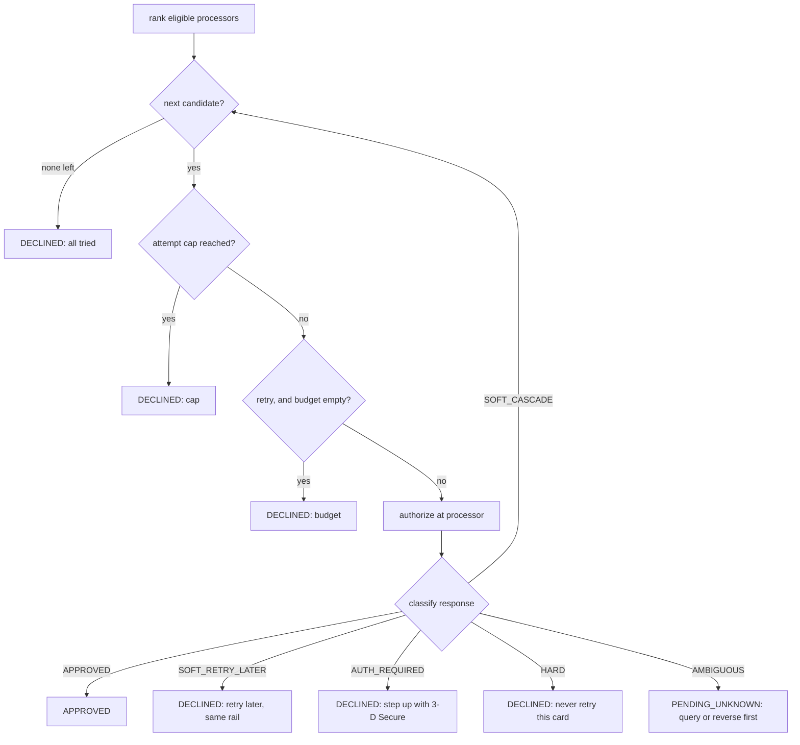

# Smart Routing, Cascading, and Retry Policies

> Which processor, which retry, and when to stop.

**Type:** Build
**Languages:** Java, Python, Go
**Prerequisites:** Phase 12 Lesson 03 (Payment Orchestration Across Processors), Phase 12 Lesson 02 (The Payment State Machine), Phase 5 Lesson 10 (Retries, Exponential Backoff, and Jitter), Phase 11 Lesson 02 (The Card Lifecycle State Machine)
**Time:** ~90 minutes

## Learning Objectives

- Rank eligible processors for one payment by expected margin, `P(approve) x (amount - fee)`, and explain why neither the cheapest nor the highest-approving processor wins on its own
- Classify an ISO 8583 response code into one of six decline classes and justify why only one class, the soft decline caused by the path rather than the card, may be cascaded to another processor
- Explain why a timeout must never be cascaded and what the router must do instead
- Maintain per-processor, per-network authorization-rate estimates from outcomes with a Beta prior and exponential decay, and keep processor health (a circuit breaker) as a separate signal
- Bound retry amplification with a per-payment attempt cap and a shared retry budget, and compute the number of processor calls a budget allows during an outage

## The Problem

A merchant takes card payments through two acquirers. Acquirer A charges 2.20% + 0.20 USD; acquirer B charges 2.90% + 0.30 USD. Finance asks engineering to "route everything to A, it's cheaper". Engineering does. Three weeks later the monthly report shows authorization rate down from 91% to 86% on Visa. A's connection to one large US issuer goes through a processor whose fraud screening is stricter, and a third of that issuer's cardholders now see "Your card was declined". On 400,000 USD of monthly Visa volume, five points of authorization rate is 20,000 USD of sales that never happened, against a fee saving of about 2,800 USD. The cheapest route was the most expensive decision of the quarter.

Engineering's fix is a retry: if A declines, try B. That works for a week. Then B's monthly invoice arrives with a line for "excessive reattempt" fees, and the Visa compliance team at the acquirer forwards a warning. The router was retrying every decline, including `43 stolen card` and `54 expired card`, on both acquirers, and some cards were attempted four times a day by a subscription retry job on top. Visa's rules cap reattempts on a declined card and charge for exceeding them; Mastercard sends a Merchant Advice Code of `03` that means "do not try this card again", and the router ignored it. Worse, during a 20-minute issuer outage, every payment produced two authorizations' worth of traffic, which doubled the load on a network that was already failing.

Then the hardest incident: A times out after 30 seconds on a 1,200 USD payment. The router treats the timeout as a decline and sends the payment to B, which approves. A's authorization had in fact succeeded; the response was lost on the way back. The customer's card now shows two holds for 1,200 USD, the second of which pushes them over their credit limit, and the customer's next purchase that evening is declined. The router did exactly what it was told. The policy was wrong in three places: which processor first, which declines to retry, and when to stop. This lesson builds the router that gets all three right and makes each decision explainable from a log line.

## The Concept

### Three decisions, three signals

A router answers three questions for every payment:

| Question | Signal it uses | Wrong answer costs |
|----------|----------------|--------------------|
| Which processor first? | Estimated authorization rate per processor and network, fee schedule, eligibility | Lost sales (low auth rate) or margin (high fees) |
| Should a decline go to the next processor? | The decline code, classified | Network fines, double authorizations, wasted calls |
| When must the router stop? | Per-payment attempt cap, shared retry budget, processor health | Retry storms during outages, latency at checkout |

Each signal has a different source. The authorization-rate estimate learns from issuer decisions. Processor health learns from technical failures (connection refused, timeouts). The decline class is a static table. Keeping them separate is the central design rule of the lesson: if a burst of connection errors lowered a processor's authorization-rate estimate, a 10-minute network blip would push traffic away for hours after the processor recovered, because the estimate decays slowly by design. If issuer declines counted toward health, one bad batch of stolen cards would trip a circuit breaker on a perfectly healthy processor.

### Ranking by expected margin

For a payment of amount `A`, processor `i` with fee `f_i(A)` and estimated approval probability `p_i`, the expected value of sending the first attempt to `i` is:

```text
score_i = p_i x (A - f_i(A))
```

This is the expected net revenue of the attempt. It is not a money amount: `p_i` is a probability, the product is a ranking key, and the code keeps it as a `double` precisely because nothing is ever posted with it. The fee itself is computed with integer arithmetic on minor units, rounded half-up, as in Phase 10.

Two observations make the formula worth its one line:

1. **Authorization rate dominates at normal ticket sizes.** A point of authorization rate on a 100.00 USD payment is worth about 0.98 USD of expected margin; the fee difference between A and B is 0.80 USD. A processor that is 1 point better on approval beats a processor that is 0.8 points cheaper.
2. **Fixed fees dominate at tiny ticket sizes.** On a 1.00 USD payment, B's fee is 0.33 USD and A's is 0.22 USD: 11 points of margin, which no plausible auth-rate difference can recover.

The router does not hard-code either rule; the formula produces both.

### Worked example by hand

A 100.00 USD Visa payment. Fees:

```text
A: 10000 x 220 / 10000 = 220 minor  + 20 fixed = 240 minor = 2.40 USD
B: 10000 x 290 / 10000 = 290 minor  + 30 fixed = 320 minor = 3.20 USD
```

Suppose the estimates are `p_A = 0.86` and `p_B = 0.93`:

```text
score_A = 0.86 x (10000 - 240) = 0.86 x 9760 = 8393.6
score_B = 0.93 x (10000 - 320) = 0.93 x 9680 = 9002.4
```

B goes first: its expected margin is 6.09 USD higher per payment despite the higher fee. Break-even for A is `p_A > 9002.4 / 9760 = 0.9224`. A must approve more than 92.24% of Visa payments to deserve the first attempt at this ticket size.

Now the cascade. B returns `91` (issuer or switch inoperative). That is a path failure: the issuer's host was unreachable through B's network connection. The router cascades to A, which approves. Total processor calls: 2. Had B returned `51` (insufficient funds), A's request would have reached the same issuer, which would have looked at the same balance and declined again. The router stops after one call and tells the merchant to retry later. Had B returned `43` (stolen card), any retry anywhere is a network rule violation; the router stops and the merchant should never attempt that card again.

### The decline classification table

ISO 8583 field 39 carries a two-character response code. The codes below are the ones every acquirer passes through in some form; Visa and Mastercard each publish the authoritative list for their networks. The classification is the router's policy, and the table is data so that it can be reviewed, printed, and versioned:

| Code | Meaning | Class | Why |
|------|---------|-------|-----|
| `00` | Approved | `APPROVED` | |
| `05` | Do not honor | `SOFT_CASCADE` | Generic; frequently caused by acquirer-side risk scoring or MCC mismatch. Contested, see below |
| `06` | Error | `SOFT_CASCADE` | A processing error on the path |
| `91` | Issuer or switch inoperative | `SOFT_CASCADE` | The issuer was not reached; another network path may reach it |
| `96` | System malfunction | `SOFT_CASCADE` | The processor failed, not the card |
| `CONNECT_ERROR` | The request never left our side | `SOFT_CASCADE` | Safe: nothing could have been authorized |
| `51` | Insufficient funds | `SOFT_RETRY_LATER` | Same issuer, same balance, same answer from any acquirer today |
| `61` | Exceeds withdrawal limit | `SOFT_RETRY_LATER` | The cardholder's limit, not the path |
| `1A` | Additional authentication required | `AUTH_REQUIRED` | PSD2 SCA soft decline; run 3-D Secure (Phase 11, Lesson 06) and resubmit |
| `65` | Exceeds frequency limit / SCA required | `AUTH_REQUIRED` | In the EEA, Mastercard uses 65 for the SCA soft decline |
| `14` | Invalid card number | `HARD` | The card does not exist |
| `41`, `43` | Lost card, stolen card | `HARD` | Retrying is a fraud signal and a rule violation |
| `54` | Expired card | `HARD` | Needs an account updater, not a retry |
| `57`, `62` | Not permitted, restricted | `HARD` | Issuer policy for this card |
| `59` | Suspected fraud | `HARD` | Retrying looks exactly like the fraud the issuer suspects |
| `N7` | CVV2 mismatch | `HARD` | The customer must re-enter details |
| `TIMEOUT` | No response | `AMBIGUOUS` | The authorization may exist |

Two overrides sit in front of the table:

- **Merchant Advice Codes.** Mastercard attaches a Merchant Advice Code (MAC) to many declines. `03` means "do not try again" and `21` means "payment cancellation" (the cardholder stopped a recurring payment). Either makes any decline `HARD`, even a `05`. `02` ("try again later") leaves the class alone.
- **Unknown codes are `HARD`.** A code the table does not know is a code the router does not understand, and retrying something you do not understand is how reattempt fines are earned. Fail safe, alert, and add the code to the table after someone reads the network's documentation.

`05` deserves its own paragraph because operators argue about it. It is the issuer's "no reason given" decline, and a large fraction of `05`s are issuer risk decisions that will repeat anywhere. But a measurable fraction come from the acquiring side: a cross-border acquirer that the issuer scores as riskier than a domestic one, or a merchant category code the issuer treats differently through one acquirer. Routing teams cascade `05` when their own data shows the second attempt approves often enough to pay for itself, and stop cascading it when it does not. The table makes that a one-line policy change, reviewable in a pull request.

### Why a timeout is never cascaded

A connection that was refused, or a TLS handshake that failed, is a request that never reached the processor. Nothing can have been authorized, and cascading is safe. A read timeout is different: the request was sent, the processor may have forwarded it to the network, the issuer may have approved it and placed a hold on the cardholder's open-to-buy, and only the response was lost. Cascading creates the double hold from The Problem.



`PENDING_UNKNOWN` hands the payment to the same machinery that Phase 12 Lesson 02 uses for a payment stuck in `PROCESSING`: query the processor for the transaction by its reference, or send a reversal (ISO 8583 message type `0400`) so that any authorization that did happen is released. Only after the first processor has said "no such authorization" or "reversed" is a new attempt safe, and that attempt belongs to the orchestration layer (Lesson 03), not to the router's inner loop.

### Learning authorization rates from outcomes

The router keeps an estimate per `(processor, network)` pair. A plain ratio `approvals / attempts` has two problems. With no data it is `0/0`; with little data it swings wildly (one decline out of two attempts is a 50% processor). And it has infinite memory: a processor that approved 95% for six months and has approved 70% since this morning still looks like a 94% processor tonight.

The estimator solves the first problem with a Beta prior and the second with exponential decay:

```text
estimate = (decayed_approvals + prior_rate x prior_weight) / (decayed_attempts + prior_weight)

on each issuer decision:
    decayed_approvals = decayed_approvals x decay + (approved ? 1 : 0)
    decayed_attempts  = decayed_attempts  x decay + 1
```

`prior_rate x prior_weight` is a count of imaginary approvals the estimator starts with; `prior_weight` is how many observations the prior is worth. With `prior_rate = 0.85` and `prior_weight = 20`, a new processor starts at 0.85 and needs about 20 real observations before the data outweighs the assumption. By hand, with no decay, 80 observations at 50% approval:

```text
(40 + 0.85 x 20) / (80 + 20) = (40 + 17) / 100 = 0.57
```

The test asserts exactly this number. With `decay = 0.995`, an observation from 200 payments ago weighs `0.995^200 = 0.37` of a fresh one; the effective memory is about `1 / (1 - decay) = 200` observations. Smaller decay reacts faster and is noisier. The test drives 200 approvals then 40 declines into two estimators: with `decay = 0.95` the estimate falls below 0.5; with no decay it stays above 0.8.

Only issuer decisions are recorded. A `CONNECT_ERROR` or `TIMEOUT` updates health, never the estimate.

### Exploration: the estimate needs traffic to stay true

A greedy router that always sends the first attempt to the best-scoring processor starves every other processor of data. If B's real approval rate improves next month, the router will never notice, because B only sees cascades (which are a biased sample: payments that already failed once). The router therefore sends a small fraction of first attempts, `explorationRate`, to a non-best candidate chosen with an injected, seeded `Random`. This is epsilon-greedy, the simplest answer to the multi-armed bandit problem. Production routers use Thompson sampling (draw a sample from each processor's Beta posterior and pick the highest), which explores more when estimates are uncertain and less when they are confident; the Beta-count representation here is exactly what Thompson sampling needs, and Exercise 3 asks for it.

In the demo, acq_a's true Visa approval rate is 0.80 and acq_b's is 0.93, both starting from the 0.85 prior. After 2,000 payments with 5% exploration, the estimates are 0.803 and 0.929, and acq_b took 1,899 of the 2,000 first attempts.

### Processor health: a circuit breaker

Health is a sliding window over the last 10 technical outcomes per processor. Five failures in the window trip the breaker `OPEN`, which removes the processor from `rank` entirely. After a 30-second cool-down (on the injected clock), the breaker is `HALF_OPEN`: the processor is eligible again, and the next result decides. A success closes the breaker and clears the window; a failure re-opens it for another cool-down. This is Nygard's circuit breaker from *Release It!*, and it is what turns "processor B is down" from 20 minutes of doubled latency (every payment tries B, waits, cascades) into one cool-down interval of probing.

| State | Eligible for routing | Transitions |
|-------|----------------------|-------------|
| `CLOSED` | yes | 5 failures in last 10 calls: to `OPEN` |
| `OPEN` | no | cool-down elapsed: to `HALF_OPEN` |
| `HALF_OPEN` | yes | success: to `CLOSED`; failure: to `OPEN` |

### Stopping: the attempt cap and the retry budget

Every cascade is another network call. During an incident that turns every first attempt into a `91`, a router with "cascade once on soft declines" doubles the load on the network that is failing. A per-payment cap (`maxAttempts`) bounds the multiplier per payment but not in aggregate. The retry budget bounds it in aggregate.

The budget is a token bucket filled by first attempts. Each first attempt deposits 0.1 token (100 milli-tokens); each cascade spends 1 token. The steady-state cascade rate is therefore at most 10% of first attempts, plus whatever the bucket held when the incident began. By hand, with an initial 3 tokens and 20 payments during a total outage:

```text
tokens available = 3 (initial) + 20 x 0.1 (deposits) = 5
processor calls  = 20 first attempts + 5 cascades = 25    (without a budget: 40)
```

The demo prints exactly this. This is the retry budget from Google's SRE book chapter on cascading failures and from Envoy's `retry_budget`, applied to authorizations.

The budget sits on top of network rules the router must also respect. Visa limits reattempts of a declined card; Mastercard's MAC `03` forbids them outright; the European SCA soft decline asks for authentication, not a retry. The router encodes the first two as `HARD` classes; a per-card reattempt counter over 30 days is Exercise 2.

### Complexity

`rank` is O(P log P) for P processors: one estimator lookup and one fee computation per processor, then a sort. With P under ten this is constant in practice. `route` makes at most `min(P, maxAttempts)` gateway calls. The estimator is O(1) per update and O(K) memory for K `(processor, network)` keys. The circuit breaker is O(W) per update for window size W, which a running failure count would make O(1).

### What this router does not do

- It does not retry later. `SOFT_RETRY_LATER` returns `DECLINED` with a reason; the retry schedule for recurring payments (dunning) is Phase 12 Lesson 11.
- It does not resolve `PENDING_UNKNOWN`. Status inquiry and reversal belong to the orchestration saga (Lesson 03) and reconciliation (Phase 14).
- It does not segment by issuer BIN, country, or ticket band. Real routers estimate per `(processor, BIN range, card type, amount band)`; adding a segment is a change to the estimator key.
- It does not route on network tokens versus PANs, local acquiring, or least-cost debit routing (the Durbin amendment's dual-network requirement in the US); those are additional eligibility rules in `accepts`.
- It does not persist estimates. A restart forgets them and falls back to the prior.

## Build It

The walkthrough is in Java, the only implementation shipped for this lesson. All code is in `code/java/Main.java`; the tests are in `code/java/MainTest.java`.

### Step 1: Processor terms and integer fees

```java
record ProcessorConfig(String id, Set<CardNetwork> networks, Set<Currency> currencies, long feeBps, long fixedFeeMinor) {
    boolean accepts(PaymentRequest r) { return networks.contains(r.network()) && currencies.contains(r.amount().currency()); }

    /** Fee in minor units: amount * bps / 10000 rounded half-up, plus the fixed component. Integer arithmetic only. */
    Money fee(Money amount) {
        long variable = Math.floorDiv(Math.addExact(Math.multiplyExact(amount.minorUnits(), feeBps), 5_000L), 10_000L);
        return Money.ofMinor(variable + fixedFeeMinor, amount.currency());
    }
}
```

`accepts` is eligibility: a processor that does not take Amex is not a candidate for an Amex payment, regardless of its score. The fee is basis points times minor units, plus 5,000 before dividing by 10,000 to round half-up, with `multiplyExact` to fail loudly on overflow. `Money` is the Phase 10 type: a `long` and a currency.

**Predict:** what is the fee for a 0.25 USD payment at 220 bps + 0.20 USD fixed?

### Step 2: The decline table and its overrides

```java
static DeclineClass classify(ProcessorResponse r) {
    DeclineRule rule = TABLE.get(r.code());
    if (rule != null && rule.decline() == DeclineClass.APPROVED) return DeclineClass.APPROVED;
    if ("03".equals(r.merchantAdviceCode()) || "21".equals(r.merchantAdviceCode())) return DeclineClass.HARD;
    return rule == null ? DeclineClass.HARD : rule.decline();
}
```

The table is a `LinkedHashMap<String, DeclineRule>` filled once in a static initializer, in the order it prints. `classify` has exactly two overrides and both make the answer stricter, never looser: a MAC of `03` or `21` on a decline, and an unknown code. The test checks both overrides and checks that MAC `02` does not override.

**Predict:** `ProcessorResponse.of("05", "02")` and `ProcessorResponse.of("05", "03")`: which classes?

### Step 3: The estimator

```java
double estimate(String processorId, CardNetwork network) {
    Counts c = counts.getOrDefault(key(processorId, network), new Counts(0, 0));
    return (c.approvals() + priorRate * priorWeight) / (c.attempts() + priorWeight);
}

void record(String processorId, CardNetwork network, boolean approved) {
    Counts c = counts.getOrDefault(key(processorId, network), new Counts(0, 0));
    counts.put(key(processorId, network),
            new Counts(c.approvals() * decay + (approved ? 1 : 0), c.attempts() * decay + 1));
}
```

Two decayed counters per key and one division. The decay is applied at update time, per key, so a processor that sees no traffic keeps its last estimate rather than drifting toward the prior; the alternative, decaying by wall-clock time, is a reasonable variant once the clock is injected. The counts are `double` because decayed counts are fractional; they are counts of attempts, never money.

**Predict:** a fresh estimator (prior 0.85, weight 20, no decay) sees 80 Visa attempts at acq `x` with 40 approvals. What does `estimate("x", MASTERCARD)` return?

### Step 4: Health as a circuit breaker

```java
CircuitState state() {
    if (state == CircuitState.OPEN && clock.nowMillis() - openedAtMillis >= coolDownMillis) state = CircuitState.HALF_OPEN;
    return state;
}

void recordFailure() {
    if (state() == CircuitState.HALF_OPEN) { trip(); return; }
    push(true);
    long failures = window.stream().filter(b -> b).count();
    if (failures >= failureThreshold) trip();
}
```

`OPEN` becomes `HALF_OPEN` lazily, when someone asks, by comparing the injected clock with the time the breaker tripped. No timer thread exists, which is why the tests can move time with `advance(29_999)` and `advance(1)` and observe the boundary exactly. A failure in `HALF_OPEN` re-trips immediately without consulting the window; `recordSuccess` in `HALF_OPEN` closes and clears it.

### Step 5: The retry budget

```java
void recordFirstAttempt() { balance = Math.min(capacity, balance + depositPerAttempt); }

boolean tryAcquireRetry() {
    if (balance < TOKEN) return false;
    balance -= TOKEN;
    return true;
}
```

Milli-tokens keep the arithmetic integral: a 10% ratio is a deposit of 100 per first attempt against a cost of 1,000 per retry. The cap prevents a long quiet period from banking thousands of retries that would all be spent in the first seconds of the next incident.

**Predict:** a budget starts with 2,000 milli-tokens. Two retries are acquired, then ten first attempts are recorded. How many more retries can be acquired?

### Step 6: Ranking

```java
List<Candidate> rank(PaymentRequest request) {
    List<Candidate> out = new ArrayList<>();
    for (ProcessorConfig p : processors.values()) {
        if (!p.accepts(request) || !health.get(p.id()).allows()) continue;
        double rate = estimator.estimate(p.id(), request.network());
        Money fee = p.fee(request.amount());
        double margin = rate * request.amount().minus(fee).minorUnits();
        out.add(new Candidate(p, rate, fee, margin));
    }
    out.sort(Comparator.comparingDouble(Candidate::expectedMarginMinor).reversed()
            .thenComparing(c -> c.processor().id()));
    return out;
}
```

Eligibility first (network, currency, circuit), then the score. `Candidate` keeps the rate, the fee, and the margin so a log line can say *why* acq_b was first, which is the question every routing incident review asks. The tie-break on id makes the order deterministic when two processors score the same.

### Step 7: The route loop

```java
for (Candidate c : ranked) {
    if (attempts.size() >= policy.maxAttempts()) {
        return new RouteResult(request.id(), RouteOutcome.DECLINED, attempts, "attempt cap " + policy.maxAttempts() + " reached");
    }
    if (!attempts.isEmpty() && !budget.tryAcquireRetry()) {
        return new RouteResult(request.id(), RouteOutcome.DECLINED, attempts, "retry budget exhausted");
    }
    String pid = c.processor().id();
    if (!health.get(pid).allows()) continue;   // tripped by an earlier attempt of this same payment
    ProcessorResponse response = gateway.authorize(pid, request);
    DeclineClass decline = DeclineCodes.classify(response);
    attempts.add(new Attempt(attempts.size() + 1, pid, response.code(), decline, clock.nowMillis()));
    learn(pid, request, response, decline);
    switch (decline) {
        case APPROVED -> { return new RouteResult(request.id(), RouteOutcome.APPROVED, attempts, "approved"); }
        case SOFT_CASCADE -> { }   // the only class that may try the next processor
        // SOFT_RETRY_LATER, AUTH_REQUIRED, HARD -> DECLINED with a reason; AMBIGUOUS -> PENDING_UNKNOWN
    }
}
```

The order of the guards is the policy: the cap before the budget (a capped payment should not spend a token), the budget only for retries (a first attempt is never refused by the budget), health re-checked because an earlier attempt of this same payment may have tripped the breaker. The `switch` over the class is exhaustive; only `SOFT_CASCADE` falls through to the next iteration. Every return carries a human reason.

**Predict:** acq_b returns `TIMEOUT`. How many gateway calls does `route` make, and what is the outcome?

### Step 8: Two signals, two sinks

```java
private void learn(String pid, PaymentRequest request, ProcessorResponse response, DeclineClass decline) {
    ProcessorHealth h = health.get(pid);
    if (response.technical()) {
        h.recordFailure();
        return;
    }
    h.recordSuccess();
    estimator.record(pid, request.network(), decline == DeclineClass.APPROVED);
}
```

A technical outcome goes to health and stops. Any response from the issuer, approval or decline, is a health success (the processor did its job) and an observation for the estimator. The test asserts both halves: a connect error leaves the estimator's observation count at zero; a `05` increments it and lowers the estimate.

### Step 9: Run it

```bash
cd phases/12-payment-systems-design/04-smart-routing-and-retries/code/java
javac -d .out *.java && java -cp .out Main
java -cp .out MainTest
```

Expected output, abbreviated:

```console
== Ranking a 100.00 USD Visa payment (expected margin = P(approve) x (amount - fee)) ==
acq_b  auth 0.900  fee 3.20 USD   expected margin  8710.90 minor
acq_a  auth 0.833  fee 2.40 USD   expected margin  8125.47 minor

== Cascading: only SOFT_CASCADE moves to the next processor ==
pay_100 -> APPROVED (approved)
   #1 acq_b  91            SOFT_CASCADE     Issuer or switch inoperative
   #2 acq_a  00            APPROVED         Approved
pay_stolen -> DECLINED (hard decline: do not retry this card)
pay_nsf -> DECLINED (issuer decline: retry later, not elsewhere)
pay_mac03 -> DECLINED (hard decline: do not retry this card)
pay_timeout -> PENDING_UNKNOWN (timeout: query or reverse at acq_b before any cascade)
pay_exhaust -> DECLINED (all eligible processors tried)
pay_amex -> NO_ROUTE (no eligible processor)

== Circuit breaker: 5 technical failures in the last 10 calls take acq_b out of the ranking ==
acq_b circuit: OPEN; ranking now [acq_a]
after 30s cool-down: HALF_OPEN; the next payment probes it
probe approved by acq_b; acq_b circuit: CLOSED

== Retry budget: an issuer outage makes every first attempt a 91 ==
20 payments -> 25 processor calls, 5 cascades; budget left 0 milli-tokens (without a budget: 40 calls)

== Learning: acq_a's true Visa approval rate is 0.80, acq_b's is 0.93; both start at the 0.85 prior ==
estimates after 2000 payments: acq_a 0.803, acq_b 0.929
first attempts: {acq_a=101, acq_b=1899}; approved 1892/2000
```

The ranked estimates (0.900 and 0.833) are lower than the 93% and 86% the demo fed in because 100 decayed observations are still pulled toward the 0.85 prior with weight 20; that shrinkage is the prior doing its job. The test suite has 52 assertions, covering fee rounding, every class in the table, both overrides, the estimator's arithmetic and decay, ranking and tie-breaks, the cascade rules for every class, the attempt cap, the separation of health and auth-rate signals, every circuit-breaker transition at its exact time boundary, and the budget arithmetic.

### In Python

The Python port (`code/python/main.py`, tests in `test_main.py`) is the same design with four differences. **`java.util.Random` is ported, not replaced:** `JavaRandom` is the 48-bit LCG with `next_int(bound)` and `next_double()` reproduced exactly, so `JavaRandom(7)` (exploration) and `JavaRandom(42)` (the simulated gateway) produce the same rolls and the learning demo ends on the same numbers, `acq_a 0.803, acq_b 0.929`, first attempts `{acq_a=101, acq_b=1899}`, 1892 approvals; a test pins the first values of both seeds against the JDK. **Integer fees without `multiplyExact`:** Python ints do not overflow, so the fee is `(amount * bps + 5_000) // 10_000`; `//` floors like `Math.floorDiv`, which on these non-negative values is half-up rounding. Estimates and margins are `float`, the same IEEE doubles Java uses, so `f"{rate:.3f}"` prints what `%.3f` printed. **The decline table is a module-level loop** that fills `DeclineCodes.TABLE` (a `dict`, insertion-ordered like `LinkedHashMap`) in place of a `static {}` block; `ProcessorResponse.of(code, mac=None)` covers both Java overloads. **Ranking sorts on a tuple key** `(-expected_margin_minor, processor.id)` instead of a chained `Comparator`; the health factory is a plain callable `(id, clock) -> ProcessorHealth`, and `IllegalArgumentException` becomes `ValueError`.

Run it from `code/python/` with `python3 main.py`; test with `python3 -m unittest -v`.

#### Step 1: Processor terms and integer fees

`ProcessorConfig` is a frozen dataclass; `__post_init__` coerces the two sets to `frozenset` (so the dataclass stays hashable) and rejects negative fees. `fee` is one line of integer arithmetic, with `+ 5_000` before `// 10_000` doing the half-up rounding; there is no overflow to check.

```python
@dataclass(frozen=True)
class ProcessorConfig:
    """A processor's static terms: what it accepts and what it charges (basis points plus a fixed fee)."""

    id: str
    networks: frozenset[CardNetwork]
    currencies: frozenset[Currency]
    fee_bps: int
    fixed_fee_minor: int

    def __post_init__(self) -> None:
        object.__setattr__(self, "networks", frozenset(self.networks))
        object.__setattr__(self, "currencies", frozenset(self.currencies))
        if self.fee_bps < 0 or self.fixed_fee_minor < 0:
            raise ValueError("fees cannot be negative")

    def accepts(self, r: PaymentRequest) -> bool:
        return r.network in self.networks and r.amount.currency in self.currencies

    def fee(self, amount: Money) -> Money:
        """Fee in minor units: amount * bps / 10000 rounded half-up, plus the fixed component. Integer arithmetic only."""
        variable = (amount.minor_units * self.fee_bps + 5_000) // 10_000
        return Money.of_minor(variable + self.fixed_fee_minor, amount.currency)
```

#### Step 2: The decline table and its overrides

`classify` is a static method with the same two stricter-only overrides: an approved row wins first, then MAC `03`/`21` forces `HARD`, then an unknown code is `HARD`. The table itself is filled by a module-level `for` loop over `(code, meaning, class)` tuples, which runs at import time the way a Java static initializer runs at class load.

```python
    @staticmethod
    def classify(r: ProcessorResponse) -> DeclineClass:
        """Classify a response. Two overrides come before the table: a Mastercard Merchant Advice Code of
        03 ("do not try again") or 21 ("payment cancellation") makes any decline HARD, and an unknown
        code is HARD because retrying what you do not understand is how a merchant gets fined."""
        rule = DeclineCodes.TABLE.get(r.code)
        if rule is not None and rule.decline is DeclineClass.APPROVED:
            return DeclineClass.APPROVED
        if r.merchant_advice_code in ("03", "21"):
            return DeclineClass.HARD
        return DeclineClass.HARD if rule is None else rule.decline

for _code, _meaning, _class in (
    ("00", "Approved", DeclineClass.APPROVED),
    ("05", "Do not honor (generic)", DeclineClass.SOFT_CASCADE),
    ("06", "Error", DeclineClass.SOFT_CASCADE),
    ("91", "Issuer or switch inoperative", DeclineClass.SOFT_CASCADE),

    (TIMEOUT, "No response; authorization may exist", DeclineClass.AMBIGUOUS),
):
    DeclineCodes._rule(_code, _meaning, _class)
```

#### Step 3: The estimator

`_Counts` is a tiny frozen dataclass holding two floats. `estimate` is the one division over prior-weighted counts; `record` decays both counts at update time and adds the new observation, so a silent processor keeps its last estimate.

```python
    def estimate(self, processor_id: str, network: CardNetwork) -> float:
        """(decayed approvals + prior pseudo-approvals) / (decayed attempts + prior weight)."""
        c = self._counts.get(self._key(processor_id, network), _Counts(0.0, 0.0))
        return (c.approvals + self._prior_rate * self._prior_weight) / (c.attempts + self._prior_weight)

    def record(self, processor_id: str, network: CardNetwork, approved: bool) -> None:
        """Record one issuer decision. Technical failures are health signals and must not be recorded here."""
        k = self._key(processor_id, network)
        c = self._counts.get(k, _Counts(0.0, 0.0))
        self._counts[k] = _Counts(c.approvals * self._decay + (1 if approved else 0), c.attempts * self._decay + 1)

    def observations(self, processor_id: str, network: CardNetwork) -> float:
        return self._counts.get(self._key(processor_id, network), _Counts(0.0, 0.0)).attempts
```

#### Step 4: Health as a circuit breaker

`state()` promotes `OPEN` to `HALF_OPEN` lazily by comparing the injected clock with `_opened_at_millis`; no timer thread exists. The window is a `deque[bool]`, and `record_failure` counts the `True`s with a generator expression; a failure in `HALF_OPEN` re-trips without consulting the window.

```python
    def state(self) -> CircuitState:
        if self._state is CircuitState.OPEN and self._clock.now_millis() - self._opened_at_millis >= self._cool_down_millis:
            self._state = CircuitState.HALF_OPEN
        return self._state

    def allows(self) -> bool:
        return self.state() is not CircuitState.OPEN

    def record_success(self) -> None:
        if self.state() is CircuitState.HALF_OPEN:
            self._state = CircuitState.CLOSED
            self._window.clear()
        self._push(False)

    def record_failure(self) -> None:
        if self.state() is CircuitState.HALF_OPEN:
            self._trip()
            return
        self._push(True)
        if sum(1 for b in self._window if b) >= self._failure_threshold:
            self._trip()

    def _trip(self) -> None:
        self._state = CircuitState.OPEN
        self._opened_at_millis = self._clock.now_millis()
        self._window.clear()
```

#### Step 5: The retry budget

`TOKEN` is a class attribute of 1,000 milli-tokens. `record_first_attempt` deposits and caps with `min`; `try_acquire_retry` refuses when the balance is below one token and otherwise spends it.

```python
class RetryBudget:
    TOKEN = 1_000  # milli-tokens per retry

    def __init__(self, deposit_per_attempt: int, capacity: int, initial: int) -> None:
        self._deposit_per_attempt = deposit_per_attempt  # milli-tokens earned per first attempt (100 = 10% retry ratio)
        self._capacity = capacity
        self._balance = min(initial, capacity)

    def record_first_attempt(self) -> None:
        self._balance = min(self._capacity, self._balance + self._deposit_per_attempt)

    def try_acquire_retry(self) -> bool:
        if self._balance < RetryBudget.TOKEN:
            return False
        self._balance -= RetryBudget.TOKEN
        return True

    def balance_milli(self) -> int:
        return self._balance
```

#### Step 6: Ranking

`rank` filters on `accepts` and `allows`, computes rate, fee, and margin, and sorts with a tuple key: negative margin first (descending), then processor id (ascending) as the deterministic tie-break. `Candidate` keeps all three inputs so the decision can be logged.

```python
    def rank(self, request: PaymentRequest) -> list[Candidate]:
        """Eligible processors, best first. Eligible: accepts the network and currency, and its circuit is
        not OPEN. Score: P(approve) * (amount - fee), the expected margin of sending the attempt there.
        Ties break on processor id so the order is deterministic."""
        out: list[Candidate] = []
        for p in self._processors.values():
            if not p.accepts(request) or not self._health[p.id].allows():
                continue
            rate = self._estimator.estimate(p.id, request.network)
            fee = p.fee(request.amount)
            margin = rate * request.amount.minus(fee).minor_units
            out.append(Candidate(p, rate, fee, margin))
        out.sort(key=lambda c: (-c.expected_margin_minor, c.processor.id))
        return out
```

#### Step 7: The route loop

The guards run in the same order as in Java: attempt cap, then budget (only when `attempts` is non-empty), then a re-check of health. Python has no `switch`, so the class dispatch is an `if` chain in which only `SOFT_CASCADE` reaches `continue`; the final `return` after the loop is "all eligible processors tried".

```python
        attempts: list[Attempt] = []
        self._budget.record_first_attempt()
        for c in ranked:
            if len(attempts) >= self._policy.max_attempts:
                return RouteResult(request.id, RouteOutcome.DECLINED, tuple(attempts),
                                   f"attempt cap {self._policy.max_attempts} reached")
            if attempts and not self._budget.try_acquire_retry():
                return RouteResult(request.id, RouteOutcome.DECLINED, tuple(attempts), "retry budget exhausted")
            pid = c.processor.id
            if not self._health[pid].allows():
                continue  # tripped by an earlier attempt of this same payment
            response = self._gateway.authorize(pid, request)
            decline = DeclineCodes.classify(response)
            attempts.append(Attempt(len(attempts) + 1, pid, response.code, decline, self._clock.now_millis()))
            self._learn(pid, request, response, decline)
            if decline is DeclineClass.APPROVED:
                return RouteResult(request.id, RouteOutcome.APPROVED, tuple(attempts), "approved")
            if decline is DeclineClass.SOFT_CASCADE:
                continue  # the only class that may try the next processor
            if decline is DeclineClass.SOFT_RETRY_LATER:
                return RouteResult(request.id, RouteOutcome.DECLINED, tuple(attempts), "issuer decline: retry later, not elsewhere")
            if decline is DeclineClass.AUTH_REQUIRED:
                return RouteResult(request.id, RouteOutcome.DECLINED, tuple(attempts), "step up with 3-D Secure, then retry")
            if decline is DeclineClass.HARD:
                return RouteResult(request.id, RouteOutcome.DECLINED, tuple(attempts), "hard decline: do not retry this card")
            return RouteResult(request.id, RouteOutcome.PENDING_UNKNOWN, tuple(attempts),
                               f"timeout: query or reverse at {pid} before any cascade")
        return RouteResult(request.id, RouteOutcome.DECLINED, tuple(attempts), "all eligible processors tried")
```

#### Step 8: Two signals, two sinks

`_learn` sends a technical response to health only and returns; an issuer answer is a health success and an estimator observation, with `decline is DeclineClass.APPROVED` as the boolean.

```python
    def _learn(self, pid: str, request: PaymentRequest, response: ProcessorResponse, decline: DeclineClass) -> None:
        """Health learns from technical outcomes; the auth-rate estimate learns only from issuer decisions."""
        h = self._health[pid]
        if response.technical():
            h.record_failure()
            return
        h.record_success()
        self._estimator.record(pid, request.network, decline is DeclineClass.APPROVED)
```

#### Step 9: Run it

```bash
cd phases/12-payment-systems-design/04-smart-routing-and-retries/code/python
python3 main.py
python3 -m unittest -v
```

Because `JavaRandom` reproduces the JDK generator, the output is identical to the Java run, down to the learned estimates:

```console
== Retry budget: an issuer outage makes every first attempt a 91 ==
20 payments -> 25 processor calls, 5 cascades; budget left 0 milli-tokens (without a budget: 40 calls)

== Learning: acq_a's true Visa approval rate is 0.80, acq_b's is 0.93; both start at the 0.85 prior ==
estimates after 2000 payments: acq_a 0.803, acq_b 0.929
first attempts: {acq_a=101, acq_b=1899}; approved 1892/2000
```

### In Go

The Go port (`code/go/main.go`, `javarandom.go`, `money.go`, tests in `main_test.go`) keeps the design with five differences. **`java.util.Random` is ported bit for bit, not swapped for `math/rand`:** `JavaRandom` in `javarandom.go` is the 48-bit LCG with `NextInt(bound)` (rejection loop included) and `NextDouble()`, so seeds 7 and 42 roll the same numbers and the learning demo ends on `acq_a 0.803, acq_b 0.929`, `{acq_a=101, acq_b=1899}`, 1892 approvals. **Checked integer arithmetic:** Go's `*` and `+` wrap silently like Java's primitives, so `Fee` uses `mulChecked`/`addChecked` (returning `ErrOverflow`) in place of `multiplyExact`/`addExact`, and `floorDiv` reproduces `Math.floorDiv` because Go's `/` truncates toward zero; `Rank` and `Route` therefore return `([]Candidate, error)` and `(RouteResult, error)`, and the error is only ever an overflow. **Doubles stay doubles, but multiply-add is kept unfused:** `AuthRateEstimator.Record` wraps `c.approvals*e.decay` in `float64()` so the compiler may not fuse it with the `+ 1` into an FMA, which would change the last bit of the decayed counts on some CPUs and drift from the Java estimates. **Constructor checks become `ErrInvalidArgument`:** `NewPaymentRequest`, `NewProcessorConfig`, `NewAuthRateEstimator`, and `NewRoutingPolicy` return `(T, error)` wrapping one sentinel; `ProcessorResponse.of(code, mac)` is `OfMAC` because Go has no overloading, and a missing advice code is `""` rather than `null`. **Ordered maps are slices plus maps:** `DeclineTable` is the ordered rule slice with `declineByCode` as its index; the router keeps processor ids in an `order` slice so `Rank` iterates in registration order before `sort.SliceStable` applies the margin-then-id comparator, and the `RouteOutcome` approval is `ROUTE_APPROVED` because `APPROVED` is already the `DeclineClass` in the same package.

Run it from `code/go/` with `go run .`; test with `go test ./...`.

#### Step 1: Processor terms and integer fees

`NewProcessorConfig` is the validating constructor and turns the slices into `map[...]bool` sets. `Fee` returns `(Money, error)` because each of `mulChecked` and `addChecked` can report overflow; `floorDiv` then reproduces `Math.floorDiv`, which matters only for negative operands but keeps the three languages identical by construction.

```go
func (c ProcessorConfig) Accepts(r PaymentRequest) bool {
	return c.Networks[r.Network] && c.Currencies[r.Amount.Currency]
}

// Fee in minor units: amount * bps / 10000 rounded half-up, plus the fixed component. Integer arithmetic only;
// the checked helpers stand in for Java's multiplyExact/addExact.
func (c ProcessorConfig) Fee(amount Money) (Money, error) {
	scaled, err := mulChecked(amount.MinorUnits, c.FeeBps)
	if err != nil {
		return Money{}, err
	}
	rounded, err := addChecked(scaled, 5_000)
	if err != nil {
		return Money{}, err
	}
	variable := floorDiv(rounded, 10_000)
	return OfMinor(variable+c.FixedFeeMinor, amount.Currency), nil
}

// floorDiv is Java's Math.floorDiv: rounds toward negative infinity, unlike Go's / which truncates.
func floorDiv(a, b int64) int64 {
	q := a / b
	if (a%b != 0) && ((a < 0) != (b < 0)) {
		q--
	}
	return q
}
```

#### Step 2: The decline table and its overrides

`DeclineTable` is the ordered slice the demo prints; `declineByCode` is built from it once by an immediately-invoked function. `Classify` applies the same overrides in the same order, using the `known` boolean from the map lookup where Java tested for `null`.

```go
var DeclineTable = []DeclineRule{
	{"00", "Approved", APPROVED},
	{"05", "Do not honor (generic)", SOFT_CASCADE},
	{"06", "Error", SOFT_CASCADE},
	{"91", "Issuer or switch inoperative", SOFT_CASCADE},
	{"96", "System malfunction", SOFT_CASCADE},
	{CONNECT_ERROR, "Request never reached the processor", SOFT_CASCADE},

	{TIMEOUT, "No response; authorization may exist", AMBIGUOUS},
}

var declineByCode = func() map[string]DeclineRule {
	m := map[string]DeclineRule{}
	for _, r := range DeclineTable {
		m[r.Code] = r
	}
	return m
}()

// Classify a response. Two overrides come before the table: a Mastercard Merchant Advice Code of
// 03 ("do not try again") or 21 ("payment cancellation") makes any decline HARD, and an unknown
// code is HARD because retrying what you do not understand is how a merchant gets fined.
func Classify(r ProcessorResponse) DeclineClass {
	rule, known := declineByCode[r.Code]
	if known && rule.Decline == APPROVED {
		return APPROVED
	}
	if r.MerchantAdviceCode == "03" || r.MerchantAdviceCode == "21" {
		return HARD
	}
	if !known {
		return HARD
	}
	return rule.Decline
}
```

#### Step 3: The estimator

`counts` is an unexported two-field struct; a missing key yields the zero value, so no `getOrDefault` is needed. The `float64(...)` wrappers in `Record` are deliberate: they forbid the compiler from fusing multiply and add, so decayed counts match Java bit for bit.

```go
func (e *AuthRateEstimator) Estimate(processorID string, network CardNetwork) float64 {
	c := e.counts[estimatorKey(processorID, network)]
	return (c.approvals + e.priorRate*e.priorWeight) / (c.attempts + e.priorWeight)
}

// Record one issuer decision. Technical failures are health signals and must not be recorded here.
// The explicit float64() conversions stop the compiler fusing multiply-add, so the counts match Java bit for bit.
func (e *AuthRateEstimator) Record(processorID string, network CardNetwork, approved bool) {
	k := estimatorKey(processorID, network)
	c := e.counts[k]
	add := 0.0
	if approved {
		add = 1
	}
	e.counts[k] = counts{float64(c.approvals*e.decay) + add, float64(c.attempts*e.decay) + 1}
}

func (e *AuthRateEstimator) Observations(processorID string, network CardNetwork) float64 {
	return e.counts[estimatorKey(processorID, network)].attempts
}
```

#### Step 4: Health as a circuit breaker

`State()` is the lazy `OPEN` to `HALF_OPEN` promotion against the injected clock. The window is a `[]bool` trimmed from the front by `push`; `trip` resets it with `h.window[:0]`, reusing the backing array.

```go
func (h *ProcessorHealth) State() CircuitState {
	if h.state == OPEN && h.clock.NowMillis()-h.openedAtMillis >= h.coolDownMillis {
		h.state = HALF_OPEN
	}
	return h.state
}

func (h *ProcessorHealth) Allows() bool { return h.State() != OPEN }

func (h *ProcessorHealth) RecordSuccess() {
	if h.State() == HALF_OPEN {
		h.state = CLOSED
		h.window = h.window[:0]
	}
	h.push(false)
}

func (h *ProcessorHealth) RecordFailure() {
	if h.State() == HALF_OPEN {
		h.trip()
		return
	}
	h.push(true)
	failures := 0
	for _, b := range h.window {
		if b {
			failures++
		}
	}
	if failures >= h.failureThreshold {
		h.trip()
	}
}

func (h *ProcessorHealth) trip() {
	h.state = OPEN
	h.openedAtMillis = h.clock.NowMillis()
	h.window = h.window[:0]
}

func (h *ProcessorHealth) push(failure bool) {
	h.window = append(h.window, failure)
	for len(h.window) > h.windowSize {
		h.window = h.window[1:]
	}
}
```

#### Step 5: The retry budget

`TOKEN` is a package constant. `RecordFirstAttempt` uses the built-in `min` on `int64`; `TryAcquireRetry` is the same two-line check-and-spend.

```go
const TOKEN int64 = 1_000 // milli-tokens per retry

type RetryBudget struct {
	depositPerAttempt int64 // milli-tokens earned per first attempt (100 = 10% retry ratio)
	capacity          int64
	balance           int64
}

func NewRetryBudget(depositPerAttempt, capacity, initial int64) *RetryBudget {
	return &RetryBudget{depositPerAttempt: depositPerAttempt, capacity: capacity, balance: min(initial, capacity)}
}

func (b *RetryBudget) RecordFirstAttempt() {
	b.balance = min(b.capacity, b.balance+b.depositPerAttempt)
}

func (b *RetryBudget) TryAcquireRetry() bool {
	if b.balance < TOKEN {
		return false
	}
	b.balance -= TOKEN
	return true
}

func (b *RetryBudget) BalanceMilli() int64 { return b.balance }
```

#### Step 6: Ranking

`Rank` walks `r.order` so iteration is deterministic (a Go map is not), propagates any overflow from `Fee` or `Minus`, and sorts with `sort.SliceStable` using margin descending then id ascending.

```go
func (r *Router) Rank(request PaymentRequest) ([]Candidate, error) {
	var out []Candidate
	for _, id := range r.order {
		p := r.processors[id]
		if !p.Accepts(request) || !r.health[p.ID].Allows() {
			continue
		}
		rate := r.estimator.Estimate(p.ID, request.Network)
		fee, err := p.Fee(request.Amount)
		if err != nil {
			return nil, err
		}
		net, err := request.Amount.Minus(fee)
		if err != nil {
			return nil, err
		}
		margin := rate * float64(net.MinorUnits)
		out = append(out, Candidate{p, rate, fee, margin})
	}
	sort.SliceStable(out, func(i, j int) bool {
		if out[i].ExpectedMarginMinor != out[j].ExpectedMarginMinor {
			return out[i].ExpectedMarginMinor > out[j].ExpectedMarginMinor
		}
		return out[i].Processor.ID < out[j].Processor.ID
	})
	return out, nil
}
```

#### Step 7: The route loop

`Route` returns `(RouteResult, error)`; every policy outcome is a result value and the error is only an overflow from `Rank`. The guards and the `switch` over `DeclineClass` are in the same order as Java; the `SOFT_CASCADE` arm is empty, so the loop continues to the next candidate.

```go
	attempts := []Attempt{}
	r.budget.RecordFirstAttempt()
	for _, c := range ranked {
		if len(attempts) >= r.policy.MaxAttempts {
			return RouteResult{request.ID, DECLINED, attempts, fmt.Sprintf("attempt cap %d reached", r.policy.MaxAttempts)}, nil
		}
		if len(attempts) > 0 && !r.budget.TryAcquireRetry() {
			return RouteResult{request.ID, DECLINED, attempts, "retry budget exhausted"}, nil
		}
		pid := c.Processor.ID
		if !r.health[pid].Allows() {
			continue // tripped by an earlier attempt of this same payment
		}
		response := r.gateway.Authorize(pid, request)
		decline := Classify(response)
		attempts = append(attempts, Attempt{len(attempts) + 1, pid, response.Code, decline, r.clock.NowMillis()})
		r.learn(pid, request, response, decline)
		switch decline {
		case APPROVED:
			return RouteResult{request.ID, ROUTE_APPROVED, attempts, "approved"}, nil
		case SOFT_CASCADE:
			// the only class that may try the next processor
		case SOFT_RETRY_LATER:
			return RouteResult{request.ID, DECLINED, attempts, "issuer decline: retry later, not elsewhere"}, nil
		case AUTH_REQUIRED:
			return RouteResult{request.ID, DECLINED, attempts, "step up with 3-D Secure, then retry"}, nil
		case HARD:
			return RouteResult{request.ID, DECLINED, attempts, "hard decline: do not retry this card"}, nil
		case AMBIGUOUS:
			return RouteResult{request.ID, PENDING_UNKNOWN, attempts, "timeout: query or reverse at " + pid + " before any cascade"}, nil
		}
	}
	return RouteResult{request.ID, DECLINED, attempts, "all eligible processors tried"}, nil
}
```

#### Step 8: Two signals, two sinks

`learn` is unexported and reads exactly like the Java method: technical outcomes feed health and return; issuer decisions feed both health and the estimator.

```go
func (r *Router) learn(pid string, request PaymentRequest, response ProcessorResponse, decline DeclineClass) {
	h := r.health[pid]
	if response.Technical() {
		h.RecordFailure()
		return
	}
	h.RecordSuccess()
	r.estimator.Record(pid, request.Network, decline == APPROVED)
}
```

#### Step 9: Run it

```bash
cd phases/12-payment-systems-design/04-smart-routing-and-retries/code/go
go run .
go test ./...
```

`go run .` prints exactly what the Java demo prints, including the learning section:

```console
== Learning: acq_a's true Visa approval rate is 0.80, acq_b's is 0.93; both start at the 0.85 prior ==
estimates after 2000 payments: acq_a 0.803, acq_b 0.929
first attempts: {acq_a=101, acq_b=1899}; approved 1892/2000
```

## Use It

**Adyen RevenueProtect / Adyen Uplift, Stripe's adaptive acceptance, Checkout.com Intelligent Acceptance, PayPal Braintree's multi-acquirer routing.** Each is this router with more segments and more data: they estimate approval per issuer BIN, card type, country, and amount band across their whole merchant population, which is why a PSP's router is better than one a single merchant can train. They also add optimizations this lesson only names: retrying with a network token instead of the PAN, toggling 3-D Secure exemptions, adjusting the authorization message (for example, sending an account-funding indicator or a different MCC where permitted), and smart retries for recurring payments at times the issuer is likely to approve.

**Payment orchestration platforms (Spreedly, Primer, Gr4vy, IXOPAY).** These sell the router as a product to merchants with several acquirers. Their configuration screens are this lesson's objects: a rules table for eligibility, a decline-code cascade list per acquirer (with `05` typically a per-merchant switch), a cap on cascade attempts, and failover on connection errors. Their documentation warns, as this lesson does, against cascading on timeouts.

**Network rules.** Visa's rules on excessive reattempts (introduced in 2021) cap reattempts on a declined card within a 30-day window and charge a fee per reattempt over the cap; Mastercard's Merchant Advice Code program charges for retrying after MAC `03` and `21` and defines `01` (updated information needed) and `02` (try again later). Both programs are why the classification table exists and why unknown codes fail safe.

**Envoy and service meshes.** Envoy's `retry_budget` (a percentage of active requests plus a minimum concurrency) and outlier detection (eject a host after N consecutive 5xx) are the general-purpose versions of this lesson's budget and circuit breaker. A payment router can sit behind a mesh that does both, but the mesh cannot do the decline classification: to Envoy, a `05` is an HTTP 200 with a body it does not read.

What all of them hide is the policy. The from-scratch router makes every policy a reviewable line: which codes cascade, how much a new processor is trusted before it has data, how much memory the estimate has, how many retries an outage may cost.

## Ship It

`outputs/runbook-routing-and-retries.md` is a review checklist and incident runbook for a payment router: the questions to answer before enabling a new processor or a new cascade code, the dashboards to have (approval rate per processor and network, cascade rate, budget exhaustion, breaker state), and the steps for the three incidents in The Problem (an acquirer's approval rate drops, an issuer outage, timeouts at an acquirer).

## Exercises

1. **Reinforce.** Change the decline table so that `05` is `SOFT_RETRY_LATER` instead of `SOFT_CASCADE`. Predict which tests fail before running them, update them, and then write the one-paragraph policy note you would attach to the pull request explaining the trade-off in approval rate against reattempt fees.
2. **Apply.** Add a `ReattemptLedger` keyed by `cardFingerprint` that records every declined attempt with its time on the injected clock and refuses (with a new stop reason) a route for a card that has had 15 declined attempts in the last 30 days. Test the boundary at exactly 30 days and at the 15th versus 16th attempt.
3. **Extend.** Replace epsilon-greedy with Thompson sampling: for each eligible processor draw `p ~ Beta(approvals + prior_rate x prior_weight, attempts - approvals + (1 - prior_rate) x prior_weight)` with a seeded `Random` (sample a Beta as `X / (X + Y)` with `X`, `Y` Gamma variates, or approximate with a normal for large counts) and rank by `p x (amount - fee)`. Rerun the learning demo and compare the number of first attempts wasted on acq_a. Then combine with Phase 12 Lesson 02: make `PENDING_UNKNOWN` a state in the payment state machine with a `STATUS_INQUIRY` event that resolves it to `SUCCEEDED` or back to a state from which the router may cascade.

## Key Terms

| Term | What people say | What it actually means |
|------|-----------------|------------------------|
| Smart routing | "send it to the best acquirer" | Ranking eligible processors per payment by expected margin, from per-segment approval estimates and the fee schedule |
| Cascading | "retry on another processor" | Sending a declined payment to the next ranked processor, which is correct only when the decline was caused by the path and not by the card or the cardholder |
| Soft decline | "a decline you can retry" | Two different things: a path failure another acquirer may clear (cascade), and an issuer decision that may change later (retry later, same card) |
| Hard decline | "card declined" | An issuer decision tied to the card (stolen, expired, invalid) that no retry, anywhere, may change; retrying it violates network rules |
| Merchant Advice Code | "the MAC" | A Mastercard field attached to declines telling the merchant whether and when it may retry; `03` and `21` forbid retries |
| Authorization rate | "auth rate" | Approvals divided by attempts for a segment; the estimate the router learns, decayed so it tracks change and shrunk toward a prior when data is thin |
| Retry budget | "retry limit" | A shared token bucket filled by first attempts and drained by retries, bounding aggregate retry load to a fixed ratio during an outage |
| Circuit breaker | "failover" | A per-processor state machine that removes a processor from routing after repeated technical failures and probes it after a cool-down |

## Further Reading

- [ISO 8583-1:2003, Financial transaction card originated messages](https://www.iso.org/standard/31628.html) — the message standard whose field 39 carries the response codes this router classifies, and whose `0400` reversal is the remedy for an ambiguous timeout.
- [Mastercard: Merchant Advice Code transaction excellence (Transaction Processing Rules)](https://www.mastercard.us/content/dam/public/mastercardcom/na/global-site/documents/transaction-processing-rules.pdf) — the published rules behind MAC `01`, `02`, `03`, and `21`, and the fees for retrying after a do-not-retry advice.
- [Visa Core Rules and Visa Product and Service Rules](https://usa.visa.com/dam/VCOM/download/about-visa/visa-rules-public.pdf) — the public rulebook, including authorization reattempt limits and the definitions of decline categories.
- [Beyer et al., *Site Reliability Engineering*, chapter 22, "Addressing Cascading Failures"](https://sre.google/sre-book/addressing-cascading-failures/) — retry budgets, per-request retry caps, and why retries at several layers multiply load during an outage.
- [Envoy proxy documentation: retry budgets and outlier detection](https://www.envoyproxy.io/docs/envoy/latest/intro/arch_overview/upstream/circuit_breaking) — a production implementation of the budget and breaker this lesson builds, with the parameters operators tune.
- [Russo, Van Roy, Kazerouni, Osband, Wen, "A Tutorial on Thompson Sampling" (Foundations and Trends in ML, 2018)](https://arxiv.org/abs/1707.02038) — the Beta-Bernoulli bandit that the estimator's counts feed, and the reason exploration matters for an estimate that is only updated where traffic goes.
