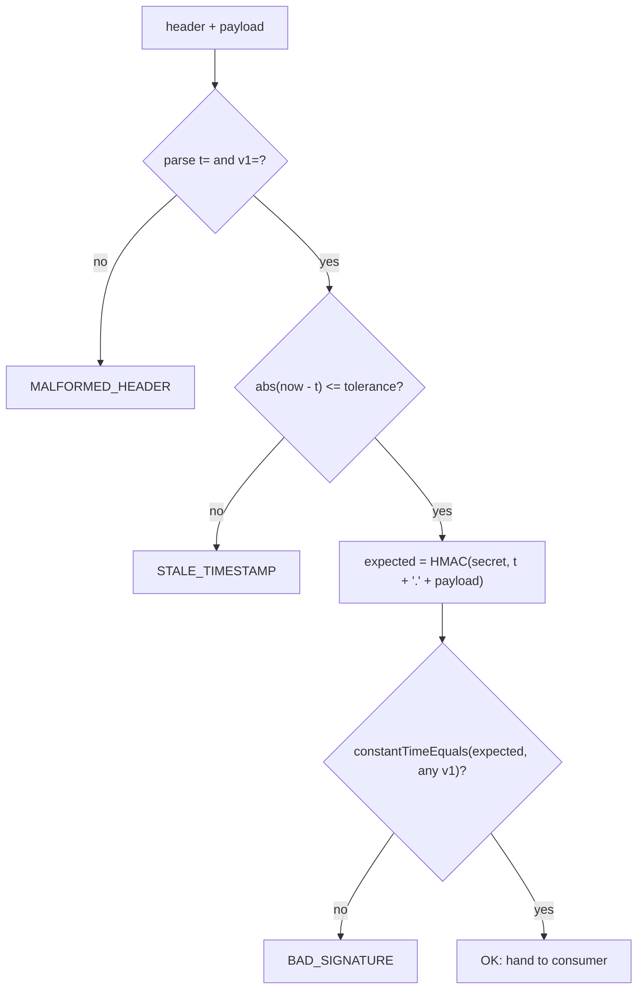

# Webhooks: Signing, Delivery, Ordering, and Replay

> A webhook is an unauthenticated HTTP POST from the internet that claims money moved; the signature, the timestamp, and the event id are the only things standing between it and your ledger.

**Type:** Build
**Languages:** Java, Python, Go
**Prerequisites:** Phase 12 Lesson 01 (Designing an Idempotent Payment API), Phase 12 Lesson 02 (The Payment State Machine), Phase 5 Lesson 10 (Retries, Exponential Backoff, and Jitter), Phase 5 Lesson 08 (Timeouts and Deadline Propagation)
**Time:** ~120 minutes

## Learning Objectives

- Sign a webhook payload with HMAC-SHA256 over a timestamp-bound message and explain which attacks each component of the header defeats
- Verify a signature with a tolerance window and a constant-time comparison, and state why the checks run in that order
- Implement at-least-once delivery with an explicit backoff schedule and a dead-letter queue, driven by an injected clock
- Build a consumer that deduplicates by event id and refuses to let an older event overwrite a newer state
- Decide which HTTP status a consumer should return for a forgery, a duplicate, and a transient failure, and predict what the producer does with each

## The Problem

A merchant integrates a payment processor. Their server listens on `/webhooks/payments` and, when it receives `{"type":"payment.captured","object":"pay_42"}`, it marks order 42 as paid and releases the goods for shipping. It works in staging. It works in production. Six weeks later the merchant ships 140 orders that were never paid for.

The endpoint was public, as every webhook endpoint must be, and it trusted the body. Someone read the merchant's public API docs, guessed the webhook URL from the pattern in the JavaScript, and posted their own `payment.captured` events. No secret was leaked. No system was breached. The endpoint simply had no way to tell the processor's POST from anyone else's.

The merchant adds signature verification and the forgeries stop. Then a second class of incident appears. The processor's delivery worker times out after 10 seconds, but the merchant's handler takes 12 seconds under load because it calls the shipping provider synchronously. The processor sees a timeout, retries 30 seconds later, and the merchant ships the same order twice. A month after that, a refund webhook arrives 400 milliseconds *before* the capture webhook it logically follows, because the two were sent by different workers over different connections; the order is marked refunded, then marked paid, and the customer receives goods they were refunded for.

Every one of these is the same failure: the consumer treated an HTTP request as if it were a fact. A webhook is a *hint* that something happened, delivered over a channel that can forge, duplicate, delay, and reorder. This lesson builds the four mechanisms that turn hints into facts: a signature that binds the payload to a secret and a time, a verifier that is immune to timing side channels and replays, a delivery scheduler that guarantees at-least-once without guaranteeing exactly-once, and a consumer that makes at-least-once safe by deduplicating and ordering.

## The Concept

### What a webhook promises and what it does not

| Property | HTTP alone | With HMAC signature | With signature + timestamp | With signature + timestamp + consumer dedupe |
|----------|-----------|--------------------|---------------------------|---------------------------------------------|
| Payload came from the producer | no | yes | yes | yes |
| Payload was not altered in transit | no (even with TLS, a proxy in the merchant's own stack can alter it) | yes | yes | yes |
| Payload is not a replay of a captured request | no | no | yes, within the tolerance window | yes |
| Each event is applied at most once | no | no | no | yes |
| Events for one object are applied in order | no | no | no | yes, if the producer numbers them |
| Every event is eventually delivered | no | no | no | only with producer retries and a dead-letter process |

The table is the whole lesson. Each column adds a mechanism; each mechanism closes exactly one gap and leaves the rest open. The most common production mistake is to implement the second column and believe you have the last one.

### HMAC: a MAC built from a hash and a secret

RFC 2104 defines HMAC as:

```text
HMAC(K, m) = H( (K' xor opad) || H( (K' xor ipad) || m ) )
```

where `H` is a hash function (SHA-256 here, per FIPS 180-4), `K'` is the key padded or hashed to the block size, `ipad` is the byte `0x36` repeated and `opad` is `0x5c` repeated. The nested structure is what makes HMAC safe where a naive `H(K || m)` is not: with a plain Merkle-Damgård hash, an attacker who knows `H(K || m)` and the length of `K` can compute `H(K || m || padding || m2)` without knowing `K` (a length-extension attack). HMAC's outer hash with a differently-keyed state defeats that.

Three properties the signing scheme depends on:

1. **Only a holder of `K` can produce a valid tag.** The secret is shared out of band (shown once in a dashboard) and never travels with the request.
2. **Any change to `m`, down to one bit, changes the tag unpredictably.** So the payload, byte for byte, is what gets signed; re-serializing JSON on the consumer side before verifying is the classic bug, because `{"a":1,"b":2}` and `{"b":2,"a":1}` are the same JSON but different bytes.
3. **The tag reveals nothing useful about `K`.** 2^256 work to brute force; the practical attack surface is the comparison routine, not the MAC.

A worked trace of what the signer actually hashes, for the demo's first event:

```text
secret   = "whsec_demo_secret_do_not_reuse_0001"          (35 bytes; shorter than SHA-256's 64-byte block, so K' = K padded with zeros)
t        = 1700000000
payload  = {"id":"evt_001","type":"payment.authorized","object":"pay_42","sequence":1,"created":1700000000,"status":"authorized"}
message  = "1700000000." + payload                           (timestamp, a dot, then the exact body bytes)
inner    = SHA256( (K' xor 0x36*64) || message )
tag      = SHA256( (K' xor 0x5c*64) || inner )
header   = "t=1700000000,v1=" + hex(tag)
         = t=1700000000,v1=1d0988920c13b08e0b43efaca51cc7060f6d4bae51b6deb47b3605c9d207b1c4
```

Change one byte of the payload (`authorized` to `captured`) and the inner hash changes completely, so the outer hash and the tag do. Change `t` by one second and the same happens. There is no partial credit: the verifier either reproduces all 32 bytes or it does not.

### Binding the timestamp

A signature over the payload alone proves origin and integrity but not freshness. An attacker who captures one legitimate `payment.captured` request can replay it forever, and every replay carries a valid signature. The fix is to sign `timestamp + "." + payload` and send the timestamp in the clear:

```text
Webhook-Signature: t=1700000000,v1=1d0988920c13b08e0b43efaca51cc7060f6d4bae51b6deb47b3605c9d207b1c4
```

The verifier recomputes the MAC over the *received* timestamp and the received payload. If the attacker changes `t` to something recent, the MAC no longer matches; if they leave `t` alone, the verifier sees it is older than the tolerance (300 seconds here, the value Stripe uses) and rejects it. The replay window shrinks from forever to five minutes, and inside those five minutes the consumer's event-id dedupe catches the replay anyway, because a replay carries the same event id as the original.

The header allows several `v1=` values. During secret rotation the producer signs with both the old and the new secret for a grace period; the consumer accepts if *any* candidate matches. Unknown scheme names (`v0`, `v2`) are ignored rather than rejected so the producer can introduce a new scheme without breaking consumers that have not upgraded.

### The order of checks



Freshness is checked before the MAC for two reasons. It is cheap, so a replay flood costs the verifier one subtraction per request instead of one HMAC. And it means a stale replay of a *valid* request produces `STALE_TIMESTAMP`, which is the honest diagnosis, rather than a confusing `BAD_SIGNATURE` after the MAC is recomputed over a timestamp the attacker may have edited.

The tolerance is symmetric: a timestamp 400 seconds in the future is as suspicious as one 400 seconds in the past, and producer clocks do drift. Five minutes is generous enough that NTP-synchronized hosts never trip it.

### Constant-time comparison

`Arrays.equals` and `String.equals` return as soon as they find the first differing byte. A verifier that uses them leaks, through response latency, how many leading bytes of the attacker's guess were correct. With a 64-hex-character tag that is 32 bytes to brute force one at a time, 256 guesses each: about 8,000 requests instead of 2^256. Network jitter makes this hard but not impossible; it has been done against real systems.

The fix is to compare every byte regardless and accumulate the differences:

```text
diff = 0
for i in 0..n: diff |= a[i] xor b[i]
return diff == 0
```

The running time depends on the length, which is public, and on nothing else. The length check at the top is fine to short-circuit on because the expected length is fixed and public too.

### At-least-once delivery

The producer cannot know whether a failed POST was processed. A timeout might mean the consumer never received it, or received it and processed it and the response was lost. The producer therefore retries until it sees a 2xx, which means the consumer may receive the same event more than once. That is at-least-once delivery, and it is the only delivery guarantee a webhook can honestly offer.

The schedule in this lesson is `[30s, 2m, 10m, 1h, 6h]` after each failure, for six attempts over about 7.2 hours. Worked by hand, with attempt 1 at `t = 0`:

```text
attempt 1 at     0s  -> 503, wait 30s
attempt 2 at    30s  -> 500, wait 120s
attempt 3 at   150s  -> 429, wait 600s
attempt 4 at   750s  -> 500, wait 3600s
attempt 5 at  4350s  -> 500, wait 21600s
attempt 6 at 25950s  -> 500, no more backoff entries: DEAD_LETTERED
```

Exponential growth is deliberate. A consumer that is down for an hour should not receive a burst of 120 retries when it comes back; it should receive one. The dead-letter queue is where a human or a batch job looks for events that never landed, and it exists because "retry forever" is a memory leak and "give up silently" is lost money.

Each retry is signed at *send* time, not at enqueue time. If attempt 6 carried the timestamp from attempt 1 it would be 7 hours stale and the consumer would correctly reject it as a replay.

### Where the event comes from: the outbox

The dispatcher in this lesson is handed events by `enqueue`. In production the hard question is who calls `enqueue` and when. The naive answer, "the payment service, right after it commits the capture," has a gap: if the process dies between the commit and the enqueue, the capture happened and nobody is ever told. The reverse order, enqueue then commit, is worse: the consumer is told about a capture that then fails to commit.

The fix is the transactional outbox. The payment service writes the event row into an `outbox` table *in the same database transaction* as the state change. A separate relay process polls the outbox (or tails the database's change log), hands each row to the dispatcher, and marks it sent. If the relay crashes after sending but before marking, it sends again on restart, which is at-least-once again, and which the consumer's dedupe absorbs. The event id is assigned when the outbox row is written, so every redelivery of that row carries the same id. Phase 8 (Streams and Change Data Capture) builds this relay; here it is enough to know that `enqueue` is called by it, not by the request handler.

### Failure modes, by component

| Symptom | Root cause | Where this lesson prevents it |
|---------|-----------|-------------------------------|
| Forged events accepted | No signature, or signature checked against a re-serialized body | Step 3 verifies the raw bytes before parsing |
| Valid events rejected after a deploy | Consumer re-serializes JSON; the new framework version orders keys differently | Same: raw bytes, never a re-encoding |
| Signature check passes for an attacker with no secret | Comparison short-circuits; timing leaks the prefix | `constantTimeEquals` |
| Old captured requests replayed months later | Timestamp not bound into the MAC | `signedPayload` prepends `t`, verifier checks tolerance |
| Every retry rejected as stale | Producer signs at enqueue time, retries hours later | `tick` signs at send time |
| Order shipped twice | Consumer processed the first delivery but timed out answering; producer retried | Consumer dedupes by event id and answers 200 to the duplicate |
| Refund overwritten by capture | Two workers delivered out of order | Per-object sequence; older events return `OUT_OF_ORDER` |
| Thousands of retries during a consumer outage | Fixed short retry interval | Exponential schedule; six attempts over seven hours |
| Events silently lost after an outage | Producer gives up with no record | Dead-letter list, surfaced to an operator |
| Retry storm from the consumer's own bug | Consumer returns 500 for duplicates | Status table: duplicates and out-of-order are 200 |

### Ordering and the consumer's job

Two events about the same payment can arrive in either order. The producer can help by numbering them per object (`sequence: 1` for the authorization, `2` for the capture) and the consumer can keep, per object, the highest sequence it has applied. An event with a sequence less than or equal to that is not applied. It is not an error either; the event was real, it was just late, and the consumer already knows everything it would have told them.

| Consumer sees | Outcome | HTTP status to return | Why that status |
|---------------|---------|-----------------------|-----------------|
| Bad or missing signature, stale timestamp | `REJECTED` | 400 | The producer must not retry a forgery; 4xx says "do not try this again" |
| Event id already processed | `DUPLICATE` | 200 | The producer is retrying because it missed our earlier 200; a 200 now stops the retries |
| Sequence older than what we have applied | `OUT_OF_ORDER` | 200 | We have nothing to do, and a 5xx would cause pointless redelivery |
| New id, newer sequence | `ACCEPTED` | 200 | Normal case |
| Our own database is unavailable | (not handled) | 500 | We want the retry |

The last row is the one teams get wrong. Returning 500 for a duplicate turns a harmless redelivery into a storm; returning 200 for a database outage loses the event forever.

### What this lesson does not do

It does not verify TLS, which is the transport's job and does not replace the signature (a load balancer or logging proxy inside the consumer's own network terminates TLS and can see and alter the body). It does not build a real HTTP server; the `Endpoint` interface stands in for one so the schedule can be tested to the second. It does not handle the "thin event" pattern where the webhook carries only an id and the consumer fetches the full object from the API; that pattern removes the ordering problem at the cost of a round trip, and Exercise 3 asks you to build it. It does not implement exactly-once, because nothing does: at-least-once delivery plus an idempotent consumer is what "exactly-once" means in practice.

## Build It

### Step 1: The event and its deterministic bytes

```java
record Event(String id, String type, String objectId, long sequence, long createdAt, String status) {
    String toJson() {
        return "{\"id\":\"" + id + "\",\"type\":\"" + type + "\",\"object\":\"" + objectId
                + "\",\"sequence\":" + sequence + ",\"created\":" + createdAt + ",\"status\":\"" + status + "\"}";
    }
    static Event fromJson(String json) { /* parses exactly the shape toJson emits */ }
}
```

The producer serializes once and signs those exact bytes. `toJson` writes keys in a fixed order so two serializations of the same event are byte-identical. The consumer verifies the raw body *before* parsing it; `fromJson` is deliberately tiny because the lesson is about the envelope, not JSON.

**Predict:** if the consumer's HTTP framework parses the body into a map and the handler re-serializes it to verify, what happens to the signature when the framework sorts the keys alphabetically?

### Step 2: Signing

```java
final class WebhookSigner {
    static String signedPayload(long timestamp, String payload) { return timestamp + "." + payload; }

    static byte[] hmacSha256(byte[] key, byte[] message) {
        Mac mac = Mac.getInstance("HmacSHA256");
        mac.init(new SecretKeySpec(key, "HmacSHA256"));
        return mac.doFinal(message);
    }

    String signature(long timestamp, String payload) {
        return hex(hmacSha256(secret, signedPayload(timestamp, payload).getBytes(StandardCharsets.UTF_8)));
    }

    String header(String payload) {
        long ts = clock.nowSeconds();
        return "t=" + ts + ",v1=" + signature(ts, payload);
    }
}
```

`javax.crypto.Mac` is the JDK's RFC 2104 implementation; every Java runtime is required to ship `HmacSHA256`, so the `GeneralSecurityException` is wrapped as an `IllegalStateException` rather than propagated. The dot between timestamp and payload is a separator, not a delimiter the verifier relies on; the verifier never splits the signed string, it rebuilds it from the header's `t` and the body. The constructor refuses secrets shorter than 16 characters because a short secret is brute-forceable regardless of how good the MAC is.

**Predict:** `signature(1700000000, p)` and `signature(1700000001, p)` for the same `p`: do they share any bytes?

### Step 3: Verification

```java
Verification verify(String payload, String header) {
    ParsedHeader parsed = parse(header);
    if (parsed == null) return Verification.MALFORMED_HEADER;
    long age = clock.nowSeconds() - parsed.timestamp();
    if (Math.abs(age) > toleranceSeconds) return Verification.STALE_TIMESTAMP;
    byte[] expected = WebhookSigner.hmacSha256(secret,
            WebhookSigner.signedPayload(parsed.timestamp(), payload).getBytes(StandardCharsets.UTF_8));
    for (String candidate : parsed.signatures()) {
        if (constantTimeEquals(expected, unhex(candidate))) return Verification.OK;
    }
    return Verification.BAD_SIGNATURE;
}

static boolean constantTimeEquals(byte[] a, byte[] b) {
    if (a.length != b.length) return false;
    int diff = 0;
    for (int i = 0; i < a.length; i++) diff |= a[i] ^ b[i];
    return diff == 0;
}
```

The verifier is given the *consumer's* clock and the *received* timestamp, and it recomputes the MAC over the received timestamp, never over `now`. `parse` rejects any `v1` that is not exactly 64 lowercase hex characters, so `unhex` can never throw on attacker input. The loop over candidates is what supports rotation: a producer signing with two secrets emits two `v1=` entries.

**Predict:** the clock is at `t0 + 300` and the header says `t=t0`. `OK` or `STALE_TIMESTAMP`? What about `t0 + 301`?

### Step 4: The scripted endpoint

```java
final class FakeEndpoint implements Endpoint {
    private final Deque<Integer> scriptedStatuses = new ArrayDeque<>();

    FakeEndpoint failWith(int... statuses) { for (int s : statuses) scriptedStatuses.add(s); return this; }

    @Override public int receive(String payload, Map<String, String> headers) {
        calls++;
        int status = scriptedStatuses.isEmpty() ? 200 : scriptedStatuses.poll();
        if (status >= 200 && status < 300) { received.add(payload); receivedHeaders.add(headers); }
        return status;
    }
}
```

`failWith(503, 500)` means "fail the first two calls with those codes, then succeed." Because the failures are scripted per attempt, a test can assert the exact attempt count and the exact timestamps, which a random failure injector could not. Only successful deliveries are recorded in `received`, which is how the tests check "delivered exactly once despite three failures."

### Step 5: The dispatcher and its schedule

```java
int tick() {
    int attempted = 0;
    for (Delivery d : deliveries) {
        if (d.state != DeliveryState.PENDING || d.nextAttemptAt > clock.nowSeconds()) continue;
        attempted++;
        Map<String, String> headers = new LinkedHashMap<>();
        headers.put(WebhookSigner.HEADER_NAME, signer.header(d.payload));   // signed now, not at enqueue
        headers.put("Webhook-Id", d.event.id());
        headers.put("Webhook-Attempt", Integer.toString(d.attempts + 1));
        int status = endpoint.receive(d.payload, headers);
        d.attempts++;
        d.statuses.add(status);
        d.attemptTimes.add(clock.nowSeconds());
        if (status >= 200 && status < 300) {
            d.state = DeliveryState.DELIVERED;
        } else if (d.attempts >= maxAttempts()) {
            d.state = DeliveryState.DEAD_LETTERED;
            deadLetters.add(d);
        } else {
            d.nextAttemptAt = clock.nowSeconds() + backoff[d.attempts - 1];
        }
    }
    return attempted;
}
```

`tick()` is what a production worker would run on a timer or a queue poll: find everything due, attempt it once, reschedule or finish. `maxAttempts()` is `backoff.length + 1` because the array holds the *waits between* attempts. `drain(FakeClock)` is a test helper that jumps the clock to the next due time and ticks until nothing is pending; it is how the demo runs seven hours of retries in a millisecond.

**Predict:** with backoff `{10, 20, 40}` and an endpoint scripted `failWith(503, 500, 429)`, at what offsets are the four attempts made, and what is the final state?

### Step 6: The consumer

```java
Handled handle(String payload, Map<String, String> headers) {
    Verification v = verifier.verify(payload, headers.get(WebhookSigner.HEADER_NAME));
    if (v != Verification.OK) return new Handled(400, Outcome.REJECTED, v);
    Event e = Event.fromJson(payload);
    if (!seenEventIds.add(e.id())) return new Handled(200, Outcome.DUPLICATE, v);
    long latest = latestSequence.getOrDefault(e.objectId(), -1L);
    if (e.sequence() <= latest) return new Handled(200, Outcome.OUT_OF_ORDER, v);
    latestSequence.put(e.objectId(), e.sequence());
    objectStatus.put(e.objectId(), e.status());
    return new Handled(200, Outcome.ACCEPTED, v);
}
```

Verify first, on the raw bytes. Then dedupe: `Set.add` returns false if the id was already present, so the check and the record happen in one operation. Then order. Only then apply. In production `seenEventIds` and `latestSequence` live in the same database transaction as the state change, so a crash between "mark seen" and "apply" cannot leave the event half-processed; Phase 12 Lesson 01 built that store.

**Predict:** `evt_003` (seq 2, captured) arrives, then `evt_004` (seq 1, authorized). What is `objectStatus` for the object afterward, and what did the consumer return for `evt_004`?

### Step 7: Run it

```bash
cd phases/12-payment-systems-design/05-webhooks-and-callbacks/code/java
javac -d .out *.java && java -cp .out Main
java -cp .out MainTest
```

Expected output, abbreviated:

```console
== Signing and verifying ==
header:  t=1700000000,v1=1d0988920c13b08e0b43efaca51cc7060f6d4bae51b6deb47b3605c9d207b1c4
verify untouched        -> OK
verify tampered payload -> BAD_SIGNATURE
verify wrong secret     -> BAD_SIGNATURE
verify 301s later       -> STALE_TIMESTAMP (tolerance 300s: replay window closed)

== At-least-once delivery with backoff ==
attempts: 3, statuses: [503, 500, 200], state: DELIVERED
attempt offsets (s): [0, 30, 150]  <- 0, +30, +150

== Dead letter after 6 attempts ==
attempt offsets (s): [0, 30, 150, 750, 4350, 25950]
state: DEAD_LETTERED, dead letters: 1, total wall time: 7.21h

== Consumer: dedupe and ordering ==
evt_003  seq=2 -> ACCEPTED     http 200
evt_003  seq=2 -> DUPLICATE    http 200
evt_004  seq=1 -> OUT_OF_ORDER http 200
pay_77 status: captured  (captured, not rolled back to authorized)
forged signature -> REJECTED (BAD_SIGNATURE) http 400
```

The test file includes the RFC 4231 test vector for HMAC-SHA256 (`key = 0x0b * 20`, `data = "Hi There"`), so a wrong `Mac` configuration fails on a published constant rather than on a value the lesson itself computed.

### In Python

The Python port (`code/python/main.py`, tests in `test_main.py`) is the same design with four differences. **The crypto is `hmac` + `hashlib`, not `javax.crypto`:** `hmac_sha256`, `hex_of` (`bytes.hex()`) and `unhex` (`bytes.fromhex`) are module-level functions that `WebhookSigner`/`WebhookVerifier` also expose as static methods, so `WebhookSigner.hmac_sha256(...)` reads like the Java; the constant-time comparison is `hmac.compare_digest` rather than a hand-rolled XOR loop, because `==` on `bytes` short-circuits, and it returns `False` on a length mismatch, which the test checks. **Header parsing is stricter about what Java took for granted:** `int(v)` accepts underscores and surrounding whitespace, so the timestamp is matched against `[+-]?\d+` first; `str.split(",")` keeps trailing empty strings where Java's `split` drops them, so they are popped before the loop; a missing header arrives as `None` from `headers.get(...)`, exactly as the Java `Map.get` returned `null`. **Overloads become defaults:** `WebhookVerifier(secret, clock, tolerance_seconds=300)` and `WebhookDispatcher(..., backoff_seconds=None)` replace the two-constructor pairs, and the backoff schedule is a tuple so nobody can mutate it after construction (the Java cloned the array for the same reason). **`IllegalArgumentException` is `ValueError`** (short secret, negative clock advance, missing JSON field) and `Handled` is a frozen dataclass compared with `assertEqual`, as the Java record was with `equals`.

Run it from `code/python/` with `python3 main.py`; test with `python3 -m unittest -v`.

#### Step 1: The event and its deterministic bytes

`Event` is a frozen dataclass; `to_json` is one f-string with the keys in a fixed order, so the bytes are deterministic. `from_json` is a static method built on a tiny `_field` scanner that reads exactly the shape `to_json` emits and raises `ValueError` on a missing key.

```python
@dataclass(frozen=True)
class Event:
    id: str
    type: str
    object_id: str
    sequence: int
    created_at: int
    status: str

    def to_json(self) -> str:
        """A fixed-shape JSON document. Keys are always emitted in this order so the bytes are deterministic."""
        return (f'{{"id":"{self.id}","type":"{self.type}","object":"{self.object_id}",'
                f'"sequence":{self.sequence},"created":{self.created_at},"status":"{self.status}"}}')

    @staticmethod
    def from_json(json: str) -> "Event":
        """Parses exactly the shape to_json emits. Not a general JSON parser; the lesson is not about parsing."""
        return Event(_field(json, "id"), _field(json, "type"), _field(json, "object"),
                     int(_field(json, "sequence")), int(_field(json, "created")), _field(json, "status"))
```

#### Step 2: Signing

The three primitives are module-level functions (`signed_payload`, `hmac_sha256`, `hex_of`), and `WebhookSigner` re-exports them as static methods for symmetry with the Java class. `hmac.new(key, message, hashlib.sha256).digest()` is RFC 2104; the constructor refuses secrets under 16 characters with `ValueError`.

```python
def signed_payload(timestamp: int, payload: str) -> str:
    """The bytes that are authenticated. Binding the timestamp into the MAC is what makes replay detectable."""
    return f"{timestamp}.{payload}"


def hmac_sha256(key: bytes, message: bytes) -> bytes:
    return hmac.new(key, message, hashlib.sha256).digest()


def hex_of(data: bytes) -> str:
    return data.hex()


def unhex(text: str) -> bytes:
    return bytes.fromhex(text)


class WebhookSigner:
    HEADER_NAME = HEADER_NAME

    def __init__(self, secret: str, clock: Clock) -> None:
        if secret is None or len(secret) < 16:
            raise ValueError("secret must be at least 16 characters")
        self._secret = secret.encode("utf-8")
        self._clock = clock

    signed_payload = staticmethod(signed_payload)
    hmac_sha256 = staticmethod(hmac_sha256)
    hex = staticmethod(hex_of)

    def signature(self, timestamp: int, payload: str) -> str:
        return hex_of(hmac_sha256(self._secret, signed_payload(timestamp, payload).encode("utf-8")))

    def header(self, payload: str) -> str:
        """Header value for a payload signed now."""
        ts = self._clock.now_seconds()
        return f"t={ts},v1={self.signature(ts, payload)}"
```

#### Step 3: Verification

`parse` returns `None` for a malformed header after the stricter checks described above: a regex for the timestamp, a 64-hex regex for each `v1`, and trailing empty parts dropped. `verify` recomputes the MAC over the *received* timestamp and compares each candidate with `hmac.compare_digest`, which supports secret rotation the same way the Java loop does.

```python
def constant_time_equals(a: bytes, b: bytes) -> bool:
    """Comparison whose running time does not depend on where the first difference is (hmac.compare_digest)."""
    return hmac.compare_digest(a, b)

    @staticmethod
    def parse(header: Optional[str]) -> Optional[ParsedHeader]:
        """Parses "t=123,v1=abc,v1=def" into timestamp and candidate signatures. Returns None when malformed."""
        if header is None or header == "":
            return None
        ts: Optional[int] = None
        sigs: list[str] = []
        parts = header.split(",")
        while parts and parts[-1] == "":  # Java's String.split drops trailing empty strings
            parts.pop()
        for part in parts:
            eq = part.find("=")
            if eq <= 0:
                return None
            k, v = part[:eq].strip(), part[eq + 1:].strip()
            if k == "t":
                if not _INT.fullmatch(v):
                    return None
                ts = int(v)
            elif k == "v1":
                if not _HEX64.fullmatch(v):
                    return None
                sigs.append(v)
            # unknown schemes (v0, v2) are ignored so the producer can rotate schemes without breaking consumers
        if ts is None or not sigs:
            return None
        return ParsedHeader(ts, tuple(sigs))

    constant_time_equals = staticmethod(constant_time_equals)
    unhex = staticmethod(unhex)

    def verify(self, payload: str, header: Optional[str]) -> Verification:
        parsed = WebhookVerifier.parse(header)
        if parsed is None:
            return Verification.MALFORMED_HEADER
        age = self._clock.now_seconds() - parsed.timestamp
        if abs(age) > self._tolerance_seconds:
            return Verification.STALE_TIMESTAMP
        expected = hmac_sha256(self._secret, signed_payload(parsed.timestamp, payload).encode("utf-8"))
        for candidate in parsed.signatures:
            if constant_time_equals(expected, unhex(candidate)):
                return Verification.OK
        return Verification.BAD_SIGNATURE
```

#### Step 4: The scripted endpoint

`FakeEndpoint` keeps the scripted statuses in a `deque` and records only successful deliveries in `received`. `fail_with` returns `self` so a test can chain it onto the constructor.

```python
class FakeEndpoint:
    """An endpoint whose failures are scripted per attempt, so a retry schedule can be tested exactly."""

    def __init__(self) -> None:
        self.received: list[str] = []
        self.received_headers: list[dict[str, str]] = []
        self._scripted_statuses: deque[int] = deque()
        self.calls = 0

    def fail_with(self, *statuses: int) -> "FakeEndpoint":
        """The next calls return these statuses in order; after the script is exhausted every call returns 200."""
        self._scripted_statuses.extend(statuses)
        return self

    def receive(self, payload: str, headers: dict[str, str]) -> int:
        self.calls += 1
        status = self._scripted_statuses.popleft() if self._scripted_statuses else 200
        if 200 <= status < 300:
            self.received.append(payload)
            self.received_headers.append(headers)
        return status
```

#### Step 5: The dispatcher and its schedule

`tick` attempts everything due exactly once, signing at send time. Headers are a plain `dict` (insertion-ordered, like the Java `LinkedHashMap`); the attempt count, statuses, and times are recorded before the state decision; `max_attempts()` is `len(self._backoff) + 1`.

```python
    def max_attempts(self) -> int:
        return len(self._backoff) + 1

    def enqueue(self, event: Event) -> Delivery:
        d = Delivery(event, self._clock.now_seconds())
        self.deliveries.append(d)
        return d

    def tick(self) -> int:
        """Attempts every delivery that is due. Signs at send time so the timestamp reflects the retry, not the enqueue."""
        attempted = 0
        for d in self.deliveries:
            if d.state is not DeliveryState.PENDING or d.next_attempt_at > self._clock.now_seconds():
                continue
            attempted += 1
            headers = {
                HEADER_NAME: self._signer.header(d.payload),
                "Webhook-Id": d.event.id,
                "Webhook-Attempt": str(d.attempts + 1),
            }
            status = self._endpoint.receive(d.payload, headers)
            d.attempts += 1
            d.statuses.append(status)
            d.attempt_times.append(self._clock.now_seconds())
            if 200 <= status < 300:
                d.state = DeliveryState.DELIVERED
            elif d.attempts >= self.max_attempts():
                d.state = DeliveryState.DEAD_LETTERED
                self.dead_letters.append(d)
            else:
                d.next_attempt_at = self._clock.now_seconds() + self._backoff[d.attempts - 1]
        return attempted
```

#### Step 6: The consumer

`handle` verifies on the raw bytes first and answers `400` on any failure, then dedupes by event id, then enforces per-object ordering, then applies. The `set` membership test and `add` are two statements here where Java's `Set.add` did both in one; the lesson's single-threaded dispatcher makes that safe.

```python
    def handle(self, payload: str, headers: dict[str, str]) -> Handled:
        v = self._verifier.verify(payload, headers.get(HEADER_NAME))
        if v is not Verification.OK:
            self.log.append(f"rejected {v.name}")
            return Handled(400, Outcome.REJECTED, v)  # 4xx: the producer should not retry a forgery
        e = Event.from_json(payload)
        if e.id in self._seen_event_ids:
            self.log.append(f"duplicate {e.id}")
            return Handled(200, Outcome.DUPLICATE, v)  # 200: tell the producer to stop retrying
        self._seen_event_ids.add(e.id)
        latest = self.latest_sequence.get(e.object_id, -1)
        if e.sequence <= latest:
            self.log.append(f"out-of-order {e.id} seq {e.sequence} <= {latest}")
            return Handled(200, Outcome.OUT_OF_ORDER, v)
        self.latest_sequence[e.object_id] = e.sequence
        self.object_status[e.object_id] = e.status
        self.log.append(f"applied {e.id} -> {e.object_id}={e.status}")
        return Handled(200, Outcome.ACCEPTED, v)
```

#### Step 7: Run it

```bash
cd phases/12-payment-systems-design/05-webhooks-and-callbacks/code/python
python3 main.py
python3 -m unittest -v
```

The output is identical to the Java run, including the header value, because HMAC-SHA256 over the same bytes is the same MAC:

```console
== Signing and verifying ==
header:  t=1700000000,v1=1d0988920c13b08e0b43efaca51cc7060f6d4bae51b6deb47b3605c9d207b1c4
verify untouched        -> OK
verify tampered payload -> BAD_SIGNATURE
verify wrong secret     -> BAD_SIGNATURE
verify 301s later       -> STALE_TIMESTAMP (tolerance 300s: replay window closed)
```

### In Go

The Go port (`code/go/main.go`, tests in `main_test.go`) keeps the design with five differences. **The crypto is `crypto/hmac` + `crypto/sha256`, and the compare is `crypto/subtle`:** `hmac.New(sha256.New, key)` replaces `Mac.getInstance("HmacSHA256")`, with no checked exception to swallow because the algorithm is part of the standard library, not a provider lookup; `subtle.ConstantTimeCompare` returns `1` on equality and `0` on any difference, including a length mismatch, which the test pins, and `encoding/hex` handles `Hex`/`Unhex`. **`null` becomes the zero value or a `bool`:** `Parse` returns `(ParsedHeader, bool)`; a header the consumer never received reads from the `map[string]string` as `""`, which `Parse` rejects as `MALFORMED_HEADER`, so the Java `null` test and empty-string test collapse into one path; `EventFromJSON` returns `(Event, error)`, and `FakeClock.Advance` returns an `error` for a negative step instead of throwing. **Overloads become two constructors:** `NewWebhookVerifier`/`NewDefaultWebhookVerifier` and `NewWebhookDispatcher`/`NewDefaultWebhookDispatcher`; the backoff slice is copied on construction, as the Java cloned the array. **`strings.Split` keeps trailing empty strings** where Java's `split` drops them, so `Parse` trims them before the loop; `strconv.ParseInt` is as strict as `Long.parseLong`, so no extra regex is needed for the timestamp. **No mutex, by design:** the consumer's `seenEventIDs` set and `LatestSequence` map are plain maps because the dispatcher is single-threaded here; a server that calls `Handle` from several goroutines wraps it in a `sync.Mutex`, and `go test -race ./...` passes as shipped.

Run it from `code/go/` with `go run .`; test with `go test ./...`.

#### Step 1: The event and its deterministic bytes

`ToJSON` is a single `fmt.Sprintf` with a fixed key order. `EventFromJSON` returns `(Event, error)` and assigns each field in turn from the `field` scanner, so a missing key surfaces as an error rather than a panic.

```go
type Event struct {
	ID        string
	Type      string
	ObjectID  string
	Sequence  int64
	CreatedAt int64
	Status    string
}

// ToJSON is a fixed-shape JSON document. Keys are always emitted in this order so the bytes are deterministic.
func (e Event) ToJSON() string {
	return fmt.Sprintf(`{"id":"%s","type":"%s","object":"%s","sequence":%d,"created":%d,"status":"%s"}`,
		e.ID, e.Type, e.ObjectID, e.Sequence, e.CreatedAt, e.Status)
}

// EventFromJSON parses exactly the shape ToJSON emits. Not a general JSON parser; the lesson is not about parsing.
func EventFromJSON(json string) (Event, error) {
	var e Event
	var err error
	if e.ID, err = field(json, "id"); err != nil {
		return Event{}, err
```

#### Step 2: Signing

`NewWebhookSigner` wraps `ErrInvalidArgument` for a short secret. `SignedPayload`, `HmacSha256`, and `Hex` are package functions; `hmac.New(sha256.New, key)` plus `Sum(nil)` is the whole MAC, and `Header` signs with the clock's current second.

```go
func NewWebhookSigner(secret string, clock Clock) (*WebhookSigner, error) {
	if len(secret) < 16 {
		return nil, fmt.Errorf("%w: secret must be at least 16 characters", ErrInvalidArgument)
	}
	return &WebhookSigner{secret: []byte(secret), clock: clock}, nil
}

// SignedPayload is the bytes that are authenticated. Binding the timestamp into the MAC is what makes replay detectable.
func SignedPayload(timestamp int64, payload string) string {
	return strconv.FormatInt(timestamp, 10) + "." + payload
}

func HmacSha256(key, message []byte) []byte {
	mac := hmac.New(sha256.New, key)
	mac.Write(message)
	return mac.Sum(nil)
}

func Hex(bytes []byte) string { return hex.EncodeToString(bytes) }

func (s *WebhookSigner) Signature(timestamp int64, payload string) string {
	return Hex(HmacSha256(s.secret, []byte(SignedPayload(timestamp, payload))))
}

// Header is the header value for a payload signed now.
func (s *WebhookSigner) Header(payload string) string {
	ts := s.clock.NowSeconds()
	return "t=" + strconv.FormatInt(ts, 10) + ",v1=" + s.Signature(ts, payload)
}
```

#### Step 3: Verification

`Parse` uses a `*int64` to distinguish "no `t` seen" from a zero timestamp and returns `false` on any malformed part. `Verify` recomputes over the received timestamp; the tolerance check is written as two comparisons rather than `math.Abs` to stay in integers. `ConstantTimeEquals` is `subtle.ConstantTimeCompare`.

```go
func Parse(header string) (ParsedHeader, bool) {
	if header == "" {
		return ParsedHeader{}, false
	}
	var ts *int64
	var sigs []string
	// Java's split drops trailing empty strings; strings.Split keeps them, so trim them first.
	parts := strings.Split(header, ",")
	for len(parts) > 0 && parts[len(parts)-1] == "" {
		parts = parts[:len(parts)-1]
	}
	for _, part := range parts {
		eq := strings.IndexByte(part, '=')
		if eq <= 0 {
			return ParsedHeader{}, false
		}
		k, v := strings.TrimSpace(part[:eq]), strings.TrimSpace(part[eq+1:])
		switch k {
		case "t":
			n, err := strconv.ParseInt(v, 10, 64)
			if err != nil {
				return ParsedHeader{}, false
			}
			ts = &n
		case "v1":
			if !hexSig.MatchString(v) {
				return ParsedHeader{}, false
			}
			sigs = append(sigs, v)
		}
		// unknown schemes (v0, v2) are ignored so the producer can rotate schemes without breaking consumers
	}
	if ts == nil || len(sigs) == 0 {
		return ParsedHeader{}, false
	}
	return ParsedHeader{*ts, sigs}, true
}

// ConstantTimeEquals is a byte-wise comparison whose running time does not depend on where the first difference is.
func ConstantTimeEquals(a, b []byte) bool {
	return subtle.ConstantTimeCompare(a, b) == 1
}

func (v *WebhookVerifier) Verify(payload, header string) Verification {
	parsed, ok := Parse(header)
	if !ok {
		return MALFORMED_HEADER
	}
	age := v.clock.NowSeconds() - parsed.Timestamp
	if age > v.toleranceSeconds || -age > v.toleranceSeconds {
		return STALE_TIMESTAMP
	}
	expected := HmacSha256(v.secret, []byte(SignedPayload(parsed.Timestamp, payload)))
	for _, candidate := range parsed.Signatures {
		if ConstantTimeEquals(expected, Unhex(candidate)) {
			return OK
		}
	}
	return BAD_SIGNATURE
}
```

#### Step 4: The scripted endpoint

The scripted statuses are a slice consumed from the front; a `200` is the default once the script is exhausted, and only successes are appended to `Received`.

```go
func (f *FakeEndpoint) FailWith(statuses ...int) *FakeEndpoint {
	f.scriptedStatus = append(f.scriptedStatus, statuses...)
	return f
}

func (f *FakeEndpoint) Receive(payload string, headers map[string]string) int {
	f.Calls++
	status := 200
	if len(f.scriptedStatus) > 0 {
		status, f.scriptedStatus = f.scriptedStatus[0], f.scriptedStatus[1:]
	}
	if status >= 200 && status < 300 {
		f.Received = append(f.Received, payload)
		f.ReceivedHeaders = append(f.ReceivedHeaders, headers)
	}
	return status
}
```

#### Step 5: The dispatcher and its schedule

`Tick` is the Java loop line for line with a map literal for the headers. `Deliveries` holds pointers, so the state written here is the state the demo and tests read back.

```go
func (w *WebhookDispatcher) Tick() int {
	attempted := 0
	for _, d := range w.Deliveries {
		if d.State != PENDING || d.NextAttemptAt > w.clock.NowSeconds() {
			continue
		}
		attempted++
		headers := map[string]string{
			HEADER_NAME:       w.signer.Header(d.Payload),
			"Webhook-Id":      d.Event.ID,
			"Webhook-Attempt": strconv.Itoa(d.Attempts + 1),
		}
		status := w.endpoint.Receive(d.Payload, headers)
		d.Attempts++
		d.Statuses = append(d.Statuses, status)
		d.AttemptTimes = append(d.AttemptTimes, w.clock.NowSeconds())
		if status >= 200 && status < 300 {
			d.State = DELIVERED
		} else if d.Attempts >= w.MaxAttempts() {
			d.State = DEAD_LETTERED
			w.DeadLetters = append(w.DeadLetters, d)
		} else {
			d.NextAttemptAt = w.clock.NowSeconds() + w.backoff[d.Attempts-1]
		}
	}
	return attempted
}
```

#### Step 6: The consumer

`Handle` reads the header from the map (a missing key is `""`, rejected by `Parse`), rejects a malformed event body as a second `400` path that Java did not need because `fromJson` threw, and then runs dedupe, ordering, and apply. The `ok` from the `LatestSequence` lookup replaces `getOrDefault(..., -1L)`.

```go
func (c *WebhookConsumer) Handle(payload string, headers map[string]string) Handled {
	v := c.verifier.Verify(payload, headers[HEADER_NAME]) // a missing header reads as "", which Parse rejects
	if v != OK {
		c.Log = append(c.Log, "rejected "+v.String())
		return Handled{400, REJECTED, v} // 4xx: the producer should not retry a forgery
	}
	e, err := EventFromJSON(payload)
	if err != nil {
		c.Log = append(c.Log, "rejected malformed event: "+err.Error())
		return Handled{400, REJECTED, v}
	}
	if c.seenEventIDs[e.ID] {
		c.Log = append(c.Log, "duplicate "+e.ID)
		return Handled{200, DUPLICATE, v} // 200: tell the producer to stop retrying
	}
	c.seenEventIDs[e.ID] = true
	latest, ok := c.LatestSequence[e.ObjectID]
	if !ok {
		latest = -1
	}
	if e.Sequence <= latest {
		c.Log = append(c.Log, fmt.Sprintf("out-of-order %s seq %d <= %d", e.ID, e.Sequence, latest))
		return Handled{200, OUT_OF_ORDER, v}
	}
	c.LatestSequence[e.ObjectID] = e.Sequence
	c.ObjectStatus[e.ObjectID] = e.Status
	c.Log = append(c.Log, fmt.Sprintf("applied %s -> %s=%s", e.ID, e.ObjectID, e.Status))
	return Handled{200, ACCEPTED, v}
}
```

#### Step 7: Run it

```bash
cd phases/12-payment-systems-design/05-webhooks-and-callbacks/code/go
go run .
go test ./...
```

The output is identical to the Java run; the delivery sections read:

```console
== At-least-once delivery with backoff ==
attempts: 3, statuses: [503, 500, 200], state: DELIVERED
attempt offsets (s): [0, 30, 150]  <- 0, +30, +150

== Dead letter after 6 attempts ==
attempt offsets (s): [0, 30, 150, 750, 4350, 25950]
state: DEAD_LETTERED, dead letters: 1, total wall time: 7.21h
```

## Use It

**Stripe** sends `Stripe-Signature: t=...,v1=...` and documents a 300-second default tolerance; its SDKs expose `Webhook.constructEvent(payload, header, secret)` which does exactly Steps 3 and 1 in that order and throws on failure. Stripe retries for up to three days with exponential backoff, then marks the endpoint as failing and emails the account owner, which is the dead-letter process with a human in the loop. Its docs are explicit that events are not delivered in order and that consumers should fetch the object from the API when order matters.

**GitHub** uses `X-Hub-Signature-256: sha256=<hex>` with no timestamp; replay protection is left to the consumer's `X-GitHub-Delivery` id dedupe. **Slack** signs `v0:<timestamp>:<body>` and documents the five-minute window and the constant-time compare explicitly. **Standard Webhooks** (standardwebhooks.com) is a vendor-neutral specification that uses `webhook-id`, `webhook-timestamp`, and `webhook-signature` headers and a base64 MAC over `id.timestamp.body`, binding the dedupe key into the signature too.

What the libraries do that the scratch version made explicit: they handle header parsing edge cases, they clamp tolerance to sane values, and `hmac.compare_digest` / `MessageDigest.isEqual` / `hmac.Equal` give you a constant-time compare that has been audited. What they do not do: deduplicate, order, or decide the HTTP status to return. Those remain the consumer's job in every framework.

The trap in every stack: reading the body through a framework that has already decoded it. Express's `bodyParser.json()`, Spring's `@RequestBody`, and Django's `request.POST` all hand you an object, not bytes. Verification needs the raw bytes, so the raw body must be captured before parsing (Express `express.raw()`, Spring `HttpServletRequest.getInputStream()`, Django `request.body`).

## Ship It

`outputs/checklist-webhook-consumer.md` is a review checklist for any endpoint that receives webhooks: raw-body capture, signature and tolerance, dedupe storage, ordering policy, status-code table, and the dead-letter runbook on the producer side. Use it in the design review before the endpoint goes public.

## Exercises

1. **Reinforce.** Add a `v2` scheme that signs `timestamp.eventId.payload` (as Standard Webhooks does), emit both `v1=` and `v2=` from the signer, and make the verifier accept either. Write the test showing a `v1`-only consumer still passes and a `v2`-aware consumer rejects a payload whose `Webhook-Id` header was altered.
2. **Apply.** Add deterministic jitter to the backoff: `wait = base[n] + (hash(eventId, n) mod (base[n] / 4))`. Show with a test that two deliveries enqueued at the same instant with the same failures no longer retry at the same second, and that the schedule is still reproducible from the event id alone.
3. **Extend.** Implement the thin-event pattern: the payload carries only `id`, `type`, and `object`; the consumer calls a `PaymentApi` (a fake, injected) to fetch the current state of the object and applies that. Show that out-of-order delivery no longer needs the `sequence` field, then measure the cost: how many API calls does a burst of five events about one payment produce, and how would you coalesce them? This combines Phase 12 Lesson 02 (the state machine the fetched status feeds) with this lesson.

## Key Terms

| Term | What people say | What it actually means |
|------|-----------------|------------------------|
| HMAC | "a signed hash" | RFC 2104: `H((K xor opad) || H((K xor ipad) || m))`, a keyed MAC immune to length extension; proves origin and integrity, not freshness |
| Replay attack | "they resent the request" | A captured valid request re-submitted later; defeated by binding a timestamp into the MAC and rejecting outside a tolerance window |
| Constant-time compare | "secure equals" | A byte comparison whose running time depends only on the length, so latency does not reveal how many leading bytes matched |
| At-least-once | "it retries" | The producer resends until it observes success, so the consumer may see duplicates; the only honest guarantee for a webhook |
| Dead-letter queue | "the failed ones" | Where deliveries go after the final attempt fails; exists so lost events are visible, not silent |
| Idempotent consumer | "dedupe" | A handler that records each event id atomically with the state change so a redelivery is a no-op |
| Tolerance window | "the five minutes" | Maximum allowed `abs(now - t)`; small enough to bound replays, large enough for clock drift |

## Further Reading

- [RFC 2104: HMAC: Keyed-Hashing for Message Authentication](https://www.rfc-editor.org/rfc/rfc2104) — the construction, the ipad/opad constants, and the security argument in section 6.
- [RFC 4231: Identifiers and Test Vectors for HMAC-SHA-224, HMAC-SHA-256, HMAC-SHA-384, and HMAC-SHA-512](https://www.rfc-editor.org/rfc/rfc4231) — the test vector used in `MainTest`.
- [FIPS 180-4: Secure Hash Standard](https://csrc.nist.gov/publications/detail/fips/180/4/final) — SHA-256 as HMAC's underlying hash.
- [Stripe: Check the webhook signatures](https://docs.stripe.com/webhooks#verify-manually) — the `t=,v1=` scheme, the 300-second tolerance, the rotation grace period, and the explicit statement that event order is not guaranteed.
- [Standard Webhooks specification](https://github.com/standard-webhooks/standard-webhooks/blob/main/spec/standard-webhooks.md) — a vendor-neutral scheme that binds the message id into the signature; compare with Exercise 1.
- [Brumley and Boneh, "Remote Timing Attacks are Practical" (2003)](https://crypto.stanford.edu/~dabo/papers/ssl-timing.pdf) — the paper that made constant-time comparison a requirement rather than a nicety.
