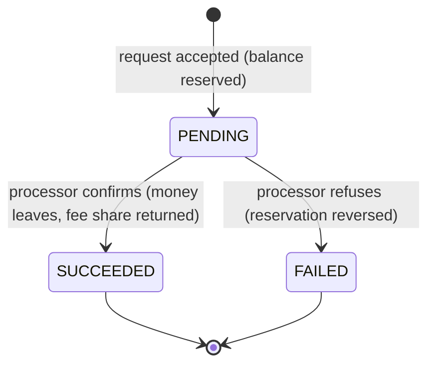

# Refunds, Partial Refunds, and Refund Windows

> Refund more than captured and the ledger must say no.

**Type:** Build
**Languages:** Java
**Prerequisites:** Phase 12, Lesson 02 (The Payment State Machine); Phase 10, Lesson 03 (The Double-Entry Ledger); Phase 10, Lesson 06 (Immutability and Reversals); Phase 10, Lesson 10 (Fees and Splits)
**Time:** ~75 minutes

## Learning Objectives

- Distinguish a void, an authorization reversal, a refund, and a chargeback by when each happens, who initiates it, and what money moves
- Track the remaining refundable amount of a capture as `captured - succeeded - pending`, and explain why a pending refund must already consume balance
- Make the over-refund check and the reservation one atomic step, so that concurrent partial refunds cannot together exceed the capture
- Post every refund movement as a balanced journal entry: the request, the settlement with its fee reversal, and the failure as a reversal of the request
- Compute proportional fee reversals cumulatively so that rounding never loses or invents a cent, and the shares of a fully refunded capture sum to the fee exactly
- Enforce a refund window on an injected calendar and say what happens at its boundary

## The Problem

An online furniture store captures 1,240.00 USD for a sofa and two side tables. The customer returns one side table; customer support issues a 180.00 USD refund in the merchant dashboard. The dashboard's refund handler checks `refund_amount <= payment.amount`, calls the processor, and on success writes `payment.status = 'partially_refunded'`. A week later the customer returns the second side table. Another agent issues another 180.00 USD refund; the check passes again, because 180 is less than 1,240. Then the sofa arrives damaged and a third agent, working from a ticket that says "full refund", refunds 1,240.00 USD. The check passes a third time. The customer has received 1,600.00 USD for a 1,240.00 USD purchase. The merchant finds out at month end when the payout is 360.00 USD short and no one can explain why.

The check compared each refund to the original amount, not to what was still refundable. Fixing that (store `refunded_amount`, check `refunded + amount <= captured`) closes the sequential hole and opens a concurrent one. Two agents on the same ticket click "refund remaining 1,060.00" within the same second. Both handlers read `refunded = 180.00`, both compute that 1,060.00 fits, both call the processor, both write `refunded = 1,240.00`. The second write overwrites the first rather than adding to it, so the database even looks correct; the processor has paid out 2,300.00 in total. The check was right and the race made it irrelevant. And a third, quieter bug: the processor's 2.9% + 0.30 fee was returned on each partial refund rounded down to the cent, so after a full refund in three pieces the processor had given back two cents less than it kept. Multiply by a million refunds a year and finance has an unreconcilable 20,000 USD in the fee revenue account.

Each of these is a ledger question disguised as an API question. Money that has been promised to the cardholder must leave the merchant's balance at the moment of the promise, not when the processor confirms. The check and the reservation must be one indivisible step. Every movement must be a balanced entry so that the ledger, not a status column, is the answer to "how much has been refunded". This lesson builds a refund service where all three hold, plus the refund window that bounds how long a capture stays refundable at all.

## The Concept

### Four ways money goes back

Refunds are one of four mechanisms that return or cancel a card payment, and confusing them produces real bugs (refunding an authorization that was never captured, or voiding something that has settled):

| Mechanism | When | Initiated by | Money movement | Lesson |
|-----------|------|--------------|----------------|--------|
| Void | Before capture, before the clearing cut-off | Merchant | None: the authorization hold is released; nothing was ever moved | Phase 11, Lesson 02 |
| Authorization reversal | After authorization, instead of capturing all of it | Merchant | None: frees the unused part of the hold | Phase 11, Lesson 02 |
| Refund (credit) | After capture and clearing | Merchant | A new credit transaction from merchant to cardholder through the same network | This lesson |
| Chargeback | After clearing, up to 120 days or more | Cardholder via issuer | Issuer pulls funds back from the acquirer, without the merchant's consent | Phase 12, Lesson 07 |

A refund is not an undo. It is a new transaction, with its own processor reference, its own success or failure, and its own settlement date, that happens to point at an earlier capture. Network rules require it to go back to the same card account that paid; a refund to a different card, or to a bank account, is a payout (Lesson 08) with its own compliance obligations.

### The invariant

For every capture `c`, at all times:

```text
succeeded(c) + pending(c) <= captured(c)
remaining(c) = captured(c) - succeeded(c) - pending(c)        and remaining(c) >= 0
```

A request for amount `r` is accepted only if `r <= remaining(c)`, and accepting it increases `pending(c)` by `r` in the same atomic step. `pending` counts because a refund that has been sent to the processor may succeed; if the service did not count it, a second request would be checked against a balance that is about to shrink. A failed refund moves its amount out of `pending`, and the balance becomes refundable again.

### The refund lifecycle

Each refund is a small state machine of its own, the shape Phase 12 Lesson 02 recommended for refunds: one object per refund, not a status on the payment.



A redelivered confirmation for a `SUCCEEDED` refund is a no-op that returns `false`, by the same reasoning as Lesson 02's duplicate events. Confirming a `FAILED` refund, or failing a `SUCCEEDED` one, is a contradiction between two messages from the processor and throws: someone must look at it.

### The ledger postings

The service keeps four accounts, from the point of view of the payment service provider that holds the merchant's money:

| Account | Type | Normal side | Means |
|---------|------|-------------|-------|
| `scheme_settlement` | Asset | Debit | What the card scheme owes us, or has paid us, for captures |
| `merchant_payable` | Liability | Credit | What we owe the merchant |
| `refunds_payable` | Liability | Credit | Refunds promised to cardholders, not yet sent |
| `fee_revenue` | Revenue | Credit | Processing fees we kept |

Every operation is one balanced entry:

| Operation | Debit | Credit |
|-----------|-------|--------|
| Capture 100.00, fee 3.20 | `scheme_settlement` 100.00 | `merchant_payable` 96.80, `fee_revenue` 3.20 |
| Refund requested, 30.00 | `merchant_payable` 30.00 | `refunds_payable` 30.00 |
| Refund settled, fee share 0.96 | `refunds_payable` 30.00, `fee_revenue` 0.96 | `scheme_settlement` 30.00, `merchant_payable` 0.96 |
| Refund failed | the request entry, every side flipped | |

The request entry is what makes "pending consumes balance" a ledger fact rather than an application convention. The moment a refund is accepted, the merchant's balance falls, so a payout run at that moment (Lesson 08) cannot pay the merchant money that has been promised to a cardholder. The `refunds_payable` balance is, at every moment, the sum of all pending refunds; `checkInvariants` asserts exactly that. A failed refund is not deleted or edited: it is a new entry that flips the request entry (Phase 10, Lesson 06), and the journal shows both.

### Fee reversal, and the cent that rounding loses

Whether the processor gives back its fee on a refund is a contract term, not a law of nature. Several large processors keep the processing fee on a refund under standard pricing; others return the fee pro rata; interchange itself is returned by the networks on a credit in most programmes. The service takes a `FeeRefundPolicy` of `NONE` or `PROPORTIONAL`, and the ledger is correct under both: under `NONE` a fully refunded merchant ends with `merchant_payable = -3.20`, a negative balance that Lesson 08 teaches how to collect.

Under `PROPORTIONAL`, the naive computation is `floor(fee x refund / captured)` per refund. It loses cents. A 10.00 USD capture at 2.90% + 0.30 has a fee of 0.59 USD. Refund it as 3.33 + 3.33 + 3.34:

```text
naive, per refund:
  floor(59 x 333 / 1000) = floor(19.647) = 19
  floor(59 x 333 / 1000) = floor(19.647) = 19
  floor(59 x 334 / 1000) = floor(19.706) = 19
  total = 57 minor units: 2 cents of fee are never returned
```

The cumulative method computes the target for everything refunded so far and returns the difference:

```text
target(x) = floor(fee x x / captured)
share_i   = target(refunded after i) - target(refunded before i)

  after 3.33:  target(333)  = floor(19.647) = 19   share 19 - 0  = 19
  after 6.66:  target(666)  = floor(39.294) = 39   share 39 - 19 = 20
  after 10.00: target(1000) = floor(59.000) = 59   share 59 - 39 = 20
  total = 59 minor units, exactly the fee
```

The shares telescope: their sum is `target(final) - target(0)`, and `target(captured) = fee` exactly. No rounding error can accumulate, whatever the number or order of partial refunds. The test refunds a 10.00 capture as one thousand one-cent refunds and asserts the fee returned is exactly 0.59. This is the same largest-remainder discipline as Phase 10, Lesson 10's allocation, applied over time instead of over parties.

### Worked example by hand

Capture `cap_1`: 100.00 USD at 2.90% + 0.30 on 2026-01-10. Fee `10000 x 290 / 10000 = 290`, plus 30, is 320 minor units.

| Step | Day | Request | Check | succeeded | pending | remaining | fee returned |
|------|-----|---------|-------|-----------|---------|-----------|--------------|
| 1 | 01-15 | `re_1` 30.00 | 30.00 <= 100.00 | 0 | 30.00 | 70.00 | 0 |
| 2 | 01-15 | `re_1` settles | | 30.00 | 0 | 70.00 | floor(320 x 3000/10000) = 96 |
| 3 | 01-15 | `re_2` 30.00 | 30.00 <= 70.00 | 30.00 | 30.00 | 40.00 | 96 |
| 4 | 01-15 | `re_3` 50.00 | 50.00 > 40.00: refused | 30.00 | 30.00 | 40.00 | 96 |
| 5 | 01-15 | `re_2` again, same amount | replay | 30.00 | 30.00 | 40.00 | 96 |
| 6 | 01-15 | `re_2` fails at processor | reversal posted | 30.00 | 0 | 70.00 | 96 |
| 7 | 01-15 | `re_4` 70.00 | 70.00 <= 70.00 | 30.00 | 70.00 | 0 | 96 |
| 8 | 01-15 | `re_4` settles | | 100.00 | 0 | 0 | 320 - 96 = 224 |

At the end every account is zero: the scheme took back the 100.00 it paid us, the merchant owes and is owed nothing, and the fee revenue from this capture is gone. Step 4 is the whole point of counting `pending`: without it, `re_3` would have been checked against 70.00 and accepted, and if `re_2` had then succeeded the total would have been 110.00.

### Atomicity: one conditional update

The check-then-reserve must be atomic. In this lesson every public method of `RefundService` is `synchronized`; the test starts ten threads that each request a 15.00 refund on a 100.00 capture, and exactly six succeed. In a database it is one statement:

```sql
UPDATE captures
   SET pending_minor = pending_minor + :amount
 WHERE id = :capture_id
   AND currency = :currency
   AND amount_minor - refunded_minor - pending_minor >= :amount;
-- 1 row updated: reserved; insert the refund row and the journal entry in the same transaction
-- 0 rows updated: refused (over-refund, or wrong currency); nothing else is written
```

The condition and the increment happen under the row lock the `UPDATE` takes, so two concurrent requests serialize on the row and the second one's `WHERE` sees the first one's increment. A `CHECK (amount_minor - refunded_minor - pending_minor >= 0)` constraint on the table is the belt to this statement's braces: if a code path ever forgets the condition, the database refuses the commit. That is the hook, literally: the ledger says no.

### The refund window

A capture is refundable for `windowDays` after the capture date, inclusive. With a 180-day window and a capture on 2026-01-15, a request on 2026-07-14 (day 180) is accepted and one on 2026-07-15 (day 181) is refused with a message that names the capture date, the window, the closing date, and today. Windows exist for three reasons: the card account may have been closed or reissued, so the credit fails or reaches a new card number through an account updater; processors and networks match a credit to its original transaction only for a limited period; and merchants' own return policies need an enforced end. A refund that was *requested* inside the window and is still pending when the window closes is allowed to settle: the window governs promises, not confirmations.

Refunds outside the window are not impossible, they are different: an unreferenced credit (a credit not linked to a capture, which many acquirers restrict because it is a classic insider-fraud vector) or a payout to the customer's bank account. Both are out of scope here and both need more controls than a refund, not fewer.

### Idempotency

The refund id is the idempotency key, supplied by the caller, with the semantics of Phase 12, Lesson 01: the same id with the same capture and amount returns the existing refund with `replayed = true` and reserves nothing; the same id with a different amount is a conflict. The common real-world duplicate is the support agent double-clicking, or the merchant's integration retrying a timed-out `POST /refunds`; without the key, each produces a second reservation that the over-refund check may or may not catch, depending on how much balance happens to remain.

### Complexity

Each request computes `succeeded` and `pending` by scanning the capture's refunds: O(k) for k refunds on that capture, which is small (a capture rarely has more than a handful). Production stores the two sums as columns updated in the same transaction, which is O(1) and is what the conditional `UPDATE` relies on. Posting is O(p) for p postings per entry (at most four). The fee share is O(k) for the same reason and O(1) with a stored `fee_returned` column.

### What this service does not do

- It does not call a processor. `succeed` and `fail` are the processor's answers, delivered by the caller; wiring them to webhooks is Lesson 05, and to the state machine of Lesson 02 is Exercise 3.
- It does not handle multi-currency captures or refunds in a different currency from the capture; FX at refund time is Phase 12, Lesson 12.
- It does not decide who pays when the merchant's balance is too low to fund a refund. It lets `merchant_payable` go negative; Lesson 08 builds the reserve and the collection.
- It does not interact with disputes. A refund on a capture that is already in chargeback double-returns the money; Lesson 07 and Exercise 2 close that hole.

## Build It

The walkthrough is in Java, the only implementation shipped for this lesson. All code is in `code/java/Main.java`; the tests are in `code/java/MainTest.java`.

### Step 1: A balanced entry cannot be constructed unbalanced

```java
record JournalEntry(String id, String description, List<Posting> postings) {
    JournalEntry {
        postings = List.copyOf(postings);
        if (postings.size() < 2) throw new IllegalArgumentException("entry " + id + " needs at least two postings");
        long net = 0;
        for (Posting p : postings) net += p.side() == Side.DEBIT ? p.amount().minorUnits() : -p.amount().minorUnits();
        if (net != 0) throw new IllegalArgumentException("entry " + id + " is unbalanced by " + net + " minor units");
    }
}
```

This is the Phase 10 ledger, cut to what the lesson needs: single currency, positive posting amounts on a side, and a compact constructor that refuses an unbalanced entry. The `Ledger` keeps a balance per account on its normal side, so `balance("merchant_payable")` is positive when we owe the merchant and negative when the merchant owes us.

### Step 2: The capture entry

```java
synchronized Capture capture(String captureId, String paymentId, Money amount, long feeBps, long fixedFeeMinor) {
    long variable = Math.floorDiv(amount.minorUnits() * feeBps + 5_000, 10_000);
    Money fee = Money.ofMinor(variable + fixedFeeMinor, amount.currency());
    Capture c = new Capture(captureId, paymentId, amount, fee, clock.today());
    ledger.post(new JournalEntry(nextEntryId(), "capture " + captureId, List.of(
            Posting.debit(SCHEME, amount),
            Posting.credit(MERCHANT, amount.minus(fee)),
            Posting.credit(FEES, fee))));
    ...
}
```

Gross on the asset side, net and fee on the liability and revenue sides. The capture date comes from the injected `Clock`, which returns a `LocalDate` because the refund window is a count of calendar days.

**Predict:** what does `merchant_payable` hold after capturing 25.00 USD at the same fee terms?

### Step 3: The remaining balance counts pending refunds

```java
synchronized Money remainingRefundable(String captureId) {
    Capture c = capture(captureId);
    return c.amount().minus(refunded(captureId)).minus(pending(captureId));
}
```

One line, and the most important line in the lesson. `refunded` sums `SUCCEEDED` refunds and `pending` sums `PENDING` ones; `FAILED` refunds count for nothing.

### Step 4: Request: check everything, then change everything

```java
synchronized RefundResult requestRefund(String refundId, String captureId, Money amount, String reason) {
    Refund existing = refunds.get(refundId);
    if (existing != null) {
        if (existing.captureId.equals(captureId) && existing.amount.equals(amount)) return new RefundResult(existing, true);
        throw new RefundIdempotencyConflictException("refund id " + refundId + " was already used for " + ...);
    }
    Capture c = capture(captureId);
    if (!amount.isPositive()) throw new IllegalArgumentException("refund amount must be positive: " + amount);
    if (!amount.currency().equals(c.amount().currency())) throw new CurrencyMismatchException(...);
    LocalDate deadline = c.capturedOn().plusDays(policy.windowDays());
    if (clock.today().isAfter(deadline)) throw new RefundWindowClosedException(...);
    Money remaining = remainingRefundable(captureId);
    if (amount.compareTo(remaining) > 0) throw new OverRefundException(...);
    Refund r = new Refund(refundId, captureId, amount, reason, clock.today());
    ledger.post(new JournalEntry(reserveEntryId(refundId), "refund " + refundId + " requested on " + captureId, List.of(
            Posting.debit(MERCHANT, amount),
            Posting.credit(REFUNDS, amount))));
    refunds.put(refundId, r);
    refundsByCapture.get(captureId).add(r);
    return new RefundResult(r, false);
}
```

The order of checks is the specification: idempotency first (a replay must never be refused because the balance has since been used by the request it is replaying), then shape (positive, same currency), then the window, then the balance. Every check throws before the first mutation, so a refused request leaves no refund record and no journal entry; the test asserts the refund count after three refusals. The over-refund message lists captured, refunded, and pending, because "exceeds remaining refundable 40.00 USD" alone sends an operator to the database to find out why.

**Predict:** a 100.00 capture has 30.00 succeeded and 30.00 pending. Which of 40.00, 40.01, and 70.00 is accepted?

### Step 5: Settle, with the fee share

```java
synchronized boolean succeed(String refundId) {
    Refund r = refund(refundId);
    if (r.state == RefundState.SUCCEEDED) return false;
    if (r.state != RefundState.PENDING) throw new RefundException("refund " + refundId + " is " + r.state + "; cannot succeed");
    Capture c = capture(r.captureId);
    Money feeBack = policy.feePolicy() == FeeRefundPolicy.PROPORTIONAL ? feeShare(c, r.amount) : Money.zero(r.amount.currency());
    List<Posting> postings = new ArrayList<>(List.of(Posting.debit(REFUNDS, r.amount), Posting.credit(SCHEME, r.amount)));
    if (feeBack.isPositive()) {
        postings.add(Posting.debit(FEES, feeBack));
        postings.add(Posting.credit(MERCHANT, feeBack));
    }
    ledger.post(new JournalEntry(nextEntryId(), "refund " + refundId + " settled", postings));
    r.state = RefundState.SUCCEEDED;
    r.feeReturned = feeBack;
    return true;
}

private Money feeShare(Capture c, Money refundAmount) {
    long after = refunded(c.id()).plus(refundAmount).minorUnits();
    long target = Math.floorDiv(Math.multiplyExact(c.fee().minorUnits(), after), c.amount().minorUnits());
    return Money.ofMinor(target, c.fee().currency()).minus(feeReturned(c.id()));
}
```

One entry, two or four postings: the cash leaves (`refunds_payable` against `scheme_settlement`), and the fee share moves from our revenue back to the merchant. `feeShare` is computed while `r` is still `PENDING`, so `refunded` does not yet include it and `after` is the cumulative refunded amount including this refund. The fee share is computed at settlement, not at request: a refund that fails must not have moved any fee.

**Predict:** a 10.00 capture with fee 0.59 has had 3.33 refunded (share 0.19). The next refund is 3.33. What is `after`, what is `target`, and what is the share?

### Step 6: Failure is a reversal, not a delete

```java
synchronized void fail(String refundId, String why) {
    Refund r = refund(refundId);
    if (r.state != RefundState.PENDING) throw new RefundException("refund " + refundId + " is " + r.state + "; cannot fail");
    JournalEntry reserve = ledger.journal().stream().filter(e -> e.id().equals(reserveEntryId(refundId))).findFirst().orElseThrow();
    ledger.post(reserve.reversal(nextEntryId(), "refund " + refundId + " failed: " + why));
    r.state = RefundState.FAILED;
    r.failureReason = why;
}
```

The request entry has a deterministic id derived from the refund id, so the failure handler can find it and post its mirror image. The journal keeps both entries, and an auditor reading it sees a refund that was promised, then withdrawn, and why.

### Step 7: Invariants as code

```java
synchronized List<String> checkInvariants() {
    List<String> broken = new ArrayList<>();
    if (!ledger.balances()) broken.add("ledger does not balance");
    for (Capture c : captures.values()) {
        Money refundedAndPending = refunded(c.id()).plus(pending(c.id()));
        if (refundedAndPending.compareTo(c.amount()) > 0) broken.add(c.id() + ": refunded + pending exceeds captured");
        if (feeReturned(c.id()).compareTo(c.fee()) > 0) broken.add(c.id() + ": fee returned exceeds fee charged");
        ...
    }
    if (!ledger.balance(REFUNDS).equals(pendingTotal)) broken.add("refunds_payable " + ... + " != pending " + pendingTotal);
    return broken;
}
```

The tests call this after each phase. It ties the application's view (refund records) to the ledger's view (`refunds_payable`), which is the reconciliation of Phase 10, Lesson 08 in miniature: two independent representations of the same money that must agree.

### Step 8: Run it

```bash
cd phases/12-payment-systems-design/06-refunds-and-partial-refunds/code/java
javac -d .out *.java && java -cp .out Main
java -cp .out MainTest
```

Expected output, abbreviated:

```console
== Capture 100.00 USD at 2.90% + 0.30 ==
fee 3.20 USD, merchant owed 96.80 USD

== Partial refund 30.00, settled ==
pending: remaining refundable 70.00 USD
settled: re_1     SUCCEEDED  30.00 USD    fee back 0.96 USD   one item returned; remaining 70.00 USD

== A second partial is pending; an over-refund is refused; a retry replays ==
refused: refund 50.00 USD exceeds remaining refundable 40.00 USD on cap_1 (captured 100.00 USD, refunded 30.00 USD, pending 30.00 USD)
re_2 again -> replayed=true, state PENDING
refused: refund id re_2 was already used for 30.00 USD on cap_1

== The processor fails re_2: the reservation is reversed ==
re_2 FAILED; remaining refundable 70.00 USD

== Refund the remaining 70.00: the fee shares sum to exactly the fee ==
redelivered confirmation applied again? false
refunded 100.00 USD, fee returned 3.20 USD of 3.20 USD, remaining 0.00 USD

== The same full refund under FeeRefundPolicy.NONE: the merchant ends up owing the fee ==
merchant_payable -3.20 USD, fee_revenue 3.20 USD, ledger balances: true

== Rounding: 10.00 USD capture, fee 0.59, refunded as 3.33 + 3.33 + 3.34 ==
shares: [0.19 USD, 0.20 USD, 0.20 USD] sum 0.59 USD (fee 0.59 USD; per-refund floor would give 0.57)

== The refund window: 180 days ==
day 180: accepted, remaining 20.00 USD
refused: capture cap_3 on 2026-01-15: refund window of 180 days closed on 2026-07-14 (today 2026-07-15, 181 days)
```

The demo also prints the full journal for `cap_1`, entry by entry, which is the table in the worked example in posting form. The test suite has 43 assertions: capture postings, multiple partials, the pending-counts boundary at exactly the remainder and one minor unit over, failure and reservation release, contradictory processor messages, the full-refund fee identity, the 0.19/0.20/0.20 shares and the thousand one-cent refunds, both fee policies, idempotent replay and conflict, validation, the window boundary at day 180 and 181, and the ten-thread race.

### Porting notes

A Python port maps `synchronized` to a `threading.Lock` held for the whole of each public method, and the race test to ten `threading.Thread`s with a `threading.Event` as the start gun; `int` is unbounded, so `multiplyExact` is unnecessary but `//` must be used for the floor (all operands are non-negative here). Dates are `datetime.date` with `timedelta(days=...)`. In Go the service holds a `sync.Mutex`; methods return `(Refund, error)` with sentinel errors (`ErrOverRefund`, `ErrWindowClosed`, `ErrIdempotencyConflict`) wrapped with `fmt.Errorf("%w: ...")` so tests use `errors.Is` and still see the message, and the race test with goroutines and a `sync.WaitGroup` must pass under `go test -race`. Dates become `time.Time` truncated to midnight UTC, compared with `After`.

## Use It

**Stripe.** A `Refund` is its own object with `pending`, `succeeded`, `failed`, `canceled`, and `requires_action` statuses, linked to a charge or payment intent; the charge carries `amount_refunded`, and a refund request larger than `amount - amount_refunded` fails with an error naming the remaining amount. Refund requests accept an `Idempotency-Key` header. Stripe's documentation describes refunds that fail after being accepted (closed card accounts, for example) and the `charge.refund.updated` event that reports them, which is this lesson's `fail` path. The balance transaction for a refund debits the merchant's Stripe balance immediately, which is the request entry here.

**Adyen.** Refunds are "modifications" against the original `pspReference`, submitted to `/payments/{paymentPspReference}/refunds`, answered synchronously with `received`, and confirmed or rejected later by a `REFUND` or `REFUND_FAILED` webhook. Partial refunds are a refund with a smaller amount; Adyen documents limits on how long after capture a refund may be requested, which vary by payment method, and offers "refund with data" (an unreferenced credit) only under separate agreement.

**PostgreSQL.** The conditional `UPDATE` and the `CHECK` constraint above are the production form of `synchronized`. Teams that use `SERIALIZABLE` isolation instead get the same guarantee by having the second transaction abort and retry, which is correct but produces retries under contention exactly when support agents are clicking.

**Ledger platforms (Modern Treasury Ledgers, TigerBeetle, Formance).** Each supports *pending* transfers or entries that reserve balance and are later posted or voided, which is the request entry and its reversal here as a first-class primitive. TigerBeetle in particular enforces `debits_must_not_exceed_credits` per account inside the database, which is the over-refund check moved into the ledger itself.

What the production systems hide is the choice this lesson made explicit: refund balance is reserved at request time, fee reversal is computed cumulatively, and failure is a reversal. Each one is a sentence in a design review; leaving any one out is one of the three incidents in The Problem.

## Ship It

`outputs/checklist-refunds.md` is a design-review checklist for any refund implementation: the invariant and where it is enforced (application, database, ledger), the order of checks, the four journal entries and who posts each one, the fee policy and its rounding method, the window and its boundary, idempotency semantics, and the reconciliation query that ties refund records to the `refunds_payable` balance. Use it on a pull request that touches refunds, or before integrating a new processor's refund API.

## Exercises

1. **Reinforce.** Add a `PARTIALLY_REFUNDABLE_ONLY_ONCE` merchant policy (some merchants allow one partial refund and then only a refund of the full remainder) as a new field on `RefundPolicy`. Write the tests first: a second partial that is not the full remainder is refused with a message that names the policy.
2. **Apply.** A capture that is in dispute must not be refunded: a refund on top of a chargeback returns the money twice. Add a `DisputeHold` that Lesson 07's dispute service can place on a capture, make `requestRefund` refuse while it is held, and decide (and justify in a comment) whether a refund already pending when the hold is placed may still settle.
3. **Extend.** Combine with Phase 12, Lesson 02: replace the `RefundState` field with Lesson 02's transition-table design (`REFUND_REQUESTED`, `REFUND_SUCCEEDED`, `REFUND_FAILED` events, a per-refund transition log with versions, optimistic concurrency on save), so that `succeed` delivered by a webhook is deduplicated by the processor's event id rather than by the current state. Then show, with a test, the case the state-based check cannot catch: a `REFUND_SUCCEEDED` redelivered after the refund was manually marked `FAILED` by support.

## Key Terms

| Term | What people say | What it actually means |
|------|-----------------|------------------------|
| Refund | "undo the payment" | A new credit transaction, after capture, from the merchant to the same card account, with its own lifecycle and settlement; not an edit of the original |
| Void | "cancel" | Releasing an authorization before it is captured; no money ever moved, so nothing is returned |
| Remaining refundable | "refundable balance" | `captured - succeeded - pending` for one capture; pending refunds already consume it |
| Reservation | "hold for the refund" | The journal entry that moves the refund amount from the merchant's balance to `refunds_payable` at request time, so nothing can spend it twice |
| Fee reversal | "fee refund" | Returning the processor's share of the fee for the refunded portion; a contract term, computed cumulatively so the shares of a full refund equal the fee exactly |
| Refund window | "refund period" | The number of days after capture during which a refund may be requested; the boundary day is inside, and a refund requested inside may settle after it closes |
| Unreferenced credit | "refund without a sale" | A credit to a card not linked to any capture; restricted by acquirers because it is a classic route for insider fraud |

## Further Reading

- [Visa Core Rules and Visa Product and Service Rules](https://usa.visa.com/dam/VCOM/download/about-visa/visa-rules-public.pdf) — the rules for credit transactions: refunds to the same account, timeliness, and the relationship between a credit and its original sale.
- [Stripe API reference: Refunds](https://docs.stripe.com/api/refunds) — the production refund object: statuses, `amount_refunded`, failure reasons, and idempotent creation.
- [Adyen documentation: Refund a payment](https://docs.adyen.com/online-payments/refund/) — refunds as asynchronous modifications, partial refunds, the `REFUND` and `REFUND_FAILED` webhooks, and per-method refund time limits.
- [PostgreSQL documentation: UPDATE and row-level locking](https://www.postgresql.org/docs/current/explicit-locking.html) — why a conditional `UPDATE ... WHERE balance >= :amount` serializes concurrent reservations on one row.
- [TigerBeetle documentation: two-phase transfers and balance limits](https://docs.tigerbeetle.com/coding/two-phase-transfers/) — pending transfers that reserve and later post or void, and account flags that let the ledger itself refuse an overdraft.
