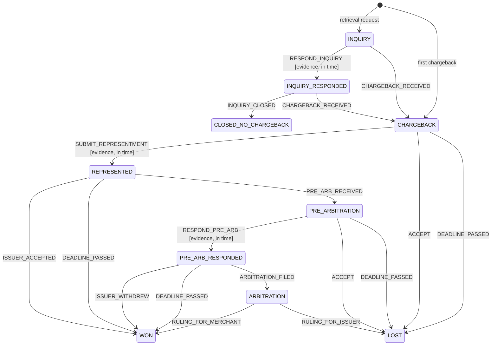

# Disputes and Chargebacks: The Lifecycle and the Evidence

> A state machine that runs for 120 days.

**Type:** Build
**Languages:** Java, Python, Go
**Prerequisites:** Phase 12 Lesson 02 (The Payment State Machine), Phase 12 Lesson 06 (Refunds, Partial Refunds, and Refund Windows), Phase 10 Lesson 07 (Holds and Available Balance), Phase 11 Lesson 06 (3-D Secure and Strong Customer Authentication)
**Time:** ~90 minutes

## Learning Objectives

- Trace a card dispute through its cycles (inquiry, first chargeback, representment, pre-arbitration, arbitration) and name who acts at each step and what money moves
- Encode the dispute lifecycle as a transition table whose guards check evidence completeness and deadlines, and whose deadline transitions are applied by the system when the injected clock passes them
- Map a network reason code to the evidence that can answer it, and refuse a representment that cannot win before it is filed
- Post each money movement as a balanced journal entry, holding re-credited funds until the outcome instead of releasing them to the merchant
- Compute what a dispute costs the merchant at every possible outcome, and explain why winning is still not free

## The Problem

A furniture marketplace sells a 249.00 USD lamp. Five weeks later the cardholder calls their bank: the lamp never arrived. The issuing bank files a chargeback under Visa reason code 13.1, Merchandise/Services Not Received. Visa moves 249.00 USD from the marketplace's acquirer back to the issuer the same day, and the acquirer debits the marketplace's balance for 249.00 plus a 15.00 chargeback fee. The marketplace's operations team receives an email about it, which lands in a shared inbox during a holiday week. The response deadline passes on day 20. The dispute is lost by default. The carrier's signed proof of delivery, which would have won it in one step, was sitting in the shipping system the whole time.

The team builds a dispute queue. On the next dispute they submit the evidence on day 12 and the representment succeeds: Visa re-credits the 249.00 USD to the acquirer. The marketplace's code, written by someone who modelled disputes as "lost" or "won", marks the dispute won and releases the funds to the seller, who is paid out that evening. Twenty-nine days later the issuer files pre-arbitration: the cardholder says the signature on the delivery record is not theirs. The marketplace now needs the 249.00 USD again, and the seller's balance is empty. Two months after that, the case goes to arbitration, and the marketplace loses: 249.00 USD, the 15.00 fee, and a 500.00 USD arbitration fee, on a 249.00 USD lamp.

And one more: on a different order, a support agent refunds a customer who complained, not knowing a chargeback had already been filed for the same purchase. The customer receives the money twice: once from the refund (Lesson 06) and once from the chargeback. Nothing in the system connected the two.

A dispute is not an event, it is a process that runs for months, with deadlines on both sides, money that moves back and forth at specific steps, and evidence that must match the claim. That is exactly what Lesson 02's state machine is for, with two additions: transitions caused by the calendar, and a ledger that holds funds rather than releasing them while the outcome is open. This lesson builds both.

## The Concept

### The actors and the cycles

Five parties take part, and the merchant is the only one who does not get to start anything:

| Party | Role in a dispute |
|-------|-------------------|
| Cardholder | Claims the charge is wrong (fraud, not received, not as described, duplicate) |
| Issuer | The cardholder's bank; files the chargeback, reviews responses, may escalate |
| Network | Visa, Mastercard; moves the funds, sets reason codes and deadlines, rules in arbitration |
| Acquirer / PSP | The merchant's bank or payment service provider; passes the dispute down and the response up |
| Merchant | Accepts or responds with evidence, within deadlines |

A dispute moves through up to five cycles. Network names differ, and the networks have each restructured their processes (Visa Claims Resolution in 2018 split disputes into an *allocation* flow for fraud and authorization claims and a *collaboration* flow for consumer disputes and processing errors; Mastercard's process has a first chargeback, a second presentment, and pre-arbitration and arbitration case filing). This lesson models the shape they share:

| Cycle | Initiated by | Money moves? | Lesson state |
|-------|--------------|--------------|--------------|
| Inquiry (retrieval request) | Issuer asks for information | No | `INQUIRY` |
| First chargeback | Issuer | Yes: funds return to the issuer, merchant debited plus a fee | `CHARGEBACK` |
| Representment (second presentment, dispute response) | Merchant, with evidence | Yes: funds re-credited to the acquirer | `REPRESENTED` |
| Pre-arbitration | Issuer, rejecting the evidence | No (in this model) | `PRE_ARBITRATION`, `PRE_ARB_RESPONDED` |
| Arbitration | Issuer files with the network | Ruling decides; loser pays a filing fee | `ARBITRATION` |

The cardholder typically has 120 days from the transaction processing date to dispute (longer for some reason codes, for example from the expected delivery date of goods), and each later cycle has its own response window, which is why a dispute that uses every cycle runs for four months after it is filed.

### The state machine



Ten states, three of them terminal (`CLOSED_NO_CHARGEBACK`, `WON`, `LOST`), thirteen event kinds, eighteen rules. The test drives every rule and enumerates the other 112 `(state, event)` pairs, asserting each is refused and leaves the dispute, its history, and the journal untouched. That is Lesson 02's exhaustive negative test, unchanged.

Read the `DEADLINE_PASSED` rules carefully, because they encode who carries the burden at each step. A deadline that passes while the *merchant* owes a response (`CHARGEBACK`, `PRE_ARBITRATION`) is a loss: silence is acceptance. A deadline that passes while the *issuer* owes a response (`REPRESENTED`, `PRE_ARB_RESPONDED`) is a win: the issuer failed to pursue. `ARBITRATION` has no deadline rule because the network rules on its own schedule. `INQUIRY` has a deadline (the merchant should answer a retrieval request) but no automatic outcome: only the issuer can turn an inquiry into a chargeback, so an overdue inquiry is reported, not moved.

### Guards: evidence and time

Three guards:

| Guard | On | Holds when |
|-------|----|------------|
| `ALWAYS` | issuer and network events, `ACCEPT` | always |
| `EVIDENCE_COMPLETE_IN_TIME` | `RESPOND_INQUIRY`, `SUBMIT_REPRESENTMENT`, `RESPOND_PRE_ARB` | today is on or before the deadline, and the evidence bundle satisfies every requirement of the reason code |
| `DEADLINE_ELAPSED` | `DEADLINE_PASSED` | the state has a deadline and today is after it |

The evidence guard is a policy decision worth defending. The network accepts any representment the merchant files; it is the issuer who decides whether the evidence answers the claim. But a representment that cannot win is worse than an acceptance: it takes the dispute into pre-arbitration and arbitration, where the merchant pays a 500.00 USD filing fee to lose a 249.00 USD argument. Refusing to file what cannot win, with a message that names what is missing, is the guard. The deadline guard on `DEADLINE_PASSED` means a hand-made or replayed deadline event cannot end a dispute early; only the clock can.

### Reason codes and evidence

A reason code is the cardholder's claim, as classified by the issuer. It determines which evidence can answer it. Each requirement in this lesson's table is a set of evidence types of which at least one must be present:

| Reason code | Claim | Category | Evidence that answers it |
|-------------|-------|----------|--------------------------|
| Visa 10.4 | Other fraud, card-absent | Fraud | (3-D Secure authentication or prior undisputed transactions) and receipt |
| Visa 11.3 | No authorization | Authorization | Authorization record |
| Visa 12.6.1 | Duplicate processing | Processing error | Explanation showing two distinct transactions |
| Visa 13.1 | Merchandise or services not received | Consumer dispute | (Proof of delivery or signed delivery) and receipt |
| Visa 13.3 | Not as described or defective | Consumer dispute | Product description and (customer communication or refund policy) |
| Visa 13.6 | Credit not processed | Consumer dispute | Refund issued or refund policy |
| Mastercard 4837 | No cardholder authorization | Fraud | 3-D Secure authentication or prior undisputed transactions |
| Mastercard 4834 | Point-of-interaction error | Processing error | Duplicate explanation or receipt |
| Mastercard 4853 | Cardholder dispute | Consumer dispute | (Proof of delivery or product description) and customer communication |

Three things to notice. First, evidence that answers one claim is useless against another: proof of delivery says nothing about whether the cardholder authorized the purchase, and an AVS/CVV match alone does not answer a card-absent fraud claim, because a fraudster with the card details matches both. Second, fraud claims have the strongest single answer: if the issuer itself authenticated the cardholder with 3-D Secure, liability for fraud shifts from the merchant to the issuer, and `EvidenceBundle.liabilityShift` reports it. Third, Visa's Compelling Evidence 3.0 rules (2023) give merchants a specific answer to 10.4 for repeat customers: two prior undisputed transactions, 120 to 365 days old, sharing device or IP data with the disputed one. That is the `PRIOR_UNDISPUTED_TRANSACTIONS` type.

The real rulebooks list dozens of reason codes with more precise conditions (time limits per code, minimum data elements, exclusions). The table here is the structure of the decision, not a substitute for the networks' guides.

### The money: debit, re-credit into a hold, then release or return

Four accounts, from the payment service provider's point of view:

| Account | Type | Means |
|---------|------|-------|
| `merchant_payable` | Liability | What we owe the merchant; debited when they lose money |
| `scheme_settlement` | Asset | Our net position with the network; funds taken back reduce it |
| `dispute_hold` | Liability | Funds the network has re-credited after a representment, held until the outcome |
| `fee_revenue` | Revenue | Chargeback fees we charge the merchant |

| Transition | Debit | Credit |
|------------|-------|--------|
| Enter `CHARGEBACK` | `merchant_payable` amount + 15.00 | `scheme_settlement` amount, `fee_revenue` 15.00 |
| Enter `REPRESENTED` | `scheme_settlement` amount | `dispute_hold` amount |
| `WON` after representment | `dispute_hold` amount | `merchant_payable` amount |
| `LOST` after representment | `dispute_hold` amount | `scheme_settlement` amount |
| `LOST` in `ARBITRATION`, additionally | `merchant_payable` 500.00 | `scheme_settlement` 500.00 |
| Inquiry steps, pre-arbitration, arbitration filing, `LOST` from `CHARGEBACK` | nothing | |

The second row is the fix for the second incident in The Problem. When the network re-credits the acquirer after a representment, the money is not the merchant's yet: it goes into `dispute_hold`, a liability the merchant cannot be paid out of. Only a final `WON` releases it. If pre-arbitration and arbitration go the issuer's way, the held funds return to the network and the merchant's balance is never touched a second time. This is Phase 10, Lesson 07's hold, used for a hold that lasts months. Winning still costs the 15.00 fee, which is why a dispute that is won is still a dispute the merchant should have prevented.

In this model pre-arbitration moves no money; in Mastercard's process the second presentment moves funds and pre-arbitration does not, and Visa's flows differ again by dispute type. What is common, and what the lesson preserves, is that money re-credited mid-dispute is provisional.

### Deadlines are transitions the clock makes

Every state with a deadline records it when the state is entered: `enteredOn + days`, from a `DeadlinePolicy`. The lesson's policy is 20 days to respond to an inquiry or a chargeback (the network allows the acquirer 30; the PSP takes 10 for itself, which is the normal arrangement), 30 days for the issuer to answer a representment, 30 for the merchant to answer pre-arbitration, and 10 for the issuer to file arbitration after a pre-arbitration response.

A daily job, `sweepDeadlines`, applies `DEADLINE_PASSED` to every open dispute whose deadline is before today. It runs on the injected clock, so the tests move the date one day at a time and watch the boundary: on the deadline day nothing fires, on the day after the dispute moves. The event id is `deadline:<dispute>:<state>:<date>`, so running the sweep twice in a day is a `DUPLICATE`, and a dispute that was answered just before the sweep (and so changed state) gets a different id and no transition. The deadline is part of the state, not a timer: nothing is scheduled, nothing can be lost on a restart, and the sweep can be re-run for any date.

### Worked example by hand

Dispute `dp_1`, 249.00 USD, Visa 13.1, chargeback received 2026-02-02 (day 0). Chargeback fee 15.00 USD, arbitration fee 500.00 USD.

| Day | Date | Event | State | Deadline | `dispute_hold` | Merchant net |
|-----|------|-------|-------|----------|----------------|--------------|
| 0 | 02-02 | first chargeback | `CHARGEBACK` | 02-22 | 0.00 | -264.00 |
| 9 | 02-11 | representment with receipt only: refused, missing proof of delivery | `CHARGEBACK` | 02-22 | 0.00 | -264.00 |
| 12 | 02-14 | representment with receipt and signed delivery | `REPRESENTED` | 03-16 | 249.00 | -264.00 |
| 41 | 03-15 | issuer files pre-arbitration | `PRE_ARBITRATION` | 04-14 | 249.00 | -264.00 |
| 56 | 03-30 | merchant responds with customer email | `PRE_ARB_RESPONDED` | 04-09 | 249.00 | -264.00 |
| 63 | 04-06 | issuer files arbitration | `ARBITRATION` | none | 249.00 | -264.00 |
| 118 | 05-31 | network rules for the merchant | `WON` | none | 0.00 | -15.00 |

The merchant was out 264.00 USD for 118 days and got 249.00 back. Had the ruling gone the other way, the hold would have returned to the network and the merchant would have been charged the filing fee: -264.00 - 500.00 = -764.00 USD on a 249.00 USD order. Had the merchant accepted on day 0: -264.00. That table is why the evidence guard exists.

### Complexity

`resolve` scans an 18-row table; a map keyed by `(state, kind)` makes it a hash lookup. `apply` is O(1) plus posting at most six lines. `sweepDeadlines` is O(D) over open disputes per run, which is fine once a day for thousands; at millions, production keeps an index on `deadline` (a B-tree in the database, or a min-heap in memory, Phase 2) and scans only the disputes due. `merchantImpact` scans the journal, O(J); production stores the dispute id on each entry and indexes it.

### What this machine does not do

- It does not prevent disputes. Pre-dispute alerts (Visa's Order Insight and Rapid Dispute Resolution through Verifi, Mastercard's Ethoca alerts) let a merchant refund before a chargeback is filed; that is cheaper than winning.
- It does not block refunds on disputed payments. Lesson 06's Exercise 2 adds the hold that does, and it is the fix for the third incident in The Problem.
- It does not model partial chargebacks against partially refunded captures, or multi-currency disputes where the chargeback amount differs from the original because of FX.
- It does not track the merchant's dispute ratio. Networks run monitoring programmes that fine acquirers, and eventually terminate merchants, whose disputes exceed thresholds on the order of one percent of transactions; Exercise 2 builds the counter.
- It does not persist across restarts or handle concurrent writers; Lesson 02's versioned store applies unchanged.

## Build It

The walkthrough is in Java, the only implementation shipped for this lesson. All code is in `code/java/Main.java`; the tests are in `code/java/MainTest.java`.

### Step 1: Reason codes as data

```java
record ReasonCode(String network, String code, String title, ReasonCategory category, List<Set<EvidenceType>> requirements) {
    ReasonCode {
        // EnumSet iterates in declaration order, so messages and the printed table are deterministic (Set.copyOf is not).
        requirements = requirements.stream().map(r -> Collections.unmodifiableSet(EnumSet.copyOf(r))).toList();
    }
    String key() { return network + " " + code; }
}
```

Each requirement is a set meaning "at least one of"; the list of requirements means "all of". The comment records a bug the first version of this file had: `Set.copyOf` returns a set whose iteration order changes between JVM runs, so the error message listing missing evidence changed from run to run. `EnumSet` iterates in declaration order, and the demo's output is now byte-identical across runs.

### Step 2: The evidence bundle

```java
List<Set<EvidenceType>> missingFor(ReasonCode reason) {
    List<Set<EvidenceType>> missing = new ArrayList<>();
    for (Set<EvidenceType> req : reason.requirements()) if (req.stream().noneMatch(this::has)) missing.add(req);
    return missing;
}

boolean liabilityShift(ReasonCode reason) {
    return reason.category() == ReasonCategory.FRAUD && has(EvidenceType.THREE_DS_AUTHENTICATION);
}
```

`missingFor` returns the unmet requirements, not a boolean, because the operator filing the response needs to know what to go and find. `liabilityShift` is deliberately category-scoped: a 3-D Secure authentication proves who the cardholder was, which answers "I didn't make this purchase" and says nothing about whether the lamp arrived.

**Predict:** for Visa 13.1, what does `missingFor` return for a bundle holding only `SIGNED_DELIVERY`?

### Step 3: The table

```java
static final List<DisputeRule> RULES = List.of(
        new DisputeRule(DisputeState.INQUIRY, DisputeEventKind.RESPOND_INQUIRY, DisputeGuard.EVIDENCE_COMPLETE_IN_TIME, DisputeState.INQUIRY_RESPONDED),
        new DisputeRule(DisputeState.INQUIRY, DisputeEventKind.CHARGEBACK_RECEIVED, DisputeGuard.ALWAYS, DisputeState.CHARGEBACK),
        ...
        new DisputeRule(DisputeState.CHARGEBACK, DisputeEventKind.SUBMIT_REPRESENTMENT, DisputeGuard.EVIDENCE_COMPLETE_IN_TIME, DisputeState.REPRESENTED),
        new DisputeRule(DisputeState.CHARGEBACK, DisputeEventKind.DEADLINE_PASSED, DisputeGuard.DEADLINE_ELAPSED, DisputeState.LOST),
        new DisputeRule(DisputeState.REPRESENTED, DisputeEventKind.DEADLINE_PASSED, DisputeGuard.DEADLINE_ELAPSED, DisputeState.WON),
        ...
        new DisputeRule(DisputeState.ARBITRATION, DisputeEventKind.RULING_FOR_ISSUER, DisputeGuard.ALWAYS, DisputeState.LOST));
```

Eighteen rows, the mermaid diagram as data. Unlike Lesson 02, no two rules share a `(state, kind)` pair, so `resolve` can take the first match; the guard decides only whether that one rule may fire.

### Step 4: Resolve with guards

```java
DisputeRule resolve(Dispute d, DisputeEvent e) {
    if (d.state.isTerminal()) throw new IllegalDisputeTransitionException(d.id + " is " + d.state + " (terminal); " + e.kind() + " refused");
    DisputeRule rule = RULES.stream().filter(r -> r.from() == d.state && r.kind() == e.kind()).findFirst()
            .orElseThrow(() -> new IllegalDisputeTransitionException(d.id + ": " + e.kind() + " is not legal from " + d.state));
    if (rule.guard() == DisputeGuard.DEADLINE_ELAPSED && (d.deadline == null || !clock.today().isAfter(d.deadline))) {
        throw new IllegalDisputeTransitionException(d.id + ": DEADLINE_PASSED on " + clock.today() + " but the deadline is " + d.deadline);
    }
    if (rule.guard() == DisputeGuard.EVIDENCE_COMPLETE_IN_TIME) {
        if (d.deadline != null && clock.today().isAfter(d.deadline)) {
            throw new IllegalDisputeTransitionException(d.id + ": " + e.kind() + " on " + clock.today() + " is after the deadline " + d.deadline);
        }
        if (e.evidence() == null) throw new IllegalDisputeTransitionException(d.id + ": " + e.kind() + " needs an evidence bundle");
        List<Set<EvidenceType>> missing = e.evidence().missingFor(d.reason);
        if (!missing.isEmpty()) {
            throw new IllegalDisputeTransitionException(d.id + ": evidence for " + d.reason.key() + " is incomplete; missing one of " + missing);
        }
    }
    return rule;
}
```

The same three refusals as Lesson 02 (terminal, no row, guard failed), with guard messages that tell an operator exactly what to do: file before a date, attach an item. Time is checked before evidence: a late response with perfect evidence is still late, and the test asserts it.

**Predict:** a chargeback was received on 2026-02-02 with a 20-day window. A complete representment is submitted on 2026-02-22. Accepted or refused? On 2026-02-23?

### Step 5: Apply: money, state, deadline, history

```java
ApplyOutcome apply(String disputeId, DisputeEvent e) {
    Dispute d = dispute(disputeId);
    if (d.appliedEventIds.contains(e.eventId())) return ApplyOutcome.DUPLICATE;
    DisputeRule rule = resolve(d, e);                       // throws before any mutation
    DisputeState from = d.state;
    postMoney(d, from, rule.to());
    d.state = rule.to();
    d.stateEnteredOn = clock.today();
    d.deadline = rule.to().isTerminal() ? null : deadlineFor(rule.to(), clock.today());
    if (e.evidence() != null) d.evidence = e.evidence();
    d.appliedEventIds.add(e.eventId());
    d.history.add(new DisputeTransition(d.history.size(), clock.today(), e.eventId(), e.kind(), from, rule.to(), e.note()));
    return ApplyOutcome.APPLIED;
}
```

Duplicate first, resolve second, mutate last: Lesson 02's order. The new deadline is computed from the date the state was entered, so each cycle gets its full window regardless of how early the previous step was answered. The journal entry is posted before the state changes; in a database both happen in one transaction.

### Step 6: The sweep

```java
List<String> sweepDeadlines() {
    List<String> fired = new ArrayList<>();
    for (Dispute d : disputes.values()) {
        if (d.state.isTerminal() || d.deadline == null || !clock.today().isAfter(d.deadline)) continue;
        boolean hasRule = RULES.stream().anyMatch(r -> r.from() == d.state && r.kind() == DisputeEventKind.DEADLINE_PASSED);
        if (!hasRule) { fired.add(d.id + " overdue in " + d.state + " (no automatic outcome)"); continue; }
        DisputeState before = d.state;
        apply(d.id, DisputeEvent.of("deadline:" + d.id + ":" + d.state + ":" + d.deadline, DisputeEventKind.DEADLINE_PASSED,
                "deadline " + d.deadline + " passed"));
        fired.add(d.id + " " + before + " -> " + d.state);
    }
    return fired;
}
```

The sweep is an ordinary caller of `apply`: it builds an event and lets the table and the guard decide. That is what makes deadline outcomes testable without special cases, and what lets an operator re-run yesterday's sweep after an outage.

**Predict:** the sweep runs twice on day 21 for a chargeback whose deadline was day 20. What does the second run return?

### Step 7: Posting the money

```java
if (to == DisputeState.CHARGEBACK) {
    what = "chargeback debited";
    p.add(Posting.debit(MERCHANT, d.amount));
    p.add(Posting.credit(SCHEME, d.amount));
    p.add(Posting.debit(MERCHANT, chargebackFee));
    p.add(Posting.credit(FEES, chargebackFee));
} else if (to == DisputeState.REPRESENTED) {
    what = "representment: funds re-credited, held";
    p.add(Posting.debit(SCHEME, d.amount));
    p.add(Posting.credit(HOLD, d.amount));
} else if (to == DisputeState.WON && from != DisputeState.CHARGEBACK) {
    what = "won: hold released to merchant";
    p.add(Posting.debit(HOLD, d.amount));
    p.add(Posting.credit(MERCHANT, d.amount));
} else if (to == DisputeState.LOST && from != DisputeState.CHARGEBACK) {
    ...   // hold back to the scheme, plus the arbitration fee if lost in ARBITRATION
} else {
    return;   // inquiry steps, pre-arbitration, arbitration filing, and LOST from CHARGEBACK move no money
}
```

The postings depend on the transition, not on the event: `WON` by issuer acceptance, by issuer silence, by withdrawal, and by ruling all release the hold the same way. Every entry's description starts with the dispute id, which `merchantImpact` uses to sum one dispute's effect on `merchant_payable`.

**Predict:** a dispute is won by `DEADLINE_PASSED` from `REPRESENTED`. Which entry is posted, and what is the merchant's net impact on a 120.00 USD dispute?

### Step 8: Run it

```bash
cd phases/12-payment-systems-design/07-disputes-and-chargebacks/code/java
javac -d .out *.java && java -cp .out Main
java -cp .out MainTest
```

Expected output, abbreviated:

```console
== A 'not received' dispute that runs the whole course: 249.00 USD, Visa 13.1 ==
day   0  first chargeback received                state CHARGEBACK        deadline 2026-02-22 hold 0.00 USD    merchant -264.00 USD
         refused: dp_1: evidence for VISA 13.1 is incomplete; missing one of [[PROOF_OF_DELIVERY, SIGNED_DELIVERY]]
day  12  representment submitted                  state REPRESENTED       deadline 2026-03-16 hold 249.00 USD  merchant -264.00 USD
day  41  pre-arbitration from issuer              state PRE_ARBITRATION   deadline 2026-04-14 hold 249.00 USD  merchant -264.00 USD
day  56  pre-arbitration response                 state PRE_ARB_RESPONDED deadline 2026-04-09 hold 249.00 USD  merchant -264.00 USD
day  63  issuer files arbitration                 state ARBITRATION       deadline -          hold 249.00 USD  merchant -264.00 USD
day 118  network ruling for the merchant          state WON               deadline -          hold 0.00 USD    merchant -15.00 USD
duplicate ruling delivery -> DUPLICATE

== Missed deadline: a fraud chargeback nobody answers ==
day 20 sweep: []
day 21 sweep: [dp_2 CHARGEBACK -> LOST]

== 3-D Secure: a fraud claim on an authenticated payment ==
liability shift: true
day 35 sweep: [dp_3 REPRESENTED -> WON]

== Arbitration lost: amount, chargeback fee, and arbitration fee ==
day   0  arbitration lost                         state LOST              deadline -          hold 0.00 USD    merchant -815.00 USD
```

The demo also prints the reason-code table, the full transition history of `dp_1`, an inquiry that closes with no money moved, and the final ledger, which balances. The test suite has 299 assertions, most of them from the exhaustive enumeration: every one of the 18 rules fires as written with the ledger balancing after it, and every one of the 112 illegal pairs is refused with state, history, and journal unchanged. The rest cover evidence matching and liability shift, the money at each step of the 118-day path, the cost of losing at each stage, the deadline boundary on the day and the day after, sweep idempotency, a forged early deadline event, late responses, and an inquiry escalated to a chargeback.

### In Python

The Python port (`code/python/main.py`, tests in `test_main.py`) is the same design with four differences. **Evidence requirements are `frozenset`s, printed in declaration order:** `EvidenceType` members carry their position as the value, and every message or table row goes through `format_groups`, because `frozenset` iteration order changes under hash randomization, the same determinism bug Step 1 fixed in Java with `EnumSet`; `missing_for` returns a `list[frozenset]` that tests compare with `==`. **The rule table is a tuple of frozen dataclasses** on `DisputeService.RULES`, with `from_state`/`to_state` because `from` is a keyword; `resolve` finds the row with `next(...)` and raises `IllegalDisputeTransitionError` (a `RuntimeError`) before any mutation, exactly where the Java threw. **Dates are `datetime.date`:** `_deadline_for` adds a `timedelta`, "after the deadline" is `today > deadline`, and `days_between(a, b)` is `(b - a).days`; `DeadlinePolicy.days` is a plain dict keyed by `DisputeState`. **The exhaustive negative test uses `subTest`** over the 112 (state, event) pairs not in the table, so a failure names the pair; `IllegalStateException` (duplicate id) is `RuntimeError` and `IllegalArgumentException` is `ValueError`.

Run it from `code/python/` with `python3 main.py`; test with `python3 -m unittest -v`.

#### Step 1: Reason codes as data

`Requirement` is a type alias for `frozenset[EvidenceType]`; `ReasonCode.__post_init__` freezes each requirement so the dataclass stays hashable. `format_groups` sorts each group by the enum's position before printing, which is how the Python port gets the deterministic output the Java `EnumSet` gave.

```python
Requirement = frozenset[EvidenceType]


def format_groups(groups: list[Requirement] | tuple[Requirement, ...]) -> str:
    """Java's EnumSet prints in declaration order; a frozenset does not, so sort by the enum's position."""
    return "[" + ", ".join("[" + ", ".join(t.name for t in sorted(g, key=lambda t: t.value)) + "]" for g in groups) + "]"


@dataclass(frozen=True)
class ReasonCode:
    network: str
    code: str
    title: str
    category: ReasonCategory
    requirements: tuple[Requirement, ...]

    def __post_init__(self) -> None:
        object.__setattr__(self, "requirements", tuple(frozenset(r) for r in self.requirements))

    def key(self) -> str:
        return f"{self.network} {self.code}"
```

#### Step 2: The evidence bundle

`missing_for` is a list comprehension that keeps each requirement no item satisfies; `has` is an `any` over the items. `liability_shift` is scoped to the `FRAUD` category exactly as in Java.

```python
class EvidenceBundle:
    items: tuple[EvidenceItem, ...]

    def __post_init__(self) -> None:
        object.__setattr__(self, "items", tuple(self.items))

    @staticmethod
    def of(*items: EvidenceItem) -> "EvidenceBundle":
        return EvidenceBundle(tuple(items))

    def has(self, t: EvidenceType) -> bool:
        return any(i.type is t for i in self.items)

    def missing_for(self, reason: ReasonCode) -> list[Requirement]:
        """Requirements not met by any item: each entry is a set of which at least one must be present."""
        return [req for req in reason.requirements if not any(self.has(t) for t in req)]

    def liability_shift(self, reason: ReasonCode) -> bool:
        """A fraud claim against a transaction the issuer itself authenticated with 3-D Secure shifts liability to the issuer."""
        return reason.category is ReasonCategory.FRAUD and self.has(EvidenceType.THREE_DS_AUTHENTICATION)
```

#### Step 3: The table

Eighteen `DisputeRule` rows in a class-level tuple, in the same order as the Java `List.of`. No two rows share a `(from_state, kind)` pair, so `resolve` takes the first match.

```python
    RULES: tuple[DisputeRule, ...] = (
        DisputeRule(DisputeState.INQUIRY, DisputeEventKind.RESPOND_INQUIRY, DisputeGuard.EVIDENCE_COMPLETE_IN_TIME, DisputeState.INQUIRY_RESPONDED),
        DisputeRule(DisputeState.INQUIRY, DisputeEventKind.CHARGEBACK_RECEIVED, DisputeGuard.ALWAYS, DisputeState.CHARGEBACK),
        DisputeRule(DisputeState.INQUIRY_RESPONDED, DisputeEventKind.INQUIRY_CLOSED, DisputeGuard.ALWAYS, DisputeState.CLOSED_NO_CHARGEBACK),
        DisputeRule(DisputeState.INQUIRY_RESPONDED, DisputeEventKind.CHARGEBACK_RECEIVED, DisputeGuard.ALWAYS, DisputeState.CHARGEBACK),
        DisputeRule(DisputeState.CHARGEBACK, DisputeEventKind.ACCEPT, DisputeGuard.ALWAYS, DisputeState.LOST),
        DisputeRule(DisputeState.CHARGEBACK, DisputeEventKind.SUBMIT_REPRESENTMENT, DisputeGuard.EVIDENCE_COMPLETE_IN_TIME, DisputeState.REPRESENTED),
        DisputeRule(DisputeState.CHARGEBACK, DisputeEventKind.DEADLINE_PASSED, DisputeGuard.DEADLINE_ELAPSED, DisputeState.LOST),
        DisputeRule(DisputeState.REPRESENTED, DisputeEventKind.ISSUER_ACCEPTED, DisputeGuard.ALWAYS, DisputeState.WON),
        DisputeRule(DisputeState.REPRESENTED, DisputeEventKind.PRE_ARB_RECEIVED, DisputeGuard.ALWAYS, DisputeState.PRE_ARBITRATION),
        DisputeRule(DisputeState.REPRESENTED, DisputeEventKind.DEADLINE_PASSED, DisputeGuard.DEADLINE_ELAPSED, DisputeState.WON),
        DisputeRule(DisputeState.PRE_ARBITRATION, DisputeEventKind.ACCEPT, DisputeGuard.ALWAYS, DisputeState.LOST),
        DisputeRule(DisputeState.PRE_ARBITRATION, DisputeEventKind.RESPOND_PRE_ARB, DisputeGuard.EVIDENCE_COMPLETE_IN_TIME, DisputeState.PRE_ARB_RESPONDED),
        DisputeRule(DisputeState.PRE_ARBITRATION, DisputeEventKind.DEADLINE_PASSED, DisputeGuard.DEADLINE_ELAPSED, DisputeState.LOST),
        DisputeRule(DisputeState.PRE_ARB_RESPONDED, DisputeEventKind.ISSUER_WITHDREW, DisputeGuard.ALWAYS, DisputeState.WON),
        DisputeRule(DisputeState.PRE_ARB_RESPONDED, DisputeEventKind.ARBITRATION_FILED, DisputeGuard.ALWAYS, DisputeState.ARBITRATION),
        DisputeRule(DisputeState.PRE_ARB_RESPONDED, DisputeEventKind.DEADLINE_PASSED, DisputeGuard.DEADLINE_ELAPSED, DisputeState.WON),
        DisputeRule(DisputeState.ARBITRATION, DisputeEventKind.RULING_FOR_MERCHANT, DisputeGuard.ALWAYS, DisputeState.WON),
        DisputeRule(DisputeState.ARBITRATION, DisputeEventKind.RULING_FOR_ISSUER, DisputeGuard.ALWAYS, DisputeState.LOST),
    )
```

#### Step 4: Resolve with guards

`resolve` raises the same three refusals with the same messages: terminal, no row, guard failed. The date guards compare `datetime.date` objects with `>`; the evidence guard checks time before completeness, and the incomplete-evidence message goes through `format_groups`.

```python
    def resolve(self, d: Dispute, e: DisputeEvent) -> DisputeRule:
        """Pick the rule, check its guard, or explain precisely why not. Pure: never mutates."""
        if d.state.is_terminal():
            raise IllegalDisputeTransitionError(f"{d.id} is {d.state.name} (terminal); {e.kind.name} refused")
        rule = next((r for r in DisputeService.RULES if r.from_state is d.state and r.kind is e.kind), None)
        if rule is None:
            raise IllegalDisputeTransitionError(f"{d.id}: {e.kind.name} is not legal from {d.state.name}")
        today = self._clock.today()
        if rule.guard is DisputeGuard.DEADLINE_ELAPSED and (d.deadline is None or not today > d.deadline):
            raise IllegalDisputeTransitionError(f"{d.id}: DEADLINE_PASSED on {today} but the deadline is {d.deadline}")
        if rule.guard is DisputeGuard.EVIDENCE_COMPLETE_IN_TIME:
            if d.deadline is not None and today > d.deadline:
                raise IllegalDisputeTransitionError(f"{d.id}: {e.kind.name} on {today} is after the deadline {d.deadline}")
            if e.evidence is None:
                raise IllegalDisputeTransitionError(f"{d.id}: {e.kind.name} needs an evidence bundle")
            missing = e.evidence.missing_for(d.reason)
            if missing:
                raise IllegalDisputeTransitionError(
                    f"{d.id}: evidence for {d.reason.key()} is incomplete; missing one of {format_groups(missing)}")
        return rule
```

#### Step 5: Apply: money, state, deadline, history

Duplicate first, `resolve` second (it raises before anything changes), then `_post_money`, state, entry date, new deadline, evidence, the applied-id set, and the history row. The deadline is derived from today, so each cycle gets its full window.

```python
    def apply(self, dispute_id: str, e: DisputeEvent) -> ApplyOutcome:
        d = self.dispute(dispute_id)
        if e.event_id in d.applied_event_ids:
            return ApplyOutcome.DUPLICATE
        rule = self.resolve(d, e)  # raises before any mutation
        frm = d.state
        today = self._clock.today()
        self._post_money(d, frm, rule.to_state)
        d.state = rule.to_state
        d.state_entered_on = today
        d.deadline = None if rule.to_state.is_terminal() else self._deadline_for(rule.to_state, today)
        if e.evidence is not None:
            d.evidence = e.evidence
        d.applied_event_ids.add(e.event_id)
        d.history.append(DisputeTransition(len(d.history), today, e.event_id, e.kind, frm, rule.to_state, e.note))
        return ApplyOutcome.APPLIED
```

#### Step 6: The sweep

`sweep_deadlines` iterates a snapshot of the disputes (`list(...)`) and is an ordinary caller of `apply`; the deterministic event id, built from the dispute, state, and deadline, is what makes a second sweep on the same day a no-op.

```python
    def sweep_deadlines(self) -> list[str]:
        """Apply DEADLINE_PASSED to every open dispute whose deadline is before today and whose state has a
        deadline rule. The event id names the state and the deadline, so running the sweep twice is harmless.
        INQUIRY has a deadline but no rule: it is reported overdue, and only the issuer can move it."""
        fired: list[str] = []
        today = self._clock.today()
        for d in list(self._disputes.values()):
            if d.state.is_terminal() or d.deadline is None or not today > d.deadline:
                continue
            has_rule = any(r.from_state is d.state and r.kind is DisputeEventKind.DEADLINE_PASSED for r in DisputeService.RULES)
            if not has_rule:
                fired.append(f"{d.id} overdue in {d.state.name} (no automatic outcome)")
                continue
            before = d.state
            self.apply(d.id, DisputeEvent.of(f"deadline:{d.id}:{d.state.name}:{d.deadline}", DisputeEventKind.DEADLINE_PASSED,
                                             f"deadline {d.deadline} passed"))
            fired.append(f"{d.id} {before.name} -> {d.state.name}")
        return fired
```

#### Step 7: Posting the money

`_post_money` is an `if`/`elif` chain over the transition. The branches and postings match the Java, including the arbitration fee when a dispute is lost from `ARBITRATION`; the early `return` covers every transition that moves no money.

```python
    def _post_money(self, d: Dispute, frm: DisputeState, to: DisputeState) -> None:
        """The money that moves on each transition. The first chargeback debits the merchant (plus a fee);
        a representment brings the funds back from the scheme into a hold, not to the merchant; the
        outcome either releases the hold to the merchant or returns it to the scheme."""
        p: list[Posting] = []
        if to is DisputeState.CHARGEBACK:
            what = "chargeback debited"
            p.append(Posting.debit(DisputeService.MERCHANT, d.amount))
            p.append(Posting.credit(DisputeService.SCHEME, d.amount))
            p.append(Posting.debit(DisputeService.MERCHANT, self._chargeback_fee))
            p.append(Posting.credit(DisputeService.FEES, self._chargeback_fee))
        elif to is DisputeState.REPRESENTED:
            what = "representment: funds re-credited, held"
            p.append(Posting.debit(DisputeService.SCHEME, d.amount))
            p.append(Posting.credit(DisputeService.HOLD, d.amount))
        elif to is DisputeState.WON and frm is not DisputeState.CHARGEBACK:
            what = "won: hold released to merchant"
            p.append(Posting.debit(DisputeService.HOLD, d.amount))
            p.append(Posting.credit(DisputeService.MERCHANT, d.amount))
        elif to is DisputeState.LOST and frm is not DisputeState.CHARGEBACK:
            what = "lost after representment: hold returned to scheme"
            p.append(Posting.debit(DisputeService.HOLD, d.amount))
            p.append(Posting.credit(DisputeService.SCHEME, d.amount))
            if frm is DisputeState.ARBITRATION:
                p.append(Posting.debit(DisputeService.MERCHANT, self._arbitration_fee))
                p.append(Posting.credit(DisputeService.SCHEME, self._arbitration_fee))
        else:
            return  # inquiry steps, pre-arbitration, arbitration filing, and LOST from CHARGEBACK move no money
        self._entry_seq += 1
        self._ledger.post(JournalEntry(f"je_{self._entry_seq:03d}", self._clock.today(), f"{d.id} {what}", tuple(p)))
```

#### Step 8: Run it

```bash
cd phases/12-payment-systems-design/07-disputes-and-chargebacks/code/python
python3 main.py
python3 -m unittest -v
```

The output is identical to the Java run, including the sweep sections:

```console
== Missed deadline: a fraud chargeback nobody answers ==
day 20 sweep: []
day 21 sweep: [dp_2 CHARGEBACK -> LOST]
day  21  after the sweep                          state LOST              deadline -          hold 0.00 USD    merchant -95.00 USD

== 3-D Secure: a fraud claim on an authenticated payment ==
liability shift: true
day 35 sweep: [dp_3 REPRESENTED -> WON]
```

### In Go

The Go port (`code/go/main.go`, `money.go`, tests in `main_test.go`) keeps the design with five differences. **Refusals are one sentinel with many messages:** `Resolve` and `Apply` return an error that `errors.Is(err, ErrIllegalTransition)` recognises while `err.Error()` still says exactly why, so the demo prints the same line as Java; `SweepDeadlines` returns `([]string, error)`, `OpenChargeback` and `OpenInquiry` return `(*Dispute, error)`, and duplicate ids wrap `ErrIllegalState`. **`null` is a pointer:** `Dispute.Deadline` is `*time.Time`, `DisputeEvent.Evidence` is `*EvidenceBundle` (which the `EVIDENCE_COMPLETE_IN_TIME` guard rejects when `nil`), and the opening `DisputeTransition` has `nil` `Kind` and `From`, printed as `OPENED` and `-`. **`EnumSet` becomes a sorted slice:** a `Requirement` is a `[]EvidenceType` that `OneOf` sorts into declaration order, so `[REFUND_POLICY, REFUND_ISSUED]` prints the way Java's `EnumSet` iterates even though the rule lists them the other way round; `Requirement.Equal` compares element by element where Java used `Set.equals`; `ReasonTable` is an ordered slice indexed by `reasonByKey`, and `RULES` is a slice searched by `findRule`. **Dates are midnight-UTC `time.Time`:** `Date(2026, time.February, 2)` stands in for `LocalDate.of`, `AddDate(0, 0, days)` for `plusDays`, `After` for `isAfter`, and `DaysBetween` for `ChronoUnit.DAYS.between`. **The exhaustive tests are loops over explicit slices:** Go's `iota` has no `values()`, so `DisputeStates` and `DisputeEventKinds` are the slices the test walks to prove that all 18 rules fire and all 112 other pairs are refused.

Run it from `code/go/` with `go run .`; test with `go test ./...`.

#### Step 1: Reason codes as data

`Requirement` is a named slice type; `OneOf` copies and sorts it so printing is deterministic, `String` and `formatRequirements` produce the bracketed form the messages use, and `Equal` is the structural comparison the tests need. `ReasonCode` holds a slice of requirements; "at least one of" per requirement, "all of" across the list.

```go
type Requirement []EvidenceType

func OneOf(types ...EvidenceType) Requirement {
	r := append(Requirement(nil), types...)
	sort.Slice(r, func(i, j int) bool { return r[i] < r[j] })
	return r
}

func (r Requirement) String() string {
	parts := make([]string, len(r))
	for i, t := range r {
		parts[i] = t.String()
	}
	return "[" + strings.Join(parts, ", ") + "]"
}

func (r Requirement) Equal(other Requirement) bool {
	if len(r) != len(other) {
		return false
	}
	for i := range r {
		if r[i] != other[i] {
			return false
		}
	}
	return true
}

func formatRequirements(reqs []Requirement) string {
	parts := make([]string, len(reqs))
	for i, r := range reqs {
		parts[i] = r.String()
	}
	return "[" + strings.Join(parts, ", ") + "]"
}

type ReasonCode struct {
	Network      string
	Code         string
	Title        string
	Category     ReasonCategory
	Requirements []Requirement
}

func (rc ReasonCode) Key() string { return rc.Network + " " + rc.Code }
```

#### Step 2: The evidence bundle

`MissingFor` is two nested loops with a `satisfied` flag, returning the unmet requirements in order; `LiabilityShift` is category-scoped. Methods take a pointer receiver because an event may carry a `nil` bundle.

```go
func (b *EvidenceBundle) Has(t EvidenceType) bool {
	for _, i := range b.Items {
		if i.Type == t {
			return true
		}
	}
	return false
}

// MissingFor: requirements not met by any item: each entry is a set of which at least one must be present.
func (b *EvidenceBundle) MissingFor(reason ReasonCode) []Requirement {
	var missing []Requirement
	for _, req := range reason.Requirements {
		satisfied := false
		for _, t := range req {
			if b.Has(t) {
				satisfied = true
				break
			}
		}
		if !satisfied {
			missing = append(missing, req)
		}
	}
	return missing
}

// LiabilityShift: a fraud claim against a transaction the issuer itself authenticated with 3-D Secure shifts liability to the issuer.
func (b *EvidenceBundle) LiabilityShift(reason ReasonCode) bool {
	return reason.Category == FRAUD && b.Has(THREE_DS_AUTHENTICATION)
}
```

#### Step 3: The table

`RULES` is a package-level slice of struct literals; `findRule` is the linear search that returns the first `(From, Kind)` match and a `bool`.

```go
var RULES = []DisputeRule{
	{INQUIRY, RESPOND_INQUIRY, EVIDENCE_COMPLETE_IN_TIME, INQUIRY_RESPONDED},
	{INQUIRY, CHARGEBACK_RECEIVED, ALWAYS, CHARGEBACK},
	{INQUIRY_RESPONDED, INQUIRY_CLOSED, ALWAYS, CLOSED_NO_CHARGEBACK},
	{INQUIRY_RESPONDED, CHARGEBACK_RECEIVED, ALWAYS, CHARGEBACK},
	{CHARGEBACK, ACCEPT, ALWAYS, LOST},
	{CHARGEBACK, SUBMIT_REPRESENTMENT, EVIDENCE_COMPLETE_IN_TIME, REPRESENTED},
	{CHARGEBACK, DEADLINE_PASSED, DEADLINE_ELAPSED, LOST},
	{REPRESENTED, ISSUER_ACCEPTED, ALWAYS, WON},
	{REPRESENTED, PRE_ARB_RECEIVED, ALWAYS, PRE_ARBITRATION},
	{REPRESENTED, DEADLINE_PASSED, DEADLINE_ELAPSED, WON},
	{PRE_ARBITRATION, ACCEPT, ALWAYS, LOST},
	{PRE_ARBITRATION, RESPOND_PRE_ARB, EVIDENCE_COMPLETE_IN_TIME, PRE_ARB_RESPONDED},
	{PRE_ARBITRATION, DEADLINE_PASSED, DEADLINE_ELAPSED, LOST},
	{PRE_ARB_RESPONDED, ISSUER_WITHDREW, ALWAYS, WON},
	{PRE_ARB_RESPONDED, ARBITRATION_FILED, ALWAYS, ARBITRATION},
	{PRE_ARB_RESPONDED, DEADLINE_PASSED, DEADLINE_ELAPSED, WON},
	{ARBITRATION, RULING_FOR_MERCHANT, ALWAYS, WON},
	{ARBITRATION, RULING_FOR_ISSUER, ALWAYS, LOST},
}

func findRule(from DisputeState, kind DisputeEventKind) (DisputeRule, bool) {
	for _, r := range RULES {
		if r.From == from && r.Kind == kind {
			return r, true
		}
	}
	return DisputeRule{}, false
}
```

#### Step 4: Resolve with guards

`Resolve` returns `(DisputeRule, error)`; `illegal(...)` builds a `transitionError` that matches `ErrIllegalTransition`. The deadline guard dereferences `*d.Deadline` only after the `nil` check, and `fmtDeadline` prints `null` for a missing deadline so the message matches Java's.

```go
func (s *DisputeService) Resolve(d *Dispute, e DisputeEvent) (DisputeRule, error) {
	if d.State.IsTerminal() {
		return DisputeRule{}, illegal("%s is %v (terminal); %v refused", d.ID, d.State, e.Kind)
	}
	rule, ok := findRule(d.State, e.Kind)
	if !ok {
		return DisputeRule{}, illegal("%s: %v is not legal from %v", d.ID, e.Kind, d.State)
	}
	today := s.clock.Today()
	if rule.Guard == DEADLINE_ELAPSED && (d.Deadline == nil || !today.After(*d.Deadline)) {
		return DisputeRule{}, illegal("%s: DEADLINE_PASSED on %s but the deadline is %s", d.ID, fmtDate(today), fmtDeadline(d.Deadline))
	}
	if rule.Guard == EVIDENCE_COMPLETE_IN_TIME {
		if d.Deadline != nil && today.After(*d.Deadline) {
			return DisputeRule{}, illegal("%s: %v on %s is after the deadline %s", d.ID, e.Kind, fmtDate(today), fmtDate(*d.Deadline))
		}
		if e.Evidence == nil {
			return DisputeRule{}, illegal("%s: %v needs an evidence bundle", d.ID, e.Kind)
		}
		if missing := e.Evidence.MissingFor(d.Reason); len(missing) > 0 {
			return DisputeRule{}, illegal("%s: evidence for %s is incomplete; missing one of %s", d.ID, d.Reason.Key(), formatRequirements(missing))
		}
	}
	return rule, nil
}

func fmtDeadline(t *time.Time) string {
	if t == nil {
		return "null"
	}
	return fmtDate(*t)
}
```

#### Step 5: Apply: money, state, deadline, history

`Apply` returns `(ApplyOutcome, error)` and checks in the same order: duplicate, `Resolve`, `postMoney`, then the mutations. Because the history row stores `*DisputeEventKind` and `*DisputeState`, the kind and from-state are copied to locals first so each row gets its own pointer.

```go
func (s *DisputeService) Apply(disputeID string, e DisputeEvent) (ApplyOutcome, error) {
	d, err := s.Dispute(disputeID)
	if err != nil {
		return DUPLICATE, err
	}
	if d.appliedEventIDs[e.EventID] {
		return DUPLICATE, nil
	}
	rule, err := s.Resolve(d, e) // fails before any mutation
	if err != nil {
		return DUPLICATE, err
	}
	from := d.State
	if err := s.postMoney(d, from, rule.To); err != nil {
		return DUPLICATE, err
	}
	today := s.clock.Today()
	d.State = rule.To
	d.StateEnteredOn = today
	if rule.To.IsTerminal() {
		d.Deadline = nil
	} else {
		d.Deadline = s.deadlineFor(rule.To, today)
	}
	if e.Evidence != nil {
		d.Evidence = e.Evidence
	}
	d.appliedEventIDs[e.EventID] = true
	kind := e.Kind
	d.History = append(d.History, DisputeTransition{len(d.History), today, e.EventID, &kind, &from, rule.To, e.Note})
	return APPLIED, nil
}
```

#### Step 6: The sweep

`SweepDeadlines` walks `s.order` (insertion order, because a Go map is unordered) and uses `findRule` to decide whether the state has an automatic outcome; any error from `Apply` is returned with what fired so far.

```go
func (s *DisputeService) SweepDeadlines() ([]string, error) {
	fired := []string{}
	today := s.clock.Today()
	for _, id := range s.order {
		d := s.disputes[id]
		if d.State.IsTerminal() || d.Deadline == nil || !today.After(*d.Deadline) {
			continue
		}
		if _, hasRule := findRule(d.State, DEADLINE_PASSED); !hasRule {
			fired = append(fired, fmt.Sprintf("%s overdue in %v (no automatic outcome)", d.ID, d.State))
			continue
		}
		before := d.State
		deadline := fmtDate(*d.Deadline)
		if _, err := s.Apply(d.ID, EventOf(fmt.Sprintf("deadline:%s:%v:%s", d.ID, d.State, deadline), DEADLINE_PASSED, "deadline "+deadline+" passed")); err != nil {
			return fired, err
		}
		fired = append(fired, fmt.Sprintf("%s %v -> %v", d.ID, before, d.State))
	}
	return fired, nil
}
```

#### Step 7: Posting the money

`postMoney` is a tagless `switch` with the same four money-moving arms and a `default` that returns `nil` for everything else. The entry goes through `NewJournalEntry`, so an unbalanced posting set would surface as an error rather than a corrupt ledger.

```go
func (s *DisputeService) postMoney(d *Dispute, from, to DisputeState) error {
	var p []Posting
	var what string
	switch {
	case to == CHARGEBACK:
		what = "chargeback debited"
		p = []Posting{Debit(MERCHANT, d.Amount), Credit(SCHEME, d.Amount), Debit(MERCHANT, s.chargebackFee), Credit(FEES, s.chargebackFee)}
	case to == REPRESENTED:
		what = "representment: funds re-credited, held"
		p = []Posting{Debit(SCHEME, d.Amount), Credit(HOLD, d.Amount)}
	case to == WON && from != CHARGEBACK:
		what = "won: hold released to merchant"
		p = []Posting{Debit(HOLD, d.Amount), Credit(MERCHANT, d.Amount)}
	case to == LOST && from != CHARGEBACK:
		what = "lost after representment: hold returned to scheme"
		p = []Posting{Debit(HOLD, d.Amount), Credit(SCHEME, d.Amount)}
		if from == ARBITRATION {
			p = append(p, Debit(MERCHANT, s.arbitrationFee), Credit(SCHEME, s.arbitrationFee))
		}
	default:
		return nil // inquiry steps, pre-arbitration, arbitration filing, and LOST from CHARGEBACK move no money
	}
	s.entrySeq++
	e, err := NewJournalEntry(fmt.Sprintf("je_%03d", s.entrySeq), s.clock.Today(), d.ID+" "+what, p)
	if err != nil {
		return err
	}
	return s.ledger.Post(e)
}
```

#### Step 8: Run it

```bash
cd phases/12-payment-systems-design/07-disputes-and-chargebacks/code/go
go run .
go test ./...
```

The output is identical to the Java run:

```console
== Missed deadline: a fraud chargeback nobody answers ==
day 20 sweep: []
day 21 sweep: [dp_2 CHARGEBACK -> LOST]
day  21  after the sweep                          state LOST              deadline -          hold 0.00 USD    merchant -95.00 USD

== 3-D Secure: a fraud claim on an authenticated payment ==
liability shift: true
day 35 sweep: [dp_3 REPRESENTED -> WON]
```

## Use It

**Stripe.** A `Dispute` object has statuses `warning_needs_response`, `warning_under_review`, `warning_closed` (inquiries), `needs_response`, `under_review`, `won`, and `lost`, with an `evidence_details.due_by` timestamp and a structured `evidence` object (fields such as `shipping_documentation`, `customer_communication`, `refund_policy`) whose relevant subset depends on the reason. Stripe debits the disputed amount plus a fee from the balance when the dispute opens and returns the amount if the dispute is won, which is this lesson's chargeback and win postings. Submitting evidence is final, which is why the guard here refuses incomplete bundles rather than letting a second submission correct them.

**Adyen.** Dispute notifications arrive as webhooks with event codes `NOTIFICATION_OF_CHARGEBACK`, `CHARGEBACK`, `SECOND_CHARGEBACK`, `PREARBITRATION_WON`, `PREARBITRATION_LOST`, `CHARGEBACK_REVERSED`, and `INFORMATION_SUPPLIED`, each carrying the reason code and the defense period end date. Adyen's dispute API exposes, per reason code, the applicable defense reasons and the document types each accepts, which is this lesson's reason-code table served at run time.

**Network programmes.** Visa Claims Resolution and Mastercard's chargeback guide define the cycles, deadlines, reason codes, and fees; Visa's Compelling Evidence 3.0 and 3-D Secure liability shift are the strongest defenses to fraud claims; Verifi (Visa) and Ethoca (Mastercard) pre-dispute alerts let merchants refund before a chargeback is filed. Network monitoring programmes count disputes per merchant per month and impose fines and remediation plans above thresholds, which is why dispute ratio is a board-level metric for high-volume merchants.

**Chargeback management vendors (Chargebacks911, Midigator, Justt).** They automate evidence assembly from order, shipping, and login data per reason code and file representments within the PSP's deadline. The useful lesson from their existence: the hard part is not the state machine, it is getting the right evidence out of five internal systems before day 20.

## Ship It

`outputs/runbook-disputes.md` is an operations runbook for a dispute desk: the daily sweep and queue review, a per-reason-code evidence checklist, the accept-or-fight decision with its cost table, how to handle each network event, the ledger checks that must pass, and the escalation path when a deadline is about to be missed.

## Exercises

1. **Reinforce.** Add Visa 13.2 (Cancelled Recurring Transaction) to the reason-code table with requirements you justify from the Visa rules (for example, proof that the cancellation was not received before the billing date, and the recurring terms the cardholder accepted). Add a test that a bundle with only a receipt is refused and names both missing groups.
2. **Apply.** Track the dispute ratio: a `DisputeMonitor` that counts first chargebacks per merchant per calendar month against that month's transaction count (passed in), and reports a merchant whose ratio exceeds 0.9% with at least 100 disputes. Then connect to Lesson 06: give `RefundService` a check that refuses a refund on a capture with an open dispute, and test the double-refund scenario from The Problem.
3. **Extend.** Combine with Phase 12, Lesson 02's `PaymentStore`: persist dispute transitions with versions and optimistic concurrency, and write a test where the sweep and an `ISSUER_ACCEPTED` webhook race on a `REPRESENTED` dispute whose deadline has just passed. Exactly one must win; the loser must reload and find its event now illegal. Decide, and defend in a comment, which outcome the merchant would prefer and whether the system should care.

## Key Terms

| Term | What people say | What it actually means |
|------|-----------------|------------------------|
| Chargeback | "the customer disputed it" | The issuer reversing a cleared card transaction through the network, which takes the funds back from the acquirer without the merchant's consent |
| Retrieval request | "an inquiry" | The issuer asking for transaction information before or instead of a chargeback; no money moves |
| Representment | "fighting the chargeback" | The merchant's response through the acquirer with evidence that answers the reason code; the network re-credits the funds provisionally |
| Pre-arbitration | "second round" | The issuer rejecting the representment's evidence and asking the merchant to accept liability before the network is asked to rule |
| Arbitration | "the network decides" | The network ruling on a dispute both sides still contest; the loser pays a filing fee that can exceed the transaction amount |
| Reason code | "the dispute reason" | The network's classification of the cardholder's claim, which determines the evidence that can answer it and the time limits that apply |
| Liability shift | "3DS protection" | Fraud liability moving from merchant to issuer when the issuer authenticated the cardholder; it answers fraud claims only |
| Dispute hold | "held funds" | A liability account holding funds re-credited mid-dispute so they cannot be paid out until the outcome is final |

## Further Reading

- [Visa Core Rules and Visa Product and Service Rules](https://usa.visa.com/dam/VCOM/download/about-visa/visa-rules-public.pdf) — dispute rights, reason code categories, time limits, and the allocation and collaboration flows of Visa Claims Resolution.
- [Visa: Dispute Management Guidelines for Visa Merchants](https://usa.visa.com/dam/VCOM/global/support-legal/documents/merchants-dispute-management-guidelines.pdf) — the merchant-facing explanation of each reason code, the evidence that answers it, and how to prevent the dispute in the first place.
- [Mastercard Chargeback Guide](https://www.mastercard.us/content/dam/public/mastercardcom/na/global-site/documents/chargeback-guide.pdf) — first chargeback, second presentment, pre-arbitration and arbitration case filing, with the conditions and documentation for 4834, 4837, 4853 and the rest.
- [EMVCo: EMV 3-D Secure Protocol and Core Functions Specification](https://www.emvco.com/emv-technologies/3-d-secure/) — the authentication whose result (ECI and authentication value) is the evidence behind the fraud liability shift.
- [Stripe documentation: Disputes and evidence](https://docs.stripe.com/disputes) — a production dispute object, its statuses and due dates, and the evidence fields per dispute reason.
- [Adyen documentation: Dispute management](https://docs.adyen.com/risk-management/disputes-api/) — dispute webhooks per cycle, defense periods, and per-reason-code defense documents served by API.
