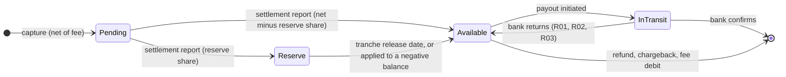

# Payouts, Balances, and Negative Balance Handling

> Pay the merchant out of funds that have actually settled.

**Type:** Build
**Languages:** Java, Python
**Prerequisites:** Phase 12, Lesson 06 (Refunds, Partial Refunds, and Refund Windows); Phase 12, Lesson 07 (Disputes and Chargebacks); Phase 10, Lesson 07 (Holds and Available Balance); Phase 10, Lesson 08 (Reconciliation); Phase 11, Lesson 08 (ACH and NACHA)
**Time:** ~90 minutes

## Learning Objectives

- Separate a merchant's balance into pending, available, reserve, and in-transit, each a ledger account, and state which events move money between them
- Make funds available only when a settlement report that reconciles against the captures says the scheme has paid, never because a date has passed
- Hold a rolling reserve as dated tranches whose sum always equals the reserve account, and release or apply them on an injected calendar
- Schedule payouts (daily or weekly, with a minimum) that never exceed available funds, and emit a payout file with control totals through a hook
- Handle a negative balance in order: net against future settlements, apply the reserve, pause payouts, and collect by debit after a grace period, including when the debit is returned

## The Problem

A marketplace pays its sellers every business day. The payout job runs at 06:00 and computes each seller's payout as "captures from two days ago, minus refunds, minus fees", because card settlement is usually T+2. For eighteen months this works. Then a Monday bank holiday in the scheme's settlement country delays one settlement file by a day. The payout job does not know; it pays sellers for Thursday's and Friday's captures as usual, 1.2 million USD of payouts funded by money the marketplace has not received. The operating account goes overdrawn, the bank charges overdraft interest and calls the treasurer, and payouts for the rest of the week are held while finance works out what happened. The job paid out of funds that were *expected* to settle. It should have paid out of funds that *had*.

The fix, "wait for the settlement file", exposes the second problem. A furniture seller sells 40,000 USD of goods in December and is paid out promptly. In February, customers start disputing orders that never arrived; chargebacks of 18,000 USD arrive over three weeks (Lesson 07). Each one debits the seller's balance, which is now zero because everything was paid out. The balance goes to -18,000 USD. The seller has stopped trading and is not answering email. The marketplace's acquirer debits the marketplace for every chargeback regardless, so the marketplace is out 18,000 USD of its own money. The payout system had no reserve, no rule for negative balances, and no way to ask the seller's bank for the money back.

And a third, smaller one: a payout to a seller's bank account is returned three days later with NACHA code R03, "no account / unable to locate account". The payout job, seeing the seller's available balance restored by the return, pays it again the next morning to the same wrong account. It is returned again. This repeats for a week, each attempt costing a return fee, until someone notices the pattern.

All three are balance-management bugs, and all three have the same cure: a merchant balance that is a set of ledger accounts with explicit rules for what moves money between them. This lesson builds that balance, the payout run that reads it, the reserve that protects against what it cannot see, and the procedure for when it goes below zero.

## The Concept

### Four balances, not one

"The merchant's balance" is four numbers, and every bug above comes from collapsing them into one:

| Balance | Meaning | Becomes something else when |
|---------|---------|-----------------------------|
| Pending | Net of captures the scheme has not yet paid us for | A settlement report names the capture: moves to available and reserve |
| Available | Settled, unreserved, not yet paid out; the only payable balance | A payout is initiated (to in transit); a refund or chargeback arrives (debited, may go negative) |
| Reserve | Settled but held back for a period as protection against future debits | Its tranche's release date arrives (to available), or available goes negative (applied early) |
| In transit | Payout sent to the bank, not yet confirmed | The bank confirms (cash leaves) or returns it (back to available) |

The total owed to the merchant is the sum of all four, and it is a liability on our books from the moment of capture. The four-way split decides *when* that liability may be discharged.



### The ledger behind it

Each merchant has four liability accounts; the platform has three asset accounts and fee revenue:

| Account | Type | Means |
|---------|------|-------|
| `scheme_receivable` | Asset | Captured but not yet paid to us by the scheme; refunds and chargebacks reduce it (the scheme nets them) |
| `bank_cash` | Asset | Our operating bank account |
| `collections_receivable` | Asset | Debits we have asked merchants' banks to pay us |
| `fee_revenue` | Revenue | Processing fees |
| `<m>:pending`, `<m>:available`, `<m>:reserve`, `<m>:in_transit` | Liability | The four balances of merchant `m` |

| Event | Debit | Credit |
|-------|-------|--------|
| Capture 100.00, fee 3.20 | `scheme_receivable` 100.00 | `m:pending` 96.80, `fee_revenue` 3.20 |
| Settlement report, 10% reserve | `bank_cash` 100.00, `m:pending` 96.80 | `scheme_receivable` 100.00, `m:available` 87.12, `m:reserve` 9.68 |
| Payout initiated | `m:available` 87.12 | `m:in_transit` 87.12 |
| Payout confirmed | `m:in_transit` 87.12 | `bank_cash` 87.12 |
| Payout returned | `m:in_transit` 87.12 | `m:available` 87.12 |
| Chargeback or refund | `m:available` | `scheme_receivable` |
| Reserve release or application | `m:reserve` | `m:available` |
| Collection initiated | `collections_receivable` | `m:available` |
| Collection received | `bank_cash` | `collections_receivable` |
| Collection returned | `m:available` | `collections_receivable` |

Every balance in this lesson is read from the ledger. There is no `available_balance` column that a job updates; there is the `m:available` account, whose balance is the sum of its postings. That is what makes the fourth incident (the one where the column and the ledger disagree) impossible to have.

### Settled means "the scheme said so"

The bank-holiday incident came from treating settlement as a function of the calendar. In this lesson, nothing is settled until `settle` receives a `SettlementReport`: the scheme's (or acquirer's) statement that it paid a total for a list of captures on a value date. Before it moves money, `settle` reconciles (Phase 10, Lesson 08):

1. Every capture in the report is known.
2. No capture in the report has already been settled.
3. The report's total equals the sum of the captures' gross amounts.

A report that fails any check is refused with nothing changed. The test advances the calendar ten days past the captures and asserts they are still pending and nothing is paid. In production the comparison is richer (the report carries interchange and scheme fees that must also reconcile, and some captures arrive in a later file than expected), but the rule is the same: the report moves pending to available, and the report is checked before it is believed.

### Reserves as tranches

A rolling reserve holds back a percentage of each settlement for a fixed number of days. It exists because refunds and chargebacks arrive long after the money was paid out (Lesson 07's disputes run for 120 days), and the platform cannot rely on future sales to cover them: the merchant may stop selling. Risk teams set reserves per merchant from its category, history, and dispute ratio; 5 to 10 percent for 90 to 180 days is a common shape for higher-risk merchants, and zero for most.

The reserve is a ledger account, but its release schedule is not a ledger concept: 9.68 USD from the 2026-03-12 settlement is releasable on 2026-06-10, and 7.73 from a later settlement on a later date. The service therefore keeps a list of `ReserveTranche(merchant, amount, releaseOn)` beside the ledger, and holds one invariant between them: the sum of a merchant's unreleased tranches equals its reserve account balance. Every operation that touches the reserve (settlement, release, application to a deficit) updates both, and the tests check the invariant after each one.

The reserve share is `floor(net x bps / 10000)`. Flooring favours the merchant by at most one minor unit per settlement, and the remainder goes to available, so pending is always moved in full.

### Payout scheduling

A merchant's `PayoutSchedule` is a frequency (daily on business days, or weekly on one weekday) and a minimum. On a due day, if the merchant is not paused, the run pays out *all of available* if it is at least the minimum. Three properties follow:

- **A payout never exceeds available at initiation**, because it is available. There is no computation that could make it larger.
- **Nothing pending or reserved is ever paid**, because neither is available.
- **A run is idempotent per day in effect**: a second run the same day finds available at zero.

The minimum exists because every payout costs money (an ACH entry, a wire fee, a return risk), and paying 0.37 USD daily is a loss. Weekly schedules exist for the same reason and for merchants whose accounting prefers it. Payout timing (`T+2`, `T+7`) in a merchant's contract is the gap between capture and first possible payout, which this design produces from settlement timing plus schedule, rather than from a date offset.

### The payout file hook

Payouts reach banks as files: NACHA batches in the US, ISO 20022 `pain.001` credit transfer initiations in SEPA and increasingly elsewhere. The lesson does not build either format (Phase 11 Lessons 08 and 09 do); it builds the hook. `PayoutFileSink` receives one file per run: a header, one detail line per payout or collection, and a trailer with the line count and the total credits and debits in minor units. The trailer is the control total the bank checks before it accepts the file, and the reconciliation job checks against the bank's acknowledgement afterwards; a NACHA file's batch and file control records serve exactly this purpose. The detail line carries a bank account *token*, not an account number: the number lives in a vault (Phase 11, Lesson 05) and the file writer that talks to the bank is the only component that detokenizes.

### Negative balances

A balance goes negative when debits (refunds, chargebacks, fees) exceed available. The procedure is ordered from cheapest to most expensive:

| Step | Mechanism | When |
|------|-----------|------|
| 1 | Net against future settlements | Automatic: settlement credits available, which reduces the deficit |
| 2 | Apply the reserve | Every run: move reserve to available, earliest-releasing tranche first, up to the deficit |
| 3 | Pause credit payouts | Automatic: a negative available can never meet a minimum |
| 4 | Collect by debit | After `collectAfterNegativeDays` continuously negative: a DEBIT line for the deficit |
| 5 | Write off and pursue | Outside this lesson: collections agency, legal, loss provisioning |

Step 2 uses the earliest-releasing tranches first because those are the ones the merchant would get back soonest; using later tranches first would leave early ones to be released into a balance that might go negative again. Step 4 waits because most deficits are temporary (a refund on Monday, sales on Tuesday), and a debit to a merchant's bank account is a costly, relationship-damaging event that may itself be returned. If the collection is returned (R01 insufficient funds), the deficit goes back on the balance and the clock restarts.

A returned *credit* is different. R03 (no account), R02 (account closed), and similar codes mean the destination is wrong; paying it again tomorrow will fail again. A returned credit therefore pauses the merchant's payouts until someone re-verifies the bank details, which is the fix for the third incident.

### Worked example by hand

Merchant `m_shoe`: daily payouts, 10.00 USD minimum, 10% reserve held 90 days. Fees 2.90% + 0.30.

| Date | Event | Pending | Available | Reserve | In transit |
|------|-------|---------|-----------|---------|------------|
| Mon 03-02 | captures 100.00, 250.00, 50.00 (fees 3.20, 7.55, 1.75) | 387.50 | 0.00 | 0.00 | 0.00 |
| Mon 03-02 | payout run: nothing available | 387.50 | 0.00 | 0.00 | 0.00 |
| Tue 03-03 | expected report did not arrive; payout run: nothing | 387.50 | 0.00 | 0.00 | 0.00 |
| Wed 03-04 | report totalling 399.99 refused (captures sum to 400.00) | 387.50 | 0.00 | 0.00 | 0.00 |
| Wed 03-04 | report reconciles; reserve floor(38750 x 1000 / 10000) = 3875 | 0.00 | 348.75 | 38.75 | 0.00 |
| Wed 03-04 | payout `po_0001` 348.75 | 0.00 | 0.00 | 38.75 | 348.75 |
| Thu 03-05 | bank confirms | 0.00 | 0.00 | 38.75 | 0.00 |
| Mon 03-16 | chargeback 600.00 | 0.00 | -600.00 | 38.75 | 0.00 |
| Mon 03-16 | run: reserve applied | 0.00 | -561.25 | 0.00 | 0.00 |
| Wed 03-18 | capture 80.00 (fee 2.62, net 77.38) settles: 69.65 available, 7.73 reserve; run applies the 7.73 | 0.00 | -483.87 | 0.00 | 0.00 |
| Mon 03-23 | seventh negative day: collection `co_0003` 483.87 | 0.00 | 0.00 | 0.00 | 0.00 |
| Wed 03-25 | collection received | 0.00 | 0.00 | 0.00 | 0.00 |

Check the bank account: 400.00 + 180.00 (another merchant's capture in the same report) + 80.00 settled, minus 348.75 paid out, plus 483.87 collected, is 795.12 USD, which the demo prints. The 600.00 chargeback appears as `scheme_receivable = -600.00`: the scheme will net it from a future settlement.

### Complexity

Every balance read is O(1) from the ledger's running totals. `settle` is O(c) in the captures named in the report. `releaseReserves` scans all tranches, O(T); production indexes tranches by release date (a B-tree, or a min-heap as in Phase 2) and touches only those due. `coverFromReserve` sorts a merchant's tranches, O(t log t) with t typically under 100. `runPayouts` is O(M) merchants per run, plus file writing. The tranche list costs O(settlements x reserve days) memory per merchant, bounded by the reserve period.

### What this service does not do

- It does not handle multiple currencies; a multi-currency merchant has one set of four accounts per currency (Phase 10, Lesson 09), and payouts in a currency other than the balance require FX.
- It does not compute interchange and scheme fees from the settlement report; it trusts the capture-time fee. Reconciling the two is Phase 14's reconciliation work.
- It does not support instant payouts (push-to-card or real-time rails, Phase 11 Lesson 10), which pay from available immediately for a fee and must pre-check the limit against available just like the scheduled run.
- It does not write off unrecoverable balances or provision for losses.
- It is not safe for concurrent runs. Two payout runs racing would both read the same available balance; production takes a per-merchant lock or uses a conditional ledger write (Lesson 06's pattern) when moving available to in transit.

## Build It

The walkthrough is in Java, the only implementation shipped for this lesson. All code is in `code/java/Main.java`; the tests are in `code/java/MainTest.java`.

### Step 1: Four accounts per merchant and a balance read from them

```java
void onboard(Merchant m) {
    merchants.put(m.id(), m);
    ledger.open(pendingAcct(m.id()), AccountType.LIABILITY);
    ledger.open(availableAcct(m.id()), AccountType.LIABILITY);
    ledger.open(reserveAcct(m.id()), AccountType.LIABILITY);
    ledger.open(inTransitAcct(m.id()), AccountType.LIABILITY);
}

Balance balance(String merchantId) {
    merchant(merchantId);
    return new Balance(ledger.balance(pendingAcct(merchantId)), ledger.balance(availableAcct(merchantId)),
            ledger.balance(reserveAcct(merchantId)), ledger.balance(inTransitAcct(merchantId)));
}
```

`Balance` is a value read from the ledger, never stored. `Balance.total()` is everything owed to the merchant, and the conservation test asserts that, after a settlement and a confirmed payout, gross captured equals paid out plus still owed plus fees, to the minor unit.

### Step 2: Capture into pending

```java
CaptureRecord c = new CaptureRecord(captureId, merchantId, gross, Money.ofMinor(variable + fixedFeeMinor, currency), clock.today());
List<Posting> postings = new ArrayList<>(List.of(Posting.debit(SCHEME, gross), Posting.credit(pendingAcct(merchantId), c.net())));
if (c.fee().isPositive()) postings.add(Posting.credit(FEES, c.fee()));
ledger.post(clock.today(), "capture " + captureId, postings);
```

The fee line is added only when the fee is positive, because the ledger's `Posting` refuses a zero amount: an entry with a 0.00 line is almost always a bug in whatever computed it, and the first version of this method tripped over exactly that check with a zero-fee test capture.

### Step 3: Settlement: reconcile, then move

```java
void settle(SettlementReport report) {
    Money sum = Money.zero(currency);
    for (String id : report.captureIds()) {
        CaptureRecord c = captures.get(id);
        if (c == null) throw new IllegalStateException("report " + report.id() + " names unknown capture " + id);
        if (isSettled(id)) throw new IllegalStateException("report " + report.id() + ": " + id + " already settled by " + settledBy.get(id));
        sum = sum.plus(c.gross());
    }
    if (!sum.equals(report.totalGross())) {
        throw new IllegalStateException("report " + report.id() + " does not reconcile: total " + report.totalGross() + " but captures sum to " + sum);
    }
    ...
    for (Map.Entry<String, Money> e : netByMerchant.entrySet()) {
        Money reserve = Money.ofMinor(Math.floorDiv(Math.multiplyExact(net.minorUnits(), m.reserve().basisPoints()), 10_000), currency);
        postings.add(Posting.debit(pendingAcct(m.id()), net));
        postings.add(Posting.credit(availableAcct(m.id()), net.minus(reserve)));
        if (reserve.isPositive()) {
            postings.add(Posting.credit(reserveAcct(m.id()), reserve));
            tranches.add(new ReserveTranche(m.id(), reserve, report.valueDate().plusDays(m.reserve().holdDays())));
        }
    }
    ledger.post(clock.today(), "settlement " + report.id(), postings);
}
```

All three reconciliation checks run before the first write. One report can settle captures of many merchants; it becomes one journal entry with the cash line and three lines per merchant, so the report either lands completely or not at all. The tranche's release date counts from the report's value date, the day the money actually arrived.

**Predict:** a report settles a merchant's 50.00 USD zero-fee capture under a 10% reserve. Which postings does the entry contain, and what tranche is created?

### Step 4: Debits may go negative

```java
void debitMerchant(String merchantId, Money amount, String reason) {
    merchant(merchantId);
    if (!amount.isPositive()) throw new IllegalArgumentException("debit must be positive");
    ledger.post(clock.today(), reason + " " + merchantId, List.of(
            Posting.debit(availableAcct(merchantId), amount), Posting.credit(SCHEME, amount)));
    trackNegative(merchantId);
}
```

A chargeback is not refusable: the scheme has already taken the money (Lesson 07). The design therefore lets available go below zero rather than pretending the debit can be rejected, and records the first day it went negative. `trackNegative` clears that date whenever available returns to zero or above, so the collection clock measures *continuous* negativity.

### Step 5: Apply the reserve, earliest tranche first

```java
Money coverFromReserve(String merchantId) {
    Money deficit = ledger.balance(availableAcct(merchantId)).negate();
    Money used = Money.zero(currency);
    if (!deficit.isPositive()) return used;
    List<ReserveTranche> mine = new ArrayList<>(tranches.stream().filter(t -> t.merchantId().equals(merchantId))
            .sorted((a, b) -> a.releaseOn().compareTo(b.releaseOn())).toList());
    for (ReserveTranche t : mine) {
        if (!deficit.isPositive()) break;
        Money take = t.amount().min(deficit);
        tranches.remove(t);
        if (take.compareTo(t.amount()) < 0) tranches.add(new ReserveTranche(merchantId, t.amount().minus(take), t.releaseOn()));
        used = used.plus(take);
        deficit = deficit.minus(take);
    }
    ...
}
```

A tranche partly used is split: the used part is removed, the remainder keeps its original release date. The ledger entry moves the total used from reserve to available, and the tranche list shrinks by the same amount, which keeps the tranche invariant.

**Predict:** a merchant has tranches of 5.00 (release 06-01) and 8.00 (release 06-15) and available of -6.00. What remains in the tranche list after `coverFromReserve`?

### Step 6: The payout run

```java
for (Merchant m : merchants.values()) {
    coverFromReserve(m.id());
    Money available = ledger.balance(availableAcct(m.id()));
    LocalDate since = negativeSince.get(m.id());
    if (available.isNegative() && since != null && !today.isBefore(since.plusDays(collectAfterNegativeDays))) {
        Payout debit = new Payout(String.format("co_%04d", ++payoutSeq), m.id(), available.negate(), PayoutDirection.DEBIT, today);
        ledger.post(today, "collection " + debit.id, List.of(
                Posting.debit(COLLECTIONS, debit.amount), Posting.credit(availableAcct(m.id()), debit.amount)));
        ...
        continue;
    }
    if (!m.schedule().dueOn(today) || isPaused(m.id())) continue;
    if (available.compareTo(m.schedule().minimumPayout()) < 0 || !available.isPositive()) continue;
    Payout credit = new Payout(String.format("po_%04d", ++payoutSeq), m.id(), available, PayoutDirection.CREDIT, today);
    ledger.post(today, "payout " + credit.id, List.of(
            Posting.debit(availableAcct(m.id()), available), Posting.credit(inTransitAcct(m.id()), available)));
    ...
}
```

The order per merchant is the negative-balance procedure: apply the reserve, then collect if the grace period is over, then pay only if due, not paused, positive, and at least the minimum. A collection zeroes available into `collections_receivable`, an asset: the merchant's debt to us has become a claim on its bank. The amount of a credit payout is `available` itself.

**Predict:** a merchant went negative on Monday 03-16 and `collectAfterNegativeDays` is 7. On which date does the run first emit a DEBIT line?

### Step 7: The file and the bank's answers

```java
lines.add("H," + today + "," + name + "," + currency.code());
for (Payout p : batch) {
    lines.add("D," + p.id + "," + p.merchantId + "," + merchant(p.merchantId).bankAccountToken() + "," + p.direction + "," + p.amount.minorUnits());
    if (p.direction == PayoutDirection.CREDIT) credits += p.amount.minorUnits(); else debits += p.amount.minorUnits();
}
lines.add("T," + batch.size() + "," + credits + "," + debits);
sink.write(name, lines);
```

```java
void returned(String payoutId, String returnCode) {
    ...
    if (p.direction == PayoutDirection.CREDIT) {
        ledger.post(clock.today(), "payout returned " + p.id + " " + returnCode, List.of(
                Posting.debit(inTransitAcct(p.merchantId), p.amount), Posting.credit(availableAcct(p.merchantId), p.amount)));
        paused.put(p.merchantId, "payout " + p.id + " returned " + returnCode);
    } else {
        ledger.post(clock.today(), "collection returned " + p.id + " " + returnCode, List.of(
                Posting.debit(availableAcct(p.merchantId), p.amount), Posting.credit(COLLECTIONS, p.amount)));
        negativeSince.remove(p.merchantId);
        trackNegative(p.merchantId);
    }
    ...
}
```

Amounts in the file are integer minor units, as NACHA amounts are. `confirm` is idempotent (a second confirmation of a `PAID` line is ignored) and refuses a returned line. A returned credit pauses payouts; a returned collection restores the deficit and restarts the negative clock from today.

### Step 8: Run it

```bash
cd phases/12-payment-systems-design/08-payouts-and-balance-management/code/java
javac -d .out *.java && java -cp .out Main
java -cp .out MainTest
```

Expected output, abbreviated:

```console
2026-03-02 MON after 3 captures (400.00 gross)        pending 387.50 USD  available 0.00 USD     reserve 0.00 USD   in transit 0.00 USD
payout run Monday -> []  (nothing settled, nothing to pay)
payout run Tuesday -> []  (the expected T+1 report did not arrive)
refused: report st_bad does not reconcile: total 399.99 USD but captures sum to 400.00 USD
2026-03-04 WED after settlement st_0302               pending 0.00 USD    available 348.75 USD   reserve 38.75 USD  in transit 0.00 USD
payout run Wednesday -> [po_0001 CREDIT m_shoe 348.75 USD IN_TRANSIT]
file payouts_2026-03-04_001.csv
   H,2026-03-04,payouts_2026-03-04_001.csv,USD
   D,po_0001,m_shoe,ba_tok_7Q2,CREDIT,34875
   T,1,34875,0
payout run Friday -> [po_0002 CREDIT m_art 174.48 USD IN_TRANSIT]
next Friday run -> []  (m_art paused: true)
2026-03-16 MON after the chargeback                   pending 0.00 USD    available -600.00 USD  reserve 38.75 USD  in transit 0.00 USD
2026-03-16 MON reserve applied, still negative        pending 0.00 USD    available -561.25 USD  reserve 0.00 USD   in transit 0.00 USD
2026-03-18 WED netted by st_0316, reserve applied     pending 0.00 USD    available -483.87 USD  reserve 0.00 USD   in transit 0.00 USD
payout run -> [co_0003 DEBIT m_shoe 483.87 USD IN_TRANSIT]
2026-03-25 WED collection received                    pending 0.00 USD    available 0.00 USD     reserve 0.00 USD   in transit 0.00 USD
   bank_cash                  795.12 USD
   ledger balances: true, journal entries: 16
```

The test suite has 49 assertions: pending is never paid and time alone settles nothing; each reconciliation failure leaves everything unchanged; reserve and available amounts to the minor unit; the file's header, detail, and control totals; confirmation idempotency; minimums and both schedule kinds; the reserve release boundary on day 89 and day 90; every step of the negative-balance procedure including the day-6 and day-7 boundary and a returned collection; a returned credit pausing and resuming payouts; and conservation of money across twenty captures.

### In Python

```python
class DayOfWeek(Enum):          # date.weekday(): Monday is 0, Sunday is 6
    MONDAY = 0
    ...
    SUNDAY = 6

    @staticmethod
    def of(d: date) -> "DayOfWeek":
        return DayOfWeek(d.weekday())

def due_on(self, d: date) -> bool:
    dow = DayOfWeek.of(d)
    business_day = dow is not DayOfWeek.SATURDAY and dow is not DayOfWeek.SUNDAY
    return business_day and (self.frequency is PayoutFrequency.DAILY or dow is self.weekly_day)
```

Differences, all in `code/python/main.py` and `test_main.py`:

- **Dates are `datetime.date`** and `java.time.DayOfWeek` becomes a small `Enum` over `date.weekday()`, so `PayoutSchedule` keeps the same `weekly_day` field and the same weekend check. `release_on + timedelta(days=hold_days)` replaces `plusDays`, and "not before" is `not today < since + timedelta(...)`.
- **Integer arithmetic.** Fees and reserves are `(x * bps + 5_000) // 10_000` and `(net * bps) // 10_000` on non-negative values; `//` is the floor `Math.floorDiv` gave, and `int` cannot overflow so `multiplyExact` goes away.
- **Tranche bookkeeping uses list comprehensions.** `release_reserves` collects the due tranches and keeps `[t for t in tranches if t not in due]` (the semantics of `removeAll`); `cover_from_reserve` sorts the merchant's tranches by `release_on` and `list.remove` finds them by dataclass equality, as `List.remove` did by record equality.
- **Exceptions:** reconciliation failures, duplicate captures and bad state changes (`IllegalStateException`) raise `RuntimeError`; unknown ids and bad arguments (`IllegalArgumentException`) raise `ValueError`. `confirm` on an already-PAID payout still returns silently.

```bash
cd phases/12-payment-systems-design/08-payouts-and-balance-management/code/python
python3 main.py
python3 -m unittest -v
```

### Porting notes

In Go, accounts are `map[string]int64`, `time.Time` values must be truncated to UTC midnight before comparison, `Weekday()` gives the schedule check, and `Settle` returns an `error` (`ErrReportDoesNotReconcile`) rather than throwing. None of this is concurrent as written; a Go port that runs the payout job in a goroutine alongside webhook handlers needs a per-merchant `sync.Mutex` around the read-available-then-post sequence, and `go test -race` should cover it.

## Use It

**Stripe Connect.** A connected account's balance has `pending` and `available` per currency, and a separate `instant_available`; funds move from pending to available on the account's `available_on` date, which Stripe derives from its own settlement. Payout schedules are `daily`, `weekly` with a `weekly_anchor`, `monthly`, or `manual`, with a per-country minimum delay. Negative balances on connected accounts are debited from the platform's balance or from the connected account's bank account depending on configuration, and Stripe documents reserves as part of risk controls. Payouts have `in_transit`, `paid`, `failed`, and `canceled` statuses, and a failed payout carries a failure code such as `account_closed` or `no_account`, which correspond to this lesson's return codes.

**Adyen for Platforms.** Balance accounts hold funds per currency; sweeps (scheduled transfers) move available funds to a transfer instrument on a schedule with a trigger amount and can be configured to *pull* funds into a balance account that drops below a threshold, which is the collection step here. Adyen's documentation distinguishes `received`, `pending`, and `balance` amounts, which map to pending, in transit, and available.

**NACHA and ISO 20022.** A NACHA file's batch header, entry detail records, batch control, and file control records with entry counts, entry hash, and total debit and credit amounts are the production version of this lesson's H/D/T lines. Return reason codes (R01 insufficient funds, R02 account closed, R03 no account, R04 invalid account number, R10 unauthorized debit) come back in a return file days later. ISO 20022 `pain.001` (initiation) and `pain.002` (status report) serve the same roles for SEPA credit transfers and increasingly for other rails.

**Marketplace treasury.** Every large marketplace (Amazon, Etsy, Airbnb, Uber) runs some version of this: hold funds until a release condition (settlement, delivery confirmation, a stay completing), reserve against high-risk sellers, net refunds and chargebacks against future earnings, and collect from sellers' bank accounts only as a last resort. The design decisions are this lesson's: what is the release condition, how big is the reserve, and how long a seller may stay negative.

## Ship It

`outputs/design-doc-merchant-balances-and-payouts.md` is a design-document template for a merchant balance and payout system: the balance states and the events between them, the ledger accounts and their postings, the settlement release condition and its reconciliation checks, the reserve policy and its tranche invariant, the payout schedule and file format, and the negative-balance procedure with its thresholds. Fill it in before building payouts for a new platform, or use it to review an existing one against the three incidents in The Problem.

## Exercises

1. **Reinforce.** Add a fixed minimum reserve: a merchant must always keep at least 500.00 USD in reserve regardless of the percentage, topped up from available at settlement before anything else. Test that a merchant with 300.00 of settlements has 300.00 reserved and nothing available, and that the next 300.00 settlement leaves 200.00 reserved more and 100.00 available.
2. **Apply.** Add instant payouts: `instantPayout(merchant, amount)` pays immediately from available for a 1% fee (minimum 0.50 USD) posted to `fee_revenue`, refusing amounts above available after the fee. Then add a daily instant-payout limit per merchant, and test that a scheduled payout later the same day pays only what remains.
3. **Extend.** Connect to Lessons 06 and 07: have `RefundService` and `DisputeService` post their merchant debits through `debitMerchant`, so that a refund reservation and a chargeback both reduce `m:available` in this ledger, and Lesson 07's dispute hold is paid out only on `WON`. Write the scenario from The Problem: 40,000 USD of sales paid out, 18,000 USD of chargebacks over three weeks, a 10% reserve. How much does the platform recover from the reserve, how much from netting, and how much must it collect?

## Key Terms

| Term | What people say | What it actually means |
|------|-----------------|------------------------|
| Pending balance | "unsettled funds" | Net of captures the scheme has not yet paid us for; owed to the merchant but not payable |
| Available balance | "the balance" | Settled, unreserved funds not yet paid out; the only balance a payout may draw on, and the one debits hit |
| Settlement | "when the money comes in" | The scheme or acquirer paying us for a set of captures, evidenced by a report that must reconcile before funds are released |
| Rolling reserve | "held funds" | A percentage of each settlement held back for a fixed period, as dated tranches, to cover future refunds and chargebacks |
| In transit | "payout sent" | A payout the bank has been told to make but has not confirmed; still a liability, and returnable |
| Negative balance | "merchant owes us" | Available below zero after debits; recovered by netting, the reserve, and finally a collection debit |
| Return code | "the payout bounced" | The bank's reason a credit or debit failed (R01, R02, R03); a wrong-destination return pauses payouts, an insufficient-funds return restores the deficit |
| Control totals | "the trailer" | Counts and sums in a payment file's trailer that the bank checks before accepting the file and that reconciliation checks after |

## Further Reading

- [Nacha Operating Rules and guidelines](https://www.nacha.org/rules) — the ACH file structure (batch and file control records with counts and totals), and the return reason codes and time frames that govern payouts and collections in the US.
- [ISO 20022 message definitions: Payments Initiation (pain.001, pain.002)](https://www.iso20022.org/catalogue-messages/iso-20022-messages-archive?search=pain) — the customer credit transfer initiation and status report messages that replace proprietary payout files outside the US.
- [Stripe documentation: Connect payouts and balances](https://docs.stripe.com/connect/payouts-connected-accounts) — pending and available balances, payout schedules and minimums, negative balance handling, and payout failure codes in a production platform.
- [Adyen documentation: Balance platform sweeps and balance accounts](https://docs.adyen.com/marketplaces-and-platforms/payout-to-users/scheduled-payouts/) — scheduled push and pull sweeps with trigger amounts, which are this lesson's payout run and collection step.
- [Visa Core Rules and Visa Product and Service Rules](https://usa.visa.com/dam/VCOM/download/about-visa/visa-rules-public.pdf) — clearing and settlement between acquirer and issuer, and the acquirer's liability for its merchants' chargebacks, which is why the platform needs reserves at all.
