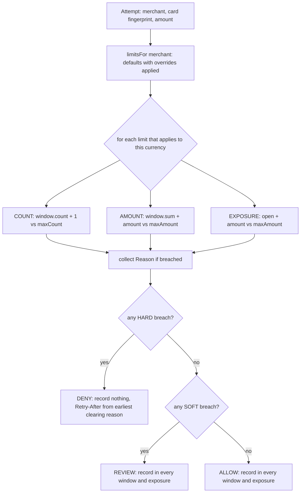

# Limits, Velocity Controls, and Exposure

> Per-card, per-merchant, per-day, in a sliding window.

**Type:** Build
**Languages:** Java
**Prerequisites:** Phase 12, Lesson 01 (Designing an Idempotent Payment API); Phase 12, Lesson 08 (Payouts and Balance Management); Phase 10, Lesson 01 (Representing Money); Phase 1, Lesson 03 (Queues and Deques)
**Time:** ~75 minutes

## Learning Objectives

- Distinguish a velocity limit (events per trailing window) from an exposure limit (money currently at risk) and explain why one needs a clock and the other does not
- Build a sliding window over a deque with lazy eviction and state its half-open interval, its complexity, and the exact instant a breach clears
- Implement a limit hierarchy in which per-merchant overrides replace platform defaults by id, and reason about what an override can and cannot do
- Separate hard limits (deny) from soft limits (allow and flag) and show why a denied attempt must not be recorded while a flagged one must
- Produce a denial that names every breached limit with observed value, projected value, threshold, and the earliest time it clears, so a `Retry-After` and a support explanation fall out of the same object
- Make check-and-record one atomic step and prove with a 32-thread test that a limit of five admits exactly five

## The Problem

At 02:14 a fraud ring begins testing stolen card numbers against a donation form that accepts any amount above 1.00 USD. They have 40,000 card numbers from a breach and want to learn which ones are still live before selling them. Each test is a 1.00 USD authorization. The processor approves about 11 percent, which is the signal the attackers want. By 02:40 the merchant has submitted 38,000 authorizations, of which 33,800 are declines. The card networks notice: Visa's excessive-authorization and decline programs assess the acquirer per decline above a threshold, and the acquirer passes the assessment through. The merchant's per-transaction authorization fee is 0.08 USD, so the attack itself costs 3,040 USD in fees before any fine. The 4,200 approvals have to be refunded, which is another 4,200 refund fees, and the 1.00 USD charges generate several hundred "I did not donate to anyone" chargebacks at 15.00 USD each. The merchant's processor flags the account as a card-testing target, and for the next week every legitimate donation from the merchant's own customers is routed through step-up authentication.

Nothing in the payment pipeline was wrong. Every authorization was well formed, idempotent, and correctly recorded. What was missing is the thing a human cashier does without thinking: notice that the same card has been tried five times in a minute, or that the same terminal has done more volume in an hour than it usually does in a week, and stop. Limits are the encoding of that noticing. They are not fraud detection, which asks whether a specific attempt is fraudulent; they are rate and size bounds that make the cheapest attacks uneconomic and cap how much any single actor can lose before a human looks.

The second face of the same problem is on the merchant side. A marketplace onboards a new seller and routes 500,000 USD of authorizations through them in a day. The authorizations are real, but the seller is a fraudster who will ship nothing, and the marketplace, as the merchant of record, will absorb every chargeback. Phase 12, Lesson 08 built the balance that pays the seller out. This lesson builds the ceiling on how much can be authorized before the money is captured and the goods are delivered, which is called *exposure*, and the per-day volume limit that stops a brand-new seller from doing a month's business in an afternoon.

These controls look simple and are routinely built wrong: fixed calendar windows that reset at midnight and let an attacker do double volume across the boundary; limits that count only approvals and so never see a card-testing attack made of declines; limits that count denied-by-limit attempts and therefore lock a customer out forever; a denial that says `limit_exceeded` and nothing else, so the support engineer cannot tell the customer when to try again; and a check-then-record sequence that is not atomic, so a burst of concurrent attempts all read "4 of 5" and all pass.

## The Concept

### Three kinds of limit

| Kind | Measures | Needs a window | Example | Cleared by |
|------|----------|----------------|---------|------------|
| Count velocity | number of attempts per scope key | yes | 5 authorizations per card per hour | time passing |
| Amount velocity | sum of attempted amounts per scope key | yes | 500.00 USD per card per 24h; 10,000.00 USD per merchant per 24h | time passing |
| Exposure | sum of currently open (authorized, not yet captured or voided) amounts per scope key | no | 2,000.00 USD open per merchant | capture, void, or authorization expiry |

The first two are rates: how much happened recently. The third is a balance: how much is outstanding right now. The distinction matters because they are cleared by different things. A velocity breach clears itself as the window slides; nothing the merchant does speeds it up. An exposure breach clears only when authorizations are resolved, and it never clears on its own, which is why an exposure limit without an authorization-expiry job is a limit that ratchets shut. The test suite pins this down: thirty days pass and an exposure breach is still a breach.

### Scope: what the limit counts against

A limit is a threshold per *scope key*. The key is derived from the attempt: the card fingerprint (a hash of the PAN, never the PAN itself), the merchant id, the pair of them, or the constant `global`. Each distinct key gets its own window. Five attempts per card per hour means five per `card:fp_4242`, and `card:fp_1881` starts from zero. The engine stores windows in a map keyed by `limitId + "@" + scopeKey`, so one limit over 40,000 cards is 40,000 small deques, and a limit over one merchant is one deque.

The scope is also what makes a limit explainable. "Denied" is useless. "Denied: `card-attempts-1h` on `card:fp_4242`, 5 attempts would become 6, limit 5 in 3600s, clears in 3550s" tells the client what to show, tells support what happened, and tells the merchant's own fraud team which card to block. The scope key is in the reason object, not reconstructed later from logs.

### The sliding window

A fixed window ("per calendar hour") resets at the boundary. An attacker who knows the boundary does 5 attempts at 02:59:59 and 5 at 03:00:00, which is 10 in two seconds under a "5 per hour" limit. The sliding window asks, at every attempt, how many attempts fall in the trailing interval `(now - W, now]`. Nothing resets; every attempt looks back the same distance.

The implementation is a deque of `(timestamp, amount)` entries in arrival order. Because entries are appended in time order, the oldest is always at the front, so eviction is: pop from the front while the front's timestamp is at or before `now - W`. The sum of amounts is maintained incrementally, subtracting on eviction and adding on append, so neither `count` nor `sum` has to walk the deque.

The interval is half-open on purpose. An entry at exactly `now - W` has *left* the window. With W = 3600s, an attempt at 02:00:00 stops counting at 03:00:00 exactly, not 03:00:01. This is the boundary the tests check, because it is the boundary that gets off-by-one'd: a `<` instead of `<=` in the eviction condition keeps the entry one millisecond too long, and a limit documented as "per hour" becomes "per hour and a millisecond", which no one notices until a client's retry at exactly `Retry-After` seconds is denied again.

Complexity: `add` is amortized O(1), because each entry is appended once and evicted once. `count` and `sum` are O(evicted) for the entries they age out, then O(1). Memory is O(entries currently inside the window) per scope key, which for a count limit of five is at most five entries, and for an amount limit over a merchant's 24-hour volume is however many attempts that merchant made in a day. When that number is tens of millions, the exact deque gives way to approximations (fixed sub-buckets, or a sliding-log sample), and *Use It* names the trade.

The window also answers a question the explanation needs: *when does this clear?* For a count limit, the breach clears when the oldest entry leaves, at `oldest.timestamp + W`. That is a lower bound for an amount limit (the oldest entry leaving may not free enough money), so the engine reports it as "earliest possible" and the denial's `Retry-After` is the earliest instant the client could possibly succeed. The time-based reasons carry that instant; exposure reasons carry none, because no amount of waiting clears them.

### Hard and soft

A **hard** limit denies. The attempt is refused, the processor is never called, and the attempt is *not* recorded in any window. The last clause is the one teams get wrong. If denied attempts were recorded, a client that retries a denied attempt on a schedule would keep the window full forever: each retry is denied and adds an entry, so the window never drains. A limit must only count attempts that it let through to the thing it protects.

A **soft** limit allows but flags. The outcome is `REVIEW`, the attempt proceeds (to step-up authentication, delayed capture, or a human queue, depending on the caller), and the attempt *is* recorded, because it happened. Soft limits exist because thresholds are guesses. A customer who buys a 1,400.00 USD laptop with a card that normally sees 40.00 USD groceries is probably the customer; a hard 500.00 USD per-card limit loses the sale, and a soft one routes it to 3-D Secure and keeps it. Hard limits are for cases where the cost of a false negative is unbounded (card testing, merchant exposure); soft limits are for cases where a false positive costs a sale.

The engine evaluates every applicable limit and collects every breach before deciding. The outcome is the worst severity breached: any hard breach is `DENY`, otherwise any soft breach is `REVIEW`, otherwise `ALLOW`. Short-circuiting on the first hard breach would be faster and would produce incomplete denials. The acme 15,000.00 USD attempt in the demo trips three limits, and the response says so, because the merchant needs to know that raising their daily volume limit alone will not make that attempt succeed.

### The hierarchy

Limits come in layers. The platform has defaults that apply to every merchant. A merchant on a negotiated contract has overrides: a 250,000.00 USD daily volume instead of 10,000.00 USD, a 50,000.00 USD exposure ceiling instead of 2,000.00 USD. The resolution rule in this lesson is deliberately narrow: an override replaces the default *with the same id*, and a merchant cannot be given a limit the platform has no default for. The effective limit list for a merchant is the defaults in declaration order, each swapped for its override if one exists. The card-level limits are not merchant-scoped, so bigbox's override of its merchant limits leaves the per-card card-testing limit untouched, which is the right outcome: a big merchant is a bigger card-testing target, not a smaller one.

That rule stops two mistakes. One is the "merchant-specific limit that nobody else has", which becomes unmaintainable because it does not appear in the defaults anyone audits. The other is an override that *adds* a restriction under a new name to a single merchant, which is a fraud decision, not a limit configuration, and belongs in the risk engine with an owner and an expiry.



### Worked example by hand

Policy: `card-attempts-1h` 5 per card per hour, hard. `card-amount-24h` 500.00 USD per card per day, soft. `merchant-exposure` 2,000.00 USD open, hard. Clock starts at `t0`.

| When | Attempt | card-attempts-1h window (fp_4242) | Decision | Why |
|------|---------|-----------------------------------|----------|-----|
| t0 | 1.00 USD on fp_4242 | 0 entries, would be 1 | ALLOW | recorded; window = [t0] |
| t0+10s .. t0+40s | four more 1.00 USD | 1..4, would be 2..5 | ALLOW | window = [t0, +10, +20, +30, +40] |
| t0+50s | 1.00 USD | 5, would be 6 | DENY | not recorded; clears at t0+3600s, so Retry-After 3550s |
| t0+3600s | 1.00 USD | evict t0 (exactly W old): 4, would be 5 | ALLOW | window = [+10, +20, +30, +40, +3600] |
| t0+3600s | 1.00 USD | 5, would be 6 | DENY | clears at t0+3610s, Retry-After 10s |

Now the exposure path at t0+3h with 716.00 USD already open for `merchant:merchant_acme`:

| Attempt | card-amount-24h on its card | merchant-exposure | Decision |
|---------|-----------------------------|-------------------|----------|
| 1,400.00 USD on fp_4242 | 6.00 -> 1,406.00 exceeds 500.00: SOFT | 716.00 -> 2,116.00 exceeds 2,000.00: HARD | DENY with two reasons |

The denial lists both. If the merchant captures or voids 200.00 USD of open authorizations, exposure falls to 516.00 and the same attempt becomes `REVIEW` on the soft card limit alone. The explanation makes that actionable; `limit_exceeded` would not.

### Invariants

1. **At most N allowed attempts per scope key per window.** For every count limit and every key, the number of recorded entries inside `(now - W, now]` never exceeds `maxCount`. The concurrency test is this invariant under 32 simultaneous callers.
2. **Denied attempts leave no trace in windows or exposure.** Otherwise denial is self-perpetuating.
3. **Allowed and flagged attempts are recorded in every applicable window atomically with the decision.** No attempt can be judged against a state that another concurrent attempt is about to change.
4. **Exposure is conserved**: it rises by exactly the amount of each allowed attempt and falls by exactly that amount on release, and release of an unknown or already-released id is a no-op, so a duplicated capture webhook (Phase 12, Lesson 05) does not drive exposure negative.
5. **A money limit judges only its own currency.** A 500.00 USD limit does not see a 9,000.00 EUR attempt. The alternative, converting at some rate, would make the limit depend on the FX desk; Phase 12, Lesson 12 is where conversion lives.

### What this design does not do

- It does not persist. Windows live in process memory; a restart forgets every attempt, which in production is a short window during which card testing is unlimited. Production stores the windows in Redis (sorted sets keyed by timestamp, `ZREMRANGEBYSCORE` for eviction) or in the database.
- It does not expire authorizations on its own. Exposure is released by `release(attemptId)`, which the capture, void, and authorization-expiry paths must call. Card network authorizations expire in 7 to 30 days depending on the network and merchant category; an expiry job that calls `release` is part of the design, not an afterthought.
- It does not decide what `REVIEW` means. Step-up, delayed capture, and manual review are the caller's business; the engine reports the flag and the reasons.
- It is not a fraud model. It has no features, no scores, no history beyond the window. It is the floor under the fraud model: the thing that still works when the model is down, mis-trained, or being probed.

## Build It

### Step 1: The attempt and the scope key

```java
record Attempt(String attemptId, String merchantId, String cardFingerprint, Money amount) {
    Attempt {
        if (!amount.isPositive()) throw new IllegalArgumentException("amount must be positive: " + amount);
    }
}

enum LimitScope {
    CARD, MERCHANT, CARD_AT_MERCHANT, GLOBAL;

    String keyFor(Attempt a) {
        return switch (this) {
            case CARD -> "card:" + a.cardFingerprint();
            case MERCHANT -> "merchant:" + a.merchantId();
            case CARD_AT_MERCHANT -> "merchant:" + a.merchantId() + "|card:" + a.cardFingerprint();
            case GLOBAL -> "global";
        };
    }
}
```

The card is a fingerprint. The limit engine never sees a PAN, which keeps it out of PCI scope and makes the scope key safe to log. The prefix on each key (`card:`, `merchant:`) means keys from different scopes cannot collide even if a merchant id happened to equal a fingerprint.

**Predict:** two merchants both receive attempts from `fp_4242`. Under a `CARD` limit, how many windows exist for that fingerprint? Under `CARD_AT_MERCHANT`?

### Step 2: The limit

```java
enum LimitKind { COUNT, AMOUNT, EXPOSURE }
enum Severity { HARD, SOFT }

record Limit(String id, LimitScope scope, LimitKind kind, long windowMillis, long maxCount, Money maxAmount, Severity severity) {
    static Limit count(String id, LimitScope scope, long windowMillis, long maxCount, Severity severity) { ... }
    static Limit amount(String id, LimitScope scope, long windowMillis, Money maxAmount, Severity severity) { ... }
    static Limit exposure(String id, LimitScope scope, Money maxAmount, Severity severity) { ... }

    boolean applies(Attempt a) {
        return kind == LimitKind.COUNT || maxAmount.currency().equals(a.amount().currency());
    }
}
```

One record, three factory methods, because the three kinds share everything except which threshold field is meaningful. The compact constructor (in `Main.java`) rejects a `COUNT` with `maxCount <= 0`, a money limit without a positive `maxAmount`, and a windowed limit without a positive window. `applies` is the currency rule: a money threshold in USD judges USD attempts only.

### Step 3: The sliding window

```java
final class SlidingWindow {
    record Entry(long atMillis, long amountMinor) {}
    private final long windowMillis;
    private final ArrayDeque<Entry> entries = new ArrayDeque<>();
    private long sumMinor = 0;

    void evict(long now) {
        long cutoff = now - windowMillis;
        while (!entries.isEmpty() && entries.peekFirst().atMillis() <= cutoff) {
            sumMinor -= entries.pollFirst().amountMinor();
        }
    }

    void add(long now, long amountMinor) {
        if (!entries.isEmpty() && now < entries.peekLast().atMillis()) {
            throw new IllegalArgumentException("entries must be appended in time order; clock went backwards");
        }
        evict(now);
        entries.addLast(new Entry(now, amountMinor));
        sumMinor = Math.addExact(sumMinor, amountMinor);
    }

    int count(long now) { evict(now); return entries.size(); }
    long sumMinor(long now) { evict(now); return sumMinor; }

    Long nextExpiryMillis(long now) {
        evict(now);
        return entries.isEmpty() ? null : entries.peekFirst().atMillis() + windowMillis;
    }
}
```

`<= cutoff` is the half-open interval. The deque is the Phase 1 deque; the invariant that makes front-eviction correct is that entries arrive in non-decreasing time order, and `add` enforces it rather than assuming it, because a clock that goes backwards (NTP step, a bad injected clock in a test) would otherwise silently corrupt the window. `sumMinor` is a `long` of minor units, the Phase 10 discipline; it is wrapped back into a `Money` with the attempt's currency at the point of comparison.

**Predict:** W = 3600s, entries at t=0 and t=10s. What does `count(3600_000)` return? What does `nextExpiryMillis(3600_000)` return?

### Step 4: Exposure

```java
final class ExposureTracker {
    private final Map<String, Map<String, Money>> openByScopeKey = new HashMap<>();

    Money open(String scopeKey, Currency currency) {
        Money total = Money.zero(currency);
        for (Money m : openByScopeKey.getOrDefault(scopeKey, Map.of()).values()) {
            if (m.currency().equals(currency)) total = total.plus(m);
        }
        return total;
    }

    void add(String scopeKey, String attemptId, Money amount) {
        openByScopeKey.computeIfAbsent(scopeKey, k -> new LinkedHashMap<>()).put(attemptId, amount);
    }

    void release(String scopeKey, String attemptId) {
        Map<String, Money> open = openByScopeKey.get(scopeKey);
        if (open != null) open.remove(attemptId);
    }
}
```

Exposure is a map of open authorizations by id, not a running total, so that `release` can be idempotent: removing an id twice removes it once. A running total with `+amount` on open and `-amount` on release would go negative on a duplicated capture event, and Phase 12, Lesson 05 established that duplicated events are normal. The cost is O(open authorizations) per `open()` call; a production tracker keeps the total alongside the map and adjusts it only when `remove` actually removed something.

### Step 5: Reasons and decisions

```java
record Reason(String limitId, LimitScope scope, String scopeKey, LimitKind kind, Severity severity,
              String observed, String wouldBe, String threshold, long windowMillis, Long retryAfterMillis) {
    String explain() {
        String window = kind == LimitKind.EXPOSURE ? "open" : "in " + (windowMillis / 1000) + "s";
        String retry = retryAfterMillis == null ? "" : ", clears in " + (retryAfterMillis / 1000) + "s";
        return limitId + " [" + severity + "] " + scopeKey + ": " + observed + " -> " + wouldBe + " exceeds " + threshold + " " + window + retry;
    }
}

record Decision(Outcome outcome, List<Reason> reasons) {
    long retryAfterSeconds() {
        long best = Long.MAX_VALUE;
        for (Reason r : reasons) {
            if (r.severity() == Severity.HARD && r.retryAfterMillis() != null) best = Math.min(best, r.retryAfterMillis());
        }
        return best == Long.MAX_VALUE ? 0 : (best + 999) / 1000;
    }
}
```

A `Reason` is one limit's verdict with the three numbers that explain it: what was observed, what this attempt would make it, and the threshold. `observed` and `wouldBe` are strings because they are `Money.toString()` for money limits and `"5 attempts"` for count limits; the explanation reads the same either way. `retryAfterSeconds` rounds up, so a breach that clears in 10,001 ms produces `Retry-After: 11`, never `10`; a client that waits the advertised time must not be denied again.

**Predict:** a decision has one SOFT reason with `retryAfterMillis = 86_400_000` and no HARD reasons. What does `retryAfterSeconds()` return, and why is that the right answer for a `REVIEW`?

### Step 6: The hierarchy

```java
final class LimitPolicy {
    private final Map<String, Limit> defaults = new LinkedHashMap<>();
    private final Map<String, Map<String, Limit>> merchantOverrides = new HashMap<>();

    LimitPolicy override(String merchantId, Limit limit) {
        if (!defaults.containsKey(limit.id())) throw new IllegalArgumentException("no default limit to override: " + limit.id());
        merchantOverrides.computeIfAbsent(merchantId, k -> new HashMap<>()).put(limit.id(), limit);
        return this;
    }

    List<Limit> limitsFor(String merchantId) {
        Map<String, Limit> overrides = merchantOverrides.getOrDefault(merchantId, Map.of());
        List<Limit> effective = new ArrayList<>();
        for (Limit d : defaults.values()) effective.add(overrides.getOrDefault(d.id(), d));
        return Collections.unmodifiableList(effective);
    }
}
```

`LinkedHashMap` keeps declaration order, so the effective list for every merchant has the same limits in the same positions, and a reason list is comparable across merchants. The override check is the "no bespoke limits" rule from the Concept.

### Step 7: The engine

```java
synchronized Decision check(Attempt attempt) {
    long now = clock.nowMillis();
    List<Reason> reasons = new ArrayList<>();
    Outcome outcome = Outcome.ALLOW;
    for (Limit limit : policy.limitsFor(attempt.merchantId())) {
        if (!limit.applies(attempt)) continue;
        Reason r = evaluate(limit, attempt, now);
        if (r == null) continue;
        reasons.add(r);
        if (limit.severity() == Severity.HARD) outcome = Outcome.DENY;
        else if (outcome == Outcome.ALLOW) outcome = Outcome.REVIEW;
    }
    if (outcome != Outcome.DENY) record(attempt, now);
    return new Decision(outcome, List.copyOf(reasons));
}
```

The whole method is one critical section, the same shape as `reserve` in Phase 12, Lesson 01: read the state, decide, write the state, under one lock, so no other attempt can interleave between the read and the write. `evaluate` (in `Main.java`) computes `observed + this attempt` for the limit's kind and returns a `Reason` or `null`. `record` appends to every applicable window and adds to exposure, and only runs when the outcome is not `DENY`. The `now` is read once at the top so every limit is judged against the same instant.

**Predict:** 32 threads call `check` simultaneously on a fresh engine with a 5-per-hour hard limit on one card. Without `synchronized`, what range of outcomes is possible for the count of allowed attempts? With it?

### Step 8: Release

```java
synchronized void release(String attemptId) {
    Attempt attempt = openAttempts.remove(attemptId);
    if (attempt == null) return;
    for (Limit limit : policy.limitsFor(attempt.merchantId())) {
        if (limit.kind() == LimitKind.EXPOSURE) exposure.release(limit.scope().keyFor(attempt), attemptId);
    }
}
```

Capture, void, and expiry all call this. It touches exposure only. Velocity history is a record of what was attempted, and capturing a payment does not un-attempt it.

### Step 9: Run it

```bash
cd phases/12-payment-systems-design/09-limits-and-velocity-controls/code/java
javac -d .out *.java && java -cp .out Main
java -cp .out MainTest
```

Expected output, abbreviated:

```console
== Card testing: 5 attempts per card per hour, hard ==
attempt 1 (1.00 USD) -> ALLOW
...
attempt 6 (1.00 USD) -> DENY
    card-attempts-1h [HARD] card:fp_4242: 5 attempts -> 6 attempts exceeds 5 attempts in 3600s, clears in 3550s
    Retry-After: 3550s

== The window slides: 1h after the first attempt, one slot frees ==
attempt 7 at t0+1h -> ALLOW
attempt 8 at t0+1h -> DENY
    card-attempts-1h [HARD] card:fp_4242: 5 attempts -> 6 attempts exceeds 5 attempts in 3600s, clears in 10s

== Exposure: open authorizations count until captured or voided ==
200.00 USD auth (open exposure 1,916.00) -> DENY
    merchant-exposure [HARD] merchant:merchant_acme: 1916.00 USD -> 2116.00 USD exceeds 2000.00 USD open
captured att-11: exposure back to 516.00 USD
200.00 USD auth after capture -> ALLOW

== A denial names every limit it tripped ==
card fp_4242, 1,400.00 USD -> DENY
    card-amount-24h [SOFT] card:fp_4242: 6.00 USD -> 1406.00 USD exceeds 500.00 USD in 86400s, clears in 75600s
    merchant-exposure [HARD] merchant:merchant_acme: 716.00 USD -> 2116.00 USD exceeds 2000.00 USD open
breached limits: 2
```

The test harness runs 52 assertions, including the half-open boundary, the soft-limit-is-recorded rule, exposure surviving thirty days, idempotent release, the override rules, and a 32-thread race that must admit exactly five.

### Porting notes

Python: the deque is `collections.deque`, the engine's lock is a `threading.Lock` held across `check` (the GIL does not make read-decide-write atomic), and `Money` is the `int` minor-units dataclass from Phase 10 with `Decimal` nowhere near the hot path. Go: `SlidingWindow` is a slice used as a ring or a `container/list`; `LimitEngine` holds a `sync.Mutex` and `check` returns `(Decision, error)` with construction errors as values rather than panics; the 32-goroutine test must pass under `go test -race`. In both, `Reason.retryAfterMillis` becomes an optional (`None` / `*int64`) since zero is a legitimate value.

## Use It

**Redis sorted sets** are the production sliding window. `ZADD key now attemptId`, `ZREMRANGEBYSCORE key -inf (now-W`, `ZCARD key`, all inside a `MULTI`/`EXEC` or a Lua script so the eviction, the count, and the add are atomic across a fleet of API servers, which the `synchronized` in this lesson only achieves within one process. The exact `(now - W, now]` interval is `ZREMRANGEBYSCORE` with an exclusive lower bound `(now-W`, the same half-open rule. For amount windows the member's score is the timestamp and the amount is encoded in the member or summed with a second structure.

**Approximate windows.** When a scope key sees millions of events per window, the exact log is replaced by fixed sub-buckets (sixty one-minute counters for an hour) with the oldest bucket weighted by how much of it is still inside the window. Cloudflare's rate limiting and most API gateways do this. The error is bounded by one bucket's worth of events and the memory is O(buckets) instead of O(events). The lesson's exact deque is the thing the approximation approximates; build the exact one first so you can measure the approximation's error.

**Stripe Radar** exposes velocity as rule predicates: `:card_count_for_ip_hourly: > 5`, `:total_charges_per_customer_daily:`, with `block`, `review`, and `allow` as the three verbs, which are exactly `DENY`, `REVIEW`, and `ALLOW`. The hard/soft distinction is the block/review distinction. What Radar hides is the window implementation and the atomicity; what it exposes that this lesson does not is a rule language over dozens of attributes.

**Card network programs.** Visa's Acquirer Monitoring Program and Mastercard's Excessive Authorization Attempts program assess fees on acquirers whose merchants exceed authorization-attempt and decline-ratio thresholds, which is why acquirers push per-card attempt limits down to merchants. The thresholds are set by the networks and change; the mechanism that enforces them is this lesson's `COUNT` limit on `CARD_AT_MERCHANT`.

**Issuer-side limits** are the same machinery on the other end of the wire: daily ATM withdrawal caps, per-transaction contactless ceilings, and the "unusual activity" velocity rules that decline a card at the fourth gas station in an hour. Issuers have the full account history and so can set per-customer thresholds; a merchant-side engine like this one has only what passed through it, which is why both exist.

## Ship It

`outputs/checklist-limits-and-velocity.md` is a design-review checklist for any new limit or rate control. It covers scope key choice, window semantics (sliding, half-open), what is counted (attempts, not approvals; never denials), hard versus soft and what `REVIEW` triggers, the override rules, atomicity across processes, exposure release paths including authorization expiry, and the fields a denial must carry. Use it when a product manager asks for "a limit on that" and again when the fraud team asks why a customer was locked out.

## Exercises

1. **Reinforce.** Add a `CARD_AT_MERCHANT` count limit of 3 per 10 minutes to `standardPolicy()` and extend `main` to show the same card being tried at two merchants: it should hit the per-merchant-card limit at the first merchant while remaining allowed at the second, and still be stopped by the global per-card limit on the sixth attempt overall. Write the two assertions that pin that down.
2. **Apply.** Add a `DECLINE_RATIO` kind: deny when, over the window, declines divided by attempts exceeds a threshold and attempts exceed a minimum. This needs a second channel into the engine, `recordOutcome(attemptId, approved)`, and a window that stores outcomes. Explain in a comment why the minimum-attempts floor is necessary (hint: one decline out of one attempt is a 100 percent decline ratio).
3. **Extend.** Replace the exact `SlidingWindow` with a `BucketedWindow` of 60 one-minute buckets for the hour-long limits, keeping the same interface. Then write a test that feeds both windows the same deterministic sequence of 10,000 attempts from a seeded `java.util.Random` and reports the maximum absolute difference in `count` between them. Relate the bound you observe to the bucket width, and connect it to Phase 1, Lesson 07 (Ring Buffers): the bucket array is a ring indexed by `(now / 60_000) % 60`.

## Key Terms

| Term | What people say | What it actually means |
|------|-----------------|------------------------|
| Velocity limit | "rate limit" | A ceiling on the number or total amount of attempts per scope key inside a trailing window; it clears as time passes and counts attempts that were allowed, never ones it denied |
| Exposure | "open auths" | The sum of authorized amounts not yet captured, voided, or expired, per scope key; a balance, not a rate, cleared only by resolving the authorizations |
| Sliding window | "the last hour" | The half-open interval `(now - W, now]`; an event exactly W old has left; no reset boundary an attacker can straddle |
| Scope key | "per card" | The string a limit buckets by, derived from the attempt (`card:fp`, `merchant:id`, both, or `global`); each key has its own window |
| Hard limit | "block" | A breach denies the attempt, which is not recorded anywhere, so denial cannot feed itself |
| Soft limit | "flag for review" | A breach allows the attempt with a `REVIEW` outcome; the attempt is recorded because it happened; what review means is the caller's decision |
| Override | "custom limit for that merchant" | A limit that replaces the default with the same id for one merchant; an override cannot introduce a limit the platform has no default for |
| Card testing | "carding" | Submitting many small authorizations on stolen card numbers to learn which are live; defeated by per-card attempt limits that count declines as attempts |

## Further Reading

- [PCI Security Standards Council: PCI DSS v4.0, Requirement 6 and the guidance on card testing (enumeration) attacks](https://www.pcisecuritystandards.org/document_library/) — the standards body's description of the attack this lesson's per-card count limit is designed to make uneconomic.
- [Visa Core Rules and Visa Product and Service Rules](https://usa.visa.com/support/consumer/visa-rules.html) — the public rulebook; the sections on authorization processing and acquirer monitoring explain why acquirers impose attempt and decline thresholds on merchants.
- [RFC 6585: Additional HTTP Status Codes, section 4 (429 Too Many Requests)](https://www.rfc-editor.org/rfc/rfc6585.html#section-4) and [RFC 9110, section 10.2.3 (Retry-After)](https://www.rfc-editor.org/rfc/rfc9110.html#name-retry-after) — the HTTP vocabulary for a velocity denial and for telling the client when a retry can succeed.
- [Redis documentation: ZADD, ZREMRANGEBYSCORE, ZCARD, and EVAL](https://redis.io/docs/latest/commands/zremrangebyscore/) — the primitives that make the sliding window atomic across many API servers; note the exclusive-bound syntax `(` that gives the half-open interval.
- [Stripe Radar rules reference: velocity attributes](https://docs.stripe.com/radar/rules/reference) — a production rule language whose `block`/`review`/`allow` verbs and hourly/daily velocity attributes map directly onto this lesson's severities and windows.
- [Cloudflare blog: How we built rate limiting capable of scaling to millions of domains](https://blog.cloudflare.com/counting-things-a-lot-of-different-things/) — the bucketed approximation of a sliding window and the error bound Exercise 3 asks you to measure.
