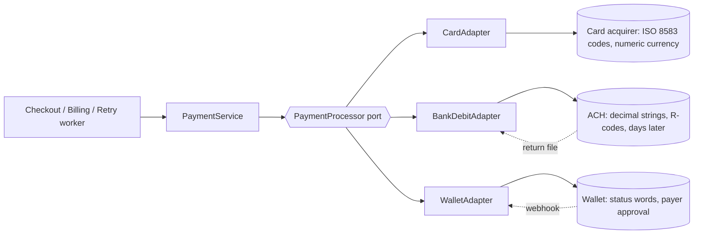

# Payment Method Abstraction and Processor Adapters

> One interface, nine rails, no leaking of processor quirks.

**Type:** Build
**Languages:** Java, Python, Go
**Prerequisites:** Phase 12 Lesson 01 (Designing an Idempotent Payment API), Phase 12 Lesson 02 (The Payment State Machine), Phase 12 Lesson 04 (Smart Routing, Cascading, and Retry Policies), Phase 12 Lesson 05 (Webhooks), Phase 10 Lesson 01 (Representing Money)
**Time:** ~90 minutes

## Learning Objectives

- Design a single `PaymentProcessor` port that card, bank debit, and wallet adapters implement, and state which vendor details must never cross it
- Normalize vendor outcomes (ISO 8583 response codes, NACHA return codes, wallet status words) into one `PaymentStatus` and one `DeclineReason` that carries its own retry advice
- Model asynchronous confirmation (bank debits that settle or return days later, wallet approvals that happen out of band) as `PENDING` plus a translated event, using the same vocabulary as synchronous results
- Declare capabilities and currencies as data, and refuse an unsupported operation before the vendor is called
- Build an adapter conformance suite that every adapter must pass, and show that it catches a lossy decline mapping and a missing dedupe

## The Problem

A marketplace launched with one card processor. The checkout service called the processor's SDK directly, and over three years the processor's vocabulary spread through the codebase: the retry worker branched on `response_code == "51"`, the dunning job on `"05"`, the risk service on `"59"`, and the support dashboard displayed the raw code with a hand-maintained lookup table. Then the business added ACH bank debits for invoices over 1,000 USD, because card fees on a 40,000 USD invoice are 1,160 USD and ACH costs 0.80 USD.

ACH does not answer "approved" or "declined". It answers "submitted", and the real answer arrives one to three banking days later in a return file: `R01` (insufficient funds), `R02` (account closed), `R10` (customer says the debit was unauthorized). The checkout code had nowhere to put "submitted", so the integrating engineer mapped it to the card world's "approved" and shipped. The order was fulfilled on submission. Two days later `R01` arrived, the retry worker did not recognize the code, and the order stayed fulfilled and unpaid. Across the first month 2.1 percent of ACH debits returned, 61 invoices, 384,000 USD of goods shipped against money that never arrived. Worse, the retry worker did eventually learn about `R01`, but someone mapped it to the card branch for `"51"`, which retries after 24 hours. NACHA rules allow at most two re-presentments of an `R01` debit within 180 days, and a re-presentment of `R10` (unauthorized) is not allowed at all. One merchant's debits got retried six times and the originating bank put the account on watch.

None of this is a bug in any single line. It is a missing boundary. Every rail has its own vocabulary for amounts (minor units, decimal strings, numeric currency codes), outcomes (two-character codes, three-character codes, status words), timing (synchronous, asynchronous, customer-in-the-loop), and capabilities (separate capture, partial capture, partial refund). If that vocabulary reaches product code, every new rail is a change to every service that touches a payment, and every service grows its own slightly wrong translation table. This lesson builds the boundary: one port, one vocabulary, adapters that are the only place a vendor's words are spoken, and a conformance suite that makes "the adapter is correct" a test rather than a code review opinion.

## The Concept

### Ports and adapters, applied to rails

The pattern is the hexagonal architecture's port and adapter. The *port* is an interface owned by the payments domain and phrased in its words: charge this `Money` to this `PaymentMethod` under this reference; capture; refund; translate this notification. An *adapter* implements the port for one rail by speaking that rail's protocol. Product code depends on the port. Only the adapter depends on the vendor.



The test of a good port is what it does *not* contain. No `responseCode` field that callers read. No `isAch` flag. No method that exists for one rail. If the retry worker needs to know whether to retry, the port tells it in the port's own terms (`RetryAdvice.RETRY_LATER`), and the adapter decided that from the vendor's code.

### The normalized vocabulary

Everything that crosses the port is one of a handful of types:

| Type | Values | Why it exists |
|------|--------|---------------|
| `PaymentMethod` | sealed: `CardMethod`, `BankDebitMethod`, `WalletMethod` | The instrument, as a token. Raw card numbers never enter this layer (PCI scope stays in the vault) |
| `PaymentStatus` | `AUTHORIZED`, `SUCCEEDED`, `PENDING`, `REQUIRES_ACTION`, `DECLINED`, `FAILED` | One lifecycle position, whichever rail produced it |
| `DeclineReason` | `INSUFFICIENT_FUNDS`, `DO_NOT_HONOR`, `ISSUER_UNAVAILABLE`, `AUTHENTICATION_REQUIRED`, `EXPIRED_INSTRUMENT`, `INVALID_ACCOUNT`, `SUSPECTED_FRAUD`, `UNAUTHORIZED_DEBIT`, `INVALID_AMOUNT`, `UNKNOWN`, `NONE` | Why it did not succeed, at the granularity product code acts on |
| `RetryAdvice` | `RETRY_NOW`, `RETRY_LATER`, `RETRY_WITH_CUSTOMER`, `DO_NOT_RETRY`, `NOT_APPLICABLE` | What to do about it, attached to the reason so no caller decides it independently |
| `Capabilities` | flags + currencies | What this rail can do, as data |
| `PaymentResult` / `PaymentEvent` | the above plus amount, references, raw code | The synchronous answer and the asynchronous one, in the same shape |

Two design choices deserve defending.

**`DECLINED` versus `FAILED`.** `DECLINED` is a synchronous refusal: nothing moved. `FAILED` is a payment that was accepted (`PENDING`) and later did not complete: a returned debit, an abandoned wallet approval. The distinction matters downstream. A `DECLINED` card never needs a ledger reversal. A `FAILED` ACH debit may have been credited to the merchant's pending balance optimistically and needs a reversing entry (Phase 12, Lesson 08).

**`rawCode` is kept but never branched on.** The result carries the vendor's code (`"51"`, `"R01"`, `"DECLINED/INSUFFICIENT_FUNDS"`) because a support engineer reading a ticket needs it and a dispute representment may cite it. It is a string for humans and logs. The day a product service writes `if (result.rawCode().equals("51"))`, the abstraction has leaked, and the conformance suite cannot catch that; code review and a lint rule can.

### The decline mapping, with real codes

The card column uses ISO 8583 field 39 response codes as acquirers pass them through; `1A` is the code Visa Europe and others use for "strong customer authentication required" under PSD2. The bank column uses NACHA return reason codes. The wallet column uses status and issue words of the kind wallet APIs return.

| `DeclineReason` | Card (ISO 8583) | ACH return | Wallet issue | `RetryAdvice` |
|-----------------|-----------------|------------|--------------|---------------|
| `INSUFFICIENT_FUNDS` | `51` | `R01`, `R09` | `INSUFFICIENT_FUNDS` | `RETRY_LATER` |
| `DO_NOT_HONOR` | `05` | `R16` | `INSTRUMENT_DECLINED`, `PAYER_CANNOT_PAY` | `RETRY_LATER` |
| `ISSUER_UNAVAILABLE` | `91` | | | `RETRY_NOW` |
| `AUTHENTICATION_REQUIRED` | `1A` | | | `RETRY_WITH_CUSTOMER` |
| `EXPIRED_INSTRUMENT` | `54` | | | `DO_NOT_RETRY` |
| `INVALID_ACCOUNT` | `14` | `R02`, `R03`, `R04` | | `DO_NOT_RETRY` |
| `SUSPECTED_FRAUD` | `59` | | | `DO_NOT_RETRY` |
| `UNAUTHORIZED_DEBIT` | | `R10`, `R29` | | `DO_NOT_RETRY` |
| `INVALID_AMOUNT` | `13` | (over-refund) | `UNPROCESSABLE_ENTITY` | `DO_NOT_RETRY` |
| `UNKNOWN` | anything else | anything else | anything else | `DO_NOT_RETRY` |

Read the last row carefully: an unmapped code becomes `UNKNOWN`, and `UNKNOWN` advises `DO_NOT_RETRY`. The safe default for "I do not know what this means" is to stop, alert, and add the mapping. The unsafe default, the one the marketplace shipped, is to fall into whatever branch the previous `else` happened to be. Card networks penalize excessive reattempts on declines that say "do not retry", and NACHA caps re-presentment, so a fail-open default is a compliance problem, not just a wasted call.

The retry advice lives on the enum, not in the retry worker. The worker reads `result.advice()`. When the business decides that `DO_NOT_HONOR` should wait 72 hours instead of 24, that is one change in one place, and the dunning job (Phase 12, Lesson 11) and the router (Phase 12, Lesson 04) both inherit it.

### Asynchronous confirmation is a status, not a special case

The ACH adapter's `charge` returns `PENDING` with the trace number as `processorRef`. Days later the bank's return file (or the processor's webhook carrying it) contains a line the adapter translates:

```text
ach|settled|ach_000001             -> PaymentEvent(ach_000001, SUCCEEDED, NONE, "")
ach|returned|ach_000002|R01        -> PaymentEvent(ach_000002, FAILED, INSUFFICIENT_FUNDS, "R01")
wallet:PAYMENT.CAPTURE.COMPLETED:wal_000004 -> PaymentEvent(wal_000004, SUCCEEDED, NONE, ...)
anything|else                      -> Optional.empty()
```

`translateEvent` returns `Optional.empty()` for anything it does not recognize. Notifications are at-least-once and frequently include event types you never subscribed to (Phase 12, Lesson 05); an adapter that throws on an unknown event type turns a vendor's new feature announcement into your outage.

The wallet's out-of-band payer approval and the card's SCA soft decline (`1A`) both normalize to `REQUIRES_ACTION`. The checkout front end has one branch for "send the customer somewhere and wait", not one per rail.

The service applies an event only to a payment that is not already final. A redelivered `returned` line, or a `settled` line for a trace the service never issued, is ignored. That is the minimal dedupe; Phase 12, Lesson 02's state machine is the full version, where every transition is checked against an allowed-transitions table.

### Capabilities as data

Rails differ in what they can do, and the differences are not cosmetic:

| Capability | Card | ACH debit | Wallet |
|------------|------|-----------|--------|
| `SEPARATE_CAPTURE` (authorize now, capture later) | yes | no | yes |
| `PARTIAL_CAPTURE` | yes | no | no (full or nothing) |
| `REFUND` | yes | yes (as a credit entry) | yes |
| `PARTIAL_REFUND` | yes | yes | yes |
| `ASYNC_CONFIRMATION` | no | yes | no |
| `CUSTOMER_ACTION` | (via `1A`) | no | yes |
| Currencies | USD, EUR, GBP, JPY | USD | USD, EUR, GBP |

Each adapter publishes its row as a `Capabilities` value, and each adapter's entry points check it *before* calling the vendor. Three reasons to check early rather than let the vendor reject:

1. The vendor's rejection is in the vendor's vocabulary, and you would have to map it.
2. Some vendors do not reject. A rail with no concept of authorize-only will happily *debit* when you meant to *authorize*. Money moves.
3. Callers can ask. A checkout page can hide "pay later, we capture on shipment" for a method whose processor lacks `SEPARATE_CAPTURE`, and the router can skip processors that lack the currency, without a failed call.

### Idempotency is the adapter's job when the rail has none

The card acquirer and the wallet both accept an idempotency key (the card fake keys on the request reference; real acquirers use a merchant reference or a dedicated header). ACH has no such concept. Submit the same debit twice in a NACHA file and the customer is debited twice. The bank adapter therefore keeps a `reference -> PaymentResult` map and returns the prior result for a repeated reference. The port's contract, "the same reference is one charge", is uniform; how each adapter meets it is not. That uniformity is precisely what the conformance suite checks.

### Worked example by hand

Three charges of 45.00 USD under the same port:

| Step | Card | Bank debit | Wallet |
|------|------|------------|--------|
| Port call | `charge(order-1, 45.00 USD, CardMethod(tok_visa_4242), capture=true)` | `charge(order-2, 45.00 USD, BankDebitMethod(acct_ok), capture=true)` | `charge(order-3, 45.00 USD, WalletMethod(wal_ok), capture=true)` |
| What the adapter sends | `amount=4500 currency=840` | `amount=45.00` | `amount=4500 currency=usd intent=CAPTURE` |
| Vendor answer | `00`, `auth_000001` | trace `ach_000001` | `COMPLETED`, `wal_000001` |
| Port result | `SUCCEEDED`, raw `00` | `PENDING`, raw empty | `SUCCEEDED`, raw `COMPLETED` |
| Later | | `ach\|settled\|ach_000001` becomes `SUCCEEDED` | |

Now the failure: insufficient funds on each rail. The card returns `51` synchronously, giving `DECLINED / INSUFFICIENT_FUNDS / RETRY_LATER`. The bank returns `PENDING`, then `ach|returned|ach_000002|R01`, giving `FAILED / INSUFFICIENT_FUNDS / RETRY_LATER`. The wallet returns `DECLINED` with issue `INSUFFICIENT_FUNDS`, giving `DECLINED / INSUFFICIENT_FUNDS / RETRY_LATER`. Three vocabularies, one answer to the only question the retry worker asks.

One currency detail: 4,500 JPY goes to the card acquirer as `amount=4500 currency=392`, because JPY has exponent 0 and ISO 4217 numeric code 392. Had the adapter multiplied by 100 out of USD habit, the customer would have been charged 450,000 JPY. The `Money` type's exponent makes that mistake unrepresentable; the adapter's test pins the wire format.

### The conformance suite

An interface in Java says what methods exist. It says nothing about what they mean. "Returns `PENDING` only if the adapter declared `ASYNC_CONFIRMATION`" and "the same reference creates one vendor charge" are semantic contracts that the compiler cannot check. The conformance suite is a single function, `ProcessorConformance.run(target)`, that drives any adapter through the same scenarios and reports which contracts it broke. Every adapter, including the next one someone writes, runs it in CI.

| # | Contract | Why |
|---|----------|-----|
| 1 | Approval returns a processor reference and the exact amount; status `SUCCEEDED`, or `PENDING` iff `ASYNC_CONFIRMATION`; eventually `SUCCEEDED` | Callers fulfil on `SUCCEEDED` and must not fulfil on `PENDING` |
| 2 | Insufficient funds ends `DECLINED` or `FAILED` with `INSUFFICIENT_FUNDS` and `RETRY_LATER` | The decline mapping is the adapter's main job |
| 3 | The same reference twice yields one processor reference and one vendor charge | Lesson 01's idempotency must survive the last hop |
| 4 | An undeclared currency throws `UnsupportedCapabilityException` with zero vendor calls | Capabilities are honest and checked before I/O |
| 5 | Separate and partial capture work if declared, are refused before the vendor if not | Same |
| 6 | Partial refund for the exact amount; over-refund is `DECLINED` | Refunds never exceed captures (Phase 12, Lesson 06) |
| 7 | Unknown or empty events are ignored, not thrown | Webhooks deliver things you did not ask for |
| 8 | Declines carry a non-`NONE` reason | No silent "declined for no reason" |

The suite is only as good as its ability to fail. The tests construct two deliberately broken adapters: a card adapter that maps every decline to `DO_NOT_HONOR` (it fails contract 2) and a bank adapter that forgets ACH has no dedupe (it fails contract 3). A conformance suite that has never been seen to fail is an untested test.

### Complexity and cost

Every operation is O(1) in the adapter: a map lookup for the code translation, a map lookup for the dedupe, a set lookup for the capability. The cost of the abstraction is not CPU. It is the information you choose to discard: the card network distinguishes `51` from `61` (exceeds withdrawal limit) and `65` (exceeds frequency limit), and this lesson's vocabulary does not. Collapse too much and the router cannot make good decisions; collapse too little and the vocabulary becomes the union of every vendor's and product code is back to branching on rails. The rule of thumb: add a `DeclineReason` when some caller would act differently on it, and not before.

### What this design does not do

- It does not handle late reversals after success. An ACH debit can be returned `R10` up to 60 days after it settled, and a card can be charged back months later. Those are not transitions of the original charge from `SUCCEEDED`; they are new objects (a return, a dispute) with their own lifecycle (Phase 12, Lesson 07). The service ignores events on final payments, which is right for duplicates and wrong for these, so a production system routes them to a separate handler.
- It does not route. With one processor per `MethodType`, there is no choice to make. Phase 12, Lesson 04 puts several card adapters behind the same port and picks among them by capability, cost, and health.
- It does not persist anything. The bank adapter's dedupe map lives in memory and dies with the process; in production it is a row in the same database as the payment (Lesson 01).
- It does not verify webhook signatures. `translateEvent` assumes the raw event is authentic; Lesson 05's HMAC check runs before it.

## Build It

The full code is in `code/java/Main.java` and `MainTest.java`. The walkthrough goes from the vocabulary outward to the vendors and back.

### Step 1: The instrument and the outcome vocabulary

```java
sealed interface PaymentMethod permits CardMethod, BankDebitMethod, WalletMethod {
    MethodType type();
    String token();
}

record CardMethod(String token, String network) implements PaymentMethod {
    public MethodType type() { return MethodType.CARD; }
}

enum PaymentStatus {
    AUTHORIZED, SUCCEEDED, PENDING, REQUIRES_ACTION, DECLINED, FAILED;

    boolean isFinal() { return this == SUCCEEDED || this == DECLINED || this == FAILED; }
}
```

`sealed` makes the set of instrument types closed: a `switch` over `PaymentMethod` is exhaustive, and adding a fourth rail is a compile error everywhere that has not handled it. Methods hold tokens, never card numbers. `isFinal` defines which statuses an event may no longer change; `AUTHORIZED` is not final because a capture follows.

**Predict:** `REQUIRES_ACTION` is not final. What would break if it were?

### Step 2: Decline reasons that carry their own retry advice

```java
enum DeclineReason {
    NONE(RetryAdvice.NOT_APPLICABLE),
    INSUFFICIENT_FUNDS(RetryAdvice.RETRY_LATER),
    DO_NOT_HONOR(RetryAdvice.RETRY_LATER),
    ISSUER_UNAVAILABLE(RetryAdvice.RETRY_NOW),
    AUTHENTICATION_REQUIRED(RetryAdvice.RETRY_WITH_CUSTOMER),
    EXPIRED_INSTRUMENT(RetryAdvice.DO_NOT_RETRY),
    INVALID_ACCOUNT(RetryAdvice.DO_NOT_RETRY),
    SUSPECTED_FRAUD(RetryAdvice.DO_NOT_RETRY),
    UNAUTHORIZED_DEBIT(RetryAdvice.DO_NOT_RETRY),
    INVALID_AMOUNT(RetryAdvice.DO_NOT_RETRY),
    UNKNOWN(RetryAdvice.DO_NOT_RETRY);

    private final RetryAdvice advice;
    DeclineReason(RetryAdvice advice) { this.advice = advice; }
    RetryAdvice advice() { return advice; }
}
```

The enum constructor binds each reason to exactly one advice. There is no way to construct a `DeclineReason` without one, and no caller-side table to drift. `UNKNOWN` is fail-safe.

### Step 3: Capabilities and the port

```java
record Capabilities(Set<Capability> flags, Set<Currency> currencies) {
    boolean supports(Capability c) { return flags.contains(c); }

    void require(String adapter, Capability c) {
        if (!supports(c)) throw new UnsupportedCapabilityException(adapter + " does not support " + c);
    }

    void requireCurrency(String adapter, Currency c) {
        if (!currencies.contains(c)) throw new UnsupportedCapabilityException(adapter + " does not support currency " + c.code());
    }
}

interface PaymentProcessor {
    String name();
    MethodType methodType();
    Capabilities capabilities();
    PaymentResult charge(ChargeRequest request);
    PaymentResult capture(String processorRef, Money amount);
    PaymentResult refund(String processorRef, Money amount);
    Optional<PaymentEvent> translateEvent(String rawEvent);
}
```

Seven methods. Every one is phrased in domain types. `ChargeRequest` carries the idempotency `reference`, the `Money`, the `PaymentMethod`, and `capture` (true for a one-step sale, false for authorize-only). The compact constructor of `Capabilities` (in the full file) makes defensive copies so an adapter cannot mutate its advertised set after the router has read it.

**Predict:** `translateEvent` is on the port, not on a separate webhook interface. What would the `PaymentService` have to know if it were not?

### Step 4: A vendor with quirks

```java
AuthResponse authorize(String idempotencyKey, String panToken, long amountMinor, String currencyNumeric, boolean capture) {
    vendorCalls++;
    lastWire = "amount=" + amountMinor + " currency=" + currencyNumeric;
    AuthResponse prior = byIdempotencyKey.get(idempotencyKey);
    if (prior != null) return prior;
    chargesCreated++;
    String code = switch (panToken) {
        case "tok_insufficient" -> "51";
        case "tok_do_not_honor" -> "05";
        case "tok_expired" -> "54";
        case "tok_fraud" -> "59";
        case "tok_bad_number" -> "14";
        case "tok_issuer_down" -> "91";
        case "tok_sca_required" -> "1A";
        case "tok_weird" -> "N7";
        default -> "00";
    };
    ...
}
```

`FakeCardNetworkApi` is a stand-in for an acquirer: magic test tokens produce specific response codes, the currency travels as the ISO 4217 *numeric* code, and the idempotency key is honoured natively. It counts `vendorCalls` (every invocation) separately from `chargesCreated` (new charges), which is what lets the suite distinguish "refused before the vendor" from "deduped by the vendor". `FakeBankDebitApi` takes decimal strings, has no dedupe at all, and puts `ach|settled|...` or `ach|returned|...|Rxx` lines in an outbox. `FakeWalletApi` takes lowercase currency, answers with status words, and only captures the full authorized amount.

### Step 5: The card adapter

```java
public PaymentResult charge(ChargeRequest request) {
    if (!(request.method() instanceof CardMethod card)) throw new IllegalArgumentException("card adapter given " + request.method().type());
    CAPS.requireCurrency(name(), request.amount().currency());
    if (!request.capture()) CAPS.require(name(), Capability.SEPARATE_CAPTURE);
    FakeCardNetworkApi.AuthResponse r = api.authorize(request.reference(), card.token(),
            request.amount().minorUnits(), request.amount().currency().numeric(), request.capture());
    if (r.responseCode().equals("00")) {
        PaymentStatus status = request.capture() ? PaymentStatus.SUCCEEDED : PaymentStatus.AUTHORIZED;
        return new PaymentResult(request.reference(), r.authId(), status, request.amount(), DeclineReason.NONE, "00");
    }
    DeclineReason reason = mapCode(r.responseCode());
    PaymentStatus status = reason == DeclineReason.AUTHENTICATION_REQUIRED ? PaymentStatus.REQUIRES_ACTION : PaymentStatus.DECLINED;
    return new PaymentResult(request.reference(), r.authId(), status, request.amount(), reason, r.responseCode());
}
```

The order is: type check, capability checks, one vendor call, translation. The pattern-matching `instanceof` binds `card` so the token is read from the right record type. `mapCode` is `RESPONSE_CODES.getOrDefault(code, UNKNOWN)`. The `1A` special case is the one place a decline becomes a status other than `DECLINED`, because the customer can fix it by authenticating.

**Predict:** a `ChargeRequest` for 10.00 CHF reaches this method. How many times is `api.authorize` called?

### Step 6: The bank adapter supplies what the rail lacks

```java
public PaymentResult charge(ChargeRequest request) {
    if (!(request.method() instanceof BankDebitMethod account)) throw new IllegalArgumentException("bank adapter given " + request.method().type());
    CAPS.requireCurrency(name(), request.amount().currency());
    if (!request.capture()) CAPS.require(name(), Capability.SEPARATE_CAPTURE);
    PaymentResult prior = byReference.get(request.reference());
    if (prior != null) return prior;
    String trace = api.submitDebit(account.token(), request.amount().toPlainString());
    PaymentResult result = new PaymentResult(request.reference(), trace, PaymentStatus.PENDING, request.amount(), DeclineReason.NONE, "");
    byReference.put(request.reference(), result);
    debited.put(trace, request.amount());
    return result;
}

public Optional<PaymentEvent> translateEvent(String rawEvent) {
    String[] parts = rawEvent.split("\\|");
    if (parts.length < 3 || !parts[0].equals("ach")) return Optional.empty();
    return switch (parts[1]) {
        case "settled" -> Optional.of(new PaymentEvent(parts[2], PaymentStatus.SUCCEEDED, DeclineReason.NONE, ""));
        case "returned" -> parts.length < 4 ? Optional.empty()
                : Optional.of(new PaymentEvent(parts[2], PaymentStatus.FAILED, mapCode(parts[3]), parts[3]));
        default -> Optional.empty();
    };
}
```

Authorize-only is refused: `SEPARATE_CAPTURE` is not in the bank's capabilities, so a `capture=false` request throws before `submitDebit`. The `byReference` map is the dedupe the rail does not provide. `toPlainString()` renders `4500` minor units as `"45.00"`, derived from the currency exponent, never from floating point. `translateEvent` parses defensively: a malformed line is `empty`, not an `ArrayIndexOutOfBoundsException`.

**Predict:** the return file contains `ach|returned|ach_000002`, with no code. What does `translateEvent` return, and is that the right choice?

### Step 7: The service routes and applies events

```java
PaymentResult pay(ChargeRequest request) {
    PaymentResult result = processorFor(request.method().type()).charge(request);
    byProcessorRef.put(result.processorRef(), result);
    return result;
}

Optional<PaymentResult> onRawEvent(MethodType type, String rawEvent) {
    Optional<PaymentEvent> event = processorFor(type).translateEvent(rawEvent);
    if (event.isEmpty()) return Optional.empty();
    PaymentEvent e = event.get();
    PaymentResult current = byProcessorRef.get(e.processorRef());
    if (current == null || current.status().isFinal()) return Optional.empty();
    PaymentResult updated = new PaymentResult(current.reference(), current.processorRef(), e.status(), current.amount(), e.reason(), e.rawCode());
    byProcessorRef.put(e.processorRef(), updated);
    return Optional.of(updated);
}
```

`PaymentService` never mentions a vendor. It selects the adapter by `MethodType` from an `EnumMap`, records the latest normalized result, and lets the adapter interpret raw notifications. The `isFinal` guard makes event application idempotent for redeliveries.

### Step 8: The conformance suite

```java
ChargeRequest dup = request(t.approve(), "12.34", true);
int createdBefore = t.chargesCreated().getAsInt();
PaymentResult first = p.charge(dup);
PaymentResult second = p.charge(dup);
expect("same reference returns the same processor reference", first.processorRef().equals(second.processorRef()));
expect("same reference creates exactly one vendor charge", t.chargesCreated().getAsInt() - createdBefore == 1);

int[] delta = {-1};
ChargeRequest chf = new ChargeRequest("conf-chf-" + p.name(), Money.parse("10.00", Currency.CHF), t.approve(), true);
expect("undeclared currency throws UnsupportedCapabilityException", throwsUnsupported(() -> p.charge(chf), delta));
expect("undeclared currency never reaches the vendor", delta[0] == 0);
```

A `ConformanceTarget` bundles an adapter with its vendor's test tokens, a way to drain its pending events, and the two counters. The suite branches on *declared* capabilities: if the adapter says `PARTIAL_CAPTURE`, partial capture must work; if it does not, partial capture must be refused with zero vendor calls. For `PENDING` results, `finalStatus` drains the vendor's outbox through the adapter's own `translateEvent`, so the async path is tested end to end. `run` returns a `ConformanceReport` with the check count and the failure names.

**Predict:** the wallet adapter declares `SEPARATE_CAPTURE` but not `PARTIAL_CAPTURE`. Which branch of contract 5 runs for it, and what does the wallet vendor's counter show afterwards?

### Step 9: Run it

```bash
cd phases/12-payment-systems-design/10-payment-method-abstraction/code/java
javac -d .out *.java && java -cp .out Main
java -cp .out MainTest
```

Expected output, abbreviated:

```console
== One interface, three rails: the same 45.00 USD charge ==
card  tok_visa_4242                -> SUCCEEDED       reason=NONE                     advice=NOT_APPLICABLE      raw=00
bank  acct_ok                      -> PENDING         reason=NONE                     advice=NOT_APPLICABLE      raw=-
wallet wal_ok                      -> SUCCEEDED       reason=NONE                     advice=NOT_APPLICABLE      raw=COMPLETED

== Three vendors say 'no money' three ways; product code sees one reason ==
card  ISO 8583 code 51             -> DECLINED        reason=INSUFFICIENT_FUNDS       advice=RETRY_LATER         raw=51
bank  submitted (outcome later)    -> PENDING         reason=NONE                     advice=NOT_APPLICABLE      raw=-
  raw bank event: ach|settled|ach_000001
  raw bank event: ach|returned|ach_000002|R01
bank  after return file            -> FAILED          reason=INSUFFICIENT_FUNDS       advice=RETRY_LATER         raw=R01
wallet INSUFFICIENT_FUNDS          -> DECLINED        reason=INSUFFICIENT_FUNDS       advice=RETRY_LATER         raw=DECLINED/INSUFFICIENT_FUNDS

== Capability flags refuse before the vendor is called ==
authorize-only on bank debit: bank_debit does not support SEPARATE_CAPTURE (vendor calls +0)
JPY on card: SUCCEEDED 4500 JPY (sent as minor=4500, currency=392)

== Conformance suite, run against every adapter ==
card       19 checks  [SEPARATE_CAPTURE, PARTIAL_CAPTURE, REFUND, PARTIAL_REFUND]    PASS
bank_debit 19 checks  [REFUND, PARTIAL_REFUND, ASYNC_CONFIRMATION]                   PASS
wallet     21 checks  [SEPARATE_CAPTURE, REFUND, PARTIAL_REFUND, CUSTOMER_ACTION]    PASS
```

`MainTest` runs 51 assertions: the suite against all three adapters, the suite failing against the two broken adapters, every row of the mapping table, the wire format of each vendor, and the event-application rules.

### In Python

```python
PaymentMethod = Union[CardMethod, BankDebitMethod, WalletMethod]   # the sealed interface

class PaymentProcessor(Protocol):                                   # the port
    def charge(self, request: ChargeRequest) -> PaymentResult: ...
    def translate_event(self, raw_event: str) -> Optional[PaymentEvent]: ...

def charge(self, request: ChargeRequest) -> PaymentResult:          # inside CardAdapter
    match request.method:
        case CardMethod() as card:
            pass
        case _:
            raise ValueError(f"card adapter given {request.method.type().name}")
```

Differences, all in `code/python/main.py` and `test_main.py`:

- **The sealed interface is a `Union` of frozen dataclasses**, each with a `type()` method, and the adapters narrow it with `match`/`case` where Java used `instanceof` patterns. `PaymentProcessor` is a `typing.Protocol`, so the two deliberately broken adapters in the tests (`LossyCardAdapter`, `NoDedupeBankAdapter`) implement it without inheriting anything.
- **`Optional<PaymentEvent>` is `Optional[PaymentEvent]`**: `translate_event` returns `None` for foreign or malformed notifications and `PaymentService.on_raw_event`/`lookup` return `None` where Java returned `Optional.empty()`.
- **Enums carry their data.** `DeclineReason` members are `(label, RetryAdvice)` tuples so `reason.advice()` works as in Java; the vendor `switch` statements on tokens become dict lookups. `Capabilities.flags` is a `frozenset`, printed through `format_flags` in declaration order because `EnumSet` iteration order is what the Java demo shows.
- **The conformance suite's out-parameter is a tuple.** `_throws_unsupported(action)` returns `(raised, vendor_calls_delta)` instead of filling an `int[]`. `UnsupportedCapabilityError` is a `RuntimeError`; wrong method type and zero amounts raise `ValueError`; a duplicate registration raises `RuntimeError`.

```bash
cd phases/12-payment-systems-design/10-payment-method-abstraction/code/python
python3 main.py
python3 -m unittest -v
```

### In Go

```go
// PaymentMethod is the sealed interface: Go has no sealed types, so the unexported marker
// method keeps the set of instruments closed to this package.
type PaymentMethod interface {
    Type() MethodType
    Token() string
    paymentMethod()
}

func (c *CardAdapter) Charge(request ChargeRequest) (PaymentResult, error) {
    card, ok := request.Method.(CardMethod)
    if !ok {
        return PaymentResult{}, fmt.Errorf("%w: card adapter given %v", ErrInvalidArgument, request.Method.Type())
    }
    if err := cardCaps.RequireCurrency(c.Name(), request.Amount.Currency); err != nil {
        return PaymentResult{}, err
    }
    ...
}
```

Differences, all in `code/go/main.go`, `money.go`, and `main_test.go`:

- **The port returns errors as values.** `Charge`, `Capture`, and `Refund` return `(PaymentResult, error)`; `UnsupportedCapabilityException` is the sentinel `ErrUnsupportedCapability`, wrong instruments and zero amounts wrap `ErrInvalidArgument`, and a duplicate `Register` wraps `ErrIllegalState`, all checked with `errors.Is`. The conformance suite's `throwsUnsupported` becomes `failsUnsupported(action func() error) (bool, int)`, returning the vendor-call delta instead of filling an `int[]`.
- **`Optional` is a second return value.** `TranslateEvent` returns `(PaymentEvent, bool)`, and `PaymentService.OnRawEvent`/`Lookup` return `(PaymentResult, bool)`; `false` is Java's `Optional.empty()`.
- **Enums carry their data through parallel tables.** `DeclineReason` is an `int` constant whose `Advice()` indexes a `declineAdvice` array, so the retry advice still travels with the reason; the `RESPONSE_CODES`, `RETURN_CODES`, and `ISSUES` maps are package-level `map[string]DeclineReason` values with a shared `lookupReason` that falls back to `UNKNOWN`. `Capabilities.Flags()` returns the declared flags in declaration order, which is what `EnumSet` iteration printed in the Java demo.
- **The conformance check count is unchanged.** The suite wraps each port call so an unexpected `error` is recorded as a failure without incrementing `checks`; the card, bank, and wallet adapters still report 19, 19, and 21 checks.

```bash
cd phases/12-payment-systems-design/10-payment-method-abstraction/code/go
go run .
go test ./...
```

## Use It

**Stripe PaymentIntents and PaymentMethods.** Stripe's API is this lesson's port at scale. A `PaymentIntent` has one status vocabulary (`requires_payment_method`, `requires_action`, `processing`, `succeeded`, `canceled`) across cards, SEPA and ACH debits, and wallets. `processing` is this lesson's `PENDING` and is what ACH Direct Debit returns until settlement; `requires_action` is `REQUIRES_ACTION` for both 3-D Secure and redirect-based wallets. Decline details arrive as a normalized `decline_code` (`insufficient_funds`, `do_not_honor`, `expired_card`) with the network's raw code available separately (`network_decline_code`). Capabilities are explicit: `capture_method=manual` is only accepted for payment method types that support it.

**Adyen.** Adyen returns a `resultCode` (`Authorised`, `Refused`, `Pending`, `RedirectShopper`) plus a `refusalReason` and `refusalReasonCode` that normalize issuer and scheme responses across 250 payment methods. Its documentation publishes the mapping from raw issuer responses to refusal reasons, which is the same table this lesson builds.

**Hyperswitch, Spreedly, and payment orchestrators.** Orchestration platforms exist because merchants want this lesson's port without writing the adapters. Each connector in an open-source orchestrator like Hyperswitch is an adapter with a request transformer, a response transformer, and a status mapping; the project runs a connector test suite per adapter, which is this lesson's conformance suite.

**What the production versions hide.** They hide the cost of the mapping table. Card networks publish hundreds of response codes and processors pass some through, remap others, and add their own. Maintaining the table is ongoing work, and the `UNKNOWN` bucket's alert is how you find out a processor added a code. Ask any platform you integrate for its raw code passthrough, because the day you need to dispute a decline you will want the issuer's actual answer.

## Ship It

`outputs/checklist-processor-adapter.md` is a review checklist for adding or changing a processor adapter: wire-format translation, the decline mapping and its `UNKNOWN` default, capability declarations, idempotency on rails that lack it, event translation, and the conformance suite. Attach it to the pull request that adds the next rail.

## Exercises

1. **Reinforce.** Add the card codes `61` (exceeds withdrawal amount limit) and `65` (exceeds withdrawal frequency limit) to the mapping. Decide whether they deserve a new `DeclineReason` or belong under an existing one, justify the choice by naming a caller that would act differently, and add the tests.
2. **Apply.** Add a fourth adapter for SEPA Direct Debit: EUR only, `ASYNC_CONFIRMATION`, amounts as decimal strings, return reasons `AC01` (incorrect account), `AM04` (insufficient funds), `MD01` (no mandate), and `MS02` (refused by debtor). Register it under a new `MethodType`, map the codes, and make it pass `ProcessorConformance.run` without changing the suite.
3. **Extend.** Combine with Phase 12, Lesson 04: put two card adapters behind the port (`CardAdapter` and a second acquirer with different codes and no JPY), and write a router that picks the first adapter whose `Capabilities` support the request's currency and capture mode, falls back on `ISSUER_UNAVAILABLE`, and never falls back on `SUSPECTED_FRAUD`. Add a conformance contract that every routed result is still idempotent per reference across the fallback.

## Key Terms

| Term | What people say | What it actually means |
|------|-----------------|------------------------|
| Port | "the payments interface" | An interface owned by the domain and phrased in domain types; product code depends on it and on nothing vendor-specific |
| Adapter | "the Stripe integration" | The one class that speaks a rail's protocol: wire formats, codes, timing; it translates both directions and owns the rail's quirks |
| Normalized decline reason | "the error code" | A domain-level reason for non-success, coarse enough that callers act on it and fine enough that different actions are distinguishable |
| Retry advice | "whether it's a soft decline" | The action attached to a reason (retry now, later, with the customer, never), defined once next to the reason rather than in each caller |
| Capability flag | "does it support X" | A declared, queryable property of an adapter that is checked before the vendor is called, so unsupported operations fail locally and visibly |
| Asynchronous confirmation | "ACH is slow" | A rail whose first answer is `PENDING` and whose real outcome arrives later as an event, translated into the same vocabulary |
| Conformance suite | "the adapter tests" | One parameterized set of semantic contracts that every adapter must pass, including the ones the type system cannot express |

## Further Reading

- [ISO 8583-1:2003, Financial transaction card originated messages](https://www.iso.org/standard/31628.html) — the message standard whose field 39 response codes (`00`, `05`, `51`, `54`, `91`) card adapters translate.
- [NACHA Operating Rules: ACH return reason codes](https://www.nacha.org/rules) — the authoritative list of `R` codes and the re-presentment limits that make a fail-open retry default a compliance problem.
- [Stripe API reference: PaymentIntent object and decline codes](https://docs.stripe.com/declines/codes) — a production normalized vocabulary across rails, with the raw network code kept separately.
- [Adyen documentation: Refusal reasons and raw acquirer responses](https://docs.adyen.com/development-resources/refusal-reasons/) — a published mapping from issuer responses to normalized reasons.
- [Alistair Cockburn, "Hexagonal Architecture"](https://alistair.cockburn.us/hexagonal-architecture/) — the original description of ports and adapters, the structure this lesson applies to payment rails.
- [EMVCo 3-D Secure Specification](https://www.emvco.com/emv-technologies/3-d-secure/) — the protocol behind the `REQUIRES_ACTION` path that a soft decline like `1A` sends the customer through.
