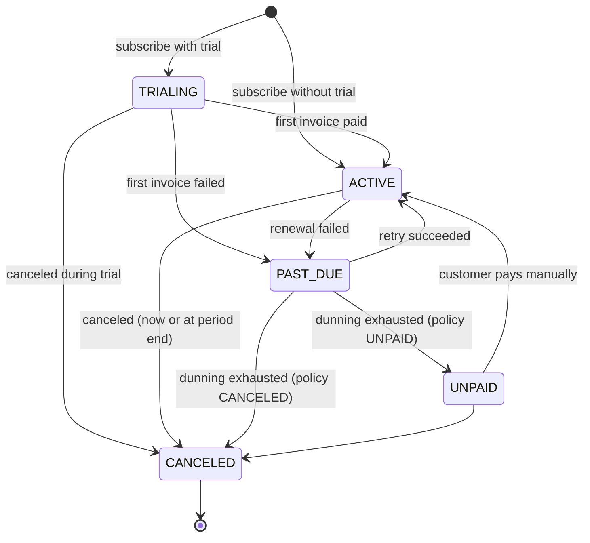

# Recurring Payments, Subscriptions, and Dunning

> Billing cycles, proration, and the retry schedule that recovers revenue.

**Type:** Build
**Languages:** Java, Python, Go
**Prerequisites:** Phase 12 Lesson 02 (The Payment State Machine), Phase 12 Lesson 04 (Smart Routing, Cascading, and Retry Policies), Phase 12 Lesson 10 (Payment Method Abstraction), Phase 10 Lesson 01 (Representing Money)
**Time:** ~90 minutes

## Learning Objectives

- Compute every billing date from the subscription's anchor, and explain why computing it from the previous billing date drifts after the first short month
- Prorate a mid-cycle plan change by days using largest-remainder allocation, so the used portion and the credit sum to the old price to the minor unit
- Implement the subscription state machine (`TRIALING`, `ACTIVE`, `PAST_DUE`, `UNPAID`, `CANCELED`) with an explicit allowed-transitions table
- Build a dunning schedule that retries soft declines on fixed offsets from the first failure, stops immediately on hard declines, and consults a card-updater hook on expired cards
- Make the daily billing run idempotent and able to catch up after missed days without double-charging or skipping a period

## The Problem

A software company bills 180,000 subscribers on the day of the month they signed up. Its billing job was written in a weekend: every night it selects subscriptions whose `next_bill_date` is today, charges them, and sets `next_bill_date = next_bill_date + 1 month`. In January, 6,100 customers signed up on the 29th, 30th, or 31st. In February their `next_bill_date + 1 month` landed on February 28. In March it became March 28, and it stayed on the 28th forever. Nobody noticed for a year, until a customer on an annual contract with a "billed on the last day of the month" clause complained that they had been charged three days early eleven times. The fix moved 6,100 customers' dates, and the migration charged 412 of them twice in March because the job ran once before and once after the data fix.

The same company's failed-payment handling was a single retry 24 hours later. Industry data on recurring card payments puts first-attempt failure rates at 5 to 15 percent, and the majority of those failures are soft: insufficient funds the day before payday, an issuer outage, a do-not-honor that clears tomorrow. A single retry recovered a fraction of them; the rest churned involuntarily. Customers who never meant to leave were canceled because their card expired and nobody asked the network for the new number. Meanwhile, the same single retry was also applied to cards declined as stolen, which card networks count as excessive reattempts on a do-not-retry decline and fine accordingly.

And when customers upgraded mid-month, the job charged the new price minus the old price, in full, regardless of the date. Upgrading on the 29th of a 30-day month cost the same as upgrading on the 1st. Support handled the complaints with manual refunds computed in a spreadsheet with floating-point percentages, and the refunds did not reconcile to the ledger by a few cents a month.

Three mechanisms fix this: billing dates derived from an anchor, proration with exact allocation, and a dunning schedule driven by the decline reason. This lesson builds all three behind a subscription state machine, and makes the daily run safe to repeat.

## The Concept

### The anchor, and why boundaries are never chained

A subscription has a *billing cycle anchor*: the date that defines its billing day. Period `n` starts at `anchor + n * interval`, computed directly, not by adding one interval to the previous start. Java's `LocalDate.plusMonths` clamps to the last valid day of the target month, so with an anchor of 2026-01-31:

| n | Anchored: `anchor.plusMonths(n)` | Chained: `previous.plusMonths(1)` |
|---|----------------------------------|-----------------------------------|
| 0 | 2026-01-31 | 2026-01-31 |
| 1 | 2026-02-28 | 2026-02-28 |
| 2 | 2026-03-31 | 2026-03-28 |
| 3 | 2026-04-30 | 2026-04-28 |
| 4 | 2026-05-31 | 2026-05-28 |
| 5 | 2026-06-30 | 2026-06-28 |

Clamping is lossy: the information "this subscription bills on the 31st" is gone once you have computed February 28. Chaining feeds the lossy result back in, so the loss is permanent. Anchoring always starts from the unclamped date, so the loss is per-period and recovers in March. The same applies to a yearly subscription anchored on February 29: anchored, it bills 2029-02-28 and then 2032-02-29 again; chained, it bills on the 28th for the rest of its life.

Every period is half-open: `[periodStart(n), periodStart(n + 1))`. The end of one period is, by definition, the start of the next, so there are no gaps and no overlapping days. A period's length in days varies (28 to 31 for monthly) and proration must use the actual length, not 30.

### Proration with exact allocation

When a customer changes plans mid-period, two amounts are owed:

- a **credit** for the unused part of the period on the old plan, and
- a **charge** for the remaining part of the period on the new plan.

Both are computed by day. The naive formula, `price * remaining / period`, produces a fraction of a cent and must be rounded, and rounding the credit and the used portion independently can make them sum to something other than the price. The fix is the Phase 10 tool: `Money.allocate(used, remaining)`, the largest-remainder method, which returns two shares that sum to exactly the price. The credit is the second share. This is the invariant this lesson's tests check for every change day of every month length:

```text
oldPrice.allocate(used, remaining)[0] + oldPrice.allocate(used, remaining)[1] == oldPrice
credit == oldPrice.allocate(used, remaining)[1]
```

**Worked example.** Plan `basic` is 30.00 USD per month; `pro` is 50.00 USD. The current period is `[2026-03-01, 2026-04-01)`, 31 days. The customer upgrades on 2026-03-11, so 10 days are used and 21 remain.

Credit on `basic`, allocating 3000 minor units as 10:21:

```text
3000 * 10 / 31 = 967  remainder 23
3000 * 21 / 31 = 2032 remainder 8
distributed 2999, leftover 1 -> the largest remainder (23, index 0) gets it
shares: 968 + 2032 = 3000          credit = 20.32 USD
```

Charge on `pro`, allocating 5000 as 10:21:

```text
5000 * 10 / 31 = 1612 remainder 28
5000 * 21 / 31 = 3387 remainder 3
leftover 1 -> index 0
shares: 1613 + 3387 = 5000         charge = 33.87 USD
```

Net due now: 33.87 - 20.32 = **13.55 USD**. A downgrade from `pro` to `basic` on the same day is the mirror image: net -13.55 USD. Nothing is refunded; it becomes a credit balance applied to the next invoice, which is on the new 30.00 USD plan, so the April renewal is 30.00 - 13.55 = 16.45 USD. The tests pin that number.

Where independent rounding visibly breaks: a 9.99 USD plan in a 30-day month, changed on day 15. Each half is 4.995. Round each half-up and the customer is billed 5.00 for the used half and credited 5.00 for the unused half: 10.00 for a 9.99 plan. Allocation gives 5.00 and 4.99. One cent per change does not sound like much until a finance team tries to reconcile a quarter of plan changes against the ledger and finds a few hundred unexplained cents, every quarter, forever.

Proration choices that this lesson makes and real systems parameterize:

| Choice | This lesson | Alternatives |
|--------|-------------|--------------|
| Granularity | Days | Seconds (Stripe prorates to the second), or no proration |
| When the net is charged | Immediately, as its own invoice | Added to the next renewal invoice |
| Negative net | Credit balance, applied to the next invoice | Refund to the card |
| Interval change (monthly to yearly) | Refused | Reset the anchor to today and credit the unused old period |

### The state machine



The table form is `SubscriptionTransitions.ALLOWED`, an `EnumMap` from status to the set of legal next statuses. Every status change goes through `Subscription.transition`, which throws `IllegalTransitionException` for anything not in the table. Two rules are worth stating as invariants:

- **`ACTIVE` never goes directly to `UNPAID`.** Unpaid is only reachable through a failed dunning cycle, so every unpaid subscription has an invoice history that explains why.
- **`CANCELED` is terminal.** Reactivating a canceled subscription is a new subscription with a new anchor. Allowing `CANCELED -> ACTIVE` would let a stale retry revive a subscription the customer explicitly ended, and charge them for it.

`UNPAID` versus `CANCELED` is a business choice encoded in the `DunningPolicy`. `UNPAID` keeps the subscription and its anchor but stops creating invoices, so a customer who updates their card can be reactivated without losing their billing day. `CANCELED` ends it.

### Dunning: a schedule, driven by the reason

*Dunning* is the process of collecting a failed recurring payment. The schedule in this lesson is a list of offsets from the first failure, `[1, 3, 7, 14]` days, for five attempts in total over two weeks. Offsets are measured from the *first failure*, not from the previous attempt, for the same reason billing dates are anchored: if the engine misses a day, the schedule does not drift.

| Day | Attempt | Outcome in the worked run | Subscription |
|-----|---------|---------------------------|--------------|
| Feb 14 (trial end) | 1 | `INSUFFICIENT_FUNDS` | `TRIALING -> PAST_DUE` |
| Feb 15 (+1) | 2 | `INSUFFICIENT_FUNDS` | `PAST_DUE` |
| Feb 17 (+3) | 3 | `INSUFFICIENT_FUNDS` | `PAST_DUE` |
| Feb 21 (+7) | 4 | `INSUFFICIENT_FUNDS` | `PAST_DUE` |
| Feb 28 (+14) | 5 | `INSUFFICIENT_FUNDS` | invoice `UNCOLLECTIBLE`, `CANCELED` |

The reason for the decline decides whether the schedule applies at all:

| `ChargeOutcome` | Retry? | What happens |
|-----------------|--------|--------------|
| `INSUFFICIENT_FUNDS` | Yes, on schedule | Funds often arrive within days (payday) |
| `DO_NOT_HONOR` | Yes, on schedule | Generic issuer refusal; frequently transient |
| `EXPIRED_CARD` | Not with the same card | Ask the card updater for a replacement; if one exists, charge it now; otherwise exhaust |
| `DO_NOT_RETRY` | Never | Stolen, lost, closed account, fraud; one more attempt is a network rule violation |

This is the same classification as Phase 12, Lesson 10's `RetryAdvice`, seen from the billing side. A production system would take the adapter's `DeclineReason` directly; this lesson uses a smaller `ChargeOutcome` enum to keep the engine readable.

### The card updater

Card numbers change: cards expire, are reissued after a breach, or are upgraded to a new product. Visa Account Updater (VAU) and Mastercard Automatic Billing Updater (ABU) let a merchant (through its acquirer) ask "for this stored credential, is there a newer one?". Processors expose this either as a batch job before the billing run or as an automatic retry on an expired-card decline. This lesson models the second: on `EXPIRED_CARD`, the engine calls `CardUpdater.refresh(customerId, oldToken)`; if it returns a different token, the subscription's token is replaced and the invoice is charged again immediately, as a new attempt with a new reference. Without the updater, an expired card is a guaranteed involuntary churn.

Charges on a subscription are *merchant-initiated transactions* on a *stored credential*. The card networks' credential-on-file framework requires the first charge to be flagged as establishing the agreement and later charges to reference it, which is what lets issuers approve renewals without the cardholder present (and exempts them from SCA in Europe). The `ChargeGateway` interface in this lesson hides that flag; Lesson 10's adapter is where it would be set.

### Idempotency of the daily run

The billing job will be run twice on some day: a deploy restarts it, an operator reruns it after a partial failure, two instances overlap. Three properties make that safe:

1. **Invoice ids are deterministic.** A renewal invoice's id is `subscriptionId:periodStart`. Opening an invoice that already exists returns the existing one.
2. **Attempt references are deterministic.** The gateway reference is `invoiceId#attemptNumber`, and the gateway dedupes on it, so the same attempt replayed is one charge. A *retry* is a new attempt number and therefore a new reference, deliberately: it is a new charge request, not a replay.
3. **Attempts are scheduled, not counted per run.** An invoice is attempted when `today >= nextAttempt`, and every attempt moves `nextAttempt` forward or closes the invoice. A second `runDay()` finds nothing due.

Catch-up is the dual property: if the job did not run for six weeks, the next run rolls every missed period in order, opening one invoice per period. The `while` loop in `runDay` keeps rolling until `currentPeriodEnd` is in the future. Nothing is skipped and nothing is billed twice.

### Complexity

`runDay` is O(S + I) for S subscriptions and I open invoices, plus O(P) per subscription for P missed periods during catch-up. Each period computation is O(1) date arithmetic. Proration is O(1). In production the scan becomes two indexed queries (`next_bill_date <= today`, `next_attempt <= today`) and the work is sharded by subscription id.

### What this design does not do

- It does not model time zones. A subscription billed "on the 31st" bills on the 31st of the merchant's calendar, and a customer in a time zone 14 hours away sees a different date. Production systems store an instant and a time zone for the anchor.
- It does not do smart retries. Stripe and others choose retry times per decline using models trained on network data (time of day, day of week, payday patterns); this lesson's fixed offsets are the baseline those models beat.
- It does not handle tax, coupons, metered usage, or multi-item invoices. Each is a line item on the invoice, priced and prorated with the same allocation discipline.
- It does not send dunning emails, which in practice recover a large share of failures by getting the customer to update their card. The schedule's hooks are where they would be sent.

## Build It

All code is in `code/java/Main.java`; tests are in `code/java/MainTest.java`.

### Step 1: Anchored billing dates

```java
static LocalDate periodStart(LocalDate anchor, Interval interval, long n) {
    if (n < 0) throw new IllegalArgumentException("period index must be >= 0");
    return anchor.plusMonths(Math.multiplyExact(n, (long) interval.months));
}

static LocalDate periodEnd(LocalDate anchor, Interval interval, long n) { return periodStart(anchor, interval, n + 1); }

static List<LocalDate> chainedStarts(LocalDate anchor, Interval interval, int count) {
    List<LocalDate> out = new ArrayList<>();
    LocalDate d = anchor;
    for (int i = 0; i < count; i++) { out.add(d); d = d.plusMonths(interval.months); }
    return out;
}
```

`Interval` carries its length in months (`MONTHLY(1)`, `QUARTERLY(3)`, `YEARLY(12)`), so yearly billing is the same code. `periodEnd(n)` is literally `periodStart(n + 1)`: half-open periods with no gaps. `chainedStarts` is the bug, kept in the code so the demo and a test can show it.

**Predict:** a quarterly subscription is anchored on 2025-11-30. What is the start of period 1, and what is the start of period 2?

### Step 2: Proration

```java
static ProrationResult compute(Plan oldPlan, Plan newPlan, LocalDate periodStart, LocalDate periodEnd, LocalDate changeDate) {
    if (changeDate.isBefore(periodStart) || !changeDate.isBefore(periodEnd)) {
        throw new IllegalArgumentException("change date " + changeDate + " outside period [" + periodStart + ", " + periodEnd + ")");
    }
    if (!oldPlan.price().currency().equals(newPlan.price().currency())) {
        throw new CurrencyMismatchException(oldPlan.price().currency(), newPlan.price().currency());
    }
    long period = ChronoUnit.DAYS.between(periodStart, periodEnd);
    long used = ChronoUnit.DAYS.between(periodStart, changeDate);
    long remaining = period - used;
    Money credit = oldPlan.price().allocate(used, remaining)[1];
    Money charge = newPlan.price().allocate(used, remaining)[1];
    return new ProrationResult(used, remaining, period, credit, charge);
}
```

The guard uses the half-open interval: a change on `periodEnd` belongs to the next period. `ChronoUnit.DAYS.between` gives the real length (31 for March). `allocate` is the Phase 10 method, copied into this lesson's `Money`. `ProrationResult.net()` is `charge.minus(credit)`.

**Predict:** a change on `periodStart` itself. What are `used`, `credit`, and `charge`?

### Step 3: The state machine

```java
static final Map<SubscriptionStatus, Set<SubscriptionStatus>> ALLOWED = new EnumMap<>(Map.of(
        SubscriptionStatus.TRIALING, EnumSet.of(SubscriptionStatus.ACTIVE, SubscriptionStatus.PAST_DUE, SubscriptionStatus.CANCELED),
        SubscriptionStatus.ACTIVE, EnumSet.of(SubscriptionStatus.PAST_DUE, SubscriptionStatus.CANCELED),
        SubscriptionStatus.PAST_DUE, EnumSet.of(SubscriptionStatus.ACTIVE, SubscriptionStatus.UNPAID, SubscriptionStatus.CANCELED),
        SubscriptionStatus.UNPAID, EnumSet.of(SubscriptionStatus.ACTIVE, SubscriptionStatus.CANCELED),
        SubscriptionStatus.CANCELED, EnumSet.noneOf(SubscriptionStatus.class)));

void transition(SubscriptionStatus to) {
    if (status == to) return;
    if (!SubscriptionTransitions.allowed(status, to)) throw new IllegalTransitionException(status, to);
    status = to;
}
```

The table is the specification; the mermaid diagram above is drawn from it. A self-transition is a no-op rather than an error so that "mark PAST_DUE" on a second failure is harmless.

### Step 4: The dunning policy and the gateway contracts

```java
record DunningPolicy(List<Integer> retryOffsetsDays, SubscriptionStatus whenExhausted) {
    static DunningPolicy standard() { return new DunningPolicy(List.of(1, 3, 7, 14), SubscriptionStatus.CANCELED); }
    int maxAttempts() { return 1 + retryOffsetsDays.size(); }
}

enum ChargeOutcome {
    APPROVED, INSUFFICIENT_FUNDS, DO_NOT_HONOR, EXPIRED_CARD, DO_NOT_RETRY;

    boolean retryable() { return this == INSUFFICIENT_FUNDS || this == DO_NOT_HONOR; }
}

interface ChargeGateway { ChargeOutcome charge(String reference, String cardToken, Money amount); }

interface CardUpdater { Optional<String> refresh(String customerId, String oldCardToken); }
```

The compact constructor (in the full file) rejects offsets that are not positive and strictly increasing, and an exhaustion status other than `CANCELED` or `UNPAID`. `retryable()` is the only place that decides which outcomes enter the schedule. The two interfaces are the seams the tests drive with `ScriptedGateway` (per-token outcome queues, dedupe by reference) and `MapCardUpdater`.

### Step 5: Rolling a period

```java
private void rollPeriod(Subscription s) {
    s.periodIndex++;
    s.currentPeriodStart = BillingCycle.periodStart(s.anchor, s.plan.interval(), s.periodIndex);
    s.currentPeriodEnd = BillingCycle.periodEnd(s.anchor, s.plan.interval(), s.periodIndex);
    Money due = s.plan.price();
    Money applied = due.compareTo(s.creditBalance) < 0 ? due : s.creditBalance;
    s.creditBalance = s.creditBalance.minus(applied);
    Money amount = due.minus(applied);
    String id = s.id + ":" + s.currentPeriodStart;
    Invoice inv = openInvoice(id, s, s.currentPeriodStart, s.currentPeriodEnd, amount, s.plan.id(), s.currentPeriodStart);
    if (amount.isZero()) { inv.status = InvoiceStatus.PAID; inv.nextAttempt = null; note(id + " covered by credit"); }
}
```

The subscription stores only the anchor and the period index; dates are always recomputed from them. Credit balance from a downgrade is applied first, capped at the invoice amount. The invoice id is deterministic, and `openInvoice` returns an existing invoice with that id instead of creating a second one. The invoice's first `nextAttempt` is its period start.

**Predict:** a subscription with a 40.00 credit balance renews on a 30.00 plan. What is the invoice amount, and what is the credit balance afterwards?

### Step 6: One attempt, and what follows it

```java
private void attempt(Invoice inv, Subscription s, LocalDate today) {
    inv.attempts++;
    String reference = inv.id + "#" + inv.attempts;
    ChargeOutcome outcome = gateway.charge(reference, s.cardToken, inv.amount);
    if (outcome == ChargeOutcome.EXPIRED_CARD) {
        Optional<String> fresh = updater.refresh(s.customerId, s.cardToken);
        if (fresh.isPresent() && !fresh.get().equals(s.cardToken)) {
            s.cardToken = fresh.get();
            inv.attempts++;
            reference = inv.id + "#" + inv.attempts;
            outcome = gateway.charge(reference, s.cardToken, inv.amount);
        }
    }
    inv.lastOutcome = outcome;
    if (outcome == ChargeOutcome.APPROVED) { ... mark PAID, transition to ACTIVE ...; return; }
    if (inv.firstFailure == null) inv.firstFailure = today;
    if (s.status == SubscriptionStatus.ACTIVE || s.status == SubscriptionStatus.TRIALING) s.transition(SubscriptionStatus.PAST_DUE);
    int retriesUsed = retriesUsed(inv);
    boolean exhausted = !outcome.retryable() || retriesUsed >= policy.retryOffsetsDays().size();
    if (exhausted) { ... invoice UNCOLLECTIBLE, s.transition(policy.whenExhausted()) ...; return; }
    inv.nextAttempt = inv.firstFailure.plusDays(policy.retryOffsetsDays().get(retriesUsed));
}
```

The reference changes on every attempt, including the immediate updater retry, because each is a distinct charge. An `EXPIRED_CARD` without a replacement falls through as non-retryable and exhausts at once. `retriesUsed` counts the schedule offsets that are on or before today, measured from `firstFailure`, so the schedule is positional: if the engine was down on day +3 and runs on day +5, it attempts once and schedules +7, rather than bursting the missed attempts.

**Predict:** the gateway answers `DO_NOT_HONOR` on the first attempt and `DO_NOT_RETRY` on the retry. How many attempts does the invoice record, and which status does the subscription end in under the standard policy?

### Step 7: The daily run

```java
void runDay() {
    LocalDate today = clock.today();
    for (Subscription s : subscriptions.values()) {
        while (s.bills() && !today.isBefore(s.currentPeriodEnd)) {
            if (s.cancelAtPeriodEnd) { s.transition(SubscriptionStatus.CANCELED); note(s.id + " canceled at period end"); break; }
            rollPeriod(s);
        }
    }
    for (Invoice inv : new ArrayList<>(invoices.values())) {
        if (inv.status == InvoiceStatus.OPEN && inv.nextAttempt != null && !today.isBefore(inv.nextAttempt)) {
            Subscription s = subscriptions.get(inv.subscriptionId);
            if (s.status == SubscriptionStatus.CANCELED) continue;
            attempt(inv, s, today);
        }
    }
}
```

Two passes: first open whatever invoices are due (rolling as many periods as were missed), then attempt every open invoice whose `nextAttempt` has arrived. `bills()` is false for `CANCELED` and `UNPAID`, so neither status opens new invoices. The clock is injected; the demo and tests drive it with `FakeClock.advanceDays` and `set`, and never sleep.

### Step 8: Run it

```bash
cd phases/12-payment-systems-design/11-recurring-and-subscriptions/code/java
javac -d .out *.java && java -cp .out Main
java -cp .out MainTest
```

Expected output, abbreviated:

```console
== Anchored billing dates vs chained dates (anchor 2026-01-31) ==
anchored: [2026-01-31, 2026-02-28, 2026-03-31, 2026-04-30, 2026-05-31, 2026-06-30]
chained:  [2026-01-31, 2026-02-28, 2026-03-28, 2026-04-28, 2026-05-28, 2026-06-28]  <- drifted to the 28th forever

== Proration: basic 30.00 -> pro 50.00 on 2026-03-11, period [2026-03-01, 2026-04-01) ==
used 10 / remaining 21 / period 31 days
basic split used:unused = 9.68 USD + 20.32 USD = 30.00 USD
credit 20.32 USD, charge 33.87 USD, net due now 13.55 USD
9.99 split 15:15 days = 5.00 USD + 4.99 USD (independent half-up rounding would give 5.00 + 5.00 = 10.00)

== Billing engine: trial, renewals, dunning, card updater ==
2026-02-14  sub_trial:2026-02-14#1 INSUFFICIENT_FUNDS -> sub_trial PAST_DUE, next attempt 2026-02-15
2026-02-15  sub_trial:2026-02-14#2 INSUFFICIENT_FUNDS -> sub_trial PAST_DUE, next attempt 2026-02-17
2026-02-28  sub_trial:2026-02-14#5 INSUFFICIENT_FUNDS; dunning exhausted -> invoice UNCOLLECTIBLE, sub_trial CANCELED
2026-02-28  sub_updater:2026-02-28#1 EXPIRED_CARD; card updater tok_old -> tok_reissued
2026-02-28  sub_updater:2026-02-28#2 APPROVED 30.00 USD -> sub_updater ACTIVE
2026-03-03  sub_flaky:2026-02-28#3 APPROVED 30.00 USD -> sub_flaky ACTIVE
...
gateway calls = 14, approved = 6
```

The demo calls `runDay()` twice per simulated day for 75 days; the gateway sees 14 charges, not 28. `MainTest` runs 54 assertions.

### In Python

```python
def add_months(d: date, months: int) -> date:
    # java.time's plusMonths: the day of month clamps to the target month's last day (Jan 31 + 1 = Feb 28).
    month_index = d.year * 12 + (d.month - 1) + months
    year, month = divmod(month_index, 12)
    month += 1
    last = calendar.monthrange(year, month)[1]
    return date(year, month, min(d.day, last))
```

Differences, all in `code/python/main.py` and `test_main.py`:

- **`datetime.date` has no `plusMonths`.** `add_months` reproduces the clamping rule with `calendar.monthrange`, and a test pins it against the same table (Jan 31 to Feb 28, Mar 31 minus one month, Feb 29 yearly). Everything else about dates is `timedelta` arithmetic and `(b - a).days` for `ChronoUnit.DAYS.between`.
- **`allocate` is pure `int` arithmetic**: `//` and `%` on the non-negative magnitude, then a stable `sorted(range(n), key=lambda i: -remainders[i])` hands the leftover minor units to the largest remainders with ties to the lower index, exactly as the Java comparator sort did. It returns a `list[Money]`.
- **The transition table is `dict[SubscriptionStatus, frozenset[SubscriptionStatus]]`**, `DunningPolicy.retry_offsets_days` is a tuple validated in `__post_init__`, and `Interval.months` is a property over the enum value.
- **Optionals and exceptions:** `CardUpdater.refresh` returns `Optional[str]` (`None` for no replacement) and `BillingEngine.invoice` returns `None` for an unknown id; `IllegalTransitionError` is a `RuntimeError`, bad arguments raise `ValueError`, and a duplicate subscription or a plan change outside ACTIVE raises `RuntimeError`.

```bash
cd phases/12-payment-systems-design/11-recurring-and-subscriptions/code/python
python3 main.py
python3 -m unittest -v
```

### In Go

```go
// plusMonths is LocalDate.plusMonths: the day-of-month is clamped to the target month's length.
// time.Time.AddDate normalizes instead (Jan 31 + 1 month = Mar 3), which is exactly the drift bug.
func plusMonths(d time.Time, months int64) time.Time {
    y, m, day := d.Date()
    total := int64(y)*12 + int64(m-1) + months
    ny, nm := total/12, total%12
    if nm < 0 {
        nm += 12
        ny--
    }
    last := time.Date(int(ny), time.Month(nm+2), 0, 0, 0, 0, 0, time.UTC).Day() // day 0 of next month
    if day > last {
        day = last
    }
    return Date(int(ny), time.Month(nm+1), day)
}
```

Differences, all in `code/go/main.go`, `money.go`, and `main_test.go`:

- **Go has no `LocalDate`, and `AddDate` does not clamp.** Dates are `time.Time` values at midnight UTC; `plusMonths` above does what `LocalDate.plusMonths` does, and `ChainedStarts` calls it too, so the drift it demonstrates is the real month-end drift, not Go's normalization. `daysBetween` is `ChronoUnit.DAYS.between` for midnight dates. The invariant test walks every day of four month lengths through `plusMonths`.
- **Errors are values.** `PeriodStart`, `ComputeProration`, `NewPlan`, `NewDunningPolicy`, `Subscribe`, and `ChangePlan` return `(T, error)` wrapping `ErrInvalidArgument`, `ErrIllegalState`, or `ErrCurrencyMismatch`; `Subscription.Transition` returns `ErrIllegalTransition`, which wraps `ErrIllegalState` so either sentinel works with `errors.Is`. Inside the engine, transitions the state table guarantees are legal are unwrapped with `mustOK`, because a failure there is a bug in the engine, not a runtime condition.
- **`null` becomes the zero value.** `Invoice.NextAttempt` and `FirstFailure` are the zero `time.Time` while unset (`IsZero()`); `CardUpdater.Refresh` returns `(string, bool)` for Java's `Optional<String>`; `BillingEngine.Invoice(id)` returns a nil pointer for an unknown id.
- **Insertion order is explicit.** Java's `LinkedHashMap` for subscriptions and invoices becomes a map plus an order slice, so `RunDay` visits subscriptions and invoices in creation order and the log lines come out in the same order as the Java demo.

```bash
cd phases/12-payment-systems-design/11-recurring-and-subscriptions/code/go
go run .
go test ./...
```

## Use It

**Stripe Billing.** Stripe's subscription object has the same five statuses plus `incomplete` and `incomplete_expired` for a first payment that never succeeded. `billing_cycle_anchor` is this lesson's anchor; Stripe documents the month-end clamping behaviour explicitly. Proration is controlled by `proration_behavior` (`create_prorations`, `always_invoice`, `none`) and is computed to the second rather than the day. Dunning is "Smart Retries" (a model choosing retry times within a configurable window, by default up to eight attempts in two weeks) or a fixed custom schedule, and the terminal action is configurable as cancel, mark unpaid, or leave past due.

**Card network updaters.** Visa Account Updater and Mastercard Automatic Billing Updater are offered through acquirers and gateways; Stripe, Adyen, and Braintree apply them automatically to stored cards. Network tokens (Visa Token Service, Mastercard MDES) go further: the token stays the same when the underlying card is reissued, so many expired-card declines never happen.

**Chargebee, Recurly, Zuora.** Dedicated billing platforms add what this lesson omits: tax, coupons, usage-based pricing, revenue recognition (ASC 606 / IFRS 15 require recognizing a yearly subscription's revenue across its twelve months, which is the same period arithmetic), and dunning email sequences.

**What the production versions hide.** The anchor and the clamping rule, the proration granularity and rounding, and the retry schedule are all configuration in these systems, and all three have defaults you have probably not read. Check them: a migration between billing platforms that changes any of the three changes what thousands of customers are charged and when.

## Ship It

`outputs/runbook-dunning-and-renewals.md` is an operations runbook for the billing run: what to check before rerunning a failed day, how to recognize anchor drift and proration drift in data, which decline reasons must never enter the retry schedule, and the reconciliation queries that prove a day's run charged each due invoice exactly once.

## Exercises

1. **Reinforce.** Change the proration granularity from days to hours, with periods computed as `LocalDateTime` from the same anchor. Recompute the worked example for an upgrade at 2026-03-11T15:00 and show that the allocation invariant still holds for every hour of February.
2. **Apply.** Add a grace period: a `PAST_DUE` subscription keeps access for `graceDays` after the first failure, and an `accessAllowed(subscriptionId)` query answers accordingly. Then add an "update card" operation that, on a `PAST_DUE` or `UNPAID` subscription, attempts the oldest open invoice immediately with the new card and returns the subscription to `ACTIVE` on success.
3. **Extend.** Combine with Phase 12, Lesson 10: replace `ChargeGateway` with the `PaymentProcessor` port, map `DeclineReason.advice()` to the dunning decision (`RETRY_LATER` enters the schedule, `RETRY_WITH_CUSTOMER` sends an email and waits, `DO_NOT_RETRY` exhausts), and make bank-debit subscriptions work, where the charge is `PENDING` for three days and a return arrives after the subscription has already been marked paid.

## Key Terms

| Term | What people say | What it actually means |
|------|-----------------|------------------------|
| Billing cycle anchor | "the billing day" | The reference date from which every period boundary is computed directly as `anchor + n * interval`, so month-end clamping never accumulates |
| Period | "the month" | The half-open interval `[start(n), start(n + 1))`; its length in days varies and proration must use the actual length |
| Proration | "charge the difference" | Crediting the unused part of the old plan and charging the remaining part of the new one, each a share of an exact allocation |
| Dunning | "retrying failed payments" | The schedule and actions for collecting a failed recurring invoice: retries on offsets from the first failure, decline-aware, ending in a policy-defined status |
| Hard vs soft decline | "retryable or not" | Whether the reason can plausibly change without the customer: insufficient funds can, a stolen card cannot, an expired card can only with a new credential |
| Card updater | "VAU / ABU" | A network service that returns the current credential for a stored, reissued card so recurring charges continue |
| Involuntary churn | "failed payments" | Customers lost because collection failed, not because they chose to leave; the metric dunning exists to reduce |

## Further Reading

- [Visa: Stored Credential Transaction Framework](https://usa.visa.com/dam/VCOM/global/support-legal/documents/stored-credential-transaction-framework-vbs-10-may-17.pdf) — the network rules for merchant-initiated recurring charges on a credential-on-file, and why the first transaction must be flagged.
- [Visa Account Updater](https://usa.visa.com/partner-with-us/payment-technology/visa-account-updater.html) — the card-updater service the `CardUpdater` hook models.
- [Stripe documentation: Subscription lifecycle and statuses](https://docs.stripe.com/billing/subscriptions/overview) — a production state machine with the same statuses and the billing-cycle-anchor clamping rule.
- [Stripe documentation: Prorations](https://docs.stripe.com/billing/subscriptions/prorations) — the parameters a real proration engine exposes, and the granularity and invoicing choices behind them.
- [Java SE 21 API: `LocalDate.plusMonths`](https://docs.oracle.com/en/java/javase/21/docs/api/java.base/java/time/LocalDate.html#plusMonths(long)) — the exact clamping rule ("the last valid day of the month") that anchored billing relies on.
- [IFRS 15 / ASC 606: Revenue from Contracts with Customers](https://www.ifrs.org/issued-standards/list-of-standards/ifrs-15-revenue-from-contracts-with-customers/) — why billing periods and proration must reconcile exactly with recognized revenue.
