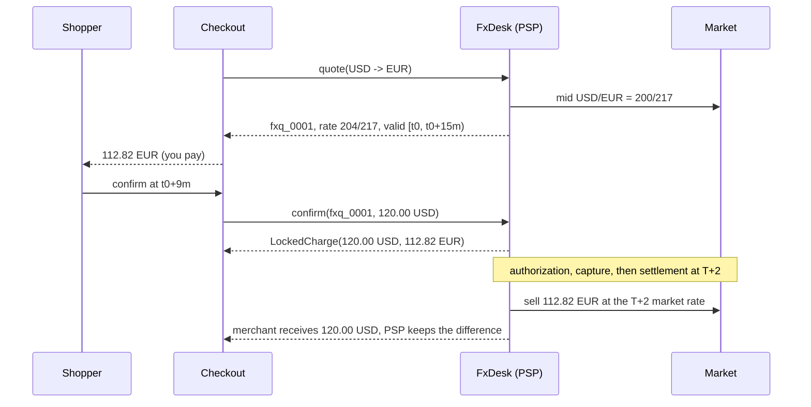

# Currency Conversion at Checkout and DCC

> Who bears FX risk and when the rate is locked.

**Type:** Build
**Languages:** Java, Python, Go
**Prerequisites:** Phase 10 Lesson 01 (Representing Money), Phase 12 Lesson 01 (Designing an Idempotent Payment API), Phase 12 Lesson 08 (Payouts and Balances), Phase 12 Lesson 10 (Payment Method Abstraction)
**Time:** ~60 minutes

## Learning Objectives

- Distinguish presentment currency (what the shopper sees and pays) from settlement currency (what the merchant receives), and name which party owns the exchange-rate risk between them in each checkout model
- Represent exchange rates as exact rationals and convert amounts with exactly one rounding, on the final minor-unit amount, with an explicit rounding mode
- Implement a rate lock with a half-open validity window, and refuse a confirmation that arrives after it
- Compute a PSP's FX profit and loss at settlement and the break-even rate at which the spread is exhausted
- Produce a dynamic currency conversion (DCC) offer whose disclosure states the markup over the reference rate exactly, and compare it with the cost of declining

## The Problem

A US electronics retailer turned on "local currency pricing" for European shoppers. The implementation fetched EUR/USD from a rates API when the product page loaded, converted the USD price, displayed it, and then converted again at payment time using whatever rate the API returned then. A shopper loaded a 1,299.00 USD laptop at 09:58, displayed as 1,197.24 EUR. They paid at 10:14. The rate had moved; the charge was 1,201.58 EUR. The shopper saw a price on the payment page that did not match the product page, assumed they were being cheated, and abandoned the cart. Others did not notice until their statement. The retailer's support queue filled with "you charged me more than the advertised price", and in the EU an advertised price that is not the charged price is a consumer-protection problem, not a UX one.

The finance team had the opposite problem. The retailer had promised itself USD revenue, but what it actually received was whatever the processor converted the EUR into at settlement, two days later, at the processor's rate. In a month where the euro fell 3 percent, European revenue came in 3 percent under forecast and nobody could explain the gap line by line, because nothing recorded which rate each order had been promised at.

Underneath both problems is one unanswered question: *who owns the rate, from when, until when?* Between the shopper seeing a price and the merchant receiving money there are three to five timestamps (display, confirmation, authorization, capture, settlement), and the rate can differ at each. A checkout that converts currency must pick the instant the rate is fixed, make it visible to the shopper, bind it to the order, and assign the movement after that instant to someone who has agreed to carry it. This lesson builds that: exact rates, a lock with an expiry, settlement P&L for whoever holds the risk, and the disclosure math for the DCC variant at the card terminal.

## The Concept

### Presentment, settlement, and the models in between

- **Presentment currency** is the currency the shopper sees and is charged in.
- **Settlement currency** is the currency the merchant is paid out in.
- **Card currency** (or billing currency) is the currency of the cardholder's account, which the issuer bills them in.

When all three are the same, there is no FX. When they differ, someone converts, at some rate, at some time:

| Model | Who converts | When the rate is fixed | Who bears the movement |
|-------|--------------|------------------------|------------------------|
| Merchant prices in its own currency; card issuer converts | Card network and issuer | At clearing, days after authorization | Cardholder (statement differs from authorization) |
| Multi-currency pricing without a lock | PSP at settlement | At settlement | Merchant (receives an unknown amount) |
| Multi-currency pricing with a rate lock (this lesson) | PSP | At quote, valid for a window | PSP, from lock to settlement |
| Dynamic currency conversion (this lesson) | DCC provider at the terminal | At authorization, disclosed to the cardholder | DCC provider, from authorization to settlement |

The first row is the default for any cross-border card payment: the merchant charges 100.00 EUR, the UK cardholder's issuer converts it to GBP at the network's rate on the day the transaction clears, plus any foreign transaction fee. The cardholder learns the GBP amount from their statement. The second row is the retailer in the problem: shopper prices in EUR, merchant revenue in USD floats. The third and fourth rows fix the rate at a moment the shopper can see and assign the risk to a party that hedges it as a business.

### Rates are ratios, and a ratio is not a decimal

An exchange rate `EUR/USD = 1.0850` means 1 EUR = 1.0850 USD. Its inverse, USD/EUR, is 1/1.0850 = 0.921658986175115207..., which does not terminate. Any decimal or floating-point representation of the inverse is already rounded, and every subsequent multiplication carries that error. The fix is to keep rates as exact fractions until the last step:

```text
EUR/USD = 1.0850         = 10850/10000 = 217/200
USD/EUR = 1 / (217/200)  = 200/217
+2.00% spread            = 200/217 * 102/100 = 204/217
```

Conversion multiplies the source amount in minor units by the rate and by `10^(target exponent - source exponent)`, producing an exact rational number of target minor units, and rounds *once*:

```text
120.00 USD = 12000 minor
12000 * 204/217 * 10^(2 - 2) = 2448000/217 = 11281.1059... EUR minor
CEILING -> 11282 -> 112.82 EUR
```

The exponent factor matters as soon as currencies differ in exponent: 120.00 USD at USD/JPY 152.37 is `12000 * 15237/100 * 10^(0 - 2) = 18284.4` JPY minor units, so 18,284 JPY. Forget the factor and the shopper pays 1,828,440 JPY.

**Round the amount, never the rate.** Rates are often published or stored to four or six decimals. Rounding 204/217 to 0.9401 before converting 50,000.00 USD gives 47,005.00 EUR; the exact conversion is 47,004.61 EUR. The 0.39 EUR difference is a rounding of money hidden inside a rounding of a rate, applied at a precision nobody chose for money. This lesson's `Rational` type makes the exact path the easy one, and `convertWithRoundedRate` exists only to demonstrate the anti-pattern in the tests.

**Rounding mode is a policy decision, made once and written down.** This lesson rounds the *presentment price* with `CEILING`: the shopper pays at most one minor unit more than the locked rate implies, and the PSP's proceeds at the locked rate are never below the promised settlement amount. It rounds settlement conversions and DCC amounts `HALF_EVEN`. Neither choice is universal. What is universal is that the mode is explicit at every call site, so a reviewer can see who absorbs the sub-unit.

### The rate lock

A *rate quote* is a promise: for the next `lockMillis`, any checkout confirmed under quote `fxq_0001` will use customer rate 204/217, and the merchant will receive exactly the settlement price it set. The quote's validity is the half-open interval `[issuedAt, issuedAt + lockMillis)`. At `issuedAt + lockMillis - 1` the confirmation succeeds; at `issuedAt + lockMillis` it throws `QuoteExpiredException`, and checkout must request a new quote and show the shopper the new price before charging. The boundary is half-open for the same reason periods were in Lesson 11: there must be no instant at which a quote is both valid and expired, or valid twice.



Why 15 minutes? It must outlast a checkout session (address entry, 3-D Secure, a wallet redirect) and must be short enough that the PSP's exposure per quote is bounded. Real products offer windows from minutes (checkout sessions) to 24 hours or more (invoices), and charge a wider spread for a longer lock, because the expected adverse movement grows with the square root of time.

A lock changes *who* owns movement, not *whether* there is movement. Inside the window, the market can move and the quote does not; the test sets EUR/USD to 1.0000 mid-window and the confirmed presentment amount is still 112.82 EUR.

### Settlement P&L: the risk, in numbers

The PSP collected 112.82 EUR and owes the merchant 120.00 USD. At settlement it sells the EUR at whatever the market pays then:

| EUR/USD at settlement | PSP sells 112.82 EUR for | Merchant receives | PSP FX P&L |
|-----------------------|--------------------------|-------------------|------------|
| 1.1000 | 124.10 USD | 120.00 USD | +4.10 USD |
| 1.0850 (unchanged) | 122.41 USD | 120.00 USD | +2.41 USD |
| 1.0700 | 120.72 USD | 120.00 USD | +0.72 USD |
| 1.0600 | 119.59 USD | 120.00 USD | -0.41 USD |

The merchant column never changes; that is what the merchant bought. The PSP's expected P&L is the spread (about 2.41 USD on this order, a little over 2 percent because the presentment price was rounded up), and its realized P&L is the spread minus the adverse move. The **break-even rate** is the settlement rate at which P&L is zero:

```text
break-even EUR/USD = 120.00 USD / 112.82 EUR = 12000 / 11282 = 1.063641...
```

A 2 percent spread absorbs a 1.97 percent adverse move over the settlement period. A PSP running this product aggregates thousands of these positions per currency pair and hedges the net exposure with forwards; the per-order P&L in this lesson is what the hedge desk's books sum.

### Dynamic currency conversion

DCC happens at the point of sale. A UK cardholder pays at a German merchant; the terminal or checkout recognizes the card's currency from its BIN and offers: pay 100.00 EUR, or pay in GBP now at our rate. If the cardholder chooses GBP, the transaction is authorized and cleared in GBP, the issuer performs no conversion, and the DCC provider (usually the acquirer or a partner) converts and pays the merchant in EUR.

The DCC rate is a reference rate plus a markup. With the ECB reference rate EUR/GBP = 0.8550 and a 3.50 percent markup:

```text
DCC rate     = 0.8550 * (1 + 350/10000) = 0.8550 * 1.035 = 0.884925 (exact)
card amount  = 10000 EUR minor * 0.884925 = 8849.25 GBP minor -> HALF_EVEN -> 88.49 GBP
at reference = 10000 * 0.8550 = 8550 -> 85.50 GBP
gross margin = 88.49 - 85.50 = 2.99 GBP
```

EU Regulation 2019/518 requires that, before a card payment with currency conversion at the point of sale, the payer is shown the total amount in the card currency and the markup expressed as a percentage over the latest available ECB euro foreign exchange reference rate. The card networks' rules add that DCC must be an explicit choice, never the default, and that the receipt shows both currencies, the rate, and the markup. That makes the markup a regulated number, and two numbers compete for the name:

| Quantity | Formula | Value |
|----------|---------|-------|
| Disclosed markup (rate over rate) | `0.884925 / 0.8550 - 1` | exactly 3.50% |
| Effective markup (amount over amount) | `88.49 / 85.50 - 1` | 3.4971% |

The disclosed markup is computed from the rates as an exact rational (`7/2` percent), so it is precisely the configured 350 basis points, not 3.4999999 from a floating-point division. The effective markup differs because the card amount was rounded. Disclose the rate-based figure (that is what the regulation's wording, "mark-up over the reference rate", describes), and test that it is exact.

The comparison the cardholder is implicitly making:

| Path | GBP charged |
|------|-------------|
| Accept DCC at 3.50% over ECB | 88.49 |
| Decline; network rate 0.8560, no issuer fee | 85.60 |
| Decline; network rate 0.8560, issuer fee 2.99% | 88.16 |

In this example DCC is the most expensive option even against an issuer that charges a foreign transaction fee, which is the typical outcome and the reason the disclosure rules exist. The DCC margin is shared: a common arrangement rebates part of it to the merchant. Splitting 2.99 GBP 30:70 with `allocate` gives 0.90 to the merchant and 2.09 to the provider, summing exactly.

### Five timestamps, one rate

The retailer in the problem converted twice because it never decided which timestamp owned the rate. A cross-border card payment has at least five, and each is a candidate:

| Timestamp | What happens | Typical delay from display | Rate fixed here in |
|-----------|--------------|----------------------------|--------------------|
| Display | Product or cart page renders a converted price | 0 | Nothing binding; an estimate unless a quote is issued |
| Confirmation | Shopper presses "Pay" | Seconds to minutes | Rate-lock products (this lesson's `confirm`) |
| Authorization | Issuer approves and holds funds | Seconds after confirmation | DCC |
| Capture | Merchant requests the funds (at shipment, for many retailers) | Hours to days | Rarely; some unlocked processors |
| Clearing and settlement | Network moves money; issuer posts to the statement | One to three days after capture | Issuer conversion; unlocked multi-currency pricing |

The rule that falls out: the rate must be fixed no later than the moment the shopper commits, and the price they saw must be computed from that same fixed rate. A display-time estimate is acceptable only if it is labelled as one and the confirmation page shows the bound price.

### Failure modes worth designing for

- **Stale rates.** The rate source stops updating (a feed outage, a weekend, a market holiday) and quotes keep being issued off a rate that is hours old. Store the source timestamp with every mid, and refuse to quote when it is older than a threshold; weekend gaps in FX markets are why many products widen the spread from Friday close to Monday open.
- **Quote reuse.** A quote is valid for a window, not for one order. If two orders can be confirmed against the same quote id, a shopper can open a quote before a known move and use it repeatedly. Bind each quote to one checkout session and consume it on confirmation.
- **Re-quote loops.** If the quote window is shorter than the slowest checkout path (a 3-D Secure challenge, a wallet redirect), some shoppers can never confirm in time. Measure the confirmation latency distribution and set the window above its 99th percentile.
- **Rate source down.** When no rate is available, fail closed: present the price in settlement currency and let the issuer convert, rather than quoting from a cached rate of unknown age.
- **Capture amount drift.** A partial capture of a locked order must convert at the locked rate, with the captured share computed by allocation, or the sum of captures can differ from the presentment total by a minor unit per capture.

### Complexity and cost

Every operation is O(1) in the number of quotes, with `BigInteger` arithmetic whose cost grows with the digits of numerator and denominator. Composing many rates (a cross rate through two pivots, each with a spread) grows the fraction; normalize by GCD after each operation, as `Rational`'s constructor does, and in a hot path cap the precision of *published* rates rather than intermediate ones. The real cost is not CPU but exposure: every open quote is an unhedged position until settlement, and the lock window times the volume is the size of the book.

### What this design does not do

- It does not hedge. The PSP's P&L is computed per order; aggregating net exposure per currency pair and hedging it is a treasury function with its own systems.
- It does not handle refunds after a rate move. Refunding 112.82 EUR two weeks later, when EUR/USD is 1.0600, costs the merchant 119.59 USD if the refund is converted at the new rate, or the PSP 0.41 USD if the original rate is honoured. Products must choose and disclose which, and Phase 12, Lesson 06's refund ledger must record the rate used.
- It does not detect card currency. DCC eligibility comes from BIN tables (Phase 11) and is not modeled.
- It does not persist quotes. In production a quote is a row referenced by the order, and the idempotency key of the payment (Lesson 01) includes the quote id, so a retry cannot silently re-quote.

## Build It

All code is in `code/java/Main.java`; tests are in `code/java/MainTest.java`.

### Step 1: An exact rational

```java
record Rational(BigInteger num, BigInteger den) implements Comparable<Rational> {
    Rational {
        if (den.signum() == 0) throw new ArithmeticException("zero denominator");
        if (den.signum() < 0) { num = num.negate(); den = den.negate(); }
        BigInteger g = num.gcd(den);
        if (!g.equals(BigInteger.ONE)) { num = num.divide(g); den = den.divide(g); }
    }

    static Rational parse(String decimal) {
        BigDecimal d = new BigDecimal(decimal.strip());
        return d.scale() >= 0
                ? new Rational(d.unscaledValue(), BigInteger.TEN.pow(d.scale()))
                : new Rational(d.unscaledValue().multiply(BigInteger.TEN.pow(-d.scale())), BigInteger.ONE);
    }

    long roundToLong(RoundingMode mode) {
        return new BigDecimal(num).divide(new BigDecimal(den), 0, mode).longValueExact();
    }
}
```

The compact constructor normalizes: positive denominator, lowest terms. Normalization makes `equals` structural, so `parse("1.0850").equals(Rational.of(217, 200))` is true. `parse` goes through `BigDecimal` only to read the digits; it never divides. `roundToLong` is the only place a `Rational` becomes an integer, and it demands a `RoundingMode`.

**Predict:** `Rational.of(1, 3).compareTo(Rational.parse("0.3333"))`. Positive, negative, or zero?

### Step 2: Rates and conversion

```java
record FxRate(Currency from, Currency to, Rational rate) {
    FxRate inverse() { return new FxRate(to, from, rate.inverse()); }

    FxRate adjustedBy(long basisPoints) { return new FxRate(from, to, rate.times(Rational.ONE.plus(Rational.bps(basisPoints)))); }
}

static Money convert(Money amount, FxRate rate, RoundingMode mode) {
    if (!amount.currency().equals(rate.from())) throw new CurrencyMismatchException(amount.currency(), rate.from());
    Rational minor = Rational.of(amount.minorUnits(), 1)
            .times(rate.rate())
            .times(Rational.pow10(rate.to().exponent() - rate.from().exponent()));
    return Money.ofMinor(minor.roundToLong(mode), rate.to());
}
```

An `FxRate` is directional, so the type system will not let you apply a USD-to-EUR rate to a EUR amount. `adjustedBy(200)` multiplies by 102/100; `adjustedBy(-200)` by 98/100. `convert` keeps everything rational until `roundToLong`, and the exponent shift comes from the two `Currency` records, never from an assumption of two decimals.

**Predict:** convert 18,284 JPY back to USD with the inverse of USD/JPY 152.37, rounding half-even. Do you get 120.00 USD exactly?

### Step 3: The desk issues quotes

```java
RateQuote quote(Currency settlement, Currency presentment) {
    long now = clock.nowMillis();
    Rational mid = rates.mid(settlement, presentment);
    FxRate customer = new FxRate(settlement, presentment, mid).adjustedBy(spreadBps);
    RateQuote q = new RateQuote(String.format("fxq_%04d", ++seq), customer, mid, spreadBps, now, now + lockMillis);
    quotes.put(q.id(), q);
    return q;
}

static Money presentmentPrice(Money settlementPrice, RateQuote q) {
    return FxConverter.convert(settlementPrice, q.customerRate(), RoundingMode.CEILING);
}
```

`RateSource` is injected; `FakeRateSource.set(EUR, USD, "1.0850")` stores both directions, deriving the inverse exactly. The quote records the mid as well as the customer rate, so the margin is auditable later. The clock is injected, which is what lets the tests stand exactly on the expiry boundary.

### Step 4: Confirm inside the window, or not at all

```java
LockedCharge confirm(String quoteId, Money settlementPrice) {
    RateQuote q = quotes.get(quoteId);
    if (q == null) throw new IllegalArgumentException("unknown quote " + quoteId);
    if (!settlementPrice.currency().equals(q.settlement())) throw new CurrencyMismatchException(settlementPrice.currency(), q.settlement());
    long now = clock.nowMillis();
    if (!q.validAt(now)) throw new QuoteExpiredException(q.id(), now, q.expiresAtMillis());
    return new LockedCharge(q, settlementPrice, presentmentPrice(settlementPrice, q));
}
```

`validAt` is `now >= issuedAt && now < expiresAt`. The `LockedCharge` binds three things that must never be separated again: the quote, the settlement amount the merchant was promised, and the presentment amount the shopper is charged. In production that record is stored with the order and its id goes into the payment's idempotency fingerprint.

**Predict:** the shopper confirms at exactly `issuedAt + lockMillis`. What happens, and what must checkout show the shopper next?

### Step 5: Settlement and break-even

```java
static SettlementResult settle(LockedCharge charge, Rational marketMidPresentmentToSettlement) {
    FxRate market = new FxRate(charge.quote().presentment(), charge.quote().settlement(), marketMidPresentmentToSettlement);
    Money proceeds = FxConverter.convert(charge.presentmentAmount(), market, RoundingMode.HALF_EVEN);
    return new SettlementResult(charge.settlementAmount(), proceeds, proceeds.minus(charge.settlementAmount()));
}

static Rational breakEvenRate(LockedCharge charge) {
    return Rational.of(charge.settlementAmount().minorUnits(), 1)
            .dividedBy(Rational.of(charge.presentmentAmount().minorUnits(), 1))
            .times(Rational.pow10(charge.quote().presentment().exponent() - charge.quote().settlement().exponent()));
}
```

The merchant's amount is copied from the charge, not computed: that is the lock's promise in code. P&L is `proceeds - promised`, in settlement currency. `breakEvenRate` is exact, and the test settles at exactly that rational and asserts a P&L of zero minor units.

### Step 6: DCC

```java
static DccOffer offer(Money merchantAmount, Currency cardCurrency, Rational referenceRate, long markupBps) {
    if (merchantAmount.currency().equals(cardCurrency)) throw new IllegalArgumentException("DCC needs a different card currency");
    if (markupBps < 0) throw new IllegalArgumentException("markup must be >= 0");
    FxRate rate = new FxRate(merchantAmount.currency(), cardCurrency, referenceRate).adjustedBy(markupBps);
    Money cardAmount = FxConverter.convert(merchantAmount, rate, RoundingMode.HALF_EVEN);
    return new DccOffer(merchantAmount, cardAmount, rate, referenceRate, markupBps);
}

Rational markupPercent() { return dccRate.rate().dividedBy(referenceRate).minus(Rational.ONE).times(Rational.of(100, 1)); }
```

`markupPercent` divides rate by rate, exactly, so 350 basis points discloses as `7/2` percent. `effectiveMarkupPercent` divides the rounded card amount by the rounded reference amount and is slightly lower. `disclosure()` renders the text a terminal or checkout must show: both amounts, the DCC rate, the markup, and the reference rate. `Dcc.issuerConversion` computes the alternative the cardholder is giving up.

**Predict:** with a markup of 0 basis points, what card amount does the offer show, and what is the gross margin?

### Step 7: The margin and the alternative

```java
Money grossMargin() {
    Money atReference = FxConverter.convert(merchantAmount, new FxRate(merchantAmount.currency(), cardAmount.currency(), referenceRate), RoundingMode.HALF_EVEN);
    return cardAmount.minus(atReference);
}

static Money issuerConversion(Money merchantAmount, Currency cardCurrency, Rational networkRate, long issuerFeeBps) {
    Money converted = FxConverter.convert(merchantAmount, new FxRate(merchantAmount.currency(), cardCurrency, networkRate), RoundingMode.HALF_EVEN);
    Money fee = Money.ofMinor(Rational.of(converted.minorUnits(), 1).times(Rational.bps(issuerFeeBps)).roundToLong(RoundingMode.HALF_EVEN), cardCurrency);
    return converted.plus(fee);
}
```

The gross margin is measured in card currency against the reference conversion, so it is the amount the provider and merchant share; the demo splits it 30:70 with `allocate(3000, 7000)` and the shares sum to 2.99 GBP exactly. `issuerConversion` models the path the cardholder declines into: convert at the network's rate, then add the issuer's foreign transaction fee as its own rounded amount. Putting the two side by side in code is what lets a checkout team show the comparison honestly, or at least know what it is.

**Predict:** with an issuer fee of 0 and a network rate equal to the ECB reference, how does the declined path compare with a 0 bps DCC offer?

### Step 8: Run it

```bash
cd phases/12-payment-systems-design/12-currency-conversion-at-checkout/code/java
javac -d .out *.java && java -cp .out Main
java -cp .out MainTest
```

Expected output, abbreviated:

```console
== Presentment vs settlement: a US merchant shows EUR to a German shopper ==
mid USD->EUR      = 200/217 = 0.9216589862
customer USD->EUR = 204/217 = 0.9400921659 (mid + 2.00%)
confirmed at +9m: shopper pays 112.82 EUR, merchant is promised 120.00 USD

== Who owns the FX risk: the PSP, from lock to settlement ==
EUR/USD at settlement 1.0850: PSP sells 112.82 EUR for 122.41 USD, merchant gets 120.00 USD, PSP FX P&L 2.41 USD
EUR/USD at settlement 1.0600: PSP sells 112.82 EUR for 119.59 USD, merchant gets 120.00 USD, PSP FX P&L -0.41 USD
break-even EUR/USD = 1.063641

== The lock expires: a late confirmation must re-quote ==
at +15m: quote fxq_0001 expired at 1760000900000, now 1760000900000
re-quoted at EUR/USD 1.0600: shopper now pays 115.48 EUR

== Round the amount once, never the rate ==
exact rate:          47004.61 EUR
rate rounded to 4dp: 47005.00 EUR  (rate 0.9401)

== DCC: a UK card at a German merchant, EUR 100.00 ==
Pay 88.49 GBP (rate 1 EUR = 0.884925 GBP, including a 3.50% markup over the ECB reference rate 0.8550) or pay 100.00 EUR and let your card issuer convert.
disclosed markup  = 3.5000% (exact: 7/2)
effective markup  = 3.4971% after rounding the amount
```

`MainTest` runs 44 assertions, including the expiry boundary at `expiresAt - 1` and `expiresAt`, P&L at four settlement rates, and every number in the DCC disclosure.

### In Python

```python
def round_to_long(self, mode: RoundingMode) -> int:
    q, r = divmod(self.num, self.den)        # floor division: 0 <= r < den
    if r == 0:
        return q
    if mode is RoundingMode.FLOOR:
        return q
    if mode is RoundingMode.CEILING:
        return q + 1
    ...
    twice = 2 * r                            # the half-way cases compare 2r with den
    return q if q % 2 == 0 else q + 1        # HALF_EVEN
```

Differences, all in `code/python/main.py` and `test_main.py`:

- **`Rational` is a frozen dataclass over two `int`s**, normalized in `__post_init__` with `math.gcd` and a positive denominator, exactly as the Java record's compact constructor did; `Rational.parse` borrows `fractions.Fraction(str)` only to read the decimal string exactly, never a float. `BigInteger` is unnecessary because Python ints do not overflow.
- **`RoundingMode` is a small `Enum` and rounding is integer arithmetic.** There is no `BigDecimal.divide(scale, mode)`, so `round_to_long` implements CEILING, FLOOR, UP, DOWN and the three HALF modes from `divmod` and a `2r` vs `den` comparison; `to_decimal(scale)` is "multiply by 10^scale, round HALF_EVEN, insert the point", which reproduces `toPlainString`. A test pins every mode on 2.5 and -2.5.
- **Field names avoid keywords:** `FxRate.from_currency`/`to_currency` for `from`/`to`. `ONE` is a module constant (also reachable as `Rational.ONE`).
- **Exceptions:** a zero denominator raises `ZeroDivisionError` (an `ArithmeticError`, as `ArithmeticException` was); `QuoteExpiredError` is a `RuntimeError`; argument problems raise `ValueError` and `CurrencyMismatchError` is a `ValueError` subclass. `allocate` returns a `list[Money]`.

```bash
cd phases/12-payment-systems-design/12-currency-conversion-at-checkout/code/python
python3 main.py
python3 -m unittest -v
```

### In Go

```go
// Rational wraps *big.Rat and never mutates a shared value: every operation allocates a result.
type Rational struct{ r *big.Rat }

func (a Rational) Times(o Rational) Rational { return Rational{new(big.Rat).Mul(a.r, o.r)} }

// RoundToInt64 rounds to an integer with the given mode; ErrOverflow where Java's longValueExact throws.
func (a Rational) RoundToInt64(mode Rounding) (int64, error) {
    v := roundBig(a.r.Num(), a.r.Denom(), mode)
    if !v.IsInt64() {
        return 0, ErrOverflow
    }
    return v.Int64(), nil
}
```

Differences, all in `code/go/main.go`, `money.go`, and `main_test.go`:

- **`math/big.Rat` plays `Rational`, behind a value type.** `big.Rat` methods mutate their receiver and alias their arguments, so `Rational` wraps a pointer and every method (`Times`, `Plus`, `Inverse`, ...) allocates a fresh `big.Rat`; a quote's locked rate can never be changed by arithmetic done elsewhere. `SetString("1.0850")` is the exact parse and normalizes to lowest terms with the sign in the numerator, as the Java constructor did. Equality is `Equal`/`Compare`, never `==`.
- **Go has no `RoundingMode`.** `roundBig` divides with `big.Int.QuoRem` (truncated, like Java) and spells out the six cases this lesson needs: `Down`, `Up`, `HalfUp`, `HalfEven` from the Phase 10 `Money`, plus `Ceiling` and `Floor` declared here. `ToDecimal(scale)` scales by 10^scale, rounds half-even, and pads, which is what `BigDecimal.divide(..., scale, HALF_EVEN).toPlainString()` prints.
- **Errors are values, with one deliberate panic.** `NewFxRate`, `Convert`, `Quote`, `Confirm`, `Settle`, `Offer`, and `IssuerConversion` return `(T, error)`; `ErrQuoteExpired`, `ErrInvalidArgument`, and `ErrCurrencyMismatch` are checked with `errors.Is`, and the lock window stays half-open. `Of(num, 0)` panics with `ErrZeroDenominator`, because a zero denominator in a rate is a programming error, the same reasoning as `Money.Compare`; the test recovers it.
- **Round-trip to minor units is checked.** `RoundToInt64` returns `ErrOverflow` instead of silently truncating a `big.Int` that does not fit an `int64`.

```bash
cd phases/12-payment-systems-design/12-currency-conversion-at-checkout/code/go
go run .
go test ./...
```

## Use It

**Stripe FX Quotes and Adaptive Pricing.** Stripe's FX Quotes API returns a locked rate for a currency pair with a chosen lock duration (from minutes to a day), and a PaymentIntent that references the quote is converted at that rate; an expired quote cannot be used. Stripe's Adaptive Pricing shows shoppers prices in their local currency with the conversion fee paid by the customer, which is this lesson's spread on the presentment side, and documents the lock window during a Checkout session.

**Adyen and multi-currency pricing.** Adyen's multi-currency processing lets merchants charge in the shopper's currency and settle in their own, with the conversion done by Adyen at settlement unless rates are locked. Its documentation is explicit that the rate used for settlement differs from authorization time unless the merchant uses a locked-rate product, which is the "who bears the movement" column of this lesson's table.

**DCC providers and the card networks.** Planet, Fexco, and acquirer-run DCC services implement the offer in this lesson at terminals and in e-commerce checkouts. Visa and Mastercard rules require the cardholder's explicit choice, the disclosure of rate and markup on the receipt, and forbid presenting DCC as the default. In the EU, Regulation 2019/518 adds the ECB-reference-rate markup disclosure and an electronic message to the cardholder after the transaction.

**Reference rates.** The ECB publishes euro foreign exchange reference rates once per working day around 16:00 CET, for information purposes. They are not tradable rates, which is why a DCC rate is "reference plus markup" rather than "market plus spread". Card networks publish their own daily conversion rates, used when the issuer converts.

**What the production versions hide.** They hide the rounding policy and the instant the rate was fixed. When you integrate any of them, find both in the documentation and record them per order. A finance team reconciling a month of cross-currency revenue needs, for every order, the rate, its source, its timestamp, and the rounding mode, or the reconciliation will never close.

## Ship It

`outputs/checklist-fx-at-checkout.md` is a review checklist for any change that shows a price in one currency and settles in another: exact rate representation, one rounding with a named mode, the lock window and its boundary, the stored quote, the risk owner, refund-rate policy, and the DCC disclosure.

## Exercises

1. **Reinforce.** Add KWD (exponent 3) and convert 120.00 USD to KWD at USD/KWD 0.3071 with a 1.5 percent spread. Work it by hand first, then add the test. Check that the presentment price has three decimals and that rounding the rate to four decimals first does or does not change the result for 50,000.00 USD.
2. **Apply.** Implement refunds against a `LockedCharge` with a policy enum: `ORIGINAL_RATE` (the shopper gets back exactly what they paid, the PSP absorbs the move) and `CURRENT_RATE` (the merchant's USD refund is converted at today's rate, the shopper absorbs the move). For a partial refund of 40.00 USD, use `allocate` so the sum of partial refunds never exceeds the presentment amount, and test both policies at EUR/USD 1.0600.
3. **Extend.** Combine with Phase 4 (graph algorithms): build cross rates. Given a set of quoted pairs with spreads (EUR/USD, USD/JPY, EUR/GBP, GBP/JPY), find the best EUR-to-JPY rate as the maximum product path, using `-log(rate)` weights and Bellman-Ford, then compute the same rate exactly with `Rational` along the chosen path and show the difference between the floating-point path selection and the exact product. Detect and report an arbitrage cycle if one exists.

## Key Terms

| Term | What people say | What it actually means |
|------|-----------------|------------------------|
| Presentment currency | "the shopper's currency" | The currency the price is displayed in and the shopper is charged in |
| Settlement currency | "the payout currency" | The currency the merchant is paid in; it differs from presentment whenever someone converts |
| Rate lock | "guaranteed rate" | A quote valid on a half-open window during which confirmations use a fixed rate; movement after the lock belongs to the issuer of the quote |
| Spread | "the FX fee" | The margin between the mid-market rate and the customer rate, expressed in basis points; the lock holder's buffer against adverse movement |
| Break-even rate | "where we lose money" | The settlement-time rate at which the lock holder's proceeds equal the promised settlement amount |
| Dynamic currency conversion | "pay in your own currency" | A point-of-sale offer to charge the card in its own currency at a provider's rate, with a disclosed markup, instead of letting the issuer convert |
| Reference rate | "the official rate" | A published, non-tradable benchmark such as the ECB euro reference rate; DCC markups are disclosed against it |
| Exact rational | "a precise rate" | A rate held as a normalized numerator and denominator so inverses and products are exact and the only rounding is on the final amount |

## Further Reading

- [Regulation (EU) 2019/518 on cross-border payments and currency conversion charges](https://eur-lex.europa.eu/eli/reg/2019/518/oj) — the requirement to disclose DCC as a markup over the latest ECB euro foreign exchange reference rate before the payment.
- [European Central Bank: Euro foreign exchange reference rates](https://www.ecb.europa.eu/stats/policy_and_exchange_rates/euro_reference_exchange_rates/html/index.en.html) — how and when reference rates are published, and why they are for information rather than trading.
- [Visa Core Rules and Visa Product and Service Rules](https://usa.visa.com/dam/VCOM/download/about-visa/visa-rules-public.pdf) — the network rules for DCC: cardholder choice, disclosure, and receipt requirements.
- [Stripe documentation: FX Quotes](https://docs.stripe.com/payments/currencies/localize-prices/fx-quotes-api) — a production rate-lock API with explicit lock durations and expiry behaviour.
- [ISO 4217 currency codes](https://www.iso.org/iso-4217-currency-codes.html) — the minor-unit exponents that the conversion's `10^(target - source)` factor depends on.
- [Java SE 21 API: `java.math.BigDecimal` and `RoundingMode`](https://docs.oracle.com/en/java/javase/21/docs/api/java.base/java/math/RoundingMode.html) — the exact semantics of `CEILING` and `HALF_EVEN`, the two modes this lesson's policy names.
