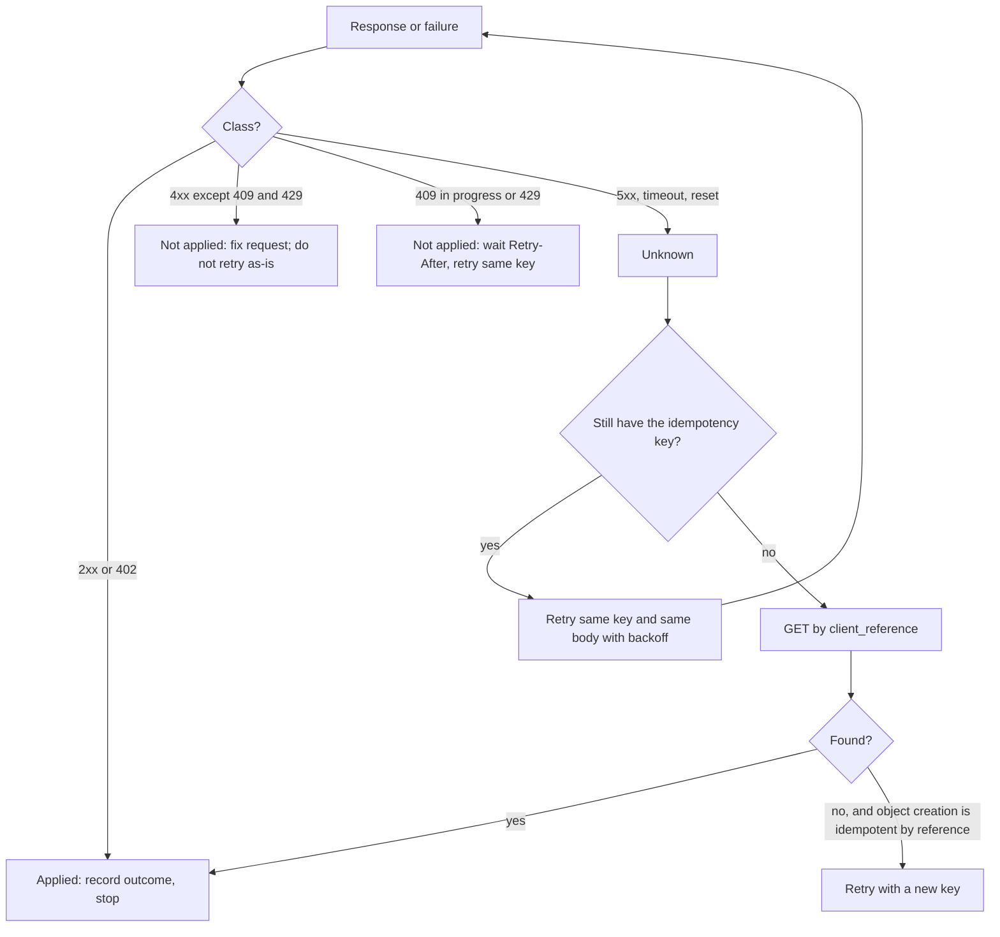

# API Design for Money: Versioning, Pagination, and Error Semantics

> A 500 on a payment is ambiguous; design so clients can recover.

**Type:** Learn
**Languages:** —
**Prerequisites:** Phase 12 Lesson 01 (Designing an Idempotent Payment API), Phase 12 Lesson 05 (Webhooks), Phase 12 Lesson 10 (Payment Method Abstraction), Phase 10 Lesson 01 (Representing Money)
**Time:** ~75 minutes

## Learning Objectives

- Classify every response a payments API can produce as applied, not applied, or unknown, and design the API so that every unknown outcome has a documented recovery path
- Represent amounts on the wire as integer minor units with an ISO 4217 code, and explain what goes wrong with JSON decimals
- Choose cursor pagination over offset pagination for payment lists, and show by trace how offsets skip or duplicate rows under concurrent writes
- Design date-pinned API versioning with a list of changes that are breaking for money APIs, including new enum values
- Decide between webhooks, polling, and an events endpoint for state changes, and specify rate limiting and `expand` so they never create ambiguity

## The Problem

A subscription platform integrates a payments API. The integration is ordinary: `POST /v1/payments` with a JSON body, a 10-second client timeout, and a retry policy that retries any `5xx` up to three times. One evening the payments provider has a partial database failover. For about four minutes, some requests commit the charge and then fail while writing the response; the load balancer converts the broken upstream into `502 Bad Gateway`. Other requests fail before reaching the charge code; they also come back as `502`. The platform's client cannot tell the two apart, retries all of them, and, because the integration never sent an idempotency key, every retry of a committed request is a second charge. About 3,000 customers are charged twice. The provider did nothing wrong by its own documentation; the documentation said "retry 5xx errors", and it did not say "only with the same idempotency key".

The next morning the platform's reconciliation job lists yesterday's payments with `GET /v1/payments?offset=0&limit=100`, then `offset=100`, and so on, while refunds for the double charges are being created. Each refund updates its payment's `updated` timestamp and the list is sorted by `updated`. Rows move between pages while the job pages through them. The job misses 214 payments and counts 190 twice, the totals do not match the provider's settlement report, and finance spends two days finding out why.

During the cleanup an engineer notices the provider's JSON has `"amount": 19.99` on one older endpoint and `"amount": 1999` on the newer one, and a JavaScript service had been parsing both into `Number`. The older endpoint was a v1 holdover nobody had migrated; a version upgrade six months earlier had changed the unit, and the client had pinned no version.

Each of these is an API design failure, not a bug in either party's code. A money API has to be designed so that a client who does everything the documentation says cannot double-charge, cannot miss a row, and cannot misread an amount. This lesson is the set of conventions that achieve that, and a worked specification that applies them.

## The Concept

### The three outcomes of a request

Every response to a write that moves money falls into one of three classes, and the class matters more than the status code:

| Class | Meaning | Examples | Client action |
|-------|---------|----------|---------------|
| Applied | The side effect happened, and the response says what it was | `201 Created`, `200 OK`, `402` decline (the decline is the applied outcome) | Record it; never repeat |
| Not applied | The server guarantees no side effect occurred | `400`, `401`, `403`, `404`, `422`, `409` in-progress, `429` | Fix the request, or wait and retry; the same key is safe |
| Unknown | The client cannot know whether the side effect happened | `500`, `502`, `504`, client timeout, connection reset, DNS failure mid-request | Recover: retry with the same idempotency key, or look up by client reference |

RFC 9110 defines `500 Internal Server Error` as "the server encountered an unexpected condition that prevented it from fulfilling the request". It does not say *when* in the request the condition occurred, and from the outside nobody can know. A `502` or `504` from an intermediary is worse: the intermediary did not even see the origin's answer. A client-side timeout is the same class: the request may be committed and the response still in flight.

The design rule follows: **an API that moves money must make the unknown class recoverable.** There are exactly two mechanisms, and a good API offers both:

1. **Idempotent retry.** Every money-moving write accepts an `Idempotency-Key` header (Lesson 01). A retry with the same key and the same body returns the original outcome if it was applied, or performs the operation if it was not. The documentation says "retry unknown outcomes *with the same key*", in those words.
2. **Lookup by client reference.** Every write accepts a client-chosen reference (`client_reference` or `metadata.order_id`), and a read endpoint can find the object by it: `GET /v1/payments?client_reference=order-1001`. This lets a client recover even if it lost the idempotency key (a crash before persisting it, a different process taking over).

The server's side of the bargain is to keep the not-applied class honest. A `429` or a `503` from admission control must be returned *before* any side effect; a server that sheds load halfway through a charge and returns `503` has moved an unknown into the not-applied class and will cause double charges. When the server knows nothing was applied, it should say so explicitly. This lesson's spec uses an `error.retryable` flag together with a `Retry-After` header, so the client does not have to infer it from the status code.



### Four identifiers that are not the same thing

Recovery depends on clients and servers agreeing on which identifier does what. They are routinely confused:

| Identifier | Chosen by | Unique within | Lifetime | Used for |
|------------|-----------|---------------|----------|----------|
| Idempotency key | Client | (merchant, endpoint) | Retention window, e.g. 24 hours | Replaying the outcome of one request |
| Client reference | Client | Merchant, forever | Object lifetime | Finding an object after losing the key; preventing a second object for one order |
| Object id (`pay_8Z3`) | Server | Globally | Object lifetime | Every later read, capture, refund |
| Request id (`req_4f9c1d`) | Server | Globally | Log retention | Support and debugging; correlating one HTTP exchange across services |

An idempotency key is not a client reference: it expires, and after it expires the same key with a different body creates a new payment (Lesson 01). A request id is not an idempotency key: every retry gets a new request id, which is exactly what lets support see that three requests were one logical operation.

### Amounts on the wire

The JSON grammar (RFC 8259) has one number type and leaves precision to implementations. JavaScript parses every JSON number to an IEEE 754 double, which cannot represent 0.1 exactly and cannot represent integers above 2^53 exactly. A money API therefore sends:

```json
{ "amount": 1999, "currency": "usd" }
```

- **Integer minor units**, scaled by the ISO 4217 exponent of the currency (2 for USD, 0 for JPY, 3 for KWD). `1999` in USD is 19.99; `1999` in JPY is 1,999 yen. The exponent is a property of the currency, never of the field.
- **An explicit currency on every amount**, never implied by the account.
- **Strings for amounts that may exceed 2^53 minor units**: cumulative balances in high-volume or high-exponent currencies, and crypto assets with 18 decimals. Some APIs use a decimal string (`"19.99"`) for display alongside the integer; if both exist, the integer is authoritative.

The trap in the problem, a unit change between versions, is avoided by never changing the unit of an existing field. A new unit is a new field name (`amount_decimal`), not a reinterpretation of `amount`.

### Versioning

A money API cannot break integrations silently, because the integrations are moving money while you deploy. The pattern that works is **date-pinned versions**: every account is pinned to the version current when it integrated; a request may override it with a header (`Payments-Version: 2026-10-01`); the server transforms responses from the internal latest shape back to the pinned version's shape. Upgrading is an explicit, testable act by the client.

What counts as breaking is broader for money than for most APIs:

| Change | Breaking? | Why |
|--------|-----------|-----|
| Add an optional request field | No | Old clients do not send it |
| Add a response field | No, if clients ignore unknown fields (document that they must) | |
| Add a new enum value (`status: "requires_capture"`) | Yes, in practice | A client with an exhaustive `switch` falls into a default branch; for a payment status that default is often "failed" or "succeeded" |
| Change a field's unit or scale | Yes | Silent 100x errors |
| Change a default (auto-capture on by default) | Yes | Same request, different money movement |
| Change which status codes are retryable | Yes | Changes the client's recovery path |
| Rename or remove a field | Yes | |

Concretely, suppose version `2026-10-01` adds `requires_capture` to the payment status for authorize-only payments, which older versions reported as `processing`. The server stores one internal object and renders it per version:

```json
{
  "pinned_2026-04-01": { "id": "pay_8Z3", "status": "processing", "amount": 4500, "currency": "usd", "capture": false },
  "pinned_2026-10-01": { "id": "pay_8Z3", "status": "requires_capture", "amount": 4500, "currency": "usd", "capture": false }
}
```

The transformation is a function per version boundary, applied newest to oldest: `2026-10-01 -> 2026-04-01` maps `requires_capture` to `processing` and drops nothing else. A client on the old version sees exactly what it saw before the change; a client that upgrades gets the new value and the release notes that describe it. Webhooks are rendered at the version pinned on the webhook endpoint, not the version of the request that caused the event, so the transformation layer must sit in front of webhook rendering too.

New enum values deserve the rule this course used in Lesson 10's `DeclineReason.UNKNOWN`: the documentation states which enums are open (clients must handle unknown values, and must handle them safely), and the server adds values to open enums only behind a version.

### Pagination: cursors, not offsets

Offset pagination (`?offset=200&limit=100`) asks the database for "rows 200 through 299 of the current ordering". If rows are inserted, deleted, or re-sorted between page requests, the boundary moves. A reconciliation job paging through payments while new payments arrive will skip rows (an insert before the boundary pushes a row from page 3 back onto page 2, which the client already read) or see duplicates (a delete pulls a row forward).

**Cursor (keyset) pagination** asks for "the next 100 rows after this one": `?limit=100&starting_after=pay_8Z3`. The server resolves the cursor to the sort key of that row, `(created, id)`, and runs a range query:

```sql
SELECT * FROM payments
WHERE merchant_id = $1 AND (created, id) < ($2, $3)
ORDER BY created DESC, id DESC
LIMIT 101;
```

A trace with five payments `p5` (newest) to `p1`, page size 2, sorted newest first, and one new payment `p6` created between page 1 and page 2:

| Step | Offset pagination | Cursor pagination |
|------|-------------------|-------------------|
| Page 1 | `offset=0`: `p5, p4` | `limit=2`: `p5, p4`, cursor `p4` |
| Insert | `p6` arrives; order is now `p6, p5, p4, p3, p2, p1` | same |
| Page 2 | `offset=2`: `p4, p3` (`p4` again) | `starting_after=p4`: `p3, p2` |
| Page 3 | `offset=4`: `p2, p1` | `starting_after=p2`: `p1` |
| Result | `p4` counted twice | every row exactly once; `p6` left for the next run |

Deletes produce the mirror image: a row removed from page 1 pulls a row from page 2 forward, and the offset reader never sees it.

Fetching `limit + 1` rows sets `has_more` without a count query. The sort key must be **immutable** (`created`, not `updated`) and **unique** (the `id` tie-breaker), or the cursor is as unstable as an offset. Cursor pages are O(log n + limit) with an index on `(merchant_id, created, id)`; offset pages are O(offset + limit), which is why offset pagination also gets slower the further you go. For "everything changed since time T" the right tool is not a sorted list at all but an events feed with its own cursor (below).

### Webhooks, polling, and the events endpoint

Payment state changes asynchronously: a bank debit settles in days (Lesson 10), a dispute opens in months (Lesson 07). The client needs to learn about changes, and there are three ways:

| Mechanism | Latency | Delivery guarantee | Cost | Failure mode |
|-----------|---------|--------------------|------|--------------|
| Webhooks | Seconds | At-least-once, unordered | Low for both | Endpoint down for hours; events arrive late, out of order, or are given up on |
| Polling a resource | Poll interval | Exactly what you ask for | High for both | Thundering herds; rate limits; missed intermediate states |
| Events endpoint (`GET /v1/events?starting_after=evt_...`) | Poll interval | Complete, ordered per account | Moderate | None for completeness; the client must persist its cursor |

The robust design uses webhooks as a *hint* and the events endpoint as the *source of truth*. A webhook says "something happened to `pay_8Z3`"; the consumer either fetches the object, or treats the webhook body as one event and periodically reconciles against `/v1/events` from its last stored cursor, which catches anything a webhook delivery lost. Lesson 05's signing and dedupe apply to the webhook path; the events endpoint is authenticated like any API call.

A thin webhook payload carries identity and type, not state, which keeps it small, version-neutral, and harmless if it arrives late:

```json
{
  "id": "evt_1Q2w",
  "type": "payment.succeeded",
  "created": 1760000123,
  "data": { "object_id": "pay_8Z3", "object_type": "payment" },
  "api_version": "2026-10-01"
}
```

The consumer dedupes on `id`, then fetches `GET /v1/payments/pay_8Z3` for the current state. If two events for the same payment arrive out of order, the fetch makes the order irrelevant: both handlers read the same current state. Fat payloads (the full object in the event) save a round trip but force consumers to compare versions or timestamps to avoid applying an older snapshot over a newer one.

### Expansion, and what it must not do

Payment objects reference other objects (customer, payment method, refunds, the balance transaction). Returning only ids forces N+1 requests; embedding everything bloats every response and leaks fields to callers who did not need them. `expand[]=customer&expand[]=latest_refund` lets a client opt in to embedding specific references, with a maximum depth (four is common) to bound cost. Two rules for money APIs: an expanded object is returned with the *caller's* permissions (expanding must never reveal a field the caller could not fetch directly), and an expanded object on a write response reflects state at the time of the response, so a client must not cache it as the object's current state.

### Rate limits that do not create unknowns

Rate limits protect the service, and on a payments API they must protect it without adding ambiguity. A `429 Too Many Requests` (RFC 6585) must be decided before any side effect, must carry `Retry-After`, and is in the not-applied class. Expose the budget so well-behaved clients can pace themselves; the IETF `RateLimit` header fields draft standardizes `RateLimit-Policy` and `RateLimit` for this. Separate budgets for reads and writes so a reconciliation job paging through lists cannot exhaust the budget checkout needs for `POST /v1/payments`, and exempt idempotent replays from the write budget or count them cheaply, because a client recovering from an outage is exactly the client that must not be throttled into giving up.

### Errors with structure

Status codes classify; bodies explain. RFC 9457 (Problem Details for HTTP APIs) defines `application/problem+json` with `type`, `title`, `status`, `detail`, and `instance`, and allows extension members. A money API adds the fields a client branches on:

```json
{
  "type": "https://api.example.com/errors/card-declined",
  "title": "The card was declined",
  "status": 402,
  "detail": "The issuer declined the authorization.",
  "instance": "/v1/payments/pay_8Z3",
  "code": "card_declined",
  "decline_code": "insufficient_funds",
  "retryable": false,
  "request_id": "req_4f9c1d",
  "payment": "pay_8Z3"
}
```

`code` is a stable machine identifier from a documented, open enum. `decline_code` is the normalized reason from Lesson 10, never the raw network code. `retryable` makes the class explicit. `request_id` is on every response, success or failure, and it is the thing support asks for first.

### A design procedure for a new money endpoint

Run every new endpoint that moves or reports money through these questions, in order. Each "no" is a design defect to fix before the endpoint ships.

1. Does every write accept an `Idempotency-Key`, scoped per merchant and endpoint, with documented retention?
2. Does every created object accept a client reference, enforced unique, and is there a read that finds the object by it?
3. Is every amount an integer in minor units with an explicit ISO 4217 currency, and is any amount that can exceed 2^53 a string?
4. Is every status code classified as applied, not applied, or unknown in the documentation, with the client action for each?
5. Are `429` and admission-control `503` decided before any side effect, with `Retry-After`, and is there a test proving no side effect occurred?
6. Are all list endpoints cursor-paginated on an immutable, unique sort key?
7. Is every enum in the response documented as open or closed, and is every open enum's unknown value safe for an old client?
8. Is every state change emitted as an event, available both as a webhook and through the events endpoint?
9. Does every response, success or error, carry a request id, and does every error carry a stable `code` and `retryable`?
10. Is the endpoint behind the version transformation layer, including its webhook renderings?

### Failure modes this design prevents

| Failure | Root cause | Prevented by |
|---------|------------|--------------|
| Double charge after a `502` | Retrying an unknown without a key | Required `Idempotency-Key`; documentation that says "same key" |
| Double charge after a client crash | Key lost before it was persisted | Client reference with a uniqueness constraint and a lookup |
| Reconciliation misses rows | Offset paging under concurrent writes | Cursor pagination on `(created, id)` |
| 100x amount error | Unit changed in place, or decimal JSON parsed as float | Integer minor units; new unit means new field |
| Old client marks a payment failed | New enum value fell into a default branch | Open-enum documentation and version-gated additions |
| Retry storm after an outage | Clients retry immediately and in lockstep | `Retry-After`, exponential backoff with jitter (Phase 5, Lesson 10) |
| Lost state change | Webhook endpoint down past the retry window | Events endpoint with a persisted cursor |

## Worked Example

A specification for a payments resource that applies every rule above, followed by a trace of the 500 problem being recovered.

```yaml
# POST /v1/payments
headers:
  Authorization: Bearer sk_live_...
  Idempotency-Key: 6f1c8e0a-93b2-4b7e-9d0e-4f2b3a1c9e77   # required; UUIDv4; 24h retention
  Payments-Version: 2026-10-01                              # optional; defaults to the account's pin
body:
  amount: 4500              # integer, minor units, > 0
  currency: usd             # ISO 4217, lowercase on the wire
  payment_method: pm_card_visa_4242
  capture: true
  client_reference: order-1001   # unique per merchant; GET-able
responses:
  201: payment object, status in [succeeded, processing, requires_action]
  402: payment object with status failed and last_error (decline is an applied outcome)
  400/422: problem+json, retryable false, nothing created
  409: problem+json code idempotency_request_in_progress, Retry-After, retryable true
  429: problem+json code rate_limited, Retry-After, retryable true, decided before any side effect
  500/502/504: outcome unknown; retry with the same Idempotency-Key and body
# GET /v1/payments/{id}                -> 200 current state; never cached by idempotency
# GET /v1/payments?client_reference=X  -> 200 list of 0 or 1
# GET /v1/payments?limit=100&starting_after=pay_...  -> data[], has_more; sorted by (created, id) desc
# GET /v1/events?starting_after=evt_...              -> ordered per account; the reconciliation source
```

The trace, with the clock in seconds:

```text
t=0.00  client  POST /v1/payments  Idempotency-Key: 6f1c...  client_reference: order-1001  amount 4500 usd
        server  reserve key -> RESERVED; charge card -> approved; begin writing response
t=0.40  server  database failover; response write fails; load balancer returns 502
t=0.41  client  502 -> class UNKNOWN; key persisted before sending, so retry with the same key and body
t=1.41  client  POST (attempt 2, backoff 1s)
        server  key is IN_PROGRESS within its lease -> 409 idempotency_request_in_progress, Retry-After: 2
t=3.41  client  409 is not-applied -> wait Retry-After, retry the same key
t=3.41  client  POST (attempt 3)
        server  lease expired; RECOVER: look up the processor by deterministic reference -> charge exists
                complete the key with the 201 body
        server  201 Created  {"id":"pay_8Z3","status":"succeeded","amount":4500,"currency":"usd",...}
t=3.42  client  record pay_8Z3 against order-1001; done. Card charged once.
```

Now the same failure for a client that crashed at `t=0.41` without having persisted the key. On restart it does not know whether order-1001 was paid:

```text
t=60.0  client  GET /v1/payments?client_reference=order-1001
        server  200 {"data":[{"id":"pay_8Z3","status":"succeeded",...}]}
t=60.1  client  found -> record it; do not create a new payment
```

If the lookup had returned an empty list, the client could create the payment with a new key, and the server's uniqueness constraint on `(merchant, client_reference)` guarantees that two concurrent recoveries cannot both succeed: one gets `201`, the other `409 client_reference_already_used` with the existing payment's id.

Finally, the reconciliation job, paging with cursors while new payments arrive. Page 1 returns payments `p100` down to `p001` (100 rows) with `has_more: true`. Between page requests, payments `p101` and `p102` are created. Page 2 is requested with `starting_after=p001`: the server queries `(created, id) < (created_of_p001, p001)` and returns `p000` downward. The new payments are newer than the cursor and do not appear in this traversal, which is correct; they are picked up by the next run, or immediately by the events feed. With `offset=100`, page 2 would have started at `p002` (both new rows pushed everything down by two), and the job would have counted `p002` and `p001` twice.

## Exercises

1. **Reinforce.** For each of `400`, `402`, `404`, `409`, `422`, `429`, `500`, `502`, `503`, `504`, and a client-side timeout, assign the class (applied, not applied, unknown) for `POST /v1/payments`, and the client action. Then name the one condition under which a `503` may be classified as not applied, and the server-side test that would prove it.
2. **Apply.** Write the specification for `POST /v1/payments/{id}/refunds` in the format of the worked example: idempotency scope, amount rules (partial refunds, never above captured minus refunded), the response classes, the lookup-by-reference path, and the events it emits. State what the client does on a `504` when the refund was for the full amount and the payment now shows `refunded: true`.
3. **Extend.** Combine with Phase 12, Lesson 01 and Phase 12, Lesson 05: design the version-transformation layer for a breaking change that adds `requires_capture` to the payment `status` enum. Show the response for the same payment under the old and new versions, the webhook payload under each (webhooks are rendered at the endpoint's pinned version), and a test plan that proves an old-version client never sees the new value.

## Key Terms

| Term | What people say | What it actually means |
|------|-----------------|------------------------|
| Ambiguous failure | "a 500" | A response or transport failure from which the client cannot tell whether the side effect happened; must be resolved by idempotent retry or lookup, never by a fresh request |
| Idempotency key | "the retry header" | A client-generated key that makes a write replay its first outcome instead of repeating its side effect; the only safe way to retry an unknown |
| Client reference | "our order id" | A client-chosen, server-enforced unique identifier on a created object that lets a client find the object without the key |
| Integer minor units | "amount in cents" | The amount scaled by the currency's ISO 4217 exponent and sent as an integer, so no JSON parser can misread it |
| Date-pinned version | "API version" | A per-account snapshot of the API's shape, transformed server-side, changed only by an explicit client upgrade |
| Cursor pagination | "next page token" | Paging by the immutable, unique sort key of the last row seen, so concurrent writes cannot shift page boundaries |
| Events endpoint | "the event log API" | An ordered, complete, cursor-paged feed of state changes per account; the reconciliation source that webhooks only hint at |
| Problem details | "error JSON" | RFC 9457 structured error bodies, extended with a stable code, a normalized decline reason, an explicit retryable flag, and a request id |

## Further Reading

- [RFC 9110: HTTP Semantics, section 15.6 (Server Error 5xx) and section 9.2.2 (Idempotent Methods)](https://www.rfc-editor.org/rfc/rfc9110.html#name-server-error-5xx) — the definitions that make `500`, `502`, and `504` ambiguous by construction.
- [RFC 9457: Problem Details for HTTP APIs](https://www.rfc-editor.org/rfc/rfc9457.html) — the structured error format, and how to extend it with domain fields.
- [draft-ietf-httpapi-idempotency-key-header](https://datatracker.ietf.org/doc/draft-ietf-httpapi-idempotency-key-header/) — the standard header for safe retries of non-idempotent methods.
- [RFC 6585, section 4 (429 Too Many Requests) and draft-ietf-httpapi-ratelimit-headers](https://datatracker.ietf.org/doc/draft-ietf-httpapi-ratelimit-headers/) — rate-limit signalling that tells clients when to come back.
- [RFC 8259: The JavaScript Object Notation (JSON) Data Interchange Format, section 6](https://www.rfc-editor.org/rfc/rfc8259.html#section-6) — why JSON numbers beyond IEEE 754 double precision are not interoperable, and why amounts are integers or strings.
- [Stripe API reference: Versioning, Pagination, Expanding responses, and Errors](https://docs.stripe.com/api/versioning) — a production money API that implements date-pinned versions, cursor pagination with `starting_after`, `expand[]`, and typed errors.
