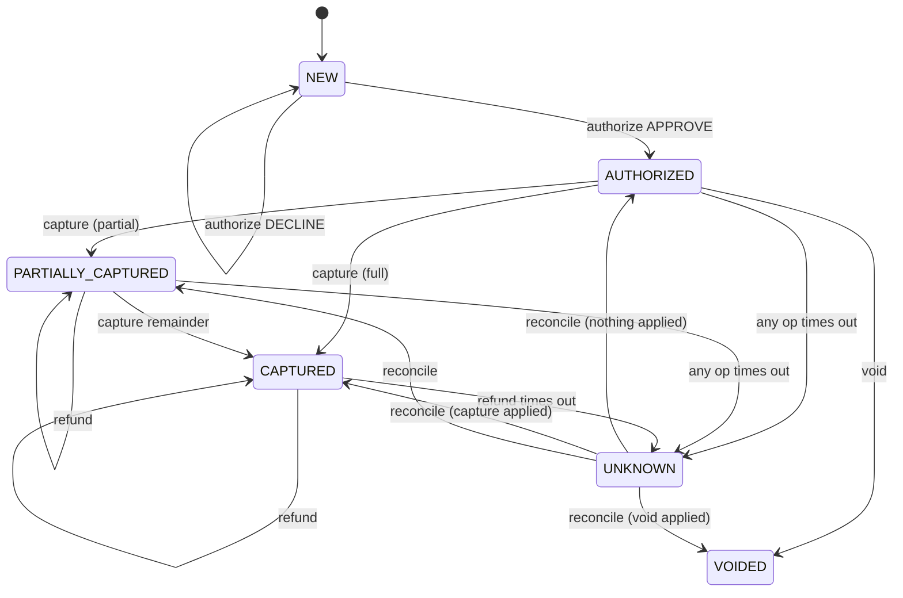

# Testing Payment Systems: Simulators, Property Tests, and Invariants

> Money is conserved; let the computer try to break that.

**Type:** Build
**Languages:** Java
**Prerequisites:** Phase 10, Lesson 01 (Representing Money), Phase 10, Lesson 03 (Double-Entry Ledger), Phase 12, Lesson 02 (Payment State Machine), Phase 12, Lesson 01 (Idempotent Payment API)
**Time:** ~120 minutes

## Learning Objectives

- State the invariants of a payment-plus-ledger system as executable predicates: money conserved, captures bounded by authorization, refunds bounded by captures, ledger equal to the processor's record
- Build a fake payment processor whose failure modes (decline, error, timeout before apply, timeout after apply) are scripted per call, and explain why a timeout is the only ambiguous one
- Write a property-based testing harness from scratch: seeded generators, a `forAll` loop, and greedy shrinking that reduces a twelve-command failure to two commands
- Express test scenarios as data so a counterexample found by the property test replays byte-for-byte as a regression test
- Explain why 500 trials found three of four injected bugs and missed the fourth, and what to change in the generator rather than the trial count

## The Problem

A payments team ships a refund endpoint with 94% line coverage. Every unit test passes: full refund, partial refund, refund of a declined payment, refund with a bad currency. Two weeks later finance reports that a merchant's balance is negative by 2,140.00 USD and climbing. The merchant had issued two partial refunds on a payment that had been captured twice (a partial capture followed by the remainder). Each refund individually was below the *last* capture's amount, so each passed the check `refund <= lastCapture`. Together they exceeded the total captured. No test had ever run two captures followed by two refunds, because nobody thought to write that test, and the space of sequences nobody thought of is where the bugs live.

A second team has a different problem. Their capture handler calls the processor, and if the call throws a socket timeout it logs a warning and returns `false`. A test confirms this. What no test confirms is what happens *next*: the processor had in fact captured the funds, the response was lost on the way back, and the ledger never heard about it. At month end the processor's settlement file shows 31 captures the ledger does not. The reverse also happened eleven times: the request never reached the processor, but a retry loop elsewhere assumed the first attempt had succeeded and posted the ledger entry anyway. Both are the same bug seen from two sides: a timeout was treated as an answer when it is the absence of one.

Example-based tests cannot find either class of bug, because the engineer writing the examples has the same blind spots as the engineer who wrote the code. What finds them is stating what must *always* be true, regardless of the sequence of operations, and letting a machine generate thousands of sequences, including the ones with four refunds and two timeouts in a row. When one sequence breaks the rule, the machine shrinks it to the shortest sequence that still breaks it, and that two-line sequence becomes the regression test. This lesson builds that machine, and the fake processor that lets it exercise failure paths a real sandbox would never reliably produce.

## The Concept

### Invariants, not examples

An example says: "authorize 50.00, capture 20.00, expect `captured == 20.00`." An invariant says: "after *any* sequence of operations, `captured <= authorized`." The example is one point in the input space; the invariant is a predicate over all of it. The property-based approach (Claessen and Hughes, QuickCheck, 2000) is to sample that space randomly, check the predicate at every point, and report the first point where it fails.

The invariants for the system in this lesson, each a line in `Invariants.check`:

| Invariant | Predicate | Which lesson introduced it |
|-----------|-----------|----------------------------|
| Money is conserved | sum of all account balances == 0 | Phase 10, Lesson 03: every posting debits one account and credits another by the same amount |
| Captures are bounded | `captured <= authorized` | Phase 12, Lesson 02: the state machine's guard on `capture` |
| Refunds are bounded | `refunded <= captured` | Phase 12, Lesson 06 |
| The ledger says what the payment says | `balance(CUSTOMER) == -(captured - refunded)` | This lesson: two views of the same fact must agree |
| Fees are never negative | `balance(PLATFORM_FEES) >= 0` | Phase 10, Lesson 01: rounding must not produce a negative fee |
| The ledger matches the processor | when state is not `UNKNOWN`, `captured == processor.captured` and `refunded == processor.refunded` | This lesson: external truth wins |

The last row is the one that catches the timeout bugs. It is conditional on the state because *while* a timeout is unresolved, disagreement is expected; the invariant is that disagreement never survives a `reconcile`.

### The fake processor and the four failure modes

A real sandbox processor approves almost everything and times out almost never, so a test suite that runs against it exercises the happy path ten thousand times and the timeout path zero. A fake processor with scripted behaviour inverts that: the test decides what happens on each call.

| Behaviour | Processor applied the operation? | Caller sees | Correct caller response |
|-----------|-------------------------------|-------------|-------------------------|
| `APPROVE` | yes | `true` | Post to ledger |
| `DECLINE` | no | `false` | Post nothing, state unchanged |
| `ERROR` | no | exception (5xx) | Post nothing, propagate |
| `TIMEOUT_AFTER_APPLY` | yes | `ProcessorTimeout` | Post nothing, mark `UNKNOWN`, reconcile later |
| `TIMEOUT_BEFORE_APPLY` | no | `ProcessorTimeout` | Post nothing, mark `UNKNOWN`, reconcile later |

The two timeout rows produce an identical exception. The caller *cannot* distinguish them at the moment of the timeout; only a later query to the processor can. That is why the correct response to both is the same: do nothing to the ledger, remember that the answer is unknown, and ask again. A service that posts on timeout is right half the time, and "right half the time" in a ledger is a reconciliation break every other incident.



`UNKNOWN` is a real state with its own guards: no new operation is allowed until `reconcile` resolves it. The alternative, letting a capture proceed while the previous one is unresolved, produces the double-posting bug.

### Generators and shrinking

A generator is two functions: `generate(rng)` produces a value, `shrink(value)` lists smaller candidates. The harness is a loop:

```text
for trial in 1..N:
    value = gen.generate(rng)
    if check(value) fails:
        repeat: pick the first candidate in gen.shrink(current) that still fails
        until no candidate fails
        report original, shrunk, reason
```

Shrinking is greedy descent: each step moves to a smaller failing value and never backtracks. It finds a *local* minimum, a failing input none of whose shrink candidates fail, which is almost always small enough to read. For integers the candidates are `lo`, then `v - (v - lo)/2`, `v - (v - lo)/4`, ..., then `v - 1`: a binary search toward the boundary. For lists, the candidates are the list with its first half removed, its second half removed, then smaller chunks, then each single element removed, then each element replaced by one of its own shrinks. Trying large removals first is what turns a twelve-command failure into a two-command one in a few dozen steps instead of thousands.

Worked by hand on the over-capture bug. Trial 12 with seed 42 generates:

```text
[VOID, VOID/TIMEOUT_BEFORE_APPLY, REFUND 7297, AUTHORIZE 171, RECONCILE, CAPTURE 8664,
 CAPTURE 3107, RECONCILE, REFUND 7062, REFUND 1469, AUTHORIZE 6407, CAPTURE 4350]
```

The first three commands are rejected by the state machine (nothing to void or refund yet). `AUTHORIZE 171` succeeds. `CAPTURE 8664` should be rejected but the bug lets it through: `captured 86.64 > authorized 1.71`. Shrinking:

```text
drop first half  -> [CAPTURE 3107, RECONCILE, REFUND 7062, ...]   all rejected, passes: keep looking
drop second half -> [VOID, VOID/T, REFUND 7297, AUTHORIZE 171, RECONCILE, CAPTURE 8664]   still fails: take it
drop first 3     -> [AUTHORIZE 171, RECONCILE, CAPTURE 8664]       still fails
drop RECONCILE   -> [AUTHORIZE 171, CAPTURE 8664]                  still fails
shrink 171 -> 1  -> [AUTHORIZE 1, CAPTURE 8664]                    still fails
shrink 8664 -> 2 -> [AUTHORIZE 1, CAPTURE 2]                       still fails; 1 passes; stop
```

67 steps, and the result reads as the bug report: authorize one cent, capture two. The value of shrinking is not that it finds the bug, the random trial did that; it is that the engineer reading the output at 2 a.m. sees two commands instead of twelve.

### Scenarios as data

A `Scenario` is a name and a list of `Command(kind, amount, processorBehaviour)`. The runner applies them in order to a fresh service and fake processor, logs each outcome, and checks every invariant after every command. Because the processor behaviour is part of each command, a scenario is a complete description of an execution: there is no hidden randomness, no clock, no network. The same list produces the same log on every machine.

This is what makes the property test and the regression suite the same thing. When `forAll` reports `[AUTHORIZE 1, CAPTURE 1/TIMEOUT_BEFORE_APPLY, RECONCILE]`, that list is pasted into a test as a `Scenario` and runs forever as a hand-written example. The generator discovered it; the scenario preserves it.

### Why trial count is the wrong knob

The demo runs each injected bug for 500 trials. Three fail within 53 trials. The fourth, posting on timeout, passes all 500 and fails at trial 930. The sequence it needs is specific: an approved authorization, then a capture whose processor behaviour is `TIMEOUT_BEFORE_APPLY` (one of five behaviours, chosen 30% of the time, so 6% per capture), then a `RECONCILE` later in the same list. Each requirement multiplies the odds down.

The honest fix is not "run 10,000 trials." It is to look at the generator and ask which paths it underweights. Here, the generator picks command kinds uniformly, so a third of all sequences start with a `VOID` or `REFUND` that is rejected outright and wastes the slot. A generator that knows the state machine, and only generates commands legal in the current state, would reach the deep paths in a fraction of the trials. Hughes calls this "testing the hard stuff": the generator carries as much design as the system. Exercise 2 asks you to build it.

### Where each kind of test earns its place

| Test kind | What it checks | Finds | Misses | Cost per run |
|-----------|---------------|-------|--------|--------------|
| Example (unit) | One input, one expected output | Regressions on paths someone already thought of | Everything nobody thought of | Milliseconds |
| Shrunk counterexample as scenario | One sequence that once failed | The same bug returning | New bugs | Milliseconds |
| Property over random sequences | An invariant across thousands of sequences | Interactions between operations, rare orderings | Paths the generator underweights | Seconds |
| Property with injected bugs (mutation) | That the suite would notice a known defect | Gaps in the invariants or the generator | Defects unlike the injected ones | Seconds per bug |
| Contract test against the sandbox | That the fake matches the real processor | Drift between fake and reality | Timeouts after apply, which no sandbox scripts | Seconds, network |
| Reconciliation in production | That the ledger equals the processor's settlement file | Whatever every layer above missed | Nothing, but a day late and after the money moved | Daily batch |

The layers are not alternatives. A payment flow with only the first row has the blind spots from The Problem; one with only the last row finds its bugs in finance's inbox. The property test sits in the middle because it is the cheapest layer that explores sequences a human did not enumerate, and the scenarios it produces feed the first row.

### What this lesson does not do

It does not test concurrency; every scenario is single-threaded, and the interleaving bugs of Phase 7 need a different generator (one that produces schedules, not command lists). It does not test the real processor; the fake is the point, and a thin contract test against the sandbox confirms the fake's assumptions separately. It does not do stateful model-based testing in the full QuickCheck sense, where an abstract model runs alongside the real system and every command's postcondition compares the two; the invariants here are a simpler version of that idea, and the processor's record is the model. It does not shrink across seeds or try to find *all* bugs: `forAll` stops at the first failure, because one shrunk counterexample is actionable and ten overlapping ones are noise.

## Build It

### Step 1: The ledger and the processor's record

```java
final class Ledger {
    private final Map<Account, Money> balances = new EnumMap<>(Account.class);

    void post(Account from, Account to, Money amount, String memo) {
        if (amount.isNegative()) throw new IllegalArgumentException("posting amount must not be negative: " + amount);
        balances.put(from, balances.get(from).minus(amount));
        balances.put(to, balances.get(to).plus(amount));
        postings.add(memo + ": " + from + " -> " + to + " " + amount);
    }

    Money total() { /* sum of every balance; zero iff every posting was balanced */ }
}

final class ProcessorPayment {
    Money authorized, captured, refunded;
    boolean voided;
}
```

Three accounts are enough: `CUSTOMER`, `MERCHANT`, `PLATFORM_FEES`. A capture moves the amount from customer to merchant and the fee from merchant to platform. `ProcessorPayment` is the processor's own view, which the fake updates when it "applies" an operation; the invariants compare it to the ledger's view.

**Predict:** if `post` is always balanced, how can `total()` ever be non-zero? Find the method in `Ledger` that exists only to let a bug in.

### Step 2: The fake processor

```java
boolean call(String op, Runnable apply) {
    ProcessorBehaviour b = next();
    return switch (b) {
        case APPROVE -> { apply.run(); yield true; }
        case DECLINE -> false;
        case TIMEOUT_AFTER_APPLY -> { apply.run(); throw new ProcessorTimeout(op); }
        case TIMEOUT_BEFORE_APPLY -> throw new ProcessorTimeout(op);
        case ERROR -> throw new IllegalStateException("processor 5xx on " + op);
    };
}

boolean capture(Money amount) { return call("capture", () -> record.captured = record.captured.plus(amount)); }
```

`apply` is the state change the processor would make. Whether it runs before the exception is the whole difference between the two timeouts, and the caller sees the same `ProcessorTimeout` either way. The script is a list consumed one entry per call; when it runs out, every call approves, so a test only scripts the calls it cares about.

### Step 3: The service, with bugs on switches

```java
boolean capture(Money amount) {
    requirePositive(amount);
    if (state != PaymentState.AUTHORIZED && state != PaymentState.PARTIALLY_CAPTURED) throw new IllegalStateException(...);
    if (!bugs.allowOverCapture() && captured.plus(amount).compareTo(authorized) > 0) {
        throw new IllegalArgumentException("capture " + amount + " exceeds remaining authorization " + authorized.minus(captured));
    }
    try {
        if (!processor.capture(amount)) return false;
    } catch (ProcessorTimeout t) {
        if (bugs.postOnTimeout()) postCapture(amount);   // the bug: assuming a timeout meant success
        state = PaymentState.UNKNOWN;
        return false;
    }
    postCapture(amount);
    return true;
}
```

The `Bugs` record has four booleans, all false in `Bugs.NONE`. Each re-introduces a defect that has shipped in a real payment system: a missing bound on capture, a missing bound on refund, a fee posting that credits without debiting, and a ledger write on timeout. They exist so the property test has something to find and so you can watch what the shrunk counterexample for each one looks like.

**Predict:** `allowOverRefund` lets `refunded` exceed `captured`. Which *two* invariants does that break, and which one does the runner report first?

### Step 4: Reconcile

```java
void reconcile() {
    if (state != PaymentState.UNKNOWN) return;
    ProcessorPayment p = processor.record;
    Money missingCapture = p.captured.minus(captured);
    if (missingCapture.minorUnits() > 0) postCapture(missingCapture);
    Money missingRefund = p.refunded.minus(refunded);
    if (missingRefund.minorUnits() > 0) postRefund(missingRefund);
    if (p.voided) state = PaymentState.VOIDED;
    else if (captured.isZero()) state = authorized.isZero() ? PaymentState.NEW : PaymentState.AUTHORIZED;
    else state = captured.compareTo(authorized) >= 0 ? PaymentState.CAPTURED : PaymentState.PARTIALLY_CAPTURED;
}
```

Reconcile asks the processor what it has and posts whatever the ledger is missing. It only ever adds; it cannot remove a posting the ledger made that the processor never saw, which is exactly why the `postOnTimeout` bug is caught *after* reconcile: the ledger says 0.01 captured, the processor says 0.00, the state is no longer `UNKNOWN`, and the last invariant fires.

### Step 5: Generators

```java
static Gen<Long> longs(long lo, long hi) {
    return new Gen<>() {
        public Long generate(Random rng) { return lo + (long) (rng.nextDouble() * (hi - lo + 1)); }
        public List<Long> shrink(Long v) {
            List<Long> out = new ArrayList<>();
            if (v <= lo) return out;
            out.add(lo);
            long d = v - lo;
            for (long step = d / 2; step > 0; step /= 2) out.add(v - step);
            if (!out.contains(v - 1)) out.add(v - 1);
            return out;
        }
    };
}
```

`lists(element, maxLen)` generates 1 to `maxLen` elements and shrinks by chunk removal, then single removal, then element shrinking. `oneOf(values)` shrinks toward earlier entries in the list, so `APPROVE` is "simpler" than `TIMEOUT_BEFORE_APPLY` and a shrunk counterexample keeps a failure behaviour only when the bug needs it. Look at the `postOnTimeout` counterexample: `CAPTURE 1/TIMEOUT_BEFORE_APPLY` kept its behaviour because replacing it with `APPROVE` makes the scenario pass.

**Predict:** `longs(1, 1_000_000).shrink(749170)`: what is the first candidate, and roughly how many candidates are there?

### Step 6: forAll

```java
static <T> PropertyResult<T> forAll(String name, Gen<T> gen, Function<T, String> check, long seed, int trials) {
    Random rng = new Random(seed);
    for (int i = 1; i <= trials; i++) {
        T value = gen.generate(rng);
        String reason = safeCheck(check, value);
        if (reason == null) continue;
        T current = value;
        int steps = 0;
        boolean progressed = true;
        while (progressed && steps < MAX_SHRINK_STEPS) {
            progressed = false;
            for (T candidate : gen.shrink(current)) {
                steps++;
                String r = safeCheck(check, candidate);
                if (r != null) { current = candidate; progressed = true; break; }
            }
        }
        return new PropertyResult<>(name, false, seed, i, new Counterexample<>(value, current, steps, currentReason));
    }
    return new PropertyResult<>(name, true, seed, trials, null);
}
```

`check` returns `null` for "holds" and a sentence for "violated"; a sentence is more useful than a boolean when the output is read by a human. `safeCheck` treats `IllegalArgumentException` and `IllegalStateException` as "the system rejected this input on purpose," which is not a failure, and any other exception as a crash, which is. The seed is in the result so a failure in CI reproduces locally with one number.

### Step 7: The scenario runner and the headline property

```java
static ScenarioRun run(Scenario scenario, Bugs bugs) {
    FakeProcessor processor = new FakeProcessor(Currency.USD);
    PaymentService service = new PaymentService(Currency.USD, processor, bugs);
    for (Command c : scenario.commands()) {
        processor.script(c.behaviour());
        try { /* dispatch on c.kind() */ } catch (IllegalArgumentException | IllegalStateException rejected) { /* log and continue */ }
        String violation = Invariants.check(service);
        if (violation != null) return new ScenarioRun(scenario, service, log, violation + " after " + c);
    }
    return new ScenarioRun(scenario, service, log, null);
}

static PropertyResult<List<Command>> invariantsHold(Bugs bugs, long seed, int trials, int maxLen) {
    return Property.forAll("invariants hold under " + bugs, sequences(maxLen),
            cmds -> run(new Scenario("generated", cmds), bugs).violation(), seed, trials);
}
```

The invariants are checked after *every* command, not only at the end. A later command can mask an earlier violation (a refund that brings a negative balance back to zero), and the violation message names the command that caused it.

**Predict:** the runner catches the service's rejections itself. What would change in the reported counterexamples if it let them propagate to `safeCheck` instead?

### Step 8: Run it

```bash
cd phases/12-payment-systems-design/14-testing-payment-systems/code/java
javac -d .out *.java && java -cp .out Main
java -cp .out MainTest
```

Expected output, abbreviated:

```console
== One scripted scenario: capture times out, reconcile repairs the ledger ==
  AUTHORIZE 5000 -> ok [AUTHORIZED]
  CAPTURE 5000/TIMEOUT_AFTER_APPLY -> declined/unknown [UNKNOWN]
  RECONCILE -> ok [CAPTURED]
  REFUND 1250 -> ok [CAPTURED]
  ledger: customer -37.50 USD, merchant 36.05 USD, fees 1.45 USD, total 0.00 USD
  invariants: hold

== Property: invariants hold for 500 random sequences (seed 42) ==
invariants hold under Bugs[...all false]: OK, 500 trials (seed 42)

== Same property with real bugs switched back on (500 trials) ==
invariants hold under Bugs[allowOverCapture=true, ...]: FAILED at trial 12 (seed 42)
  shrunk (67 steps): [AUTHORIZE 1, CAPTURE 2]
  reason: captured 0.02 USD > authorized 0.01 USD after CAPTURE 2
invariants hold under Bugs[allowOverRefund=true, ...]: FAILED at trial 53 (seed 42)
  shrunk (179 steps): [AUTHORIZE 1, CAPTURE 1, REFUND 2]
invariants hold under Bugs[unbalancedFee=true, ...]: FAILED at trial 5 (seed 42)
  shrunk (123 steps): [AUTHORIZE 18, CAPTURE 18]
  reason: money not conserved: ledger total 0.01 USD after CAPTURE 18
invariants hold under Bugs[postOnTimeout=true]: OK, 500 trials (seed 42)

== The timeout bug needs AUTHORIZE, CAPTURE/TIMEOUT_BEFORE_APPLY, RECONCILE in that order: 2000 trials ==
invariants hold under Bugs[postOnTimeout=true]: FAILED at trial 930 (seed 42)
  shrunk (122 steps): [AUTHORIZE 1, CAPTURE 1/TIMEOUT_BEFORE_APPLY, RECONCILE]
  reason: ledger captured 0.01 USD != processor captured 0.00 USD after RECONCILE

== Shrinking a plain integer property: 'truncating the 2.9% fee equals HALF_EVEN' ==
truncated fee == rounded fee: FAILED at trial 2 (seed 7)
  original: 749170
  shrunk (59 steps): 18
  reason: n=18: truncated 0 != rounded 1
```

Notice `[AUTHORIZE 18, CAPTURE 18]` for the unbalanced-fee bug. Why 18 and not 1? Because 2.9% of 17 cents rounds to zero, so the unbalanced fee posting credits nothing and conservation holds by accident. Eighteen cents is the smallest amount whose fee is non-zero, which is also what the integer property at the end finds from the other direction. The shrinker did not know that; it found it.

### Porting notes

Python's `random.Random(seed)` and Go's `math/rand.New(rand.NewSource(seed))` give the same determinism guarantee as `java.util.Random(seed)`, though the three streams differ, so seeds are not portable across languages; port the shrunk scenarios, not the seeds. Python's `hypothesis` and Go's `testing/quick` and `rapid` are the production harnesses; the lesson's `Gen` maps to Hypothesis's `SearchStrategy` with its integrated shrinking. In Go, `check` returning `(string, bool)` or an `error` replaces the null-means-ok convention, and the service's rejections would be sentinel errors tested with `errors.Is` rather than exception classes. Money stays `int64` minor units in Go and `int` in Python; the fee rounding must be ported with the sign-and-magnitude care from Phase 10, Lesson 01, because Python's `//` floors.

## Use It

**jqwik** (Java), **Hypothesis** (Python), and **rapid** (Go) are the production versions of `forAll`. What they add: generators for every standard type, size-aware generation that starts small and grows, integrated shrinking that is far smarter than greedy descent (Hypothesis shrinks the random byte stream that produced the value, so shrinking works for any generator without a hand-written `shrink`), a database of past failures replayed first on every run, and stateful testing where you declare commands with preconditions and postconditions and the library builds the sequence generator for you. What they do not add: the invariants. Those come from understanding the domain, which is why this lesson spent as long on `Invariants.check` as on the harness.

**Stripe's test mode** and **Adyen's test environment** are the real-world fake processors: magic card numbers (`4000000000000002` declines, `4000000000000119` fails with a processing error) select the behaviour per call, which is exactly `FakeProcessor.script`. Neither can simulate `TIMEOUT_AFTER_APPLY` on demand, because a sandbox that drops responses is indistinguishable from a broken one; that failure mode has to be tested with a fake you control.

**Jepsen** and **FoundationDB's simulation testing** apply the same idea one level down: generate operation histories, run them against the real system with injected network faults, check invariants (linearizability, durability) on the history. FoundationDB's simulator is the reason its storage engine shipped with so few bugs that the company's founders described finding bugs in production as "novel."

The trap: a property test that passes is weaker evidence than it looks. It proves the generator found no counterexample, not that none exists. The `postOnTimeout` run at 500 trials is the lesson's own example. Always ask what the generator cannot produce.

## Ship It

`outputs/checklist-payment-invariants.md` lists the invariants a payment-plus-ledger system should hold, with the property-test shape for each and the failure modes a fake processor must be able to script. Use it when reviewing a new payment flow or when a reconciliation break makes you suspect an invariant nobody wrote down.

## Exercises

1. **Reinforce.** Add a fifth bug switch, `feeOnRefund`, that posts a second fee when a refund is processed (a real defect: fees charged twice on partially refunded payments). Predict the shrunk counterexample before you run it, then run it. Which invariant catches it?
2. **Apply.** Write a state-aware command generator: it tracks the state the sequence would be in and only emits commands legal in that state (`CAPTURE` only after `AUTHORIZED`, `REFUND` only after a capture, `RECONCILE` only after `UNKNOWN`). Measure how many trials the `postOnTimeout` bug now needs with seed 42, and how the shrunk counterexamples change.
3. **Extend.** Replace the three-account ledger with the full double-entry ledger from Phase 10, Lesson 03, including journal entries and the trial balance, and add the invariant that every journal entry individually balances. Then add a `Bugs.lostPosting` switch that drops one leg of a two-leg entry under a timeout, and show that the per-entry invariant catches it earlier (after fewer commands) than the global `total() == 0` check does.

## Key Terms

| Term | What people say | What it actually means |
|------|-----------------|------------------------|
| Invariant | "the thing that should always be true" | A predicate over system state that every reachable state satisfies; the property test's oracle |
| Property-based test | "fuzzing" | Random generation of structured inputs plus an invariant check and shrinking; fuzzing usually means unstructured bytes and crash detection only |
| Generator | "random data" | A pair of functions, `generate(rng)` and `shrink(value)`, whose design determines which paths get exercised |
| Shrinking | "minimising the failure" | Greedy descent through smaller candidates that still fail, ending at a local minimum small enough to read |
| Fake | "a mock" | A working in-memory implementation with scripted behaviour; a mock records calls and asserts on them, a fake behaves |
| Scenario | "a test case" | A list of commands including processor behaviours; complete, deterministic, and replayable as data |
| Reconcile | "sync with the processor" | Query the external record and post whatever the ledger is missing; the only correct resolution of a timeout |

## Further Reading

- [Claessen and Hughes, "QuickCheck: A Lightweight Tool for Random Testing of Haskell Programs" (ICFP 2000)](https://www.cs.tufts.edu/~nr/cs257/archive/john-hughes/quick.pdf) — the original paper: generators, `forAll`, and shrinking in twelve pages.
- [Hughes, "Experiences with QuickCheck: Testing the Hard Stuff and Staying Sane" (2016)](https://publications.lib.chalmers.se/records/fulltext/232550/local_232550.pdf) — stateful testing of real systems (Volvo, Klarna's payment ledger) and why generator design matters more than trial count.
- [MacIver and Hatfield-Dodds, "Hypothesis: A new approach to property-based testing" (JOSS 2019)](https://joss.theoj.org/papers/10.21105/joss.01891) — how shrinking the underlying byte stream removes the need for hand-written `shrink` functions.
- [jqwik user guide](https://jqwik.net/docs/current/user-guide.html) — the JUnit 5 property-testing engine; compare its `Arbitrary` to this lesson's `Gen`.
- [Stripe: Testing with test cards](https://docs.stripe.com/testing) — magic card numbers that script decline and error behaviour per call; note the absence of a "timeout after apply" card.
- [Kingsbury, Jepsen analyses](https://jepsen.io/analyses) — generated histories plus fault injection plus invariant checking, applied to databases; the same method one layer down.
