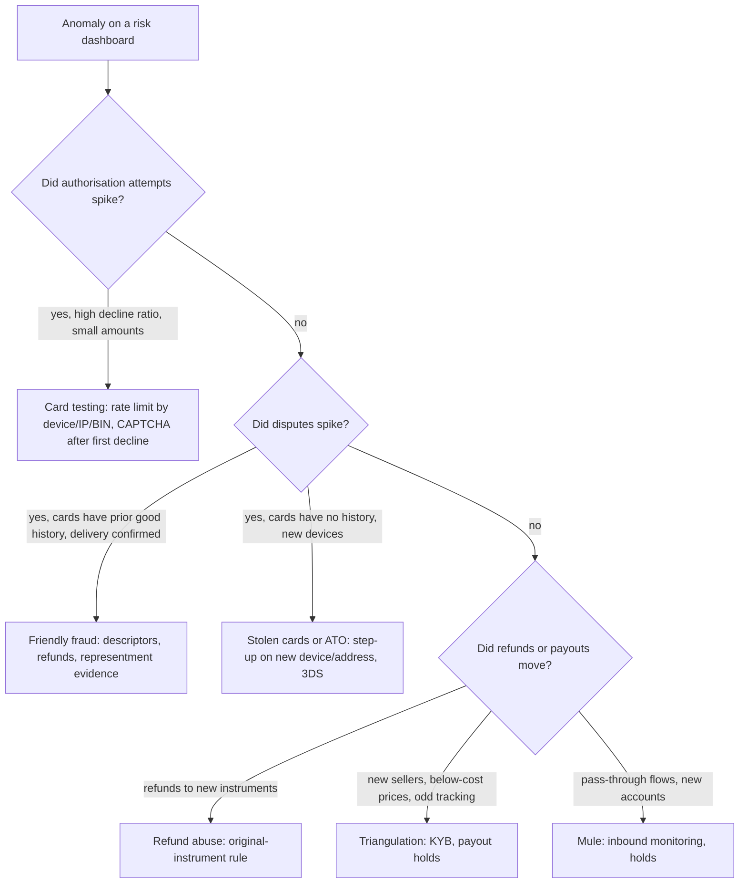

# Fraud Patterns: Card Testing, Account Takeover, Friendly Fraud

> Know the attack before you build the defense.

**Type:** Learn
**Languages:** —
**Prerequisites:** Phase 11 Lesson 01 (How a Card Payment Works), Phase 12 Lesson 02 (The Payment State Machine), Phase 10 Lesson 03 (The Double-Entry Ledger)
**Time:** ~75 minutes

## Learning Objectives

- Classify a suspicious event into one of eight fraud patterns from its mechanism, its target, and who eventually bears the loss
- Name the two or three signals that distinguish each pattern from legitimate traffic, and the control that acts on each signal
- Trace the money and the liability through a card-testing attack and a friendly-fraud chargeback, including who pays the network fees
- Explain why a control that stops one pattern (CAPTCHA on checkout, 3-D Secure, refund limits) is neutral or harmful against another
- Read a dispute-rate or decline-rate dashboard and say which pattern the shape of the curve suggests
- State the loss formula a risk team optimises and why "block everything suspicious" is the most expensive policy available

## The Problem

A donations platform processes about 9,000 card payments a day with an authorisation decline rate that has sat at 6% for a year. On a Tuesday at 02:10 UTC the decline rate climbs to 71% over twenty minutes. The payments on-call engineer sees nothing wrong with the gateway: latency is normal, the acquirer is healthy, successful payments are still clearing. The volume, however, is 40 times the usual overnight rate, and almost every attempt is a $1.00 or $2.00 donation to a handful of newly created campaigns.

What is happening is card testing. Somebody holds a list of 300,000 card numbers of unknown quality, bought from a breach dump, and is using the donation form as a free oracle: every authorisation response tells them whether the card is live, whether the CVV matches, and sometimes whether the address check passed. The 29% that succeed are now sorted into a "verified live" list worth twenty times what the raw dump cost. The platform did not lose money on the declined attempts, but it is about to. The acquirer charges an authorisation fee on every attempt, approved or declined, so 150,000 attempts at $0.10 each is $15,000 in network fees for $8,000 of fraudulent $1.00 donations that will all be charged back at $15 to $25 each. The card issuers, watching an unusual spike of small authorisations from one merchant, raise the platform's risk rating, which lowers its approval rate for legitimate donors for months afterwards. If the attempt volume stays high, the card networks' excessive-authorisation programmes fine the acquirer, who passes the fine on.

The engineer's instinct, to add a CAPTCHA to the form, is the right control for this pattern and the wrong one for the next incident, where a ring buys gift cards using accounts they have taken over with credentials recycled from another site's breach. Those attackers have valid sessions, pass CAPTCHAs, and pay with the victim's own saved card. The control that stops them is a step-up challenge on a changed shipping address and a cooling-off period on new payment instruments, which does nothing against card testing. A third incident, a wave of chargebacks six weeks after a successful marketing campaign, is not an attack at all in the usual sense: real customers, real cards, disputing real purchases they made, because the statement descriptor did not match the brand name and the refund page was hard to find.

Every control in this phase is a trade: it stops some fraud and it blocks or annoys some good customers. The trade is only sensible if you know which attack you are facing, because the signals, the controls, and the party who ultimately pays are different for each one. This lesson is the taxonomy the rest of the phase builds on.

## The Concept

### A loss formula to optimise

A risk team is not asked to eliminate fraud. It is asked to minimise a total cost that has at least four terms:

```text
total cost = fraud losses written off
           + chargeback fees and network fines
           + revenue lost from good customers blocked or abandoned at a challenge
           + cost of manual review (analyst minutes * fully loaded rate)
```

The third term is the one engineers forget. If 2% of attempts are fraudulent, a control that blocks all fraud plus 5% of good customers has turned a 2% loss into a 7% loss, because a blocked good customer is revenue that does not come back, and in a marketplace it is also a seller's revenue. The industry phrase is the "insult rate": the fraction of legitimate customers declined. Lesson 03 turns this formula into a threshold decision; this lesson supplies the patterns the terms are measured against.

### Who bears the loss

The same chargeback shifts between parties depending on how the payment was authenticated and what kind of merchant made it, which is why the fraud pattern determines the design.

| Situation | Who eats a fraudulent transaction | Why |
|-----------|-----------------------------------|-----|
| Card-present, EMV chip read, issuer approved | Issuer | Chip authentication happened; the merchant did what the network asked |
| Card-present, chip card swiped on a non-chip terminal | Merchant | The liability shift of 2015 (US) moved loss to whoever has the weaker technology |
| Card-not-present, no 3-D Secure | Merchant | The merchant accepted the card without authenticating the cardholder |
| Card-not-present, 3-D Secure authentication completed | Issuer | Authentication shifted liability to the party that authenticated |
| Account funded wallet (stored balance), fraudster spends victim's balance | Wallet operator | No network to arbitrate; the operator's terms govern |
| Bank transfer initiated by the victim under deception (authorised push payment) | Victim, increasingly the bank (UK PSR rules from October 2024 reimburse most cases) | The payment was authorised; the question is who should have stopped it |

Read the table top down and a pattern emerges: liability sits with whoever had the chance to authenticate and did not. Every fraud control is therefore also a liability decision. 3-D Secure on a card-not-present payment does not just lower fraud, it moves the loss to the issuer when fraud happens anyway, which is why merchants with high fraud exposure use it even though it costs conversion.

### The taxonomy

Eight patterns cover the large majority of what a payments risk team sees. They are grouped by what is stolen: credentials, instruments, the merchant's own policy, or identity itself.

| Pattern | What is stolen or abused | Typical target | Primary signals | Primary controls | Who bears the loss |
|---------|--------------------------|----------------|-----------------|------------------|--------------------|
| Card testing (enumeration) | Validity of stolen card numbers | Any form that authorises a card: donations, low-value checkout, card-on-file update | Authorisation burst, decline ratio, small round amounts, many cards per IP or device, sequential BINs | Rate limit per IP/device/BIN, CAPTCHA on first attempt, require AVS/CVV before authorising, $0 verification instead of $1 auth, block velocity by BIN | Merchant: auth fees, chargebacks, fines; issuers: later fraud on verified cards |
| Account takeover (ATO) | Victim's logged-in account and its saved payment methods | Marketplaces, wallets, loyalty points, anything with stored value or saved cards | Login from new device/geo, credential-stuffing patterns (many users, one IP), password or email change followed by purchase, shipping address change | Credential-stuffing detection, step-up authentication on risky actions, cooling-off after profile change, notify old email on change | Platform (often refunds the victim); issuer if 3DS was used |
| Friendly fraud (first-party misuse) | The merchant's dispute process | Digital goods, subscriptions, delivered physical goods | Dispute reason "not recognised" or "not received" with matching device/IP to successful login, delivery confirmation, prior purchases from same card | Clear statement descriptors, easy self-service refunds, delivery evidence, representment with device/login evidence, compelling evidence 3.0 (Visa) | Merchant unless representment wins |
| Triangulation | A real buyer's card and trust, via a fake storefront | Marketplaces with many small sellers; the fraudster is both a seller and a buyer elsewhere | Seller's orders fulfilled from third-party retailers, stolen cards on the retailer side, buyer complaints months later, prices below cost | Seller onboarding checks (KYB, Lesson 05), fulfilment source verification, payout holds for new sellers, cross-referencing shipping addresses to card-testing lists | Retailer whose goods were bought with stolen cards; marketplace via seller chargebacks |
| Refund and return abuse | The merchant's refund policy | Retail with generous returns, platforms that refund to a different instrument | Refund count per account, refund-to-purchase ratio, "item never arrived" at delivered addresses, refunds requested to a new card or wallet | Refund to original instrument only, refund velocity limits, delivery proof, account-level refund budget | Merchant |
| Synthetic identity | A fabricated person built from real and fake fragments (real SSN of a child, fake name and DOB) | Credit, BNPL, bank account opening | Thin or no credit file, identity elements that conflict across bureaus, many applicants sharing a phone or address, piggybacking on authorised-user tradelines | Document verification plus database verification (Lesson 05), SSN issuance-date checks (US eCBSV), link analysis across applicants | Lender; there is no victim to dispute, so the loss is only discovered at default |
| Mule accounts | Accounts opened or sold to move stolen money | Banks, wallets, remittance | Rapid in-and-out flows, incoming from many unrelated senders, immediate withdrawal or crypto purchase, account opened recently with little other activity | Inbound payment monitoring (Lesson 06), holds on new accounts, pattern matching on pass-through behaviour, consortium data on known mule patterns | Victim of the upstream scam; receiving bank under reimbursement rules |
| Bust-out | A credit line built legitimately then maxed out and abandoned | Card issuers, BNPL, merchant cash advance, marketplace seller credit | Months of good behaviour, sudden utilisation spike, balance paid with a cheque or transfer that later bounces, address change before the spike | Payment-source verification before credit limit release, limit increases paced to tenure, monitoring for utilisation acceleration | Lender |

The table is the lesson. Everything below it is the explanation of why each cell is what it is.

### Card testing in detail

Card testing is the pattern an engineer is most likely to meet first because it needs no victim relationship and no knowledge of your product. The attacker needs a form that returns an authorisation result quickly. Three design choices make a form a good oracle: it accepts arbitrary amounts (so $1.00 is possible), it returns the specific decline reason to the browser (so "CVV mismatch" is distinguishable from "do not honour"), and it does not rate limit by anything the attacker cannot cheaply rotate.

The signals, in rough order of how early they appear:

1. **Velocity of distinct cards per device or IP.** A human has one or two cards. Fifty distinct PANs from one device fingerprint in ten minutes has no legitimate explanation. Lesson 02 builds the sliding-window counter for this.
2. **Decline ratio.** Normal card-not-present traffic declines 5 to 15%. A stream of attempts with 60 to 90% declines is enumeration.
3. **BIN concentration.** Dumps are often sorted by issuer. Many attempts from one six- or eight-digit BIN range in a short window are a strong signal and a cheap counter.
4. **Amount distribution.** Testers use the minimum your form permits, and they use the same amount repeatedly.
5. **Newly created accounts or campaigns receiving the attempts.** The fraudster controls the destination so they can see results in an admin panel.

The controls that work: rate limits keyed on several dimensions at once (IP, device, BIN, destination account), a CAPTCHA that is shown only after the first decline so it does not tax good customers, $0 account-verification messages instead of $1 authorisations when you only need to check a card (the networks prefer this and some fine $1 auths at scale), and never returning the issuer's decline reason verbatim to the browser. The control that does not work: blocking by IP alone, because residential proxy networks give the attacker hundreds of thousands of clean IPs for a few dollars.

A card-testing attack also damages you in a way the dashboard does not show. Visa's and Mastercard's excessive-authorisation and fraud monitoring programmes are triggered by ratios of declined and fraudulent authorisations to total; a merchant who lets a test attack run for a weekend can enter a monitoring programme that lasts months and raises costs on every legitimate payment.

### Account takeover in detail

ATO starts somewhere else: a credential dump from an unrelated breach. The attacker scripts logins against your site with the dumped email and password pairs (credential stuffing) and succeeds on the 0.5 to 2% of users who reuse passwords. From the victim's account they can spend a stored balance, buy with a saved card, redeem loyalty points, or change the payout bank account of a seller so the next settlement goes to them.

The distinguishing signal is a **sequence**, not a single event: a login from a new device and a new network, followed within minutes by a change to the email, phone, password, or shipping address, followed by a purchase. Each step is individually normal. The sequence is not. This is why ATO detection is a state-machine problem (Phase 12, Lesson 01) and why risk signals need to be joined across the session, not evaluated per request.

Controls, ordered by where they sit in the sequence:

- **At login:** detect stuffing by the ratio of distinct usernames to IPs, by impossible travel, and by known-breached credential lists. Require a second factor on new devices.
- **At the profile change:** notify the old contact details, not just the new ones. Hold the change for 24 hours before it affects payouts. This single control stops most seller-payout hijacking.
- **At the purchase:** step up (3-D Secure, one-time code) when the shipping address, the payment method, or the device is new relative to the account's history. Lesson 07 covers which device signals are stable enough to anchor "new" on.

The control that misfires: adding friction to login for everyone. ATO is rare per user and common per platform; a per-user cost on every login to catch a one-in-a-thousand event is usually a worse trade than targeted step-ups.

### Friendly fraud in detail

Friendly fraud (the networks' term is first-party misuse) is a cardholder disputing a transaction they or a household member made. Reasons range from genuine confusion (an unfamiliar statement descriptor, a forgotten subscription renewal, a child's in-app purchase) to deliberate abuse ("I never received it" on a delivered package). From the merchant's dashboard it looks like fraud because the chargeback reason code is fraud; from the issuer's side the cardholder is a customer who is believed by default.

The signals are the opposite of ATO's: everything about the transaction looks like the real customer. The same device fingerprint logged in before and after; the shipping address matches a year of order history; the item was delivered and signed for. That is exactly the evidence the merchant submits in **representment**, the formal response to a chargeback. Visa's Compelling Evidence 3.0 rule (2023) lets a merchant defeat a "fraud" chargeback outright if it can show two prior undisputed transactions on the same card with matching device ID, IP, account login, or shipping address, within a 120 to 365 day window. Keeping that history is an engineering requirement, not a compliance nicety.

Controls: statement descriptors that match the brand the customer recognises; a refund path that is easier than calling the bank; subscription renewal reminders before the charge; delivery confirmation with signature for high-value items. The decisive operational control is the pre-dispute alert networks (Verifi's Order Insight and Ethoca's Consumer Clarity), which let the merchant refund within 72 hours of a cardholder inquiry and avoid the chargeback and its fee entirely.

Friendly fraud is also where chargeback *ratios* bite. Visa's dispute monitoring programme has historically used thresholds around 0.9% (disputes divided by transactions in the same month) and 100 disputes to enter the standard programme; Mastercard's excessive chargeback programme is similar. Above those thresholds the merchant pays monthly fines and, eventually, loses the ability to accept cards. A merchant with a 1% friendly-fraud rate is in as much trouble as one with a 1% stolen-card rate, even though nothing was stolen.

### Triangulation

Triangulation exploits trust in three directions. A fraudster lists popular goods on a marketplace at 30% below retail. A real buyer pays with a real card. The fraudster then orders the goods from a legitimate retailer using a stolen card, with the buyer's address as the shipping address. The buyer receives genuine goods and is happy; the retailer eats a chargeback months later; the marketplace holds the fraudster's payout, which is clean money from a real buyer, unless it notices.

Signals live on the marketplace side: a new seller with prices below cost, fulfilment tracking numbers that originate from a retailer's warehouse rather than the seller's address, and shipping addresses that later appear in the retailer's fraud reports. Controls are seller-side: KYB on onboarding (Lesson 05), payout holds for new sellers scaled to their chargeback exposure window, and cross-industry sharing of shipping addresses linked to stolen-card orders. Triangulation is the reason marketplaces hold payouts for 7 to 14 days even for good sellers.

### Refund and return abuse

The simplest abuse is a customer who claims non-receipt on every third order. The more damaging pattern is refund-to-alternate-instrument: a fraudster buys with a stolen card and requests a refund to a wallet or bank account they control, converting a stolen card into clean funds through your refund flow. The control is a rule, not a model: refunds go to the original payment instrument, always, and the exceptions (card expired, account closed) go to manual review. Refund velocity per account and a refund-to-purchase ratio catch the softer abuse. The ledger lesson (Phase 10, Lesson 03) makes the first control enforceable: a refund posting must reference the original payment posting.

### Synthetic identity

A synthetic identity is not a stolen one; it is a manufactured one. In the United States the classic recipe combines a real Social Security number that has no credit file (often a child's or a recent immigrant's) with a fabricated name and date of birth. The identity applies for credit, is declined, and the application itself creates a credit bureau file. A second application succeeds at a lender with loose checks. The synthetic becomes an authorised user on a complicit account to inherit history, builds a profile over 12 to 24 months, and then busts out.

There is no victim to call the bank, so the fraud is only recognised when the account defaults and collections discover the person does not exist. The US Federal Reserve estimated synthetic identity losses to lenders in the billions annually, and most lenders cannot separate them from credit losses. Signals: identity elements that disagree across data sources, a thin file for an adult, many applicants at the same address or phone, and an SSN issued after the stated date of birth. The decisive control is the Social Security Administration's electronic Consent Based SSN Verification service, which confirms whether an SSN, name, and date of birth match SSA records. Lesson 05 covers where it fits in onboarding.

### Mule accounts and bust-out

A mule account receives stolen funds and passes them on, typically within hours, either to another mule, to a crypto exchange, or as cash. Mules are recruited (job scams, "payment processing from home") or are the fraudster's own accounts opened with stolen or synthetic identities. The distinguishing shape is pass-through: inbound from many unrelated senders, outbound in one or two transfers, near-zero resting balance, on an account with no payroll, no bills, and little history. Lesson 06 builds the monitoring that detects this. Mule detection matters more every year because reimbursement rules for authorised push payment scams increasingly put losses on the *receiving* bank that hosted the mule.

Bust-out is the credit-side cousin: an account behaves perfectly for months to earn limit increases, then draws everything in a few days, often "paying" the balance with a transfer that later reverses so the limit frees up again for a second draw. The signal is acceleration in utilisation and a payment from a new source immediately before it. The control is to release limit only after a payment has cleared irrevocably, which, from Phase 11, you know takes days for a cheque and seconds for a real-time rail.

### Controls cross-reference: what helps, what is neutral, what hurts

Each control below is a real one a team might ship after an incident. The columns show its effect on each pattern. "Hurts" means the control adds cost or friction without reducing that pattern, or actively feeds it.

| Control | Card testing | ATO | Friendly fraud | Triangulation | Refund abuse | Synthetic | Mule | Bust-out |
|---------|--------------|-----|----------------|---------------|--------------|-----------|------|----------|
| CAPTCHA on checkout | Helps | Neutral (attacker has a session) | Hurts (friction on real customers, no effect) | Neutral | Neutral | Neutral | Neutral | Neutral |
| 3-D Secure on all CNP | Helps a little (adds a step to the oracle) | Helps (victim gets the OTP) | Helps (shifts liability; cardholder authenticated) | Neutral | Neutral | Neutral | Neutral | Neutral |
| Rate limit by device and BIN | Helps strongly | Helps against stuffing | Neutral | Neutral | Neutral | Neutral | Neutral | Neutral |
| Step-up on new shipping address | Neutral | Helps strongly | Hurts slightly (friction) | Neutral | Neutral | Neutral | Neutral | Neutral |
| Refund to original instrument only | Helps (bulk refunds are safe) | Neutral | Neutral | Neutral | Helps strongly | Neutral | Helps (blocks one laundering path) | Neutral |
| Payout hold for new sellers | Neutral | Helps (hijacked payouts can be reversed) | Neutral | Helps strongly | Neutral | Neutral | Neutral | Neutral |
| Document plus database identity check at onboarding | Neutral | Neutral | Neutral | Helps | Neutral | Helps strongly | Helps | Helps |
| Release credit only on cleared funds | Neutral | Neutral | Neutral | Neutral | Neutral | Neutral | Neutral | Helps strongly |
| Decline all transactions above a risk score | Helps | Helps | Hurts (real customers blocked; disputes unaffected) | Neutral | Neutral | Neutral | Neutral | Neutral |

Two cells deserve a second look. A high-score decline rule does nothing for friendly fraud because the transactions in question are legitimate at authorisation time; the only thing it changes is how many good customers you lose. And a CAPTCHA, the most common first response to any incident, has exactly one row where it helps.

### What each pattern looks like on a dashboard

Risk incidents usually arrive as a shape on a chart before anyone has a label. These are the shapes.

| Metric | Card testing | ATO | Friendly fraud | Triangulation | Mule |
|--------|--------------|-----|----------------|---------------|------|
| Authorisation attempts per minute | Step change, 10x to 100x, often at night | Flat | Flat | Flat | Not applicable |
| Decline ratio | 60 to 90% | Normal | Normal | Normal | Not applicable |
| Average ticket | Collapses to the minimum amount | Rises (gift cards, electronics) | Normal | Normal | Not applicable |
| Dispute rate, lagged 30 to 90 days | Spike matching the attack window | Spike, reason "fraud, card not present" | Steady climb, reason "not recognised" or "not received" | Spike on the retailer's side, not yours | Not applicable |
| Password or email changes per hour | Flat | Spike preceding purchases | Flat | Flat | Flat |
| New accounts per hour | Spike (destination accounts) | Flat | Flat | Spike in sellers | Spike in receivers |
| Inbound transfers per account | Not applicable | Not applicable | Not applicable | Not applicable | Many senders, one receiver, fast outbound |

The lag in the dispute row is the single most important operational fact in this phase. Fraud labels arrive 30 to 120 days after the transaction, so a model or a rule tuned on this month's disputes is tuned on transactions from last quarter, and a new attack is invisible in dispute data until it is already expensive. Real-time signals (velocity, device, sequence) exist because the ground truth is late.

### Data you must keep to fight back

Several controls above depend on history the merchant chose to keep months earlier. The minimum set, with the pattern that needs it:

- **Device identifier, IP, and account login per transaction, retained at least 365 days.** Required for Compelling Evidence 3.0 representment against friendly fraud and for ATO sequence detection.
- **Shipping address per order, normalised, with first-seen date per account.** Needed for "new address" step-ups and for triangulation cross-referencing.
- **Delivery confirmation joined to the order, with carrier timestamp and signature where available.** The only evidence that beats "item not received".
- **Authorisation responses including issuer decline codes, per attempt, even failed ones.** Card testing is invisible if you log only successes.
- **Profile change events with old and new values and the device that made them.** ATO investigations hinge on the change sequence.
- **Refund postings that reference the original payment posting.** Enforces the original-instrument rule in the ledger rather than in application code.

Each of these is personal data under GDPR and similar regimes, and Lesson 10 covers the retention argument: fraud prevention is a recognised legitimate interest, but the retention period must be justified by the dispute window, not left open.

### A decision procedure

When a dashboard moves, classify before you act:



The procedure is imperfect, and real incidents mix patterns (a card-testing ring sells verified cards to an ATO ring), but acting without classifying is how a team adds a CAPTCHA against a chargeback wave.

### Reading a dispute reason code

Disputes arrive with a network reason code, and the code is the first label you get. It is written by the issuer from the cardholder's story, so it is evidence, not truth: a "fraud" code on a transaction from a device that has logged in two hundred times is friendly fraud, whatever the code says.

| Network code (family) | Cardholder's claim | Pattern it usually indicates | Pattern it sometimes hides |
|-----------------------|--------------------|------------------------------|----------------------------|
| Visa 10.4 / Mastercard 4837 | "I did not authorise this card-not-present transaction" | Stolen card, ATO | Friendly fraud (most common disguise) |
| Visa 13.1 / Mastercard 4855 | "Merchandise or service not received" | Refund abuse, delivery problem | Triangulation (buyer really did not receive from the seller) |
| Visa 13.2 / Mastercard 4841 | "Recurring transaction cancelled" | Subscription friendly fraud | Genuine failure to process a cancellation |
| Visa 13.3 / Mastercard 4853 | "Not as described or defective" | Merchant quality dispute | Refund abuse on consumables |
| Visa 12.x / Mastercard 4834 | Processing error (duplicate, wrong amount, late presentment) | Merchant bug (see Phase 12, Lesson 02 on idempotency) | None; these are yours |

The engineering consequence: the dispute feed must be joined to the device, login, and delivery history *before* a human reads it, so the analyst sees "10.4 but same device as 40 prior orders" rather than "10.4". That join is the representment case, generated automatically.

### An excerpt from the rulebook, read as an engineer

Network monitoring programmes are defined in the operating regulations and read like this (paraphrased from the structure of Visa's dispute and fraud monitoring rules; the exact thresholds change and are published in the rules themselves):

```text
A merchant outlet is identified in the programme for a month when, in that month:
  fraud-reported amount / sales amount  >=  threshold_fraud   AND  fraud count >= minimum_count
  OR
  dispute count / sales count           >=  threshold_dispute AND  dispute count >= minimum_count
Identification for N consecutive months escalates to fees per dispute and, eventually, to
termination of card acceptance. Disputes that the merchant later wins still count toward the
dispute count for the month in which they were raised.
```

Three engineering facts fall out. First, the denominator is *this month's* sales and the numerator is disputes *raised* this month on sales from any earlier month, so a merchant whose volume drops after a bad quarter sees its ratio rise even as fraud falls. Second, winning a representment does not lower the ratio, so pre-dispute refunds are the only lever that touches it. Third, the thresholds are per merchant outlet (per merchant ID), which is why platforms that process for many sub-merchants (Phase 14) track the ratio per sub-merchant and shut off the ones approaching it before the network does.

### What this taxonomy does not do

It does not tell you *how much* of each pattern you have; that is the job of labelled dispute data joined back to transactions, which takes 60 to 120 days to arrive because chargebacks lag purchases. It does not cover merchant-side fraud (a merchant processing their own stolen cards, or a seller colluding with buyers), which is an acquirer and underwriting concern. And it does not replace the threshold economics of Lesson 03: knowing the attack tells you which signals to compute, not where to set the cut.

## Worked Example

Follow the money through one card-testing attack and one friendly-fraud dispute, using the fee structure of a typical US acquirer and real amounts.

**Card testing.** 150,000 authorisation attempts over 20 minutes, 29% approved, each $1.00.

```text
authorisation fee           150,000 * $0.10               = $15,000.00  (charged on declines too)
approved donations          43,500 * $1.00                = $43,500.00  gross
interchange + processing    43,500 * ($0.05 + 1.80%)      =  $2,958.00
chargebacks (assume 60% of approved are disputed)
  fee per chargeback        26,100 * $20.00               = $522,000.00
  amount reversed           26,100 * $1.00                =  $26,100.00
```

The $1.00 donations were never the point; the attacker paid nothing and walked away with 43,500 verified cards. The platform's direct cost is dominated by chargeback fees, roughly $540,000 against $43,500 of gross receipts, before any network fine. Refunding the approved attempts proactively, before the cardholders dispute, converts a $20 chargeback into a free refund (minus the unrecoverable interchange on some networks). That is why the correct incident response to card testing includes bulk refunds of the approved attempts, not just blocking the attacker.

**Friendly fraud.** One $89.00 subscription renewal disputed as "transaction not recognised".

```text
merchant receives chargeback: -$89.00 and a $15.00 fee, ledger posts:
  DR chargebacks-receivable    89.00     CR settlement-account   89.00
  DR dispute-fees-expense      15.00     CR settlement-account   15.00
merchant represents with: two prior undisputed renewals on the same card, same device ID,
  same account login, delivery of the digital good logged against the login
issuer accepts representment 30 days later:
  DR settlement-account        89.00     CR chargebacks-receivable 89.00
the $15.00 fee is not returned
```

Win or lose, the merchant pays $15.00 and 30 days of working capital, and the dispute counts toward its ratio for the month it was raised. That is why the pre-dispute alert (refund within 72 hours, no chargeback filed) is worth paying $2 to $4 per alert even when the merchant would have won representment: the ratio is the thing the networks fine you on, and a won dispute still counts.

**Account takeover as a sequence.** One victim account on a marketplace, events as the risk service sees them. Each event is scored alone and then as part of the session.

```text
time      event                                   alone      in sequence
--------  --------------------------------------  ---------  -----------------------------------------
14:02:11  login ok, device D9 (never seen),       low        new device: +1 (one of 3 ATO precursors)
          IP in a different country from the
          last 40 logins
14:02:48  email changed to a new domain           medium     new device + contact change: +2
14:03:05  password changed                        medium     +3; old email notified (control fires)
14:04:30  saved card used, $480 gift card,        low        +4; new address + new device + changes
          shipping address never seen before                 within 3 minutes -> step-up challenge
14:04:31  3-D Secure challenge sent to the        -          victim's phone receives the OTP, not the
          cardholder's registered phone                      attacker's; attempt abandoned
14:09:00  victim clicks "this wasn't me" in the   -          account locked, changes rolled back
          notification sent to the OLD email
```

Scored alone, nothing before 14:04:30 exceeds "medium", and the purchase itself is a saved card on a logged-in account, the lowest-risk kind of payment. The sequence is unambiguous. Two controls did the work: the notification to the *old* contact details, which the attacker cannot intercept, and the step-up keyed on the combination of new device, recent profile change, and new shipping address. Neither is a model; both are rules over session history, which is the subject of Lesson 02.

## Exercises

1. **Reinforce.** For each of the eight patterns, write one sentence stating the single cheapest signal you would compute first and the data source it needs (authorisation log, login log, dispute feed, delivery feed, onboarding record). Then mark which signals cannot be computed in real time because the data arrives days later.
2. **Apply.** A marketplace's dispute rate rose from 0.3% to 1.1% over two months. Disputes are concentrated on orders from twelve sellers who joined in the last 90 days, all selling consumer electronics 25 to 35% below retail, with tracking numbers originating from two large retailers' warehouses. Classify the pattern, name the party currently eating the loss, and specify the two controls you would add to onboarding and payouts, including the hold duration and how you chose it from the chargeback window.
3. **Extend.** Using the payment state machine from Phase 12, Lesson 01, add the states and transitions needed to represent a dispute lifecycle (`DISPUTED`, `REPRESENTED`, `DISPUTE_WON`, `DISPUTE_LOST`, `PRE_DISPUTE_REFUNDED`) and write out the ledger postings (Phase 10, Lesson 03) for each transition in the friendly-fraud worked example. State which transitions change the merchant's dispute ratio and which do not.

## Key Terms

| Term | What people say | What it actually means |
|------|-----------------|------------------------|
| Card testing | "bots hitting checkout" | Using a merchant's authorisation endpoint as an oracle to sort stolen card numbers into live and dead; the merchant pays per attempt and later per chargeback |
| Account takeover | "hacked account" | An attacker using a victim's valid credentials, usually from another site's breach, to spend stored value or saved instruments; detected as a sequence of individually normal events |
| Friendly fraud | "chargeback fraud" | A cardholder disputing a transaction they or their household made; the networks call it first-party misuse, and it counts against the merchant's dispute ratio exactly like stolen-card fraud |
| Representment | "fighting the chargeback" | The merchant's formal evidence submission in response to a chargeback; winning returns the amount but not the fee, and the dispute still counts toward monitoring thresholds |
| Liability shift | "3DS makes it the bank's problem" | The network rule that moves fraud loss to the issuer when the merchant authenticated the cardholder (3-D Secure) or to the merchant when it used weaker technology than the card supports |
| Synthetic identity | "fake person" | An identity assembled from real and fabricated elements that builds its own credit file; there is no victim to dispute, so the loss appears only at default |
| Mule account | "money laundering account" | An account that receives stolen funds and passes them on quickly; distinguished by pass-through flows on an account with no economic life of its own |
| Insult rate | "false positives" | The fraction of legitimate customers declined or challenged by a control; the cost term that makes blocking everything the most expensive policy |

## Further Reading

- [Visa Compelling Evidence 3.0 (Visa Rules, dispute condition 10.4)](https://usa.visa.com/content/dam/VCOM/global/support-legal/documents/compelling-evidence-3-merchant-guide.pdf) — the exact data a merchant must retain to defeat a first-party-misuse dispute; read it as a data-retention requirement.
- [EMV 3-D Secure Protocol and Core Functions Specification](https://www.emvco.com/emv-technologies/3-d-secure/) — the authentication protocol behind the card-not-present liability shift; the message flow explains why it costs conversion.
- [Federal Reserve: Synthetic Identity Fraud in the U.S. Payment System](https://fedpaymentsimprovement.org/wp-content/uploads/frs-synthetic-identity-payments-fraud-white-paper-july-2019.pdf) — the definition, the recipe, and why lenders cannot see it in their loss data.
- [UK Payment Systems Regulator: APP scams reimbursement requirement](https://www.psr.org.uk/our-work/app-scams/) — the policy that made receiving banks liable for hosting mule accounts, and why inbound monitoring became a priority.
- [Visa Acquirer Monitoring Program and Mastercard Excessive Chargeback Program (overview via Visa Core Rules)](https://usa.visa.com/support/consumer/visa-rules.html) — the ratio thresholds that make friendly fraud as costly as stolen-card fraud.
- [OWASP Automated Threats to Web Applications: OAT-001 Carding, OAT-008 Credential Stuffing](https://owasp.org/www-project-automated-threats-to-web-applications/) — a neutral taxonomy of the automated attacks behind card testing and account takeover, with countermeasure classes.
