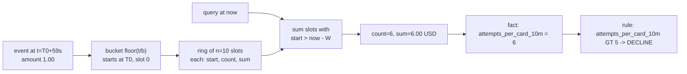

# A Rules Engine with Velocity Checks

> Declarative rules, sliding-window counters, and explainable decisions.

**Type:** Build
**Languages:** Java, Python, Go
**Prerequisites:** Phase 13 Lesson 01 (Fraud Patterns), Phase 10 Lesson 01 (Representing Money), Phase 1 Lesson 06 (Hash Maps)
**Time:** ~120 minutes

## Learning Objectives

- Express a fraud control as data (`field`, `operator`, `value`, `action`, `priority`, `score`) and explain why a rule that lives in a config table beats a rule that lives in an `if` statement
- Build a sliding-window velocity counter from a ring of time buckets, state its memory bound, and name the precision it trades away
- Evaluate a rule set over a transaction context with two decision strategies, first-match-by-priority and accumulated score, and say when each is the right one
- Produce a decision record that lists every rule evaluated, every rule that fired, the observed value, and the human-readable reason, so an analyst or a cardholder can be told why
- Test the two boundaries that matter: the velocity threshold trips on exactly the Nth attempt, and the window releases the key at exactly the right time, with the clock injected
- Run a candidate rule in shadow mode, so it is evaluated and traced on live traffic but never decides and never scores, and read its would-have-fired rate before promoting it

## The Problem

At 02:14 on a Saturday a merchant's authorization endpoint starts receiving 1.00 USD purchases. Each one carries a different card number, the same device, the same IP range, and a card that was added to the wallet seconds earlier. By 02:20 there have been 4,200 attempts; 310 were approved. None of this is the merchant's customer. Someone bought a list of stolen card numbers and is using the checkout page as a free card validator: an approval tells them the card is live, and the live cards are resold at ten times the price. This is card testing, Lesson 01's first pattern, and it has three costs. The merchant pays an authorization fee on every attempt, approved or not, so 4,200 attempts at 0.10 USD is 420 USD gone before breakfast. The approved 1.00 USD charges turn into chargebacks at 15.00 USD each. And the issuers whose cards were tested see the merchant's name on a wave of fraud and start declining its legitimate traffic for days afterwards.

The on-call engineer sees the spike, writes `if (amount < 2.00 && cardAgeDays == 0) return DECLINE;`, and deploys at 02:40. The attack stops. On Monday, a legitimate customer who just added a card and bought a 1.99 USD app upgrade is declined with no explanation. Support cannot tell her why, because the decision was an `if` statement with no record of what it compared. The product team asks for the rule to be relaxed to `amount < 1.50`; the change needs a code review, a build, and a deploy, so it lands on Wednesday. On Thursday the attacker returns with 1.75 USD attempts.

Three things went wrong, and they are the three things this lesson fixes. The control was code, so changing it took a deploy cycle while the attacker iterated in minutes. The control looked at one transaction in isolation, when the signal was the *rate*: one 1.00 USD purchase on a fresh card is a customer, six in two minutes on the same card is an attack. And the decision left no evidence, so nobody could explain it to the customer, tune it against data, or defend it to the card network when the chargeback ratio was questioned. A rules engine makes the controls data, a velocity service makes rate a fact a rule can read, and a decision record makes every outcome explainable.

## The Concept

### Rules are data, decisions are evidence

A rule is a predicate over a set of named facts plus a consequence:

```text
IF <field> <operator> <value> THEN <action>   with priority p and score s, and a reason
```

The facts are everything the engine knows about the authorization attempt: the amount, the card's issuer range (BIN), the issuing country, how old the card is in the wallet, and, after enrichment, the velocity counters: how many attempts this card made in the last ten minutes, how much this account has spent today. Every fact has a name, and a rule names the fact it reads. That is the entire coupling between the rule language and the system: a rule set can be stored in a database table, reviewed by the risk team, versioned, and swapped without a deploy, because no rule contains code.

The engine evaluates **every** rule, not just until the first hit, and records a trace per rule: the field, the observed value, the operator, the expected value, and whether it fired. That trace is the decision's evidence. It costs a few dozen comparisons, which is nothing against a network call to the issuer, and it is what lets you answer three questions after the fact: why was this declined (which rule decided), what else was wrong with it (which other rules fired), and what did the engine see (the observed values, including which facts were absent).

Two decision strategies share the same trace:

| Strategy | How the action is chosen | Strength | Weakness |
|----------|--------------------------|----------|----------|
| `FIRST_MATCH` | Rules are sorted by priority; the first rule that fires supplies the action | Predictable; a blocklist at priority 5 always wins; easy to explain with one rule name | Cannot express "three weak signals together are strong"; priority ordering becomes a political artifact |
| `SCORE` | Every fired rule adds its score; the total is compared with `reviewAt` and `declineAt` thresholds | Combines weak signals; thresholds are tunable against a labelled set (Lesson 03) | No single rule "decided", so the explanation is a list; a badly weighted rule shifts every decision |

Production engines usually run both: a short list of hard rules under first-match (sanctions hit, blocklisted BIN, velocity breach) that short-circuit everything, then a scored layer for the grey area. This lesson builds both strategies on the same `RulesEngine` with a flag, so you can see that the difference is twenty lines of decision logic over an identical trace.

### Velocity: the signal is the rate

Velocity is a count or a sum of events per key over a trailing time window: attempts per card in ten minutes, amount per account in a day, distinct cards per device in an hour. The key is the dimension you suspect is shared by the attack: card testing shares a card or a device, account takeover shares an account, a mule network shares a destination. The window is how long the attacker's burst lasts. The threshold is what separates the burst from a customer's normal behaviour, and Lesson 03 is about choosing it.

The exact way to compute a sliding count is to keep every event's timestamp and, at query time, discard the ones older than `now - W`. That is correct and simple, and it has two problems in a system that screens tens of thousands of authorizations per second: memory grows with traffic (a card under attack accumulates thousands of timestamps), and every query walks and prunes a list. The standard engineering answer is to approximate the window with a **ring of time buckets**.

Split the window `W` into `n` buckets of width `b = W / n`. For each key, keep an array of `n` slots, each holding the bucket's start time, a count, and a sum. An event at time `t` belongs to bucket number `floor(t / b)`, and the slot it lands in is that number modulo `n`. Because the ring has exactly `n` slots and the window is exactly `n` buckets wide, the slot that bucket `k` uses was last used by bucket `k - n`, which started exactly `W` ago and is therefore outside any window ending at or after `t`. So when an event arrives and finds its slot holding an older bucket, it simply resets the slot. A query at time `now` sums every slot whose bucket start is strictly newer than `now - W`.



The costs and the invariant:

- **Memory per key is O(n)**, fixed, regardless of how many events arrive. A card under a 10,000-attempt attack costs the same 10 slots as a card with one purchase.
- **Record and query are O(n)** in the number of buckets, which is a constant you chose (10 or 24 or 60), not the number of events.
- **The window is approximate at the trailing edge.** An event is counted until its *bucket* leaves the window, not until the event itself is `W` old. An event recorded at the last millisecond of a bucket is dropped as soon as `W - b` has passed; an event at the first millisecond lasts the full `W`. So the effective window is somewhere between `W - b` and `W`. Ten buckets of one minute for a ten-minute window means the count may undercount by up to one minute of history.
- **The leading edge is exact.** An event recorded now is counted now. The attempt that trips the threshold is always counted, and the threshold trips on exactly the Nth attempt, which is the boundary the tests check.

The bucket count is the knob. More buckets means a tighter approximation and more memory; `n = W` in milliseconds would be exact and absurd. Ten to sixty is typical. Production systems that need exact windows for a few high-value keys keep per-event logs for those keys and buckets for everything else.

### Worked example by hand

Window `W = 10 min`, `n = 10`, so `b = 1 min`. `T0 = 1,700,000,040,000 ms`, which is `28,333,334 * 60,000` exactly, so `T0` is on a minute boundary and bucket edges fall where you expect them. Six 1.00 USD attempts on card `tok_mallory`, twenty seconds apart, starting at `T0 + 20 s`:

```text
attempt  time        bucket = floor(t / 60000)   slot = bucket mod 10   slot state after
   1     T0 + 20s    28,333,334                   4                      start=T0,     count=1, sum=100
   2     T0 + 40s    28,333,334                   4                      count=2, sum=200
   3     T0 + 60s    28,333,335                   5                      start=T0+60s, count=1, sum=100
   4     T0 + 80s    28,333,335                   5                      count=2, sum=200
   5     T0 + 100s   28,333,335                   5                      count=3, sum=300
   6     T0 + 120s   28,333,336                   6                      start=T0+120s, count=1, sum=100
```

Query at `T0 + 120 s`, right after the sixth attempt: `now - W = T0 - 480 s`. Slots 4, 5, and 6 have starts `T0`, `T0 + 60 s`, `T0 + 120 s`, all newer than the cutoff, so `count = 2 + 3 + 1 = 6`. The fact `attempts_per_card_10m = 6`, the rule `attempts_per_card_10m GT 5` fires, and the sixth attempt is declined. The fifth attempt, at `T0 + 100 s`, saw `count = 2 + 3 = 5`, and `5 GT 5` is false. The threshold trips on exactly the sixth.

Now advance to `T0 + 10 min + 20 s`, a seventh attempt: `now - W = T0 + 20 s`. Slot 4's start is `T0`, which is not newer than `T0 + 20 s`, so slot 4 is out; the two events in it (at `T0 + 20 s` and `T0 + 40 s`) are gone even though the second of them is only 9 min 40 s old. Slots 5 and 6 are still in: `count = 3 + 1 = 4`, plus the seventh attempt itself, which lands in bucket `28,333,344`, slot 4, resets it, and makes the count 5. Still not `GT 5`. The window has slid; the card is released from the velocity rule but still trips `card_age_days LT 1`, so the decision is `REVIEW`, not `ALLOW`. That is the correct answer: the burst is over, the card is still brand new.

### Priority, short-circuit, and what "fired" means

Rules are sorted by priority once, at engine construction, with a stable sort so two rules at the same priority keep their declaration order. Under `FIRST_MATCH` the action comes from the first fired rule in that order; the engine does not stop evaluating, because the trace of the later rules is the evidence. "Short-circuit" in this design means the *decision* is settled early, not that evaluation stops. If evaluation were expensive (a rule that called an external service), you would add a second flag that skips evaluation after the decision is made; the trace would then record those rules as `skipped`, which is a different thing from `pass`, and the explanation would say so.

### Shadow mode: measure before you act

Every rule carries a `shadow` flag. A shadow rule is evaluated like any other and its trace line is written with the observed value, the expected value, and whether the condition held, but it is excluded from the decision in both strategies: it can never be the deciding rule under `FIRST_MATCH`, and its score is never added under `SCORE`. The decision record reports it separately: `fired()` is the list of live rules that acted, `shadowFired()` is the list of candidates that would have. In the explanation the marker is `[shadow]` instead of `[fire]`.

This is how a rule gets promoted safely. A new rule is deployed as a shadow for a week; its would-have-fired count divided by the traffic it saw is its fire rate, and joining its would-have-fired transactions with the chargeback feed that arrives weeks later gives its precision (Lesson 03). A rule that would have declined 4% of good customers to catch 0.1% more fraud is visible in the numbers before it costs anything. The flag belongs on the rule, not on the engine, because a rule set in production is always a mixture: dozens of live rules and two or three candidates, and a second "shadow engine" running a whole copy of the rule set doubles the velocity writes and still cannot tell you which rule made the diff.

A rule reads one fact. If the fact is absent from the context, the rule does not fire and the trace shows `<absent>`. This is a deliberate choice: a missing velocity counter is a system problem (the velocity service is down, or the rule names a fact nobody produces), and silently treating it as zero would make a counter outage look like clean traffic. Absence is visible in the trace so a monitor can alarm on it. The opposite error, a rule whose `value` has a different type from the fact (`country GT 5`), is a configuration bug and fails loudly at evaluation. A rule that can never evaluate is not a risk signal; it is a broken rule set, and the right response is to refuse to decide rather than decide wrongly.

### What this engine does not do

- It does not learn. The thresholds and scores are set by a person. Lesson 03 is about choosing them against labelled data; Lesson 07 is about the device and behavioural signals that become facts here.
- It does not persist. The counters live in memory, in one process. A production velocity service shards keys across a cluster, replicates the ring state, and accepts that a failover loses a bucket. Phase 7's replication lessons cover why that is a reasonable trade for a fraud counter and an unacceptable one for a balance.
- It does not compose predicates. A rule is one field, one operator, one value. `amount GT 100 AND country IN {...}` is two rules under `SCORE`, or one derived fact computed by the enrichment step. Keeping rules atomic keeps them explainable; the moment a rule has an `AND`, the explanation has to say which half held.

## Build It

The primary walkthrough is in Java. The Python and Go files implement the same design with the same names; the subsections at the end show only what differs. `Money` and `Currency` are copied from Phase 10, Lesson 01, because the daily-spend velocity is a sum of amounts and amounts are never floats.

### Step 1: Inject the clock

```java
interface Clock {
    long nowMillis();
}

final class ManualClock implements Clock {
    private long now;

    ManualClock(long startMillis) { this.now = startMillis; }

    @Override
    public long nowMillis() { return now; }

    void advance(long millis) {
        if (millis < 0) throw new IllegalArgumentException("clock never goes backwards");
        now += millis;
    }
}
```

Nothing in the lesson calls `System.currentTimeMillis()`. The demo and the tests move the clock by hand, so "ten minutes later" is `clock.advance(10 * MINUTE)` and the window-expiry test runs in microseconds. A velocity counter that reads the wall clock cannot be tested at its boundary, and the boundary is where it fails.

**Predict:** if `ManualClock` allowed negative advances, which test in `MainTest` would become impossible to write correctly, and why?

### Step 2: The transaction and its facts

```java
record Transaction(String id, String accountId, String cardToken, String bin, String country,
                   long cardAgeDays, Money amount) {

    Map<String, Object> facts() {
        Map<String, Object> f = new LinkedHashMap<>();
        f.put("amount", amount);
        f.put("bin", bin);
        f.put("country", country);
        f.put("card_age_days", cardAgeDays);
        f.put("account_id", accountId);
        return f;
    }
}
```

The card is identified by a token, never by a PAN. PCI DSS Requirement 3 (Lesson 08) is the reason, and it costs nothing here: the velocity key is `"card:" + cardToken`, and a token is as good a key as a PAN. `facts()` is the bridge from the typed record to the untyped context the rules read. The map is insertion-ordered so explanations print the same way every run. Values keep their types (`Money`, `Long`, `String`), because the operators compare typed values; a `Money` fact is compared with a `Money` rule value and currency mismatch is an error, exactly as in Lesson 01.

**Predict:** `cardAgeDays` is put into the map as a `Long`. If the demo rule were written `new Rule("fresh-card", "card_age_days", LT, 1, ...)` with an `int` literal instead of `1L`, what happens at evaluation time, and is that the behaviour you want?

### Step 3: The ring of buckets

```java
final class SlidingWindowCounter {
    private final long windowMillis;
    private final long bucketMillis;
    private final int buckets;
    private final Currency currency;
    private final Map<String, Ring> rings = new HashMap<>();

    private static final class Ring {
        final long[] starts;   // Long.MIN_VALUE marks a never-used slot
        final long[] counts;
        final long[] sums;
        Ring(int n) { starts = new long[n]; counts = new long[n]; sums = new long[n]; Arrays.fill(starts, Long.MIN_VALUE); }
    }

    SlidingWindowCounter(long windowMillis, int buckets, Currency currency) {
        if (buckets <= 0) throw new IllegalArgumentException("buckets must be positive");
        if (windowMillis <= 0 || windowMillis % buckets != 0) {
            throw new IllegalArgumentException("window must be a positive multiple of the bucket count");
        }
        this.windowMillis = windowMillis;
        this.bucketMillis = windowMillis / buckets;
        this.buckets = buckets;
        this.currency = Objects.requireNonNull(currency);
    }
}
```

One counter is one window, one bucket count, and one currency. The window must divide evenly into buckets so that `n * b == W` exactly; otherwise the "slot reuse means the old bucket is outside the window" argument breaks. A counter that sums amounts in mixed currencies would produce a number with no meaning, so the currency is fixed at construction and `record` rejects anything else.

```java
void record(String key, Money amount, long nowMillis) {
    if (!amount.currency().equals(currency)) throw new CurrencyMismatchException(currency, amount.currency());
    Ring ring = rings.computeIfAbsent(key, k -> new Ring(buckets));
    long bucketStart = Math.floorDiv(nowMillis, bucketMillis) * bucketMillis;
    int idx = (int) Math.floorMod(Math.floorDiv(nowMillis, bucketMillis), (long) buckets);
    if (ring.starts[idx] != bucketStart) {          // slot holds a previous lap: reset it
        ring.starts[idx] = bucketStart;
        ring.counts[idx] = 0;
        ring.sums[idx] = 0;
    }
    ring.counts[idx]++;
    ring.sums[idx] = Math.addExact(ring.sums[idx], amount.minorUnits());
}
```

The two lines that matter are `bucketStart` and `idx`. `floorDiv` rather than `/` so that the arithmetic is right for any timestamp, including the negative ones a test might use. The reset-on-lap check compares the slot's recorded start with the start the current event wants; if they differ, the slot belongs to an older lap and is wiped. `addExact` on the sum because a counter that wraps at `Long.MAX_VALUE` would turn a flood of large amounts into a small negative number and silently stop firing the rule it feeds.

```java
long count(String key, long nowMillis) {
    Ring ring = rings.get(key);
    if (ring == null) return 0;
    long n = 0;
    for (int i = 0; i < buckets; i++) {
        if (ring.starts[i] > nowMillis - windowMillis) n += ring.counts[i];
    }
    return n;
}
```

The query is a linear scan over `n` slots with the single predicate `start > now - W`. Strictly greater: a bucket that started exactly `W` ago is out, which is what makes the window `[now - W, now)` half-open and the expiry test deterministic. `sum` is the same loop over `sums` and returns a `Money`.

**Predict:** with `W = 10 min`, `n = 10`, an event at `T0 + 59 s`, and a query at `T0 + 10 min`: is the event counted? What is the event's actual age at that moment?

### Step 4: Velocity as facts

```java
final class VelocityService {
    enum Dimension { CARD, ACCOUNT;
        String keyFor(Transaction tx) {
            return switch (this) {
                case CARD -> "card:" + tx.cardToken();
                case ACCOUNT -> "account:" + tx.accountId();
            };
        }
    }
    enum Metric { COUNT, SUM }
    record Definition(String factName, Dimension dimension, Metric metric, SlidingWindowCounter counter) {}

    Map<String, Object> enrich(Transaction tx, long nowMillis) {
        Map<String, Object> facts = tx.facts();
        for (Definition d : definitions) {
            String key = d.dimension().keyFor(tx);
            d.counter().record(key, tx.amount(), nowMillis);
            Object value = d.metric() == Metric.COUNT ? (Object) d.counter().count(key, nowMillis) : d.counter().sum(key, nowMillis);
            facts.put(d.factName(), value);
        }
        return facts;
    }
}
```

`enrich` records first, then reads, so the current attempt counts itself: the sixth attempt sees `attempts_per_card_10m = 6`. This is the convention that makes the threshold `GT 5` mean "the sixth and later". The alternative, reading before recording, means `GT 5` fires on the seventh, and a reviewer reading the rule will get it wrong by one. Pick one convention, write it in the rule's explanation text, and test the exact boundary.

Declined attempts are recorded too. That is not an accident: a card tester's declines *are* the signal, and a counter that only counted approvals would reset the attacker's budget every time a rule fired.

**Predict:** the same card is used at two different merchants that share this velocity service. Does the `CARD` dimension count both? What would the key have to include for the count to be per merchant, and which of the two is the better card-testing signal?

### Step 5: Operators that fail loudly

```java
enum Operator {
    EQ, NE, GT, GTE, LT, LTE, IN, NOT_IN;

    boolean apply(Object observed, Object expected) {
        switch (this) {
            case EQ: return Objects.equals(observed, expected);
            case NE: return !Objects.equals(observed, expected);
            case IN: return asSet(expected).contains(observed);
            case NOT_IN: return !asSet(expected).contains(observed);
            default: {
                int cmp = compare(observed, expected);
                return switch (this) {
                    case GT -> cmp > 0; case GTE -> cmp >= 0; case LT -> cmp < 0; case LTE -> cmp <= 0;
                    default -> throw new IllegalStateException();
                };
            }
        }
    }

    private static int compare(Object a, Object b) {
        if (a instanceof Long x && b instanceof Long y) return Long.compare(x, y);
        if (a instanceof Money x && b instanceof Money y) return x.compareTo(y);   // throws on currency mismatch
        throw new IllegalArgumentException("cannot order " + typeName(a) + " against " + typeName(b));
    }
}
```

Eight operators cover every rule in this lesson and most rules in production. Ordering is defined for exactly two types, `Long` and `Money`; anything else is a configuration error and throws. There is no coercion: `"5"` is not `5L`, and `5L` is not `5.00 USD`. The reason is the same as in Lesson 01: an engine that coerces will one day compare `amount GT 5000` where `5000` was meant as dollars and is read as cents, and approve a 49,999.99 USD purchase without a trace of why.

### Step 6: The rule and its trace

```java
record Rule(String name, String field, Operator operator, Object value, Action action, int priority, int score, String explanation,
            boolean shadow) {
    Rule(String name, String field, Operator operator, Object value, Action action, int priority, int score, String explanation) {
        this(name, field, operator, value, action, priority, score, explanation, false);
    }

    Rule {
        if (name == null || name.isBlank()) throw new IllegalArgumentException("rule needs a name");
        if (explanation == null || explanation.isBlank()) throw new IllegalArgumentException("rule needs an explanation");
        if (score < 0) throw new IllegalArgumentException("score must be non-negative");
        if (value instanceof Set<?> s) value = Collections.unmodifiableSet(new TreeSet<>(s));   // sorted: deterministic text
    }

    Rule asShadow() { return new Rule(name, field, operator, value, action, priority, score, explanation, true); }
}

record RuleTrace(String rule, int priority, String field, Object observed, Operator operator, Object expected,
                 Action action, int score, boolean fired, boolean shadow, String explanation) {}
```

The eight-argument constructor builds a live rule; `asShadow()` returns a copy with the flag set, so a candidate is declared next to the live rules with one extra call and nothing else about it changes. A rule without an explanation is rejected at construction. The explanation is what the analyst reads in the case queue and what the customer-facing team paraphrases; a rule set where half the rules say `"rule 17"` is a rule set nobody can tune. Sets are copied into a sorted, unmodifiable `TreeSet` so that `IN [888888, 999999]` prints identically every time; the trace is going to be hashed into an audit log in Lesson 11, and a `HashSet`'s iteration order would make two identical decisions hash differently.

### Step 7: The engine

```java
Decision decide(String transactionId, Map<String, Object> facts, long nowMillis) {
    List<RuleTrace> traces = new ArrayList<>();
    int total = 0;
    String first = null;
    Action firstAction = null;
    for (Rule rule : rules) {                                   // already sorted by priority
        Object observed = facts.get(rule.field());
        boolean fired = observed != null && rule.operator().apply(observed, rule.value());
        traces.add(new RuleTrace(rule.name(), rule.priority(), rule.field(), observed, rule.operator(), rule.value(),
                rule.action(), rule.score(), fired, rule.explanation()));
        if (fired && !rule.shadow()) {                        // a shadow rule is observed, never obeyed
            total += rule.score();
            if (first == null) { first = rule.name(); firstAction = rule.action(); }
        }
    }
    if (strategy == Strategy.FIRST_MATCH) {
        Action action = first == null ? Action.ALLOW : firstAction;
        return new Decision(transactionId, action, strategy, total, first, traces, nowMillis);
    }
    Action action = total >= declineAt ? Action.DECLINE : total >= reviewAt ? Action.REVIEW : Action.ALLOW;
    return new Decision(transactionId, action, strategy, total, null, traces, nowMillis);
}
```

One loop, every rule, one trace per rule. `observed != null &&` is the absent-fact rule: a missing fact never fires. `&& !rule.shadow()` is the entire implementation of shadow mode: the trace already recorded `fired`, so the only thing left to do is skip the two lines that act on it. The score is accumulated under both strategies so that a `FIRST_MATCH` decision still reports what the score *would* have been, which is the data you need when deciding whether to move a rule set to `SCORE`. The default when nothing fires is `ALLOW`; a rules engine that defaults to `DECLINE` on an empty rule set is a rules engine that takes the business down when someone deploys an empty config.

**Predict:** under `SCORE` with `reviewAt = 50` and `declineAt = 80`, three rules each scoring 30 fire. What is the action? Under `FIRST_MATCH` with the same rules, all with action `REVIEW`?

### Step 8: The explanation

```java
String explain() {
    StringBuilder sb = new StringBuilder();
    sb.append("decision for ").append(transactionId).append(": ").append(action)
      .append(" [").append(strategy).append(", score=").append(score).append("]");
    if (strategy == Strategy.SCORE) sb.append(" by accumulated score");
    else if (decidingRule == null) sb.append(" default: no rule matched");
    else sb.append(" by \"").append(decidingRule).append("\"");
    sb.append(" at t=").append(decidedAtMillis).append('\n');
    for (RuleTrace t : traces) {
        sb.append(t.fired() ? "  [fire] " : "  [pass] ")
          .append("p").append(t.priority()).append(' ').append(t.rule()).append(": ")
          .append(t.field()).append('=').append(t.observed() == null ? "<absent>" : t.observed())
          .append(' ').append(t.operator()).append(' ').append(t.expected());
        if (t.fired()) sb.append(" -> ").append(t.action()).append(" (+").append(t.score()).append("): ").append(t.explanation());
        sb.append('\n');
    }
    return sb.toString();
}
```

The explanation is derived from the trace, never stored separately, so it cannot drift from the decision. Every line shows the observed value next to the expected one: `attempts_per_card_10m=6 GT 5` is the sentence an analyst needs. `<absent>` is printed for a missing fact so that a velocity outage is visible in every decision made during it, and `[shadow]` marks a candidate that held but did not act, so the same log that explains live decisions is also the measurement of every candidate.

**Predict:** a shadow rule at priority 10 with action `DECLINE` and a live rule at priority 20 with action `REVIEW` both hold. What does the header line say, what does `firedRuleNames()` return, and what does `shadowFired()` return?

### Step 9: Run it

```bash
cd phases/13-risk-fraud-and-compliance/02-rules-engine-and-velocity-checks/code/java
javac -d .out *.java && java -cp .out Main
java -cp .out MainTest
```

Expected output, abbreviated:

```console
== Card testing: six $1 attempts on a fresh card in two minutes ==
  attempt 1 -> REVIEW fired=[fresh-card-micro-auth]
  ...
  attempt 5 -> REVIEW fired=[fresh-card-micro-auth]
  attempt 6 -> DECLINE fired=[card-testing-burst, fresh-card-micro-auth]
decision for tx-106: DECLINE [FIRST_MATCH, score=85] by "card-testing-burst" at t=1700000160000
  [pass] p5 bin-blocklist: bin=411111 IN [888888, 999999]
  [fire] p10 card-testing-burst: attempts_per_card_10m=6 GT 5 -> DECLINE (+60): more than five authorizations ...
  [fire] p20 fresh-card-micro-auth: card_age_days=0 LT 1 -> REVIEW (+25): card was added less than a day ago
  [pass] p30 high-risk-country: country=US IN [NG, RU, VE]
  [pass] p40 daily-spend: amount_per_account_1d=6.00 USD GT 2000.00 USD
  [pass] p50 large-ticket: amount=1.00 USD GTE 5000.00 USD

== Ten minutes later the window has slid past the burst ==
decision for tx-107: REVIEW [FIRST_MATCH, score=25] by "fresh-card-micro-auth" at t=1700000760000
  [pass] p10 card-testing-burst: attempts_per_card_10m=5 GT 5
  ...
== Same rules, SCORE strategy: four REVIEW signals add up to a DECLINE ==
decision for tx-400: DECLINE [SCORE, score=125] by accumulated score at t=1700001660000
FIRST_MATCH would have said: REVIEW

== Shadow mode: a candidate rule is traced but does not act ==
decision for tx-500: ALLOW [FIRST_MATCH, score=0] default: no rule matched at t=1700001660000
  ...
  [shadow] p45 mid-ticket-candidate: amount=750.00 USD GTE 500.00 USD -> REVIEW (+20): candidate: ...
  [pass] p50 large-ticket: amount=750.00 USD GTE 5000.00 USD
acted on: []  would have fired: [mid-ticket-candidate]
```

The `SCORE` block is the argument for a scored layer: four independent `REVIEW` signals on one 5,500 USD purchase from a day-old card in a high-risk country is not a review case, and only a strategy that adds them up can say so.

### In Python

The Python port (`code/python/main.py`, tests in `test_main.py`) is the same design with four differences. **`//` is already floor division**, so `now_millis // bucket_millis` replaces `Math.floorDiv`; the comment in `record` says timestamps are non-negative here, and if you ever feed negative ones `//` still floors correctly, which is what the ring needs. **No overflow**, so there is no `addExact` and the test suite does not assert an overflow error; `_compare` excludes `bool` explicitly because `True` is an `int` in Python and `Operator.GT.apply(True, 0)` would otherwise be a legal comparison. **`shadow` is a dataclass field with a default** (`shadow: bool = False`), so the eight-argument call site stays the same and `as_shadow()` builds the copy explicitly rather than through `dataclasses.replace`, to keep the same name as the Java and Go methods. **Sets become `frozenset`** in `Rule.__post_init__` via `object.__setattr__` (the dataclass is frozen), and `_fmt` sorts them for printing; Python's `set` iteration order depends on hash seeds, so without the sort two runs of the same demo would print different explanations.

Run it from `code/python/` with `python3 main.py`; test with `python3 -m unittest -v`.

#### Step 1: Inject the clock

There is no interface to declare: anything with `now_millis()` is a clock. `ManualClock.advance` raises `ValueError` on a negative step, so a test can never move time backwards by accident.

```python
class ManualClock:
    """A clock the test or demo moves by hand. Monotone: advance() never goes backwards."""

    def __init__(self, start_millis: int) -> None:
        self._now = start_millis

    def now_millis(self) -> int:
        return self._now

    def advance(self, millis: int) -> None:
        if millis < 0:
            raise ValueError("clock never goes backwards")
        self._now += millis
```

#### Step 2: The transaction and its facts

`Transaction` is a frozen dataclass; `facts()` returns a plain dict, which in Python is insertion-ordered, so the explanation prints the same way every run. Values keep their types: the amount is a `Money`, the card age an `int`.

```python
class Transaction:
    id: str
    account_id: str
    card_token: str
    bin: str
    country: str
    card_age_days: int
    amount: Money

    def facts(self) -> dict[str, Any]:
        """The facts a rule can see before velocity enrichment. Keys are the rule `field` names."""
        return {
            "amount": self.amount,
            "bin": self.bin,
            "country": self.country,
            "card_age_days": self.card_age_days,
            "account_id": self.account_id,
        }
```

#### Step 3: The ring of buckets

`_Ring` uses `__slots__` and marks a never-used slot with `None` where Java used `Long.MIN_VALUE`. `record` computes `lap`, `bucket_start`, and `idx` with `//` and `%`, resets a slot that holds an older lap, and adds without an overflow check. `_live` is a generator over the slots whose start is strictly newer than `now - W`, shared by `count` and `sum`.

```python
class _Ring:
    __slots__ = ("starts", "counts", "sums")

    def __init__(self, n: int) -> None:
        self.starts = [None] * n  # None marks a never-used slot
        self.counts = [0] * n
        self.sums = [0] * n


class SlidingWindowCounter:
    """Counts and sums events per key over a sliding window of W ms split into n buckets of
    width b = W / n. Recording lands in bucket floor(now / b); a slot holding an older lap is
    reset first. Queries add every slot whose start is newer than now - W. Memory per key is
    O(n); the effective window is between W - b and W."""

    def __init__(self, window_millis: int, buckets: int, currency: Currency) -> None:
        if buckets <= 0:
            raise ValueError("buckets must be positive")
        if window_millis <= 0 or window_millis % buckets != 0:
            raise ValueError("window must be a positive multiple of the bucket count")
        self.window_millis = window_millis
        self.bucket_millis = window_millis // buckets
        self.buckets = buckets
        self.currency = currency
        self._rings: dict[str, _Ring] = {}

    def record(self, key: str, amount: Money, now_millis: int) -> None:
        if amount.currency != self.currency:
            raise CurrencyMismatchError(self.currency, amount.currency)
        ring = self._rings.setdefault(key, _Ring(self.buckets))
        lap = now_millis // self.bucket_millis          # Python // floors; timestamps are non-negative here
        bucket_start = lap * self.bucket_millis
        idx = lap % self.buckets
        if ring.starts[idx] != bucket_start:            # slot holds a previous lap: reset it
            ring.starts[idx] = bucket_start
            ring.counts[idx] = 0
            ring.sums[idx] = 0
        ring.counts[idx] += 1
        ring.sums[idx] += amount.minor_units

    def _live(self, ring: _Ring, now_millis: int):
        cutoff = now_millis - self.window_millis
        return (i for i, start in enumerate(ring.starts) if start is not None and start > cutoff)

    def count(self, key: str, now_millis: int) -> int:
        ring = self._rings.get(key)
        if ring is None:
            return 0
        return sum(ring.counts[i] for i in self._live(ring, now_millis))

    def sum(self, key: str, now_millis: int) -> Money:
        ring = self._rings.get(key)
        total = 0 if ring is None else sum(ring.sums[i] for i in self._live(ring, now_millis))
        return Money.of_minor(total, self.currency)
```

#### Step 4: Velocity as facts

`Dimension.key_for` picks the card or account key; `enrich` records first and then reads, so the current attempt counts itself, and writes one fact per definition into the dict returned by `tx.facts()`.

```python
class Dimension(Enum):
    CARD = "card"
    ACCOUNT = "account"

    def key_for(self, tx: Transaction) -> str:
        return f"card:{tx.card_token}" if self is Dimension.CARD else f"account:{tx.account_id}"

    def enrich(self, tx: Transaction, now_millis: int) -> dict[str, Any]:
        """Record the attempt, then return the transaction facts plus one velocity fact per counter.
        The attempt counts itself; declined attempts are recorded too (a burst of declines is the
        card-testing signal)."""
        facts = tx.facts()
        for d in self._definitions:
            key = d.dimension.key_for(tx)
            d.counter.record(key, tx.amount, now_millis)
            facts[d.fact_name] = d.counter.count(key, now_millis) if d.metric is Metric.COUNT else d.counter.sum(key, now_millis)
        return facts
```

#### Step 5: Operators that fail loudly

`_compare` orders only `int` against `int` (excluding `bool`) and `Money` against `Money`; anything else raises `ValueError`. `apply` dispatches on the enum member and looks the four ordering results up in a small dict keyed by operator.

```python
def _compare(a: Any, b: Any) -> int:
    """Order two facts of the same kind. int vs int, Money vs Money; anything else is a config bug.
    bool is excluded because True is an int in Python."""
    ints = (isinstance(a, int) and not isinstance(a, bool)) and (isinstance(b, int) and not isinstance(b, bool))
    if ints or (isinstance(a, Money) and isinstance(b, Money)):
        return (a > b) - (a < b)  # Money.__lt__ raises on currency mismatch
    raise ValueError(f"cannot order {_type_name(a)} against {_type_name(b)}")


def _as_set(expected: Any) -> frozenset:
    if isinstance(expected, (set, frozenset)):
        return frozenset(expected)
    raise ValueError(f"IN / NOT_IN need a set, got {_type_name(expected)}")


class Operator(Enum):
    EQ = "EQ"
    NE = "NE"
    GT = "GT"
    GTE = "GTE"
    LT = "LT"
    LTE = "LTE"
    IN = "IN"
    NOT_IN = "NOT_IN"

    def apply(self, observed: Any, expected: Any) -> bool:
        if self is Operator.EQ:
            return observed == expected
        if self is Operator.NE:
            return observed != expected
        if self is Operator.IN:
            return observed in _as_set(expected)
        if self is Operator.NOT_IN:
            return observed not in _as_set(expected)
        cmp = _compare(observed, expected)
        return {Operator.GT: cmp > 0, Operator.GTE: cmp >= 0, Operator.LT: cmp < 0, Operator.LTE: cmp <= 0}[self]
```

#### Step 6: The rule and its trace

`Rule` is a frozen dataclass with `shadow: bool = False`; `__post_init__` performs the Java compact constructor's checks and freezes a `set` value into a `frozenset` with `object.__setattr__`. `as_shadow` returns a copy with the flag set.

```python
class Rule:
    """One rule. Lower priority number is evaluated and, under FIRST_MATCH, decided first.
    `score` is only used under SCORE. `explanation` is what an analyst or customer reads."""

    name: str
    field: str
    operator: Operator
    value: Any
    action: Action
    priority: int
    score: int
    explanation: str
    shadow: bool = False  # evaluated and traced, but never decides and never scores

    def __post_init__(self) -> None:
        if not self.name.strip():
            raise ValueError("rule needs a name")
        if not self.field.strip():
            raise ValueError("rule needs a field")
        if self.value is None:
            raise ValueError("rule needs a value")
        if self.score < 0:
            raise ValueError("score must be non-negative")
        if not self.explanation.strip():
            raise ValueError("rule needs an explanation")
        if isinstance(self.value, set):
            object.__setattr__(self, "value", frozenset(self.value))

    def as_shadow(self) -> "Rule":
        """Same rule, evaluated and traced but never acting: it cannot decide and its score is not counted."""
        return Rule(self.name, self.field, self.operator, self.value, self.action, self.priority, self.score,
                    self.explanation, True)
```

#### Step 7: The engine

`decide` walks the pre-sorted rules, builds one `RuleTrace` per rule, and acts only on rules that fired and are not shadow; `first = first or rule` keeps the first live firing. The strategy branch at the end is the same as Java's.

```python
    def decide(self, transaction_id: str, facts: dict[str, Any], now_millis: int) -> Decision:
        """Evaluate every rule (the full trace is the audit record), then decide. An absent fact
        never fires a rule. A type mismatch between fact and value raises: a rule that can never
        evaluate is a configuration error, not a risk signal."""
        traces: list[RuleTrace] = []
        total = 0
        first: Rule | None = None
        for rule in self.rules:
            observed = facts.get(rule.field)
            fired = observed is not None and rule.operator.apply(observed, rule.value)
            traces.append(RuleTrace(rule.name, rule.priority, rule.field, observed, rule.operator, rule.value,
                                    rule.action, rule.score, fired, rule.shadow, rule.explanation))
            if fired and not rule.shadow:  # a shadow rule is observed, never obeyed
                total += rule.score
                first = first or rule
        if self.strategy is Strategy.FIRST_MATCH:
            action = first.action if first else Action.ALLOW
            return Decision(transaction_id, action, self.strategy, total, first.name if first else None, traces, now_millis)
        action = Action.DECLINE if total >= self.decline_at else Action.REVIEW if total >= self.review_at else Action.ALLOW
        return Decision(transaction_id, action, self.strategy, total, None, traces, now_millis)
```

#### Step 8: The explanation

`explain` derives every line from the trace: `_fmt` renders `None` as `<absent>` and sorts sets, and the mark is `pass`, `shadow`, or `fire`.

```python
    def explain(self) -> str:
        head = f"decision for {self.transaction_id}: {self.action.name} [{self.strategy.value}, score={self.score}]"
        if self.strategy is Strategy.SCORE:
            head += " by accumulated score"
        elif self.deciding_rule is None:
            head += " default: no rule matched"
        else:
            head += f' by "{self.deciding_rule}"'
        lines = [head + f" at t={self.decided_at_millis}"]
        for t in self.traces:
            mark = "pass" if not t.fired else "shadow" if t.shadow else "fire"
            line = (f"  [{mark}] p{t.priority} {t.rule}: "
                    f"{t.field}={_fmt(t.observed)} {t.operator.value} {_fmt(t.expected)}")
            if t.fired:
                line += f" -> {t.action.name} (+{t.score}): {t.explanation}"
            lines.append(line)
        return "\n".join(lines) + "\n"
```

#### Step 9: Run it

```bash
cd phases/13-risk-fraud-and-compliance/02-rules-engine-and-velocity-checks/code/python
python3 main.py
python3 -m unittest -v
```

The output is identical to the Java run:

```console
== A normal purchase ==
decision for tx-001: ALLOW [FIRST_MATCH, score=0] default: no rule matched at t=1700000040000
  [pass] p5 bin-blocklist: bin=411111 IN [888888, 999999]
  [pass] p10 card-testing-burst: attempts_per_card_10m=1 GT 5
  [pass] p20 fresh-card-micro-auth: card_age_days=400 LT 1
  [pass] p30 high-risk-country: country=US IN [NG, RU, VE]
  [pass] p40 daily-spend: amount_per_account_1d=42.50 USD GT 2000.00 USD
  [pass] p50 large-ticket: amount=42.50 USD GTE 5000.00 USD
```

### In Go

The Go port (`code/go/main.go`, tests in `main_test.go`) keeps the design with five differences. **Errors are values:** `Apply`, `Record`, `Enrich`, `Decide`, and `Screen` return `error`; `ErrConfiguration`, `ErrCurrencyMismatch`, and `ErrOverflow` are sentinels for `errors.Is`, and a type mismatch in a rule surfaces as `rule bad: configuration error: cannot order string against int64`, wrapped so the rule name is in the message. **Facts are a small ordered map type**, because Go's `map` iterates in random order and the explanation must print deterministically; `Facts.Put` records insertion order and `Facts.Get` returns `(value, present)` so absence is distinguishable from a nil value. **Integer facts are `int64`**, and rule values must be `int64` too: `GT, 5` (an untyped `int`) will not compare against an `int64` fact and fails loudly, which is the Go version of the "no coercion" rule; the demo writes `int64(5)`. **Set printing** is `StringSet.String()`, which sorts keys, the same reason as the Java `TreeSet`. **`AsShadow` is a value-receiver method** that sets the field on its copy and returns it; because `Rule` is a struct passed by value, the original in the slice is untouched, which is the same immutability the Java record gives you for free.

Run it from `code/go/` with `go run .`; test with `go test ./...`.

#### Step 1: Inject the clock

`Clock` is a one-method interface and `ManualClock` its hand-driven implementation; a negative `Advance` panics, because it can only be a test bug.

```go
type Clock interface {
	NowMillis() int64
}

// ManualClock is moved by hand. Monotone: Advance never goes backwards.
type ManualClock struct{ now int64 }

func NewManualClock(start int64) *ManualClock { return &ManualClock{now: start} }

func (c *ManualClock) NowMillis() int64 { return c.now }

func (c *ManualClock) Advance(millis int64) {
	if millis < 0 {
		panic("clock never goes backwards")
	}
	c.now += millis
}
```

#### Step 2: The transaction and its facts

`Facts` is the ordered map: a `map[string]any` plus an `order` slice so iteration is deterministic. `Transaction.Facts()` puts the five base facts in the same order as the Java `LinkedHashMap`.

```go
type Facts struct {
	values map[string]any
	order  []string
}

func NewFacts() *Facts { return &Facts{values: map[string]any{}} }

func (f *Facts) Put(name string, v any) {
	if _, ok := f.values[name]; !ok {
		f.order = append(f.order, name)
	}
	f.values[name] = v
}

func (f *Facts) Get(name string) (any, bool) {
	v, ok := f.values[name]
	return v, ok
}

func (f *Facts) Remove(name string) { delete(f.values, name) }

func (tx Transaction) Facts() *Facts {
	f := NewFacts()
	f.Put("amount", tx.Amount)
	f.Put("bin", tx.BIN)
	f.Put("country", tx.Country)
	f.Put("card_age_days", tx.CardAgeDays)
	f.Put("account_id", tx.AccountID)
	return f
}
```

#### Step 3: The ring of buckets

`newRing` fills `starts` with `math.MinInt64`. `Record` uses `floorDiv` (Go's `/` truncates) and a double-modulo for a non-negative index, resets a stale slot, and adds through `addChecked`, returning `ErrOverflow` where Java's `addExact` would throw. `live` is the strict `start > now - W` predicate shared by `Count` and `Sum`.

```go
type ring struct {
	starts []int64 // math.MinInt64 marks a never-used slot
	counts []int64
	sums   []int64
}

func newRing(n int) *ring {
	r := &ring{make([]int64, n), make([]int64, n), make([]int64, n)}
	for i := range r.starts {
		r.starts[i] = math.MinInt64
	}
	return r
}

func (c *SlidingWindowCounter) Record(key string, amount Money, now int64) error {
	if amount.Currency != c.Currency {
		return fmt.Errorf("%w: counter is %s, amount is %s", ErrCurrencyMismatch, c.Currency.Code, amount.Currency.Code)
	}
	r, ok := c.rings[key]
	if !ok {
		r = newRing(c.Buckets)
		c.rings[key] = r
	}
	lap := floorDiv(now, c.BucketMillis)
	bucketStart := lap * c.BucketMillis
	idx := int(((lap % int64(c.Buckets)) + int64(c.Buckets)) % int64(c.Buckets))
	if r.starts[idx] != bucketStart { // slot holds a previous lap: reset it
		r.starts[idx], r.counts[idx], r.sums[idx] = bucketStart, 0, 0
	}
	r.counts[idx]++
	sum, err := addChecked(r.sums[idx], amount.MinorUnits)
	if err != nil {
		return err
	}
	r.sums[idx] = sum
	return nil
}

func (c *SlidingWindowCounter) live(r *ring, now int64, i int) bool {
	return r.starts[i] > now-c.WindowMillis
}

// Count returns the events for the key inside the window ending at now.
func (c *SlidingWindowCounter) Count(key string, now int64) int64 {
	r, ok := c.rings[key]
	if !ok {
		return 0
	}
	var n int64
	for i := 0; i < c.Buckets; i++ {
		if c.live(r, now, i) {
			n += r.counts[i]
		}
	}
	return n
}

// Sum returns the amounts for the key inside the window ending at now.
func (c *SlidingWindowCounter) Sum(key string, now int64) Money {
	var total int64
	if r, ok := c.rings[key]; ok {
		for i := 0; i < c.Buckets; i++ {
			if c.live(r, now, i) {
				total += r.sums[i]
			}
		}
	}
	return OfMinor(total, c.Currency)
}
```

#### Step 4: Velocity as facts

`Dimension.KeyFor` builds the key; `Enrich` records before reading so the attempt counts itself and returns the first `Record` error it meets.

```go
type Dimension int

const (
	DimensionCard Dimension = iota
	DimensionAccount
)

func (d Dimension) KeyFor(tx Transaction) string {
	if d == DimensionCard {
		return "card:" + tx.CardToken
	}
	return "account:" + tx.AccountID
}

func (v *VelocityService) Enrich(tx Transaction, now int64) (*Facts, error) {
	facts := tx.Facts()
	for _, d := range v.definitions {
		key := d.Dimension.KeyFor(tx)
		if err := d.Counter.Record(key, tx.Amount, now); err != nil {
			return nil, err
		}
		if d.Metric == MetricCount {
			facts.Put(d.FactName, d.Counter.Count(key, now))
		} else {
			facts.Put(d.FactName, d.Counter.Sum(key, now))
		}
	}
	return facts, nil
}
```

#### Step 5: Operators that fail loudly

`compareFacts` orders `int64` against `int64` and `Money` against `Money` (whose `Compare` reports a currency mismatch); everything else is `ErrConfiguration`. `Apply` handles `EQ`/`NE` with `==`, the set operators with a `StringSet` and a string fact, and the four orderings through `compareFacts`.

```go
func compareFacts(a, b any) (int, error) {
	switch x := a.(type) {
	case int64:
		if y, ok := b.(int64); ok {
			switch {
			case x < y:
				return -1, nil
			case x > y:
				return 1, nil
			}
			return 0, nil
		}
	case Money:
		if y, ok := b.(Money); ok {
			return x.Compare(y) // currency mismatch surfaces as an error
		}
	}
	return 0, fmt.Errorf("%w: cannot order %s against %s", ErrConfiguration, typeName(a), typeName(b))
}

// Apply evaluates observed <op> expected. Types must agree; a mismatch is a configuration bug.
func (o Operator) Apply(observed, expected any) (bool, error) {
	switch o {
	case EQ:
		return observed == expected, nil
	case NE:
		return observed != expected, nil
	case IN, NotIn:
		set, ok := expected.(StringSet)
		if !ok {
			return false, fmt.Errorf("%w: IN / NOT_IN need a set, got %s", ErrConfiguration, typeName(expected))
		}
		s, ok := observed.(string)
		if !ok {
			return false, fmt.Errorf("%w: IN / NOT_IN need a string fact, got %s", ErrConfiguration, typeName(observed))
		}
		_, member := set[s]
		if o == IN {
			return member, nil
		}
		return !member, nil
	}
	cmp, err := compareFacts(observed, expected)
	if err != nil {
		return false, err
	}
	switch o {
	case GT:
		return cmp > 0, nil
	case GTE:
		return cmp >= 0, nil
	case LT:
		return cmp < 0, nil
	default:
		return cmp <= 0, nil
	}
}
```

#### Step 6: The rule and its trace

`NewRule` performs the construction checks and returns `ErrConfiguration`; `AsShadow` flips the flag on a copy because `Rule` is a value type.

```go
type Rule struct {
	Name        string
	Field       string
	Operator    Operator
	Value       any
	Action      Action
	Priority    int
	Score       int
	Explanation string
	Shadow      bool // evaluated and traced, but never decides and never scores
}

func NewRule(name, field string, op Operator, value any, action Action, priority, score int, explanation string) (Rule, error) {
	switch {
	case strings.TrimSpace(name) == "":
		return Rule{}, fmt.Errorf("%w: rule needs a name", ErrConfiguration)
	case strings.TrimSpace(field) == "":
		return Rule{}, fmt.Errorf("%w: rule needs a field", ErrConfiguration)
	case value == nil:
		return Rule{}, fmt.Errorf("%w: rule needs a value", ErrConfiguration)
	case score < 0:
		return Rule{}, fmt.Errorf("%w: score must be non-negative", ErrConfiguration)
	case strings.TrimSpace(explanation) == "":
		return Rule{}, fmt.Errorf("%w: rule needs an explanation", ErrConfiguration)
	}
	return Rule{name, field, op, value, action, priority, score, explanation, false}, nil
}

// AsShadow returns the same rule, evaluated and traced but never acting: it cannot decide and
// its score is not counted.
func (r Rule) AsShadow() Rule {
	r.Shadow = true
	return r
}
```

#### Step 7: The engine

`Decide` returns `(Decision, error)`: a fact that is absent (`present == false`) never fires, an `Apply` error is wrapped with the rule name, and only fired non-shadow rules score or decide.

```go
func (e *RulesEngine) Decide(transactionID string, facts *Facts, now int64) (Decision, error) {
	traces := make([]RuleTrace, 0, len(e.Rules))
	total := 0
	var first *Rule
	for i := range e.Rules {
		rule := &e.Rules[i]
		observed, present := facts.Get(rule.Field)
		fired := false
		if present {
			var err error
			fired, err = rule.Operator.Apply(observed, rule.Value)
			if err != nil {
				return Decision{}, fmt.Errorf("rule %s: %w", rule.Name, err)
			}
		}
		traces = append(traces, RuleTrace{rule.Name, rule.Priority, rule.Field, observed, rule.Operator, rule.Value, rule.Action, rule.Score, fired, rule.Shadow, rule.Explanation})
		if fired && !rule.Shadow { // a shadow rule is observed, never obeyed
			total += rule.Score
			if first == nil {
				first = rule
			}
		}
	}
	if e.Strategy == FirstMatch {
		action, name := Allow, ""
		if first != nil {
			action, name = first.Action, first.Name
		}
		return Decision{transactionID, action, e.Strategy, total, name, traces, now}, nil
	}
	action := Allow
	switch {
	case total >= e.DeclineAt:
		action = Decline
	case total >= e.ReviewAt:
		action = Review
	}
	return Decision{transactionID, action, e.Strategy, total, "", traces, now}, nil
}
```

#### Step 8: The explanation

`Explain` writes into a `strings.Builder` with the same header and per-rule lines; `fmtValue` prints `<absent>` for a nil observed value, and the mark is chosen by `Fired` and `Shadow`.

```go
func (d Decision) Explain() string {
	var sb strings.Builder
	fmt.Fprintf(&sb, "decision for %s: %s [%s, score=%d]", d.TransactionID, d.Action, d.Strategy, d.Score)
	switch {
	case d.Strategy == ScoreStrategy:
		sb.WriteString(" by accumulated score")
	case d.DecidingRule == "":
		sb.WriteString(" default: no rule matched")
	default:
		fmt.Fprintf(&sb, " by %q", d.DecidingRule)
	}
	fmt.Fprintf(&sb, " at t=%d\n", d.DecidedAtMillis)
	for _, t := range d.Traces {
		mark := "pass"
		if t.Fired && t.Shadow {
			mark = "shadow"
		} else if t.Fired {
			mark = "fire"
		}
		fmt.Fprintf(&sb, "  [%s] p%d %s: %s=%s %s %s", mark, t.Priority, t.Rule, t.Field, fmtValue(t.Observed), t.Operator, fmtValue(t.Expected))
		if t.Fired {
			fmt.Fprintf(&sb, " -> %s (+%d): %s", t.Action, t.Score, t.Explanation)
		}
		sb.WriteString("\n")
	}
	return sb.String()
}
```

#### Step 9: Run it

```bash
cd phases/13-risk-fraud-and-compliance/02-rules-engine-and-velocity-checks/code/go
go run .
go test ./...
```

The output is identical to the Java run; the shadow-mode section ends:

```console
  [shadow] p45 mid-ticket-candidate: amount=750.00 USD GTE 500.00 USD -> REVIEW (+20): candidate: single authorization at or above 500.00 USD
  [pass] p50 large-ticket: amount=750.00 USD GTE 5000.00 USD
acted on: []  would have fired: [mid-ticket-candidate]
```

## Use It

### Production rules engines

Stripe Radar, Adyen RevenueProtect, and Sift all expose the same shape you built: rules written in a small expression language over named attributes, with velocity attributes precomputed and available as fields (Radar's `total_charges_per_card_number_hourly`, `blocked_charges_per_email_daily`, and so on), a per-rule action (block, review, allow, 3DS challenge), and a per-decision list of which rules matched. What they do that the scratch version made explicit: they maintain the velocity counters as a globally replicated service across every merchant, so a card tested at merchant A is already hot at merchant B; they compute hundreds of derived facts (distance between billing and IP geolocation, email-domain age) before the rules see anything; and they version rule sets with a test-mode that evaluates new rules without acting on them, producing the trace so you can measure what a rule *would* have done.

### Redis and the velocity counter

Most in-house velocity services are Redis. The idiom is either a key per `(dimension, bucket)` with `INCR` and `EXPIRE` (which is exactly a ring of buckets with Redis doing the slot reuse via expiry), or a sorted set per key with timestamps as scores and `ZREMRANGEBYSCORE` to prune (the exact per-event log, with its unbounded memory). Redis's `INCRBY` on a 64-bit integer wraps silently, so sums of minor units need the same `addExact` discipline on the client. The trap: `EXPIRE` is wall-clock on the Redis server, so a clock skew between the application and Redis makes the window wider or narrower than configured, and there is no injected clock to test it with. The ring-in-process design here can be tested at the millisecond boundary; a Redis design has to be tested with a fake Redis or trusted.

### Drools, Easy Rules, and when not to use them

Java has general-purpose rules engines (Drools implements the Rete algorithm for forward-chaining over many facts and many rules). They are designed for rule sets of thousands of interdependent rules where one rule's conclusion is another's premise. A fraud rule set is flat: every rule reads facts, none produces them, and a linear scan of fifty rules takes microseconds. Rete's indexing buys nothing and its chaining makes decisions harder to explain. If a colleague proposes Drools for authorization screening, ask them to write the explanation line for a declined transaction first.

### What this engine still lacks for production

Hot reload of the rule set without a restart (a `volatile` reference to an immutable `RulesEngine`, swapped atomically), persistence of the shadow traces into a table keyed by rule name so the would-have-fired rate is a query rather than a log grep, per-rule metrics (fire rate, decline rate, chargeback rate on the rules that allowed), and a case-management hook for `REVIEW`. Each is a straightforward extension once the trace exists; none is possible without it.

## Ship It

`outputs/checklist-fraud-rule-review.md` is a review checklist for any new or changed fraud rule: the fact it reads and who produces it, the boundary convention (does the Nth attempt count itself), the explanation text, the shadow-mode numbers, and the roll-back plan. Attach it to the rule-change template in your risk team's tracker; the questions are the ones a card network's dispute analyst will eventually ask.

## Exercises

1. **Reinforce.** Add a `DISTINCT` metric to `SlidingWindowCounter` that counts distinct values of a secondary key per bucket (distinct cards per device in an hour, the classic card-testing signature when the attacker rotates cards). Each bucket needs a set instead of a count; state the new memory bound and write the test that proves two attempts with the same card in one bucket count once.
2. **Apply.** Implement rule-set versioning and a shadow report: give `RulesEngine` a `version` string, include it in every `Decision` and in `explain()`, and write a `ShadowReport` that consumes a stream of decisions and prints, per shadow rule, the number of transactions seen, the would-have-fired count, and how often the shadow action was stricter than the live action. Run the demo's traffic through it with `mid-ticket-candidate` in shadow and decide, from the numbers, whether you would promote it.
3. **Extend.** Combine with Phase 11, Lesson 11 (Auditability, hash-chained logs): append every `Decision` to a hash-chained log where each entry's hash covers the previous hash and the full `explain()` text. Then prove that the `TreeSet` sorting of `IN` values and the `LinkedHashMap` ordering of facts are load-bearing: replace one with an unordered collection and show that two identical decisions produce different chain hashes.

## Key Terms

| Term | What people say | What it actually means |
|------|-----------------|------------------------|
| Velocity | "how fast the card is being used" | A count or sum of events per key over a trailing window; the key, window, and metric are three independent choices |
| Sliding window | "the last ten minutes" | A window `[now - W, now)` that moves with every query; distinct from a fixed window that resets on the clock and lets a burst straddle the reset |
| Bucketed ring | "approximate sliding window" | `n` fixed slots of width `W / n`; O(n) memory per key, exact at the leading edge, up to one bucket of undercount at the trailing edge |
| First match | "the first rule wins" | Rules sorted by priority; the earliest fired rule supplies the action; every rule is still evaluated for the trace |
| Scored decision | "risk score" | Fired rules add their weights; the total is compared with ordered thresholds; combines weak signals, has no single deciding rule |
| Absent fact | "the counter was null" | A fact the context does not contain; never fires a rule and is printed as `<absent>` so an enrichment outage is visible in every decision |
| Shadow mode | "dry run", "monitor only" | A per-rule flag: the rule is evaluated and traced on live traffic, its trace line says `[shadow]`, and it is excluded from both the first-match decision and the accumulated score |
| Card testing | "carding", "BIN attack" | Using a merchant's authorization endpoint to validate stolen card numbers with small purchases; the signal is attempts per card or per device, not any one transaction |

## Further Reading

- [Stripe Radar rules reference](https://docs.stripe.com/radar/rules/reference) — a production rule language with the same field-operator-value shape and the list of precomputed velocity attributes; compare its `total_charges_per_card_number_hourly` with `attempts_per_card_10m`.
- [Redis `INCR` command documentation, rate-limiter patterns](https://redis.io/docs/latest/commands/incr/) — the official write-up of the fixed-bucket and sliding-window rate limiter idioms, which are the velocity counter in production clothing.
- [PCI DSS v4.0 Requirement 3: Protect stored account data](https://www.pcisecuritystandards.org/document_library/) — why the velocity key is a token and not a PAN, and what a counter keyed by PAN would do to your compliance scope (Lesson 08).
- [Visa Rules: card testing and the Visa Acquirer Monitoring Program](https://usa.visa.com/support/consumer/visa-rules.html) — the network's definition of excessive authorization attempts and the thresholds at which an acquirer is penalised, which is where the ten-minute window comes from.
- [Forgy, "Rete: A Fast Algorithm for the Many Pattern/Many Object Pattern Match Problem" (1982)](https://doi.org/10.1016/0004-3702(82)90020-0) — the algorithm behind general-purpose rules engines, to understand what Drools buys and why a flat fraud rule set does not need it.
- [Federal Reserve, "Synthetic Identity Fraud in the U.S. Payment System" (2019)](https://fedpaymentsimprovement.org/wp-content/uploads/frs-synthetic-identity-payments-fraud-white-paper-july-2019.pdf) — the behavioural patterns (dormant accounts, bust-out) that velocity rules on account dimensions are built to catch.
