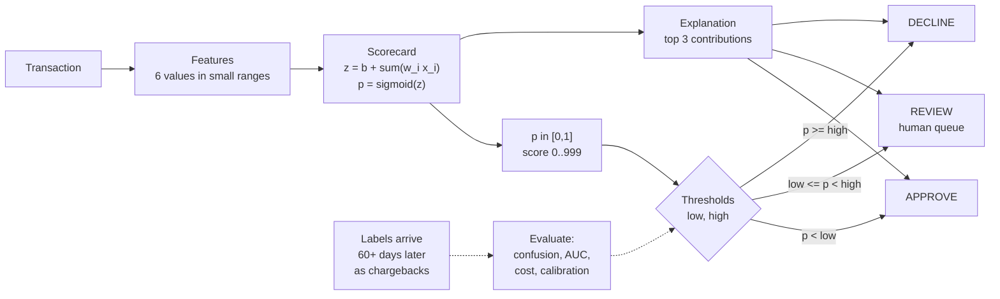

# Risk Scoring, Thresholds, and Precision-Recall Trade-offs

> A score is useless without the threshold decision.

**Type:** Build
**Languages:** Java, Python, Go
**Prerequisites:** Phase 13, Lesson 01 (Fraud Patterns); Phase 13, Lesson 02 (A Rules Engine with Velocity Checks); Phase 10, Lesson 01 (Representing Money)
**Time:** ~90 minutes

## Learning Objectives

- Fit a six-feature logistic scorecard by batch gradient descent on a seeded synthetic dataset and read each weight as a change in log-odds
- Compute a confusion matrix, precision, recall, F1, false-positive rate, and AUC by hand and in code, and explain why AUC alone cannot choose a threshold
- Choose a threshold by expected money cost instead of F1, and derive the Bayes threshold `C_fp / (C_fp + C_fn)` from the cost of each mistake
- Add a manual-review band with two thresholds and show when a review queue lowers total cost and when it cannot
- Measure calibration with a reliability table and expected calibration error, and explain why an analytic threshold silently fails on an uncalibrated model
- Ship every decision with an integer score and the top contributing features so that analysts, customers, and auditors can read it

## The Problem

A marketplace's risk team ships a new fraud model. Offline it looks excellent: an AUC of 0.975 on held-out data, a number that goes straight into the launch email. The engineer wiring it into checkout needs one more thing, a cut-off, and picks the obvious one: decline when the model says the probability of fraud is at least 0.5. "Fifty-fifty is the natural midpoint."

Two weeks later both teams are unhappy for opposite reasons. Finance reports that chargebacks barely moved. On the 6,000-transaction holdout that threshold catches 25 of 136 frauds, a recall of 18%; the model is rarely confident above 0.5 when only 2% of traffic is fraud, so 111 frauds sail through at an average loss of 105.00 USD each. A product manager then lowers the threshold to 0.05 "to catch more". Recall jumps to 93%, and 451 good customers out of 5,864 (7.7%) are declined. Each costs about 12.00 USD in lost margin and support, and some never return. Nobody can say which of these is correct because nobody wrote down what a missed fraud and a wrongly declined customer cost.

The model was never the problem. A score is a ranking; the business decision is a threshold, and the threshold is an economic choice that depends on the cost of each kind of mistake, the base rate, whether a human can review the borderline cases, and whether the model's probabilities mean what they say. This lesson builds the whole pipeline from scratch: a hand-fitted scorecard, an evaluator, three threshold selectors, a calibration check, and a decision engine that explains itself. On the same holdout, the cost-optimal single threshold costs 3,645.00 USD versus 14,280.00 USD for approving everything, and a review band brings it to 3,290.00 USD.

## The Concept

### A score is a ranking, a threshold is a decision

A fraud model maps a transaction's features to a number. Two different questions get confused:

1. **Ranking:** does the model put fraud above legitimate traffic? Measured by AUC, independent of any threshold.
2. **Deciding:** at which number do we stop approving? Measured in money, and it depends on things the model does not know.

A model with perfect ranking and the wrong threshold still loses money. A model with mediocre ranking and the right threshold often beats it. The pipeline you will build makes each step explicit:



### The scorecard: logistic regression with readable weights

The model is the simplest one that produces a probability:

```text
z = bias + w1*x1 + w2*x2 + ... + w6*x6        (the logit, or log-odds)
p = 1 / (1 + e^(-z))                          (the sigmoid)
```

Each weight is the change in log-odds per unit of its feature. A weight of +1.238 on `new_device` multiplies the odds of fraud by `e^1.238 = 3.45` when the device is new, everything else equal. That one sentence is why scorecards survive in regulated settings: every point of every score can be attributed to a named input.

The six features are deliberately transformed to small ranges before they reach the model:

| Feature | Raw signal | Transform | Range |
|---------|-----------|-----------|-------|
| `amount_log_ratio` | amount vs the account's trailing average | `ln(amount / avg)` | about -2..3, 0 = typical |
| `new_device` | fingerprint never seen on this account (Lesson 07) | 0 or 1 | 0..1 |
| `geo_mismatch` | IP country differs from card issuing country | 0 or 1 | 0..1 |
| `velocity_1h` | attempts on the account in the last hour (Lesson 02) | `min(10, n) / 10` | 0..1 |
| `account_young` | account age in days | `max(0, 1 - age/90)` | 0..1 |
| `failed_cvv_24h` | CVV failures in 24 hours | `min(5, n) / 5` | 0..1 |

Capping and scaling matter. A raw `attempts = 400` from a card-testing bot would otherwise dominate the logit and make the gradient step unstable. The log ratio turns "ten times the usual amount" and "a tenth of it" into symmetric distances from zero.

### Fitting it by hand: gradient descent on log loss

Training minimises the average log loss over the labelled rows:

```text
loss = -(1/n) * sum( y*ln(p) + (1-y)*ln(1-p) )
d loss / d w_i = (1/n) * sum( (p - y) * x_i )
d loss / d b   = (1/n) * sum( p - y )
```

The gradient has a beautiful form: the prediction error `p - y` times the input. Every epoch computes it over all rows and steps each weight against it. With 14,000 rows, 6 features, and 400 epochs that is about 34 million multiply-adds, well under a second. Batch gradient descent with a fixed learning rate and a fixed dataset is fully deterministic, which is the property the tests rely on: same seed, same data, same weights, bit for bit.

Complexity: training is O(epochs * n * d); scoring one transaction is O(d), here six multiplications and one `exp`, cheap enough to run inline in an authorization path with a 100 ms budget (Phase 12).

### The confusion matrix and its four rates

Fix a threshold `t` and declare fraud when `p >= t`. Every labelled row lands in one cell:

| | Labelled fraud | Labelled legitimate |
|---|---|---|
| **Flagged** (`p >= t`) | TP: fraud stopped | FP: good customer insulted |
| **Not flagged** | FN: fraud approved, chargeback later | TN: good customer served |

From the four counts:

| Metric | Formula | Question it answers |
|--------|---------|---------------------|
| Precision | TP / (TP + FP) | Of what we declined, how much was fraud? |
| Recall (TPR) | TP / (TP + FN) | Of the fraud, how much did we stop? |
| False-positive rate (insult rate) | FP / (FP + TN) | Of good customers, how many did we decline? |
| F1 | 2PR / (P + R) | Harmonic mean; punishes a lopsided P or R |

The invariant the tests check at 101 thresholds: **TP + FP + TN + FN = n**. Every transaction is counted once, in exactly one cell. Off-by-one bugs in threshold comparisons (`>` versus `>=`) break it at ties, and ties are common because production scores are integers.

### Worked example by hand

Six scored transactions:

| # | p | Label |
|---|---|---|
| 1 | 0.9 | fraud |
| 2 | 0.8 | legit |
| 3 | 0.7 | fraud |
| 4 | 0.4 | fraud |
| 5 | 0.3 | legit |
| 6 | 0.1 | legit |

At `t = 0.5`, rows 1, 2, 3 are flagged. TP = 2 (rows 1, 3), FP = 1 (row 2), FN = 1 (row 4), TN = 2 (rows 5, 6). Precision 2/3, recall 2/3, F1 2/3. With the lesson's cost model (missed fraud 105.00 USD, insult 12.00 USD) the cost is `1 * 105.00 + 1 * 12.00 = 117.00 USD`.

Lower the threshold to 0.4 (inclusive): row 4 is now flagged, TP = 3, FN = 0, FP still 1, cost 12.00 USD. On this toy set, 0.4 is far cheaper than 0.5 even though precision barely moved (3/4 vs 2/3).

AUC by counting pairs: there are 3 frauds and 3 legits, so 9 (fraud, legit) pairs. A pair is "ordered" when the fraud outscores the legit:

```text
fraud 0.9 beats legit 0.8, 0.3, 0.1   -> 3
fraud 0.7 beats legit 0.3, 0.1        -> 2   (loses to 0.8)
fraud 0.4 beats legit 0.3, 0.1        -> 2   (loses to 0.8)
total ordered = 7 of 9 -> AUC = 7/9 = 0.778
```

The code computes the same number in O(n log n) with the rank-sum (Mann-Whitney U) formula instead of O(n^2) pair counting: sort by p, assign ranks 1..n with ties sharing the average rank, sum the ranks of the frauds `R`, then `AUC = (R - P(P+1)/2) / (P*N)`. For the toy set the fraud ranks are 6, 4, 3, so `R = 13`, `(13 - 6) / 9 = 7/9`.

### Why AUC cannot pick the threshold

AUC integrates over every threshold. It answers "how good is the ranking" and is blind to the base rate: an AUC of 0.975 at a 2% fraud rate still means that at most thresholds the flagged set is mostly legitimate customers, because there are 49 legits for every fraud. The sweep from the lesson's holdout makes this concrete:

| Threshold | TP | FP | FN | Precision | Recall | Insult rate |
|-----------|----|----|----|-----------|--------|-------------|
| 0.05 | 126 | 451 | 10 | 0.218 | 0.926 | 7.69% |
| 0.10 | 111 | 85 | 25 | 0.566 | 0.816 | 1.45% |
| 0.20 | 72 | 10 | 64 | 0.878 | 0.529 | 0.17% |
| 0.30 | 51 | 3 | 85 | 0.944 | 0.375 | 0.05% |
| 0.50 | 25 | 0 | 111 | 1.000 | 0.184 | 0.00% |

Same model, same AUC, five businesses. On imbalanced data the precision-recall view is the honest one: ROC plots false-positive *rate*, and 1.45% of 5,864 legits sounds tiny until you notice it is 85 people against 111 frauds.

### The cost-optimal threshold

Assign a money cost to each mistake: `C_fn` for a missed fraud (the average fraud ticket plus a chargeback fee, here 105.00 USD) and `C_fp` for a declined good customer (lost margin plus support plus churn, here 12.00 USD). Correct decisions cost zero by convention.

For a single transaction with true fraud probability `p`:

```text
cost of approving = p * C_fn
cost of declining = (1 - p) * C_fp
decline when  p * C_fn > (1 - p) * C_fp
          <=> p > C_fp / (C_fp + C_fn)
```

This is the Bayes-optimal threshold (Elkan, 2001). With 12 and 105 it is `12 / 117 = 0.1026`. The empirical sweep over the holdout lands on 0.10 with an expected cost of 3,645.00 USD. F1 picks 0.14 and costs 4,689.00 USD: F1 weights precision and recall equally, which is equivalent to pretending a missed fraud and an insult cost the same. They do not, and the difference is 1,044.00 USD on 6,000 transactions.

Three consequences engineers forget:

- **The threshold moves when costs move.** If insults cost 400.00 USD (a high-value B2B customer who churns), the optimal threshold rises sharply; a test checks this.
- **The analytic formula needs calibrated probabilities.** `p > 0.1026` is only optimal if `p` is the true fraud rate among transactions with that score. The next section shows ours is not quite.
- **Costs are money.** The code keeps them as `Money` (integer minor units, Phase 10 Lesson 01) and multiplies by integer counts. A threshold sweep comparing float costs can pick a different threshold on a tie depending on summation order.

### The review band

A third option, manual review, costs a fixed fee (here 4.00 USD of analyst time) plus imperfect outcomes: analysts miss 10% of the fraud they see and wrongly decline 5% of the good customers. For a transaction with probability `p`:

```text
approve: 105.00 * p
decline:  12.00 * (1 - p)
review:    4.00 + 105.00 * 0.10 * p + 12.00 * 0.05 * (1 - p)  =  4.60 + 9.90 * p
```

Review beats approving when `105p > 4.6 + 9.9p`, so `p > 0.048`. Review beats declining when `12 - 12p > 4.6 + 9.9p`, so `p < 0.338`. A calibrated model would therefore approve below 0.048, review in `[0.048, 0.338)`, and decline above. At the Bayes threshold 0.1026 the approve and decline lines meet at a cost of 10.77 USD, and the review line is `fee + 0.60 + 9.90 * 0.1026 = fee + 1.62`; once the review fee exceeds about 9.15 USD the band collapses to nothing and the single threshold wins; a test with a 500.00 USD review cost checks exactly that.

The sweep over the holdout searches every `(low, high)` pair on a 100-bin histogram, O(bins^2) after one O(n) pass, and finds approve below 0.06, review `[0.06, 0.13)`, decline at 0.13 and above: 275 reviews (4.6% of traffic) and a cost of 3,290.00 USD, 355.00 USD less than the best single threshold. Note the upper edge: the empirical band ends at 0.13, not 0.338. That gap is the calibration problem.

### Calibration: does p = 0.30 mean 30%?

Group the holdout by predicted probability and compare the mean prediction with the observed fraud rate in each group:

| Bin | n | Mean p | Observed fraud rate |
|-----|---|--------|---------------------|
| [0.0, 0.1) | 5804 | 0.019 | 0.004 |
| [0.1, 0.2) | 114 | 0.138 | 0.342 |
| [0.2, 0.3) | 28 | 0.237 | 0.750 |
| [0.3, 0.4) | 16 | 0.333 | 0.875 |

The model is **underconfident in the tail**: when it says 0.24, three in four are fraud. Gradient descent stopped at 400 epochs before the weights grew large enough, and the six features are only a linear view of a nonlinear generator. The expected calibration error, the count-weighted mean of `|mean p - observed|`, is only 0.024, because 97% of rows sit in the bottom bin where the error is small. **ECE is dominated by where the traffic is, not where the decisions are.** Always read the table, not just the number.

The practical lesson: the analytic thresholds (0.1026, 0.048, 0.338) assume calibration and would be wrong here; the empirical cost sweep over labelled data makes no such assumption and correctly places the decline edge at 0.13, where the observed fraud rate is already about 34%. Either recalibrate the model (Platt scaling, isotonic regression) and then use the formula, or sweep on labelled data. Never use the formula on an uncalibrated score.

### Integer scores and explanations

Downstream systems should not compare raw doubles. The scorecard maps `p` to an integer `round(p * 999)` in 0..999, the shape FICO Falcon and many vendors use. Rules engines (Lesson 02) can then say `score >= 130` with no floating-point equality traps, and the integer is what gets logged in the decision record (Lesson 11).

Every decision also carries an explanation: each feature's contribution `w_i * x_i`, sorted by absolute value, top three kept. For the "everything wrong at once" sample the logit decomposes exactly:

```text
bias                                  -4.511
amount_log_ratio  2.00  x +1.294  =   +2.588
new_device        1.00  x +1.238  =   +1.238
geo_mismatch      1.00  x +0.999  =   +0.999
account_young     0.98  x +0.864  =   +0.845
failed_cvv_24h    0.60  x +0.776  =   +0.466
velocity_1h       0.60  x +0.344  =   +0.206
z = 1.831,  p = 1 / (1 + e^-1.831) = 0.862,  score 861
```

For a linear model this decomposition is exact, not an approximation. For trees and neural networks, production teams use SHAP values to get an additive decomposition after the fact.

### What this lesson does not do

- It does not handle **label delay**. Chargebacks arrive 30-120 days after the transaction, so the "test set" is always months old, and a model trained on it is already stale. Production teams track a provisional label (early fraud warnings from Visa TC40 and Mastercard SAFE reports) and retrain on a schedule.
- It does not handle **selection bias**. Once a model declines a transaction you never learn whether it was fraud. Training only on approved traffic teaches the model that the patterns it blocks do not exist. The standard mitigation is a small random holdout that bypasses the model, at a measured cost.
- It does not regularise, cross-validate, or tune the learning rate. Those are model-quality questions; this lesson is about turning any score into a decision.
- It does not handle adversaries adapting to the threshold. Card testers probe until they find the edge (Lesson 01). Thresholds are revisited weekly, not set once.

## Build It

All code is in `code/java/Main.java`. The design: `Features` and `Example` hold the data, `SyntheticDataset` generates it from a seed, `Scorecard` fits and explains, `Evaluator` measures, `ThresholdSelector` picks thresholds in money, `Calibration` checks the probabilities, and `DecisionEngine` is the object that would ship.

### Step 1: Features with fixed meaning and range

```java
record Features(double[] values) {
    static final String[] NAMES = {
        "amount_log_ratio", "new_device", "geo_mismatch",
        "velocity_1h", "account_young", "failed_cvv_24h"
    };
    static final int COUNT = NAMES.length;

    static Features of(double amountLogRatio, boolean newDevice, boolean geoMismatch,
                       int attempts1h, int accountAgeDays, int failedCvv24h) {
        return new Features(new double[] {
            amountLogRatio,
            newDevice ? 1.0 : 0.0,
            geoMismatch ? 1.0 : 0.0,
            Math.min(10, Math.max(0, attempts1h)) / 10.0,
            Math.max(0.0, 1.0 - Math.max(0, accountAgeDays) / 90.0),
            Math.min(5, Math.max(0, failedCvv24h)) / 5.0
        });
    }
}
```

The factory is the only way raw signals become model inputs, so the transform is defined once and shared by training and serving. Training-serving skew, where the offline pipeline computes `account_young` one way and the online service another, is one of the most common reasons a model that tested well underperforms in production.

Predict: a bot makes 400 attempts in an hour. What does `velocity_1h` become, and why is that better than 40.0?

### Step 2: A seeded synthetic dataset

```java
static List<Example> generate(long seed, int n, double fraudRate) {
    Random rng = new Random(seed);
    for (int i = 0; i < n; i++) {
        boolean fraud = rng.nextDouble() < fraudRate;
        if (fraud) {
            amountLogRatio = 0.9 + 0.8 * rng.nextGaussian();
            newDevice = rng.nextDouble() < 0.70;
            geoMismatch = rng.nextDouble() < 0.40;
            attempts = 1 + poisson(rng, 3.0);
            ...
        } else {
            amountLogRatio = 0.0 + 0.6 * rng.nextGaussian();
            newDevice = rng.nextDouble() < 0.10;
            geoMismatch = rng.nextDouble() < 0.03;
            ...
        }
        long cents = Math.round(4000 * Math.exp(amountLogRatio)) + 100;
        rows.add(new Example(Features.of(...), fraud, Money.ofMinor(cents, Currency.USD)));
    }
}
```

Fraud and legitimate rows come from overlapping distributions: 10% of good customers are on a new device and 30% of fraud is not. The overlap is what makes thresholds a trade-off; with disjoint distributions any threshold in the gap would be perfect. The amount is integer cents derived from the same log ratio, so expensive anomalies and the money at stake move together. `split` shuffles with its own seed and cuts 70/30.

Predict: why does the generator draw `fraud` first and then features, rather than features first and then a label from a formula?

### Step 3: The scorecard and its gradient

```java
static Scorecard train(List<Example> rows, int epochs, double learningRate) {
    double[] w = new double[Features.COUNT];
    double b = 0.0;
    int n = rows.size();
    for (int epoch = 0; epoch < epochs; epoch++) {
        double[] gradW = new double[Features.COUNT];
        double gradB = 0.0;
        for (Example row : rows) {
            double z = b;
            for (int i = 0; i < w.length; i++) z += w[i] * row.features().get(i);
            double error = sigmoid(z) - (row.fraud() ? 1.0 : 0.0);
            for (int i = 0; i < w.length; i++) gradW[i] += error * row.features().get(i);
            gradB += error;
        }
        for (int i = 0; i < w.length; i++) w[i] -= learningRate * gradW[i] / n;
        b -= learningRate * gradB / n;
    }
    return new Scorecard(w, b);
}
```

This is the three gradient formulas from The Concept, line for line. Weights start at zero, so the first epoch predicts 0.5 everywhere and the bias gradient is about 0.48, pushing `b` sharply negative toward the log-odds of the base rate, `ln(0.02/0.98) = -3.9`. The fitted bias ends at -4.511 and all six weights come out positive, which the tests assert.

Predict: if you doubled the epochs to 800, would the tail calibration improve or worsen? Run it and compare the `[0.2, 0.3)` bin.

### Step 4: Integer scores and explanations

```java
int score(Features f) { return (int) Math.round(probability(f) * 999.0); }

Explanation explain(Features f, int k) {
    List<Contribution> all = new ArrayList<>();
    for (int i = 0; i < weights.length; i++) {
        all.add(new Contribution(Features.NAMES[i], f.get(i), weights[i], weights[i] * f.get(i)));
    }
    all.sort(Comparator.comparingDouble((Contribution c) -> -Math.abs(c.contribution()))
            .thenComparing(Contribution::feature));
    return new Explanation(score(f), probability(f), List.copyOf(all.subList(0, Math.min(k, all.size()))));
}
```

The secondary sort by feature name makes the explanation deterministic when two contributions tie, so the same transaction produces the same reason codes in every replay. Reason codes end up in customer-facing decline messages, analyst queues, and for credit decisions in legally required adverse-action notices; nondeterminism there is a compliance finding.

Predict: a feature with a large negative weight and value 1 would rank where? Why does the sort use absolute value?

### Step 5: The confusion matrix and AUC

```java
static ConfusionMatrix confusion(List<Scored> scored, double threshold) {
    long tp = 0, fp = 0, tn = 0, fn = 0;
    for (Scored s : scored) {
        boolean flagged = s.probability() >= threshold;
        if (s.fraud() && flagged) tp++;
        else if (!s.fraud() && flagged) fp++;
        else if (!s.fraud()) tn++;
        else fn++;
    }
    return new ConfusionMatrix(tp, fp, tn, fn);
}
```

The if-chain has exactly four exits, which is the conservation invariant in code form. `ConfusionMatrix.precision()` returns 0 rather than NaN when nothing is flagged; a NaN would poison every max-F1 comparison after it.

```java
static double auc(List<Scored> scored) {
    List<Scored> sorted = new ArrayList<>(scored);
    sorted.sort(Comparator.comparingDouble(Scored::probability));
    ...
    while (i < sorted.size()) {
        int j = i;
        while (j < sorted.size() && sorted.get(j).probability() == sorted.get(i).probability()) j++;
        double avgRank = (i + 1 + j) / 2.0;
        for (int k = i; k < j; k++) if (sorted.get(k).fraud()) rankSum += avgRank;
        i = j;
    }
    return (rankSum - positives * (positives + 1) / 2.0) / ((double) positives * negatives);
}
```

The inner `while` groups ties and gives each member the average of ranks `i+1..j`, which counts a tied fraud-legit pair as half ordered. Without it, AUC on integer scores depends on sort stability. A test with every score tied asserts exactly 0.5.

Predict: what does an AUC of 0.0 mean, and what one-line change turns that model into a perfect one?

### Step 6: Thresholds chosen in money

```java
record CostModel(Money fraudLoss, Money insultCost, Money reviewCost,
                 double reviewMissRate, double reviewInsultRate) {
    Money cost(ConfusionMatrix cm) {
        return fraudLoss.times(cm.fn(), 1, Rounding.HALF_EVEN)
                .plus(insultCost.times(cm.fp(), 1, Rounding.HALF_EVEN));
    }
}

static Threshold bestByCost(List<Scored> scored, CostModel costs) {
    Threshold best = null;
    for (int i = 1; i < STEPS; i++) {
        double t = i / (double) STEPS;
        ConfusionMatrix cm = Evaluator.confusion(scored, t);
        Money c = costs.cost(cm);
        if (best == null || c.compareTo(best.expectedCost()) < 0) best = new Threshold(t, cm, c);
    }
    return best;
}
```

`bestByF1` is the same loop with `cm.f1() > best.matrix().f1()` as the comparison. Strict `<` keeps the lowest threshold on a tie, deterministic and conservative. The sweep is O(STEPS * n); sorting once and walking the sorted list would make it O(n log n), which is Exercise 1.

Predict: with `C_fp = C_fn`, which threshold does the Bayes formula give, and how close is that to the F1 choice?

### Step 7: The review band

```java
static ReviewBand bestBand(List<Scored> scored, CostModel costs) {
    long[] fraudBins = new long[STEPS + 1], legitBins = new long[STEPS + 1];
    for (Scored s : scored) {
        int bin = Math.min(STEPS, (int) Math.floor(s.probability() * STEPS));
        if (s.fraud()) fraudBins[bin]++; else legitBins[bin]++;
    }
    long[] fraudCum = cumulative(fraudBins), legitCum = cumulative(legitBins);
    for (int lo = 1; lo < STEPS; lo++) {
        for (int hi = lo; hi < STEPS; hi++) {
            long fraudBelow = fraudCum[lo], legitBelow = legitCum[lo];
            long fraudMid = fraudCum[hi] - fraudCum[lo], legitMid = legitCum[hi] - legitCum[lo];
            long fraudAbove = fraudCum[STEPS + 1] - fraudCum[hi], legitAbove = legitCum[STEPS + 1] - legitCum[hi];
            ...
        }
    }
}
```

One pass builds a histogram; prefix sums (`cum[i]` = count in bins `[0, i)`) turn every bucket count into a subtraction, so the 4,950 candidate bands are evaluated in O(1) each instead of re-scanning 6,000 rows. `hi == lo` is allowed, which makes "no review band" one of the candidates; that is why the band can never cost more than the best single threshold, an invariant the tests assert.

Predict: the reviewed fraud count is `fraudMid`. Why is the expected number that slips through rounded to a whole transaction before being multiplied by the fraud loss?

### Step 8: Calibration and the decision engine

```java
static double expectedCalibrationError(List<Bin> bins) {
    long total = 0;
    for (Bin b : bins) total += b.count();
    double ece = 0;
    for (Bin b : bins) ece += (double) b.count() / total * Math.abs(b.meanPredicted() - b.observedRate());
    return ece;
}

Decision decide(Features f) {
    double p = model.probability(f);
    Outcome outcome = p >= band.high() ? Outcome.DECLINE : p >= band.low() ? Outcome.REVIEW : Outcome.APPROVE;
    return new Decision(outcome, model.explain(f, 3));
}
```

`reliability` clamps `p = 1.0` into the last bin with `Math.min(bins - 1, ...)`; without it the index would be out of range for a maximally confident prediction. `DecisionEngine` rejects a band with `low > high` at construction, so a misconfigured deploy fails at startup, not on the first transaction.

Predict: a deploy swaps `low` and `high` by mistake. What would every transaction's outcome be if the constructor did not check?

### Step 9: Run it

```bash
cd phases/13-risk-fraud-and-compliance/03-risk-scoring-and-thresholds/code/java
javac -d .out *.java && java -cp .out Main
java -cp .out MainTest
```

```console
== Dataset ==
20000 rows, 14000 train (286 fraud), 6000 test (136 fraud), base rate 2.11%

== Scorecard ==
bias -4.511
  amount_log_ratio   +1.294
  new_device         +1.238
  ...
== Separation ==
AUC on test = 0.975

best F1   : threshold 0.14, F1 0.722, expected cost 4689.00 USD
best cost : threshold 0.10, F1 0.669, expected cost 3645.00 USD  (fn 25, fp 85)
approve everything: 14280.00 USD   decline everything: 70368.00 USD

== Review band ==
approve < 0.06, review [0.06, 0.13), decline >= 0.13
approved 5577, reviewed 275 (4.6%), declined 148, expected cost 3290.00 USD
...
expected calibration error = 0.0241

== Decisions with explanations ==
regular customer, usual amount -> APPROVE (score 13, p=0.013)
new device, young account, 3 attempts -> DECLINE (score 333, p=0.333)
everything wrong at once -> DECLINE (score 861, p=0.862)
```

`MainTest` prints `47 passed, 0 failed`.

### In Python

```python
def jf(x: float, digits: int, plus: bool = False) -> str:
    d = Decimal(repr(float(x))).quantize(Decimal(1).scaleb(-digits), rounding=ROUND_HALF_UP)
    s = f"{d:f}"
    return "+" + s if plus and not s.startswith("-") else s
```

`code/python/main.py` prints the same dataset counts, weights, sweep table, band, calibration bins, and explanations as the Java version, digit for digit. Getting there took four deliberate choices:

- **`java.util.Random` is ported, not replaced.** `random.Random(42)` is a Mersenne Twister and would generate a different dataset. `JavaRandom` reproduces the 48-bit LCG, `next_double`, and the polar-method `next_gaussian` with its cached second value; `java_shuffle` is `Collections.shuffle`. Same seed, same 20,000 rows, same 14,000/6,000 split.
- **Floats are summed the Java way.** Python 3.12+ `sum()` uses compensated summation, which is more accurate and therefore not bit-identical to a Java `+=` loop. Every float accumulation (gradients, ECE) uses `reduce(operator.add, ...)` instead. `Scorecard.train` works column by column with `map` so 400 epochs take about two seconds; its docstring lists the three rewrites that keep it exact, and a test asserts two runs give identical weights.
- **Java's rounding rules are explicit.** `Math.round` rounds half up (`java_round`), and `String.format("%.2f")` rounds the shortest decimal half up, where Python's f-strings round the exact binary value half to even (`0.125` prints `0.13` in Java, `0.12` in Python). `jf` reproduces the Java output. `math.exp` raises `OverflowError` where Java returns `Infinity`, so `sigmoid(-1000)` is caught and returns `0.0` like the Java.
- **Money stays integer.** Costs are `Money` with `int` minor units; `times` reapplies the sign after `divmod` because Python's `//` floors where Java truncates, and `_check_long` keeps `Math.addExact`'s 64-bit bound.

Run it from `code/python/`:

```bash
python3 main.py
python3 -m unittest -v
```

### In Go

```go
func (r *JavaRandom) NextGaussian() float64 {
    if r.haveNextNextGaussian {
        r.haveNextNextGaussian = false
        return r.nextNextGaussian
    }
    for {
        v1 := 2*r.NextDouble() - 1
        v2 := 2*r.NextDouble() - 1
        s := v1*v1 + v2*v2
        if s >= 1 || s == 0 { continue }
        multiplier := math.Sqrt(-2 * math.Log(s) / s)
        r.nextNextGaussian = v2 * multiplier
        r.haveNextNextGaussian = true
        return v1 * multiplier
    }
}
```

`code/go/main.go` prints the same dataset counts, weights, sweep table, band, calibration bins, and explanations as the Java version, digit for digit. What it took:

- **`java.util.Random` is ported, not replaced.** `math/rand` would generate a different dataset. `JavaRandom` is the 48-bit LCG with `next(bits)`, `NextInt(bound)`, `NextDouble`, and the polar-method `NextGaussian` with its cached second value; `Shuffle` is `Collections.shuffle`. Same seed, same 20,000 rows, same 14,000/6,000 split.
- **Floating point is kept un-fused.** Go may fuse `a*b + c` into one rounding on some CPUs, which would make the 400-epoch gradient descent drift from Java's two roundings. The hot loops write `z += float64(w[i] * x)`: the explicit conversion forbids fusion, so the weights match to the last bit.
- **Java's rounding rules are explicit.** `javaRound` is `Math.round` (`floor(x + 0.5)`, so -2.5 gives -2 where `math.Round` gives -3), and `jf` reproduces `String.format("%.Nf")`, which rounds the shortest decimal representation half up; Go's `%f` rounds the binary value half to even, so `0.125` would print `0.12`. A test pins both.
- **Errors are values; money stays integer.** `NewFeatures`, `NewScorecard`, and `NewDecisionEngine` return sentinel errors (`ErrFeatureCount`, `ErrInvertedBand`) checked with `errors.Is`. `Money.Plus`, `Minus`, and `Times` return `(Money, error)` with `ErrOverflow`/`ErrCurrencyMismatch`; `Compare` panics on a mismatch because it has no error slot. The cost model unwraps with `must`, since no overflow is reachable from the demo's amounts.

Run it from `code/go/`:

```bash
go run .
go test ./...
```

## Use It

**Stripe Radar** returns `outcome.risk_score` (0-99) and `risk_level` (`normal`, `elevated`, `highest`) on every charge. Radar for Fraud Teams lets you write rules such as `Review if :risk_score: > 65` and `Block if :risk_score: > 85`, which is exactly the review band from Step 7 with Stripe's model in place of the scorecard. Stripe's own default block threshold is set from network-wide data; your costs are not Stripe's, which is why the rule exists.

**Adyen RevenueProtect**, **Sift**, and **FICO Falcon** ship the same split: a vendor model emits a score (Sift 0-100, Falcon 1-999), and the merchant or issuer owns the thresholds and the review queue. Falcon's integer scale is the reason the scorecard in this lesson emits 0..999.

**Credit scorecards** (FICO, VantageScore, bank application scorecards) are logistic regressions on binned features, rescaled with "points to double the odds" so that, for example, every 20 points doubles the odds of repayment. The reason codes on a US adverse-action notice under ECOA / Regulation B come from the same per-feature contribution ranking as `explain`.

**scikit-learn** provides every piece of the evaluator: `LogisticRegression`, `precision_recall_curve`, `roc_auc_score`, `calibration_curve`, and `CalibratedClassifierCV` for Platt or isotonic recalibration. Use them in the notebook. What they hide is the cost model: `predict()` uses 0.5, the trap from The Problem. Production fraud models are more often gradient-boosted trees (XGBoost, LightGBM) than logistic regression; the threshold, cost, calibration, and explanation machinery is identical, and boosted trees are typically *worse* calibrated out of the box, so the reliability table matters more.

**Model risk management.** US banks govern every scoring model under the Federal Reserve's SR 11-7: documented development, independent validation, ongoing monitoring of performance and calibration, and an inventory of where each model's output is used. The decision log in Lesson 11 is how you prove which model version and threshold made each decision.

## Ship It

`outputs/checklist-score-threshold-review.md` is a review checklist for any change that introduces a score or moves a threshold: the cost model written down in money, the base rate, the PR and calibration tables on recent labelled data, the review-band capacity check, explanation and reason-code requirements, and the rollback plan. Attach it to the change request; a threshold change without a cost model is a guess.

## Exercises

1. **Reinforce (easy).** Replace the O(STEPS * n) threshold sweep with an O(n log n) version: sort scored rows by probability once, then walk from the top, moving one row at a time from "not flagged" to "flagged" and updating TP/FP incrementally. Assert that it returns the same cost-optimal threshold as `bestByCost` on the seeded holdout.
2. **Apply (medium).** Implement Platt scaling: fit a one-feature logistic regression `p' = sigmoid(a * logit + c)` on a calibration split (carve 20% off the training set). Show the reliability table before and after, then compare the analytic Bayes threshold `12/117` applied to `p'` with the empirical `bestByCost`. They should now agree within one step.
3. **Extend (hard).** Combine with Lesson 02: feed the integer score into the rules engine as a field, so that a rule like `score >= 130 AND velocity_1h >= 0.5 -> DECLINE` and `score >= 60 -> REVIEW` can override the band. Add a per-day review capacity (say 150 reviews); when the queue is full, the engine must fall back to the cost-optimal single threshold for the rest of the day. Measure the extra cost of the capacity limit on a 30-day synthetic stream.

## Key Terms

| Term | What people say | What it actually means |
|------|-----------------|------------------------|
| Risk score | "How risky the payment is" | A monotone function of the model's estimated fraud probability, here `round(p * 999)`; a ranking, not a decision |
| Threshold | "The cut-off" | The score at which the action changes; an economic choice set from the cost of each mistake, not a property of the model |
| Precision / recall | "Accuracy of the fraud model" | Of what was flagged, the share that was fraud / of the fraud, the share that was flagged; they trade against each other as the threshold moves |
| AUC | "How good the model is" | The probability a random fraud outscores a random legitimate transaction; threshold-free and blind to the base rate |
| Insult rate | "False declines" | Legitimate transactions declined divided by all legitimate transactions; the cost the customer sees |
| Calibration | "The probabilities are right" | Among transactions scored `p`, a fraction `p` are fraud; required before using any analytic threshold formula |
| Review band | "Send it to manual review" | The score interval `[low, high)` where a human decision costs less than either automatic outcome |
| Reason code | "Why it was declined" | The top contributing features of a decision, kept deterministic so logs, analysts, and notices agree |

## Further Reading

- [Elkan, "The Foundations of Cost-Sensitive Learning", IJCAI 2001](https://cseweb.ucsd.edu/~elkan/rescale.pdf) — derives the `C_fp / (C_fp + C_fn)` threshold and shows how to rebalance training instead of moving the threshold
- [Saito and Rehmsmeier, "The Precision-Recall Plot Is More Informative than the ROC Plot When Evaluating Binary Classifiers on Imbalanced Datasets", PLOS ONE 2015](https://doi.org/10.1371/journal.pone.0118432) — why a 0.975 AUC can hide a useless operating point at a 2% base rate
- [Niculescu-Mizil and Caruana, "Predicting Good Probabilities with Supervised Learning", ICML 2005](https://www.cs.cornell.edu/~alexn/papers/calibration.icml05.crc.rev3.pdf) — which model families are miscalibrated in which direction, and Platt versus isotonic recalibration
- [Hanley and McNeil, "The Meaning and Use of the Area under a ROC Curve", Radiology 1982](https://doi.org/10.1148/radiology.143.1.7063747) — the rank-sum interpretation of AUC that `Evaluator.auc` implements
- [Board of Governors of the Federal Reserve System, SR 11-7: Guidance on Model Risk Management](https://www.federalreserve.gov/supervisionreg/srletters/sr1107.htm) — what a regulator expects around development, validation, and monitoring of any score used in decisions
- [Stripe Radar documentation: risk evaluation and rules](https://docs.stripe.com/radar/risk-evaluation) — a production score, risk levels, and merchant-owned thresholds side by side
