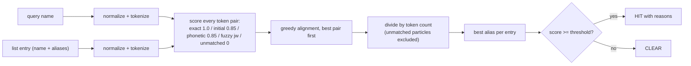

# Sanctions Screening: Name Matching Under Uncertainty

> Jaro-Winkler, phonetic keys, and the false-positive flood.

**Type:** Build
**Languages:** Java, Python, Go
**Prerequisites:** Phase 2, Lesson 04 (String Algorithms and Edit Distance), Phase 13, Lesson 03 (Risk Scoring and Thresholds)
**Time:** ~120 minutes

## Learning Objectives

- Normalize a personal name so that case, diacritics, punctuation, honorifics, and token order no longer count as differences
- Implement Jaro and Jaro-Winkler similarity from scratch and reproduce Winkler's published values for `martha/marhta`, `dwayne/duane`, and `dixon/dicksonx`
- Implement American Soundex and explain what a phonetic key catches that an edit-distance measure misses, and vice versa
- Align the tokens of two multi-word names with a greedy best-pair strategy that ignores order and does not penalize unmatched particles
- Tune a screening threshold against a labelled set using a precision/recall table, and explain why 0.85 and 0.95 are both defensible for different queues
- Produce an explanation for every hit that names the token pairs and the evidence kind, so an analyst can clear or escalate it in seconds

## The Problem

A payment processor is required by law to refuse transactions involving persons on government sanctions lists (OFAC's SDN list in the United States, the EU and UK consolidated lists, the UN list). The engineering team's first implementation is an exact string match against the list. It screens 4 million payments in its first month and produces zero hits. Compliance is pleased until an auditor points out that the list contains `AL-QASRANI, Hamid` and the processor sent money to `Hamid Al Qasrani` eleven times.

The team's second implementation lowercases both sides and splits on whitespace and punctuation, then flags any payment where a listed surname appears. It produces 38,000 hits in its first week. Every one must be reviewed by a human analyst, who clears 37,994 of them: people named Garcia, Khan, Kim, Ali, and Smith, which are also names on the list. Six are real. The analysts, working through a queue of 38,000, take nine days to reach the six, during which the six transactions have already settled. The regulator's finding is not that the system missed them; it is that the system produced so many alerts that the real ones could not be acted on. A fine follows.

The third implementation is the subject of this lesson. It normalizes names so that `GRIMBLEWOOD, Thaddeus` and `Thaddeus Grimblewood` are the same string. It scores token pairs with Jaro-Winkler so that `Grimblewod` is a 0.98 match to `Grimblewood` and `Grimble` is not. It uses a phonetic key so that `Kraskovich` and `Kraskovitch`, which an edit-distance measure sees as two substitutions apart, are recognized as the same spoken name. It aligns tokens so that order does not matter and so that an Arabic or Dutch particle (`al`, `van`) that one side has and the other lacks is not held against the match. It picks the threshold from a precision/recall table on a labelled set rather than from a guess. And it attaches to every hit a list of the token pairs that produced the score, so the analyst's first look answers "why did this fire?" rather than "where do I start?"

## The Concept

### Screening is a classification problem with asymmetric costs

Every screened name is either a true match to a listed person or it is not. The screener either flags it or clears it. That gives four outcomes:

| | Flagged | Cleared |
|---|---|---|
| **Listed person** | True positive: the law is satisfied | False negative: a sanctioned payment settled; regulatory and criminal exposure |
| **Not listed** | False positive: an analyst spends ten minutes; the customer's payment is delayed | True negative: the normal case |

A false negative can cost a banking licence; a false positive costs ten minutes. So the system is tuned to favour recall, and the price is paid in analyst hours. The engineering question is how to buy the most recall per analyst hour, and the answer has three parts: a similarity measure that ranks near-variants above unrelated names, a threshold set with data, and explanations that cut the ten minutes to two.

Precision is `tp / (tp + fp)`: of the alerts raised, how many were real. Recall is `tp / (tp + fn)`: of the real matches, how many were raised. A threshold trades one for the other; the lesson's final section computes both at seven thresholds on a labelled set and reads the table.

### Normalization: deciding what is not a difference

Two names differ in ways that carry identity (different letters in the surname) and ways that do not (one is in capitals, one has a comma). Normalization removes the second kind before any scoring happens:

| Input | After normalization | What was removed |
|-------|---------------------|------------------|
| `GRIMBLEWOOD, Thaddeus` | `grimblewood thaddeus` | case, comma |
| `Dr. Ximena Fortaleza-Rúa` | `ximena fortaleza rua` | honorific, hyphen (becomes a token boundary), acute accent |
| `Müller-Lüdenscheidt, Jörg` | `muller ludenscheidt jorg` | umlauts (folded to the base letter, not transliterated to `ue`) |
| `Hamid al-Qasrani` | `hamid al qasrani` | hyphen; the particle `al` is kept as its own token |
| `Straße` | `strasse` | sharp s expanded |

The diacritic table is written out by hand (`à á â ã ä å ā ă ą` all map to `a`) rather than using `java.text.Normalizer`, `unicodedata`, or `golang.org/x/text`, because the three implementations must fold identically and the libraries differ at the edges (`ø` has no decomposition in NFD; `ß` is handled differently by each). Hyphens and apostrophes become spaces rather than being deleted, so `Fortaleza-Rúa` becomes two tokens that can each be matched; deleting the hyphen would produce `fortalezarua`, which matches nothing. Honorifics (`mr`, `dr`, `jr`) are removed because they carry no identity and would otherwise either match each other (false evidence) or go unmatched (false penalty).

### Jaro similarity

Edit distance (Phase 2, Lesson 04) counts insertions, deletions, and substitutions, and treats a transposition as two edits. Human-typed names are full of transpositions (`marhta`) and the Jaro measure, designed at the U.S. Census Bureau for exactly this, treats them more gently. For strings `a` and `b`:

1. Two characters match if they are equal and within `floor(max(|a|, |b|) / 2) - 1` positions of each other. Each character matches at most once. Let `m` be the number of matches.
2. List the matched characters of `a` in order, and the matched characters of `b` in order. Count positions where they differ; half that count, rounded down, is the number of transpositions `t`.
3. `jaro = (m/|a| + m/|b| + (m - t)/m) / 3`, or 0 if `m = 0`.

Worked by hand on `martha` versus `marhta`:

```text
window = floor(6/2) - 1 = 2
a = m a r t h a
b = m a r h t a
m matches m (pos 0), a~a (1), r~r (2), t at a[3] finds t at b[4] (distance 1, within window),
h at a[4] finds h at b[3], a~a (5)                                -> m = 6
matched sequence from a: m a r t h a
matched sequence from b: m a r h t a
positions 3 and 4 differ                                           -> 2 mismatches, t = 1
jaro = (6/6 + 6/6 + (6 - 1)/6) / 3 = (1 + 1 + 0.8333) / 3 = 0.9444
```

### Winkler's prefix boost

Winkler observed that errors in names cluster at the end (`Grimblewod`) and that two names sharing a prefix are more likely the same than two sharing a suffix. His adjustment pulls the score toward 1 by a fraction of the remaining distance, proportional to the length of the common prefix up to four characters:

```text
jaro_winkler = jaro + prefix * 0.1 * (1 - jaro)        prefix in 0..4
martha/marhta: prefix "mar" = 3 -> 0.9444 + 0.3 * 0.0556 = 0.9611
dwayne/duane:  jaro 0.8222, prefix "d" = 1 -> 0.8400
dixon/dicksonx: jaro 0.7667, prefix "di" = 2 -> 0.8133
```

These three values are from Winkler's 1990 paper and are the test vectors in all three implementations. The cap at four characters matters: without it, two long names sharing a six-letter prefix would be boosted past names that are actually closer.

### Phonetic keys: catching what spelling hides

`Kraskovich` and `Kraskovitch` differ by one inserted letter and score 0.98 on Jaro-Winkler, which is fine. `Nightshade` and `Nitshade` score 0.91. But `Yevgenia` and `Evgenia`, two transliterations of the same Cyrillic name, score lower than you would like, and the general problem of names crossing a script boundary is that the spelling varies while the sound does not.

Soundex, from the 1930s U.S. census, encodes the sound: keep the first letter, map the rest to digit classes (`b f p v` to 1, `c g j k q s x z` to 2, `d t` to 3, `l` to 4, `m n` to 5, `r` to 6), drop vowels and `h w y`, collapse adjacent duplicate digits, pad or truncate to one letter plus three digits.

| Name | Soundex | Note |
|------|---------|------|
| Robert | R163 | |
| Rupert | R163 | Same key: the measure's intended catch |
| Tymczak | T522 | `c z` share a class and collapse; the `a` separates `z` from `k`, so `k` emits a new 2 |
| Pfister | P236 | `p f` share a class with the first letter and collapse into it |
| Ashcraft | A261 | `h` is transparent, so `s` and `c` (same class) collapse across it |
| Kraskovitch, Kraskovich | K621 | Same key |
| Nightshade, Nitshade | N232, N323 | Different keys: `gh` versus `t` changes the digit order; Jaro-Winkler catches this pair instead |

The two measures are complementary, and the matcher uses both: a pair with the same Soundex key but a low Jaro-Winkler score is scored at a fixed 0.85 (phonetic evidence), a pair with a high Jaro-Winkler score is scored at that value (fuzzy evidence), and a pair with neither contributes nothing.

### Token alignment: order does not matter, particles do not count

A screened name and a list name are each a bag of tokens. The matcher scores every query token against every list token, sorts the pairs best first (ties broken by position so the result is deterministic), and greedily takes pairs whose tokens are both still unused. The total score is divided by the larger token count, so a name with an extra real token is diluted: `Theodora Grimblewood` against `Thaddeus Grimblewood` scores `(0 + 1.0) / 2 = 0.5`.

Two refinements come from how names actually vary across cultures:

- **Initials.** `T Grimblewood` against `Thaddeus Grimblewood` should score high; the initial is weak but real evidence. A one-letter token that is the first letter of the other token scores 0.85.
- **Particles.** `Hameed Qasrani` against `Hamid al-Qasrani` should not be penalized for the missing `al`, because `al`, `bin`, `van`, `de`, and their kin are dropped, kept, or attached inconsistently across documents. An unmatched particle is removed from the denominator instead of counted as a missing token. A *matched* particle still counts, so `van der Berg` against `van der Berg` scores 1.0 on all three tokens.

Worked by hand, `Theodora Grimblewood` against the alias `T. Grimblewood`:

```text
query  = [theodora, grimblewood]
list   = [t, grimblewood]
pairs: grimblewood~grimblewood EXACT 1.00
       theodora~t              INITIAL 0.85   (t is the first letter of theodora)
       theodora~grimblewood    UNMATCHED
       grimblewood~t           INITIAL? no: 'g' != 't'; jw too low -> UNMATCHED
greedy: take EXACT (1.00), take INITIAL (0.85); nothing left unused
score = 1.85 / max(2, 2) = 0.925
```

This is a false positive at a 0.85 threshold and a true negative at 0.95, and the threshold table below shows exactly that trade.



### Choosing the threshold from data

The lesson ships 24 labelled pairs: 12 true variants of listed names (reordered, misspelled, initialled, transliterated) and 12 hard negatives that share a token or a prefix with a listed name. Running the matcher at seven thresholds:

```text
  thr  tp  fp  fn  tn precision  recall     f1
 0.70  12   6   0   6     0.667   1.000  0.800
 0.85  12   6   0   6     0.667   1.000  0.800
 0.90  12   4   0   8     0.750   1.000  0.857
 0.95   9   1   3  11     0.900   0.750  0.818
 1.00   4   0   8  12     1.000   0.333  0.500
```

Read the table from the bottom. Exact matching (1.00) finds four of twelve real variants: two thirds of the sanctioned names would have passed. At 0.95 it finds nine, missing `T Grimblewood` (0.925), `Hameed Qasrani` (0.938), and `Bart Quillfeather` (0.936): an initial, a transliteration, and a shortened given name, which are three of the most common real-world variants. `Perpetua Nitshade` survives at 0.957 because the misspelling is inside a long token and Jaro-Winkler is forgiving there. At 0.90 it finds all twelve at the cost of four false positives. Below 0.90 recall is already perfect and lowering the threshold only adds false positives.

The right threshold depends on who is downstream. A fully automated block, where a hit stops the payment with no human review, wants 0.95 and a second-stage check on the misses. An analyst queue wants 0.90, because missing a true match is the failure the regulator fines and four extra reviews is the price. What is not defensible is picking a number without a table like this one, and the table is only as good as the labelled set, which is why the hard negatives are chosen to share tokens with listed names.

### What this lesson does not do

It does not use real sanctions data; every listed name is invented, and the real lists have their own formats (OFAC's SDN is distributed as XML and CSV with structured alias, date-of-birth, and nationality fields). It does not use secondary identifiers, which is how production systems clear most false positives: a date of birth or nationality that does not match the listed person clears a name hit immediately, and Exercise 2 adds this. It does not handle non-Latin scripts; a real screener transliterates Arabic, Cyrillic, and CJK names through several schemes and screens all of them. It does not scale: comparing every query against every list entry is O(query tokens x list entries x list tokens), fine for a 7-entry demo and for a 20,000-entry list at moderate volume, but a high-volume screener blocks on a phonetic key or an n-gram index first (Phase 2, Lesson 06) and scores only the candidates. It does not learn weights; the 0.85 constants are set by hand, and a production system fits them to labelled review outcomes.

## Build It

### Step 1: Normalize

```java
static String normalize(String name) {
    StringBuilder out = new StringBuilder();
    for (int i = 0; i < name.length(); i++) {
        char ch = name.charAt(i);
        String folded = DIACRITICS.get(ch);
        if (folded != null) {
            out.append(folded);
        } else if (ch < 128 && Character.isLetterOrDigit(ch)) {
            out.append(Character.toLowerCase(ch));
        } else {
            out.append(' '); // punctuation, hyphens, apostrophes, anything else
        }
    }
    List<String> tokens = new ArrayList<>();
    for (String t : out.toString().trim().split("\\s+")) {
        if (!t.isEmpty() && !STOPWORDS.contains(t)) tokens.add(t);
    }
    return String.join(" ", tokens);
}
```

One pass over the characters, one pass over the tokens. Anything that is not an ASCII letter or digit after folding becomes a space, which is the decision that turns `Fortaleza-Rúa` into two tokens. `STOPWORDS` holds the honorifics. The `PARTICLES` set is deliberately not applied here; particles survive normalization so the aligner can match them when both sides have them.

**Predict:** `normalize("O'Brien-Smythe, Mr. Seán")`?

### Step 2: Jaro

```java
static double jaro(String a, String b) {
    if (a.equals(b)) return 1.0;
    if (a.isEmpty() || b.isEmpty()) return 0.0;
    int window = Math.max(a.length(), b.length()) / 2 - 1;
    if (window < 0) window = 0;
    boolean[] aMatched = new boolean[a.length()];
    boolean[] bMatched = new boolean[b.length()];
    int matches = 0;
    for (int i = 0; i < a.length(); i++) {
        int lo = Math.max(0, i - window);
        int hi = Math.min(b.length(), i + window + 1);
        for (int j = lo; j < hi; j++) {
            if (!bMatched[j] && b.charAt(j) == a.charAt(i)) {
                aMatched[i] = true; bMatched[j] = true; matches++;
                break;
            }
        }
    }
    if (matches == 0) return 0.0;
    int transpositions = 0, j = 0;
    for (int i = 0; i < a.length(); i++) {
        if (!aMatched[i]) continue;
        while (!bMatched[j]) j++;
        if (a.charAt(i) != b.charAt(j)) transpositions++;
        j++;
    }
    int half = transpositions / 2;
    double m = matches;
    return (m / a.length() + m / b.length() + (m - half) / m) / 3.0;
}
```

The `bMatched` array is what enforces "each character matches at most once": without it, `aaa` against `a` would count three matches. The transposition loop walks both matched sequences in parallel; `while (!bMatched[j]) j++` skips the unmatched characters of `b`. Complexity is O(|a| x window), effectively O(n) for names.

**Predict:** `jaro("ab", "ba")`. Work out the window first.

### Step 3: Winkler and Soundex

```java
static double jaroWinkler(String a, String b) {
    double base = jaro(a, b);
    int prefix = 0;
    int n = Math.min(a.length(), b.length());
    for (int i = 0; i < n; i++) {
        if (a.charAt(i) != b.charAt(i) || prefix == JW_MAX_PREFIX) break;
        prefix++;
    }
    return base + prefix * JW_PREFIX_SCALE * (1.0 - base);
}

static String soundex(String token) {
    // keep letters only; first letter uppercased
    char last = soundexCode(letters.charAt(0));
    for (int i = 1; i < letters.length() && key.length() < 4; i++) {
        char c = letters.charAt(i);
        if (c == 'h' || c == 'w') continue;         // transparent: do not reset `last`
        char code = soundexCode(c);
        if (code == 0) { last = 0; continue; }      // a vowel separates: the same code may repeat
        if (code != last) { key.append(code); last = code; }
    }
    while (key.length() < 4) key.append('0');
    return key.toString();
}
```

The two Soundex subtleties that most implementations get wrong are both here: `h` and `w` are skipped *without* resetting `last` (so `Ashcraft` is `A261`, not `A226`), and vowels reset `last` (so `Tymczak` is `T522`, with the `k` after the `a` emitting a second 2). The National Archives examples in the tests check both.

### Step 4: Scoring a token pair

```java
static MatchReason pairScore(String q, String c) {
    if (q.equals(c)) return new MatchReason(ReasonKind.EXACT, q, c, 1.0);
    if ((q.length() == 1 && c.startsWith(q)) || (c.length() == 1 && q.startsWith(c))) {
        return new MatchReason(ReasonKind.INITIAL, q, c, INITIAL_SCORE);
    }
    double jw = Names.jaroWinkler(q, c);
    if (Names.soundex(q).equals(Names.soundex(c)) && jw < PHONETIC_FLOOR) {
        return new MatchReason(ReasonKind.PHONETIC, q, c, PHONETIC_FLOOR);
    }
    if (jw >= FUZZY_FLOOR) return new MatchReason(ReasonKind.FUZZY, q, c, jw);
    return new MatchReason(ReasonKind.UNMATCHED, q, c, 0.0);
}
```

Every pair returns a `MatchReason` carrying the kind of evidence and the score, and the explanation string is built from these. The `FUZZY_FLOOR` of 0.70 exists because Jaro-Winkler gives most pairs of random English words a score around 0.5 to 0.6; letting that count would make every two-token name score about 0.55 against every other two-token name, and the threshold would have to be raised until it missed real variants.

**Predict:** `pairScore("robert", "rupert")`: which branch, and what score?

### Step 5: Alignment

```java
MatchScore compare(String query, String candidate) {
    List<String> q = Names.tokenize(Names.normalize(query));
    List<String> c = Names.tokenize(Names.normalize(candidate));
    List<Pair> pairs = new ArrayList<>();
    for (int i = 0; i < q.size(); i++)
        for (int j = 0; j < c.size(); j++) {
            MatchReason r = pairScore(q.get(i), c.get(j));
            if (r.kind() != ReasonKind.UNMATCHED) pairs.add(new Pair(r.score(), i, j, r.kind()));
        }
    pairs.sort((x, y) -> { /* score desc, then i, then j */ });
    boolean[] usedQ = new boolean[q.size()], usedC = new boolean[c.size()];
    double total = 0.0;
    for (Pair p : pairs) {
        if (usedQ[p.i] || usedC[p.j]) continue;
        usedQ[p.i] = usedC[p.j] = true;
        total += p.score;
        if (p.i != p.j) reordered = true;
        reasons.add(new MatchReason(p.kind, q.get(p.i), c.get(p.j), p.score));
    }
    // unmatched tokens: particles leave the denominator, real tokens stay in it
    int denominator = Math.max(Math.max(qCount, cCount), 1);
    return new MatchScore(total / denominator, List.copyOf(reasons), reordered);
}
```

Greedy alignment is not optimal (the Hungarian algorithm is), but for names of two to five tokens it produces the same result almost always and is easier to explain to an analyst: "the best pair was taken first." The tie-break on `(i, j)` makes the output deterministic, which matters because the same screen is run again at review time and must produce the same reasons.

### Step 6: The watchlist, best alias per entry

```java
ScreeningResult screen(String name, double threshold) {
    if (!(threshold > 0.0 && threshold <= 1.0)) throw new IllegalArgumentException("threshold must be in (0, 1]");
    List<Hit> hits = new ArrayList<>();
    for (WatchlistEntry entry : entries) {
        Hit best = null;
        for (String candidate : entry.allNames()) {
            MatchScore m = matcher.compare(name, candidate);
            if (best == null || m.score() > best.match().score()) best = new Hit(entry.entryId(), candidate, entry.program(), m);
        }
        if (best != null && best.match().score() >= threshold) hits.add(best);
    }
    hits.sort(/* score desc, then entryId */);
    return new ScreeningResult(name, Names.normalize(name), threshold, List.copyOf(hits));
}
```

One hit per listed person, scored on their best alias. Without this, an entry with five aliases could produce five alerts for one query, and the analyst would clear the same person five times.

### Step 7: Precision and recall

```java
static Evaluation evaluate(NameMatcher matcher, List<LabelledPair> pairs, double threshold) {
    int tp = 0, fp = 0, fn = 0, tn = 0;
    for (LabelledPair pair : pairs) {
        boolean predicted = matcher.compare(pair.query(), pair.listName()).score() >= threshold;
        if (predicted && pair.isMatch()) tp++;
        else if (predicted) fp++;
        else if (pair.isMatch()) fn++;
        else tn++;
    }
    return new Evaluation(threshold, tp, fp, fn, tn);
}
```

The test asserts a property of the whole table rather than individual cells: raising the threshold never raises recall and never raises false positives. If that ever fails, the matcher is not monotone in its threshold, which would mean a score is being computed differently at review time than at screening time.

**Predict:** at threshold 1.00, which four of the twelve true pairs are found?

### Step 8: Run it

```bash
cd phases/13-risk-fraud-and-compliance/04-sanctions-screening/code/java
javac -d .out *.java && java -cp .out Main
java -cp .out MainTest
```

Expected output, abbreviated:

```console
== Jaro-Winkler on classic pairs ==
  martha       marhta       jaro=0.9444  jaro_winkler=0.9611
  dwayne       duane        jaro=0.8222  jaro_winkler=0.8400
  dixon        dicksonx     jaro=0.7667  jaro_winkler=0.8133

== Screening at threshold 0.85 ==
screen 'Hameed Al Qasrani' -> 'hameed al qasrani' @ 0.85: HIT
  FIC-0003 'Hameed Qasrani' [FICTIONAL-SDN] score=1.000 [exact 'hameed'~'hameed' (+1.00); exact 'qasrani'~'qasrani' (+1.00); particle 'al' ignored; token order ignored]
screen 'Perpetua Nitshade' -> 'perpetua nitshade' @ 0.85: HIT
  FIC-0006 'Perpetua Nightshade' [FICTIONAL-SDN] score=0.957 [exact 'perpetua'~'perpetua' (+1.00); fuzzy 'nitshade'~'nightshade' (+0.91)]
screen 'Theodora Grimblewood' -> 'theodora grimblewood' @ 0.85: HIT
  FIC-0001 'T. Grimblewood' [FICTIONAL-SDN] score=0.925 [exact 'grimblewood'~'grimblewood' (+1.00); initial 'theodora'~'t' (+0.85)]
screen 'Marisol Everly' -> 'marisol everly' @ 0.85: CLEAR

== Threshold tuning on the labelled synthetic set ==
    thr  tp  fp  fn  tn precision  recall     f1
   0.85  12   6   0   6     0.667   1.000  0.800
   0.90  12   4   0   8     0.750   1.000  0.857
   0.95   9   1   3  11     0.900   0.750  0.818
   1.00   4   0   8  12     1.000   0.333  0.500
```

The explanation lines are the deliverable. An analyst reading `initial 'theodora'~'t' (+0.85)` knows in one glance that the hit rests on a single-letter alias and can clear it against a date of birth; one reading `fuzzy 'nitshade'~'nightshade' (+0.91)` knows to look harder.

### In Python

`code/python/main.py` is the same design with `@dataclass(frozen=True)` for `MatchReason`, `MatchScore`, `WatchlistEntry`, `Hit`, and `LabelledPair`, and an `Enum` for `ReasonKind`. Two differences worth noticing. The diacritic table is a module-level `dict` built the same way, and it is deliberately not `unicodedata.normalize("NFKD", ...)`, which would handle `ø` and `ß` differently from the Java table. The pair sort uses a tuple key `(-score, i, j)` rather than a comparator, which is the idiomatic way to get the same deterministic tie-break. Errors are `ValueError` where Java throws `IllegalArgumentException`. Tests: 29 `unittest` methods.

### In Go

`code/go/main.go` returns `(ScreeningResult, error)` from `Screen` with sentinel errors `ErrBadThreshold` and `ErrDuplicateEntry` that tests check with `errors.Is`. Strings are iterated as runes, not bytes, in `Normalize`, because the diacritic table is keyed by `rune` and a byte-wise loop would split `ü` into two garbage bytes; after normalization everything is ASCII and `Jaro` and `Soundex` can index bytes directly. The alignment uses `sort.SliceStable` with an explicit `(score, i, j)` comparator; `sort.Slice` is not stable and would make the explanation order vary between runs. Tests: 9 `Test` functions with 39 assertions.

## Use It

**OFAC's Sanctions List Search** exposes a "minimum name score" slider from 50 to 100 and documents that it uses Jaro-Winkler for the fuzzy component; its FAQ says explicitly that the tool is a starting point and that a score is not a determination. **Dow Jones**, **Refinitiv World-Check**, **LexisNexis Bridger**, and **ComplyAdvantage** are the commercial screeners most processors buy; each ships a matching engine with dozens of tunable rules (name-order independence, transliteration variants, nickname tables such as `Bill` for `William`, cultural name-structure models that know `bin` is a patronymic marker) and a case-management queue for analysts. What they add over this lesson, in rough order of value: secondary-identifier matching (date of birth, nationality, identifiers) that clears most name hits automatically; multi-script transliteration; nickname and cultural-variant dictionaries; blocking indexes for throughput; and audit logs of every decision for the regulator.

What they do not remove is the threshold decision and the labelled set. Every vendor engine ships with a default threshold, and every regulator exam asks how it was tuned for your customer base. A European processor's customers produce a different false-positive distribution from a South Asian one's, and the table in this lesson is what the compliance team needs to see for theirs.

The standard-library trap: `java.text.Normalizer`, `unicodedata`, and `golang.org/x/text/unicode/norm` are tempting for the diacritic step and will produce three slightly different normalizations. If the screener and the review tool run in different languages, a name can hit in one and clear in the other. Write the table down.

## Ship It

`outputs/runbook-screening-threshold-review.md` is the quarterly threshold-review procedure: how to assemble the labelled set from cleared and escalated alerts, how to compute the table, which cells to present to compliance, and what to document for the examiner. Use it the first time compliance asks why the threshold is what it is.

## Exercises

1. **Reinforce.** Add a nickname table (`bill`/`william`, `bob`/`robert`, `tadeusz`/`thaddeus`) and a `NICKNAME` reason kind scoring 0.90. Add two labelled pairs that need it and recompute the table. Does the best threshold move?
2. **Apply.** Add an optional date of birth to `WatchlistEntry` and to the screening query. A name hit whose query date of birth is present and differs from the entry's by more than two years is downgraded to a `WEAK_HIT` that is logged but not queued. Measure the false-positive count at 0.90 on the labelled set with dates added.
3. **Extend.** The screener compares every query against every entry. Build a blocking index from Phase 2, Lesson 06: key each list token by its Soundex and its first two characters, and screen only entries that share at least one block with the query. Measure recall on the labelled set (it must stay at 1.000 at threshold 0.90) and count how many `compare` calls are saved on a 7-entry list and, by extrapolation, on a 20,000-entry one.

## Key Terms

| Term | What people say | What it actually means |
|------|-----------------|------------------------|
| Fuzzy match | "close enough" | A similarity score from a defined measure (here Jaro-Winkler) compared to a threshold chosen from labelled data |
| Jaro similarity | "edit distance for names" | `(m/a + m/b + (m-t)/m) / 3` where `m` counts characters matching within a window and `t` counts half the out-of-order matches; transpositions cost less than in Levenshtein |
| Winkler boost | "the prefix bonus" | `jaro + p * 0.1 * (1 - jaro)` for a common prefix of `p <= 4` characters; rewards names that agree at the start |
| Soundex | "phonetic matching" | A 1930s key of one letter plus three digit classes; catches spelling variants that sound alike and misses ones that do not |
| False-positive rate | "too many alerts" | `fp / (fp + tn)`; the analyst cost of a threshold. Precision `tp / (tp + fp)` is the fraction of alerts worth raising |
| Recall | "coverage" | `tp / (tp + fn)`; the fraction of true matches found, and the number a regulator asks about first |
| Blocking | "pre-filtering" | Indexing list entries by a cheap key so only candidates sharing a key are scored; required at volume, must not reduce recall |
| Particle | "the 'al' or the 'van'" | A name component (`al`, `bin`, `de`, `van`, `der`) attached inconsistently across documents; unmatched particles are excluded from the denominator rather than counted as missing tokens |

## Further Reading

- [Winkler, "String Comparator Metrics and Enhanced Decision Rules in the Fellegi-Sunter Model of Record Linkage" (1990)](https://files.eric.ed.gov/fulltext/ED325505.pdf) — the paper that introduced the prefix adjustment; the `martha/marhta` and `dixon/dicksonx` values come from here.
- [Jaro, "Advances in Record-Linkage Methodology as Applied to Matching the 1985 Census of Tampa, Florida" (JASA 1989)](https://www.tandfonline.com/doi/abs/10.1080/01621459.1989.10478785) — the original similarity measure and the matching-window rule.
- [U.S. National Archives, "The Soundex Indexing System"](https://www.archives.gov/research/census/soundex) — the official rules, including the `h`/`w` and vowel-separator cases that the tests check with `Ashcraft` and `Tymczak`.
- [OFAC, Sanctions List Search FAQ](https://ofac.treasury.gov/faqs/topic/1636) — the Treasury's own fuzzy search tool, its score slider, and its statement that a score is not a determination.
- [Wolfsberg Group, "Guidance on Sanctions Screening" (2019)](https://www.wolfsberg-group.org/sites/default/files/wb/Wolfsberg%20Guidance%20on%20Sanctions%20Screening.pdf) — what banks are expected to document about matching rules, thresholds, and testing; the source for the review runbook.
- [Fellegi and Sunter, "A Theory for Record Linkage" (JASA 1969)](https://www.tandfonline.com/doi/abs/10.1080/01621459.1969.10501049) — the probabilistic framework (match weights, upper and lower thresholds, a clerical-review band between them) that production screeners descend from.
