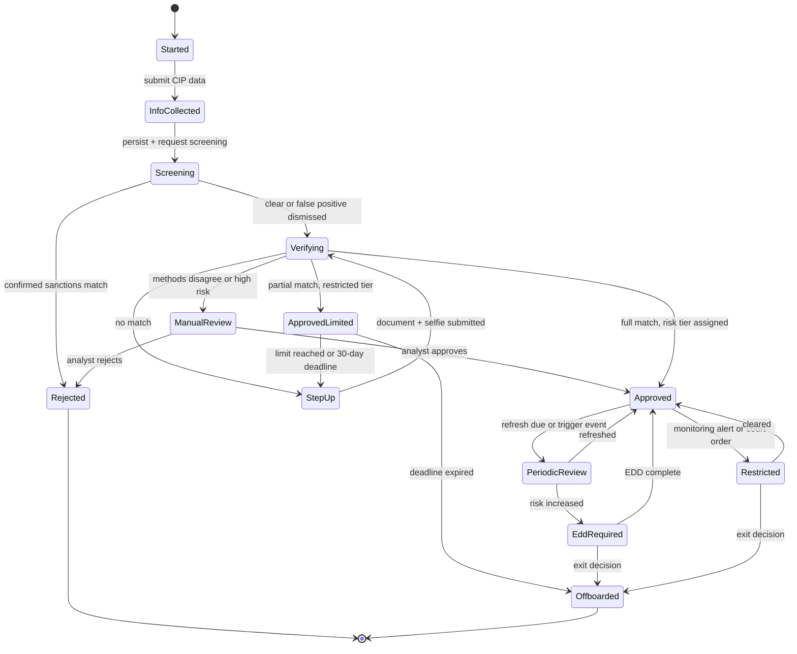

# KYC, CIP, and Identity Verification Flows

> Who you are allowed to pay.

**Type:** Learn
**Languages:** —
**Prerequisites:** Phase 13 Lesson 04 (Sanctions Screening), Phase 12 Lesson 02 (The Payment State Machine), Phase 13 Lesson 01 (Fraud Patterns)
**Time:** ~75 minutes

## Learning Objectives

- Distinguish KYC, CIP, CDD, EDD, KYB, and UBO identification, and name which regulation imposes each one in the US, the EU, the UK, and India
- Choose between documentary, non-documentary, and electronic-ID verification for a given product, and state the assurance, cost, and failure mode of each
- Model customer onboarding as an explicit state machine with tiered limits, idempotent vendor callbacks, manual review, and ongoing-monitoring states
- Compute beneficial ownership through a chain of entities and identify every person who meets the ownership or control prong
- Decide, field by field, what an engineer may store, must store, and must not store from an identity check

## The Problem

A payouts platform lets small online sellers sign up in three minutes and receive marketplace earnings to a bank account or a debit card. Growth asked for "frictionless onboarding", so the signup form collects a name, an email, a phone number, and a bank account, and the bank account is verified with a micro-deposit. Nobody checks a date of birth, an address, or a government ID number. For eight months it works: 40,000 sellers, almost no fraud losses, and a conversion rate the board loves.

Then the sponsor bank's compliance team runs its annual review of the platform and samples 200 accounts. They find 31 sellers they cannot identify at all, 4 accounts that share one residential address and one device with 117 others, and a cluster of accounts receiving marketplace "earnings" from buyers that are themselves recently opened accounts: money moving in a circle and leaving through debit-card payouts. The bank cannot file the required reports on people it cannot name. Under the program agreement the platform is now in breach; the bank freezes new onboarding, requires a remediation plan, and gives the platform 90 days to collect and verify identity for every existing seller. Seventeen percent of sellers never respond and must be offboarded, with their balances held.

The engineering mistake was not that the checks were weak. It was that there was no model of *who the customer is* as a first-class, versioned, auditable state, so there was nowhere to put the checks when they became mandatory, no way to restrict an account to lower limits while it was being verified, and no record of what had been relied on. Large-scale versions of the same failure have ended in criminal pleas: in November 2023 Binance and its founder pleaded guilty in the US to Bank Secrecy Act violations that included allowing users to trade without meaningful identity verification, with penalties above 4 billion USD.

Know Your Customer is not a form. It is a lifecycle: identify, verify, assess risk, set limits, monitor, refresh, and sometimes exit. This lesson maps that lifecycle onto the systems engineers build.

## The Concept

### The vocabulary, precisely

These terms are often used interchangeably. They are not.

| Term | What it is | Typical legal source |
|------|-----------|----------------------|
| KYC | The umbrella: everything a regulated firm does to know who its customers are and what they do | Industry term; FATF Recommendation 10 |
| CIP (Customer Identification Program) | The minimum: collect identifying information and verify it before or within a reasonable time of opening an account | US: 31 CFR 1020.220 (banks) and parallel rules for other institutions |
| CDD (Customer Due Diligence) | CIP plus understanding the nature and purpose of the relationship, building a risk profile, identifying beneficial owners of legal entities, and ongoing monitoring | US: FinCEN CDD Rule (2016, effective May 2018); EU: AML Directives, now Regulation (EU) 2024/1624 |
| SDD / EDD | Simplified or enhanced due diligence: less or more evidence, depending on assessed risk | FATF risk-based approach; EU AMLR; UK MLR 2017 regs 33 and 37 |
| KYB (Know Your Business) | KYC for a legal-entity customer: verify the entity exists, who controls it, who owns it | Same rules, applied to entities |
| UBO (Ultimate Beneficial Owner) | The natural person who ultimately owns or controls an entity customer | US: 25% ownership prong plus one control-prong person; EU: more than 25% |
| PEP | Politically exposed person; triggers EDD, not refusal | FATF Recommendation 12 |
| Sanctions screening | Checking names against prohibited-party lists; a strict-liability prohibition, separate from KYC risk | US: OFAC; EU: consolidated list (Lesson 04) |

Two distinctions matter for system design. First, **CIP is about identity, CDD is about risk**: CIP answers "is this a real person and is it this person?", CDD answers "what should we expect this customer to do, and how closely should we watch?". Second, **sanctions screening is not risk-based**: a confirmed sanctions match is a prohibition regardless of risk score, whereas a PEP is merely higher risk.

### What CIP actually requires (US example)

The US bank CIP rule requires, for an individual opening an account, at minimum four data elements: **name, date of birth, address** (residential or business street address, not a PO box, for individuals), and an **identification number** (an SSN or ITIN for US persons; for non-US persons, a passport number, alien ID number, or other government-issued document number). The firm must verify identity "to the extent reasonable and practicable" using documentary methods, non-documentary methods, or both, within a reasonable time; must have procedures for when it cannot verify (including when to close the account); must check government lists; and must keep records of the information collected and the methods and results of verification for **five years after the account is closed**.

India's equivalent is the RBI Master Direction on KYC (2016, repeatedly amended), which adds officially valid documents, Aadhaar-based e-KYC with consent, video-based customer identification (V-CIP), and the Central KYC Records Registry (CKYCR). The EU's new Anti-Money Laundering Regulation, Regulation (EU) 2024/1624, applies from July 2027 and replaces national variations of the directives with one directly applicable rulebook. The specifics differ; the shape is the same everywhere.

### Three ways to verify an identity

| Method | How it works | Assurance | Cost and latency | Characteristic failure |
|--------|-------------|-----------|------------------|------------------------|
| Documentary | Photo of a government ID, checked for security features and data consistency, plus a selfie and liveness check matched to the portrait | Medium to high; proves possession of a document and presence of a matching face | 0.50 to 3.00 USD; seconds to minutes; 5-20% need a retry | Forged or stolen documents, injected deepfake video streams, poor photos that reject good customers |
| Non-documentary (database) | Match name, DOB, address, ID number against credit bureau headers, government or telecom data | Medium for established adults; weak for thin-file customers | 0.10 to 1.00 USD; sub-second | **Synthetic identity**: a real SSN with a fabricated name and DOB that has been "aged" into bureau data passes |
| Electronic ID | Government or bank-issued eID: BankID (Nordics), Aadhaar e-KYC (India), eIDAS-notified schemes (EU), UK digital identity trust framework | High where available; the issuer did the proofing | Often cheap; seconds | Coverage gaps (tourists, migrants), consent and data-use limits imposed by the scheme |

NIST SP 800-63A frames the same choice as Identity Assurance Levels: IAL1 (self-asserted), IAL2 (remote or in-person proofing with evidence validated and verified), IAL3 (supervised, in-person-equivalent). Payments onboarding typically targets something close to IAL2 for full accounts and accepts IAL1 for restricted, low-limit tiers.

The decision procedure in practice is a **waterfall**: try the cheapest, lowest-friction method that can reach the required assurance; on a no-match or partial match, step up to the next method; route to manual review only when the automated methods disagree or the case is high risk. A typical US consumer waterfall: database match on four CIP elements, then documentary with selfie on failure, then manual review. Each step's result is recorded with the vendor, the vendor's reference ID, and what matched.

### Reading a verification response

Vendors return far more than pass or fail, and the difference matters when an examiner asks what you relied on. A representative database-match response, reduced to the fields that drive decisions:

```json
{
  "reference": "ver_8f2c41",
  "method": "database",
  "sources": ["credit_header", "ssa_issuance"],
  "matches": {
    "name": "exact",
    "dob": "exact",
    "address": "partial_street",
    "ssn": "match",
    "ssn_issued_after_dob": true,
    "ssn_deceased_flag": false
  },
  "watchlist": {"sanctions": "clear", "pep": "clear"},
  "risk_signals": ["address_shared_with_42_identities", "email_age_days_3"],
  "result": "partial"
}
```

Three habits turn this into evidence. Map vendor outcomes onto your own vocabulary (`full`, `partial`, `none`) per data element, because vendors change their enums and you will switch vendors. Keep the raw response, keyed by `reference`, in the vault for the retention period, so the decision can be re-derived. And treat `risk_signals` as inputs to your risk tier, not as verification: `address_shared_with_42_identities` does not make the identity false, but it is exactly the mule-farm pattern from The Problem and should push the tier up or route to review.

### Risk tiers and tiered limits

The risk-based approach says the evidence you collect should be proportionate to the risk the customer presents. Risk is scored from factors such as customer type, geography, product, delivery channel, expected volume, PEP status, adverse media, and occupation or industry. The output is a tier, and the tier drives two things: **due diligence level** and **product limits**.

| Tier | Due diligence | Example limits (illustrative) | Refresh cycle |
|------|---------------|-------------------------------|---------------|
| Restricted (pre-verification) | Minimal data collected, screening done | Receive only, or 250 USD/month, no withdrawals | Must verify within 30 days or close |
| Low | SDD or standard | Standard consumer limits | Low risk: up to 10 years (RBI); often 3-5 years elsewhere |
| Standard | Standard CDD | Standard limits | Medium risk: up to 8 years (RBI); often 2-3 years |
| High | EDD: source of funds, source of wealth, senior-management approval for PEPs | Case-by-case | High risk: at least every 2 years (RBI); often annually |

Tiered limits are how products reconcile conversion with compliance. India's prepaid payment instrument rules, for example, allow a "small" PPI with minimal KYC under a low monthly load cap, and a full-KYC PPI with higher limits. The engineering consequence: **limits are a function of verification state**, so every money-moving endpoint must read the customer's current tier, not a cached flag from signup.

### Onboarding as a state machine

Phase 12 taught that payment flows are state machines with explicit, persisted states and idempotent transitions. Onboarding is the same.



Engineering rules that follow from the diagram:

1. **Persist every state and transition** with timestamp, actor (system, vendor, analyst ID), and the evidence relied on. This is the CIP record, and it belongs in the tamper-evident log from Lesson 11.
2. **Vendor callbacks are idempotent and out of order.** A document vendor may send `verification.completed` twice, or `verification.failed` after `completed` for a re-submission. Key callbacks by vendor reference and attempt number, and reject transitions that are not legal from the current state (Phase 12, Lesson 01).
3. **Time is a transition trigger.** "Verify within 30 days" is a scheduled transition from `ApprovedLimited` to `Offboarded`, driven by a durable timer, not a cron job that queries by date and hopes.
4. **Offboarding is not deletion.** Closed accounts keep CIP records for five years after closure (US) and the funds go through a defined exit process: return to source, payment to a verified external account, or escheatment.
5. **`Restricted` is distinct from `Rejected`.** A customer under investigation must often not be told why (tipping-off prohibitions after a suspicious-activity filing), so the product needs a neutral restricted state with neutral copy.

An excerpt of the transition table that implements the diagram. Guards are evaluated against persisted state, never against the event payload alone:

| From | Event | Guard | To | Side effects |
|------|-------|-------|----|--------------|
| `Screening` | `screening.result` | result is confirmed match | `Rejected` | Block, file report per policy, no reason given to applicant |
| `Verifying` | `vendor.completed` | attempt matches current attempt; all four CIP elements full match | `Approved` | Assign tier, set refresh date, write log entry |
| `Verifying` | `vendor.completed` | attempt is older than current attempt | (no change) | Record late callback, ignore |
| `Verifying` | `vendor.completed` | partial match, no high-risk signals | `ApprovedLimited` | Set restricted limits, start 30-day timer |
| `ApprovedLimited` | `timer.deadline` | still not fully verified | `Offboarded` | Return funds to source, keep CIP record |
| `Approved` | `rescreen.hit` | confirmed match | `Restricted` | Freeze funds immediately, open case |

A minimal relational model that keeps verification as evidence rather than a flag:

```sql
CREATE TABLE kyc_check (
  check_id        TEXT PRIMARY KEY,
  customer_id     TEXT NOT NULL,
  attempt         INTEGER NOT NULL,
  method          TEXT NOT NULL,          -- database | document | eid | manual
  vendor          TEXT NOT NULL,
  vendor_ref      TEXT NOT NULL,
  result          TEXT NOT NULL,          -- full | partial | none | error
  assurance_level TEXT NOT NULL,          -- e.g. IAL1 | IAL2
  element_results TEXT NOT NULL,          -- JSON: per-element outcome, no raw identifiers
  raw_ref         TEXT,                   -- vault token for the raw vendor response
  checked_at      TIMESTAMP NOT NULL,
  expires_at      TIMESTAMP,
  UNIQUE (customer_id, attempt, method)
);

CREATE TABLE customer_kyc_state (
  customer_id     TEXT PRIMARY KEY,
  state           TEXT NOT NULL,
  risk_tier       TEXT NOT NULL,
  limits_profile  TEXT NOT NULL,
  refresh_due_at  TIMESTAMP,
  version         INTEGER NOT NULL        -- optimistic concurrency for transitions
);
```

The `UNIQUE` constraint makes duplicate vendor callbacks harmless; the `version` column makes two concurrent transitions (a vendor callback and an analyst decision) serialize instead of overwriting each other.

### KYB: verifying the business itself

For an entity customer, identity has three parts, each with its own evidence:

1. **The entity exists and is in good standing.** Look it up in the official registry (Companies House in the UK, a Secretary of State filing in the US, the MCA registry in India) and record the registration number, status, registered address, and incorporation date. A company incorporated last week with a virtual-office address is not disqualified, but it is a risk factor.
2. **The people are who they say.** Every beneficial owner and the control-prong person goes through individual CIP. Authorised signers who are not owners are verified to the level your policy sets.
3. **The business is what it says.** For merchants and sellers, compare the declared activity with the website, the merchant category code, and expected volume. A "consulting" business whose website sells supplements is the start of a transaction-laundering case (Lesson 06).

### Worked Example: beneficial ownership through a chain

A seller applies as Alder Trading Ltd. The KYB vendor returns this ownership structure:

| Owner of Alder Trading | Stake |
|------------------------|-------|
| Birch Holdings Ltd (entity) | 60% |
| Zara Khan (person) | 20% |
| Wen Li (person) | 20% |

| Owner of Birch Holdings | Stake |
|-------------------------|-------|
| Xavier Mendes (person) | 50% |
| Yusuf Okafor (person) | 30% |
| Zara Khan (person) | 20% |

Indirect ownership multiplies along each path and sums across paths:

```text
Xavier Mendes  = 0.60 * 0.50                 = 30%
Yusuf Okafor   = 0.60 * 0.30                 = 18%
Zara Khan      = 0.20 (direct) + 0.60 * 0.20 = 20% + 12% = 32%
Wen Li         = 0.20 (direct)               = 20%
total over persons = 30 + 18 + 32 + 20 = 100%
```

Under a 25% ownership prong (US CDD Rule; EU uses "more than 25%"), the beneficial owners are **Xavier Mendes (30%)** and **Zara Khan (32%)**. Zara is the instructive case: neither her direct 20% nor her indirect 12% crosses the threshold alone, and a system that evaluates each edge separately misses her. Yusuf at 18% and Wen at 20% are not owners for this purpose, though Wen may still need verification as an authorised signer. The US rule also requires one **control-prong** person, someone with significant responsibility to control the entity (a CEO, CFO, managing member); if Alder's managing director is Wen Li, she must be identified and verified under that prong.

Implementation notes: represent ownership as a weighted directed graph, compute effective ownership by summing path products (a DFS with the product carried down, Phase 2 graph lessons), guard against cycles (entities owning each other through intermediaries), and treat bearer shares, trusts, and nominee arrangements as "cannot compute": route to manual review. Store the graph as received with the vendor reference, not just the computed list, so the decision can be re-derived.

### What engineers may and may not store

Identity data is the most sensitive data a payments company holds after card data. The rules come from three directions at once: KYC rules say *keep evidence*; privacy law says *minimise and limit* (Lesson 10); scheme-specific laws add hard prohibitions.

| Data | Store? | How |
|------|--------|-----|
| Name, DOB, address, ID number type | Must, for the CIP record | Encrypted at rest; access logged; ID number in a tokenized vault, with only the last 4 digits in operational databases |
| Description of document relied on (type, number, issuer, issue and expiry dates) | Must (US CIP record-keeping) | Same vault as ID numbers |
| Verification result, method, vendor, vendor reference, timestamp, match details | Must | Ordinary database plus the audit log; this is what proves the check happened |
| Document images and selfie video | Only as long as needed for the decision and any required retention; many firms keep the vendor reference instead | If kept: separate encrypted store, short retention, no analytics access |
| Face templates or biometric vectors | Avoid storing yourself | Illinois BIPA requires written consent, a public retention policy, and destruction schedules; GDPR treats biometrics for identification as special-category data |
| Aadhaar number | **Must not** be stored in plain form outside an authorised vault | UIDAI requires an Aadhaar Data Vault with reference keys; display masked (last 4 digits only) |
| Full SSN in logs, analytics, error messages, tickets | **Must not** | Redact at the logging layer; scan for patterns in CI and in log pipelines |
| Data used for KYC reused for marketing | Generally not without a separate lawful basis | Purpose limitation (GDPR Art. 5(1)(b)); flag the fields as KYC-purpose in the data map |

The pattern that works: a dedicated **identity vault** service holding raw identifiers and documents, issuing opaque tokens; every other service stores tokens, masked values, and verification outcomes. The vault is small, heavily access-controlled, and is where erasure and retention rules are enforced.

### Ongoing monitoring and refresh

KYC does not end at approval. Triggers that move an `Approved` customer to `PeriodicReview` or `EddRequired`:

- The scheduled refresh date for the tier arrives
- Sanctions or PEP list updates produce a new potential match on rescreening (rescreen the whole base on every list update, not only at onboarding)
- Transaction monitoring alerts (Lesson 06) or volume far above the expected profile captured at onboarding
- Material change: new address in a high-risk jurisdiction, change of beneficial owners, adverse media
- Document expiry, for products where the regulator requires a valid document on file

Each trigger is an event into the state machine, not an email to an analyst.

### A decision procedure for a new product

When a product team asks "how much KYC do we need?", walk these questions in order and write the answers into the design document:

1. **Does money leave the platform to a party you choose not to identify?** If customers can withdraw, pay out, or send to third parties, full CIP applies before those capabilities unlock. Receive-only or closed-loop products may qualify for simplified regimes.
2. **What is the regulated entity?** Your own licence, a sponsor bank's, or an e-money issuer's. Their policy is the floor; read it before designing.
3. **Which customer types?** Individuals, sole traders, and companies need different flows; companies need KYB and UBO.
4. **What limits make a restricted tier safe?** Set them from expected fraud and laundering exposure, not from conversion targets alone.
5. **Which verification methods cover your population?** Measure coverage by segment: database checks fail for young adults and recent immigrants, eID covers only some countries.
6. **What will you store, where, for how long?** Fill in the store / must-not-store table for every field before the first line of code.
7. **What triggers re-verification?** Refresh cycle per tier, list updates, monitoring alerts, material changes.

### Failure modes

| Failure | What it looks like | Control |
|---------|-------------------|---------|
| Synthetic identity | Passes database checks, builds history, then busts out (Lesson 01) | Documentary step-up on thin files, consistency checks (SSN issuance era vs DOB), velocity across shared attributes |
| Mule recruitment | Real, verified people renting their accounts | Behavioural monitoring after onboarding, device and network links (Lesson 07) |
| Document and liveness spoofing | Template-generated IDs, injected camera feeds | Vendor injection-attack detection, NFC chip reads of e-passports where available |
| Verification as a single boolean | `is_verified = true` with no method, date, or evidence | Store method, level, vendor reference, and expiry; derive limits from them |
| Stale tier | Limits read from a signup-time cache | Limits evaluated from current state on every money movement |
| Over-collection | Storing full document images forever "just in case" | Retention schedule per field; vault with automatic deletion (Lesson 10) |
| Vendor outage | Onboarding blocked or, worse, defaulting to approve | Queue in `Verifying`; fail closed to the restricted tier, never open to full limits |

### What this lesson does not cover

It does not teach the legal analysis of which regime applies to a given business; that depends on licences, sponsor-bank agreements, and counsel. It does not cover credit underwriting, which uses identity data under different rules (FCRA, ECOA in the US). And it does not cover authentication: KYC proves who someone *is* at onboarding; logging in later proves they are *the same* person (Lessons 07 and 09).

## Exercises

1. **Reinforce (easy).** Change the ownership worked example so that Alder Trading is owned 40% by Birch Holdings, 30% by Cedar Ltd, 15% by Zara Khan, and 15% by Wen Li, and Cedar Ltd is owned 40% by Birch Holdings and 60% by Wen Li (Birch's owners are unchanged). Recompute every person's effective ownership and list the beneficial owners. Then describe the graph traversal that computes this in code and how it detects a cycle.
2. **Apply (medium).** Write the transition table (from-state, event, to-state, guard, side effects) for the onboarding state machine above, including vendor callbacks arriving twice and out of order, the 30-day restricted deadline, and a sanctions rescreen hit on an already-approved customer. Mark which transitions must write to the tamper-evident log and which must not notify the customer.
3. **Extend (hard).** Combining Lesson 04 and Lesson 06: design the data flow for a full-base rescreen when a sanctions list updates at 14:00 with 300 new names. Your design must screen 2 million customers within 4 hours, deduplicate alerts already dispositioned, move confirmed matches to `Restricted` with funds frozen, and produce the evidence an examiner would ask for. Estimate the false-positive volume using the threshold trade-off from Lesson 04.

## Key Terms

| Term | What people say | What it actually means |
|------|-----------------|------------------------|
| KYC | "The ID check" | The whole lifecycle of identifying, verifying, risk-rating, monitoring, and refreshing a customer, of which the ID check is one step |
| CIP | "KYC lite" | The legal minimum to identify and verify a customer: four data elements, a verification method, list checks, and five-year records |
| CDD / EDD | "More KYC" | Risk-based due diligence: understanding purpose and expected activity, with enhanced measures (source of funds and wealth, approvals) for high risk |
| Beneficial owner | "The owner" | Each natural person with 25% or more effective ownership through any chain, plus one person with significant control |
| Synthetic identity | "A fake person" | A fabricated identity built from real fragments (often a real ID number) that passes database checks because it has been aged into them |
| Tiered limits | "Account levels" | Product limits computed from the customer's current verification and risk state, so partial KYC can mean partial access |
| Identity vault | "Where PII lives" | A small, isolated service that holds raw identifiers and documents and gives the rest of the system tokens and masked values |

## Further Reading

- [31 CFR 1020.220: Customer identification program requirements for banks](https://www.ecfr.gov/current/title-31/subtitle-B/chapter-X/part-1020/subpart-B/section-1020.220) — the actual US CIP text: required data, verification, list checks, and record retention
- [FinCEN, Customer Due Diligence Requirements for Financial Institutions, Final Rule (81 FR 29398, 2016)](https://www.federalregister.gov/documents/2016/05/11/2016-10567/customer-due-diligence-requirements-for-financial-institutions) — beneficial ownership prongs and the four core CDD elements, with the reasoning behind them
- [FATF Recommendations (Recommendation 10 and the Interpretive Notes)](https://www.fatf-gafi.org/en/publications/Fatfrecommendations/Fatf-recommendations.html) — the international standard every national KYC regime implements
- [NIST SP 800-63A: Digital Identity Guidelines, Enrollment and Identity Proofing](https://pages.nist.gov/800-63-3/sp800-63a.html) — identity assurance levels and what evidence each requires; the clearest engineering framing of proofing
- [Reserve Bank of India, Master Direction - Know Your Customer (KYC) Direction, 2016](https://www.rbi.org.in/Scripts/BS_ViewMasDirections.aspx?id=11566) — Aadhaar e-KYC, V-CIP, CKYCR, and the 2/8/10-year periodic updation cycle
- [Regulation (EU) 2024/1624 on preventing the use of the financial system for money laundering](https://eur-lex.europa.eu/eli/reg/2024/1624/oj) — the single EU AML rulebook applying from 2027, including CDD and beneficial ownership
