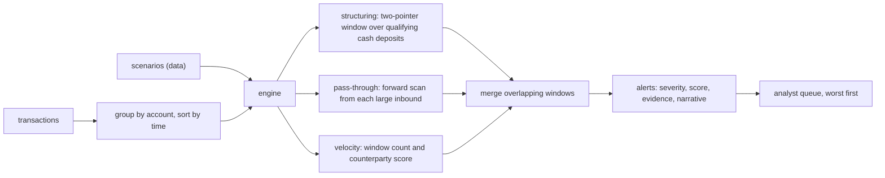

# AML Transaction Monitoring and Structuring Detection

> Ten deposits of $9,900.

**Type:** Build
**Languages:** Java, Python, Go
**Prerequisites:** Phase 1, Lesson 05 (Sliding Windows and Two Pointers), Phase 13, Lesson 02 (Rules Engine and Velocity Checks), Phase 13, Lesson 03 (Risk Scoring and Thresholds)
**Time:** ~90 minutes

## Learning Objectives

- Explain what a currency transaction report threshold is, why splitting deposits to stay under it is itself a crime, and why the detector therefore looks for amounts just *under* a number rather than over it
- Implement structuring detection as a rolling-window aggregation over qualifying cash deposits using two pointers, in O(n) per account
- Implement rapid pass-through detection and a velocity score, and state what each catches that the others do not
- Represent monitoring scenarios as data (kind, severity, named parameters) so that compliance can tune a threshold without a deploy
- Attach the transactions that triggered an alert as evidence and write a narrative an investigator can file from
- Measure a scenario set against a seeded synthetic population with planted patterns, and tune a floor parameter to remove a false positive without losing a true one

## The Problem

A regional bank's branch teller sees the same customer three days in a row. Monday: a cash deposit of 9,900.00 USD. Tuesday: 9,850.00. Wednesday: 9,900.00 again. Each deposit is under the 10,000.00 USD threshold at which the bank must file a currency transaction report (CTR) with FinCEN, so no report is filed. Over the following week the pattern continues at two other branches. By the end of the month the customer has deposited 98,500.00 USD in cash across ten transactions and the bank has filed nothing.

The customer has committed structuring, a federal crime under 31 U.S.C. 5324 independent of where the cash came from. The bank has a different problem: it is required to have a monitoring program that detects exactly this, and when the examiner asks why ten near-threshold deposits across three branches did not produce a suspicious activity report, "each one was under the limit" is the answer that gets the bank a consent order. The threshold is not a line below which nothing matters; it is a line that criminals know about, and a deposit pattern that hugs it from below is more suspicious than one that crosses it.

The bank's first monitoring rule is a SQL query: `SUM(amount) > 10000 GROUP BY account, DATE(timestamp)`. It misses the customer entirely, because the deposits are on different days. The second version uses a calendar week and produces 2,300 alerts in its first run, almost all of them small businesses that take cash: restaurants, laundromats, convenience stores, whose daily deposits are legitimately in the thousands and whose weekly totals are legitimately above ten thousand. The compliance team of four cannot review 2,300 alerts and the real structurer is somewhere in the pile.

What the bank needs is a detector that looks at *rolling* windows rather than calendar buckets, that qualifies deposits by their proximity to the threshold rather than their mere existence, that scores the pattern so analysts can work the worst first, that attaches the deposits themselves so the analyst does not have to re-query, and whose parameters live in data so compliance can tighten the floor from 80% to 93% of the threshold on Tuesday without an engineering ticket. This lesson builds that detector and two companions, pass-through and velocity, then runs them against a synthetic population to see what they catch and what they catch wrongly.

## The Concept

### Thresholds, and why "under" is the signal

Most jurisdictions set a cash reporting threshold: 10,000 USD in the United States (31 CFR 1010.311), 10,000 EUR under the EU's AML directives for cash payments to traders, 10,000 CAD in Canada, 10 lakh INR for cash transaction reporting in India. A single transaction at or over the threshold is reported automatically; the report is routine and not an accusation. Splitting a sum into pieces under the threshold *to avoid* that report is structuring, and the law criminalizes the intent regardless of the source of funds.

This inverts the usual anomaly-detection intuition. The detector is not looking for large transactions. It is looking for transactions that are:

- in cash (the channel the reporting rule covers),
- individually below the threshold,
- individually *near* the threshold (a floor, say 80% or more of it, separates a structured 9,900 from an ordinary 2,000),
- and collectively above the threshold within a rolling window.

The floor is the parameter that trades recall against false positives, and the lesson's synthetic run shows exactly that trade.

A note on what "near" means across currencies. The floor is expressed in basis points of the threshold rather than as an absolute amount so that the same scenario definition works for a 10,000 USD threshold, a 10,000 EUR one, and a 1,000,000 INR one: 80% is 8,000.00 USD or 800,000.00 INR, computed with `Money.basisPoints(8_000)` on integer minor units. A hard-coded `8000` would be wrong in every currency but one.

### Three scenarios, three different shapes

| Scenario | What it looks for | Shape in the data | Typology it targets |
|----------|------------------|-------------------|---------------------|
| Structuring | Cash deposits in `[floor, threshold)` summing to at least the threshold within a rolling window, at least `minCount` of them | A cluster of similar amounts just under a line | Placement: getting cash into the system without a report |
| Rapid pass-through | An inbound of at least `minIn` followed within `window` by outbound transfers totalling at least `outBps` of it | A spike in followed quickly by spikes out, to several counterparties | Layering: a mule account moving funds onward |
| Velocity | Transaction count and distinct-counterparty count far above a baseline within a window, combined into a score | A burst | Account takeover, mule recruitment, smurfing networks |

The three are deliberately different algorithms over the same transaction list. Structuring is a sliding-window sum. Pass-through is a per-inbound forward scan. Velocity is a sliding-window score. A production system has dozens of such scenarios; what they share is the framework around them: scenarios as data, alerts with evidence, scoring, and merging.

### Rolling windows with two pointers

The calendar-bucket query missed Monday-Tuesday-Wednesday deposits that straddle a week boundary and would miss deposits at 23:00 and 01:00 that straddle a day. A rolling window asks: for *every* deposit, what is the sum of qualifying deposits in the `window` seconds ending at this one?

Computing that naively is O(n^2) per account. The two-pointer technique from Phase 1, Lesson 05 makes it O(n): sort the qualifying deposits by time, keep a running sum, advance a `right` pointer one deposit at a time, and advance a `left` pointer while `time[right] - time[left] > window`, subtracting as it goes. Every deposit enters the sum once and leaves once.

Worked by hand, ten deposits of 9,900.00 every seven hours, window 72 hours, floor 8,000.00, `minCount` 3:

```text
right=0  d0 00:00  sum=9900.00    count=1  (under minCount)
right=1  d0 07:00  sum=19800.00   count=2  (under minCount)
right=2  d0 14:00  sum=29700.00   count=3  >= 10000.00 -> alert, evidence dep0..dep2, score 99
right=3  d0 21:00  sum=39600.00   count=4  -> alert, dep0..dep3, score 100 (capped)
...
right=9  d2 15:00  left stays 0 (63h span <= 72h)  sum=99000.00  count=10 -> alert, dep0..dep9
```

Eight raw alerts, all overlapping. An analyst wants one. `mergeOverlapping` unions the evidence of consecutive alerts that share any transaction and keeps the narrative of the highest-scoring window, appending the merged total: `4 cash deposits ... totalling 39600.00 USD within 3 days; merged window holds 10 transactions totalling 99000.00 USD`.

The score formula, `min(100, 50 + 10 * count + 10 * (sum - threshold) / threshold)`, is deliberately simple: a base for meeting the rule, a term for repetition, and a term for how far over the threshold the aggregate went. Phase 13, Lesson 03 covers calibrating such scores; here the score exists so that the queue can be sorted.

### Boundaries that matter

| Case | Alerts? | Why |
|------|---------|-----|
| Three deposits of exactly 10,000.00 | No | Each is at the threshold and is reported by the CTR process itself; there is nothing to detect |
| Three deposits of 7,999.99 | No | Below the 80% floor; ordinary cash business, not threshold-hugging |
| Two deposits of 9,900.00 | No | Sum exceeds the threshold but `minCount` is 3; two near-threshold deposits in three days is a weak signal and the floor of a different scenario |
| Three deposits of 9,900.00 on days 0, 4, 8 | No | No 72-hour window contains three |
| Three deposits of 9,900.00 on days 0, 1, 3 | Yes | `time[2] - time[0] = 72h`, and the window test is `> window` to leave, so exactly 72 hours is inside |
| Three wires of 9,900.00 | No | The scenario filters on `Channel.CASH`; wire structuring is a different typology with a different rule |

Each row is a test. The first one is the one teams get wrong: a rule written as `amount <= threshold` instead of `amount < threshold` turns every legitimate reported deposit into a structuring alert.

### Calendar buckets versus rolling windows

| Approach | Query shape | Catches Mon/Tue/Wed at 9,900 | Catches 23:00 and 01:00 | Catches Sat/Sun/Mon | Cost |
|----------|-------------|------------------------------|-------------------------|---------------------|------|
| Daily bucket | `GROUP BY account, date` | No | No | No | One pass |
| Weekly bucket | `GROUP BY account, week` | Yes, if same week | Yes, if same week | No, if the week starts Monday | One pass, floods on cash businesses |
| Rolling 72h, naive | For each deposit, re-sum the prior 72h | Yes | Yes | Yes | O(n^2) per account |
| Rolling 72h, two pointers | Sorted scan with a moving left edge | Yes | Yes | Yes | O(n) per account |

The bucket approaches fail on boundaries because the structurer does not know or care where the bank's calendar boundaries are. The rolling window has no boundaries; every deposit is the end of its own window.

### Pass-through and velocity

Pass-through scans forward from each inbound transfer of at least `minIn`. It sums outbound wires and ACH transfers (card spend is excluded; buying things is not layering) inside the window until it reaches `outBps` of the inbound or runs out of window. If it reaches it, the evidence is the inbound plus exactly the outbound legs that got it there, and the score rises the faster the funds left: `60 + 40 * (window - elapsed) / window`. A mule that forwards 46,560 of 48,500 in eight hours scores 86.

Worked by hand on the planted mule, window 24 hours, `outBps` 9,000:

```text
d3 09:00  IN   WIRE 48500.00 from shell-co        required out = 90% = 43650.00
d3 11:00  OUT  WIRE 15520.00 to beneficiary-0     sent on 15520.00   (< required, keep scanning)
d3 14:00  OUT  WIRE 15520.00 to beneficiary-1     sent on 31040.00
d3 17:00  OUT  WIRE 15520.00 to beneficiary-2     sent on 46560.00   (>= 43650.00: stop)
elapsed = 8h; score = 60 + 40 * (24 - 8) / 24 = 86
evidence = the inbound and the three legs; the card purchases that evening are not included
```

Velocity keeps a sliding window over all of an account's transactions and scores `50 * count / baselineCount + 50 * counterparties / baselineCounterparties`. With a baseline of 6 transactions and 4 counterparties in six hours, an account hitting 8 and 8 scores 166 and alerts at a threshold of 150. The two terms are separate because nine payments to one landlord (`50 * 9/6 + 50 * 1/4 = 87`) is rent, while nine payments to nine strangers is something else. The window and baselines are per-scenario parameters; a production system computes the baseline per account from its own history rather than using one number for everyone (Exercise 2).



### Scenarios as data

A `Scenario` is an id, a kind, a severity, a map of named `long` parameters, and a description. The engine dispatches on the kind and reads the parameters by name, failing loudly if one is missing. This is not an abstraction for its own sake. In a bank, the people who decide that the structuring floor should move from 80% to 93% are compliance officers responding to an examiner, not engineers; the parameters are reviewed, approved, and versioned as policy. Putting them in a `Map` in this lesson stands in for putting them in a table with an approval workflow in production. The `description` field is what appears in the alert and in the policy document, and it is generated from the parameters so the two cannot drift.

### Alerts carry evidence

An `Alert` holds the scenario id, the kind, the severity, the account, a score, the list of transactions that triggered it, and a one-line narrative. The evidence is mandatory. A suspicious activity report has a narrative section that must describe who, what, when, where, and how, with specific transactions; an alert that says "structuring score 100" without the deposits forces the investigator to reconstruct the case, and an alert that cannot be reconstructed cannot be filed. The `explain()` output is written to be pasted into a case file.

### From alert to filing

An alert is the start of a process with deadlines, and the detector's output has to fit it:

| Stage | Who | Input | Output | Clock |
|-------|-----|-------|--------|-------|
| Detection | The engine | Transactions, scenarios | Alerts with evidence and score | Nightly batch or streaming |
| Triage | Level-1 analyst | The alert queue, worst first | Close as false positive with a reason code, or open a case | Days; the queue's size is the team's capacity |
| Investigation | Level-2 investigator | The case, customer file, counterparties | Decision to file or not, documented | Within 30 days of detection (US) |
| Filing | Compliance officer | The investigation narrative | SAR submitted to the FIU | The 30-day clock; 60 if no subject identified |
| Continuing review | Investigator | Later activity on a filed subject | Continuing-activity SAR | Every 90 days while activity continues |

Three consequences for the detector. The score orders the queue, so a miscalibrated score does not change what is caught but changes what is caught *in time*. The evidence must be complete at detection, because the investigator's 30 days should not be spent reconstructing which deposits the rule saw. And the close reason codes from triage ("legitimate cash business", "payroll", "known counterparty") are the labels for the next tuning cycle; a program that does not capture them cannot tune.

### Failure modes

| Symptom | Root cause | Where this lesson prevents it |
|---------|-----------|-------------------------------|
| Structurer depositing on three consecutive days never alerts | Calendar-day bucketing | Rolling two-pointer window |
| Every reported 10,000.00 deposit raises a structuring alert | `<=` instead of `<` on the threshold | Strict `compareTo(threshold) < 0`, and a test at exactly the threshold |
| Thousands of alerts on restaurants and laundromats | No floor; every cash deposit qualifies | `floorBps` parameter; the synthetic run shows the trade-off at 80% and 93% |
| Ten alerts for one structuring episode | One alert per window position | `mergeOverlapping` unions overlapping evidence |
| Payday ACH plus rent, groceries, and fuel flagged as pass-through | Card spend counted as onward transfer | Pass-through counts `WIRE` and `ACH` out, excludes `CARD` |
| Nine rent payments flagged as velocity | Count alone drives the score | Two-term score; the counterparty term stays low for one payee |
| Investigator cannot tell which deposits triggered the alert | Alert carries a score and nothing else | Evidence list is a required field; `explain()` prints it |
| Threshold change needs a deploy and a code review | Parameters compiled into the detector | `Scenario` is data; `param()` fails loudly on a missing name |
| Tuning cannot be defended to the examiner | No labelled population | Seeded synthetic generator with planted ground truth; Phase 13 Lesson 04's table |

### What this lesson does not do

It does not learn. The scenarios are rules with hand-set parameters, which is still how most monitoring programs work; machine-learned models sit alongside rules in larger institutions, mostly to prioritize the alert queue rather than to replace the rules, because a regulator asks for an explanation of every filed report and "the model said so" is not one. It does not model the network: a smurfing ring where ten people each deposit 9,900 into their own accounts and then forward to one beneficiary is invisible to a per-account detector, and needs the graph lesson (Phase 4, Lesson 03) applied to counterparty links. It does not handle the case lifecycle: alert, triage, investigation, SAR decision, filing within 30 days, and the 90-day continuing-activity review; those are workflow, not detection. It does not de-duplicate across scenarios, so one account can produce a structuring alert and a velocity alert for related activity, which is intentional: they are different typologies and an investigator wants to see both. It does not use real thresholds for any jurisdiction but the United States; the numbers are parameters precisely so that they can be changed.

## Build It

### Step 1: The transaction

```java
enum Direction { IN, OUT }
enum Channel { CASH, WIRE, ACH, CARD }

record Transaction(String id, String accountId, String counterpartyId, Direction direction, Channel channel, Money amount, long timestamp) {
    Transaction {
        if (amount.minorUnits() <= 0) throw new IllegalArgumentException("transaction amount must be positive: " + amount);
    }
}
```

Direction and channel are what the scenarios filter on; a structuring rule that cannot tell cash from wires is useless, and a pass-through rule that counts card spend as onward transfer alerts on every payday. Amounts are the `Money` type from Phase 10, Lesson 01, and the floor "80% of 10,000.00" is computed with `basisPoints(8_000)`, never with `* 0.8`.

### Step 2: Scenarios

```java
record Scenario(String id, ScenarioKind kind, Severity severity, Map<String, Long> params, String description) {
    long param(String name) {
        Long v = params.get(name);
        if (v == null) throw new IllegalArgumentException("scenario " + id + " missing parameter " + name);
        return v;
    }

    static Scenario structuring(String id, long thresholdMinor, long floorBps, long windowSeconds, long minCount) {
        return new Scenario(id, ScenarioKind.STRUCTURING, Severity.HIGH,
                Map.of("thresholdMinor", thresholdMinor, "floorBps", floorBps, "windowSeconds", windowSeconds, "minCount", minCount),
                "cash deposits just under the CTR threshold that aggregate above it within " + (windowSeconds / Hours.DAY) + " days");
    }
}
```

The factory methods are conveniences; the record itself is just data and could be loaded from JSON. `param` throws on a missing name rather than defaulting, because a structuring rule that silently defaults its threshold to zero would alert on everything or nothing, and either would be discovered by an examiner before an engineer.

**Predict:** `Scenario.structuring("S", 1_000_000, 8_000, 3 * Hours.DAY, 3).description()`.

### Step 3: The structuring detector

```java
static List<Alert> structuring(Scenario s, String account, List<Transaction> sorted) {
    Money threshold = Money.ofMinor(s.param("thresholdMinor"), Currency.USD);
    Money floor = threshold.basisPoints(s.param("floorBps"));
    long window = s.param("windowSeconds");
    int minCount = (int) s.param("minCount");
    List<Transaction> qualifying = new ArrayList<>();
    for (Transaction tx : sorted) {
        if (tx.direction() == Direction.IN && tx.channel() == Channel.CASH
                && tx.amount().compareTo(threshold) < 0 && tx.amount().compareTo(floor) >= 0) qualifying.add(tx);
    }
    List<Alert> out = new ArrayList<>();
    int left = 0;
    Money sum = Money.zero(Currency.USD);
    for (int right = 0; right < qualifying.size(); right++) {
        sum = sum.plus(qualifying.get(right).amount());
        while (qualifying.get(right).timestamp() - qualifying.get(left).timestamp() > window) {
            sum = sum.minus(qualifying.get(left).amount());
            left++;
        }
        int count = right - left + 1;
        if (count >= minCount && sum.compareTo(threshold) >= 0) {
            List<Transaction> evidence = List.copyOf(qualifying.subList(left, right + 1));
            long score = Math.min(100, 50 + 10L * count + (sum.minorUnits() - threshold.minorUnits()) * 10 / threshold.minorUnits());
            out.add(new Alert(s.id(), s.kind(), s.severity(), account, score, evidence, /* narrative */));
        }
    }
    return out;
}
```

The qualifying filter runs first so the window only ever contains deposits that could be part of the pattern; a 200.00 cash deposit between two 9,900.00 deposits neither helps nor hurts. `compareTo(threshold) < 0` is the strict inequality from the boundary table. The `while` loop is the left pointer; it runs at most `n` times in total across the whole scan, which is what makes the detector linear.

**Predict:** the window is 72 hours and deposits arrive at hours 0, 50, 100, 150. Which windows contain three deposits?

### Step 4: Pass-through

```java
for (int i = 0; i < sorted.size(); i++) {
    Transaction in = sorted.get(i);
    if (in.direction() != Direction.IN || in.amount().compareTo(minIn) < 0) continue;
    Money required = in.amount().basisPoints(outBps);
    Money sentOn = Money.zero(Currency.USD);
    List<Transaction> evidence = new ArrayList<>(List.of(in));
    for (int j = i + 1; j < sorted.size() && sorted.get(j).timestamp() - in.timestamp() <= window; j++) {
        Transaction tx = sorted.get(j);
        if (tx.direction() != Direction.OUT || tx.channel() == Channel.CARD) continue;
        sentOn = sentOn.plus(tx.amount());
        evidence.add(tx);
        if (sentOn.compareTo(required) >= 0) break;
    }
    if (sentOn.compareTo(required) >= 0) { /* alert with evidence and a speed-weighted score */ }
}
```

The inner loop stops as soon as the outbound total reaches the requirement, so the evidence is minimal: the inbound and the legs that got it to 90%, not every later payment. This is O(n x k) where `k` is the number of transactions in one window, which for an account is small.

**Predict:** an account receives 50,000.00 and sends 44,000.00 out an hour later. With `outBps = 9000`, does it alert? What if a second 2,000.00 leaves 20 hours after that?

### Step 5: Velocity

```java
for (int right = 0; right < sorted.size(); right++) {
    while (sorted.get(right).timestamp() - sorted.get(left).timestamp() > window) left++;
    List<Transaction> win = sorted.subList(left, right + 1);
    Set<String> cps = new LinkedHashSet<>();
    for (Transaction tx : win) cps.add(tx.counterpartyId());
    long score = 50L * win.size() / baseCount + 50L * cps.size() / baseCp;
    if (score >= scoreThreshold) { /* alert */ }
}
```

Recounting the distinct counterparties for every window is O(k) per step rather than O(1); a production version keeps a count map that increments on the right and decrements on the left, exactly as the sum does in Step 3. It is left as is here because the lesson's point is the score, and Exercise 2 asks for the incremental version.

### Step 6: Merging

```java
static List<Alert> mergeOverlapping(List<Alert> raw) {
    List<Alert> merged = new ArrayList<>();
    for (Alert a : raw) {
        if (!merged.isEmpty()) {
            Alert last = merged.get(merged.size() - 1);
            boolean overlaps = a.evidence().stream().anyMatch(tx -> lastIds.contains(tx.id()));
            if (overlaps) {
                // union the evidence, keep the higher score and its narrative, append the merged total
                continue;
            }
        }
        merged.add(a);
    }
    return merged;
}
```

Raw alerts arrive in time order from each detector, so overlap only needs to be checked against the previous merged alert. Two clusters a month apart on the same account stay separate, which is correct: they are two patterns and probably two filings.

### Step 7: The synthetic population

```java
List<Transaction> structurer(String account, long t0, int deposits, long thresholdMinor) {
    planted.put(account, "STRUCTURING");
    List<Transaction> out = new ArrayList<>(normalAccount(account, t0, 10));
    for (int i = 0; i < deposits; i++) {
        long amount = thresholdMinor - 5_000 - rng.nextInt(60_000); // 9,400.00 to 9,950.00 on a 10,000.00 threshold
        out.add(tx(account, "branch-" + rng.nextInt(3), Direction.IN, Channel.CASH, amount, t0 + 2 * Hours.DAY + i * 7 * Hours.HOUR));
    }
    return out;
}
```

The generator builds 60 retail accounts (payroll in, card spend out, the occasional small cash deposit), two legitimate cash businesses whose daily deposits sit between 5,500 and 9,500, and three planted accounts: a structurer, a mule, and a burst. The `planted` map is the ground truth, so the demo can report true and false positives. The `Random` is seeded, so the population, and therefore the alert list, is identical on every run.

**Predict:** before running it, will the laundromat alert on `STR-01` with an 80% floor? What about a 93% floor?

### Step 8: Run it

```bash
cd phases/13-risk-fraud-and-compliance/06-aml-transaction-monitoring/code/java
javac -d .out *.java && java -cp .out Main
java -cp .out MainTest
```

Expected output, abbreviated:

```console
== Hand-built case: ten deposits of 9,900.00 over three days ==
  [HIGH STR-01] STRUCTURING on acct-demo score=100 d0 00:00..d2 15:00: 4 cash deposits of 8000.00 USD to 10000.00 USD totalling 39600.00 USD within 3 days; merged window holds 10 transactions totalling 99000.00 USD
      dep0 IN CASH 9900.00 USD from branch @d0 00:00
      ...
      dep9 IN CASH 9900.00 USD from branch @d2 15:00

== Synthetic population: 60 ordinary accounts, two cash businesses, three planted patterns (seed 7) ==
  transactions: 1792, alerts: 4
  HIGH  STR-01  acct-laundromat  score=100 planted=none               4 cash deposits ... totalling 35694.21 USD within 3 days; merged window holds 5 transactions ...
  HIGH  STR-01  acct-structurer  score=100 planted=STRUCTURING        4 cash deposits ... totalling 38315.53 USD within 3 days; merged window holds 10 transactions ...
  HIGH  RPT-01  acct-mule        score= 86 planted=RAPID_PASS_THROUGH 48500.00 USD in, 46560.00 USD out to 3 counterparties within 8h
  MEDIUM VEL-01  acct-burst       score=100 planted=VELOCITY           8 transactions with 8 counterparties in 6h (baseline 6/4); merged window holds 40 transactions ...
  planted patterns found: 3 of 3; true-positive alerts 3, false-positive alerts 1
```

The laundromat is the lesson. Its deposits are 8,400 to 9,300, every day, from one branch, and at an 80% floor they are indistinguishable from the structurer's 9,400 to 9,950 from three branches. The test file runs the same population with the floor raised to 93% and shows the structurer still alerts and the laundromat does not. Whether 93% is the right floor for a real bank depends on its customer base, which is why it is a parameter; and the laundromat's one-branch, same-time-every-day regularity is itself a feature a richer scenario would use to clear it (Exercise 1).

### In Python

```python
def jdiv(a: int, b: int) -> int:
    q = abs(a) // abs(b)
    return q if (a < 0) == (b < 0) else -q

score = min(100, 50 + 10 * count + jdiv((total.minor_units - threshold.minor_units) * 10, threshold.minor_units))
```

`code/python/main.py` has the same scenarios, detectors, merge step, and generator, and its demo prints the same population (1,792 transactions), the same four alerts with the same scores and evidence, and the same first alert in full. What differs:

- **Integer division is Java's.** Python's `//` floors and `%` takes the sign of the divisor; `jdiv` and `jmod` truncate toward zero like Java's `/` and `%`. Every score, the `basis_points` half-even rounding, the 96% pass-through split, and `Hours.format` go through them. The inputs here are non-negative, so `//` would usually agree, but the helpers make the port correct for every input rather than for this data; a test pins `jdiv(-7, 2) == -3`.
- **The generator is `java.util.Random`.** `JavaRandom` ports the 48-bit LCG and `nextInt(bound)`, and `normal_account` draws its random numbers into local variables in the order Java evaluates the call's arguments (counterparty, amount, hour, minute). Change that order and every account changes.
- **Ordering is explicit.** Accounts are evaluated in `sorted()` order (Java's `TreeMap`), transactions sort on `(timestamp, id)`, and alerts on `(-severity, -score, account, scenario)`, the same comparator chain as the Java.
- **One harmless difference.** Java prints each scenario's `Map.of(...)` parameters in an order that changes from one JVM run to the next; Python prints them in declaration order. Every other line of the demo is identical.

Run it from `code/python/`:

```bash
python3 main.py
python3 -m unittest -v
```

### In Go

```go
type paramReader struct {
    s   Scenario
    err error
}

func (p *paramReader) get(name string) int64 {
    v, err := p.s.Param(name)
    if err != nil && p.err == nil {
        p.err = err
    }
    return v
}

func (e *MonitoringEngine) Evaluate(transactions []Transaction) ([]Alert, error) { ... }
```

`code/go/main.go` has the same scenarios, detectors, merge step, and generator, and its demo prints the same population (1,792 transactions), the same four alerts with the same scores and evidence, and the same first alert in full. What differs:

- **Errors are values.** `Scenario.Param` returns `ErrMissingParam`, and each detector reads its parameters through a small `paramReader` that remembers the first miss, so `Evaluate` returns `([]Alert, error)` instead of throwing mid-sweep. `NewTransaction` returns `ErrNonPositiveAmount`, `NewMonitoringEngine` returns `ErrDuplicateScenario`, and `Money.Plus`/`Minus`/`BasisPoints` return `(Money, error)`; the detectors unwrap them with `must` because every operand there is USD and the sums cannot overflow.
- **Integer division is already Java's.** Go's `/` and `%` truncate toward zero exactly like Java, so the scores, the half-even `BasisPoints`, and the 96% pass-through split need no helper; the Python port had to write `jdiv` for the same lines.
- **The generator is `java.util.Random`.** `JavaRandom` ports the 48-bit LCG and `NextInt(bound)`, and `NormalAccount` draws its random numbers into local variables in the order Java evaluates the call's arguments (counterparty, amount, hour, minute). Change that order and every account changes.
- **Ordering is explicit.** Go maps are unordered, so accounts are evaluated in sorted order (Java's `TreeMap`), transactions sort on `(timestamp, id)` with `sort.SliceStable`, alerts on `(-severity, -score, account, scenario)`, and the generator keeps its planted accounts in a slice beside the map. The one harmless difference is the scenario parameter line: Java prints `Map.of(...)` in an order that changes between JVM runs; Go prints the parameters in declaration order.

Run it from `code/go/`:

```bash
go run .
go test ./...
```

## Use It

**NICE Actimize**, **Oracle Financial Crime and Compliance Management**, **SAS AML**, **Verafin**, and the open-source-adjacent **Hummingbird** and **Unit21** are the systems banks and fintechs actually run. Every one of them has a scenario library (Actimize calls them "models", Oracle "scenarios", Unit21 "rules") with the same structure as this lesson's `Scenario`: a typology, a set of named thresholds, a lookback window, a severity, and a generated description, versioned under a change-control process the examiner can audit. What they add: hundreds of pre-built typologies mapped to FATF and FinCEN guidance; per-customer baselines computed from history (a restaurant's expected daily cash is learned, not configured); peer-group comparison (this restaurant against other restaurants); network scenarios over counterparty graphs; a case-management workflow with SAR filing integration; and above-the-line / below-the-line testing, where the scenario is run with thresholds slightly above and below the production values to show the examiner that the setting is justified.

The open-source stack a fintech might assemble: Kafka or a change-data-capture feed for transactions (Phase 8), a stream processor or a nightly Spark job running the scenarios, Postgres for alerts and cases, and a BI tool for the queue. The scenario definitions still live in a table with an approval column.

Batch versus streaming is a real design choice. Structuring and velocity windows span hours to days, so a nightly batch is acceptable and is what most banks run; pass-through on a mule account is worth catching before the outbound wires settle, which argues for evaluating that one scenario on the stream with the same two-pointer state kept per account in memory. The detector code is identical; only the driver changes.

The trap in every stack: tuning to the alert volume the team can handle instead of to the risk. A floor raised until the queue is manageable is a floor the examiner will ask about, and the only acceptable answer is a table like the one in Phase 13, Lesson 04: here are the labelled cases, here is what each setting catches and misses, here is why we chose this one.

## Ship It

`outputs/design-doc-monitoring-scenario.md` is the template for proposing a new monitoring scenario: typology and regulatory basis, the detection logic in plain language, parameters with their initial values and the evidence for them, the evidence and narrative the alert must carry, expected volume from a back-test, and the tuning and review cadence. Fill one in before writing the detector; compliance signs it, and it becomes the document the examiner reads.

## Exercises

1. **Reinforce.** Add a `regularity` clearing rule to the structuring detector: if every qualifying deposit in the evidence comes from one branch and the gaps between consecutive deposits are all within 2 hours of each other (the same time every day), downgrade the alert to `LOW` and prefix the narrative with `regular-pattern`. Show that the laundromat downgrades at the 80% floor and the structurer (three branches, seven-hour gaps) does not.
2. **Apply.** Replace the velocity scenario's fixed `baselineCount` and `baselineCounterparties` with a per-account baseline computed from the account's own first seven days (mean transactions per six-hour window and mean distinct counterparties), and make the counterparty count incremental with a count map that increments on the right pointer and decrements on the left. Confirm the burst still alerts and that a naturally busy account (increase a normal account's daily spends to 12) no longer does.
3. **Extend.** Build the network view from Phase 4, Lesson 03: treat accounts and counterparties as nodes and transactions as edges, then add a `SMURFING` scenario that fires when three or more distinct accounts each make a qualifying cash deposit within the window and then transfer to the same beneficiary within 48 hours. Plant such a ring in the generator (four accounts, 9,600 each, all forwarded to `beneficiary-ring`) and show that the per-account structuring scenario misses it (each account has one deposit) and the network scenario finds it.

## Key Terms

| Term | What people say | What it actually means |
|------|-----------------|------------------------|
| CTR threshold | "the ten thousand dollar rule" | The cash amount at or above which a currency transaction report is filed automatically (31 CFR 1010.311 in the US); routine, not an accusation |
| Structuring | "smurfing" | Splitting cash transactions to stay under the reporting threshold; a crime of intent under 31 U.S.C. 5324 regardless of the source of funds. Smurfing specifically means using several people to do it |
| SAR | "filing on someone" | A suspicious activity report to the financial intelligence unit, with a narrative describing specific transactions; due within 30 days of detection in the US |
| Scenario | "a rule" | A typology plus named, versioned parameters, a window, and a severity; the unit of change control in a monitoring program |
| Rolling window | "last three days" | A window ending at each transaction rather than at a calendar boundary; implemented with two pointers in O(n) |
| Evidence | "the transactions behind the alert" | The exact transactions that satisfied the scenario, attached to the alert so the investigator can file without re-querying |
| Above/below-the-line testing | "threshold tuning" | Running a scenario at parameters slightly above and below production values on labelled data to justify the production setting to an examiner |
| Typology | "a money-laundering pattern" | A recognized method (placement by structuring, layering by pass-through, integration through businesses) published by FATF and national FIUs, which scenarios are mapped to |

## Further Reading

- [31 U.S.C. 5324: Structuring transactions to evade reporting requirement prohibited](https://www.law.cornell.edu/uscode/text/31/5324) — the statute; note that intent to evade, not the source of funds, is the offence.
- [31 CFR 1010.311: Filing obligations for reports of transactions in currency](https://www.ecfr.gov/current/title-31/subtitle-B/chapter-X/part-1010/subpart-C/section-1010.311) — the 10,000 USD threshold and the aggregation rule for multiple transactions in one business day.
- [FinCEN, Suspicious Activity Report (SAR) Electronic Filing Instructions](https://www.fincen.gov/sites/default/files/shared/FinCEN%20SAR%20ElectronicFilingInstructions-%20Stand%20Alone%20doc.pdf) — the narrative requirements that dictate what an alert's evidence must contain.
- [FATF Recommendations (2012, updated)](https://www.fatf-gafi.org/en/publications/Fatfrecommendations/Fatf-recommendations.html) — Recommendation 10 (customer due diligence) and 20 (reporting of suspicious transactions), the international basis for monitoring programs.
- [FFIEC BSA/AML Examination Manual: Suspicious Activity Reporting](https://bsaaml.ffiec.gov/manual) — what U.S. examiners check in a monitoring program, including scenario documentation and threshold justification.
- [Wolfsberg Group, Statement on AML Screening, Monitoring and Searching (2009)](https://www.wolfsberg-group.org/sites/default/files/wb/pdfs/wolfsberg-standards/18.%20Wolfsberg_Monitoring_Screening_Searching_Paper_%282009%29.pdf) — industry guidance on risk-based monitoring design and the tuning cycle.
