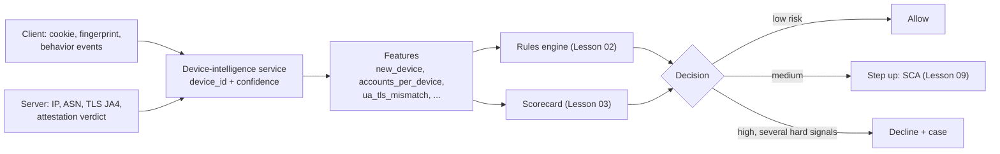

# Device Fingerprinting and Behavioral Signals

> What the browser tells you and what it lies about.

**Type:** Learn
**Languages:** —
**Prerequisites:** Phase 13, Lesson 01 (Fraud Patterns); Phase 13, Lesson 02 (Rules Engine and Velocity Checks); Phase 13, Lesson 03 (Risk Scoring and Thresholds)
**Time:** ~60 minutes

## Learning Objectives

- Distinguish a stored device identifier, a derived fingerprint, a platform attestation, a behavioral signal, and a network signal, and say who controls each one
- Estimate the identifying power of fingerprint components in bits of entropy, and explain why summing per-component bits overstates uniqueness
- Classify signals by stability and spoofability, and explain why server-observed signals and attestations outrank client-reported attributes
- Turn device, behavioral, and IP signals into features and rules that step up authentication instead of blocking on one signal
- Apply ePrivacy, GDPR, and platform-policy constraints to decide what a fraud team may collect, for which purpose, and for how long

## The Problem

A mobile wallet sees a wave of account takeovers. Attackers use passwords from another site's breach, log in, add a new payout card, and drain balances within ten minutes. The fraud team ships the obvious rule: **decline any payout on a device not seen before on the account**. Losses fall by 70% in a week.

Then the support queue triples. Customers who bought a new phone, who use Safari (which caps script-written storage for sites a user has not interacted with recently, so the "device ID" cookie vanishes), who reinstalled the app, or who simply cleared their browser data are all "new devices". The rule's insult rate is 4% of all payouts. A product manager reverts it, and losses come back, now with a twist: the attackers have noticed. They are using antidetect browsers that present a fresh, internally consistent fingerprint for every session, and residential proxy networks that route their traffic through home broadband IPs in the victim's own city. On paper, each fraudulent session looks like a normal customer on a normal phone in the right place.

Both failures come from treating a device signal as a fact rather than as evidence with a known error rate and a known attacker cost. A cookie is controlled entirely by the client. A canvas hash is computed by code the attacker can intercept. A TLS handshake fingerprint is observed by your server and is harder, though not impossible, to fake. A hardware-backed attestation from the operating system is harder still. Behavioral rhythms are cheap to collect and expensive to imitate at scale. This lesson sorts these signals by who controls them, how much they identify, how stable they are, and what the law lets you do with them, and then shows how they feed the rules and scores of Lessons 02 and 03.

## The Concept

### Five kinds of device and session signal

| Kind | Example | Who controls it | What it is good for |
|------|---------|-----------------|---------------------|
| Stored identifier | First-party cookie, `localStorage` token, iOS `identifierForVendor`, Android App Set ID | The client: can be deleted, copied, or forged | Recognising a returning, cooperative device cheaply |
| Derived fingerprint | Hash of user agent, screen, fonts, canvas, WebGL, audio, timezone | Computed by your script on the client: attacker can intercept and replace inputs | Re-identifying a device after storage is cleared; linking accounts |
| Platform attestation | Apple App Attest / DeviceCheck, Google Play Integrity verdict | The OS vendor, with keys in secure hardware | Proving the request came from your genuine app on a genuine, unmodified device |
| Behavioral signal | Keystroke timing, pointer paths, touch pressure, paste events, navigation speed | The human (or bot) at the keyboard | Telling humans from scripts and the account owner from someone else |
| Network signal | IP address, ASN, proxy or hosting classification, TLS handshake fingerprint (JA3, JA4), HTTP/2 settings | Observed by your server; partly controllable by the client | Location plausibility, infrastructure reuse, automation detection |

The column that matters most is the third. **Anything computed on the client is a claim made by whoever controls the client.** For a legitimate customer that is the customer's browser, honestly reporting. For an attacker it is a tool built to tell you what you want to hear. Signals rise in value as they move away from the attacker's control: server-observed beats client-reported, and hardware-attested beats both.

### Fingerprint components

A browser fingerprint combines attributes that individually are shared by millions of devices and jointly are often rare:

| Component | Approx. entropy | Stability | Spoofability | Notes |
|-----------|-----------------|-----------|--------------|-------|
| User agent string | High (about 10 bits historically) | Changes on every browser update | Trivial | Being reduced by UA freezing; Client Hints expose detail on request |
| Screen size and colour depth | Medium (about 4-5 bits) | Changes with external monitors, zoom | Easy | Mobile devices cluster heavily |
| Timezone and language | Low to medium (2-4 bits each) | Stable unless travelling | Easy | Most useful as a consistency check against IP location |
| Installed fonts | High on desktop | Stable for months | Moderate | Heavily restricted in modern browsers |
| Canvas rendering hash | High | Stable per GPU, driver, and OS version | Moderate: antidetect tools add noise | Same hardware and software give same hash; noise is itself a signal |
| WebGL vendor and renderer | Medium | Stable per GPU | Easy to report falsely | Inconsistency with UA is a strong tell |
| Audio processing hash | Medium | Stable | Moderate | |
| Hardware concurrency, device memory | Low | Stable | Easy | Coarse buckets by design |
| `navigator.webdriver`, headless traits | Very low entropy, high signal | N/A | Easy for sophisticated tools | Catches unsophisticated automation only |

The research record is a useful calibration. Eckersley's Panopticlick study (2010) found 83.6% of about 470,000 browsers unique, with about 18 bits of entropy on average, and 94.2% unique among those with Flash or Java plugins. AmIUnique (Laperdrix et al., 2016) found 89.4% unique on its volunteer dataset. But Gómez-Boix et al. (2018), using two million fingerprints collected passively from a popular French website, found only 33.6% unique, and mobile fingerprints far less distinctive than desktop. Volunteer datasets overrepresent unusual configurations. For a payments company, the honest planning number is: **fingerprints distinguish many desktop devices and comparatively few phones**, and the phones are where most payments happen.

### Entropy: how much does a value identify?

The surprisal of an attribute value is `-log2(p)`, where `p` is the fraction of your population sharing that value. A value shared by half the population carries 1 bit; one shared by 1 in 1,024 carries 10 bits. To single out one device among `N`, you need about `log2(N)` bits: 23.3 bits for 10 million customers.

Worked example for one customer's browser, with frequencies measured over your own traffic:

| Component | This device's value | Share of traffic | Surprisal |
|-----------|--------------------|------------------|-----------|
| User agent | Chrome 129 on Windows 11 | 1 in 6 | 2.58 bits |
| Screen | 2560 x 1440 | 1 in 20 | 4.32 bits |
| Timezone | Asia/Kolkata | 1 in 8 | 3.00 bits |
| Language | en-IN | 1 in 10 | 3.32 bits |
| Canvas hash | `a91f...` | 1 in 900 | 9.81 bits |
| WebGL renderer | ANGLE (NVIDIA RTX 3060) | 1 in 150 | 7.23 bits |
| **Naive sum** | | | **30.27 bits** |

Thirty bits would mean this configuration appears once in about a billion devices, so it should be unique among 10 million customers. It is not that rare, because the components are **correlated**: the canvas hash is largely determined by the GPU, driver, and OS, which the WebGL renderer and user agent already reveal, and `en-IN` is strongly correlated with `Asia/Kolkata`. If you measure the joint frequency directly and find that 1 in 40,000 sessions shares the full combination, the true identifying power is `log2(40,000) = 15.3` bits, half the naive sum. Among 10 million customers, roughly 250 devices share this fingerprint.

Two engineering consequences. First, **measure joint frequencies on your own traffic**, never sum published per-component entropy. Second, a fingerprint is a **probabilistic identifier**: matching it means "one of a few hundred devices like this", and its power is greatest when combined with an account context ("this account has used this fingerprint 40 times") rather than used to identify a device globally.

### Stability, drift, and fuzzy matching

Fingerprints change. Browsers update every four weeks, changing the user agent and sometimes rendering; users plug in monitors and change zoom; OS updates change font lists. An exact-hash match therefore loses returning customers continuously. Eckersley found that a simple heuristic could re-link about 65% of changed fingerprints to their previous value, with 99.1% of its guesses correct. Production device-intelligence systems do the same at scale: they treat the fingerprint as a vector, match on weighted similarity, prefer stable components (GPU, canvas, fonts) over volatile ones (UA version), and return a device ID with a **confidence score** rather than a yes/no.

A minimal version of similarity matching, enough to see the moving parts. Each component has a weight reflecting its stability and identifying power; a candidate device from the account's history matches when the weighted share of agreeing components clears a threshold:

```java
record Component(String name, double weight) {}

static final List<Component> COMPONENTS = List.of(
    new Component("canvas", 0.30), new Component("webgl_renderer", 0.20),
    new Component("fonts", 0.20), new Component("screen", 0.10),
    new Component("timezone", 0.10), new Component("ua_family", 0.07),
    new Component("ua_version", 0.03));      // volatile: changes every four weeks

static double similarity(Map<String, String> seen, Map<String, String> now) {
    double agree = 0, total = 0;
    for (Component c : COMPONENTS) {
        String a = seen.get(c.name()), b = now.get(c.name());
        if (a == null || b == null) continue;            // missing is not disagreement
        total += c.weight();
        if (a.equals(b)) agree += c.weight();
    }
    return total == 0 ? 0 : agree / total;
}
```

After a browser update only `ua_version` changes and the similarity is 0.97: same device. After the customer plugs into an external monitor, `screen` changes too: 0.87. A different laptop of the same model in the same office shares `webgl_renderer`, `ua_family`, `ua_version`, and `timezone` but not `canvas` (driver build differs) or `fonts`: 0.40. A production system replaces the hand-set weights with ones learned from labelled re-identifications, and returns the best candidate with its score so the rules engine can use the confidence, not just the ID.

The stability-spoofability tension is the core design trade-off:

| | Hard to spoof | Easy to spoof |
|---|---|---|
| **Stable** | Hardware attestation keys, TLS stack fingerprint of a native app | Fonts, WebGL renderer (reported, not measured) |
| **Unstable** | Behavioral rhythms (vary per session but are hard to imitate) | User agent, cookies, screen size |

Stable and hard to spoof is what you want and is rare in browsers. Most of a web fingerprint lives in the right column, which is why it identifies cooperative devices well and adversarial ones poorly.

### What the browser lies about: consistency checks

Attackers using antidetect browsers or emulators can set every reported attribute. What they struggle to do is keep all attributes **mutually consistent** and consistent with what the server observes. Checks that remain effective:

- **UA versus rendering.** The user agent claims an iPhone; the WebGL renderer reports an NVIDIA desktop GPU; the touch-point count is zero.
- **UA versus TLS.** The user agent claims Safari, but the TLS ClientHello (cipher order, extensions, as summarised by JA3 or JA4) matches a Python HTTP library or a Chromium build. The server sees the handshake; the client's JavaScript cannot change it.
- **Timezone and language versus IP.** Browser timezone `America/New_York`, IP geolocated to Lagos, language `ru-RU`. Each alone is common (travellers, expatriates, VPN users); all three together on a first login to a payout flow is not.
- **Noise as a signal.** Some privacy tools and antidetect browsers randomise canvas output per session. A canvas hash that changes on every page load from the same session is not a device, it is a tool.
- **Automation tells.** `navigator.webdriver` true, missing plugins and media devices typical of headless browsers, perfectly linear pointer paths, form fields filled in zero milliseconds.

The principle: **use client-reported attributes as hypotheses and server-observed facts as tests.** The more independent observations agree, the more you trust the session.

### Platform attestation on mobile

On iOS and Android your code runs inside an app you ship, which allows something the web cannot offer: a cryptographic statement from the platform. Apple's App Attest generates a key in the Secure Enclave and lets your server verify that requests are signed by that key inside a genuine instance of your app; DeviceCheck stores two bits per device on Apple's servers that survive reinstall. Google's Play Integrity API returns a signed verdict on whether the app binary is genuine, whether the device passes integrity checks, and whether the app was installed from Play.

Attestations defeat emulators, repackaged apps, and scripted API calls cheaply. They do not detect a real person on a real phone being coached by a scammer, they have quotas and latency, and a "device integrity" failure is common among legitimate users with rooted or custom-ROM phones. Use them as strong features and as gates for the highest-risk actions (adding a payout card), not as a blanket login requirement.

Two implementation details decide whether an attestation is worth anything. **Bind it to the request**: include a server-issued nonce, or a hash of the request (for example the payout card fingerprint and amount), in the attestation challenge, so a valid verdict captured once cannot be replayed on another request. **Verify it on the server**: the app forwards the token, and your backend verifies the signature and fields with the platform; an app that checks its own verdict and sends `"integrity": true` has merely added another client-reported claim.

### Behavioral biometrics

Behavioral signals measure **how** a session interacts rather than **what** device it uses:

| Signal | Legitimate pattern | Attack pattern |
|--------|-------------------|----------------|
| Keystroke dwell and flight times on the password | Habitual rhythm for this user | Different rhythm (another person), or zero-variance timing (script) |
| Credentials entered | Typed, or filled by a password manager | Pasted from clipboard, especially username and password both pasted |
| Pointer and touch | Curved paths, overshoot, variable pressure | Straight lines, constant velocity, teleporting cursor (remote access tools) |
| Navigation | Browses balance, history, then pays | Goes straight to "add payee" and "withdraw max" within seconds |
| Session context | Normal app usage | Long pauses at OTP entry while on an active phone call (social-engineering scams) |

Behavioral signals are strong against bots and against takeover by a different human, and they are one of the few signals that can detect **authorised push payment scams**, where the genuine customer on their genuine device is being directed by a scammer. Their limits: they need a per-user baseline (a new account has none), they vary with injury, fatigue, and assistive technology (accessibility users must not be penalised), and under GDPR, behavioral data processed to uniquely identify a person can be biometric data, a special category requiring an explicit legal basis.

### IP intelligence

| Signal | What it tells you | Pitfall |
|--------|-------------------|---------|
| Geolocation | Country is usually right; city often is not | Mobile carriers route through regional gateways hundreds of kilometres away |
| ASN and connection type | Residential, mobile, business, hosting | Residential proxy networks rent real home IPs to attackers |
| Proxy, VPN, Tor classification | Anonymising infrastructure | Many legitimate users run VPNs, especially corporate employees |
| IP velocity | Accounts or cards per IP or per /24 (IPv4) or /64 (IPv6) | Carrier-grade NAT puts thousands of mobile users behind one IPv4 address |
| Reputation | Seen in abuse elsewhere | Lists lag; addresses are recycled |

Datacenter-IP blocking stopped a generation of bots and is now weak on its own, because residential proxies are cheap. IP remains valuable for **consistency** (does it match timezone, billing country, and the device's history?) and for **velocity** (Lesson 02), with thresholds tuned per connection type so that a CGNAT mobile IP does not look like a card-testing farm.

### Privacy constraints are design inputs

Device signals are personal data, and some collection is regulated before you ever process it:

- **ePrivacy Directive, Article 5(3)** (EU and, through PECR, the UK): storing or accessing information on a user's device requires consent unless strictly necessary for a service the user requested. The EDPB's Guidelines 2/2023 confirm that fingerprinting scripts and pixel-style collection fall within that scope. Fraud prevention for a payment the user initiated is commonly argued to be strictly necessary, but the argument covers that purpose only.
- **GDPR.** Recital 47 names fraud prevention as a legitimate interest, which gives a lawful basis for processing; you still need purpose limitation (fraud signals must not flow to marketing or ad-tracking), data minimisation, and defined retention. Hashing a fingerprint does not anonymise it: it remains a stable identifier.
- **Platform rules.** Apple's App Store rules forbid fingerprinting for tracking and require apps to declare approved reasons for using certain device APIs (the "required reason API" list, such as system boot time and disk space). Google's Play policies similarly restrict persistent device identifiers.
- **US state law.** CCPA/CPRA treats device identifiers as personal information; Illinois BIPA applies if behavioral data is used as a biometric identifier.

What the device-intelligence service should keep, and for how long, follows from the purpose:

| Data | Keep? | Form and retention (illustrative) |
|------|-------|-----------------------------------|
| Raw fingerprint components | Short term only | Needed to recompute similarity after weight changes; 30-90 days |
| Device ID and confidence per event | Yes | With the risk decision in the audit log (Lesson 11), for the decision's retention period |
| Device-to-account links | Yes | Drives `accounts_per_device`; 13 months is a common balance between ring detection and minimisation |
| Raw keystroke and pointer streams | No | Reduce to features in the session; keep features, not streams |
| Behavioral baseline per user | Yes, if lawful basis covers it | Summary statistics only; delete with the account |
| IP address per event | Yes | Needed for disputes and law-enforcement requests; truncate or aggregate for analytics |
| Attestation verdicts | Yes | Verdict and timestamp, not the raw token, beyond verification |

The practical architecture: a **device-intelligence service** with a declared fraud-only purpose, its own retention (for example 13 months for device-to-account links), no export to analytics or marketing, and documented necessity for each collected attribute.

### From signals to decisions

Signals are inputs to the rules engine (Lesson 02) and the scorecard (Lesson 03), never decisions on their own. Typical derived features:

| Feature | Definition | Typical use |
|---------|-----------|-------------|
| `new_device` | No match above confidence 0.9 in this account's device history | Score feature; step-up trigger for sensitive actions |
| `device_age_days` | Days since this device was first linked to this account | Lower risk as it grows |
| `accounts_per_device_30d` | Distinct accounts seen on this device | Mule farms and synthetic-identity rings share devices |
| `devices_per_account_24h` | Distinct devices on one account | Credential-stuffing and sharing of stolen sessions |
| `ua_tls_mismatch` | UA family disagrees with TLS fingerprint family | Automation and antidetect tools |
| `geo_inconsistency` | Count of disagreements among IP country, timezone, billing country | Combined with other signals only |
| `paste_credentials` | Both username and password pasted | ATO and scripted logins |
| `attestation_failed` | Play Integrity or App Attest verdict negative | Gate payout-card addition |

Then choose the response proportionate to the evidence. **Step up rather than decline**: a new device on a payout request should trigger strong customer authentication (Lesson 09), which a legitimate customer passes in seconds and a credential-stuffing attacker usually cannot. Decline outright only when several independent, hard-to-spoof signals agree.



### Measuring whether a signal earns its place

Every signal costs something: collection code, privacy review, latency, and false positives. Before it reaches a rule, measure it the way Lesson 03 measures a score:

1. **Coverage.** On what share of sessions is the signal present? Attestation is absent on web; behavioral baselines are absent on new accounts. A signal present on 20% of traffic can only help on that 20%.
2. **Lift.** Compare the fraud rate when the signal fires with the base rate. `ua_tls_mismatch` firing on 0.3% of logins with a 25% takeover rate, against a 0.2% base rate, is a lift of 125: strong. `geo_inconsistency` firing on 6% with a 0.5% rate is a lift of 2.5: weak alone, possibly useful in combination.
3. **Incremental value.** Add the signal as a feature and measure the change in expected cost at the cost-optimal threshold (Lesson 03), not the change in AUC. A signal that is strongly correlated with existing features adds little even if its own lift is high.
4. **Durability.** Re-measure after 30 and 90 days. Signals that attackers can cheaply change decay fastest once they start blocking; signals tied to server observation or hardware decay slowest.

### A decision procedure for a sensitive action

For "add payout card", "change phone number", or "first withdrawal", a reasonable default ordering:

1. Hard, independent, hard-to-spoof signals agree on attack (attestation failure plus TLS mismatch plus scripted entry): decline and open a case.
2. Any one strong signal, or a new device without a supporting history: step up with strong authentication bound to an existing factor (Lesson 09).
3. Soft signals only (VPN, travel, unusual hour): allow, log, and add to the account's monitoring context.
4. Known device with high confidence, consistent network, normal behavior: allow without friction.

Write the procedure down with its expected volumes at each step, because step-up capacity (SMS cost, customer drop-off) is a budget like the review queue in Lesson 03.

### Worked Example: three login attempts

Account `acct_42` has used one Android phone for 14 months (device confidence 0.98 on every login). Three attempts arrive in one afternoon, each followed by "add payout card":

| Signal | Attempt A | Attempt B | Attempt C |
|--------|-----------|-----------|-----------|
| Device match | Known phone, 0.97 | No match | No match |
| Attestation | Pass | Pass (genuine app, genuine device) | Not present (web) |
| IP | Home ISP, same city | Mobile carrier, same city | Residential ISP, same city |
| TLS vs UA | Consistent | Consistent | UA says Chrome on macOS; TLS matches a Python library |
| Behavior | Typed password, usual rhythm | Typed password, rhythm far from baseline | Username and password pasted in 40 ms |
| `accounts_per_device_30d` | 1 | 1 | 23 |

Attempt A is the customer: allow. Attempt B is ambiguous: a new genuine phone in the right city, but a different typing rhythm. It could be a new phone (the rhythm on a new keyboard differs) or a family member. The right response is step-up authentication through a factor bound to the old device or the registered phone number, not a decline. Attempt C has three independent hard signals (TLS contradicting the UA, scripted credential entry, a device fingerprint shared by 23 accounts) plus a residential IP that would have passed a datacenter check. Decline, lock the payout flow, and open a case. Note what would have happened under the original "new device = decline" rule: B, possibly the real customer, is declined; under a "known city = allow" rule, C is allowed.

How three candidate policies would have handled the same afternoon:

| Policy | Attempt A (customer) | Attempt B (new phone or family) | Attempt C (attacker) |
|--------|---------------------|---------------------------------|---------------------|
| Decline any new device | Allow | **Decline** (insult) | Decline |
| Allow if IP in home city | Allow | Allow | **Allow** (loss) |
| Layered: hard signals decline, single signals step up | Allow | Step up, passes | Decline |

Only the layered policy gets all three right, and it does so because it asks how independent and how spoofable the evidence is, not merely whether a signal fired.

### Failure modes

| Failure | Consequence | Fix |
|---------|-------------|-----|
| Single-signal blocking | High insult rate (new phones, cleared cookies) | Signals as weighted features; step-up before decline |
| Exact-hash device matching | Every browser update creates a "new device" | Similarity matching with confidence |
| Trusting client-reported attributes | Antidetect tools pass every check | Cross-check against server-observed and attested signals |
| Global IP thresholds | CGNAT mobile users flagged as card-testing farms | Thresholds by connection type; /64 granularity for IPv6 |
| Penalising unusual behavior | Users of assistive technology declined | Behavioral signals adjust step-up, never sole decline reason; test with accessibility tools |
| Purpose creep | Fraud fingerprints reused for marketing, regulatory exposure | Separate service, declared purpose, access controls, retention |

### What this lesson does not do

It does not teach how to write a fingerprinting script; the components are well documented and the hard part is the decision logic. It does not cover authentication protocols, which are Lesson 09's subject, or graph-based linking of accounts through shared devices, which uses the graph algorithms of Phase 2 on the `accounts_per_device` relation built here.

## Exercises

1. **Reinforce (easy).** Your traffic shows these joint frequencies for a device: user agent 1 in 4, screen 1 in 12, timezone 1 in 3, canvas 1 in 600, and the full combination 1 in 9,000. Compute the naive summed surprisal and the true joint surprisal. With 4 million customers, how many devices share this fingerprint on average? Explain the gap.
2. **Apply (medium).** Write five rules for the Lesson 02 rules engine using the features in the "From signals to decisions" table, for the "add payout card" action. Each rule must name its outcome (allow, step up, decline), justify its threshold, and state its expected false-positive population (for example, "travellers with VPNs").
3. **Extend (hard).** Combine with Lesson 03: add `accounts_per_device_30d` and `ua_tls_mismatch` as features to the scorecard's synthetic generator (fraud rows draw them from heavier distributions), retrain, and compare the cost-optimal threshold and expected cost with and without the new features. Then write the data-protection justification (purpose, necessity, retention) that would let you collect those two signals in the EU.

## Key Terms

| Term | What people say | What it actually means |
|------|-----------------|------------------------|
| Device fingerprint | "The device ID" | A probabilistic identifier derived from client attributes; identifies a configuration shared by some number of devices, with a confidence |
| Entropy / surprisal | "How unique it is" | `-log2(p)` bits for a value with population share `p`; joint surprisal is less than the sum when components are correlated |
| Spoofability | "Can it be faked?" | The attacker's cost to report a chosen value; low for anything computed by client code, high for server-observed and hardware-attested signals |
| Attestation | "Device check" | A platform-signed statement that a request came from your genuine app on a genuine device (App Attest, Play Integrity) |
| Behavioral biometrics | "Typing patterns" | Timing and motion features of how a session interacts, used to separate humans from bots and owners from impostors |
| Residential proxy | "A VPN" | Attacker traffic relayed through real home broadband connections, defeating datacenter-IP blocks |
| Step-up | "Extra verification" | Answering medium-risk evidence with stronger authentication instead of a decline, so legitimate customers pass and attackers stop |

## Further Reading

- [Eckersley, "How Unique Is Your Web Browser?", PETS 2010](https://coveryourtracks.eff.org/static/browser-uniqueness.pdf) — the original entropy measurement of browser fingerprints, and the fuzzy re-identification result
- [Laperdrix, Rudametkin, Baudry, "Beauty and the Beast: Diverting Modern Web Browsers to Build Unique Browser Fingerprints", IEEE S&P 2016](https://doi.org/10.1109/SP.2016.57) — canvas, WebGL, and mobile fingerprinting at scale
- [Gómez-Boix, Laperdrix, Baudry, "Hiding in the Crowd: an Analysis of the Effectiveness of Browser Fingerprinting at Large Scale", WWW 2018](https://doi.org/10.1145/3178876.3186097) — two million real-world fingerprints and why mobile devices are far less unique than studies suggested
- [EDPB Guidelines 2/2023 on the Technical Scope of Art. 5(3) of the ePrivacy Directive](https://www.edpb.europa.eu/our-work-tools/documents/public-consultations/2023/guidelines-22023-technical-scope-art-53-eprivacy_en) — why fingerprinting needs consent or strict necessity in the EU
- [Google Play Integrity API documentation](https://developer.android.com/google/play/integrity/overview) — verdict fields, quotas, and recommended server-side handling
- [Apple App Attest documentation (DeviceCheck framework)](https://developer.apple.com/documentation/devicecheck/establishing-your-app-s-integrity) — key generation in the Secure Enclave and server-side assertion verification
