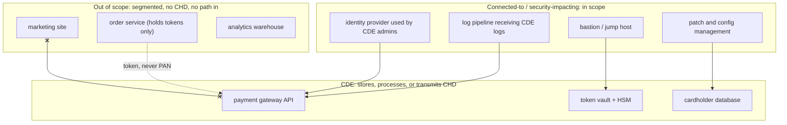

# PCI DSS for Engineers

> The twelve requirements, translated into architecture.

**Type:** Learn
**Languages:** —
**Prerequisites:** Phase 11, Lesson 02 (Card Networks and the Four-Party Model), Phase 12, Lesson 05 (Webhooks: Signing, Delivery, Ordering, and Replay), Phase 13, Lesson 07 (Device Fingerprinting and Signals)
**Time:** ~75 minutes

## Learning Objectives

- Define the cardholder data environment (CDE) and decide, for a given component, whether it is in scope, connected-to, or out of scope
- Restate each of PCI DSS v4.0's twelve requirements as an architecture decision an engineer makes rather than a control an auditor checks
- Explain how tokenization, network segmentation, and hosted payment fields shrink scope, and what each one does not remove
- Choose the correct self-assessment questionnaire (SAQ) type for a given integration pattern and state what changes when the merchant stores PANs
- Recognize the five ways PANs leak out of the CDE in practice (logs, URLs, analytics, error reports, backups) and the control that closes each
- Scope a worked example system end to end and defend the result to a qualified security assessor

## The Problem

A subscription business processes 40,000 card payments a month through a payment service provider's API. The engineering team never stores card numbers; the checkout form posts the PAN to the merchant's backend, which forwards it to the provider and stores only the returned token. The team considers itself out of scope for PCI DSS, fills in the shortest self-assessment questionnaire, and moves on.

Eighteen months later a fraud ring begins testing stolen cards against the checkout. The team adds logging to the payment endpoint to investigate, and the logger serializes the entire request body, PAN included, into a log aggregation service that is retained for 90 days, indexed, searchable, and accessible to 60 engineers. A support engineer, debugging a different problem, searches the logs for a customer's email address and sees their full card number in the result. She reports it. The ensuing investigation finds 2.1 million PANs in the log index, the backup snapshots of the log cluster, and the error-tracking service that captured request bodies on exceptions.

Nothing was "stored" in the database. But PCI DSS does not care about the database; it cares about everywhere cardholder data is stored, processed, or transmitted, and the merchant's backend processed it on every request. The backend, the log pipeline, the error tracker, the backup store, and every engineer's laptop with log access were in scope the entire time. The questionnaire the team filled in was the wrong one, the controls it attested to were never implemented on those systems, and the card brands' fines after a breach are assessed against the gap between what was attested and what was true.

The engineering decision that would have prevented all of it was made on day one, in the checkout form: post the PAN to the provider directly from the browser (hosted fields or a redirect), so the merchant's backend never sees it. That one decision moves the backend, the logs, the error tracker, and the backups out of scope. PCI DSS is usually taught as a compliance checklist; this lesson teaches it as a set of architecture decisions, because the controls are expensive and the cheapest control is the one you do not need.

## The Concept

### What the standard covers and who enforces it

PCI DSS (Payment Card Industry Data Security Standard) is a contractual standard, not a law. The card brands (Visa, Mastercard, American Express, Discover, JCB) require it through their rules; acquirers pass the requirement to merchants in the merchant agreement; the PCI Security Standards Council publishes and maintains it. Version 4.0 was released in March 2022 and became mandatory on 31 March 2024, with a set of future-dated requirements that became mandatory on 31 March 2025; v4.0.1 is a clarifying revision from June 2024. Fines for non-compliance after a breach flow from the brand to the acquirer to the merchant, and can be accompanied by increased interchange rates or loss of the ability to accept cards.

The standard protects two categories of data:

| Category | Elements | Storage permitted? | Rendering required |
|----------|----------|-------------------|-------------------|
| Cardholder data (CHD) | Primary account number (PAN) | Yes, if protected | Unreadable anywhere it is stored: strong cryptography, truncation, tokenization, or one-way hash with salt |
| | Cardholder name, expiry date, service code | Yes, if the PAN is also present they must be protected | Protected as part of the record |
| Sensitive authentication data (SAD) | Full track data (magnetic stripe or chip equivalent) | **Never** after authorization, even encrypted | Not applicable: must not exist |
| | Card verification code (CVV2/CVC2/CID) | **Never** after authorization | Not applicable |
| | PIN and PIN block | **Never** after authorization | Not applicable |

The distinction between "may store if protected" and "never" is the one engineers most often get wrong. A system that encrypts CVVs at rest with a hardware security module is still non-compliant: the data is not permitted to exist after the authorization response arrives, regardless of how well it is protected. Requirement 3.3.1 is unconditional.

### Scope: the cardholder data environment

The CDE is the set of people, processes, and technologies that store, process, or transmit cardholder data or sensitive authentication data. Scope extends to **connected-to** systems: anything that can reach the CDE over the network or that provides security services to it (authentication, logging, patching, monitoring), because compromising a connected system is the usual path to compromising the CDE.



Three things decide whether a component is in scope:

1. Does cardholder data touch it, even transiently, even in a log line? Then it is CDE.
2. Can it initiate a connection into the CDE, or does the CDE depend on it for a security function? Then it is connected-to and in scope.
3. Is it separated from the CDE by controls that prevent any traffic in either direction, verified by a penetration test (Requirement 11.4.5)? Then, and only then, it is out of scope.

"Segmentation" means the third item. A VLAN tag with a permissive firewall rule is not segmentation; a network boundary with an explicit deny-all and documented, tested exceptions is. The default assumption, absent evidence, is that everything on the flat network is in scope.

### Two incidents that defined the scope rules

**Target, 2013.** Attackers obtained the network credentials of a heating and ventilation contractor, used them to reach Target's vendor portal, and moved from there to the point-of-sale network, where memory-scraping malware collected about 40 million card numbers from the POS terminals' RAM between authorizations. The HVAC vendor's access had nothing to do with payments. What made it a payment breach was that the network path from the vendor portal to the POS segment existed. In PCI terms, the vendor portal was connected-to the CDE and nobody had treated it that way. The connected-to category and the annual segmentation penetration test (11.4.5) are the standard's answer.

**British Airways, 2018.** A third-party JavaScript library loaded on the airline's payment page was modified by attackers to copy the contents of the card form to a domain they controlled. The airline's servers never saw the stolen copies; the skimming happened in the customer's browser, inside a page the airline served. About 380,000 transactions were affected and the UK regulator fined the airline 20 million GBP under GDPR. The payment-page script inventory (6.4.3) and change detection (11.6.1) in v4.0 are the standard's answer, and they apply even to merchants who use hosted fields, because the surrounding page is still theirs.

Both incidents happened at organizations that were PCI DSS compliant on their most recent attestation. Compliance is a snapshot of controls; the architecture is what holds between snapshots.

### The twelve requirements as architecture decisions

PCI DSS v4.0 groups its requirements into six goals. Each row below is the requirement in the standard's words, then the decision an engineer actually makes.

| # | Requirement (v4.0) | The engineering decision |
|---|--------------------|--------------------------|
| 1 | Install and maintain network security controls | Draw the CDE boundary on the network diagram first. Default deny in both directions. Every allowed flow is a documented rule with an owner. Egress is restricted too: a compromised CDE host should not be able to reach the internet to exfiltrate |
| 2 | Apply secure configurations to all system components | Golden images for anything in scope; no default credentials; one primary function per server (do not run the web tier and the database on one host in the CDE); configuration as code with review |
| 3 | Protect stored account data | Store PANs only if the business cannot function without them, and then only in a vault with its own key hierarchy. Never store SAD. Render PAN unreadable: tokenize, or encrypt with keys the application servers cannot read directly. Retention policy with automated deletion |
| 4 | Protect cardholder data with strong cryptography during transmission over open, public networks | TLS 1.2 or later everywhere CHD moves, with certificate validation; no CHD in email, chat, or SMS; strong cipher suites enforced, not just available |
| 5 | Protect all systems and networks from malicious software | Anti-malware or an accepted equivalent on in-scope hosts; for containers and serverless, image scanning and runtime controls; a documented reason for any exception |
| 6 | Develop and maintain secure systems and software | Dependency and image vulnerability management with SLAs (critical patches within one month); a secure SDLC; code review for CDE changes; and, new in v4.0 (6.4.3), an inventory of every script on payment pages with integrity verification |
| 7 | Restrict access to system components and cardholder data by business need to know | Role-based access with deny by default; the set of humans who can read a PAN should fit on one hand; access reviews at least every six months |
| 8 | Identify users and authenticate access to system components | Unique accounts (no shared `admin`); multi-factor authentication for all access into the CDE, including from inside the corporate network (v4.0 extended this from remote-only); password policy per 8.3.6; service accounts with rotated credentials |
| 9 | Restrict physical access to cardholder data | For cloud deployments, the provider's attestation covers the data centre; the merchant still owns media handling, printed reports, and the laptops of CDE administrators |
| 10 | Log and monitor all access to system components and cardholder data | Every access to CHD is logged with who, what, when, and outcome; logs are centralized, write-once, time-synchronized, retained one year with three months immediately available; **and the logs themselves must never contain a PAN** |
| 11 | Test security of systems and networks regularly | Quarterly external vulnerability scans by an approved scanning vendor; internal scans; annual penetration tests including a test that segmentation holds; change-detection on payment pages (11.6.1, new in v4.0) |
| 12 | Support information security with organizational policies and programs | Someone is named as responsible; risk assessment is done and repeated; third-party providers' compliance is tracked; incident response is written and rehearsed |

Reading the table top to bottom, a pattern appears: requirements 1, 3, 7, and 8 are where architecture does the most work, because each one is cheaper the smaller the CDE is. The rest are operational discipline that must be applied to whatever is in scope. The lever is therefore scope.

### Shrinking scope

| Technique | What it removes from scope | What it does not remove |
|-----------|---------------------------|-------------------------|
| Hosted payment page (redirect to the provider) | Everything: the merchant never sees a PAN. Qualifies for SAQ A | The merchant's web server still serves the page that redirects, so its integrity matters (6.4.3, 11.6.1) |
| Hosted fields (provider's iframe inside the merchant's page) | The merchant's backend and its logs; the PAN goes browser-to-provider. Qualifies for SAQ A | The merchant's page hosts the iframe, so page-script integrity and change detection apply; a compromised merchant page can overlay a fake form |
| Client-side tokenization (provider's JavaScript posts PAN, returns token) | Backend, logs, database | Same page-integrity obligations as hosted fields; the JavaScript runs in the merchant's origin |
| Tokenization vault (merchant backend receives PAN, swaps for token immediately) | The downstream services that only ever see tokens | The receiving backend and everything it logs to are fully in scope; this is the architecture from The Problem |
| Network segmentation | Systems that cannot reach the CDE | Nothing inside the segment; and the segmentation must be penetration-tested annually |
| Point-to-point encryption (validated P2PE terminals) | The merchant's store network and POS software for card-present | The terminals and the P2PE solution provider's environment |

The first three rows are where most e-commerce merchants should be. The token returned by the provider is not cardholder data (it cannot be reversed without the provider's vault), so a system that holds only tokens, expiry dates, and last-four digits is out of scope for storage, though it still appears in the attestation as the system that initiates charges.

How hosted fields keep the PAN out of the merchant's origin, step by step:

```mermaid
sequenceDiagram
  participant B as Browser (merchant page)
  participant I as Provider iframe (provider origin)
  participant P as Provider API
  participant M as Merchant backend
  B->>I: load iframe with publishable key
  Note over I: card form rendered in the provider's origin;<br/>same-origin policy keeps the merchant's scripts out
  I->>P: POST PAN, expiry, CVV over TLS
  P-->>I: token tok_7f3a... (and last four, brand)
  I-->>B: postMessage(token)
  B->>M: POST /charge {token, amount}
  M->>P: POST /charges {token, amount} with secret key
  P-->>M: charge result
```

The PAN crosses exactly two hops, browser-iframe-provider, both inside the provider's origin and the provider's attestation. The merchant's backend holds a secret API key and a token; the key needs protecting as a credential (Requirement 8), but it is not cardholder data. Everything the merchant does with the token (recurring charges, refunds, saved cards) works without the PAN ever returning.

### Self-assessment questionnaires

Merchants below a transaction volume threshold (set by each brand; Visa Level 1 is over six million transactions a year) self-assess with an SAQ rather than undergoing an on-site assessment by a Qualified Security Assessor (QSA). The SAQ type is determined by how cards are accepted:

| SAQ | Integration pattern | Approximate requirement count (v4.0) | Typical fit |
|-----|--------------------|--------------------------------------|-------------|
| A | Card-not-present; all CHD functions fully outsourced to a validated provider; merchant site redirects or embeds the provider's iframe | About 30 | E-commerce with a hosted page or hosted fields |
| A-EP | E-commerce where the merchant's site controls how CHD is sent to the provider (direct-post from merchant JavaScript, for example) but does not receive it | About 150 | Merchant-built form that posts to the provider from the browser |
| B / B-IP | Standalone dial-out or IP-connected terminals, no electronic storage | About 40 / 80 | Small card-present merchants |
| C-VT | Virtual terminal entered manually on one isolated computer | About 80 | Mail or telephone order |
| C | Payment application connected to the internet, no storage | About 160 | Card-present with POS software |
| P2PE | Validated point-to-point encryption terminals only | About 30 | Card-present with a P2PE solution |
| D | Everything else, including any merchant that stores PANs electronically | All, about 250 | Any merchant whose backend touches the PAN |

The jump from A to A-EP is the one that matters for engineers: it is triggered by the merchant's own code being involved in how the PAN reaches the provider. The jump to D is triggered by the backend receiving the PAN at all. The subscription business in The Problem believed it was SAQ A; it was SAQ D from the first day its backend accepted a PAN in a request body.

### A decision procedure for scope

When a new component or integration is proposed, walk it through these steps in order and stop at the first that applies:

1. **Does cardholder data or SAD ever enter it, in any form, including logs, error reports, caches, and backups?** If yes, it is CDE. Ask whether the design can be changed so the answer is no; this is where hosted fields earn their keep.
2. **Can it open a connection to anything in the CDE?** If yes, it is connected-to and in scope. Ask whether the connection can be removed, reversed (CDE pulls from it), or replaced with a token-only interface.
3. **Does the CDE depend on it for authentication, logging, monitoring, patching, or configuration?** If yes, it is security-impacting and in scope. These are rarely removable; plan to apply the controls.
4. **Is it separated from the CDE by a tested boundary with deny-all and documented exceptions?** If yes, it is out of scope. Record the test date.
5. **None of the above applies, but it is on the same flat network as the CDE.** It is in scope until segmentation is built and tested.

The procedure is conservative on purpose. The cost of wrongly calling something out of scope is a breach assessed against a false attestation; the cost of wrongly calling it in scope is applying controls to a system that did not need them. The second is cheaper.

### Merchants, service providers, and the responsibility matrix

A merchant that outsources card capture to a provider has not outsourced compliance; it has changed what it is responsible for. The provider supplies an Attestation of Compliance (AOC) covering its own environment, and Requirement 12.8 requires the merchant to keep a list of providers, confirm their AOC annually, and hold a written agreement about which party owns which requirement. The result is a responsibility matrix: for each of the twelve requirements, the provider, the merchant, or both. For a hosted-fields integration the provider owns almost everything about the PAN; the merchant owns the page that embeds the iframe, the staff who can log into the provider's dashboard, and the tokens it stores. Cloud infrastructure providers publish the same kind of matrix for their platform: the provider's AOC covers physical security (Requirement 9) and the hypervisor; the merchant owns everything it configures on top.

### Compensating controls and the customized approach

When a requirement cannot be met as written, the defined approach allows a **compensating control**: a different control that meets the same intent, documented with a risk analysis and validated by the assessor each year. Legacy systems that cannot support current TLS, for instance, have been covered by compensating network controls while a replacement was built. v4.0 adds the **customized approach**, which lets an organization meet a requirement's stated objective by its own design, documented with a targeted risk analysis and tested by a QSA. It exists for mature organizations with controls the standard's authors did not anticipate, and it is not available to merchants self-assessing with an SAQ. For most engineering teams the practical lesson is that neither is a shortcut; both cost more assessor time than meeting the requirement as written, and both must be re-justified every year.

### Key management, in brief

Where PANs must be stored, Requirement 3 specifies a key hierarchy: data-encrypting keys (DEKs) encrypt the PANs; key-encrypting keys (KEKs), at least as strong, encrypt the DEKs; the KEK lives in a hardware security module or a cloud key management service and never leaves it in the clear. Keys have custodians who sign for them, documented generation and distribution, rotation at the end of their cryptoperiod, and a retirement process when they are suspected compromised. The application server that serves checkout should not be able to decrypt a PAN; the ability to decrypt belongs to a small vault service with its own audit log. If one host can both receive requests from the internet and decrypt the entire card database, the key hierarchy exists on paper only.

One-way hashing of PANs is permitted as a rendering method only with a salt or keyed hash (3.5.1.1 in v4.0 requires a keyed cryptographic hash with key management). A plain SHA-256 of a sixteen-digit PAN is reversible in minutes: the first six digits are the public BIN and the last is a Luhn check digit, leaving about 10^9 candidates per BIN.

### Common ways PANs leak

| Leak | How it happens | Control |
|------|---------------|---------|
| Logs | A request logger serializes the body; an exception handler dumps the stack with local variables; a debug flag left on | Never log request bodies on payment paths; a PAN detector (Luhn-validating regex) on the log pipeline that redacts and alerts; treat the log system as in scope if it ever receives one |
| URLs | A form posts with `GET`; a redirect carries the PAN as a query parameter; it lands in web server logs, proxy logs, browser history, and `Referer` headers | `POST` only; never put CHD in a URL; strip `Referer` on payment pages |
| Analytics and session replay | A tag manager loads a session-recording script that captures every keystroke in every field, including the card form | Exclude payment fields from capture; better, use hosted fields so the PAN is never in the merchant's DOM; 6.4.3 script inventory makes the recording script visible |
| Error reporting | The error tracker captures request context on exceptions | Scrub payment fields before sending; configure the SDK's data-scrubbing allow-list, not a deny-list |
| Backups and replicas | A database that held PANs before tokenization was introduced still has them in old backups and read replicas | Data discovery scans of backups; a retention policy that actually deletes; migration plans that include historical data |
| Support tooling | A customer-service screen shows the full PAN because "the agent needs to verify the card" | Show last four only; verification by other means; 3.4.1 requires masking when displayed unless there is a documented business need |
| Test environments | Production data copied to staging "for realistic testing" | Synthetic test cards (every provider publishes them); production CHD is never copied, and staging is in scope if it is |

Every one of these has happened at a real merchant and been the root cause of a reported breach. The pattern is that the PAN leaves the designed path through an incidental system nobody thought of as a payment system.

A PAN detector for a log pipeline is short enough to show. It finds digit runs of plausible length, strips separators, checks the Luhn digit (Phase 11, Lesson 01), and redacts to first six and last four:

```java
static final Pattern CANDIDATE = Pattern.compile("(?<!\\d)(?:\\d[ -]?){12,18}\\d(?!\\d)");

static String redactPans(String line) {
    Matcher m = CANDIDATE.matcher(line);
    StringBuilder out = new StringBuilder();
    while (m.find()) {
        String digits = m.group().replaceAll("[ -]", "");
        String replacement = luhnValid(digits)
                ? digits.substring(0, 6) + "*".repeat(digits.length() - 10) + digits.substring(digits.length() - 4)
                : m.group();
        m.appendReplacement(out, Matcher.quoteReplacement(replacement));
    }
    return m.appendTail(out).toString();
}
```

Order numbers and timestamps rarely pass Luhn, so the false-positive rate is low; a BIN-range check cuts it further (Exercise 3). The detector is a safety net, not a design: a pipeline that redacts PANs is still a pipeline that received them, and the log store is in scope from the first match. The point of the detector is to find out that the designed path has been left, loudly and immediately.

Requirement 10 adds a second obligation that is easy to miss: the audit trail of *who accessed cardholder data* must itself be complete, tamper-evident, and retained for a year. In practice that means every read of a PAN from the vault is logged with the user, the record, the time, and the outcome; the log is shipped to a write-once store within minutes; the vault's own administrators cannot edit it; and time is synchronized from a trusted source so events across systems can be correlated. An investigator reconstructing a breach works from this log; if it can be edited by the people being investigated, it is not an audit trail.

### Changes in v4.0 that affect engineers most

- **Payment page script integrity (6.4.3) and change detection (11.6.1).** Every script that runs on a page that captures card data must be inventoried, authorized, and integrity-checked (Subresource Integrity, a Content Security Policy, or a monitoring service), and the page's HTTP headers and content must be monitored for unauthorized change. This is a direct response to web-skimming attacks ("Magecart") where a third-party script on the checkout page exfiltrated card data. Hosted fields reduce but do not eliminate this; the merchant page still hosts the iframe.
- **MFA for all CDE access (8.4.2),** not only remote access.
- **Keyed hashes for PAN rendering (3.5.1.1).**
- **Targeted risk analyses (12.3.1)** allow a merchant to define its own frequency for some controls, if it documents the analysis.
- **The customized approach,** an alternative to the defined controls where the merchant demonstrates it meets the objective by other means; it requires a QSA and is not available for SAQs.

### What the standard does not do

It does not certify that a system is secure; it attests that a set of controls was in place at a point in time. It does not cover data that is not cardholder data: bank account numbers, personal information, and authentication credentials for the merchant's own users are governed by other regimes (Phase 13, Lesson 10). It does not specify architecture; a flat network with every control applied to every host is compliant and absurdly expensive, and a tightly scoped CDE is compliant and cheap. It does not remove liability for a breach; it reduces fines and is a condition of continuing to accept cards. And it does not apply to tokens issued by a provider, which is the whole reason tokenization is the dominant strategy.

## Worked Example

Scope the following system. A marketplace runs: a React web app served by a CDN; a Node API behind a load balancer; a Postgres orders database; a Python "payments" service that calls a payment provider; a Kafka cluster carrying order events; a Snowflake warehouse fed from Kafka; a central log pipeline (Fluent Bit to OpenSearch); Sentry for errors; Okta for staff login; a bastion host for production SSH.

**Design A: the browser posts the PAN to the Node API, which forwards it to the payments service, which calls the provider and stores the token.**

| Component | Touches CHD? | Connected-to CDE? | Scope |
|-----------|-------------|-------------------|-------|
| React app | Yes: holds the PAN in the DOM and posts it | | CDE (and 6.4.3 / 11.6.1 apply to the page) |
| CDN | Serves the page; does not see the POST body if the API is a separate origin | Delivers code to the page that captures CHD | In scope for page integrity |
| Load balancer | Terminates TLS and sees the body | | CDE |
| Node API | Processes the PAN on every charge | | CDE |
| Payments service | Processes the PAN | | CDE |
| Orders database | Holds tokens only, if nobody ever logged a PAN into an order note | Reachable from the Node API | Connected-to; in scope |
| Kafka | Order events; in scope if any event ever carried CHD | Reachable from the API | Connected-to |
| Snowflake | Fed from Kafka | | Connected-to unless the feed is one-way and proven CHD-free |
| Log pipeline | Receives logs from the API and payments service | | CDE if any PAN was ever logged; connected-to otherwise |
| Sentry | Receives exception context from the API | | Same as logs |
| Okta | Authenticates staff who administer CDE hosts | Security-impacting | In scope |
| Bastion | Path into CDE hosts | | In scope |

Result: essentially the whole platform is in scope; SAQ D or a full QSA assessment; MFA, logging, scanning, and segmentation testing on all of it; and the log pipeline and Sentry need PAN detection because an incident is one debug flag away.

**Design B: the React app embeds the provider's hosted fields iframe. The PAN goes from the iframe to the provider. The provider returns a token to the page, which posts the token to the Node API.**

| Component | Touches CHD? | Scope |
|-----------|-------------|-------|
| React app | Hosts the iframe; never has the PAN in its own DOM | SAQ A eligible, but 6.4.3 and 11.6.1 apply: inventory and integrity-check every script on the checkout page |
| CDN | Serves the page | Page integrity |
| Everything else | Sees tokens, expiry, last four | Out of scope for CHD; still named in the SAQ as the environment that initiates charges |

Result: SAQ A, about 30 requirements, most of them about the page's scripts and the provider's attestation. The engineering cost difference between A and B is a few days of front-end work. The compliance cost difference is a QSA engagement, a segmentation penetration test, MFA on every production system, and a year of log retention with PAN scanning, every year.

**Design C: the React app's own JavaScript collects the PAN and posts it directly to the provider's tokenization endpoint from the browser, then sends the token to the Node API.**

| Component | Touches CHD? | Scope |
|-----------|-------------|-------|
| React app | Yes: the PAN is in the merchant's DOM and the merchant's code decides where it is sent | In scope; SAQ A-EP, about 150 requirements |
| CDN | Serves the code that handles the PAN | In scope for integrity and secure delivery |
| Node API and the rest | Tokens only | Out of scope for CHD, as in Design B |

Design C looks almost identical to Design B on an architecture diagram, and the backend is equally clean. The difference is who controls the code that touches the PAN: in B it is the provider's iframe, in C it is the merchant's bundle. That one difference moves the merchant from SAQ A to A-EP and roughly quintuples the requirement count, because every requirement about secure development, vulnerability management, and page integrity now applies to the merchant's front-end pipeline in full. Teams choose C for control over the form's look and feel; the provider's hosted fields usually accept enough styling that the trade is not worth it.

The one place Design B still demands attention is the checkout page itself. A tag manager that any marketer can add scripts to is the attack surface the v4.0 requirements were written for: a malicious script in the merchant's origin can draw a fake card form over the iframe. The controls are a Content Security Policy that restricts script sources, Subresource Integrity on every third-party script, no tag manager on the payment page, and a change-detection monitor that alerts when the page's scripts or headers differ from the authorized set.

## Exercises

1. **Reinforce.** Take the twelve-requirement table and, for each row, write the one question you would ask in a design review to test whether the decision was made deliberately. Then apply the twelve questions to a system you know. Which three would it fail?
2. **Apply.** The marketplace in the worked example adds a feature: customer-service agents can take card payments over the phone, typing the PAN into an internal tool. Re-scope. Which SAQ applies now? Which components re-enter scope? Design the cheapest architecture that keeps the agents' laptops and the internal tool out of the CDE (hint: the provider likely offers a pay-by-link or a hosted virtual terminal).
3. **Extend.** Build a PAN detector for a log pipeline: a function that finds candidate 13-19 digit sequences (allowing spaces and dashes), validates them with the Luhn check from Phase 11, Lesson 01, and checks the first six digits against a small BIN range table to cut false positives from order numbers and timestamps. Measure its false-positive rate on a sample of ordinary log lines you generate, and decide whether it should redact in place or block the line and alert.

## Key Terms

| Term | What people say | What it actually means |
|------|-----------------|------------------------|
| PCI DSS | "PCI compliance" | A contractual security standard from the card brands, enforced through acquirers; v4.0 has twelve requirements across six goals and is assessed annually |
| CDE | "the payment system" | Every person, process, and technology that stores, processes, or transmits cardholder data or SAD, plus connected-to and security-impacting systems |
| PAN | "the card number" | Primary account number; may be stored only if rendered unreadable, and must be masked when displayed without a documented need |
| SAD | "CVV and track data" | Sensitive authentication data: full track, CVV2, PIN. Must never be stored after authorization, encrypted or not |
| Tokenization | "we don't store cards" | Replacing the PAN with a surrogate that cannot be reversed without the provider's vault; removes downstream systems from scope only if the PAN never passed through them |
| Segmentation | "it's on a different VLAN" | Controls that prevent all traffic between the CDE and other systems, verified by annual penetration test; without the test it is a claim, not scope reduction |
| SAQ | "the questionnaire" | Self-assessment questionnaire; the type (A, A-EP, D, etc.) is dictated by how the PAN reaches the provider, and choosing the wrong one invalidates the attestation |
| QSA | "the auditor" | Qualified Security Assessor certified by the PCI SSC to perform on-site assessments and sign a Report on Compliance |

## Further Reading

- [PCI DSS v4.0.1: Requirements and Testing Procedures (PCI Security Standards Council, June 2024)](https://docs-prv.pcisecuritystandards.org/PCI%20DSS/Standard/PCI-DSS-v4_0_1.pdf) — the standard itself; read requirements 3, 6.4.3, 8.4.2, and 11.6.1 in full.
- [PCI DSS v4.0 Summary of Changes](https://docs-prv.pcisecuritystandards.org/PCI%20DSS/Standard/PCI-DSS-v3-2-1-to-v4-0-Summary-of-Changes-r2.pdf) — what moved from v3.2.1, with the future-dated requirements that became mandatory in March 2025.
- [PCI SSC, Information Supplement: Guidance for PCI DSS Scoping and Network Segmentation](https://www.pcisecuritystandards.org/documents/Guidance-PCI-DSS-Scoping-and-Segmentation_v1_1.pdf) — the connected-to and security-impacting categories, with diagrams; the basis for the worked example.
- [PCI SSC, Self-Assessment Questionnaire Instructions and Guidelines v4.0](https://www.pcisecuritystandards.org/document_library/?category=saqs) — the eligibility criteria for each SAQ type; the A versus A-EP distinction is spelled out here.
- [PCI SSC, Tokenization Product Security Guidelines](https://www.pcisecuritystandards.org/documents/Tokenization_Product_Security_Guidelines.pdf) — what makes a token out of scope and what a token vault must do.
- [Visa, Global Acquirer Risk Standards and Merchant Level definitions](https://usa.visa.com/support/small-business/security-compliance.html) — the transaction-volume levels that decide between an SAQ and a QSA assessment.
