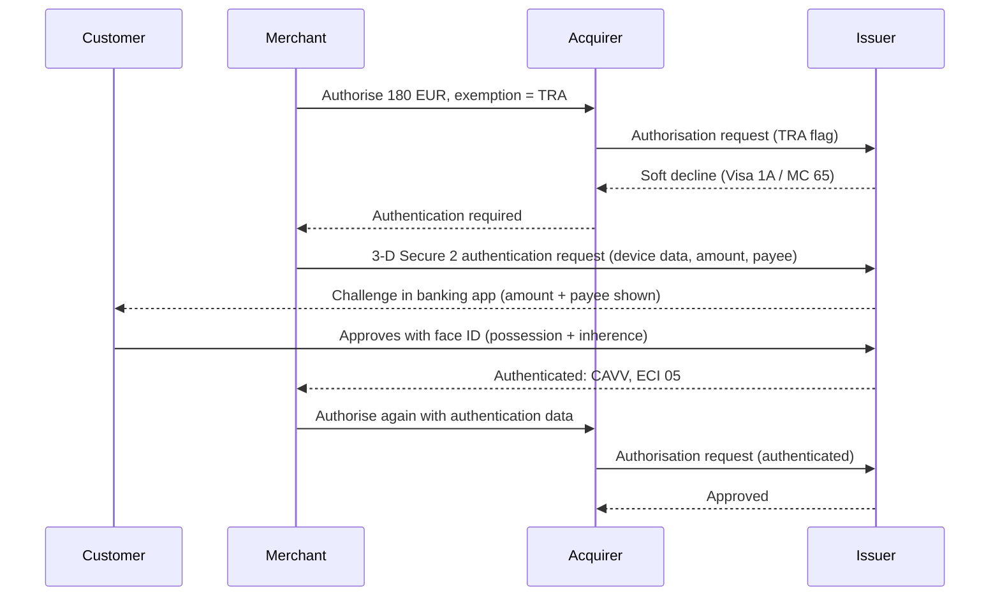

# PSD2, SCA, and Regional Regulation

> Exemptions, TRA, and when a challenge is mandatory.

**Type:** Learn
**Languages:** —
**Prerequisites:** Phase 11 Lesson 01 (How a Card Payment Works), Phase 13 Lesson 03 (Risk Scoring and Thresholds), Phase 13 Lesson 07 (Device Fingerprinting)
**Time:** ~60 minutes

## Learning Objectives

- State when PSD2 requires strong customer authentication, what counts as two independent factors, and what dynamic linking adds for remote payments
- Decide whether a transaction is out of scope, exempt (low value, TRA, trusted beneficiary, recurring, secure corporate), or must be challenged, and who bears fraud liability in each case
- Compute a PSP's fraud rate and the transaction-risk-analysis ceiling it unlocks, and trace the cumulative counters behind the low-value exemption
- Handle soft declines, 3-D Secure frictionless and challenge flows, and the CIT/MIT split for stored-credential payments in an integration
- Compare the EU regime with India's AFA, e-mandate, and tokenization rules and the US Regulation E and Z liability model, and encode jurisdiction rules as versioned, testable data

## The Problem

A subscription box company based in the US opens an EU entity and starts charging European cards through a European acquirer. The checkout integration is the one it has used for years: card number, expiry, CVV, authorise. In the first week, 23% of EU authorisations come back declined with response codes the team has never handled: Visa `1A` and Mastercard `65`, both meaning "additional customer authentication required". The integration treats them like any other decline and retries the same request twice, which the issuer declines again. Customers see "your card was declined" and leave.

The team adds 3-D Secure, and to be safe sets it to **challenge every payment**. Declines fall, but now every customer is sent to their bank's app or an SMS code, including on the monthly renewal, where the customer is not even present. Checkout abandonment in the challenge step is 15%. Renewals fail en masse because nobody is there to complete a challenge. Meanwhile a competitor with the same customers and the same issuers completes most of its payments with no challenge at all.

The competitor understood the rules. Strong customer authentication is mandatory for customer-initiated electronic payments in the EEA, but the regulation defines what is in scope and carves out exemptions: low-value payments, payments the acquirer has risk-assessed below a fraud-rate-dependent ceiling, payees the customer has trusted, and merchant-initiated payments that are out of scope entirely once the first one was authenticated. Each exemption has conditions, counters, and a liability consequence. India, the UK, and the US each answer the same question ("when must we make the customer prove it is them?") differently. This lesson turns those rules into a decision procedure an engineer can implement, test, and audit.

## The Concept

### What PSD2 requires

The revised Payment Services Directive (Directive (EU) 2015/2366, Article 97) requires a payment service provider to apply **strong customer authentication** when the payer:

1. accesses their payment account online,
2. initiates an electronic payment transaction, or
3. carries out any action through a remote channel that may imply a risk of payment fraud.

The Regulatory Technical Standards (Commission Delegated Regulation (EU) 2018/389, the "SCA RTS") define the details. SCA means authentication based on **two or more elements from different categories** that are independent, so the breach of one does not compromise the others:

| Category | Examples that qualify | Examples that do not (EBA opinion) |
|----------|----------------------|-------------------------------------|
| Knowledge | PIN, password, passphrase | Card number, CVV, expiry date, email address, username |
| Possession | Device bound to the user by a cryptographic key or OTP generator; SIM receiving an OTP; card read by chip | Card details typed into a form |
| Inherence | Fingerprint, face recognition, behavioral biometrics if they meet the standard | |

Card number plus CVV is **not** two factors; it is neither knowledge nor possession under the EBA's interpretation, because it is printed on the card and widely leaked. That is why a card-not-present payment needs 3-D Secure or an equivalent.

For remote electronic payments, Article 5 of the RTS adds **dynamic linking**: the payer must be shown the amount and payee, and the authentication code must be specific to that amount and payee, so that any change to either invalidates it. A one-time code that authenticates "a payment" without binding the amount fails the standard. This is the same idea as binding an attestation to the request in Lesson 07.

### Who applies it, and who decides

SCA is applied by the **payer's PSP**, which for cards is the issuer. The merchant and acquirer cannot "do SCA" themselves; they can only route the payment through 3-D Secure so the issuer can authenticate, or **request an exemption** and let the issuer decide. The issuer always has the final word: it can honour an exemption or respond with a soft decline demanding authentication.



### Out of scope versus exempt

Two different things are often conflated:

| | Out of scope | Exempt |
|---|---|---|
| Meaning | PSD2 SCA does not apply at all | SCA applies but this transaction qualifies for an exemption |
| Who decides | Determined by the transaction's nature | Requested by acquirer or applied by issuer; issuer may refuse |
| Examples | Merchant-initiated transactions (MIT); mail and telephone orders (MOTO); one-leg-out where payer's or payee's PSP is outside the EEA (best effort); anonymous prepaid below limits | Low value, TRA, trusted beneficiary, recurring, secure corporate, contactless, unattended transport and parking |
| Flagging | MIT and MOTO indicators in the authorisation | Exemption indicator in authorisation or 3-D Secure request |

**Merchant-initiated transactions** are the most important case for subscription businesses. A payment the merchant initiates under a prior agreement, without the customer present, is not initiated by the payer and so is out of scope. The **first** payment, when the customer sets up the agreement (a customer-initiated transaction, CIT), must be authenticated. Subsequent charges are flagged as MIT and reference the network transaction ID of that original authenticated CIT. The subscription company's failing renewals needed this flag, not a challenge.

### The exemptions

| Exemption (SCA RTS article) | Condition | Counters or limits | Applied by |
|-----------------------------|-----------|--------------------|-----------|
| Contactless at point of sale (Art. 11) | Physical card or wallet tap | Up to 50 EUR each; SCA after cumulative 150 EUR or 5 consecutive since last SCA | Issuer |
| Unattended transport and parking terminals (Art. 12) | Fare or parking fee at unattended terminal | None in RTS | Issuer |
| Trusted beneficiaries (Art. 13) | Payer added the payee to a trusted list, with SCA, at their own PSP | Issuer maintains the list | Issuer |
| Recurring transactions (Art. 14) | Same amount, same payee, after first with SCA | Applies to series initiated by payer; cards normally use the MIT route instead | Payer's PSP |
| Transfers to own accounts (Art. 15) | Payer and payee are the same person at the same PSP | | Payer's PSP |
| Low-value remote (Art. 16) | Up to 30 EUR | SCA after cumulative 100 EUR or 5 consecutive since last SCA | Issuer (acquirer may flag) |
| Secure corporate processes (Art. 17) | Dedicated corporate payment processes and protocols, e.g. lodged or virtual corporate cards | Competent authority must be satisfied of equivalent security | Either |
| Transaction risk analysis (Art. 18) | Real-time risk analysis finds low risk and PSP fraud rate is within the reference rate for the amount band | Amount ceilings by fraud rate (below) | Acquirer or issuer |

The counters belong to the **issuer**. A merchant can request the low-value exemption on a 25 EUR payment, but only the issuer knows whether this card has already accumulated 90 EUR or four exempted payments at other merchants. That is why low-value requests sometimes come back as soft declines, and why the integration must always be ready to fall back to 3-D Secure.

### Transaction risk analysis: the score meets the regulation

TRA is Lesson 03 with a regulator attached. A PSP may skip SCA on a remote payment if its real-time risk analysis assesses the transaction as low risk **and** its own fraud rate for that payment type, over the previous 90 days, is within the reference rate for the amount band:

| Exemption threshold value | Reference fraud rate: remote card payments | Reference fraud rate: remote credit transfers |
|---------------------------|---------------------------------------------|-----------------------------------------------|
| up to 100 EUR | 0.13% | 0.015% |
| up to 250 EUR | 0.06% | 0.01% |
| up to 500 EUR | 0.01% | 0.005% |

The fraud rate is the value of unauthorised or fraudulent remote transactions, whether SCA was applied or exempted, divided by the total value of all remote transactions of that type, calculated by the PSP over a rolling quarter and reported to its competent authority. The real-time analysis must at minimum check for abnormal spending or behavioural patterns, unusual device or software information, signs of malware, known fraud scenarios, abnormal payer location, and high-risk payee location (Art. 18(3)); in short, the device and behavioral signals of Lesson 07 feeding the score of Lesson 03.

### Worked example: a fraud rate and the ceiling it unlocks

An acquirer's remote card payments over the last 90 days:

```text
total remote card volume          = 412,500,000.00 EUR
fraudulent remote card volume     =     309,375.00 EUR
fraud rate = 309,375.00 / 412,500,000.00 = 0.075%
```

Compare with the reference table: 0.075% is at or below 0.13%, so TRA is available up to 100 EUR; it is above 0.06%, so not up to 250 EUR. A 180 EUR payment cannot be TRA-exempted by this acquirer, whatever its score. To unlock the 250 EUR band, the acquirer needs fraud at or below 0.06%:

```text
allowed fraud at 0.06% = 412,500,000.00 * 0.0006 = 247,500.00 EUR
required reduction     = 309,375.00 - 247,500.00 = 61,875.00 EUR (20% less fraud)
```

This creates a real incentive loop: lower fraud widens the exemption band, which removes friction from more payments, which raises conversion. It also creates a trap: exempting aggressively raises fraud (exempted payments have no SCA), which can push the rate over the reference and shrink the band for everyone. Compute the rate in integer minor units, as everywhere in this course; a floating-point rate compared against a threshold at the boundary is exactly the kind of tie Lesson 03 warned about.

Now the low-value counters, from the issuer's side, for one card with no SCA since the counter reset:

| Payment | Amount | Cumulative exempted value | Consecutive exempted count | Exempt? |
|---------|--------|---------------------------|----------------------------|---------|
| 1 | 12.00 EUR | 12.00 | 1 | Yes |
| 2 | 29.00 EUR | 41.00 | 2 | Yes |
| 3 | 28.50 EUR | 69.50 | 3 | Yes |
| 4 | 27.00 EUR | 96.50 | 4 | Yes |
| 5 | 9.00 EUR | 105.50 would exceed 100 | | **No: SCA required** |
| 6 | 9.00 EUR (after SCA on #5) | 9.00 | 1 | Yes |

Payment 5 is a 9 EUR coffee, far below 30 EUR, and it still triggers authentication because the cumulative cap is reached. Issuers choose between the value cap and the count cap; the RTS allows either. Merchants cannot predict this, so they must handle the soft decline.

### Liability follows the decision

| Scenario | Who bears fraud liability (typical network rules) |
|----------|----------------------------------------------------|
| Payment authenticated with 3-D Secure, issuer approved | Issuer (liability shift to issuer) |
| Acquirer applied TRA exemption, issuer approved | Acquirer, passed to the merchant contractually |
| Issuer applied an exemption on its own | Issuer |
| Low-value exemption flagged by acquirer | Generally acquirer/merchant |
| MIT referencing an authenticated CIT | Depends on network rules; disputes for the MIT itself are not covered by the original authentication |
| No authentication, no exemption, out of scope (e.g. one-leg-out) | Merchant |

The merchant's exemption strategy is therefore a cost decision exactly like the threshold in Lesson 03: requesting TRA buys conversion and buys liability. Request it for low scores where the expected fraud loss is smaller than the expected abandonment cost of a challenge.

### 3-D Secure 2, briefly

EMV 3-D Secure (version 2.x) lets the merchant send the issuer over a hundred data elements, including device information, shipping and billing match, account age, and prior authentication history, so the issuer can authenticate **frictionlessly** (no customer interaction) when its own risk analysis is satisfied. The issuer returns an Electronic Commerce Indicator (ECI) and a cryptogram (CAVV for Visa, AAV for Mastercard) that travel in the authorisation:

| ECI (Visa / Mastercard) | Meaning |
|-------------------------|---------|
| 05 / 02 | Fully authenticated (frictionless or challenge) |
| 06 / 01 | Attempted: issuer or cardholder not enrolled, liability usually still shifts |
| 07 / 00 | Not authenticated |

Two engineering consequences: **send rich data** (frictionless rates depend on it), and **persist the authentication result** (ECI, cryptogram, 3DS transaction ID, exemption requested and granted) with the payment, because disputes months later turn on it, and it belongs in the decision log of Lesson 11.

### Stored credentials: the data model behind CIT and MIT

The renewal failures in The Problem were a data-model failure: the integration never stored what a later merchant-initiated payment needs to reference. A minimal model:

```sql
CREATE TABLE payment_mandate (
  mandate_id            TEXT PRIMARY KEY,
  customer_id           TEXT NOT NULL,
  card_token            TEXT NOT NULL,       -- network token, never a PAN (Lesson 08; required for Indian cards)
  kind                  TEXT NOT NULL,       -- subscription | unscheduled | instalment
  max_amount_minor      BIGINT,              -- agreed ceiling, if any
  currency              TEXT NOT NULL,
  cit_network_txn_id    TEXT NOT NULL,       -- Visa Transaction ID / Mastercard Trace ID of the authenticated CIT
  cit_eci               TEXT NOT NULL,       -- proof the CIT was authenticated
  cit_authenticated_at  TIMESTAMP NOT NULL,
  jurisdiction          TEXT NOT NULL,       -- drives e-mandate rules (pre-debit notice, limits)
  status                TEXT NOT NULL        -- active | cancelled | expired
);
```

Every renewal is then authorised with the MIT indicator and `cit_network_txn_id`, the amount is checked against `max_amount_minor` before submission, and for Indian cards a pre-debit notification with delivery evidence is recorded at least 24 hours before the debit. If the customer changes the plan to a higher amount than the mandate allows, that is a new CIT with authentication, not a silent MIT.

### Regional analogues

| Topic | EU / EEA | UK | India | US |
|-------|----------|----|----|----|
| Mandate | PSD2 Art. 97 + SCA RTS | PSRs 2017 + FCA's UK SCA-RTS; e-commerce enforcement from 14 March 2022 | RBI: Additional Factor of Authentication (AFA) for card-not-present payments, in force since the early 2010s | No authentication mandate; liability rules and network incentives drive 3-D Secure use |
| Factors | Two of knowledge, possession, inherence; dynamic linking | Same model | AFA typically OTP or PIN; UPI uses device binding plus UPI PIN | Issuer choice |
| Small payments | 30 EUR remote, 50 EUR contactless | 100 GBP contactless; low-value remote similar to EU | Contactless without AFA up to 5,000 INR | N/A |
| Recurring | MIT out of scope after authenticated CIT | Same | E-mandates: AFA at registration; subsequent debits without AFA up to 15,000 INR (1,00,000 INR for some categories such as insurance premiums, mutual fund subscriptions, and credit card bills); pre-debit notification at least 24 hours before each debit | Merchant and network rules; Reg E for preauthorised debit transfers from accounts |
| Stored cards | Network tokens encouraged | Same | Card-on-file tokenisation: since 1 October 2022 merchants and aggregators may not store card numbers; network or issuer tokens only | No regulatory ban; PCI DSS governs storage (Lesson 08) |
| Consumer liability for unauthorised payments | Payer liable up to 50 EUR unless gross negligence; zero if SCA was not required by the PSP | Up to 35 GBP | Zero liability if reported within 3 working days for third-party breach (RBI 2017 circular) | Reg E (debit, ACH, P2P): 50 USD if reported within 2 business days, up to 500 USD within 60 days, more after; Reg Z (credit cards): at most 50 USD |

The US column is worth dwelling on, because it shows a different philosophy. Instead of mandating how customers authenticate, US law limits what customers can lose and puts the rest on financial institutions, which then choose their own controls. **Regulation E** (12 CFR Part 1005) governs electronic fund transfers from consumer accounts: unauthorised-transfer liability tiers (§1005.6) and error resolution with provisional credit within 10 business days and investigation up to 45 days (§1005.11). **Regulation Z** (12 CFR Part 1026) caps cardholder liability for unauthorised credit card use at 50 USD (§1026.12(b)). Card networks then layer the 3-D Secure liability shift on top. The effect on engineering is similar (risk-based authentication, step-up for risky payments) but the trigger is economic rather than legal.

### Handling a soft decline

The integration rule is short and must be exact: on a soft decline, authenticate once and resubmit once; never loop, never retry unchanged.

```java
AuthResult charge(Payment p, Exemption requested) {
    AuthResult first = acquirer.authorise(p, requested, null);
    if (!first.softDecline()) return first;                     // approved, or a hard decline
    ThreeDsResult auth = threeDs.authenticate(p, ChallengePreference.MANDATE_CHALLENGE);
    if (!auth.authenticated()) return AuthResult.declined("authentication failed: " + auth.status());
    AuthResult second = acquirer.authorise(p, Exemption.NONE, auth);   // carries ECI, CAVV, 3DS transaction ID
    log.append("sca.retry", p.id(), Map.of("exemption_requested", requested.name(),
            "first_response", first.code(), "eci", auth.eci(), "result", second.code()));
    return second;
}
```

Three details: the second attempt must request a challenge (asking for frictionless again invites a second soft decline), the second authorisation must carry the authentication data or it is the same request, and both attempts share the payment's idempotency key from Phase 12 so a timeout between them cannot produce a double charge. If the customer is not present (an MIT that was soft-declined), there is no one to authenticate; the correct path is to notify the customer and ask them to return and complete a CIT.

### A decision procedure for each payment

1. **Is it merchant-initiated under a mandate with an authenticated CIT?** Flag MIT with the CIT reference. Out of scope.
2. **Is either PSP outside the EEA, or is it MOTO?** Out of scope; apply your own risk controls (Lessons 02 and 03).
3. **Is the score low and the amount within your current TRA band?** Request TRA, accepting liability, if the expected fraud loss is below the expected challenge abandonment cost.
4. **Is the amount at or below 30 EUR?** Request low value; the issuer may still demand SCA.
5. **Otherwise**, authenticate with 3-D Secure, sending full device and account data to maximise the issuer's frictionless rate.
6. **On any soft decline**, authenticate with a challenge and resubmit once.
7. **Persist** the outcome, rule ID, legal reference, and authentication data with the payment and in the decision log.

### Compliance as code

The rules above have jurisdictions, effective dates, amount bands, counters, and legal references. They change: limits are raised, regulators issue opinions, PSD3 and the Payment Services Regulation proposed in 2023 will revise them again. Hard-coding `if (amount < 3000)` in a checkout service guarantees that nobody can tell, a year later, which rule applied to which payment. Treat the rules as **versioned data** evaluated by a small, tested function:

```java
enum ScaOutcome { OUT_OF_SCOPE, EXEMPT, CHALLENGE_REQUIRED }

record ScaRule(String id, String jurisdiction, LocalDate effectiveFrom, LocalDate effectiveTo,
               String legalRef, long maxAmountMinor, String currency, double maxFraudRate) {}

record ScaDecision(ScaOutcome outcome, String ruleId, String legalRef, String reason) {}

static ScaDecision decide(Payment p, RiskAssessment risk, FraudRate rate, List<ScaRule> rules) {
    if (p.merchantInitiated() && p.referencesAuthenticatedCit())
        return new ScaDecision(ScaOutcome.OUT_OF_SCOPE, "mit", "PSD2 Art. 97 (payer did not initiate)", "MIT on CIT " + p.citId());
    if (!p.payerPspInEea() || !p.payeePspInEea())
        return new ScaDecision(ScaOutcome.OUT_OF_SCOPE, "one-leg-out", "PSD2 Art. 2", "best effort");
    for (ScaRule r : applicable(rules, "TRA", p.jurisdiction(), p.date())) {
        if (p.amount().minorUnits() <= r.maxAmountMinor() && rate.ratio() <= r.maxFraudRate() && risk.low())
            return new ScaDecision(ScaOutcome.EXEMPT, r.id(), r.legalRef(), "score " + risk.score() + ", rate " + rate);
    }
    return new ScaDecision(ScaOutcome.CHALLENGE_REQUIRED, "default", "PSD2 Art. 97(1)(b)", "no exemption applies");
}
```

Properties that matter more than the code: every decision returns the **rule ID and legal reference** it relied on; rules carry **effective dates**, so replaying a payment from last March evaluates last March's rules; the rule table is reviewed by compliance as data, not as a code diff; a **golden test suite** encodes worked examples straight from the regulation text (the low-value counter table above is one such test); and every decision is written to the tamper-evident log of Lesson 11. The fraud rate itself is computed in integer minor units and compared exactly. A request for an exemption is still only a request: the integration must handle a soft decline by falling back to authentication.

### Failure modes

| Failure | Symptom | Fix |
|---------|---------|-----|
| Soft decline treated as hard decline | High EU decline rate, retries without authentication | Map `1A`/`65` and acquirer equivalents to "authenticate and retry once" |
| Challenge everything | Abandonment in the challenge step, failed renewals | Exemption strategy by score; MIT flags for renewals |
| MIT without a valid CIT reference | Issuers decline renewals or demand SCA from an absent customer | Store the network transaction ID of the authenticated CIT with the mandate |
| TRA requested above the band your fraud rate allows | Regulatory breach, liability exposure | Rule table driven by the current quarterly fraud rate |
| Authentication result not persisted | Lost disputes; cannot prove liability shift | Store ECI, cryptogram, 3DS IDs, exemption requested and granted |
| India e-mandate debits without pre-debit notification | Debit rejected or disputed | Notification job with delivery evidence at least 24 hours before |
| Card numbers stored for Indian cards after tokenisation rules | Regulatory breach | Network tokens only; purge stored PANs |

### What this lesson does not do

It does not cover open-banking access rules (PSD2's account information and payment initiation services), the details of 3-D Secure message flows, or the legal question of which entity in a payment chain is the regulated PSP. It gives you the decision logic and the data model; your compliance team and your acquirer's documentation supply the jurisdiction-specific parameters.

## Exercises

1. **Reinforce (easy).** An issuer uses the count-based low-value cap (SCA after 5 consecutive exempted payments). Trace a card through these remote payments, all requested with the low-value exemption: 4.00, 31.00, 12.00, 8.00, 6.00, 3.00, 2.00 EUR, starting from a fresh counter. Which ones are exempt, which need SCA, and why is the second one never eligible?
2. **Apply (medium).** Your acquirer's 90-day remote card fraud is 0.11%. Your scorecard (Lesson 03) says 62% of payments under 100 EUR are low risk. Abandonment on a challenge is 12%, average margin is 9.00 EUR, and expected fraud on a TRA-exempted low-risk payment is 0.04% of value. For a 60.00 EUR payment, compute the expected cost of challenging versus requesting TRA, and state which you choose and what changes if fraud rises to 0.14%.
3. **Extend (hard).** Implement the `decide` function and rule table above for the EU and India: EU TRA bands and low-value, MIT out of scope; India AFA for card-not-present, e-mandate subsequent debits up to the applicable limit with a recorded pre-debit notification at least 24 hours earlier. Write a golden test suite with at least ten cases drawn from the regulation text, give every decision a legal reference, and log decisions with the hash-chained log from Lesson 11.

## Key Terms

| Term | What people say | What it actually means |
|------|-----------------|------------------------|
| SCA | "Two-factor for payments" | Authentication with two independent elements from knowledge, possession, and inherence; card details do not count |
| Dynamic linking | "The code is for this payment" | The authentication code is bound to the specific amount and payee, which the payer was shown |
| Exemption | "We skip 3DS" | A request that SCA not be applied under a specific RTS article; the issuer decides and liability follows whoever applied it |
| TRA | "Risk-based exemption" | Skipping SCA for a low-risk remote payment, allowed only up to an amount band set by the PSP's 90-day fraud rate |
| Soft decline | "Declined, try again" | Issuer response (Visa 1A, Mastercard 65) meaning authenticate and resubmit, not a refusal |
| CIT / MIT | "First payment / renewals" | Customer-initiated transactions need SCA; merchant-initiated ones under a mandate are out of scope if they reference an authenticated CIT |
| Liability shift | "3DS protects us" | Fraud liability moves to the issuer when the payment was authenticated; exemptions move it back to whoever requested them |
| AFA / e-mandate | "India's OTP rule" | India's additional factor of authentication for card-not-present payments, and the registered mandate framework for recurring debits |

## Further Reading

- [Directive (EU) 2015/2366 (PSD2)](https://eur-lex.europa.eu/eli/dir/2015/2366/oj) — Article 97 defines when SCA is required; Articles 73-74 set payer liability
- [Commission Delegated Regulation (EU) 2018/389 (SCA RTS)](https://eur-lex.europa.eu/eli/reg_del/2018/389/oj) — the exemptions, TRA reference rates, dynamic linking, and fraud-rate calculation
- [EBA Opinion on the elements of strong customer authentication under PSD2 (EBA-Op-2019-06)](https://www.eba.europa.eu/publications-and-media/press-releases/eba-publishes-opinion-elements-strong-customer-authentication) — which factors qualify and why card details do not
- [EMVCo, EMV 3-D Secure specifications](https://www.emvco.com/emv-technologies/3-d-secure/) — the protocol carrying device data, exemption indicators, and authentication results
- [12 CFR Part 1005 (Regulation E)](https://www.ecfr.gov/current/title-12/chapter-X/part-1005) — US consumer liability and error resolution for electronic fund transfers
- [Reserve Bank of India, Digital Payments – E-mandate Framework, 2026 (April 2026; consolidates and repeals the August 2019 e-mandate circular and its amendments)](https://www.rbi.org.in/Scripts/NotificationUser.aspx?Id=13374) — AFA at registration, the 15,000 INR and 1,00,000 INR limits on subsequent debits, and the 24-hour pre-debit notification
