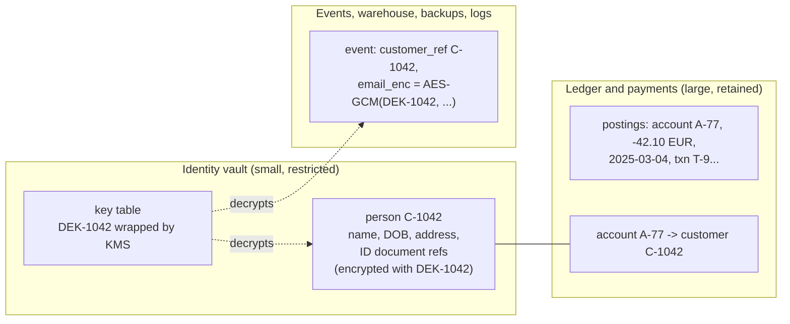
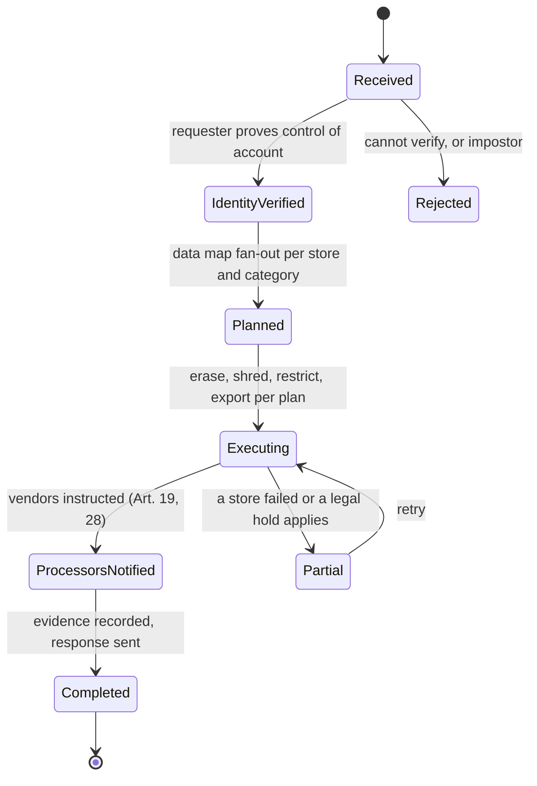

# Data Privacy, Retention, and Right to Erasure in Financial Systems

> Delete the customer but keep the audit trail.

**Type:** Learn
**Languages:** —
**Prerequisites:** Phase 10 Lesson 03 (The Double-Entry Ledger), Phase 13 Lesson 05 (KYC and Identity Verification), Phase 8 Lesson 01 (The Append-Only Log), Phase 8 Lesson 05 (Event Sourcing)
**Time:** ~60 minutes

## Learning Objectives

- Apply GDPR's principles, lawful bases, and data-subject rights (and their CCPA and India DPDP analogues) to the data a payments system holds
- Resolve a retention-versus-erasure conflict category by category, citing which obligation wins and for how long
- Separate identity from financial facts with a pseudonymized ledger and an identity vault, and explain why a plain hash of a phone number is not pseudonymization
- Design crypto-shredding with per-subject keys so that erasure reaches event logs, warehouses, backups, and hash-chained audit logs without rewriting them
- Build a machine-readable data map and use it to drive data-subject access and erasure requests within their legal deadlines

## The Problem

A European wallet receives an email from a former customer in Munich: "Under Article 17 GDPR, delete all my personal data." The account was closed eighteen months ago. A support engineer finds the customer row and runs `DELETE FROM customers WHERE id = 'C-1042'`. The foreign keys were declared `ON DELETE CASCADE`. The delete removes the customer's 1,312 ledger postings. The next morning the daily trial balance is off by 2,481.17 EUR across three internal accounts, because the counter-postings (fees, the settlement account, an FX account) were not the customer's and survived. Finance cannot close the month. The AML team discovers that the transaction history for a suspicious-activity report filed last year, which the law requires them to keep for five years after the relationship ended, is gone. And the customer's data is in fact still everywhere: in 14 months of Kafka topics, in the data warehouse, in nightly backups, in application logs, in 23 support tickets, in the fraud model's training set, and at the KYC vendor.

The opposite failure is equally common. A different company, burned once, decides never to delete anything "because regulators might ask and the fraud models need history". Five years later an attacker exfiltrates a warehouse table with 11 million customers' names, addresses, dates of birth, and transaction histories, including people who left the service in 2019. The breach notification, the regulator's fine, and the class action all ask the same question: why did you still have this?

Both companies treated privacy as a delete button. It is a design constraint on where personal data is allowed to live. Financial systems face it in its hardest form, because the same records are subject to **erasure** rights from privacy law and **retention** duties from AML, tax, accounting, and dispute rules. The resolution, which this lesson builds, is to separate who the customer is from what happened to the money: keep the financial facts under opaque identifiers, keep identity in one place under per-customer keys, and make erasure an operation on keys and the identity store rather than a hunt through every table.

## The Concept

### The vocabulary that decides designs

| Term | Meaning | Design consequence |
|------|---------|-------------------|
| Personal data | Any information relating to an identified or identifiable person (GDPR Art. 4(1)) | Customer IDs, device IDs, IPs, and transaction histories are all personal data |
| Pseudonymized data | Data that can no longer be attributed to a person **without additional information kept separately** (Art. 4(5)) | Still personal data; reduces risk, does not remove obligations |
| Anonymized data | Data from which no one can be identified by any means reasonably likely to be used (Recital 26) | Outside GDPR; very hard to achieve for transaction data |
| Controller / processor | Who decides purposes and means / who processes on their behalf | Your KYC vendor is a processor; erasure must reach it (Art. 19, Art. 28) |
| Lawful basis | Contract, legal obligation, legitimate interests, consent, and others (Art. 6) | Each field's basis determines whether erasure applies |
| Purpose limitation | Data collected for one purpose not used for incompatible ones (Art. 5(1)(b)) | Fraud signals cannot silently feed marketing (Lesson 07) |
| Storage limitation | Kept no longer than necessary for the purpose (Art. 5(1)(e)) | Every store needs a retention period and an enforcement job |

The single most important line in that table is the second one. Replacing a name with `C-1042` pseudonymizes the ledger; it does not anonymize it, because the mapping exists. That is fine, and it is the design: the ledger is pseudonymized personal data held under a legal obligation, and the mapping is held separately where it can be restricted and destroyed.

### Rights and deadlines

| Right (GDPR article) | What the subject can ask | Deadline | Exceptions that matter in payments |
|----------------------|--------------------------|----------|------------------------------------|
| Access (15) | A copy of their data, purposes, recipients, retention, source | One month, extendable by two more for complex requests (Art. 12(3)) | Other people's data must be redacted (counterparties, analysts' notes may be restricted) |
| Rectification (16) | Correct inaccurate data | One month | Ledger facts are not "inaccurate" because the customer dislikes them; corrections are new postings |
| Erasure (17) | Delete their data | One month | Art. 17(3)(b): legal obligation to retain (AML, tax); 17(3)(e): establishment or defence of legal claims (open disputes) |
| Restriction (18) | Stop processing except storage | One month | The usual outcome for data under retention: stored, locked, not used |
| Portability (20) | Their data in a machine-readable format | One month | Applies to data they provided and data generated by their activity under contract or consent |
| Objection (21) | Stop processing based on legitimate interests | One month | Fraud prevention may present compelling legitimate grounds |

Other regimes rhyme. California's CCPA as amended by the CPRA gives rights to know, delete, correct, and opt out of sale or sharing, with a 45-day response window extendable once; it exempts personal information collected under the federal Gramm-Leach-Bliley Act, which covers much of a US financial institution's customer data, but not all of it (marketing, device, and website data often fall outside). India's Digital Personal Data Protection Act, 2023 grants rights to access, correction, and erasure, with erasure subject to retention required by law. And India adds a localisation rule that privacy law does not: the RBI's 2018 directive requires payment system data to be stored only in India.

Side by side, the parameters an implementation has to configure per regime:

| Parameter | EU / UK GDPR | California (CCPA/CPRA) | India (DPDP Act 2023) |
|-----------|--------------|------------------------|-----------------------|
| Response deadline | 1 month, +2 months if complex | 45 days, +45 once | Set by the Act's rules; plan for weeks, not months |
| Erasure exceptions | Legal obligation, legal claims, public interest, and others (Art. 17(3)) | Legal obligations, security and fraud, completing the transaction, and others | Retention required by law or for the specified purpose |
| Financial-data carve-out | None; financial data is ordinary personal data with sector retention duties | GLBA-covered data largely exempt | None in the Act; RBI and PMLA retention duties apply |
| Location rules | Transfers outside need an adequacy decision or safeguards (Chapter V) | None general | RBI: payment system data stored only in India |
| Regulator | National DPAs; ICO in the UK | California Privacy Protection Agency, Attorney General | Data Protection Board of India |

### Retention duties that override erasure

A payments company typically holds these categories, each with its own clock:

| Category | Retention driver (examples) | Typical period | What happens at the end |
|----------|----------------------------|----------------|------------------------|
| KYC records (identity, documents relied on, verification results) | AML: EU AMLD Art. 40, US CIP | 5 years after the relationship ends | Erase identity; keep nothing linkable |
| Transaction records | AML (5 years), tax and accounting law (up to 10 years in some member states) | 5-10 years after the transaction or year-end | Erase linkage; aggregates may remain |
| Suspicious-activity case files | AML; plus confidentiality (no tipping off) | 5 years from filing, often longer by policy | Restricted access throughout; never disclosed in a DSAR |
| Dispute and chargeback evidence | Network rules and legal claims | Until the dispute window and any litigation closes (often 18 months+) | Erase |
| Card data | PCI DSS: never store sensitive authentication data after authorisation; PAN only if needed, protected | As short as possible; tokens instead (Lesson 08) | Purge |
| Security and audit logs | PCI DSS 10.5.1: at least 12 months | 12 months to a few years | Delete or aggregate |
| Marketing preferences and profiles | Consent | Until consent is withdrawn | Erase on request |
| Device and fraud signals | Legitimate interests in fraud prevention | Months, not years (Lesson 07) | Erase |

The resolution of the Munich request is not "delete" or "refuse". It is a per-category decision: erase what has no remaining obligation, restrict what must be kept, record why, and schedule the rest for erasure when its clock runs out.

### Separate identity from facts

The structural fix for the cascading delete is to never put identity and money in the same rows.



Rules that make this work:

1. **Ledger rows carry opaque IDs only.** Accounts, amounts, timestamps, counterparty account IDs, and transaction IDs. No names, emails, or addresses in postings or their descriptions. Free-text fields ("memo", "description") are the usual leak; constrain them or encrypt them.
2. **Identity lives in one vault**, the same service Lesson 05 introduced for KYC identifiers. Other services hold the customer ID and, if they need a display name, call the vault.
3. **Foreign keys from facts to identity never cascade deletes.** Erasure is a vault operation, not a relational delete.
4. **Any personal data that must leave the vault is encrypted under the subject's key** before it is written to events, warehouses, logs, or exports.

After erasure, the ledger still balances, the AML team can still trace account A-77's flows to and from other accounts, and auditors can still verify totals. Nobody can say that A-77 was the person in Munich unless the vault still holds the restricted KYC record, which it does until the AML clock expires, and then it does not.

### Why a hash is not a pseudonym

A tempting shortcut is to replace an email or phone number with its SHA-256 hash "so we can still join on it". For low-entropy identifiers this is reversible in minutes. Indian mobile numbers are ten digits beginning 6-9, about 4 x 10^9 possibilities. A commodity GPU computes billions of SHA-256 hashes per second, so the whole space is enumerated in seconds, and every hash in your warehouse maps back to its number. Email addresses fall to dictionary attacks built from breach corpora.

Two designs that do work:

| Approach | How | Properties |
|----------|-----|-----------|
| Random token | Vault issues `tok_8f2c...` and stores the mapping | Not reversible without the vault; joins need the same token, so tokenize at ingestion |
| Keyed hash | `HMAC-SHA256(k, normalised_value)` with `k` held in a KMS and never exported | Deterministic, so joins work across systems; secure while `k` is secret; rotate `k` per domain to limit linkability; destroying `k` unlinks every pseudonym at once |

Normalise before hashing (lowercase emails, E.164 phone numbers), or the same person gets two pseudonyms.

### Crypto-shredding

Data written to append-only stores cannot be deleted row by row without breaking what makes them useful: Kafka topics with long retention, warehouse partitions, immutable backups, WORM archives, and the hash-chained log of Lesson 11. Crypto-shredding makes erasure an operation on a key instead:

1. Each data subject gets a **data encryption key** (DEK), generated in or wrapped by a key management service under a key encryption key (KEK). This is envelope encryption.
2. Every personal field written outside the vault is encrypted with that subject's DEK using an authenticated cipher (AES-GCM), with a fresh nonce per value and the field name and subject ID as associated data.
3. To erase, delete the DEK, and every wrapped copy of it. All ciphertext, in every copy and every backup, becomes unreadable at once.

```java
// Envelope encryption of one field with a per-subject key (javax.crypto, standard library).
static byte[] encryptField(SecretKey subjectDek, String subjectId, String field, String plaintext)
        throws GeneralSecurityException {
    byte[] nonce = new byte[12];
    RNG.nextBytes(nonce);                                   // never reuse a nonce under the same key
    Cipher gcm = Cipher.getInstance("AES/GCM/NoPadding");
    gcm.init(Cipher.ENCRYPT_MODE, subjectDek, new GCMParameterSpec(128, nonce));
    gcm.updateAAD((subjectId + "|" + field).getBytes(StandardCharsets.UTF_8));   // binds ciphertext to its slot
    byte[] ct = gcm.doFinal(plaintext.getBytes(StandardCharsets.UTF_8));
    return ByteBuffer.allocate(1 + 12 + ct.length).put((byte) 1).put(nonce).put(ct).array();   // version, nonce, ct+tag
}
```

The associated data stops an attacker, or a bug, from moving one customer's ciphertext into another's row and having it decrypt. The leading version byte allows a future algorithm change.

Worked numbers for planning, with 8 million customers and an average of 5 encrypted fields per event:

```text
overhead per field   = 1 (version) + 12 (nonce) + 16 (GCM tag) = 29 bytes
events per day       = 20,000,000
added storage/day    = 20,000,000 * 5 * 29 B = 2.9 GB
DEKs                 = 8,000,000 * 32 B raw; ~ 0.5 GB wrapped with metadata
decrypt cost         = a KMS unwrap per subject per cache window, then local AES-GCM
```

The overhead is modest; the operational cost is the key service, which becomes a dependency of every read of personal data, so DEKs are cached (briefly, in memory only) after unwrapping.

Crypto-shredding interacts with the audit log of Lesson 11 in a useful way: if entries store personal fields as ciphertext and the entry hash is computed over the ciphertext, then shredding the subject's key leaves every hash, link, and Merkle root intact. The log still verifies; it just no longer says who.

What crypto-shredding does **not** do: it does not reach plaintext copies that escaped encryption (application logs, support tickets, spreadsheets, a debugging dump), which is why the data map below matters. It is only as final as key deletion, so KMS key-deletion events and backup copies of the key store must be part of the erasure workflow. And it is erasure of readability, not of the fact that a record existed; regulators such as the UK ICO accept data that is "put beyond use" in backups when it is not restored and is overwritten on schedule, and crypto-shredding is the strongest form of that. NIST SP 800-88 recognises cryptographic erase as a sanitisation method for the same reason.

### What erasure means in each kind of store

| Store | Practical erasure | Trap |
|-------|------------------|------|
| OLTP database (PostgreSQL) | `DELETE` or overwrite in the vault; facts unlinked | Dead tuples persist until vacuum; replicas and WAL archives hold copies |
| Event log (Kafka) | Crypto-shred encrypted fields; or compacted topic with a tombstone for keyed records | Tombstones only work on compacted topics and only after compaction runs; consumers may have copied the data |
| Data warehouse | Drop expired partitions; crypto-shred encrypted columns | Derived tables and extracts made by analysts |
| Object storage with WORM lock | Crypto-shred only; the object cannot be deleted before its lock expires | That is the point of WORM; plan encryption before writing |
| Search index | Delete documents, then force merge or reindex | Deleted documents remain in segments until merged |
| Caches | Short TTLs; explicit invalidation on erasure | Long-lived local caches in services |
| Application logs | Never log personal data; redact at the logger | Exception messages and request dumps |
| ML training sets and features | Rebuild from retained pseudonymous facts; drop erased subjects at the next retrain | The trained model itself (see below) |

Models deserve a note. A model trained on data that included an erased customer is not itself a copy of that customer's records, and regulators have generally not required retraining on every erasure, but the training data must not be retained beyond its basis, the next scheduled retrain must exclude erased subjects, and models that can memorise and reproduce inputs (large generative models, nearest-neighbour systems that store examples) need specific assessment. Fraud scorecards like Lesson 03's, which store only weights, carry little of this risk.

### The data map

You cannot erase what you cannot find. GDPR Article 30 requires a record of processing activities; engineering needs a stricter version that is **machine-readable**, kept next to the code, and checked in CI:

```yaml
- store: warehouse.payments_enriched
  owner: data-platform
  location: eu-west-1
  fields:
    customer_ref:   {category: pseudonymous_id, basis: legal_obligation, erasure: unlink}
    email_enc:      {category: contact, basis: contract, erasure: crypto_shred, key: subject_dek}
    amount_minor:   {category: financial_fact, basis: legal_obligation, erasure: retain}
    ip_trunc:       {category: network, basis: legitimate_interest_fraud, erasure: delete}
  retention: {financial_fact: P10Y, network: P13M, default: P5Y_after_close}
  processors: []
  dsar_export: payments_history_v2
```

Each store lists its fields, their category and lawful basis, what erasure means for them, the retention clock, processors that receive copies, and the exporter that produces DSAR output. A CI check fails any migration that adds a column without a data-map entry. The map is then the routing table for every request.

### The request pipeline



Three engineering points:

1. **Verify the requester** with the same strength as a login to the account. An access request is a perfect account-takeover tool: an attacker who can submit DSARs in your customer's name receives their full history. Do not ask for more identity data than you already hold to do so.
2. **Plan per category, execute idempotently.** Each store gets a task with a stable ID; retries are safe; a failure leaves the request in `Partial`, visible and dated against the one-month deadline.
3. **Record what you did without recreating what you erased.** The evidence entry for the request (request ID, date, categories erased, restricted, and retained with legal basis) goes into the tamper-evident log of Lesson 11. It must not contain the erased personal data itself.

### Worked Example: the Munich request, done properly

Customer C-1042 closed the account on 2025-04-15 and requests erasure on 2026-10-13. One open chargeback on a 2026-03 transaction is still in the issuer's arbitration window. The plan:

| Category | Store(s) | Obligation | Action now | Scheduled |
|----------|----------|------------|------------|-----------|
| Marketing profile, preferences | CRM | None (consent withdrawn) | Erase | |
| Device and fraud signals | Device-intelligence service | Legitimate interest has lapsed for a closed account | Erase | |
| Support tickets | Helpdesk | None beyond quality purposes | Redact personal data, keep ticket metadata | |
| Contact data in events and warehouse | Kafka, warehouse, backups | None | Crypto-shred `email_enc`, `phone_enc` by deleting the contact DEK | |
| KYC identity and documents | Identity vault | AML: 5 years after relationship end | Restrict (compliance-only access) | Erase 2030-04-15 |
| Transaction records | Ledger, warehouse | AML 5 years; accounting law up to 10 years | Retain under pseudonymous IDs; restrict | Unlink 2030-04-15; delete per accounting schedule |
| Chargeback evidence for 2026-03 transaction | Disputes service | Legal claims (Art. 17(3)(e)) | Restrict | Erase 30 days after dispute closes |
| KYC vendor copy | Processor | Contract instructs deletion except where vendor has its own obligation | Instruct deletion, record confirmation | |

To make the split possible, the design uses **two DEKs** per subject: a contact key (shredded now) and an identity key (shredded when the AML clock ends). The response to the customer lists what was erased, what is retained, under which legal obligation, and until when, within one month of the request. The ledger trial balance is untouched.

### Retention enforcement

A retention period nobody enforces is a policy, not a control. Enforcement patterns:

- **Partition by time** in warehouses and event stores so expiry is dropping a partition, not scanning rows.
- **Per-category TTL jobs** that read the data map, run daily, and log what they deleted (counts, not contents).
- **Legal holds** as explicit records that suspend a specific deletion (litigation, a regulator's request), with an owner and a review date; deletion jobs check holds first.
- **Backups expire** on a schedule shorter than or equal to the longest retention of their contents, and restored backups re-apply erasures that happened after the backup was taken (keep an erasure journal of subject IDs, not data, to replay).
- **Key deletion schedules** in the KMS for subject DEKs whose last retention clock has run out.

### A decision procedure for every new field

Before a column, event field, or log attribute containing personal data ships, answer in the data map:

1. **Purpose.** Which specific purpose needs it? "Might be useful" is not a purpose.
2. **Lawful basis.** Contract, legal obligation, legitimate interest (with an assessment), or consent.
3. **Minimum form.** Could a token, a truncated value (last four digits, /24 network), or a derived feature serve instead of the raw value?
4. **Location.** Vault, or outside the vault encrypted under a subject key? Plaintext outside the vault needs a written exception.
5. **Retention.** Which clock, starting from which event (transaction date, account closure), and what happens at the end: delete, shred, or aggregate.
6. **Requests.** What does access export, and what does erasure do, for this field?
7. **Recipients.** Which processors or third parties receive it, under which agreement, and in which country (remember localisation rules such as India's for payment data).

### Failure modes

| Failure | Consequence | Fix |
|---------|-------------|-----|
| `ON DELETE CASCADE` from identity to ledger | Ledger stops balancing; AML records destroyed | Facts reference opaque IDs; no cascades; erasure in the vault |
| Personal data in free-text memo fields | Erasure misses it; it lands in every downstream copy | Constrain or encrypt memo fields; scan for PII patterns |
| Plain SHA-256 of phone or email as "pseudonym" | Reversed by enumeration | Random tokens or KMS-keyed HMAC |
| Restored backup resurrects erased subjects | Silent re-identification | Erasure journal replayed after any restore |
| DSAR to an unverified requester | Data breach by request | Authenticate as strongly as login |
| Keeping everything "for the models" | Breach blast radius, storage-limitation violation | Retention per category; train on retained pseudonymous facts only |
| Data map out of date | Requests miss stores | CI check on schema changes; quarterly reconciliation against actual stores |

### What this lesson does not cover

It does not cover cross-border transfer mechanisms in detail (GDPR Chapter V, standard contractual clauses, adequacy decisions), sector rules on bank secrecy, or the legal analysis of which lawful basis applies to a given processing purpose; those need counsel. It also does not make anonymization easy: aggregated statistics with small counts, or transaction sequences, can re-identify people, and techniques such as k-anonymity thresholds or differential privacy are a separate discipline.

## Exercises

1. **Reinforce (easy).** For the Munich worked example, write the response letter's retention section as a table: each retained category, the legal basis (cite the article or statute), and the erasure date. Then list which DEKs are deleted today and which are scheduled.
2. **Apply (medium).** Your warehouse table `payments_enriched` has `customer_email` in plaintext, 4 billion rows, and immutable daily partitions going back 6 years. Design the migration to crypto-shredding: key creation for existing customers, re-encryption by partition without downtime, dual-read during the transition, and how you prove at the end that no plaintext email remains in any store (including backups).
3. **Extend (hard).** Combine with Lesson 11: modify the hash-chained decision log so that each entry's personal fields are AES-GCM ciphertext under the subject's DEK and the entry hash covers the ciphertext. Show, with a test, that after deleting one subject's key the full-log verifier and every other subject's evidence bundle still verify, while that subject's entries can no longer be decrypted. Then argue in writing whether that subject's bundle should still be producible.

## Key Terms

| Term | What people say | What it actually means |
|------|-----------------|------------------------|
| Right to erasure | "Delete my data" | A right with exceptions: data under a legal retention obligation or needed for legal claims is restricted, not erased, until the obligation ends |
| Pseudonymization | "Anonymized IDs" | Replacing identifiers with tokens while the mapping exists elsewhere; still personal data, but lower risk and the basis of a retainable ledger |
| Crypto-shredding | "Deleting the key" | Encrypting each subject's data under its own key so destroying the key erases every copy, including immutable logs and backups |
| Envelope encryption | "KMS encryption" | Data encrypted with a data key that is itself encrypted by a key-encryption key in a KMS, so keys can be managed and destroyed centrally |
| Data map | "The data inventory" | A machine-readable record of every store, field, category, lawful basis, retention, and processor, used to route requests and enforce retention |
| DSAR | "Access request" | A data-subject request (access, erasure, rectification, portability) with a statutory deadline, starting with verifying the requester |
| Legal hold | "Don't delete this" | An explicit, owned, dated suspension of a specific deletion, checked by retention jobs |

## Further Reading

- [Regulation (EU) 2016/679 (GDPR)](https://eur-lex.europa.eu/eli/reg/2016/679/oj) — Articles 4, 5, 6, 12, 15-21, 30; read Article 17(3) before designing any erasure flow
- [EDPB Guidelines 01/2022 on data subject rights: right of access](https://www.edpb.europa.eu/our-work-tools/our-documents/guidelines/guidelines-012022-data-subject-rights-right-access_en) — scope, deadlines, identity verification, and third-party data in access responses
- [UK ICO guidance on the right to erasure](https://ico.org.uk/for-organisations/uk-gdpr-guidance-and-resources/individual-rights/individual-rights/right-to-erasure/) — exceptions and the treatment of backups ("beyond use")
- [NIST SP 800-88 Rev. 1, Guidelines for Media Sanitization](https://csrc.nist.gov/pubs/sp/800/88/r1/final) — cryptographic erase as a recognised sanitisation technique and its preconditions
- [Directive (EU) 2015/849 (fourth AML Directive), Article 40](https://eur-lex.europa.eu/eli/dir/2015/849/oj) — the five-year retention duty that overrides erasure for KYC and transaction records
- [California Consumer Privacy Act, Cal. Civ. Code 1798.100 et seq.](https://leginfo.legislature.ca.gov/faces/codes_displayText.xhtml?division=3.&part=4.&lawCode=CIV&title=1.81.5) — US consumer rights, deadlines, and the GLBA exemption in section 1798.145
