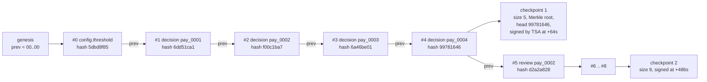
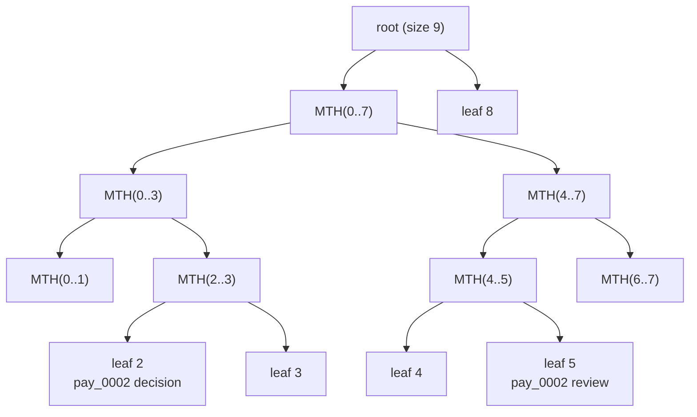

# Auditability: Immutable Logs and Evidence Bundles

> Hash-chained decision logs a regulator can verify.

**Type:** Build
**Languages:** Java, Python, Go
**Prerequisites:** Phase 13 Lesson 03 (Risk Scoring and Thresholds), Phase 13 Lesson 10 (Data Privacy and Retention), Phase 1 Lesson 07 (Hash Functions and Collisions), Phase 3 Lesson 09 (Merkle Trees), Phase 10 Lesson 01 (Representing Money)
**Time:** ~75 minutes

## Learning Objectives

- Build a hash-chained, append-only decision log over a canonical, injective encoding, and state exactly which tampering it detects on its own
- Explain why a hash chain without an external anchor cannot stop an operator who rewrites the whole chain, and fix it with signed, time-stamped checkpoints
- Implement an RFC 6962 Merkle tree with leaf/node domain separation, generate an audit path, and verify inclusion in O(log n) hashes
- Export an evidence bundle that proves one customer's decisions against a sealed checkpoint without disclosing anyone else's
- Write a verifier a regulator can run that trusts nothing except the time-stamp authority's public key, and name what it still cannot prove

## The Problem

A payments company receives a letter from its banking regulator: a customer complained that a 1,299.99 USD transfer on 3 March was declined, and that the decline was discriminatory. The examiner asks for the decision record, the model version and thresholds in force at that moment, and evidence that the record has not been altered since.

The decisions live in a PostgreSQL table, `risk_decisions`, which the risk service writes and three teams can update. The row exists and says `DECLINE, score 861, model scorecard-2026-01-a`. The examiner's next question is the hard one: "During the incident on 9 March your team ran a backfill that rewrote 40,000 rows of this table. How do I know this row is not one of them?" The honest answer is that nobody can tell. The table has an `updated_at` column, which the backfill also set. The database audit log was retained for 30 days. There is a nightly backup, but backups are also mutable, and the examiner has no way to check that the backup you show them is the backup you took.

Nothing here required malice. A record that can be edited is a claim, not evidence, and its value in a dispute, an examination, or a court collapses to the credibility of the people who could have edited it. The same problem appears with card-network disputes (proving the 3-D Secure result at authorization time), with AML case files (Lesson 06, proving when an alert was raised and closed), and with PCI DSS Requirement 10 (protecting audit trails from modification).

The mechanism this lesson builds turns the record into evidence. Every decision is appended to a log where each entry commits to the one before it, so silent edits break the chain. Periodically the log is sealed: a Merkle root over all entries is signed and time-stamped by an independent party, so the operator cannot rewrite history and re-chain it. For a single customer, the company exports an evidence bundle containing only that customer's entries and short proofs that each one is inside the sealed tree, and the regulator checks it with a verifier that trusts only the time-stamp authority's public key.

## The Concept

### Tamper-evident, not tamper-proof

Anyone with root on the database server can change bytes on disk. No data structure prevents that. What a data structure can do is make every change *detectable* by someone who holds a small piece of trusted state. Be precise about the threat model before building:

| Actor | Can do | Must be detected |
|-------|--------|------------------|
| Engineer with SQL access | `UPDATE` a row, `DELETE` a row | Edit and deletion of any past entry |
| Buggy backfill job | Rewrite many rows consistently | Bulk rewrite, even if internally consistent |
| Operator under pressure | Rebuild the entire log from scratch and recompute every hash | Wholesale history rewrite |
| Operator under pressure | Insert a decision "as of" an earlier time | Backdating |
| Anyone | Drop the last N entries | Truncation |

The first three rows need integrity checks; the last two need a notion of time that the operator does not control. The design below answers each row and the verifier tests every one.

### Canonical encoding: hash the bytes, not the object

A hash is over bytes, so "the hash of an entry" needs one, and only one, byte representation per entry. JSON looks convenient and fails three ways: key order is unspecified (`{"a":1,"b":2}` and `{"b":2,"a":1}` hash differently), numbers have many spellings (`1`, `1.0`, `1e0`), and string escaping varies (`"é"` versus `"é"`). Two services serializing the same decision produce different hashes, and verification fails for reasons that are not tampering. RFC 8785 (JSON Canonicalization Scheme) exists to fix exactly this.

This lesson uses netstrings: each field is written as `<byte length>:<bytes>,`. The encoding is **injective**, meaning different field lists always produce different bytes. Plain concatenation is not: `"ab" + "c"` and `"a" + "bc"` are both `"abc"`, so an attacker could move characters between fields without changing the hash. With netstrings they are `2:ab,1:c,` and `1:a,2:bc,`. Fields are written in a fixed order, payload keys sorted, and the first field is a version tag (`pefs-log-v1`) so that a future format change can never collide with the current one.

### The hash chain

Each entry stores the hash of its predecessor and is hashed over everything including that pointer:

```text
h_0 = SHA-256( canon(seq=0, ts, prev=000...0, kind, subject, payload) )
h_i = SHA-256( canon(seq=i, ts, prev=h_(i-1), kind, subject, payload) )
```



Work through what each tampering does to the lesson's nine-entry log, where entry #3 is `DECLINE` for `pay_0003`:

1. **Edit #3's outcome to `APPROVE`, leave the stored hash.** Recomputing #3's hash gives a different value than the one stored. Detected at #3.
2. **Edit #3 and recompute its hash.** #3 is now self-consistent, but #4 still stores `prev = 6a46be01`, the old hash. Detected as a broken link between #3 and #4.
3. **Edit #3, recompute #3, then rewrite #4..#8 with new `prev` values and new hashes.** Every hash matches its content and every link matches. **The chain alone cannot detect this.** A hash chain proves internal consistency, not that this is the chain that existed yesterday.
4. **Delete #5.** Position 5 now holds an entry with `seq = 6` whose `prev` points to a hash that is not at position 4. Detected.
5. **Truncate #7 and #8.** The remaining chain is perfectly consistent. Only someone who knew the log used to be longer can detect it.

Cases 3 and 5 are the reason the chain needs an anchor: a small piece of state, held by someone the operator cannot influence, that pins the log's contents at a point in time.

### Anchoring: checkpoints signed by someone else

A checkpoint is the statement "the first `size` entries of this log have Merkle root `R` and head hash `H`". The log does not sign it; an independent **time-stamp authority** (TSA) does, binding the statement to the TSA's own clock. This is the RFC 3161 model: the TSA signs `(digest, time)` and anyone holding its public key can verify. In the lesson the TSA uses Ed25519 (RFC 8032) from the JDK.

Now replay cases 3 and 5. The rewritten chain from case 3 produces a different Merkle root over entries 0..4, which does not match the root the TSA signed in checkpoint 1. Truncation in case 5 leaves 7 entries while checkpoint 2 says 9. The operator cannot produce a new matching signature without the TSA's private key, and cannot move the TSA's time without breaking the signature.

Production systems anchor in several ways, in increasing order of independence: an RFC 3161 TSA run by a commercial provider; publishing the root to a transparency log operated by a third party (the Certificate Transparency model); emailing the daily root to the regulator or the auditor; writing it to WORM storage under a different administrative domain; or, in some systems, a public blockchain. The verifier in every case needs the same thing: a way to obtain the checkpoint that does not go through the party being audited.

### Clock anchoring: what time can and cannot be proven

The log's own timestamps come from the operator's clock, so on their own they prove nothing. Two mechanisms give them meaning:

- **Monotonic append.** `DecisionLog.append` rejects any entry whose timestamp is earlier than the previous entry's. In the demo, setting the clock back to +5 s after entry #8 at +426 s throws `clock went backwards`. This stops casual backdating inside the log's own sequence.
- **Seal times bound entry times.** Checkpoint 1 was signed by the TSA at +64 s and covers entries 0..4. Therefore entries 0..4 existed **no later than** +64 s, regardless of what their own timestamps say. An entry first appearing in checkpoint 2 (signed at +486 s) was not in the log at +64 s, by the log's own sealed statement, so it was appended in the window (+64 s, +486 s].

The seal interval is therefore the backdating window. Sealing every minute bounds every decision's existence to within a minute; sealing daily allows an operator to insert an entry anywhere in a 24-hour window and give it any timestamp in that window that keeps the sequence monotonic. Verifiers also check that no entry claims a timestamp *after* the seal that covers it, which would be a forward-dated entry.

### Merkle trees: proving one entry without revealing the rest

To verify the checkpoint against the full log, the verifier recomputes the Merkle root over all entries. That works for an internal auditor and fails for a regulator investigating one complaint: you cannot hand over every other customer's decisions (Lesson 10 explains why). A Merkle tree solves this. RFC 6962 defines it over leaves `d_0..d_(n-1)`, here the 32-byte entry hashes:

```text
MTH({})       = SHA-256()                                   (empty tree)
MTH({d0})     = SHA-256(0x00 || d0)                         (leaf hash)
MTH(D[0:n])   = SHA-256(0x01 || MTH(D[0:k]) || MTH(D[k:n])) (k = largest power of 2 < n)
```

The `0x00` and `0x01` prefixes are **domain separation**. Without them, an interior node's 64 input bytes (two child hashes) could be presented as a leaf, and an attacker could prove that a "leaf" made of two hashes is in the tree. With the prefixes, a leaf hash and a node hash are computed over inputs that can never be equal.

The shape for the lesson's 9 entries, with `k = 8` at the root:



To prove leaf 2 is in the tree, send the **audit path**: the sibling hash at each level, bottom first. For leaf 2 that is `leaf 3`, `MTH(0..1)`, `MTH(4..7)`, `leaf 8`: four hashes. The verifier computes:

```text
r = H(0x00 || d2)
r = H(0x01 || r || leafhash3)          index 2 is a left child
r = H(0x01 || MTH(0..1) || r)          index 1 at this level is a right child
r = H(0x01 || r || MTH(4..7))          index 0 is a left child
r = H(0x01 || r || leafhash8)          left child of the root
r == signed root ?
```

A path has at most `ceil(log2 n)` hashes: 4 for 9 or 16 entries, 20 for a million, 30 for a billion. The bundle for one customer stays a few kilobytes even when the log has billions of entries, and none of the hashes in the path reveal anything about the entries they summarize. The RFC 9162 verification algorithm used in the code walks the index and the tree size in parallel, so it also rejects a path that is the wrong length for the claimed tree size.

### The evidence bundle

The bundle for `pay_0002` contains exactly:

| Line | Purpose |
|------|---------|
| `subject`, `tree-size`, `merkle-root`, `head-hash` | The checkpoint statement |
| `tsa-time`, `tsa-signature`, `tsa-public-key` | The TSA's signature over the statement and its time |
| `entry 2 <base64 canonical bytes> <hash>` | The decision: `REVIEW`, score 88, 319.00 USD, model and thresholds |
| `proof 2 <4 hashes>` | Audit path for leaf 2 |
| `entry 5 ...`, `proof 5 ...` | The analyst's review outcome: `APPROVE` |

Entries ship as their canonical bytes, not as re-serialized fields, so the verifier hashes exactly what was hashed at write time and decodes the human-readable view from those same bytes. Entries #0, #1, #3, #4, #6, #7, #8 are not disclosed; the tests assert that #3's bytes do not appear in the bundle.

### What the verifier trusts

The verifier is the program the regulator runs, so its trusted computing base must be small and stated:

1. The TSA's public key, obtained independently (from the TSA's website, a regulator registry, or a prior engagement), **not** from the bundle. If the bundle names a different key, verification fails. Without a trusted key, the verifier only proves that the bundle is internally consistent, and it says so.
2. SHA-256 and Ed25519 implementations in the JDK.
3. The verifier's own source, which is short enough to read: about 180 lines.

It does **not** trust the log operator, the operator's clock, the operator's database, or the field values printed in the bundle header.

### Detection matrix

| Tampering | Chain only | Chain + checkpoints | Bundle verifier |
|-----------|-----------|---------------------|-----------------|
| Edit an entry, keep hash | Detected | Detected | Detected (hash mismatch) |
| Edit and rehash one entry | Detected (link) | Detected | Detected (not in sealed tree) |
| Rewrite whole chain | **Missed** | Detected (root mismatch) | Detected |
| Delete an entry | Detected | Detected | Detected if it was disclosed |
| Truncate the tail | **Missed** | Detected (size) | Detected if a disclosed entry was cut |
| Backdate a new entry | **Missed** | Bounded to the seal window | Bounded to the seal window |
| Never log a decision at all | Missed | Missed | Missed |

The last row is the honest limit. A log proves what was written; it cannot prove that everything was written. The control for omission is process: log before acting (the risk engine appends the decision before returning it to the authorization path, as Phase 12's outbox pattern does for events), and reconcile the log against the ledger, where every authorization must have a matching decision entry.

### Complexity

| Operation | This lesson | Production |
|-----------|-------------|------------|
| Append | O(1): one SHA-256 | O(1) |
| Seal | O(n): recompute the root | O(log n) with an incremental "compact range" of subtree roots |
| Audit path | O(n) here (recomputes subtrees) | O(log n) with stored interior nodes |
| Verify one entry | O(log n) hashes | O(log n) |
| Verify the whole log | O(n) | O(n), parallelizable per segment |

### What this lesson does not do

- **Confidentiality.** Hashes are not encryption. Payloads with personal data should be stored encrypted per subject so that crypto-shredding (Lesson 10) can make them unreadable while the hash chain, computed over the ciphertext, still verifies.
- **Availability.** If the operator deletes the whole log, verification fails loudly but the evidence is gone. Replicate to WORM storage in a separate administrative domain.
- **Consistency proofs between checkpoints.** RFC 6962 also defines a proof that checkpoint 2's tree extends checkpoint 1's, without revealing entries. The full-log verifier checks this implicitly by recomputing both roots; the compact proof is Exercise 3.
- **Key management.** A compromised TSA key lets anyone forge checkpoints. Real TSAs use HSMs and publish key rotations; verifiers need the key valid at signing time.

## Build It

The design: `Crypto` (SHA-256 and netstrings), `Entry` (one record), `DecisionLog` (append and seal), `Merkle` (RFC 6962), `TimestampAuthority` and `TimestampToken` (the anchor), `Checkpoint`, `EvidenceBundle` (export), and `Verifier` in its own file with its own `main`, because it is a separate program run by a separate party. `Main.java` holds everything except the verifier.

### Step 1: Canonical bytes

```java
static byte[] netstrings(String... fields) {
    StringBuilder sb = new StringBuilder();
    for (String f : fields) {
        byte[] utf8 = f.getBytes(StandardCharsets.UTF_8);
        sb.append(utf8.length).append(':').append(f).append(',');
    }
    return sb.toString().getBytes(StandardCharsets.UTF_8);
}
```

The length is the **byte** length of the UTF-8 encoding, not `f.length()`. Java strings count UTF-16 code units, so `"€".length()` is 1 while its UTF-8 encoding is 3 bytes; using the character count would make the parser misread every entry with a non-ASCII name. A test checks `"€"` encodes as `3:`. `parseNetstrings` is the strict inverse and throws on any malformed length or missing comma rather than guessing.

Predict: a payload value contains `5:hello,`. Does that confuse the parser? Why not?

### Step 2: The entry

```java
static byte[] canonical(long seq, long ts, String prevHash, String kind, String subject,
                        SortedMap<String, String> payload) {
    List<String> fields = new ArrayList<>(List.of(VERSION, Long.toString(seq), Long.toString(ts),
            prevHash, kind, subject, Integer.toString(payload.size())));
    for (Map.Entry<String, String> e : payload.entrySet()) { fields.add(e.getKey()); fields.add(e.getValue()); }
    return Crypto.netstrings(fields.toArray(new String[0]));
}

static Entry create(long seq, long ts, String prevHash, String kind, String subject, Map<String, String> payload) {
    SortedMap<String, String> sorted = new TreeMap<>(payload);
    String hash = Crypto.sha256Hex(canonical(seq, ts, prevHash, kind, subject, sorted));
    return new Entry(seq, ts, prevHash, kind, subject, sorted, hash);
}
```

The payload count goes before the pairs, so `fromCanonical` can reject a truncated or padded entry. `TreeMap` fixes key order, which is why the test "payload key order does not change the hash" passes for a `Map.of` (unspecified order) and a `TreeMap` built in reverse. `fromCanonical` always calls `create`, which recomputes the hash: a parsed entry never carries a hash it did not earn.

Predict: why is `seq` inside the hashed bytes, when the position in the list already implies it?

### Step 3: Append-only with a monotonic clock

```java
Entry append(String kind, String subject, Map<String, String> payload) {
    long ts = clock.millis();
    Entry last = entries.isEmpty() ? null : entries.get(entries.size() - 1);
    if (last != null && ts < last.timestampMillis()) {
        throw new IllegalStateException("clock went backwards: " + ts + " < " + last.timestampMillis());
    }
    Entry e = Entry.create(entries.size(), ts, last == null ? Crypto.ZERO_HASH : last.hash(), kind, subject, payload);
    entries.add(e);
    return e;
}
```

`DecisionLog` has no update or delete method, and `entries()` returns `List.copyOf`, so callers cannot mutate the list. The clock is injected; the demo uses a `ManualClock` so output is byte-identical across runs. Equal timestamps are allowed: two decisions in the same millisecond are normal, and `seq` orders them. A real clock stepping backwards after an NTP correction will make `append` throw; production systems instead take `max(now, last.ts)` and record the skew, a choice Exercise 1 explores.

Predict: the test checks that a rejected append leaves the log at 9 entries. Which line ordering guarantees that?

### Step 4: The Merkle root and audit path

```java
static byte[] root(List<byte[]> leaves, int lo, int hi) {
    int n = hi - lo;
    if (n == 0) return Crypto.sha256();
    if (n == 1) return leafHash(leaves.get(lo));
    int k = split(n);
    return nodeHash(root(leaves, lo, lo + k), root(leaves, lo + k, hi));
}

static List<byte[]> auditPath(List<byte[]> leaves, int m, int lo, int hi) {
    int n = hi - lo;
    if (n <= 1) return new ArrayList<>();
    int k = split(n);
    List<byte[]> path;
    if (m < k) { path = auditPath(leaves, m, lo, lo + k); path.add(root(leaves, lo + k, hi)); }
    else       { path = auditPath(leaves, m - k, lo + k, hi); path.add(root(leaves, lo, lo + k)); }
    return path;
}
```

Both are direct transcriptions of RFC 6962 section 2.1. Splitting at the largest power of two below `n` (not at `n/2`) is what makes the tree for the first 8 entries a subtree of the tree for 9, 10, or 1,000 entries; that stability is what consistency proofs rely on. The recursion appends siblings on the way back up, so the path is ordered leaf-to-root.

Predict: for a 5-leaf tree, how many hashes are in the audit path of leaf 4, and why is it shorter than for leaf 0?

### Step 5: Verifying inclusion

```java
static boolean verifyInclusion(byte[] leafData, long index, long treeSize, List<byte[]> path, byte[] expectedRoot) {
    if (index < 0 || index >= treeSize) return false;
    long fn = index, sn = treeSize - 1;
    byte[] r = leafHash(leafData);
    for (byte[] p : path) {
        if (sn == 0) return false;
        if ((fn & 1) == 1 || fn == sn) {
            r = nodeHash(p, r);
            if ((fn & 1) == 0) {
                while ((fn & 1) == 0 && fn != 0) { fn >>= 1; sn >>= 1; }
            }
        } else {
            r = nodeHash(r, p);
        }
        fn >>= 1;
        sn >>= 1;
    }
    return sn == 0 && MessageDigest.isEqual(r, expectedRoot);
}
```

This is RFC 9162 section 2.1.3.2. `fn` tracks the node's index and `sn` the last index at the current level. When `fn` is odd the node is a right child, so the sibling goes on the left. When `fn == sn` and `fn` is even, the node is the rightmost and has no sibling at this level (the unbalanced right edge), so the loop shifts up until it does. `sn == 0` at the end confirms the path had exactly the right length for `treeSize`. `MessageDigest.isEqual` compares in constant time. The test sweeps every leaf of every tree size from 1 to 17.

Predict: the proof for leaf 3 in a 9-leaf tree also verifies against the same root if you claim the tree has 10 leaves. Why is that harmless here? (Hint: what does the TSA sign?)

### Step 6: The anchor

```java
TimestampToken stamp(String digestHex) {
    long t = clock.millis();
    TimestampToken unsigned = new TimestampToken(digestHex, t, "");
    Signature s = Signature.getInstance("Ed25519");
    s.initSign(keys.getPrivate());
    s.update(unsigned.signedBytes());
    return new TimestampToken(digestHex, t, Base64.getEncoder().encodeToString(s.sign()));
}

Checkpoint seal() {
    String root = Crypto.HEX.formatHex(Merkle.root(leafData(entries, entries.size())));
    String head = entries.get(entries.size() - 1).hash();
    Checkpoint cp = new Checkpoint(entries.size(), root, head,
            tsa.stamp(Checkpoint.statementDigest(entries.size(), root, head)));
    checkpoints.add(cp);
    return cp;
}
```

The TSA has its own clock: the time in the token is the TSA's, not the log's. The signed bytes are a netstring of a version tag, the digest, and the time, so neither can be changed without breaking the signature (a test moves the time back an hour and verification fails). The TSA's key is generated from a seeded `SHA1PRNG` purely so the demo prints the same key every run; a real TSA's key lives in an HSM.

Predict: why does the checkpoint include the head hash when the Merkle root already commits to every entry?

### Step 7: The full-log verifier

```java
String root = Crypto.HEX.formatHex(Merkle.root(DecisionLog.leafData(entries, cp.size())));
boolean good = true;
if (!root.equals(cp.merkleRootHex())) {
    problems.add("checkpoint size " + cp.size() + ": Merkle root differs from the sealed root (history rewritten)");
    good = false;
}
if (!entries.get((int) cp.size() - 1).hash().equals(cp.headHashHex())) { ... }
if (entries.get((int) cp.size() - 1).timestampMillis() > cp.token().timeMillis()) { ... }
```

Before this, `verifyLog` walks every entry checking `seq == position`, the recomputed hash, the `prev` link, and timestamp order. Then each checkpoint: signature first (an unsigned claim is worthless), size versus log length (truncation), root (rewrite), head, and no entry dated after its own seal. `firstBadSeq` reports the earliest implicated entry; for a broken link it is the entry *before* the link, since either side may be the edit, and for a pure root mismatch it is the end of the last checkpoint that still verified.

Predict: an attacker rewrites only entries 5..8 (after checkpoint 1). Which checkpoint catches it, and what `firstBadSeq` is reported?

### Step 8: Exporting and verifying a bundle

```java
for (int i = 0; i < cp.size(); i++) {
    Entry e = all.get(i);
    if (!e.subject().equals(subject)) continue;
    sb.append("entry ").append(e.seq()).append(' ')
      .append(Base64.getEncoder().encodeToString(e.canonical())).append(' ').append(e.hash()).append('\n');
    List<String> hexPath = new ArrayList<>();
    for (byte[] p : Merkle.auditPath(leaves, i)) hexPath.add(Crypto.HEX.formatHex(p));
    sb.append("proof ").append(e.seq()).append(' ').append(hexPath.isEmpty() ? "-" : String.join(",", hexPath)).append('\n');
}
```

On the other side, `Verifier.verifyBundle` rebuilds the checkpoint digest from the header, verifies the TSA signature with the **trusted** key, and for each entry decodes the canonical bytes, recomputes the hash, checks the subject, checks the timestamp is not after the seal, and verifies the audit path against the signed root. If two disclosed entries are adjacent it also checks their link. A bundle whose header names a different key fails even if its own signature is valid, because a self-signed bundle proves nothing about origin.

Predict: the operator exports a bundle against checkpoint 1 instead of checkpoint 2. Which of `pay_0002`'s two entries can it include, and does it verify?

### Step 9: Run it

```bash
cd phases/13-risk-fraud-and-compliance/11-auditability-and-evidence/code/java
javac -d .out *.java && java -cp .out Main
java -cp .out MainTest
```

```console
== The hash-chained log ==
#0 t=+0      config.threshold  risk-engine prev=00000000.. hash=5dbd8f85..
#1 t=+1      risk.decision     pay_0001    prev=5dbd8f85.. hash=6dd51ca1..
...
#8 t=+426    review.outcome    pay_0005    prev=a75a68ca.. hash=c30f2620..

checkpoint size=5 root=1d4f3e3610e8.. head=997816464600.. stamped t=+64s
checkpoint size=9 root=4a7c7fbbc562.. head=c30f26206992.. stamped t=+486s

== Full-log verification ==
untouched log: ok=true
edit #3 outcome DECLINE->APPROVE:      ok=false first bad=#3  entry #3 content does not match its hash
edit #3 and recompute its hash:        ok=false first bad=#3  entry #4 does not link to the entry before it
edit #3 and rewrite the whole chain:   ok=false first bad=#0  checkpoint size 5: Merkle root differs from the sealed root (history rewritten)
delete #5 (the review of pay_0002):    ok=false first bad=#5  position 5 holds seq 6 (entry missing or reordered)

== Clock anchoring ==
backdated append rejected: clock went backwards: 1767225605000 < 1767226026000
entries 0..4 existed no later than t=+64s (signed by the TSA, not by us)

regulator verifies bundle with the TSA's published key: ok=true
  #2 2026-01-01T00:00:02Z risk.decision {amount=319.00 USD, model=scorecard-2026-01-a, outcome=REVIEW, score=88, ...}
  #5 2026-01-01T00:05:04Z review.outcome {analyst=analyst-31, minutes=4, result=APPROVE}
  sealed: 9 entries, no later than 2026-01-01T00:08:06.250Z
bundle with the review result changed: ok=false first bad=#5  entry #5 content does not match its stated hash
```

`MainTest` prints `50 passed, 0 failed`. To act as the regulator, save a bundle to a file and run `java -cp .out Verifier bundle.txt <tsa-public-key>`; it prints the decoded entries and `VERIFIED` with exit code 0, or each problem and `FAILED` with exit code 1.

### In Python

```python
def stamp(self, digest_hex: str) -> TimestampToken:
    t = self._clock()
    unsigned = TimestampToken(digest_hex, t, "")
    mac = hmac.new(self._key, unsigned.signed_bytes(), hashlib.sha256).digest()
    return TimestampToken(digest_hex, t, b64(mac))

@staticmethod
def verify(key_base64: Optional[str], token: TimestampToken) -> bool:
    ...
    expected = hmac.new(key, token.signed_bytes(), hashlib.sha256).digest()
    return hmac.compare_digest(expected, sig)
```

`code/python/main.py` builds the same log: every entry hash, both Merkle roots, both head hashes, and every audit path are byte-identical to the Java output, because they use only SHA-256 and netstrings. One substitution changes the seal, and it changes what the seal proves:

- **The seal is HMAC-SHA256, not Ed25519.** The standard library has no Ed25519, so `TimestampAuthority` holds a 32-byte secret key and seals with `hmac.new(key, signed_bytes, sha256)`. The log operator never holds that key, so it still cannot move a seal's time, swap a root, or mint a seal of its own; every tamper test from the Java suite passes, plus one that tries exactly that with a different key. The difference is who can check: an Ed25519 public key lets anyone verify and nobody but the authority sign, while an HMAC key lets whoever holds it do both. The regulator must get the key from the authority out of band and must be trusted not to forge with it. For evidence that has to convince a third party, use an asymmetric signature (RFC 3161 tokens are RSA or ECDSA signed).
- **Names follow the substitution.** Because the key is secret, the bundle carries `tsa-key-id` (a SHA-256 fingerprint of the key) where the Java bundle carries `tsa-public-key`, and the methods are `verification_key_base64()` and `tsa_verification_key()`. `verify_bundle` with no trusted key reports a problem rather than falling back to a key inside the bundle, since there is none. In the demo only the `tsa-signature` and `tsa-key-id` lines differ from the Java output.
- **The verifier is a separate entry point in the same file.** `Verifier` lives in `main.py` (one file per lesson), and the regulator runs it as `python3 main.py verify bundle.txt <trusted-key>`, which prints the decoded entries and `VERIFIED` (exit 0) or each problem and `FAILED` (exit 1).
- **Java string and time behaviour is ported where it matters.** `java_split` drops trailing empty strings like `String.split`; `instant_str` prints `2026-01-01T00:08:06.250Z` like `Instant.toString()`; netstring lengths count `len(s.encode("utf-8"))` bytes, and the parser rejects lengths that `Integer.parseInt` would reject even though `int()` accepts them. Comparisons of digests use `hmac.compare_digest`, the constant-time equivalent of `MessageDigest.isEqual`.

Run it from `code/python/`:

```bash
python3 main.py
python3 -m unittest -v
```

### In Go

```go
func NewTimestampAuthority(seed int64, clock Clock) *TimestampAuthority {
    keySeed := make([]byte, ed25519.SeedSize)
    newSHA1PRNG(seed).nextBytes(keySeed)          // the JDK's SHA1PRNG, so the key is the Java key
    private := ed25519.NewKeyFromSeed(keySeed)
    return &TimestampAuthority{private, private.Public().(ed25519.PublicKey), clock}
}

func (a *TimestampAuthority) Stamp(digestHex string) TimestampToken {
    t := a.clock.Millis()
    unsigned := TimestampToken{digestHex, t, ""}
    return TimestampToken{digestHex, t, base64.StdEncoding.EncodeToString(ed25519.Sign(a.private, unsigned.SignedBytes()))}
}
```

`code/go/main.go` and `code/go/verifier.go` keep the Java design whole, Ed25519 seal included, and the demo output is byte for byte the Java output, down to the public key and the signatures. How:

- **`crypto/ed25519` is in the standard library**, so the seal stays an asymmetric signature: anyone with the published key can verify and nobody but the authority can sign. The Python port had to substitute HMAC; Go does not. Signatures are deterministic (RFC 8032), so matching the Java key is enough to match the Java signatures, and the key is matched by reproducing the JDK's `SHA1PRNG` (SHA-1 state, the 20-byte counter update, and `setSeed(long)`'s little-endian byte order) from which Java's key generator draws its 32-byte seed. `PublicKeyBase64` wraps the raw key in the X.509 `SubjectPublicKeyInfo` prefix so the `tsa-public-key` line is identical and the two verifiers accept each other's bundles.
- **Errors are values.** `ParseNetstrings`, `EntryFromCanonical`, `AuditPath`, `Append`, `Seal`, `ExportBundle` and `ParseBundle` return errors (`ErrBadNetstring`, `ErrBadEntry`, `ErrLeafOutOfRange`, `ErrClockWentBackwards`, `ErrNothingToSeal`, `ErrBadBundle`) that tests check with `errors.Is`; the verifier folds them into `Report.Problems` as the Java folds exceptions. `VerifyToken` returns `false` on any decoding failure. Digests are compared with a constant-time loop, the equivalent of `MessageDigest.isEqual`.
- **The verifier is a subcommand, not a second `main`.** One `package main` per lesson means `go run . verify bundle.txt [trusted-key]` runs `verifierMain` in `verifier.go`; it prints the decoded entries and `VERIFIED` (exit 0) or each problem and `FAILED` (exit 1). An empty trusted key falls back to the key in the bundle and says so.
- **Java string and time behaviour is ported where it matters.** `javaSplit` drops trailing empty strings like `String.split`; `instantString` prints `2026-01-01T00:08:06.250Z` like `Instant.toString()`; netstring lengths count UTF-8 bytes; the payload is a `map[string]string` whose keys are sorted at hash time and print time, standing in for `TreeMap`.

Run it from `code/go/`:

```bash
go run .
go test ./...
```

## Use It

**Certificate Transparency** (RFC 6962, RFC 9162) is this lesson at internet scale: every publicly trusted TLS certificate is appended to Merkle-tree logs run by Google, Cloudflare, DigiCert and others; logs publish signed tree heads; browsers require inclusion proofs; independent monitors check consistency proofs between tree heads. **Trillian**, Google's open-source verifiable log, and **Sigstore Rekor**, the transparency log for software signatures, are reusable implementations of the same structure.

**WORM storage** handles availability and deletion. **Amazon S3 Object Lock** in compliance mode prevents any user, including the root account, from deleting or overwriting an object until its retention date; AWS publishes an assessment of it against SEC Rule 17a-4(f). Azure Blob immutable storage and Google Cloud Storage bucket lock offer the same. They make deletion impossible within the retention window but do not give you per-record proofs; the Merkle structure does. Most production designs layer both: the hash-chained, sealed log is written to WORM storage, and daily roots go to an external party.

**Ledger databases** were sold as this primitive. Amazon QLDB offered a hash-chained journal with digests and proofs; AWS ended support for it in July 2025 and recommended migrating to Aurora PostgreSQL, so teams now build the chain at the application layer as this lesson does. A PostgreSQL table where the application role has `INSERT` and `SELECT` but no `UPDATE` or `DELETE`, with a trigger computing the chain hash and an external job sealing roots, is a common and adequate design.

**Regulation** asks for the properties, not the data structure. PCI DSS v4.0 Requirement 10 requires audit logs protected from modification (10.3) and retained for at least 12 months (10.5.1). SEC Rule 17a-4(f) requires broker-dealer records in non-rewriteable, non-erasable form, or since the 2022 amendments, a system with a complete time-stamped audit trail of every modification. The Federal Reserve's SR 11-7 expects records of which model version made which decision. An evidence bundle with a verifier is how you show all three to an examiner in an afternoon instead of a quarter.

## Ship It

`outputs/checklist-audit-log-design.md` is a design-review checklist for any log that must serve as evidence: canonical encoding, chain and seal design, seal interval as the backdating window, anchor independence, what the bundle discloses, verifier trusted base, retention and WORM placement, and the omission controls that the data structure cannot provide. Use it when a new service starts writing decisions that someone may later dispute.

## Exercises

1. **Reinforce (easy).** Change `append` to tolerate a clock that steps backwards by up to 2 seconds: use `max(now, last.ts)` as the timestamp and add a `clock_skew_ms` payload field when it applies. Reject larger steps. Add tests for both paths and explain in two sentences why silently clamping without recording the skew would weaken the evidence.
2. **Apply (medium).** Make sealing O(log n): maintain a "compact range" (the list of perfect-subtree roots along the right edge, at most `log2 n` of them) that updates on each append, and compute the root from it. Assert that the root equals `Merkle.root` after every append from 1 to 1,000 entries.
3. **Extend (hard).** Implement RFC 9162 consistency proofs (`PROOF(m, D[n])` and its verification algorithm) so a verifier holding checkpoint 1 (size 5) can check that checkpoint 2 (size 9) extends it, using only hashes. Then combine with Lesson 10: store each payload encrypted under a per-subject key, crypto-shred `pay_0002`'s key, and show that the full log and every other subject's bundle still verify while `pay_0002`'s entries are now unreadable.

## Key Terms

| Term | What people say | What it actually means |
|------|-----------------|------------------------|
| Immutable log | "Nobody can change it" | A tamper-evident log: changes are possible but detectable by anyone holding a trusted checkpoint |
| Hash chain | "Blockchain-style log" | Each entry's hash covers the previous entry's hash, so an edit breaks every later link unless the whole suffix is rewritten |
| Canonical encoding | "Serialize it" | One injective byte representation per record, so equal records hash equally and different records never collide by construction |
| Checkpoint / signed tree head | "A snapshot" | A statement of size, Merkle root, and head hash, signed and time-stamped by a party the log operator does not control |
| Merkle audit path | "The proof" | The O(log n) sibling hashes from one leaf to the root; recomputing the root from them proves inclusion without revealing other leaves |
| Time-stamp authority | "Trusted time" | An independent signer of (digest, time) pairs (RFC 3161); bounds when data existed, never when it was created |
| Evidence bundle | "An export" | The subject's entries as canonical bytes, their inclusion proofs, and the signed checkpoint they are proven against |
| Seal interval | "How often we checkpoint" | The window within which an operator can still insert or backdate entries undetected; the operational dial for evidence strength |

## Further Reading

- [RFC 6962: Certificate Transparency](https://www.rfc-editor.org/rfc/rfc6962) — section 2.1 defines the Merkle tree hash, audit paths, and consistency proofs this lesson implements
- [RFC 9162: Certificate Transparency Version 2.0](https://www.rfc-editor.org/rfc/rfc9162) — section 2.1.3 gives the inclusion and consistency verification algorithms used by `verifyInclusion`
- [RFC 3161: Internet X.509 PKI Time-Stamp Protocol](https://www.rfc-editor.org/rfc/rfc3161) — the request, token, and trust model behind `TimestampAuthority`
- [Crosby and Wallach, "Efficient Data Structures for Tamper-Evident Logging", USENIX Security 2009](https://www.usenix.org/legacy/event/sec09/tech/full_papers/crosby.pdf) — history trees, the formal case for Merkle-based audit logs over plain hash chains
- [Schneier and Kelsey, "Secure Audit Logs to Support Computer Forensics", ACM TISSEC 1999](https://www.schneier.com/academic/archives/1999/05/secure_audit_logs_to.html) — the foundational design for logs on machines that may later be compromised
- [17 CFR 240.17a-4, Records to be preserved by certain exchange members, brokers and dealers](https://www.ecfr.gov/current/title-17/section-240.17a-4) — the WORM and audit-trail requirements regulators actually examine against
