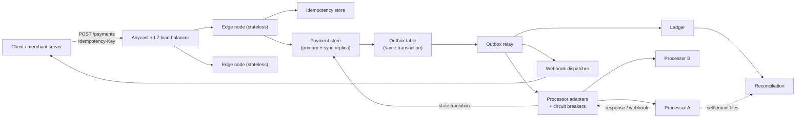
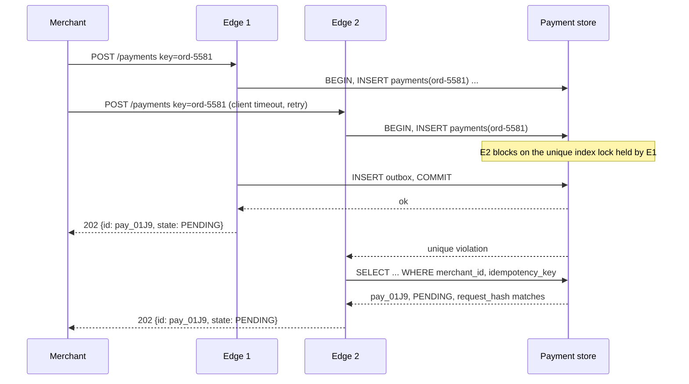

# Architecture of a High-Availability Payment Gateway

> Stateless edges, durable cores, and where the idempotency store lives.

**Type:** Learn
**Languages:** —
**Prerequisites:** Phase 5 Lesson 09 (Idempotency Keys), Phase 5 Lesson 11 (Circuit Breakers and Bulkheads), Phase 7 Lesson 13 (The Transactional Outbox), Phase 9 Lesson 10 (Capacity Planning and Queueing Theory), Phase 12 Lesson 02 (The Payment State Machine), Phase 12 Lesson 05 (Webhooks)
**Time:** ~90 minutes

## Learning Objectives

- Draw the reference architecture of a payment gateway and state, for each component, whether it holds state and what happens when it dies
- Decide where the idempotency store lives and defend the choice against the two classic holes: a key committed without its payment, and a payment committed without its key
- Walk four failure modes (processor down, database failover mid-payment, duplicate retry, region loss) through the architecture and name the exact row, message, or timer that keeps money correct in each
- Build a capacity and latency budget from a peak-rate target using Little's law, utilization limits, and the processor's p99
- Explain why "unknown outcome" is a first-class state and why no gateway may ever map it to "declined"

## The Problem

On 1 June 2018 a hardware failure in one of Visa Europe's two UK data centres caused a partial switch failure. The system was designed to fail over; the failover did not complete cleanly, and for about ten hours roughly 10% of Visa transactions attempted in the UK failed. Visa later told the Treasury Committee that about 5.2 million transactions did not process. Cardholders retried at the terminal, merchants fell back to cash, and issuers spent the following week reconciling authorizations that had been approved by one site and never confirmed by the other. Nothing was lost in the sense of money disappearing; a great deal was lost in the sense of payments that nobody could say had or had not happened.

Scale that down to a single company. A gateway that handles 500 payments a second has one database. The database's primary fails at 14:02 and the replica is promoted at 14:03. During that minute, every edge node returns errors; clients retry; the retries land on the new primary. Some of the original requests had been written to the old primary but not yet replicated. Three things now happen at once: payments that were sent to the processor before the failover and whose responses arrive after it find no row to update; retried requests with the same idempotency key find no key and create a second payment; and the webhook dispatcher, reading from an outbox table that was also partially lost, never tells the merchant about the first charge. By 14:10 the system is healthy and 1,400 customers have been charged twice. The root cause is not the failover. The root cause is that the architecture never decided which component was allowed to be the truth.

A high-availability gateway is an answer to one question: when any single component dies at the worst possible instant, what is the state of every payment that was in flight, and how does the system converge from there without a human? This lesson gives the reference answer, then runs four failures through it.

## The Concept

### The reference architecture



Each component has a one-line contract. The contract says what it owns and what it is allowed to lose.

| Component | Holds state? | Owns | Allowed to lose | On death |
|-----------|--------------|------|-----------------|----------|
| Load balancer | no (connection tables only) | routing, TLS termination, health checks | in-flight connections | clients reconnect; another LB takes the anycast address |
| Edge node | no | request validation, idempotency check, writing the payment row and outbox row in one transaction | everything in memory | LB stops routing to it within one health-check interval; in-flight requests fail and clients retry with the same key |
| Idempotency store | yes | key to (request hash, payment id, response) | nothing within the key's TTL | if separate from the payment store, this is the dangerous component; see below |
| Payment store | yes, the truth | the payment row and its state machine; the outbox | nothing acknowledged | synchronous replica promoted; unacknowledged writes are gone, which is correct because the client never got a 2xx |
| Outbox relay | no (a cursor it can rebuild) | publishing committed outbox rows exactly once per row, at least once in delivery | its position, which it re-reads from the outbox | another relay instance takes the lease; duplicates are absorbed downstream by idempotency |
| Processor adapter | no | one processor's protocol, timeouts, idempotency key mapping, circuit breaker | breaker state (it re-learns in seconds) | the relay routes to another adapter instance |
| Webhook dispatcher | no (reads the outbox) | signed, retried, ordered-per-payment delivery to merchants | nothing | restarts from the outbox |
| Ledger | yes | double-entry postings per state transition | nothing | its own durability story (Phase 10) |
| Reconciliation | derived | comparing the ledger with processor settlement files | nothing; it is recomputable | runs late |

The design rule that produces this table: **exactly one component is the truth for a payment's state, every other component either holds no state or holds state derivable from the truth, and every message that leaves the truth leaves through its transaction log.** The payment store is the truth; the outbox is how messages leave it; everything else is a stateless worker or a derived view.

### Stateless edges

An edge node does five things per request and keeps nothing between requests: terminate the request, validate the body, look up the idempotency key, write the payment row plus the outbox row in one transaction, return the response. It does not call the processor. That is the single most consequential decision in the architecture, and it is the one most teams get backwards at first.

The naive edge calls the processor synchronously: receive request, write `PENDING`, call processor, write `APPROVED`, respond. It feels simpler and it has lower latency on the happy path. It is also the design that produces the 14:02 incident: the processor call happens between two database writes, so a crash or failover in the middle leaves an authorization at the processor that the database does not know about, and the only record of it was in the dead edge node's memory.

With the outbox design, the edge's transaction commits the intent to charge, and a separate relay drives the processor call. If the edge dies after commit, the relay still makes the call. If the edge dies before commit, nothing happened anywhere, and the client's retry starts clean. There is no window in which the processor knows something the database does not, because the processor is never contacted until the database has a durable record of the attempt.

The price is latency: the client's first response is `202 Accepted` with a payment in `PENDING`, and the terminal state arrives by webhook or by polling. Most gateways then add a synchronous wait on the edge: hold the HTTP connection open for up to N seconds waiting for the state to change, and return `200` with the final state if it arrives in time. The wait is a convenience over a durable mechanism, not the mechanism itself, and a client that times out loses nothing.

### Where the idempotency store lives

Phase 5, Lesson 09 built the store; this lesson decides its address. There are three options.

| Option | Lookup latency | Failure hole | Verdict |
|--------|----------------|--------------|---------|
| A: separate cache (Redis, Memcached) written before the payment | ~1 ms | key written, payment transaction fails: the retry is told "already processed" for a payment that does not exist. Or: payment committed, cache write fails: the retry creates a second payment | never as the only store |
| B: unique index in the payment store, same transaction as the payment row | ~2 to 5 ms | none between key and payment; they commit or roll back together | the default |
| C: B plus a read-through cache in front for replays | ~1 ms on replay, B's cost on first write | cache can be stale by one write; a miss falls through to B, so staleness only costs latency | B when the replay rate justifies it |

Option B is a `payments` table with a unique constraint on `(merchant_id, idempotency_key)` and columns for the request hash and the serialized response. The first request inserts; a concurrent duplicate blocks on the unique index until the first commits and then fails with a constraint violation, which the edge turns into a replay of the stored response or a `409` if the request is still in progress. A retry after a database failover finds the row if and only if the original was acknowledged, because the synchronous replica had it before the `2xx` was sent. There is no second system to disagree with.

The scope of the key is part of the decision. A key must be unique per merchant, never global, or one merchant's accidental reuse of `order-1001` collides with another's. The key must also be scoped to a region only if payments are (see region loss below).

### Anatomy of one request

The edge's whole job is one transaction. In SQL it is small enough to read in full:

```sql
BEGIN;
INSERT INTO payments (id, merchant_id, idempotency_key, request_hash, amount_minor, currency,
                      state, processor_key, created_at)
VALUES ('pay_01J9', 'm_42', 'ord-5581', 'sha256:9f1c...', 1999, 'USD',
        'PENDING', 'm_42:pay_01J9', now());
-- unique index on (merchant_id, idempotency_key) is the idempotency store
INSERT INTO outbox (payment_id, kind, payload)
VALUES ('pay_01J9', 'AUTHORIZE', '{"processor":"A","amount_minor":1999,...}');
COMMIT;
```

If the first `INSERT` violates the unique index, the edge catches the constraint error, reads the existing row, compares `request_hash`, and either replays the stored response or returns a conflict. The `processor_key` is assigned here, before any processor has been contacted, and never changes.

The relay's loop is a second small transaction:

```sql
SELECT id, payment_id, kind, payload FROM outbox
WHERE published_at IS NULL ORDER BY id LIMIT 100 FOR UPDATE SKIP LOCKED;
-- deliver each row to its consumer, then:
UPDATE outbox SET published_at = now() WHERE id = ANY($1);
```

`SKIP LOCKED` lets several relay instances share one partition without blocking each other; the cost is that rows can be published out of id order across instances, so consumers that need per-payment order (the webhook dispatcher) key their own ordering on `payment_id`.

The processor adapter's write-back is the guarded update:

```sql
UPDATE payments SET state = 'AUTHORIZED', processor_ref = 'A-77812', updated_at = now()
WHERE id = 'pay_01J9' AND state = 'PENDING';
-- rows affected: 1 means this worker applied the transition; 0 means someone already did
INSERT INTO outbox (payment_id, kind, payload) VALUES ('pay_01J9', 'AUTHORIZED', '{...}');
```

Both statements run in one transaction, and the second only runs if the first affected a row. A duplicate processor response, a duplicate outbox delivery, or two adapters racing all collapse to "rows affected: 0" and no second outbox row.

The duplicate-retry case as a sequence, with the first request's transaction still open when the second arrives:



Two edges, two connections, one payment. Neither edge coordinated with the other; the database's index did it.

### Durable payment store and the state machine

The payment row carries the state machine from Phase 12, Lesson 02: `PENDING`, `AUTHORIZED`, `CAPTURED`, `DECLINED`, `FAILED`, `UNKNOWN`, and so on. Every transition is a single-row update guarded by the expected previous state (`UPDATE payments SET state = 'AUTHORIZED' WHERE id = ? AND state = 'PENDING'`), so two workers racing to apply the same processor response produce one transition and one no-op. Every transition also inserts an outbox row in the same transaction, so downstream consumers learn of it exactly when it becomes durable.

The store runs with a synchronous replica (PostgreSQL `synchronous_commit = on` with `synchronous_standby_names`, or a quorum-commit distributed store). The guarantee a payment gateway needs from its database is narrow: a write that was acknowledged to the edge is on at least two machines. Asynchronous replication saves a few milliseconds and buys the 14:02 incident.

### Outbox and relay

The outbox is a table in the payment store: `(id, payment_id, kind, payload, created_at, published_at)`. The relay reads unpublished rows in id order, hands each one to the right consumer (processor adapter, webhook dispatcher, ledger), and marks it published. It is at-least-once by construction: a relay that crashes after delivering and before marking will redeliver. Every consumer therefore dedupes on `outbox.id` or on the payment id plus transition, which is cheap because consumers are themselves idempotent writers into stores with unique indexes.

One relay instance is active per partition of the outbox at a time, held by a lease with a fencing token (Phase 5, Lesson 12). Two relays running at once is not a correctness problem (duplicates are absorbed) but it doubles processor calls during the overlap, which costs money and authorization rate.

### Processor adapters with breakers

An adapter owns one processor's wire protocol and three protective mechanisms:

1. **A timeout** set from the processor's observed p99 plus a margin, not from a round number. If the processor's p99 is 1,200 ms, a 1,000 ms timeout turns 1% of successful authorizations into unknowns.
2. **A circuit breaker** (Phase 5, Lesson 11) that opens after a window of timeouts or 5xx responses, routes new attempts to the secondary processor or parks them, and half-opens with a trickle of real traffic.
3. **A bulkhead**: a bounded connection pool and worker pool per processor, so a slow Processor A cannot consume the threads that Processor B needs.

The adapter also maps the gateway's payment id to the processor's idempotency key (Stripe's `Idempotency-Key`, Adyen's `idempotencyKey`, a card network's STAN plus RRN). The mapping is stored on the payment row before the first call, and every retry uses the same value. A retry that mints a new key is the bug that Phase 14, Lesson 10 plants and catches.

### Webhook dispatcher and ledger

The dispatcher reads transition events from the outbox, signs each one (HMAC over the body with a per-merchant secret, plus a timestamp to bound replay), delivers with exponential backoff over at least 24 hours, and preserves order per payment by never dispatching event `n + 1` for a payment while event `n` is undelivered. Merchants are told to dedupe on event id and to treat the payment id plus state as the fact, not the event's arrival order.

The ledger receives the same transitions and posts entries: an authorization is a hold, a capture is a receivable against the processor, a refund reverses. The ledger is downstream of the truth, so if it disagrees with the payment store, the payment store wins and the ledger is corrected by a new entry; reconciliation against the processor's settlement file is what catches the case where both are wrong together.

### What this architecture does not solve

It does not make the processor idempotent if the processor is not. Some bank rails have no idempotency key, and for those the adapter must query by reference before retrying. It does not eliminate `UNKNOWN`; it makes `UNKNOWN` durable and bounded, with a job that resolves it by query or by void. It does not give you multi-region writes; it gives you a clean statement of what a region owns, which is the input to Phase 14, Lesson 02. And it does not reconcile: a gateway whose every component is correct still needs the daily comparison against the processor's files, because the processor is a different company with its own bugs.

## Worked Example

### Four failures, one architecture

Each walkthrough names the moment of failure, the components involved, and the row, message, or timer that keeps the outcome correct.

**1. Processor A is down.**

1. 09:14:00. Processor A begins returning connection resets. The adapter's breaker counts 12 failures in a 10-second window and opens.
2. New `AUTHORIZE` outbox rows for Processor A are routed to Processor B if the merchant's configuration allows cascading (Phase 12, Lesson 04). Otherwise the relay leaves them unpublished; the payment stays `PENDING` and the client's synchronous wait returns `202`.
3. The 37 authorizations in flight when the resets began time out at 1,200 ms. Their payments move `PENDING -> UNKNOWN` by guarded update; the `processor_key` recorded at insert time is the handle for resolution.
4. A resolver job selects every `UNKNOWN` older than 30 seconds and queries Processor A by `processor_key`. While A is down, the queries fail and the job backs off.
5. 09:31:10. A recovers. The next resolver pass returns 31 approvals and 6 "no such request". The 31 move to `AUTHORIZED`, the 6 to `FAILED`, each transition writing its outbox row so webhooks and the ledger follow.

What kept it correct: the `processor_key` stored before the first call, and the rule that a timeout is `UNKNOWN`. No payment was declined because of the outage; declines are the issuer's decision, never the gateway's.

**2. Database failover mid-payment.**

1. 14:02:09.800. Request R1 commits and is acknowledged. Its payment row and outbox row are on the synchronous replica.
2. 14:02:10.000. The primary dies. Request R2's transaction was open; its client receives a connection error and no `2xx`.
3. 14:02:10 to 14:03:05. Every edge's connection pool has no primary; requests fail fast with `503` and `Retry-After`. R2's client retries at 14:02:12 and is refused.
4. 14:03:05. The replica is promoted. The relay reconnects, reads R1's unpublished outbox row, and calls the processor at 14:03:07. The processor approves; the adapter applies the guarded update.
5. 14:03:06. R2's client retries again. No key is found, so a new payment is created. This is correct: the first attempt never existed anywhere durable.

What kept it correct: synchronous replication (acknowledged means on two machines), the key and the payment in one transaction, and the processor never being called before commit. The cost was 55 seconds of unavailability and a one-minute delay on R1.

**3. Duplicate retry.**

1. Second 0. A merchant's server sends `POST /payments` with key `ord-5581`. Edge 1 opens the transaction.
2. Second 3. Edge 1 commits. The response is in flight back to the merchant.
3. Second 5. The merchant's 5-second client timeout fires (the response was lost on a flaky link). It sends the same request again; Edge 2 receives it.
4. Edge 2's insert hits the unique index. It reads the row: state `PENDING`, `request_hash` equal. It returns `202` with the same payment id.
5. Variant: the retry arrives at second 2, while Edge 1's transaction is open. Edge 2's insert blocks on the index lock until second 3, then fails identically. There is no instant at which both edges believe they are first.
6. Variant: the merchant changed the amount. `request_hash` differs; Edge 2 returns `422 IDEMPOTENCY_KEY_REUSED` and the processor is never contacted.

What kept it correct: the unique index as the idempotency store, and the stored request hash.

**4. Region loss.**

1. The gateway runs in EU-1 and EU-2. Each merchant is homed in one region (Phase 14, Lesson 02): keys, payments, and outbox live there, replicated asynchronously to the other region with a measured lag of 200 to 400 ms.
2. 03:40:00. EU-1 loses power. Merchants homed there are unavailable.
3. The operator, not an automatic process, decides to promote EU-2 as home for those merchants. The reason is the lag window: the last 200 to 400 ms of EU-1 commits may be absent from EU-2.
4. Before EU-2 accepts traffic, a resolver runs against both processors for every payment that was `PENDING` or `UNKNOWN` in the last replicated snapshot, and for every `processor_key` in the lag window that can be reconstructed from the processor's side (a query by merchant and time range).
5. 04:05. EU-2 accepts traffic. A retry whose original commit was lost in the lag window creates a new payment; if the processor already approved the original, the resolver's pre-pass has already surfaced it as an orphan authorization to be voided or matched.

What kept it correct: nothing automatic. This is the one case the architecture cannot make clean, and the mitigation is procedural. An architecture that fails over automatically across asynchronous replication, with no such step, converts a 40-minute outage into a week of duplicate-charge investigations.

### The SLIs that tell you which component is sick

| SLI | Healthy | Component it indicts | First action |
|-----|---------|----------------------|--------------|
| Edge `5xx` rate | under 0.1% | edge or store | check store primary; shed low-priority traffic |
| Relay lag (oldest unpublished outbox row age) | p99 under 100 ms | relay, or its lease | confirm one relay per partition holds the lease |
| `UNKNOWN` count and oldest age | under 50 and under 2 minutes | processor adapter or processor | check breaker state and processor status page |
| Processor p99 by processor | within 10% of 30-day baseline | the processor | raise the timeout margin or cascade |
| Breaker state changes per hour | under 2 | processor | nothing yet; more than 2 means flapping thresholds |
| Webhook delivery p99 and retry depth | under 5 s; under 3 retries | dispatcher or merchant endpoints | check per-merchant failure concentration |
| Ledger lag behind payment store | under 1 s | ledger consumer | replay from outbox |
| Idempotency replay rate | 1 to 5% | the clients | a spike means clients are timing out; look at edge latency |

The replay rate is the one teams forget. A healthy gateway sees a steady few percent of duplicate keys because networks are imperfect. A jump to 20% means clients are not getting responses in time, which is an edge or store latency problem presenting as "lots of idempotent replays".

### The degradation ladder

When capacity is short, the gateway sheds in a fixed order, decided in advance and encoded as request priorities at the edge:

1. Reporting and list endpoints (`GET /payments?...`): shed first; nothing moves.
2. Webhook delivery: delay, never drop; the outbox holds them.
3. Synchronous wait on the edge: return `202` immediately instead of holding connections; correctness is unchanged.
4. New authorizations for merchants over their rate limit (Phase 9, Lesson 05).
5. New authorizations, all merchants: the last step, taken only when the store itself is saturated.
6. Never shed: the relay, the resolver for `UNKNOWN`, and guarded state updates from processor responses. These are the paths that converge in-flight money; starving them turns an outage into a reconciliation project.

### A capacity and latency budget

Target: 500 payments per second average, 2,500 per second at the forecast peak (Black Friday morning, five times average), p99 end-to-end latency for the synchronous path under 1,500 ms, no single-node failure reduces capacity below peak.

**Latency budget**, built from measured components, p50 and p99 in milliseconds:

| Step | p50 | p99 | Note |
|------|-----|-----|------|
| TLS and LB to edge | 15 | 40 | regional anycast |
| Validate, hash body | 1 | 2 | |
| Idempotency lookup (unique index) | 2 | 6 | same database round trip as the insert on a miss |
| Insert payment + outbox, sync commit | 6 | 25 | fsync on primary and replica |
| Relay pickup latency | 10 | 60 | polling interval 10 ms, or CDC |
| Processor A authorization | 280 | 1,100 | measured over 30 days; the budget's largest term |
| Guarded state update + outbox | 5 | 20 | |
| Edge wait wakes, serializes response | 5 | 15 | |
| Total | 324 | 1,268 | p99 is a sum of p99s, so this is a worst case, not the true p99 |

The processor is 86% of the p99. The processor timeout is set at 1,200 ms (its p99 plus a margin), which leaves 300 ms for everything else at the tail and fits the 1,500 ms budget. If the processor's p99 drifts to 1,400 ms, the budget is broken before any gateway code changes; the latency SLO is therefore defined with the processor's latency subtracted, and a separate alert fires on the processor's p99.

**Concurrency from Little's law.** In-flight requests equal arrival rate times residence time. At peak, with a mean residence of 0.35 s on the synchronous path, the gateway holds `2,500 x 0.35 = 875` requests open on average, and during a processor slowdown to a mean of 1.0 s it holds 2,500. The edge's worker and connection limits must be sized for the slowdown case, not the average, or a slow processor turns into edge saturation and the whole gateway fails rather than one processor's traffic.

**Edge nodes.** A measured edge handles 400 requests per second at 60% CPU, the utilization ceiling beyond which queueing delay grows faster than throughput (Phase 9, Lesson 10). Peak needs `2,500 / 400 = 6.25`, round to 7, plus 2 for N+2 redundancy: 9 edges per region. Each edge's database connection pool holds `2,500 / 9 x 0.03 s` of database residence, about 9 connections on average and 32 as the configured cap for bursts.

**Payment store.** Each payment is one insert (payment plus outbox) and on average 2.3 guarded updates (authorize, capture, occasionally void), each with an outbox row: about 3.3 write transactions per payment, `8,250` write transactions per second at peak. At 350 bytes per payment row and 600 per outbox row with three outbox rows, a day at average rate is `43.2M x (350 + 1,800) = 93 GB` before indexes. The outbox is trimmed after publication plus a 7-day safety window; the payments table is partitioned by month.

**Idempotency store.** Keys are retained 24 hours in the hot path (Stripe's documented behaviour) and the row remains as part of the payment forever, so the store adds no capacity of its own under option B. Under option C, the cache holds `43.2M keys x 200 bytes = 8.6 GB` per day, which fits one replicated cache cluster.

**Relay.** One relay per outbox partition, 8 partitions by payment id hash, each needing `8,250 / 8 = 1,031` rows per second at peak: trivial for a relay that batches 100 rows per read. Relay lag is the SLI that tells you the asynchronous half of the system is healthy; its p99 at 60 ms is in the latency table.

The numbers are illustrative; the method is not. Every row in the table is a measurement or a derivation from one, and the two decisions that fall out (processor timeout at 1,200 ms, edge concurrency sized for the slow case) are the ones that keep the gateway up when the processor has its bad night.

## Exercises

1. **Reinforce.** Redraw the reference architecture for a gateway whose edge calls the processor synchronously (no outbox). Mark every arrow with the component that would hold the only record of an in-flight authorization if the edge crashed at that moment. Count the arrows where the answer is "nobody".
2. **Apply.** The latency budget above assumes the relay polls every 10 ms. Recompute the p50 and p99 totals if the relay uses change data capture with a 2 ms p50 and 8 ms p99, then decide whether the saving is worth running a CDC pipeline, given that the processor's p99 moves by more than that from week to week. Write the decision as three sentences a staff engineer would accept.
3. **Extend.** Combine with Phase 14, Lesson 10. Specify the fault schedule a deterministic simulation would need to reproduce the database-failover walkthrough above: which component crashes, at which point relative to the commit, and which invariants from that lesson's `checkSafety` would catch the asynchronous-replication variant where the last 200 ms of commits are lost. Then state which invariant is missing from that lesson's list and would need to be added.

## Key Terms

| Term | What people say | What it actually means |
|------|-----------------|------------------------|
| Stateless edge | "the API layer" | A node that holds nothing between requests, so it can be killed at any instant and the only effect is that in-flight requests fail and are retried with the same key |
| Source of truth | "the database" | The one component whose record of a payment's state is authoritative; every other component's state is derivable from it, and messages leave it only through its transaction log |
| Transactional outbox | "the events table" | A table written in the same transaction as the state change, read by a relay, so a message is published if and only if the change committed |
| Synchronous replica | "HA database" | A standby that must acknowledge a write before the primary acknowledges it to the client; the property that makes "acknowledged" mean "on two machines" |
| Unknown outcome | "it timed out" | A durable payment state meaning the processor was contacted and the result is not known; resolved by query or void, never by assuming decline |
| Guarded update | "optimistic locking" | `UPDATE ... WHERE state = expected`, so two workers applying the same transition produce one change and one no-op |
| Home region | "active-active" | The one region that owns a merchant's writes; failover to another region is a promotion decision that must account for replication lag |
| Little's law | "concurrency" | In-flight work equals arrival rate times residence time; the formula that sizes pools for the slow case rather than the average |

## Further Reading

- [Visa, letter to the Treasury Committee on the 1 June 2018 service disruption](https://committees.parliament.uk/committee/158/treasury-committee/) — the primary account of a failover that did not complete, with transaction counts, duration, and the remediation steps; search the committee's correspondence for June 2018.
- [Stripe API documentation, "Idempotent requests"](https://docs.stripe.com/api/idempotent_requests) — the key scope, the 24-hour retention, and the behaviour on body mismatch that this lesson's edge reproduces.
- [PostgreSQL documentation, "Synchronous Replication"](https://www.postgresql.org/docs/current/warm-standby.html#SYNCHRONOUS-REPLICATION) — what `synchronous_commit` and `synchronous_standby_names` guarantee and what they cost; the basis for "acknowledged means on two machines".
- [Chris Richardson, "Pattern: Transactional outbox"](https://microservices.io/patterns/data/transactional-outbox.html) — the canonical description of the outbox and its two relay styles, polling and transaction-log tailing.
- [Google SRE Book, Chapter 22, "Addressing Cascading Failures"](https://sre.google/sre-book/addressing-cascading-failures/) — why timeouts, bulkheads, and load shedding at the edge are what keep a slow dependency from taking down the whole service.
- [Stripe Engineering, "Designing robust and predictable APIs with idempotency"](https://stripe.com/blog/idempotency) — the unknown-outcome problem from the client's side, and why the server must store the response, not just the key.
