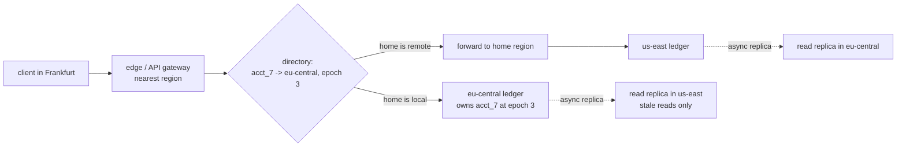
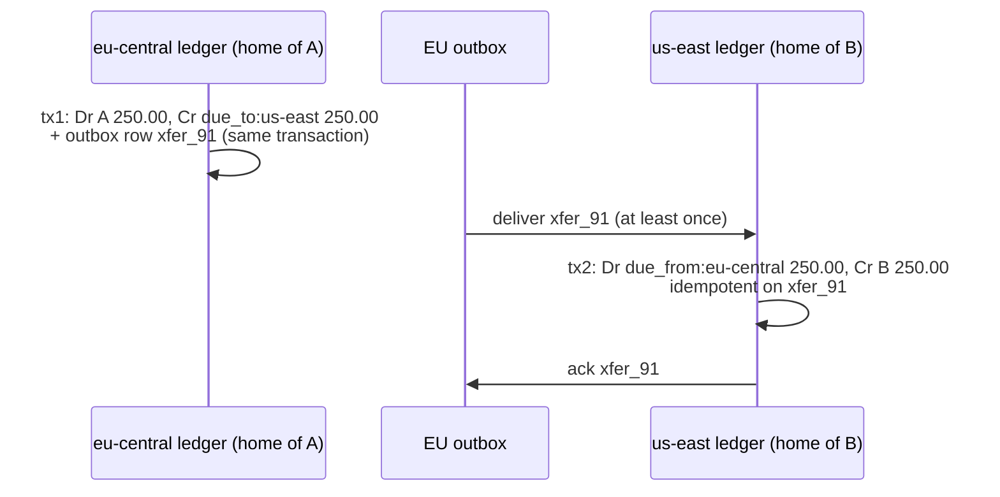

# Multi-Region Ledgers and Home-Region Routing

> An account lives somewhere; route to it.

**Type:** Learn
**Languages:** —
**Prerequisites:** Phase 6, Lesson 03 (Leader-Based Replication), Phase 7, Lesson 01 (Partitioning and Rebalancing), Phase 7, Lesson 13 (Transactional Outbox), Phase 9, Lesson 11 (Multi-Region and Disaster Recovery), Phase 10, Lesson 03 (Double-Entry Ledger), Phase 10, Lesson 08 (Reconciliation), Phase 14, Lesson 03 (Exactly-Once Money Movement)
**Time:** ~90 minutes

## Learning Objectives

- Explain why a balance with a non-negative invariant cannot be written in two regions concurrently without coordination, and show the double spend that results
- Design home-region ownership for accounts: a directory, routing at the edge, an ownership epoch that fences misrouted writes, and stale reads from replicas
- Move money between accounts homed in different regions with clearing accounts and an outbox, keeping every region's ledger balanced at every instant and proving the pair ties out
- Distinguish the per-region durability guarantee (synchronous, across zones) from cross-region disaster recovery (asynchronous, with an RPO), and write the failover procedure that reconciles the lost tail
- Choose an account's home region from data-residency rules, the licensed legal entity, and latency, and plan the migration of an account between regions

## The Problem

A digital wallet launches in Europe and the United States. To give both continents low latency, the team deploys the ledger in `eu-central` and `us-east` as an active-active pair: each region accepts writes for any account and replicates its journal to the other asynchronously, with a typical lag of 300 ms. Balances are computed from the replicated journal. Load tests pass. The architecture review praises the availability.

A customer in Frankfurt has 600.00 EUR. At 14:02:11.200 her phone, on a mobile network that routes through Frankfurt, pays a 500.00 EUR invoice through the app. At 14:02:11.350 a scheduled transfer she set up last month, triggered by a job running in `us-east`, sends 500.00 EUR to her landlord. Each region checks the balance it can see: 600.00, enough. Each region posts the debit. Replication delivers each debit to the other region 300 ms later, and the balance becomes -400.00. Neither write was wrong given what its region knew. The ledger now records money that does not exist, and the platform has already sent 1,000.00 EUR out through two payment rails.

A week later `us-east` has a regional outage. The team fails over to `eu-central`, which has been receiving `us-east`'s journal with a 300 ms lag. Forty-one transactions acknowledged to customers in the last 300 ms before the outage are not in `eu-central`'s copy. Customers who were told "transfer complete" see their old balance, some retry, and when `us-east` returns its journal disagrees with the one that took writes during the outage.

Both failures come from the same design error: letting any region write any account. Money has an invariant that is not commutative (a balance must not go below its limit), and an invariant like that needs one place that decides. This lesson builds the alternative used by every large multi-region ledger: each account has exactly one **home region** that owns its writes; requests are routed to it; money moving between accounts in different regions goes through **clearing accounts** with an outbox, so no transaction ever needs two regions to commit together; and disaster recovery is a deliberate, fenced failover with a reconciliation of the tail, not an accident of replication.

## The Concept

### Why balances need coordination

Some invariants survive concurrent, uncoordinated writes and some do not. "Every journal entry has a unique id" survives if ids are generated with a region prefix. "The set of transactions only grows" survives: merge two sets and you have a valid set. These are the invariants that conflict-free replicated data types (CRDTs) and multi-leader replication handle well.

"Balance never goes below zero" does not survive. Two debits that are each valid against the same starting balance can be jointly invalid. Bailis et al. formalised this as **invariant confluence**: an invariant can be maintained without coordination only if merging any two valid states that diverged from a common valid state always produces a valid state. A non-negative balance under concurrent withdrawals is the textbook counterexample, alongside uniqueness constraints and foreign keys with deletes. The conclusion is not that multi-region ledgers are impossible; it is that the coordination has to happen somewhere, and the cheapest place is a single owner per account.

| Approach | Who decides a debit | Cross-region latency on a debit | Double-spend possible? | Residency control |
|----------|---------------------|----------------------------------|------------------------|-------------------|
| Active-active, async multi-leader | Whichever region received it | None | Yes, whenever writes overlap within the replication lag | Poor: every region holds every account |
| Global consensus (Spanner, CockroachDB default) | A quorum spanning regions | One cross-region round trip per commit | No | Configurable per row or table |
| Home region (partitioned single leader) | The account's home region | None if the client is near home; one hop if not | No | Strong: data written only in its home |

Home-region ownership is the partitioning of Phase 7, Lesson 01 with geography as the partition key, combined with leader-based replication within the partition. Global consensus is the alternative when accounts genuinely have no home (a shared treasury account debited from every continent) and you can afford a cross-region round trip on every write to it.

### The home region and the directory

Every account has a home region recorded in an **account directory**: `account_id -> (home_region, epoch)`. The directory is small (one row per account), read on every request, and written rarely (on account creation and migration). It is stored with strong consistency: in a globally replicated consensus store, or derived deterministically from the account id when accounts never move (for example, an id prefix `eu_` or `us_` assigned at creation).

The **epoch** is a counter that increments every time the account's home changes. Every write to the ledger carries the epoch the router saw. The home region accepts a write only if it currently owns the account at that epoch. This is a fencing token (Phase 6): a router with a stale cached directory entry, or an old home region that has not yet heard it lost the account, cannot apply a write.



Routing rules:

1. **Writes go home.** A debit, a hold, or a transfer out of an account is executed by its home region. If the request arrives elsewhere, the edge forwards it. The forward costs one cross-region round trip (80 to 150 ms between Europe and the US East coast), which is why choosing the home near the customer matters.
2. **Reads that decide go home.** "Can this customer afford this payment?" is a write in disguise: it must be answered by the home region, under the same lock or transaction as the debit.
3. **Reads that display can be stale.** A transaction history screen can be served from a local replica, labelled as of its replication timestamp. Never let a stale read feed a decision.
4. **The directory is cached with its epoch.** Routers cache entries; a write rejected for a stale epoch causes a directory refresh and one retry.

### The fenced write, in SQL

The home region's debit is one local transaction that checks ownership, checks the balance, posts the journal, and writes the outbox row together. In PostgreSQL-flavoured SQL:

```sql
BEGIN;
-- 1. Ownership: this region must own the account at the epoch the router used.
SELECT 1 FROM account_ownership
 WHERE account_id = :acct AND home_region = 'eu-central' AND epoch = :request_epoch
 FOR SHARE;                                   -- zero rows: reject with STALE_EPOCH, router refreshes
-- 2. Balance: lock the balance row so concurrent debits serialize here.
SELECT balance_minor FROM account_balances WHERE account_id = :acct FOR UPDATE;
-- abort if balance_minor - :amount < floor_minor
-- 3. Journal, balanced, and the cross-region message in the same commit.
INSERT INTO journal_lines (journal_id, account_id, amount_minor, currency) VALUES
  (:xfer, :acct, :amount, 'EUR'),
  (:xfer, 'due_to:us-east', -:amount, 'EUR');
UPDATE account_balances SET balance_minor = balance_minor - :amount WHERE account_id = :acct;
INSERT INTO outbox (message_id, destination, payload) VALUES (:xfer, 'us-east', :payload);
COMMIT;
```

Migration takes the ownership row `FOR UPDATE` and bumps the epoch, so it waits for in-flight debits holding it `FOR SHARE` and every later debit at the old epoch finds zero rows. The balance lock is the single decider that the active-active design lacked.

### Staleness budgets for reads

Every read path in the product gets an explicit answer to "may this be served from a replica, and how stale may it be?" Writing the table down prevents the most common multi-region bug, a stale read quietly promoted to a decision.

| Read | Served from | Staleness allowed | Why |
|------|-------------|-------------------|-----|
| Balance shown on the home screen | Local replica | Seconds, with "as of" time | Display only; refreshed after the customer's own writes by reading home |
| Balance check before a debit | Home, same transaction as the debit | None | It is part of the write |
| Transaction history | Local replica | Minutes | Display; new items appear when replication catches up |
| Customer's own just-completed payment | Home, or replica at a position at least the write's | Read-your-writes | The customer must see what they just did |
| Risk features (velocity, recent spend) | Local replica or feature store | Seconds to minutes, measured | Advisory input; the debit re-checks the hard limits at home |
| Statements and regulatory reports | Home region, from a closed period | None within the period | Must match the books exactly (Phase 10, Lesson 12) |

Read-your-writes is implemented by returning the commit's journal position to the client with the response and having replicas refuse (or forward) reads whose requested position they have not yet applied. It costs one integer per response and removes the "my payment disappeared" support ticket.

### Per-region consistency

Inside a region, the ledger is a normal strongly consistent database: a single leader, synchronous replication to standbys in at least two other availability zones, and a commit acknowledged only after the standbys have it. Losing a zone loses no acknowledged transaction. This is the guarantee customers experience day to day, and it costs a few milliseconds per commit because zones are close together.

Between regions, replication is asynchronous. It exists for disaster recovery and for stale reads, not for correctness. The asymmetry is deliberate: synchronous replication across an ocean adds 80 ms or more to every commit, and the probability of losing a whole region is far lower than the probability of losing a zone.

### Cross-region transfers with clearing accounts

A customer homed in `eu-central` (account A) sends 250.00 EUR to a merchant homed in `us-east` (account B). No single region owns both accounts, and a two-phase commit across regions (Phase 7, Lesson 08) would hold locks across an ocean and block on any coordinator failure. Instead, each region keeps a **clearing account** for every other region: in `eu-central`, `due_to:us-east` (what EU owes US); in `us-east`, `due_from:eu-central` (what US is owed by EU). Banks call the same structure nostro and vostro accounts.

The transfer is two local transactions joined by a message:



Step by step, with debits positive:

| Moment | EU: A | EU: due_to:us-east | US: due_from:eu-central | US: B | In flight |
|--------|-------|--------------------|-------------------------|-------|-----------|
| Before | 600.00 balance | 0.00 | 0.00 | 1,000.00 balance | 0.00 |
| After tx1 | 350.00 | -250.00 (credit) | 0.00 | 1,000.00 | 250.00 |
| After tx2 | 350.00 | -250.00 | +250.00 (debit) | 1,250.00 | 0.00 |

Three properties hold at every row:

1. **Each region's ledger balances on its own.** tx1 is a balanced journal in EU; tx2 is a balanced journal in US. No region ever holds half a transaction.
2. **The mirror ties out.** `due_to:us-east (EU) + due_from:eu-central (US) + in flight = 0`. Before tx2 it is `-250 + 0 + 250`; after, `-250 + 250 + 0`. Reconciliation (Phase 10, Lesson 08) checks this equation per region pair, every few minutes, and any non-zero residual is a lost or duplicated message.
3. **The debit decision is made by the debtor's home.** A's balance check and A's debit happen in one local transaction in EU. The US side only ever credits, and crediting has no invariant that can fail (unless B is closed, which is handled by a return transfer, never by an exception after the fact).

The mirror check is a query per region pair, run against each region's ledger and the sender's outbox, and compared in a reconciliation job:

```sql
-- in eu-central
SELECT sum(amount_minor) AS due_to_us FROM journal_lines WHERE account_id = 'due_to:us-east';
SELECT coalesce(sum((payload->>'amount_minor')::bigint), 0) AS in_flight
  FROM outbox WHERE destination = 'us-east' AND acked_at IS NULL;
-- in us-east
SELECT sum(amount_minor) AS due_from_eu FROM journal_lines WHERE account_id = 'due_from:eu-central';
-- reconciliation: due_to_us + in_flight + due_from_eu must be 0, plus the same check in the other direction
```

The three queries run at slightly different instants, so a transfer acknowledged between them can appear in two places or none. The job either reads all three as of a common cut (each region's journal position plus the outbox position recorded with it) or tolerates residuals that clear on the next run and alerts only on residuals that persist across two runs.

The outbox row is written in the same local transaction as tx1 (Phase 7, Lesson 13), so the message exists if and only if the debit does. Delivery is at least once and tx2 is idempotent on the transfer id (Phase 14, Lesson 03), so redelivery is harmless. If B's account is closed or frozen, US posts a return: `Dr B-suspense, Cr due_from:eu-central`, and sends a return message that EU applies as `Dr due_to:us-east, Cr A`. The clearing accounts return to zero for that transfer, and both sides keep the audit trail.

The clearing balances grow with traffic in each direction and net out against each other. If the regions are separate legal entities (a European e-money institution and a US money transmitter), the net position is settled periodically with a real bank transfer between the entities, which posts `Dr due_to:us-east, Cr cash` in EU and `Dr cash, Cr due_from:eu-central` in US. If they are one entity, the clearing accounts are an internal device that consolidated financial statements eliminate.

### Currency across regions

If A holds EUR and B holds USD, the conversion happens in exactly one place, chosen in advance: usually the sender's home, which quotes a rate and debits A in EUR, credits `due_to:us-east` in USD through an FX position account (Phase 10, Lesson 09), and sends a USD-denominated message. The receiving region never converts. Two regions converting the same transfer at two rates is a reconciliation break by construction.

### Disaster recovery

Each region's ledger is replicated asynchronously to a standby in another region. The standby is not a second owner; it is a copy that can be promoted when the home region is lost.

- **RPO (recovery point objective)**: how much acknowledged data can be lost. With asynchronous replication it is the replication lag at the moment of failure: 300 ms in The Problem, which was 41 transactions.
- **RTO (recovery time objective)**: how long until the accounts can be written again. It is dominated by the decision to fail over, not by the mechanics.

The failover procedure for the accounts homed in the failed region:

1. **Decide.** A human or a well-tested automated policy declares the region lost. Flapping between regions is worse than a few minutes of read-only.
2. **Fence.** Increment the epoch of every account homed in the failed region in the directory, so that if the old region comes back it cannot accept writes. If the storage layer supports it, revoke the old leader's lease.
3. **Promote.** Make the standby the new home at the new epoch. Its state is the old home's state minus the unreplicated tail.
4. **Identify the tail.** Everything acknowledged by the old region after the last replicated position is unknown. The sources that know about it are outside the failed region: outbox messages already delivered to other regions (they carry transfer ids), the card processor's and the bank's records of payments initiated (Phase 14, Lesson 04), and client-side idempotency keys that will be retried.
5. **Reconcile the tail.** Replay what can be proven from external records, idempotently. When the old region returns, extract its journal after the replicated position, diff it with what was replayed, and post corrections as new journal entries (Phase 10, Lesson 06), never by editing history.

Accounts homed elsewhere are unaffected except for transfers in flight to or from the failed region, which wait in outboxes. That isolation is a second benefit of home regions: an outage in one region is not an outage of the whole ledger.

Synchronous cross-region replication (RPO zero) is the alternative for accounts where losing 300 ms is unacceptable, such as a treasury account. It costs a cross-region round trip on every commit and, with two regions, makes each region's availability depend on the other's. Three-region consensus (Spanner-style, Phase 7, Lesson 09) avoids the second problem at the cost of the first.

### Residency and the legal home

The home region is not only a latency decision.

- **Data residency.** Some regulators require payment data to be stored in-country. The Reserve Bank of India's 2018 directive on storage of payment system data requires the full end-to-end transaction data of payment systems operating in India to be stored only in India (with limited exceptions for the foreign leg of cross-border transactions). The EU's GDPR restricts transfers of personal data outside the EEA without an adequacy decision or safeguards. A home region inside the jurisdiction, with stale replicas restricted to the same jurisdiction, is the straightforward way to comply.
- **The licensed entity.** The ledger records obligations of a legal entity: the e-money institution licensed in Ireland owes EU customers their balances. That entity's books are usually expected to be in its own systems in its jurisdiction. The home region follows the contracting entity, which follows the customer's country.
- **Latency.** Within those constraints, the region nearest the customer's usual location.

### Moving an account between regions

A customer moves from Germany to the United States and is onboarded by the US entity. Migration is a transfer of the balance plus a change of ownership:

1. Freeze writes to the account in its old home (new payments rejected with a retryable error; holds left in place).
2. Wait for in-flight holds and transfers to complete or expire; pending card authorizations block the migration until they capture or expire.
3. Post a cross-region transfer of the full balance from `eu_acct` to a new `us_acct` through the clearing accounts, as above.
4. Update the directory to the new home with epoch + 1. Old routers now get fenced.
5. Unfreeze in the new home. History stays in the old region (residency again); the new account links to it.

### Worked design: a wallet in three jurisdictions

Requirements: 30 million accounts, 70% EU, 25% US, 5% India; peak 4,000 payments per second; p99 debit latency under 200 ms for customers in their home jurisdiction; India data in India; RPO under 1 second and RTO under 30 minutes.

| Decision | Choice | Reason |
|----------|--------|--------|
| Regions | `eu-central` (home EU), `us-east` (home US), `ap-south` (home India); DR standbys in `eu-west`, `us-west`, a second Indian region | One home per jurisdiction, standby in the same jurisdiction for residency |
| Directory | Account id prefix encodes jurisdiction at creation; a small consensus store maps id to region and epoch for migrated accounts | Most lookups need no network call; migrations are rare |
| Per-region store | Single-leader relational database, synchronous standbys in 3 zones | Zone loss loses nothing; commit adds ~2-5 ms |
| Cross-region | Clearing account per region pair (6 accounts), outbox + idempotent consumer, mirror reconciliation every 5 minutes | No distributed transactions; every region balanced alone |
| Throughput | EU home takes ~2,800 payments/s at peak; partition the EU ledger by account id within the region (Phase 7, Lesson 01) | One leader cannot take all of it with headroom |
| DR | Async replication to the in-jurisdiction standby, measured lag p99 400 ms; fenced failover runbook; tail reconciliation from outbox and processor records | Meets RPO < 1 s and RTO < 30 min with a human decision |
| India | Card data and full transaction records only in Indian regions; the US and EU see only the clearing-level message for cross-border transfers | RBI storage directive |

A latency check for a US customer travelling in Europe: phone to `eu-central` edge 20 ms, forward to `us-east` 90 ms, commit 5 ms, back 90 + 20 ms: about 225 ms, outside the 200 ms target. The requirement says "in their home jurisdiction," so this is acceptable and documented; the alternative, re-homing on travel, would break residency and churn the directory.

### Failure modes

1. **Directory split brain.** Two routers disagree about an account's home because the directory itself was replicated asynchronously. Every write is then a potential double spend. The directory must be strongly consistent or immutable.
2. **Unfenced old home.** After a failover, the old region returns and its stale clients write to it. Without epochs those writes are accepted and diverge. Fencing is not optional.
3. **Stale read used for a decision.** A risk check reads the balance from the local replica, approves, and the home region debits based on that approval without re-checking. The check and the debit must be in the same home-region transaction.
4. **Clearing drift.** A consumer bug drops one message in a million. Without the mirror reconciliation, the clearing accounts drift silently for months, and the year-end intercompany settlement does not tie out.
5. **Two conversions.** Both regions apply FX to a cross-currency transfer. The fix is policy: one region converts, the message carries the converted amount.
6. **Hot shared accounts.** A fee-revenue account that every region credits on every payment is a single global hotspot. Give each region its own fee account and consolidate in reporting.

### Testing the design

The properties above are only true if they are tested under the faults that break them. A deterministic simulation (Phase 14, Lesson 10) of two or three regions with a seeded network should, at minimum:

1. Send concurrent debits for one account to every region and assert no balance ever goes below its floor.
2. Duplicate, delay, and reorder every cross-region message and assert the mirror equation holds after the network heals.
3. Kill a region between tx1 and the relay, promote its standby, and assert that the tail reconciliation recovers every transfer whose effects are visible elsewhere.
4. Bring the old region back with clients still pointed at it and assert that every write it receives is fenced by epoch.
5. Migrate an account while debits are in flight and assert that the old and new homes never both accept a write.

### What home regions do not solve

They do not make a cross-region transfer atomic: between tx1 and tx2 the money is in flight, visible as a clearing balance, and the customer-facing status must say so. They do not help accounts with no natural home; those need consensus or a designated owner region. They do not remove the need for reconciliation; they make it local and cheap. And they do not decide the law: residency requirements change, and the region layout must be reviewed with counsel when they do.

## Worked Example

### The double spend, replayed with a home region

The Frankfurt customer's account `eu_7` (balance 600.00 EUR) is homed in `eu-central` at epoch 3. The same two debits arrive 150 ms apart:

| Time (ms) | Event | Where it executes | Balance check | Result |
|-----------|-------|-------------------|---------------|--------|
| 0 | Phone pays 500.00 invoice; edge in Frankfurt | `eu-central` (home) | 600.00 >= 500.00 | Committed, balance 100.00 |
| 150 | `us-east` job sends 500.00 rent; edge in Virginia sees home is `eu-central` | Forwarded, arrives at ~240 ms | | |
| 240 | Rent debit in `eu-central` | `eu-central` (home) | 100.00 < 500.00 | Rejected: insufficient funds |
| 540 | Replica in `us-east` catches up | Read-only | | History shows one payment |

The rent payment fails cleanly, with a decline the job can retry tomorrow, and the platform never sends money it does not have. The cost was 90 ms of forwarding on a scheduled job that nobody was waiting for. If the job had run in `eu-central` in the first place (schedule jobs in the account's home), there would be no forward at all.

### A failover, counted

`us-east` fails at 03:12:07.400. Its standby in `us-west` has applied the journal up to 03:12:07.100. The 300 ms tail held 41 acknowledged transactions. After fencing (epochs bumped for all 7.4 million `us-east` accounts in one directory transaction) and promotion, the team classifies the tail from external evidence:

| Tail transactions | Count | Evidence outside the failed region | Action in the promoted region |
|-------------------|-------|------------------------------------|-------------------------------|
| Card captures | 22 | Processor's capture report and webhook redeliveries | Replayed idempotently by capture id |
| Cross-region transfers out | 9 | Messages already delivered to `eu-central` and `ap-south` (their tx2 exists) | Replayed: post the tx1 debits so the mirror ties out |
| Cross-region transfers in | 3 | Senders' outboxes still hold them unacknowledged | Redelivered automatically; consumer posts tx2 |
| Internal transfers between two `us-east` accounts | 5 | Client retries with the same idempotency key | Re-executed on retry; 1 client never retried |
| Payouts initiated to banks | 2 | Bank's file acknowledgement | Replayed: post the payout journal |

Forty of 41 are recovered within the hour. The one internal transfer whose client never retried is found when `us-east` returns and its journal after 03:12:07.100 is diffed with the promoted region's: one journal id present only in the old region. It is posted as a correcting entry with a reference to the old journal id. The customer saw a "completed" transfer briefly disappear, which is why the RPO is in the customer terms of service as well as the runbook.

### Choosing a home region: the decision procedure

1. Which legal entity holds this customer's funds? Its jurisdiction bounds the candidate regions.
2. Does a residency rule apply to this customer's data (in-country storage, personal-data transfer restrictions)? Remove regions that violate it, including for replicas and backups.
3. Among the remaining regions, pick the one with the lowest latency to where the customer usually transacts.
4. Is the account debited from many regions at similar rates (a treasury, a shared pool)? If so, consider a consensus-replicated home spanning the candidate regions instead of one region.
5. Record the choice in the directory with epoch 1, and record the reason, because the next migration review will ask.

## Exercises

1. **Reinforce.** Draw the clearing-account table (like the one above) for a 100.00 EUR transfer from `us-east` account C to `eu-central` account A that happens while the 250.00 EUR transfer from A to B is still in flight. Show the mirror equation for the region pair at each of the four intermediate moments.
2. **Apply.** Write the failover runbook for `us-east` in the worked design as a numbered checklist, including who decides, how the directory epochs are bumped in bulk, which external records are used to reconstruct the tail, and how corrections are posted when `us-east` returns. State the RPO you can actually promise given a measured replication lag p99 of 400 ms and p99.99 of 3 s.
3. **Extend.** Using Phase 14, Lesson 03's exactly-once pipeline, sketch the code for a cross-region transfer: the EU transaction that posts tx1 and the outbox row, the relay, and the US consumer that posts tx2 idempotently. Add the return path for a closed destination account, and the mirror reconciliation job from Phase 10, Lesson 08. List the tests that prove the mirror equation holds under duplicate delivery, reordering, and a crash between tx1 and the relay.

## Key Terms

| Term | What people say | What it actually means |
|------|-----------------|------------------------|
| Home region | "where the account is" | The single region that owns an account's writes and the decisions that depend on its balance |
| Account directory | "the routing table" | A strongly consistent map from account to home region and ownership epoch, read on every request |
| Ownership epoch | "version" | A counter incremented on every change of home; writes carry it, and a home accepts only writes at its current epoch (a fencing token) |
| Clearing account | "inter-region account" | A per-region-pair ledger account (due to / due from) that holds the in-flight side of cross-region transfers so each region balances on its own |
| Mirror reconciliation | "intercompany recon" | Checking that `due_to (A) + due_from (B) + in flight = 0` for every region pair |
| RPO | "data loss" | The amount of acknowledged data that can be lost in a regional failure; with async replication, the lag at failure |
| RTO | "downtime" | Time from failure to accepting writes again for the affected accounts |
| Invariant confluence | "can it be eventually consistent?" | Whether merging any two valid divergent states always yields a valid state; non-negative balances are not confluent, so they need an owner |

## Further Reading

- [Bailis et al., "Coordination Avoidance in Database Systems" (VLDB 2015)](https://www.vldb.org/pvldb/vol8/p185-bailis.pdf) — invariant confluence, and the proof that non-negative balances under concurrent withdrawal require coordination.
- [Corbett et al., "Spanner: Google's Globally-Distributed Database" (OSDI 2012)](https://research.google/pubs/spanner-googles-globally-distributed-database-2/) — the consensus alternative to home regions, and what a cross-region commit costs.
- [Reserve Bank of India, "Storage of Payment System Data" (circular, April 2018)](https://www.rbi.org.in/Scripts/NotificationUser.aspx?Id=11244) — the in-country storage requirement that forces a home region for Indian payment data.
- [Regulation (EU) 2016/679 (GDPR), Chapter V: Transfers of personal data to third countries](https://eur-lex.europa.eu/eli/reg/2016/679/oj) — the rules that constrain where replicas of EU customers' data may live.
- [CockroachDB documentation: Multi-region capabilities and REGIONAL BY ROW tables](https://www.cockroachlabs.com/docs/stable/multiregion-overview) — a production database expressing home regions as a per-row property with configurable survival goals.
- [Kleppmann, "Designing Data-Intensive Applications" (O'Reilly, 2017), Chapters 5 and 9](https://dataintensive.net/) — multi-leader replication conflicts, fencing tokens, and linearizability, the background for every routing rule here.
