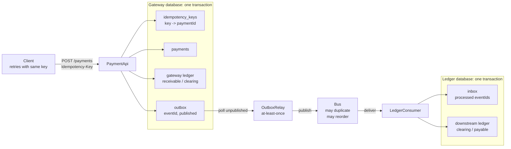

# Exactly-Once Money Movement End to End

> Exactly-once delivery is impossible; exactly-once effect is a chain of dedupe points, and the chain is only as strong as the seam you forgot.

**Type:** Build
**Languages:** Java, Python, Go
**Prerequisites:** Phase 5 Lesson 09 (Idempotency Keys), Phase 7 Lesson 13 (The Transactional Outbox), Phase 8 Lesson 03 (Delivery Guarantees), Phase 10 Lesson 03 (The Double-Entry Ledger), Phase 14 Lesson 01 (Architecture of a High-Availability Payment Gateway)
**Time:** ~150 minutes

## Learning Objectives

- Enumerate the seven places a payment pipeline can crash or duplicate and state, for each, which mechanism absorbs it
- Build an idempotent API, a transactional outbox, an at-least-once relay, a deduplicating consumer, and a ledger that posts with a unique entry id, as one pipeline
- State the five invariants that together mean "money moved exactly once" and encode each as a checker over the final state
- Drive the pipeline through thousands of operations under a seeded fault schedule and prove the invariants hold, reproducibly by seed
- Remove one defence at a time and name, from the harness output alone, which invariant each defence was protecting

## The Problem

A merchant-of-record platform processes a 19.99 USD card payment. The API handler writes the payment row, commits, and then the process is killed by the orchestrator during a deploy before the HTTP response leaves the box. The client's SDK sees a timeout and retries with the same body. The handler, now on a new pod, has no memory of the first attempt and writes a second payment row. Two outbox events go to the message bus. The relay that publishes them crashes once between "publish" and "mark as published", so one of the two is published twice. The bus delivers three messages to the ledger consumer; the consumer processes the first, commits, and is killed before acknowledging, so the bus redelivers it. Four messages for one payment arrive at the ledger. If the ledger accepts whatever it is given, the merchant's payable account is credited 79.96 USD for a 19.99 USD sale.

Each of those failures is individually rare. At 2,000 payments per second with a monthly deploy cadence across a few hundred pods, each one happens many times a day. The reconciliation job (Phase 10, Lesson 08) will eventually find the breaks, but a break in a merchant payable that was already paid out is an operational loss, and a break that double-charges a customer is a complaint, a chargeback, and a regulator's letter. The cost of finding the problem after the fact is dominated by the cost of having had the problem.

The naive responses do not work. "Make the bus exactly-once" is not available: a message bus can deduplicate within a session or a partition, but it cannot know whether the consumer's side effect happened before the consumer crashed. "Wrap the whole thing in one transaction" is not available either: the client, the gateway database, the bus, and the ledger database are four systems with no shared transaction coordinator, and two-phase commit across them (Phase 7, Lesson 08) is both slow and blocked by the client, which you do not control. What is available is a chain of local, idempotent steps, each of which tolerates being run again, so that the whole pipeline produces exactly one *effect* no matter how many times each step is *attempted*. This lesson builds that chain, then attacks it with a seeded fault injector for three thousand operations and checks that not one minor unit was created or destroyed.

## The Concept

### Delivery versus effect

The phrase "exactly-once delivery" conflates two things. *Delivery* is a message arriving at a process. *Effect* is a durable state change caused by it. A process can crash after the effect and before acknowledging the delivery; from the outside, the message was delivered and must be re-sent, but the effect already exists. No protocol can distinguish "delivered, effect pending" from "delivered, effect done, ack lost" without the receiver remembering what it did. So the receiver must remember, in the same durable store and the same transaction as the effect itself. That memory is the dedupe record, and the design question for the whole lesson is *where the dedupe records live and what key they use*.

| Seam | What can happen | Who remembers | Key |
|------|-----------------|---------------|-----|
| Client to API | Response lost; client retries the same request | Gateway database | Client-supplied idempotency key |
| API to bus | Payment committed but event never emitted (dual write) | Gateway database | Outbox row written in the payment's transaction |
| Relay to bus | Published but not marked; re-published on restart | Nobody; at-least-once is accepted here | Event id carried in the message |
| Bus to consumer | Duplicate, reorder, redelivery after a consumer crash | Consumer database | Processed-event inbox keyed by event id |
| Consumer to ledger | Same event handled twice | Ledger | Entry id equals event id |

Each row is a layer of defence, and each defence is a *local* transaction: the API's check-then-write happens inside the gateway database; the consumer's check-then-post happens inside the ledger database. There is no distributed transaction anywhere in the pipeline, which is exactly why it can be fast and why it survives any single component dying at any instant.

### The pipeline



Reading left to right: the client supplies the first dedupe key; the gateway's transaction binds payment, ledger entry, and outbox row so none can exist without the others; the relay is deliberately *not* exactly-once because making it so would require a transaction spanning the database and the bus; the bus is a hostile environment that duplicates and reorders; the consumer's inbox makes the hostile environment harmless; and the ledger entry id is the same string as the event id, so even a bug in the inbox would be caught by a unique constraint (Exercise 1 adds that constraint and discusses why the lesson leaves it out).

### The seven fault points

The implementation names every place a process can die as a `FaultPoint`, and the harness can fire any of them with any probability. Each one corresponds to a real production failure:

| Fault point | Production equivalent | Observable consequence | Absorbed by |
|-------------|----------------------|------------------------|-------------|
| `API_BEFORE_COMMIT` | Pod killed mid-request; database connection dropped | Nothing written; client times out and retries | Nothing needed: a fresh attempt proceeds normally |
| `API_AFTER_COMMIT` | Commit succeeded, response lost on the wire | Payment exists; client times out and retries | Idempotency key lookup returns the stored payment as a replay |
| `RELAY_AFTER_PUBLISH` | Relay publishes, dies before updating the row | Event is on the bus twice after restart | Consumer inbox |
| `BUS_DUPLICATE` | Producer-side retry inside the bus client | Two copies of one event | Consumer inbox |
| `BUS_REORDER` | Partition rebalance; multiple producers | Events arrive in a different order than committed | Nothing needed: each event is self-contained |
| `CONSUMER_BEFORE_COMMIT` | Consumer dies while handling | Nothing written; message redelivered | Nothing needed: a fresh attempt proceeds normally |
| `CONSUMER_AFTER_COMMIT` | Consumer commits, dies before ack | Posting exists; message redelivered | Consumer inbox |

Notice the pattern. "Before commit" faults are free: a crash before any durable write is indistinguishable from the request never having arrived, and a retry is a first attempt. "After commit" faults are the dangerous ones, and every one of them is absorbed by a dedupe record that was written *in the same transaction as the effect*. That is the whole trick. If the inbox insert and the ledger posting were two transactions, `CONSUMER_AFTER_COMMIT` could land between them and the inbox would say "done" about a posting that never happened, or the posting would exist with no inbox record and be posted again on redelivery.

### The invariants

"Exactly once" is not one property. The harness checks five, and a failing run reports which one broke, because each maps to a specific missing defence:

1. **one-payment-per-key.** Every idempotency key maps to exactly one payment, and the payment the client was told about is the one in the store. Broken by removing API dedupe.
2. **payment-has-outbox-row.** No payment exists without its outbox row. Broken by writing the payment and the outbox row in separate transactions (the dual-write anti-pattern).
3. **posted-once-gateway / posted-once-downstream.** Every accepted payment appears exactly once in each ledger's journal, and the journals contain nothing else. Broken by removing consumer dedupe.
4. **trial-balance.** Both ledgers sum to zero across all accounts. This is the double-entry invariant from Phase 10, Lesson 03; a single unbalanced entry would break it, and so would a crash between two postings of the same entry if the ledger were not written atomically.
5. **money-conserved / charged-what-was-asked.** The gateway's clearing liability equals the sum of accepted payments; the downstream merchant payables equal the same sum; and each customer's receivable equals the sum of that customer's distinct acknowledged requests. This is the one the finance team cares about: it says no unit of money appeared or vanished between the client's intent and the merchant's balance.

The first three are structural (counts); the last two are arithmetic (sums). A pipeline can satisfy the counts and fail the sums if, for instance, a replayed request returned a payment with a different amount than the one stored; the fingerprint check guards that.

### Worked example: one payment, every seam crashing once

Trace a single 19.99 USD payment with the demo's deterministic faults, each fired exactly once.

```text
attempt 1   createPayment(key-1, cust-7, merch-2, 19.99 USD)
            transaction writes: payments[pay-000001], idempotencyKeys[key-1] = pay-000001,
                                gateway ledger entry pay-000001 (DR receivable:cust-7 19.99, CR clearing 19.99),
                                outbox[evt-pay-000001] = unpublished
            commit
            CRASH API_AFTER_COMMIT          <- client sees a timeout

attempt 2   createPayment(key-1, same body)
            idempotencyKeys[key-1] exists -> fingerprint "cust-7|merch-2|19.99 USD" matches
            return Response(pay-000001, replayed=true)
            state: payments=1 gatewayEntries=1 outboxRows=1

relay 1     unpublished = [evt-pay-000001]; publish to bus
            CRASH RELAY_AFTER_PUBLISH       <- row still says unpublished
relay 2     unpublished = [evt-pay-000001]; publish again; mark published
            bus now holds 2 copies of evt-pay-000001

deliver     copy 1: inbox lacks evt-pay-000001 -> transaction { inbox.add, post entry evt-pay-000001 } commit
            copy 2: inbox has evt-pay-000001   -> skipped, skippedDuplicates=1

final       gateway:    receivable:cust-7 = 19.99,  clearing:acquirer = -19.99,  trial = 0.00
            downstream: clearing:acquirer = 19.99,  payable:merch-2  = -19.99,  trial = 0.00
```

Two API attempts, two relay attempts, two deliveries, one payment, one posting per ledger, every balance correct. Now imagine the same trace without the idempotency key lookup: attempt 2 writes `pay-000002`, two events reach the bus, and `cust-7` is charged 39.98 USD. Or without the inbox: copy 2 posts a second `evt-pay-000001`, `merch-2` is owed 39.98 USD, and the downstream trial balance is still zero, because double-entry conservation is a weaker property than exactly-once. That last point is worth sitting with: **a balanced ledger is not evidence that the pipeline is correct.** The harness checks both.

### Why the relay is allowed to be at-least-once

The relay reads an outbox row, publishes to the bus, and updates the row. Making that atomic would need a transaction spanning the gateway database and the bus, which neither participates in. The two orderings are: publish-then-mark (a crash between them republishes; duplicates downstream) or mark-then-publish (a crash between them loses the event; the payment is never posted downstream). Lost events are a reconciliation break that someone must find and repair by hand. Duplicate events are absorbed by a consumer inbox that must exist anyway, because the bus itself can duplicate. So publish-then-mark is the only defensible order, and the consumer is designed on the assumption that it will receive every event at least once and some events several times. This is the same reasoning that makes Kafka producers at-least-once by default and pushes dedupe to the consumer.

### Complexity and cost

Every dedupe check is a point lookup by key: `O(1)` in a hash index, `O(log n)` in a B-tree. The cost is storage, not time. The idempotency-key table grows by one row per distinct request and the inbox by one row per event, forever, unless expired. Production systems expire idempotency keys after 24 hours to a few days (Stripe documents 24 hours) and inboxes after the bus's retention period, because a duplicate cannot arrive after the bus has forgotten the message. The harness does not expire anything, because a run is a few thousand operations; Exercise 2 adds expiry and asks what new failure it introduces.

### What this pipeline does not do

- It does not order events. Each `PaymentEvent` is self-contained, so `BUS_REORDER` is harmless. A pipeline that emits `authorized` then `captured` for the same payment needs per-key ordering (Phase 8, Lesson 04) or a consumer that tolerates seeing `captured` first.
- It does not retry the downstream processor or handle a processor's own idempotency. The processor adapter (Phase 12, Lesson 03) is another seam with the same shape and is omitted here so the pipeline fits in one file.
- It does not model concurrent handlers. Two API pods receiving the same key simultaneously is a race that the unique index on `idempotency_keys` resolves in a real database: one insert wins, the other gets a constraint violation and falls back to the replay path. The in-memory store is single-threaded, so the race cannot occur in the demo; the Go version's `-race` run confirms there is no accidental sharing.

## Build It

The primary walkthrough is in Java. Python and Go implement the same types with the same names; the subsections at the end show only what differs.

### Step 1: Faults as first-class values

```java
enum FaultPoint {
    API_BEFORE_COMMIT, API_AFTER_COMMIT, RELAY_AFTER_PUBLISH, BUS_DUPLICATE,
    BUS_REORDER, CONSUMER_BEFORE_COMMIT, CONSUMER_AFTER_COMMIT,
}

final class FaultInjector {
    private final Random random;
    private final Map<FaultPoint, Double> rates = new EnumMap<>(FaultPoint.class);
    private boolean armed = true;

    FaultInjector(long seed, Map<FaultPoint, Double> rates) { this.random = new Random(seed); this.rates.putAll(rates); }

    boolean fire(FaultPoint point) {
        if (!armed) return false;
        double rate = rates.getOrDefault(point, 0.0);
        boolean hit = rate > 0 && random.nextDouble() < rate;
        if (hit) fired.merge(point, 1, Integer::sum);
        return hit;
    }

    void disarm() { armed = false; }
}
```

The injector is the *only* source of randomness in the pipeline. Every component asks it `fire(point)` at the moment a real process could die, and it answers from a seeded `Random`. That gives two properties: a run is fully determined by its seed, so a failing seed can be replayed in a debugger; and the test can set a rate of `1.0` at a single point to force exactly the crash it wants to study. `disarm()` exists so a run can drain to quiescence at the end without new faults, which is what lets the invariants be checked against a settled state.

**Predict:** if `rates` is empty, how many `Random` draws does a run consume, and why does that matter for reproducing a bug across the three languages?

### Step 2: The gateway store and its one honest promise

```java
final class GatewayStore {
    final Map<String, Payment> payments = new LinkedHashMap<>();
    final Map<String, String> idempotencyKeys = new LinkedHashMap<>();   // the unique index
    final Map<String, OutboxRow> outbox = new LinkedHashMap<>();
    final Ledger ledger = new Ledger(Currency.USD);

    void transaction(FaultInjector faults, FaultPoint before, FaultPoint after, Runnable writes) {
        if (before != null && faults.fire(before)) throw new CrashException(before);
        writes.run();
        commits++;
        if (after != null && faults.fire(after)) throw new CrashException(after);
    }
}
```

The store is three maps and a ledger. The only thing it models faithfully is *atomicity*: `transaction` either runs all of `writes` or none, and a crash can be injected strictly before or strictly after, never in the middle. This is the contract a real database gives you and the one the whole design leans on. The maps are `LinkedHashMap` so iteration order is insertion order, which keeps the outbox relay deterministic.

**Predict:** `writes.run()` throws a `RuntimeException` halfway through its three `put` calls. Does the model still honour atomicity? What would a real database do?

### Step 3: The idempotent API handler

```java
Response createPayment(PaymentRequest request) {
    if (defences.apiDedupe()) {
        String existingId = store.idempotencyKeys.get(request.idempotencyKey());
        if (existingId != null) {
            Payment existing = store.payments.get(existingId);
            if (!existing.fingerprint().equals(request.fingerprint())) throw new IdempotencyConflictException(request.idempotencyKey());
            return new Response(existing, true);
        }
    }
    String paymentId = String.format("pay-%06d", ++sequence);
    Payment payment = new Payment(paymentId, request.idempotencyKey(), request.customerId(), request.merchantId(), request.amount());
    PaymentEvent event = PaymentEvent.accepted(payment);
    JournalEntry entry = JournalEntry.transfer(paymentId, GatewayStore.RECEIVABLE + request.customerId(), GatewayStore.CLEARING, request.amount());
    Runnable record = () -> { store.payments.put(paymentId, payment); store.idempotencyKeys.put(request.idempotencyKey(), paymentId); store.ledger.post(entry); };
    Runnable enqueue = () -> store.outbox.put(event.eventId(), new OutboxRow(event, false));
    if (defences.atomicOutbox()) {
        store.transaction(faults, FaultPoint.API_BEFORE_COMMIT, FaultPoint.API_AFTER_COMMIT, () -> { record.run(); enqueue.run(); });
    } else {
        store.transaction(faults, FaultPoint.API_BEFORE_COMMIT, FaultPoint.API_AFTER_COMMIT, record);
        store.transaction(faults, null, null, enqueue);   // dual write: a crash between the two orphans the payment
    }
    return new Response(payment, false);
}
```

Three things to read closely. First, the replay path checks the *fingerprint*, not just the key: a client that reuses a key with a different amount gets a conflict error, not a silent replay of the old amount, because "same key, different body" is a client bug that must surface. Second, `record` and `enqueue` are separate lambdas only so the harness can run them in one transaction or two; the `else` branch is the anti-pattern, present so the harness can show you what it costs. Third, the event id is derived from the payment id (`evt-pay-000001`), which is what makes the downstream ledger's entry id stable across every retry and republish.

**Predict:** with `atomicOutbox` on, `API_AFTER_COMMIT` fires. The client retries. How many outbox rows exist, and does the relay ever publish twice because of this fault alone?

### Step 4: The relay that is allowed to repeat itself

```java
int relayOnce() {
    int published = 0;
    for (PaymentEvent event : store.unpublished()) {
        bus.publish(event);
        published++;
        if (faults.fire(FaultPoint.RELAY_AFTER_PUBLISH)) throw new CrashException(FaultPoint.RELAY_AFTER_PUBLISH);
        store.transaction(faults, null, null, () -> store.outbox.put(event.eventId(), new OutboxRow(event, true)));
    }
    return published;
}
```

Publish, then mark. A crash between them leaves the row unpublished, so the next `relayOnce` publishes it again. The relay makes no attempt to be clever, because any cleverness here (a "publishing" state, a lease) only narrows the window without closing it. The consumer inbox closes it.

### Step 5: A bus that behaves badly on purpose

```java
int deliver(EventHandler handler, int batchSize) {
    List<PaymentEvent> batch = new ArrayList<>();
    while (!queue.isEmpty() && batch.size() < batchSize) batch.add(queue.pollFirst());
    if (batch.size() > 1 && faults.fire(FaultPoint.BUS_REORDER)) Collections.shuffle(batch, faults.random());
    int ok = 0;
    for (int i = 0; i < batch.size(); i++) {
        try {
            handler.handle(batch.get(i));
            ok++;
        } catch (CrashException crash) {
            for (int j = batch.size() - 1; j >= i; j--) queue.addFirst(batch.get(j));   // redeliver from here
            throw crash;
        }
    }
    return ok;
}
```

`publish` may enqueue a second copy (`BUS_DUPLICATE`); `deliver` may shuffle a batch (`BUS_REORDER`) and, when the handler crashes, puts the unacknowledged tail back at the head of the queue so the message that crashed is redelivered first. The shuffle uses the injector's `Random`, keeping the whole run seed-determined.

**Predict:** the consumer crashes `CONSUMER_AFTER_COMMIT` on message 3 of a batch of 8. How many messages are redelivered, and how many of them will the inbox reject?

### Step 6: The consumer with an inbox

```java
public void handle(PaymentEvent event) {
    if (defences.consumerDedupe() && store.inbox.contains(event.eventId())) { skippedDuplicates++; return; }
    JournalEntry entry = JournalEntry.transfer(event.eventId(), LedgerStore.CLEARING, LedgerStore.PAYABLE + event.merchantId(), event.amount());
    store.transaction(faults, FaultPoint.CONSUMER_BEFORE_COMMIT, FaultPoint.CONSUMER_AFTER_COMMIT, () -> {
        store.inbox.add(event.eventId());
        store.ledger.post(entry);
    });
}
```

The inbox insert and the ledger posting are in one transaction. That single line of design is what turns `CONSUMER_AFTER_COMMIT` from a double-post into a harmless redelivery: when the message comes back, the inbox already contains the event id and the handler returns before touching the ledger. The ledger entry id is the event id, so a reviewer can join the two tables and prove the correspondence after the fact.

### Step 7: Invariants as code

```java
for (Payment p : gateway.payments.values()) {
    int d = downstream.countEntries("evt-" + p.paymentId());
    if (d != 1) violations.add("[posted-once-downstream] " + p.paymentId() + " posted " + d + " times downstream");
}
if (!books.trialBalance().isZero()) violations.add("[trial-balance] gateway " + books.trialBalance());
Money payables = downstream.creditTotal(LedgerStore.PAYABLE);
if (!payables.equals(accepted)) violations.add("[money-conserved] merchant payables " + payables + " != accepted " + accepted);
```

`checkInvariants` returns a list of strings, each prefixed with the invariant's name in brackets. `HarnessReport.firstBrokenInvariant()` parses that prefix, which is how the tests assert not merely "it failed" but "it failed in the way that removing this defence should make it fail". A harness that only says pass or fail teaches you nothing when it fails.

### Step 8: The harness

```java
for (int i = 0; i < cfg.operations(); i++) {
    PaymentRequest request = (!issued.isEmpty() && workload.nextInt(100) < 15)
            ? issued.get(workload.nextInt(issued.size()))      // a client re-sends an old key
            : newRequest(issued);
    for (int attempt = 0; attempt < MAX_CLIENT_ATTEMPTS; attempt++) {
        try { acknowledged.put(request.idempotencyKey(), api.createPayment(request).payment()); break; }
        catch (CrashException crash) { crashes++; }      // timeout: retry with the same key
    }
    if (i % 3 == 0) crashes += step(() -> relay.relayOnce());
    if (i % 5 == 0) crashes += step(() -> bus.deliver(consumer, 8));
}
faults.disarm();
while (!gateway.unpublished().isEmpty() || bus.pending() > 0) { relay.relayOnce(); bus.deliver(consumer, 64); }
```

The workload uses a second seeded `Random` so that changing the fault schedule does not change which payments are requested. Fifteen percent of operations re-send an old key, simulating client retry storms independent of crashes. The relay and consumer are interleaved at different cadences so events pile up and batches are large enough to reorder. After the loop, faults are disarmed and the pipeline drains; only then are the invariants checked, because an in-flight event is not a violation.

### Step 9: Run it

```bash
cd phases/14-payments-at-scale/03-exactly-once-money-movement/code/java
javac -d .out *.java && java -cp .out Main
java -cp .out MainTest
```

Expected output, abbreviated:

```console
== One payment, a crash at every seam, exactly one posting in each ledger ==
attempt 1: crash at API_AFTER_COMMIT  (payment + ledger entry + outbox row committed, client saw a timeout)
attempt 2: replayed=true paymentId=pay-000001  payments=1 gatewayEntries=1 outboxRows=1
relay 1: crash at RELAY_AFTER_PUBLISH  (event on the bus, row still unpublished)
relay 2: bus now holds 2 copies of evt-pay-000001
consumer: delivered=2 skippedDuplicates=1 downstreamEntries=1 trialBalance=0.00 USD

== Seeded fault-injection harness: 3000 operations, 8% fault rate at every seam ==
PASS seed=1 requests=3000 apiCalls=3424 crashes=1032 accepted=2550 published=2788 dup=234 redelivered=370 gatewayEntries=2550 downstreamEntries=2550 skipped=660 trial=0.00 USD/0.00 USD violations=0

== Remove one defence at a time: the harness names the invariant that breaks ==
FAIL without apiDedupe      -> [one-payment-per-key] key-0 has 2 payments
FAIL without atomicOutbox   -> [payment-has-outbox-row] pay-000026 has no outbox row
FAIL without consumerDedupe -> [posted-once-downstream] pay-000001 posted 3 times downstream
```

Read the seed-1 line as a sentence: three thousand client operations needed 3,424 API calls because 1,032 crashes caused retries; 2,550 distinct payments were accepted; the bus saw 2,788 publishes of which 234 were duplicates and 370 were redeliveries; the consumer skipped 660 duplicates; both ledgers have 2,550 entries and a zero trial balance; nothing was violated. The exact counts differ between languages because each language's `Random` produces a different sequence from the same seed; the zero violations do not differ.

### In Python

The Python port (`code/python/main.py`, tests in `test_main.py`) is the same design with three differences. **Exceptions carry the fault point:** `CrashError(point)` mirrors Java's `CrashException`, and `IdempotencyConflictError` is a `ValueError`; the harness catches `CrashError` only, so any other exception is a genuine bug and propagates. **Closures over loop variables:** the relay's `mark` function binds `event` through a default argument (`def mark(event=event)`), because Python closures capture variables, not values, and a late-bound `event` would mark the wrong row; Java's lambdas capture effectively-final values and have no such trap. **`random.Random(seed)` is Mersenne Twister**, not Java's LCG, so the per-seed counts differ from Java's; the invariants do not. `Defences` is a frozen dataclass and `without("api_dedupe")` takes the snake_case name.

Run it from `code/python/` with `python3 main.py`; test with `python3 -m unittest -v`.

#### Step 1: Faults as first-class values

`FaultPoint` is an `Enum`, `CrashError` a `RuntimeError` that remembers its point. `FaultInjector.fire` draws from one `random.Random` and counts the hits; `disarm` stops new faults so a run can drain.

```python
class FaultPoint(Enum):
    """Where the harness may crash a component. Each point is a real place a process dies in production."""

    API_BEFORE_COMMIT = "api_before_commit"            # nothing is written
    API_AFTER_COMMIT = "api_after_commit"              # committed, response lost: the client will retry
    RELAY_AFTER_PUBLISH = "relay_after_publish"        # published but row not marked: a duplicate will follow
    BUS_DUPLICATE = "bus_duplicate"                    # the bus delivers the same message twice
    BUS_REORDER = "bus_reorder"                        # the bus delivers a batch out of order
    CONSUMER_BEFORE_COMMIT = "consumer_before_commit"  # nothing written, the message is redelivered
    CONSUMER_AFTER_COMMIT = "consumer_after_commit"    # committed but ack lost: redelivered anyway


class CrashError(RuntimeError):
    def __init__(self, point: FaultPoint) -> None:
        super().__init__(f"crash at {point.name}")
        self.point = point


class FaultInjector:
    """Seeded fault injector: the only source of randomness in the pipeline, so every run is replayable by seed."""

    def __init__(self, seed: int, rates: dict[FaultPoint, float]) -> None:
        self.random = random.Random(seed)
        self.rates = dict(rates)
        self.fired: dict[FaultPoint, int] = {}
        self.armed = True

    def fire(self, point: FaultPoint) -> bool:
        if not self.armed:
            return False
        rate = self.rates.get(point, 0.0)
        if rate <= 0:
            return False
        hit = self.random.random() < rate
        if hit:
            self.fired[point] = self.fired.get(point, 0) + 1
        return hit

    def disarm(self) -> None:
        """Stop injecting faults so a run can drain to quiescence; counts are kept."""
        self.armed = False
```

#### Step 2: The gateway store and its one honest promise

Three dicts (insertion-ordered, like the Java `LinkedHashMap`) and a ledger. `transaction` takes `Optional` fault points and a callable: a crash is raised strictly before `writes()` or strictly after, never in the middle.

```python
class GatewayStore:
    """In-memory stand-in for the gateway's database. The only thing it models faithfully is atomicity:
    transaction() applies every write or none, and a crash is only possible strictly before or after commit."""

    def __init__(self) -> None:
        self.payments: dict[str, Payment] = {}          # payment_id -> payment
        self.idempotency_keys: dict[str, str] = {}      # key -> payment_id (unique index)
        self.outbox: dict[str, OutboxRow] = {}          # event_id -> row, insertion order
        self.ledger = Ledger(USD)                       # the gateway's own books
        self.commits = 0

    def transaction(self, faults: FaultInjector, before: FaultPoint | None, after: FaultPoint | None,
                    writes: Callable[[], None]) -> None:
        if before is not None and faults.fire(before):
            raise CrashError(before)
        writes()
        self.commits += 1
        if after is not None and faults.fire(after):
            raise CrashError(after)

    def unpublished(self) -> list[PaymentEvent]:
        return [row.event for row in self.outbox.values() if not row.published]
```

#### Step 3: The idempotent API handler

The replay path compares fingerprints, not just keys. `record` and `enqueue` are nested functions so they can run in one transaction (`both`) or, in the dual-write anti-pattern, in two.

```python
    def create_payment(self, request: PaymentRequest) -> Response:
        store = self.store
        if self.defences.api_dedupe:
            existing_id = store.idempotency_keys.get(request.idempotency_key)
            if existing_id is not None:
                existing = store.payments[existing_id]
                if existing.fingerprint() != request.fingerprint():
                    raise IdempotencyConflictError(request.idempotency_key)
                return Response(existing, True)
        self._sequence += 1
        payment_id = f"pay-{self._sequence:06d}"
        payment = Payment(payment_id, request.idempotency_key, request.customer_id, request.merchant_id, request.amount)
        event = PaymentEvent.accepted(payment)
        entry = JournalEntry.transfer(payment_id, RECEIVABLE + request.customer_id, GATEWAY_CLEARING, request.amount)

        def record() -> None:
            store.payments[payment_id] = payment
            store.idempotency_keys[request.idempotency_key] = payment_id
            store.ledger.post(entry)

        def enqueue() -> None:
            store.outbox[event.event_id] = OutboxRow(event, False)

        if self.defences.atomic_outbox:
            def both() -> None:
                record()
                enqueue()
            store.transaction(self.faults, FaultPoint.API_BEFORE_COMMIT, FaultPoint.API_AFTER_COMMIT, both)
        else:
            # The dual-write anti-pattern: record, then enqueue in a second transaction. A crash between them
            # (API_AFTER_COMMIT) leaves a payment that no downstream system will ever hear about.
            store.transaction(self.faults, FaultPoint.API_BEFORE_COMMIT, FaultPoint.API_AFTER_COMMIT, record)
            store.transaction(self.faults, None, None, enqueue)
        return Response(payment, False)
```

#### Step 4: The relay that is allowed to repeat itself

Publish, then mark. The `mark` closure takes `event` as a default argument so each iteration marks its own row; a crash between publish and mark leaves the row unpublished for the next pass.

```python
    def relay_once(self) -> int:
        published = 0
        for event in self.store.unpublished():
            self.bus.publish(event)
            published += 1
            if self.faults.fire(FaultPoint.RELAY_AFTER_PUBLISH):
                raise CrashError(FaultPoint.RELAY_AFTER_PUBLISH)

            def mark(event: PaymentEvent = event) -> None:
                self.store.outbox[event.event_id] = OutboxRow(event, True)

            self.store.transaction(self.faults, None, None, mark)
        return published
```

#### Step 5: A bus that behaves badly on purpose

`deliver` pops a batch from a `deque`, may shuffle it with the injector's `Random`, and on a `CrashError` pushes the unacknowledged tail back onto the left of the queue in order before re-raising.

```python
    def deliver(self, handler: Callable[[PaymentEvent], None], batch_size: int) -> int:
        batch: list[PaymentEvent] = []
        while self._queue and len(batch) < batch_size:
            batch.append(self._queue.popleft())
        if len(batch) > 1 and self.faults.fire(FaultPoint.BUS_REORDER):
            self.faults.random.shuffle(batch)
            self.reordered_batches += 1
        ok = 0
        for i, event in enumerate(batch):
            try:
                handler(event)
                self.delivered += 1
                ok += 1
            except CrashError:
                # nothing from this message on was acknowledged: put the rest back, in order, for redelivery
                for j in range(len(batch) - 1, i - 1, -1):
                    self._queue.appendleft(batch[j])
                self.redelivered += 1
                raise
        return ok
```

#### Step 6: The consumer with an inbox

`handle` returns early when the inbox already holds the event id; otherwise the inbox insert and the ledger posting run inside one `transaction`, which is what makes `CONSUMER_AFTER_COMMIT` harmless.

```python
    def handle(self, event: PaymentEvent) -> None:
        if self.defences.consumer_dedupe and event.event_id in self.store.inbox:
            self.skipped_duplicates += 1
            return
        entry = JournalEntry.transfer(event.event_id, DOWNSTREAM_CLEARING, PAYABLE + event.merchant_id, event.amount)

        def writes() -> None:
            self.store.inbox.add(event.event_id)
            self.store.ledger.post(entry)

        self.store.transaction(self.faults, FaultPoint.CONSUMER_BEFORE_COMMIT, FaultPoint.CONSUMER_AFTER_COMMIT, writes)
```

#### Step 7: Invariants as code

Each violation is a string prefixed with its invariant name in brackets; this excerpt covers the posted-once and money-conserved checks. `sorted(...)` on the dict items keeps the report order stable.

```python
    # 3. Every accepted payment is posted exactly once in each ledger; nothing else is posted.
    for p in gateway.payments.values():
        g = books.count_entries(p.payment_id)
        if g != 1:
            violations.append(f"[posted-once-gateway] {p.payment_id} posted {g} times")
        d = downstream.count_entries(f"evt-{p.payment_id}")
        if d != 1:
            violations.append(f"[posted-once-downstream] {p.payment_id} posted {d} times downstream")
    if len(books.journal) != len(gateway.payments):
        violations.append(f"[posted-once-gateway] gatewayEntries={len(books.journal)} payments={len(gateway.payments)}")
    if len(downstream.journal) != len(gateway.payments):
        violations.append(f"[posted-once-downstream] downstreamEntries={len(downstream.journal)} payments={len(gateway.payments)}")

    # 4. Money is conserved: both trial balances are zero and the clearing amounts agree with the accepted total.
    if not books.trial_balance().is_zero():
        violations.append(f"[trial-balance] gateway {books.trial_balance()}")
    if not downstream.trial_balance().is_zero():
        violations.append(f"[trial-balance] downstream {downstream.trial_balance()}")
    accepted = Money.zero(USD)
    for p in gateway.payments.values():
        accepted = accepted.plus(p.amount)
    gateway_clearing = books.credit_total(GATEWAY_CLEARING)
    payables = downstream.credit_total(PAYABLE)
    if gateway_clearing != accepted:
        violations.append(f"[money-conserved] gateway clearing {gateway_clearing} != accepted {accepted}")
    if payables != accepted:
        violations.append(f"[money-conserved] merchant payables {payables} != accepted {accepted}")
```

#### Step 8: The harness

A second `random.Random` drives the workload so the fault schedule does not change which payments are requested; 15% of operations re-send an old key. Relay and consumer are interleaved at different cadences, faults are disarmed, the pipeline drains, and only then are the invariants checked.

```python
def run_harness(cfg: HarnessConfig) -> HarnessReport:
    """Drive thousands of operations through the pipeline under injected faults and check the invariants."""
    faults = FaultInjector(cfg.seed, cfg.rates)
    workload = random.Random(cfg.seed * 1_000_003 + 17)
    gateway = GatewayStore()
    api = PaymentApi(gateway, faults, cfg.defences)
    bus = Bus(faults)
    relay = OutboxRelay(gateway, bus, faults)
    downstream = LedgerStore()
    consumer = LedgerConsumer(downstream, faults, cfg.defences)

    issued: list[PaymentRequest] = []            # every distinct request a client ever made
    acknowledged: dict[str, Payment] = {}        # key -> payment the client saw
    api_calls = crashes = client_requests = 0

    for i in range(cfg.operations):
        if issued and workload.randrange(100) < 15:
            request = issued[workload.randrange(len(issued))]   # a client re-sends an old key (retry storm)
        else:
            amount = Money.of_minor(100 + workload.randrange(20_000), USD)
            request = PaymentRequest(f"key-{len(issued)}", f"cust-{workload.randrange(50)}",
                                     f"merch-{workload.randrange(8)}", amount)
            issued.append(request)
        client_requests += 1
        for _attempt in range(MAX_CLIENT_ATTEMPTS):
            api_calls += 1
            try:
                acknowledged[request.idempotency_key] = api.create_payment(request).payment
                break
            except CrashError:
                crashes += 1   # the client saw a timeout and retries with the same key
        if i % 3 == 0:
            crashes += _step(relay.relay_once)
        if i % 5 == 0:
            crashes += _step(lambda: bus.deliver(consumer.handle, 8))

    faults.disarm()
    while gateway.unpublished() or bus.pending() > 0:
        relay.relay_once()
        bus.deliver(consumer.handle, 64)

    violations = check_invariants(gateway, downstream.ledger, issued, acknowledged)
    return HarnessReport(cfg.seed, client_requests, api_calls, crashes, len(gateway.payments), bus.published,
                         bus.duplicated, bus.redelivered, len(gateway.ledger.journal), len(downstream.ledger.journal),
                         consumer.skipped_duplicates, gateway.ledger.trial_balance(), downstream.ledger.trial_balance(),
                         violations)
```

#### Step 9: Run it

```bash
cd phases/14-payments-at-scale/03-exactly-once-money-movement/code/python
python3 main.py
python3 -m unittest -v
```

The counts differ from Java because the generator differs; the verdicts do not:

```console
== Seeded fault-injection harness: 3000 operations, 8% fault rate at every seam ==
PASS seed=1 requests=3000 apiCalls=3426 crashes=1038 accepted=2571 published=2784 dup=210 redelivered=399 gatewayEntries=2571 downstreamEntries=2571 skipped=619 trial=0.00 USD/0.00 USD violations=0

== Remove one defence at a time: the harness names the invariant that breaks ==
FAIL without api_dedupe      -> [one-payment-per-key] key-0 has 4 payments
FAIL without atomic_outbox   -> [payment-has-outbox-row] pay-000003 has no outbox row
FAIL without consumer_dedupe -> [posted-once-downstream] pay-000003 posted 3 times downstream
```

### In Go

The Go port (`code/go/main.go`, tests in `main_test.go`) keeps the design with three differences. **Errors are values:** every operation that can crash returns `error`; `IsCrash(err)` uses `errors.As` to distinguish an injected crash from a programming error, and the harness panics on the latter so a bug cannot hide inside a crash count; `ErrIdempotencyConflict` is a sentinel for `errors.Is`. **Maps are unordered:** `GatewayStore` keeps an `outboxOrder` slice alongside the `Outbox` map so `Unpublished()` returns rows in insertion order; iterating a Go map directly would make the relay's publish order, and therefore the run, non-deterministic, and `CheckInvariants` sorts keys before reporting for the same reason. **No nullable enum:** `Transaction` takes `hasBefore`/`hasAfter` booleans where Java passes `null` for "no fault here". `go test -race ./...` passes because nothing is shared between goroutines; the lesson is single-threaded by design.

Run it from `code/go/` with `go run .`; test with `go test ./...`.

#### Step 1: Faults as first-class values

`FaultPoint` is an `iota` enum; `CrashError` is an error type and `IsCrash` finds it at any wrapping depth. `Fire` draws from a `*rand.Rand` seeded once.

```go
type FaultPoint int

const (
	ApiBeforeCommit      FaultPoint = iota // handler dies before the transaction commits: nothing is written
	ApiAfterCommit                         // transaction committed, response lost: the client will retry
	RelayAfterPublish                      // relay published to the bus but died before marking the row: a duplicate will follow
	BusDuplicate                           // the bus delivers the same message twice
	BusReorder                             // the bus delivers a batch out of order
	ConsumerBeforeCommit                   // consumer died mid-handle: nothing written, the message is redelivered
	ConsumerAfterCommit                    // consumer committed but died before acknowledging: redelivered anyway
	numFaultPoints
)

var faultPointNames = [...]string{"API_BEFORE_COMMIT", "API_AFTER_COMMIT", "RELAY_AFTER_PUBLISH", "BUS_DUPLICATE",
	"BUS_REORDER", "CONSUMER_BEFORE_COMMIT", "CONSUMER_AFTER_COMMIT"}

type CrashError struct{ Point FaultPoint }

func (c *CrashError) Error() string { return "crash at " + c.Point.String() }

// IsCrash reports whether err is a CrashError (at any wrapping depth).
func IsCrash(err error) bool {
	var c *CrashError
	return errors.As(err, &c)
}

func (f *FaultInjector) Fire(point FaultPoint) bool {
	if !f.armed {
		return false
	}
	rate := f.rates[point]
	if rate <= 0 {
		return false
	}
	hit := f.Random.Float64() < rate
	if hit {
		f.fired[point]++
	}
	return hit
}

// Disarm stops injecting faults so a run can drain to quiescence; counts are kept.
func (f *FaultInjector) Disarm() { f.armed = false }
```

#### Step 2: The gateway store and its one honest promise

`Transaction` returns a `*CrashError` strictly before or after `writes()`. `putOutbox` appends to `outboxOrder` on first sight so `Unpublished` iterates in insertion order.

```go
type GatewayStore struct {
	Payments        map[string]Payment   // paymentID -> payment
	IdempotencyKeys map[string]string    // key -> paymentID (unique index)
	Outbox          map[string]OutboxRow // eventID -> row
	outboxOrder     []string             // insertion order of eventIDs (Go maps are unordered)
	Ledger          *Ledger
	Commits         int
}

func NewGatewayStore() *GatewayStore {
	return &GatewayStore{Payments: map[string]Payment{}, IdempotencyKeys: map[string]string{},
		Outbox: map[string]OutboxRow{}, Ledger: NewLedger(USD)}
}

func (s *GatewayStore) Transaction(faults *FaultInjector, before, after FaultPoint, hasBefore, hasAfter bool, writes func()) error {
	if hasBefore && faults.Fire(before) {
		return &CrashError{before}
	}
	writes()
	s.Commits++
	if hasAfter && faults.Fire(after) {
		return &CrashError{after}
	}
	return nil
}

func (s *GatewayStore) putOutbox(row OutboxRow) {
	if _, exists := s.Outbox[row.Event.EventID]; !exists {
		s.outboxOrder = append(s.outboxOrder, row.Event.EventID)
	}
	s.Outbox[row.Event.EventID] = row
}

// Unpublished returns outbox rows not yet marked published, in insertion order.
func (s *GatewayStore) Unpublished() []PaymentEvent {
	var out []PaymentEvent
	for _, id := range s.outboxOrder {
		if row := s.Outbox[id]; !row.Published {
			out = append(out, row.Event)
		}
	}
	return out
}
```

#### Step 3: The idempotent API handler

`CreatePayment` returns `(Response, error)`: the conflict wraps `ErrIdempotencyConflict`, a crash propagates as the `*CrashError` from `Transaction`. The `record`/`enqueue` closures and the dual-write `else` branch are the same as Java; the "no fault here" transaction passes `false, false`.

```go
func (a *PaymentApi) CreatePayment(request PaymentRequest) (Response, error) {
	store := a.store
	if a.defences.ApiDedupe {
		if existingID, ok := store.IdempotencyKeys[request.IdempotencyKey]; ok {
			existing := store.Payments[existingID]
			if existing.Fingerprint() != request.Fingerprint() {
				return Response{}, fmt.Errorf("%w: %s", ErrIdempotencyConflict, request.IdempotencyKey)
			}
			return Response{existing, true}, nil
		}
	}
	a.sequence++
	paymentID := fmt.Sprintf("pay-%06d", a.sequence)
	payment := Payment{paymentID, request.IdempotencyKey, request.CustomerID, request.MerchantID, request.Amount}
	event := Accepted(payment)
	entry, err := Transfer(paymentID, Receivable+request.CustomerID, GatewayClearing, request.Amount)
	if err != nil {
		return Response{}, err
	}
	record := func() {
		store.Payments[paymentID] = payment
		store.IdempotencyKeys[request.IdempotencyKey] = paymentID
		if err := store.Ledger.Post(entry); err != nil {
			panic(err) // the entry was built balanced; this cannot happen
		}
	}
	enqueue := func() { store.putOutbox(OutboxRow{event, false}) }
	if a.defences.AtomicOutbox {
		if err := store.Transaction(a.faults, ApiBeforeCommit, ApiAfterCommit, true, true, func() { record(); enqueue() }); err != nil {
			return Response{}, err
		}
	} else {
		// The dual-write anti-pattern: record, then enqueue in a second transaction. A crash between them
		// (ApiAfterCommit) leaves a payment that no downstream system will ever hear about.
		if err := store.Transaction(a.faults, ApiBeforeCommit, ApiAfterCommit, true, true, record); err != nil {
			return Response{}, err
		}
		if err := store.Transaction(a.faults, 0, 0, false, false, enqueue); err != nil {
			return Response{}, err
		}
	}
	return Response{payment, false}, nil
}
```

#### Step 4: The relay that is allowed to repeat itself

`RelayOnce` returns the publish count alongside the error; `event := event` re-binds the loop variable for the closure, the Go spelling of the same late-binding concern the Python port handles with a default argument.

```go
func (r *OutboxRelay) RelayOnce() (int, error) {
	published := 0
	for _, event := range r.store.Unpublished() {
		r.bus.Publish(event)
		published++
		if r.faults.Fire(RelayAfterPublish) {
			return published, &CrashError{RelayAfterPublish}
		}
		event := event
		if err := r.store.Transaction(r.faults, 0, 0, false, false, func() { r.store.putOutbox(OutboxRow{event, true}) }); err != nil {
			return published, err
		}
	}
	return published, nil
}
```

#### Step 5: A bus that behaves badly on purpose

`Deliver` slices the batch off the queue, may `Shuffle` it with the injector's generator, and on a crash prepends `batch[i:]` to the queue before returning the error.

```go
func (b *Bus) Deliver(handler EventHandler, batchSize int) (int, error) {
	n := batchSize
	if n > len(b.queue) {
		n = len(b.queue)
	}
	batch := make([]PaymentEvent, n)
	copy(batch, b.queue[:n])
	b.queue = b.queue[n:]
	if len(batch) > 1 && b.faults.Fire(BusReorder) {
		b.faults.Random.Shuffle(len(batch), func(i, j int) { batch[i], batch[j] = batch[j], batch[i] })
		b.ReorderedBatches++
	}
	ok := 0
	for i, event := range batch {
		if err := handler(event); err != nil {
			if IsCrash(err) {
				// nothing from this message on was acknowledged: put the rest back, in order, for redelivery
				b.queue = append(append([]PaymentEvent{}, batch[i:]...), b.queue...)
				b.Redelivered++
			}
			return ok, err
		}
		b.Delivered++
		ok++
	}
	return ok, nil
}
```

#### Step 6: The consumer with an inbox

`Handle` returns `nil` for a known event id and otherwise runs the inbox insert and the ledger post inside one `Transaction`; a `Post` error is a panic because the entry was built balanced.

```go
func (c *LedgerConsumer) Handle(event PaymentEvent) error {
	if c.defences.ConsumerDedupe && c.store.Inbox[event.EventID] {
		c.SkippedDuplicates++
		return nil
	}
	entry, err := Transfer(event.EventID, DownstreamClearing, Payable+event.MerchantID, event.Amount)
	if err != nil {
		return err
	}
	return c.store.Transaction(c.faults, ConsumerBeforeCommit, ConsumerAfterCommit, func() {
		c.store.Inbox[event.EventID] = true
		if err := c.store.Ledger.Post(entry); err != nil {
			panic(err)
		}
	})
}
```

#### Step 7: Invariants as code

The posted-once and money-conserved checks iterate `paymentIDs` (sorted) so the first reported violation is deterministic; `MustPlus` is safe because every amount is USD.

```go
			violations = append(violations, fmt.Sprintf("[posted-once-gateway] %s posted %d times", id, g))
		}
		if d := downstream.CountEntries("evt-" + id); d != 1 {
			violations = append(violations, fmt.Sprintf("[posted-once-downstream] %s posted %d times downstream", id, d))
		}
	}
	if len(books.Journal) != len(gateway.Payments) {
		violations = append(violations, fmt.Sprintf("[posted-once-gateway] gatewayEntries=%d payments=%d", len(books.Journal), len(gateway.Payments)))
	}
	if len(downstream.Journal) != len(gateway.Payments) {
		violations = append(violations, fmt.Sprintf("[posted-once-downstream] downstreamEntries=%d payments=%d", len(downstream.Journal), len(gateway.Payments)))
	}

	// 4. Money is conserved: both trial balances are zero and the clearing amounts agree with the accepted total.
	if !books.TrialBalance().IsZero() {
		violations = append(violations, fmt.Sprintf("[trial-balance] gateway %v", books.TrialBalance()))
	}
	if !downstream.TrialBalance().IsZero() {
		violations = append(violations, fmt.Sprintf("[trial-balance] downstream %v", downstream.TrialBalance()))
	}
	accepted := Zero(USD)
	for _, id := range paymentIDs {
		accepted = accepted.MustPlus(gateway.Payments[id].Amount)
	}
	if gatewayClearing := books.CreditTotal(GatewayClearing); gatewayClearing != accepted {
		violations = append(violations, fmt.Sprintf("[money-conserved] gateway clearing %v != accepted %v", gatewayClearing, accepted))
	}
	if payables := downstream.CreditTotal(Payable); payables != accepted {
		violations = append(violations, fmt.Sprintf("[money-conserved] merchant payables %v != accepted %v", payables, accepted))
	}
```

#### Step 8: The harness

`RunHarness` panics on any non-crash error from the API, counts crashes from `step(err)`, disarms, drains (panicking if anything still fails), and then checks invariants.

```go
func RunHarness(cfg HarnessConfig) HarnessReport {
	faults := NewFaultInjector(cfg.Seed, cfg.Rates)
	workload := rand.New(rand.NewSource(cfg.Seed*1_000_003 + 17))
	gateway := NewGatewayStore()
	api := NewPaymentApi(gateway, faults, cfg.Defences)
	bus := NewBus(faults)
	relay := NewOutboxRelay(gateway, bus, faults)
	downstream := NewLedgerStore()
	consumer := NewLedgerConsumer(downstream, faults, cfg.Defences)

	var issued []PaymentRequest             // every distinct request a client ever made
	acknowledged := map[string]Payment{}    // key -> payment the client saw
	apiCalls, crashes, clientRequests := 0, 0, 0

	for i := 0; i < cfg.Operations; i++ {
		var request PaymentRequest
		if len(issued) > 0 && workload.Intn(100) < 15 {
			request = issued[workload.Intn(len(issued))] // a client re-sends an old key (retry storm)
		} else {
			amount := OfMinor(int64(100+workload.Intn(20_000)), USD)
			request = PaymentRequest{fmt.Sprintf("key-%d", len(issued)), fmt.Sprintf("cust-%d", workload.Intn(50)),
				fmt.Sprintf("merch-%d", workload.Intn(8)), amount}
			issued = append(issued, request)
		}
		clientRequests++
		for attempt := 0; attempt < MaxClientAttempts; attempt++ {
			apiCalls++
			resp, err := api.CreatePayment(request)
			if err == nil {
				acknowledged[request.IdempotencyKey] = resp.Payment
				break
			}
			if !IsCrash(err) {
				panic(err)
			}
			crashes++ // the client saw a timeout and retries with the same key
		}
		if i%3 == 0 {
			_, err := relay.RelayOnce()
			crashes += step(err)
		}
		if i%5 == 0 {
			_, err := bus.Deliver(consumer.Handle, 8)
			crashes += step(err)
		}
	}

	faults.Disarm()
	for len(gateway.Unpublished()) > 0 || bus.Pending() > 0 {
		if _, err := relay.RelayOnce(); err != nil {
			panic(err)
		}
		if _, err := bus.Deliver(consumer.Handle, 64); err != nil {
			panic(err)
		}
	}

	violations := CheckInvariants(gateway, downstream.Ledger, issued, acknowledged)
	return HarnessReport{cfg.Seed, clientRequests, apiCalls, crashes, len(gateway.Payments), bus.Published,
		bus.Duplicated, bus.Redelivered, len(gateway.Ledger.Journal), len(downstream.Ledger.Journal),
		consumer.SkippedDuplicates, gateway.Ledger.TrialBalance(), downstream.Ledger.TrialBalance(), violations}
}
```

#### Step 9: Run it

```bash
cd phases/14-payments-at-scale/03-exactly-once-money-movement/code/go
go run .
go test ./...
```

`math/rand` gives different counts from Java's and Python's generators; the invariants hold and break in the same ways:

```console
== Seeded fault-injection harness: 3000 operations, 8% fault rate at every seam ==
PASS seed=1 requests=3000 apiCalls=3398 crashes=1003 accepted=2527 published=2761 dup=241 redelivered=371 gatewayEntries=2527 downstreamEntries=2527 skipped=651 trial=0.00 USD/0.00 USD violations=0

== Remove one defence at a time: the harness names the invariant that breaks ==
FAIL without apiDedupe      -> [one-payment-per-key] key-0 has 3 payments
FAIL without atomicOutbox   -> [payment-has-outbox-row] pay-000009 has no outbox row
FAIL without consumerDedupe -> [posted-once-downstream] pay-000007 posted 2 times downstream
```

## Use It

### Stripe's idempotency keys and the 24-hour window

Stripe's API accepts an `Idempotency-Key` header on every `POST`, stores the first response for 24 hours, and replays it for any retry with the same key. A retry with the same key but a different body returns an `idempotency_error` rather than the stored response, which is exactly the fingerprint check in Step 3. The documentation is explicit that the key is scoped to the *request*, not the resource, and that the client should generate a fresh key for a genuinely new payment, which is what makes "retry storm" and "two payments" distinguishable at the gateway.

### Debezium and the outbox event router

Debezium's Outbox Event Router reads the outbox table through the database's change stream (Phase 7, Lesson 11) rather than by polling. That removes the relay's `RELAY_AFTER_PUBLISH` window as a *code path*, because Debezium tracks its position in the log, but it does not remove the at-least-once property: a Debezium restart can replay log entries past its last committed offset. Consumers of Debezium outbox events are still expected to deduplicate by event id. The pattern in Step 4 is the polling version; the guarantee is the same.

### Kafka's idempotent producer and transactions

Kafka's idempotent producer (`enable.idempotence=true`) deduplicates retries *within one producer session* using a producer id and sequence number per partition. Kafka transactions extend that to "consume, process, produce" atomically across topics. Neither covers the seam this lesson is about, which is a side effect in an *external* database: Kafka cannot know whether your ledger insert committed. The Kafka documentation's own guidance for that case is a consumer-side dedupe keyed on the message, which is the inbox in Step 6.

### PostgreSQL: the unique index does the work

In a real gateway, `idempotency_keys.key` has a unique index and `inbox.event_id` is a primary key. Two concurrent handlers that both miss the read-before-write race to insert; one wins and the other gets `unique_violation` (`23505`), which the handler maps to the replay path. The in-memory store cannot show that race; the index is what makes the pattern safe under concurrency, and your integration test should run two handlers against one database to prove it.

## Ship It

`outputs/checklist-exactly-once-pipeline.md` is a review checklist for any change that moves money across a service boundary: one section per seam, each asking where the dedupe record lives, what its key is, and whether it is written in the same transaction as the effect. Use it in design review before the code exists and in PR review after.

## Exercises

1. **Reinforce.** Add a unique constraint on entry id to `Ledger.post` so that posting an entry whose id already exists throws. Run the harness without `consumerDedupe`. The downstream ledger now rejects duplicates and the `posted-once-downstream` violation disappears, but a different violation or a crash appears. Find it, explain why defence in depth here *hid* a missing layer rather than fixing it, and argue for or against keeping both.
2. **Apply.** Add an expiry to the idempotency-key table: keys older than `N` operations are evicted. Pick `N` smaller than the harness's retry window (the 15% re-send of an old key can reach back to `key-0`). Which invariant breaks, and what does that tell you about how to choose a production key TTL relative to client retry policy?
3. **Extend.** Replace the self-contained `PaymentEvent` with a two-event lifecycle, `authorized` then `captured`, where the downstream ledger posts to a `pending` account on `authorized` and moves to `payable` on `captured`. Enable `BUS_REORDER`. Using the per-key ordering technique from Phase 8, Lesson 04 or a consumer that buffers `captured` until `authorized` arrives, make the invariants hold again, and measure how many events are buffered at peak.

## Key Terms

| Term | What people say | What it actually means |
|------|-----------------|------------------------|
| Exactly-once | "the message is delivered once" | The *effect* happens once; delivery is at-least-once and a dedupe record written atomically with the effect absorbs the extras |
| Idempotency key | "a request id" | A client-chosen key that the server maps to its first response; a retry with the same key and the same body gets the stored response, a different body gets a conflict |
| Fingerprint | "the request hash" | The subset of a request that must be identical for two requests with the same key to count as the same request; mismatch is a client bug, not a replay |
| Transactional outbox | "write the event to a table" | Writing the event in the same database transaction as the state change so neither can exist without the other; a relay later moves it to the bus |
| Dual write | "save, then publish" | Two writes to two systems with no shared transaction; a crash between them leaves one without the other |
| Inbox | "processed-messages table" | A consumer-side set of handled event ids written in the same transaction as the side effect; the only thing that makes at-least-once delivery safe |
| Trial balance | "the books balance" | The sum of all account balances is zero; necessary for ledger correctness but not sufficient, because a double-posted entry is still balanced |
| Fault point | "a chaos hook" | A named place a process can die, with a seeded probability, so a failure is reproducible from its seed |

## Further Reading

- [Pat Helland, "Idempotence Is Not a Medical Condition" (ACM Queue, 2012)](https://queue.acm.org/detail.cfm?id=2187821) — the argument that every message across a service boundary must be assumed to arrive more than once, and what that does to application design.
- [Stripe API documentation: Idempotent requests](https://docs.stripe.com/api/idempotent_requests) — a production specification of key scope, the 24-hour window, and the conflict response for a reused key with a different body.
- [Debezium: Outbox Event Router](https://debezium.io/documentation/reference/stable/transformations/outbox-event-router.html) — how a change-data-capture relay reads an outbox table, and why its consumers still deduplicate.
- [Apache Kafka documentation, section 4.6 "Message Delivery Semantics"](https://kafka.apache.org/documentation/#semantics) — the exact boundary of what the idempotent producer and transactions guarantee, and the explicit statement that external side effects need consumer-side dedupe.
- [PostgreSQL documentation: Index Uniqueness Checks](https://www.postgresql.org/docs/current/index-unique-checks.html) — how a unique index arbitrates concurrent inserts, which is the mechanism behind both the idempotency-key table and the inbox.
- [Martin Kleppmann, *Designing Data-Intensive Applications*, chapter 11 ("Stream Processing"), "Fault Tolerance"](https://dataintensive.net/) — microbatching, idempotence, and "exactly-once" as end-to-end effect rather than delivery.
