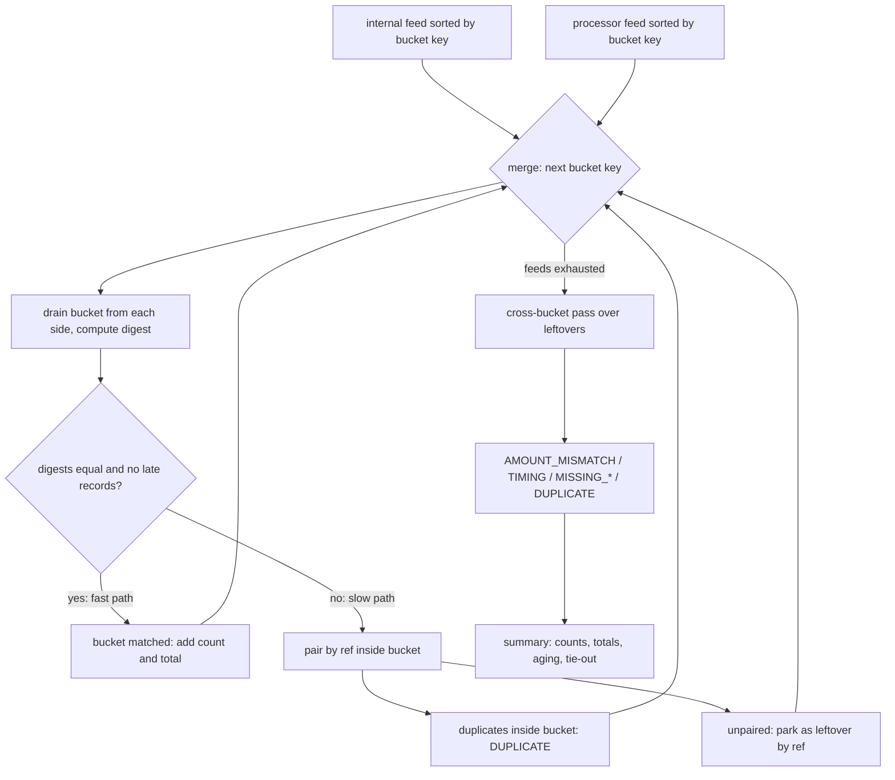

# Reconciliation at Scale: Streams, Buckets, and Breaks

> Match a billion records a day and surface the breaks.

**Type:** Build
**Languages:** Java, Python, Go
**Prerequisites:** Phase 2 Lesson 01 (Sorting), Phase 1 Lesson 06 (Hash Maps), Phase 10 Lesson 01 (Representing Money), Phase 10 Lesson 08 (Reconciliation), Phase 14 Lesson 03 (Exactly-Once Money Movement)
**Time:** ~120 minutes

## Learning Objectives

- Explain why a reconciliation that loads both sides into memory and joins on reference stops working at a few hundred million records, and what replaces it
- Build a streaming merge-join over two feeds sorted by a shared bucket key, with memory proportional to the breaks rather than the records
- Compare whole buckets with an order-independent digest so that matching buckets cost one comparison and only disagreeing buckets are inspected record by record
- Classify every unexplained difference into one of five break types and age it from the transaction date
- Prove the report ties out: every record on each side is either matched or inside exactly one break, and the totals say so

## The Problem

A payment service provider settles card transactions through two acquirers. Every night each acquirer delivers a settlement file: one line per captured transaction with the acquirer's reference, the transaction date, the settlement date, and the amount. The provider's own ledger has one capture posting per transaction with the same reference, recorded at capture time. Reconciliation is the job that proves the two agree, and it is the only thing standing between "the processor says they paid us 125,452,155.51 USD" and "we know we were paid what we were owed."

The first version of that job is a SQL `FULL OUTER JOIN` on reference. It works for two years. Then volume passes 40 million transactions a day, the join needs both sides' working sets in memory, the nightly run takes eleven hours, and it finishes after the finance team has already published the day's position. Twice a month the job is killed by the database's memory limit and nobody reconciles that day at all. The breaks it does find are a flat list of 300,000 "unmatched" rows with no explanation, so an analyst spends the morning sorting them into "the acquirer settles T+1 and this is just timing", "this one is off by a cent", and "this one is actually missing." By the time a genuinely missing capture of 50,000.00 USD is noticed, it is 23 days old and the acquirer's dispute window has closed.

Three things went wrong, and they are independent. Memory grew with the record count instead of the break count. Every record was compared individually even though 99.9% of them match. And the output described differences without classifying them, so the humans did the classification by hand, slowly, after the fact. This lesson builds a reconciler that fixes all three: it streams two sorted feeds through a merge join so memory is bounded by the current bucket plus the leftovers; it compares whole buckets by digest so that matching buckets cost one comparison; and it names every break and ages it, producing a summary whose totals tie out to the cent before anyone reads it.

## The Concept

### Reconciliation is a set difference with explanations

Phase 10, Lesson 08 defined reconciliation as proving that two independent records of the same events agree, and that where they do not, every difference is explained. At small scale that is a loop. At large scale it is three separate problems:

1. **Finding candidates.** Which records on side A have no exact partner on side B, and vice versa? This is a set difference, and the naive algorithm is `O(n)` memory for a hash join or `O(n log n)` time for a sort-merge join.
2. **Explaining them.** A record without an exact partner may still have a near-partner: same reference, amount off by a cent; same reference and amount, settled four days late; the same line appearing twice in the file. The explanation determines who fixes it.
3. **Proving completeness.** The report must demonstrate that it accounted for every record, so that an auditor can trust "510 breaks" means 510 and not "510 that we noticed."

### Sorted feeds and the merge join

If both feeds arrive sorted by the same key, the join needs no index. Two cursors advance in lockstep: compare the heads, emit the smaller as unmatched on its side, advance both when they are equal. Memory is two records. This is the merge step of merge sort (Phase 2, Lesson 03), applied to two inputs instead of two halves, and it is how every database executes a sort-merge join.

The question is what to sort by. The obvious key is the reference, but the reference alone does not help the next step. The key this lesson uses is the **bucket key**: `(transaction date, currency, amount)`. Two records with the same bucket key are candidates to be the same transaction; the reference decides. Sorting by bucket key groups candidates together, so the join can process a bucket at a time instead of a record at a time.

The transaction date must be the one both sides share. The acquirer's file carries both the transaction date (when the card was presented) and the settlement date (when the acquirer booked it); our ledger carries the capture date. Transaction date is common to both; settlement date is not, and bucketing by it would put every T+1 settlement in a different bucket from its capture, defeating the fast path entirely. The first version of this lesson's code made exactly that mistake and inspected half its buckets.

### Digests: compare the bucket, not the records

Within a bucket, the two sides are supposed to contain the same multiset of references. Comparing them record by record costs `O(k)` hash operations for a bucket of `k` records. Comparing a digest costs `O(1)` after `O(k)` to compute it, and the digest is computed while draining the bucket from the feed, which has to happen anyway.

The digest is `(sum of mix(ref) over the bucket, count, total amount)`. Summation makes it order-independent, so the two feeds do not have to agree on the order of records inside a bucket. `mix` is a 64-bit finaliser (the SplitMix64 mixing function) applied to the reference's characters, so that references differing in one character land far apart. Two buckets with equal digests are declared matched without looking at a single reference. Two buckets with different digests are inspected.

What can go wrong: a collision, where two different reference multisets sum to the same 64-bit value and have the same count and total. The probability for a bucket of `k` records against a random collision is about `k / 2^64`; across a billion buckets it is about `10^-10`. The design accepts that, and the Ship It checklist says so, because the alternative, a cryptographic hash of the sorted references, costs a sort per bucket and buys nothing a reconciliation needs. An adversary who controls the acquirer's references could engineer a collision; an adversary who controls the acquirer's file has easier ways to steal money.

### The fast path and the slow path



The fast path is where the billion records go. On the seeded demo, 362,291 of 362,941 buckets take it, and the 650 that do not contain 1,290 records. The slow path builds a small hash map for one bucket, pairs by reference, and parks whatever does not pair in a **leftover** map keyed by reference. Leftovers are the only state that survives from one bucket to the next, and in a healthy reconciliation they number in the hundreds.

### Why the leftover map is the whole design

A break can span buckets. If the acquirer booked 12.50 USD as 12.00 USD, the two records have different bucket keys and the merge sees each of them alone in its bucket. Neither bucket knows the other exists. The cross-bucket pass runs once, after the feeds are exhausted, over the leftover map: for each reference, pair the internal and processor records that were parked and explain the pair.

This is why memory is proportional to the breaks. Everything that matched was discarded as soon as its bucket closed. Only unmatched records are retained, and the pass that explains them is `O(breaks)`, not `O(records)`. If the leftover map grows to millions of entries, that is itself the finding: one side's feed is wrong, and the job should stop and page rather than finish.

### Break classification

| Type | Pattern | Who fixes it | Typical cause |
|------|---------|--------------|---------------|
| `DUPLICATE` | same ref twice on one side | whoever has two | file line emitted twice; capture retried without idempotency (Lesson 03) |
| `AMOUNT_MISMATCH` | same ref both sides, different amount | both, with evidence | FX applied on one side; partial capture not reflected; rounding rule drift (Phase 10, Lesson 01) |
| `TIMING` | same ref and amount, processor settled more than `tolerance` days after the transaction | usually waits; escalate past 7 days | acquirer batch delay; weekend and holiday calendars |
| `MISSING_AT_PROCESSOR` | we have it, they do not | processor, or our capture never reached them | capture message lost; processor dropped a line |
| `MISSING_INTERNAL` | they have it, we do not | us | ledger write lost; capture recorded under a different reference |

Order matters in the classifier. A reference that appears twice on the processor side and once on ours is one match plus one `DUPLICATE`, not one match plus one `MISSING_INTERNAL`. A pair with different amounts is `AMOUNT_MISMATCH` even if the dates also differ, because the amount is the more serious finding. `TIMING` is the only type with a parameter: a lag inside the tolerance (two days in the demo, reflecting an acquirer that settles T+1 with weekend carry) is not a break at all, and the record is matched.

### Aging

Every break carries the days between its transaction date and the run date. The summary groups them into bands: 0-1, 2-7, 8-30, over 30. The bands are the operational signal: a `MISSING_AT_PROCESSOR` at age 1 is probably settling tomorrow; the same break at age 30 is money the acquirer may never pay, and most scheme rules give you 45 to 120 days to raise it. Phase 14, Lesson 06 turns the oldest open break into an alert.

### The tie-out

The report keeps four totals: internal and processor sides as read from the feeds, the matched total, and the amounts sitting in breaks on each side. The invariant is:

```text
internalTotal  == matchedTotal + sum(internal-side amounts in breaks)
processorTotal == matchedTotal + sum(processor-side amounts in breaks)
```

Every record is in exactly one of three places: matched, in a break as the internal half, or in a break as the processor half. If the equation fails, the reconciler has lost or double-counted a record, and the report is wrong even if every individual break in it is correct. `tiesOut()` is checked before the summary is printed and the demo exits non-zero if it fails. This is the reconciliation of the reconciliation, and it is what you show the auditor.

### Worked example by hand

Five internal captures, five processor lines, tolerance two days, run date 2026-03-31:

```text
internal                              processor
A1  tx 03-28  booked 03-28  19.99     A1  tx 03-28  settled 03-29  19.99
A2  tx 03-28  booked 03-28  19.99     A2  tx 03-28  settled 03-29  19.99
B1  tx 03-28  booked 03-28  50.00     B1  tx 03-28  settled 04-03  50.00
C1  tx 03-29  booked 03-29  12.50     C1  tx 03-29  settled 03-29  12.00
D1  tx 03-01  booked 03-01   7.00     E9  tx 03-29  settled 03-29  42.00
```

Sorted by bucket key `(txDate, USD, cents)`, the merge visits six buckets:

```text
03-01/700   : internal {D1}            processor {}          -> slow path, D1 parked
03-28/1999  : internal {A1,A2}         processor {A1,A2}     -> digests equal, fast path, 2 matched, 39.98
03-28/5000  : internal {B1}            processor {B1 lag 6}  -> B1 processor deferred as late, digests differ, B1 internal parked
03-29/1200  : internal {}              processor {C1}        -> C1 processor parked
03-29/1250  : internal {C1}            processor {}          -> C1 internal parked
03-29/4200  : internal {}              processor {E9}        -> E9 parked
```

Cross-bucket pass over leftovers `{D1, B1, C1, E9}`:

```text
B1: both sides, same amount, value dates 03-28 vs 04-03 = 6 days > 2  -> TIMING, age 3
C1: both sides, 12.50 vs 12.00                                        -> AMOUNT_MISMATCH, age 2
D1: internal only                                                     -> MISSING_AT_PROCESSOR, age 30
E9: processor only                                                    -> MISSING_INTERNAL, age 2
```

Tie-out: internal total 109.48 = matched 39.98 + breaks internal side (50.00 + 12.50 + 7.00 = 69.50). Processor total 143.98 = 39.98 + (50.00 + 12.00 + 42.00 = 104.00). Both hold.

### Complexity

| Step | Time | Memory |
|------|------|--------|
| Sorting each feed by bucket key (producer's job, or external sort) | `O(n log n)` | external |
| Merge over buckets | `O(n)` | current bucket |
| Digest per bucket | `O(k)` per bucket, `O(n)` total | `O(1)` |
| Slow path per disagreeing bucket | `O(k)` | `O(k)` |
| Cross-bucket pass | `O(b)` for `b` leftovers | `O(b)` |

For a billion records with a 0.1% break rate, the working set is a few hundred thousand leftovers, a few megabytes. The feeds can be files, Kafka partitions keyed so that one partition's records are sorted, or a database cursor with `ORDER BY tx_date, currency, amount_minor`.

### What this reconciler does not do

- It does not detect a duplicate whose two copies fall in different buckets (same reference, two different amounts or dates). Both copies are leftovers and the pass pairs one with the internal record; the other surfaces as `MISSING_INTERNAL`. Detecting it exactly needs a set of every matched reference, which is the `O(n)` memory the design avoids. Exercise 3 adds a Bloom filter for a probabilistic version.
- It does not reconcile fees, FX, or multi-leg settlements. Those are separate feeds with their own bucket keys; Phase 10, Lesson 09 covers multi-currency, and Lesson 05 of this phase covers the settlement side.
- It does not decide what to do about a break. It names it and ages it; the runbook in Lesson 07 says who acts.

## Build It

### Step 1: Money, trimmed

```java
record Money(long minorUnits, Currency currency) implements Comparable<Money> {
    Money { Objects.requireNonNull(currency, "currency"); }
    static Money ofMinor(long minorUnits, Currency currency) { return new Money(minorUnits, currency); }
    static Money zero(Currency currency) { return new Money(0, currency); }
    Money plus(Money other) {
        requireSameCurrency(other);
        return new Money(Math.addExact(minorUnits, other.minorUnits), currency);
    }
}
```

The `Money` and `Currency` records are the Phase 10, Lesson 01 design with only the operations this lesson needs: construction, `plus`, `minus`, comparison, printing. The totals in the report are `Money`, so the tie-out is an exact integer comparison. `Math.addExact` is kept: a 125-million-dollar total is nowhere near overflow, but the day it is, you want an exception rather than a negative total that happens to tie out.

**Predict:** if a processor file arrived with amounts in EUR for a USD reconciliation, which line throws, and how early?

### Step 2: The record and its bucket key

```java
record Rec(String ref, LocalDate txDate, LocalDate valueDate, Money amount, Side side) {
    BucketKey bucket() { return new BucketKey(txDate.toEpochDay(), amount.currency().code(), amount.minorUnits()); }
    long lagDays() { return valueDate.toEpochDay() - txDate.toEpochDay(); }
}

record BucketKey(long epochDay, String currency, long amountMinor) implements Comparable<BucketKey> {
    static final Comparator<BucketKey> ORDER = Comparator.comparingLong(BucketKey::epochDay)
            .thenComparing(BucketKey::currency)
            .thenComparingLong(BucketKey::amountMinor);
    @Override public int compareTo(BucketKey other) { return ORDER.compare(this, other); }
}
```

`txDate` is in the key; `valueDate` is not. `lagDays` is how late this side booked the record relative to the transaction, which for our own captures is zero and for the processor is the settlement lag. The comparator is total and deterministic, which the sorted-feed check in Step 4 depends on.

**Predict:** two processor lines for the same transaction, one settled 03-29 and one 03-30, same amount. Same bucket or different?

### Step 3: The digest

```java
record BucketDigest(long hash, int count, long totalMinor) {
    static final BucketDigest EMPTY = new BucketDigest(0, 0, 0);

    static long mix(String ref) {
        long h = 0x9E3779B97F4A7C15L;
        for (int i = 0; i < ref.length(); i++) h = (h ^ ref.charAt(i)) * 0xBF58476D1CE4E5B9L;
        h ^= h >>> 31;
        h *= 0x94D049BB133111EBL;
        h ^= h >>> 29;
        return h;
    }

    BucketDigest add(Rec r) {
        return new BucketDigest(hash + mix(r.ref()), count + 1, Math.addExact(totalMinor, r.amount().minorUnits()));
    }
}
```

`hash + mix(ref)` is addition modulo 2^64, which is commutative, so the digest of `{A1, A2}` equals the digest of `{A2, A1}`. `count` is carried so that an empty bucket and a bucket whose hashes happen to cancel are distinguishable. `totalMinor` is carried because the report needs it anyway and it is a third independent check. Equality of two digests is the `record`'s generated `equals`, one line in the reconciler.

**Predict:** why is `String.hashCode()` not used instead of `mix`? Consider `"Aa"` and `"BB"`.

### Step 4: The order-checking cursor

```java
private void advance() {
    if (!it.hasNext()) { head = null; return; }
    Rec next = it.next();
    if (next.side() != side) throw new IllegalArgumentException("record " + next.ref() + " is on the wrong feed");
    BucketKey k = next.bucket();
    if (last != null && k.compareTo(last) < 0) {
        throw new IllegalStateException(side + " feed is not sorted: " + k + " after " + last);
    }
    last = k;
    head = next;
}
```

A merge join over an unsorted feed does not crash. It runs to completion and reports almost every record as a break, which looks like a catastrophe on the processor's side and gets escalated to them at 6 a.m. The cursor remembers the last key it saw and refuses to continue the moment a key goes backwards. The check is `O(1)` per record and it is the single most valuable line in the file.

`drainBucket` pulls every record with the current key into a buffer and folds it into the digest, with one exception: a predicate selects records to **defer**, which are returned separately and left out of the digest. The reconciler uses this for processor records whose settlement lag exceeds the tolerance.

**Predict:** if the deferred-late records were included in the digest instead, which break type would the reconciler never report?

### Step 5: The merge loop

```java
while (a.hasNext() || b.hasNext()) {
    BucketKey key;
    if (!a.hasNext()) key = b.key();
    else if (!b.hasNext()) key = a.key();
    else key = a.key().compareTo(b.key()) <= 0 ? a.key() : b.key();
    r.bucketsSeen++;

    bufA.clear(); bufB.clear(); late.clear();
    BucketDigest da = a.hasNext() && a.key().equals(key) ? a.drainBucket(key, bufA, never, late) : BucketDigest.EMPTY;
    BucketDigest db = b.hasNext() && b.key().equals(key) ? b.drainBucket(key, bufB, settledLate, late) : BucketDigest.EMPTY;
    r.internalCount += da.count();
    r.processorCount += db.count() + late.size();
    r.internalTotal = r.internalTotal.plus(Money.ofMinor(da.totalMinor(), currency));
    r.processorTotal = r.processorTotal.plus(Money.ofMinor(db.totalMinor(), currency));
    for (Rec y : late) {
        r.processorTotal = r.processorTotal.plus(y.amount());
        leftoverProcessor.computeIfAbsent(y.ref(), k -> new ArrayList<>()).add(y);
    }

    if (da.equals(db) && late.isEmpty()) {
        r.bucketsFastMatched++;
        r.matchedCount += da.count();
        r.matchedTotal = r.matchedTotal.plus(Money.ofMinor(da.totalMinor(), currency));
        continue;
    }
    r.bucketsInspected++;
    inspectBucket(bufA, bufB, r, leftoverInternal, leftoverProcessor, asOf);
}
```

The smaller head key is the next bucket. If only one side has that key, the other side's digest is `EMPTY` and the digests cannot be equal, so the bucket goes to the slow path with one buffer empty, and every record in it becomes a leftover. The side totals are accumulated here, from the digests, before any matching decision, so they are the totals of what was read, not of what was understood.

**Predict:** a bucket where the internal side has `{A1}` and the processor side has `{A1, A1}`. Fast or slow path, and why?

### Step 6: The slow path inside one bucket

```java
Map<String, Rec> byRef = new HashMap<>();
Set<String> matchedHere = new HashSet<>();
for (Rec x : bufA) {
    Rec prev = byRef.putIfAbsent(x.ref(), x);
    if (prev != null) r.breaks.add(new Break(BreakType.DUPLICATE, x.ref(), x, null, ageDays(x.txDate(), asOf)));
}
for (Rec y : bufB) {
    Rec x = byRef.remove(y.ref());
    if (x != null) {
        r.matchedCount += 1;
        r.matchedTotal = r.matchedTotal.plus(x.amount());
        matchedHere.add(y.ref());
    } else if (matchedHere.contains(y.ref())) {
        r.breaks.add(new Break(BreakType.DUPLICATE, y.ref(), null, y, ageDays(y.txDate(), asOf)));
    } else {
        leftoverProcessor.computeIfAbsent(y.ref(), k -> new ArrayList<>()).add(y);
    }
}
for (Rec x : byRef.values()) leftoverInternal.computeIfAbsent(x.ref(), k -> new ArrayList<>()).add(x);
```

Inside a bucket every record already agrees on date, currency, and amount, so the reference is the only thing left to compare. A matched pair adds its amount to `matchedTotal` once, not twice: the matched total is the amount of money both sides agree on, and the tie-out equation adds it to each side's break amounts separately. A second copy of a reference already matched or already seen on the same side is a `DUPLICATE` immediately; it never enters the leftover map, because the leftover map is for records that might still find a partner.

### Step 7: The cross-bucket pass

```java
int pairs = Math.min(xs.size(), ys.size());
for (int i = 0; i < pairs; i++) {
    Rec x = xs.get(i), y = ys.get(i);
    long age = ageDays(x.txDate(), asOf);
    if (!x.amount().equals(y.amount())) {
        r.breaks.add(new Break(BreakType.AMOUNT_MISMATCH, ref, x, y, age));
    } else if (Math.abs(x.valueDate().toEpochDay() - y.valueDate().toEpochDay()) <= timingToleranceDays) {
        r.matchedCount += 1;
        r.matchedTotal = r.matchedTotal.plus(x.amount());
    } else {
        r.breaks.add(new Break(BreakType.TIMING, ref, x, y, age));
    }
}
for (int i = pairs; i < xs.size(); i++) {
    BreakType t = (i > 0 || pairs > 0) ? BreakType.DUPLICATE : BreakType.MISSING_AT_PROCESSOR;
    r.breaks.add(new Break(t, ref, xs.get(i), null, ageDays(xs.get(i).txDate(), asOf)));
}
```

Leftovers for one reference are paired positionally; whatever is left over after pairing is missing on the other side, or a duplicate if a partner was already consumed. The `AMOUNT_MISMATCH` test comes before the timing test because a wrong amount is the finding, whatever the dates say. Age is always measured from the transaction date, the one fact both sides agree on.

**Predict:** `xs = [x]`, `ys = []`, both with amount 7.00 and transaction date 03-01, run date 03-31. Type, age, and age band?

### Step 8: The tie-out and the summary

```java
boolean tiesOut() {
    return internalTotal.equals(matchedTotal.plus(internalInBreaks()))
            && processorTotal.equals(matchedTotal.plus(processorInBreaks()));
}
```

`internalInBreaks` sums `internal.amount()` over breaks where the internal half is present; `processorInBreaks` does the same for the other half. The equation is checked with `Money.equals`, which compares minor units and currency, so a one-cent discrepancy anywhere in the pipeline fails it. `summary()` prints the side totals, the matched total, the fast/slow bucket counts, the break counts by type, the aging histogram, and the tie-out result, in that order, because that is the order a reviewer reads it.

### Step 9: Run it

```bash
cd phases/14-payments-at-scale/04-reconciliation-at-scale/code/java
javac -d .out *.java && java -cp .out Main
java -cp .out MainTest
```

Expected output, abbreviated:

```console
== A small run you can read ==
as of 2026-03-31
internal:  5 records  109.48 USD
processor: 5 records  143.98 USD
matched:   2 records  39.98 USD
buckets: 6 seen, 1 fast-matched by digest, 5 inspected record by record
breaks: 4  (internal side 69.50 USD, processor side 104.00 USD)
  AMOUNT_MISMATCH        1
  TIMING                 1
  MISSING_AT_PROCESSOR   1
  MISSING_INTERNAL       1
aging: D2_7=3 D8_30=1
ties out: true

== 1,000,000 records, seeded, 0.1% injected breaks ==
generated 500,000 + 500,018 records in 3226 ms (510 break situations injected)
reconciled in 547 ms
buckets: 362,941 seen, 362,291 fast-matched by digest, 650 inspected record by record
breaks: 510  (internal side 89831.87 USD, processor side 94647.02 USD)
ties out: true

== An unsorted feed is refused, not silently mis-reconciled ==
rejected: INTERNAL feed is not sorted: 2026-03-28/USD/1999 after 2026-03-29/USD/1250
```

Half a second for a million records on two cores, and the time is dominated by iterating; the generator's sort takes six times longer than the reconciliation. The test suite asserts that the large run finds exactly as many breaks as the generator injected, which is the property that lets you trust the number on a real file.

### In Python

The Python port (`code/python/main.py`, tests in `test_main.py`) keeps the same pieces: `Rec`, `BucketKey`, `BucketDigest`, `StreamingReconciler` with its `Cursor`, `ReconciliationReport`, and `FeedGenerator`. The demo reconciles the same million records with the same seed and prints the same 510 breaks. Four things differ. **The digest must be masked:** Java's `mix` relies on `long` overflow and `>>>`; Python integers never wrap, so every multiply is followed by `& 0xFFFFFFFFFFFFFFFF`, the value is kept unsigned so `>>` is a logical shift, and the running sum in `add` is masked the same way; forget one mask and the two sides' digests diverge on the first large bucket. **The seeded generator is `java.util.Random`, not `random.Random`:** `FeedGenerator` uses a 25-line `JavaRandom` (the JDK's 48-bit LCG with the exact `nextInt(bound)` rejection loop and `nextDouble`), so seed 42 produces the same feeds, the same buckets, and the same first three breaks as the Java run; a test pins the sequence to values taken from the JDK. **Hot-path types are tuples:** `BucketKey` and `BucketDigest` are `NamedTuple`s rather than frozen dataclasses, because one of each is built per record and tuple construction, equality, and ordering run in C; the report accumulates its three totals as plain minor-unit ints and exposes `matched_total`, `internal_total`, and `processor_total` as `Money` properties, since a million `Money.plus` calls would otherwise cost more than the merge itself, and the cursor caches `head.bucket()` once per record. With those changes the million-record demo runs in a few seconds on CPython, most of it in generating and sorting the feeds. **Exceptions:** the unsorted feed raises `RuntimeError` (Java's `IllegalStateException`) and a record on the wrong feed raises `ValueError` (`IllegalArgumentException`); `EnumMap` ordering in the summary is reproduced by iterating `BreakType` and `AgeBand` in declaration order. The Python tests port all 31 Java checks (58 assertions), including the seeded 100,000-record run that must surface exactly the injected number of breaks and tie out.

Run it from `code/python/` with `python3 main.py`; test with `python3 -m unittest -v`.

#### Step 1: Money, trimmed

`Money` is a frozen dataclass with only what this lesson needs. Python ints cannot overflow, so `plus` has no `addExact`; `_require_same_currency` still raises on a mismatch, as early as the first `plus` of a foreign amount.

```python
class Money:
    minor_units: int
    currency: Currency

    @staticmethod
    def of_minor(minor_units: int, currency: Currency) -> "Money":
        return Money(minor_units, currency)

    @staticmethod
    def zero(currency: Currency) -> "Money":
        return Money(0, currency)

    def _require_same_currency(self, other: "Money") -> None:
        if self.currency != other.currency:
            raise CurrencyMismatchError(self.currency, other.currency)

    def plus(self, other: "Money") -> "Money":
        self._require_same_currency(other)
        return Money(self.minor_units + other.minor_units, self.currency)

    def minus(self, other: "Money") -> "Money":
        self._require_same_currency(other)
        return Money(self.minor_units - other.minor_units, self.currency)
```

#### Step 2: The record and its bucket key

`BucketKey` is a `NamedTuple`, so comparing and hashing a million keys runs in C, and tuple ordering is exactly the Java comparator chain: epoch day, currency, amount. `Rec.bucket()` computes the epoch day from `toordinal()`; `lag_days` is the booking lag.

```python
class BucketKey(NamedTuple):
    """The join key of the streaming merge: (txDate, currency, amount). Both feeds must be sorted by this key;
    the reconciler verifies the ordering and refuses to proceed on a violation, because a merge join over an
    unsorted feed silently reports every record as a break. A NamedTuple so that comparing, hashing and sorting
    a million keys run in C; a frozen dataclass with order=True does the same work in Python, several times slower."""

    epoch_day: int
    currency: str
    amount_minor: int

    def __str__(self) -> str:
        return f"{of_epoch_day(self.epoch_day)}/{self.currency}/{self.amount_minor}"


@dataclass(frozen=True)
class Rec:
    """One line of a feed. `ref` is the shared identifier both sides carry. `tx_date` is the date of the underlying
    transaction, which both sides know and which is therefore safe to join on. `value_date` is the date this side
    booked the record: capture date for us, settlement date for the processor."""

    ref: str
    tx_date: date
    value_date: date
    amount: Money
    side: Side

    def bucket(self) -> BucketKey:
        return BucketKey(self.tx_date.toordinal() - EPOCH_ORDINAL, self.amount.currency.code, self.amount.minor_units)

    def lag_days(self) -> int:
        """Days between the transaction and this side booking it; a processor lag beyond tolerance is a TIMING break."""
        return epoch_day(self.value_date) - epoch_day(self.tx_date)
```

#### Step 3: The digest

`mix` is the SplitMix64 finaliser with a `& MASK64` after each multiply and an unsigned value so `>>` is logical. `add` masks the running hash sum too; `count` and `total_minor` travel alongside, and `EMPTY` is the zero tuple.

```python
class BucketDigest(NamedTuple):
    """Order-independent digest of a set of references. Each reference is mixed through a 64-bit finaliser and the
    results are summed; equal sets give equal digests regardless of order, and the count travels alongside.
    A NamedTuple: one is built per record, and tuple construction and equality run in C."""

    hash: int
    count: int
    total_minor: int

    @staticmethod
    def mix(ref: str) -> int:
        """The Java version relies on long overflow; here every multiply is masked to 64 bits and the shifts are
        logical because the value is kept unsigned. Iterating the UTF-8 bytes equals charAt for the ASCII refs."""
        h = 0x9E3779B97F4A7C15
        for b in ref.encode():
            h = ((h ^ b) * 0xBF58476D1CE4E5B9) & MASK64
        h ^= h >> 31
        h = (h * 0x94D049BB133111EB) & MASK64
        h ^= h >> 29
        return h

    def add(self, r: Rec) -> "BucketDigest":
        return BucketDigest((self[0] + BucketDigest.mix(r.ref)) & MASK64, self[1] + 1, self[2] + r.amount.minor_units)


BucketDigest.EMPTY = BucketDigest(0, 0, 0)
```

#### Step 4: The order-checking cursor

`_advance` pulls the next record with `next(it, None)`, refuses a record from the wrong feed with `ValueError`, compares the new key with the last one (tuple `<`), and raises `RuntimeError` the moment a key goes backwards. It caches `head_key` so the merge loop never recomputes a bucket.

```python
    def _advance(self) -> None:
        nxt = next(self.it, None)
        if nxt is None:
            self.head = None
            self.head_key = None
            return
        if nxt.side is not self.side:
            raise ValueError(f"record {nxt.ref} is on the wrong feed")
        k = nxt.bucket()
        if self.last is not None and k < self.last:
            raise RuntimeError(f"{self.side} feed is not sorted: {k} after {self.last}")
        self.last = k
        self.head = nxt
        self.head_key = k
```

#### Step 5: The merge loop

The loop reads the cached head keys (`None` once a feed is exhausted), picks the smaller, drains both sides, accumulates counts and minor-unit totals from the digests, and takes the fast path when `da == db` with nothing deferred.

```python
        while a.head is not None or b.head is not None:
            ka, kb = a.head_key, b.head_key  # None once that feed is exhausted
            if ka is None:
                key = kb
            elif kb is None:
                key = ka
            else:
                key = ka if ka <= kb else kb
            r.buckets_seen += 1

            buf_a.clear()
            buf_b.clear()
            late.clear()
            da = a.drain_bucket(key, buf_a, never, late) if ka == key else BucketDigest.EMPTY
            db = b.drain_bucket(key, buf_b, settled_late, late) if kb == key else BucketDigest.EMPTY
            r.internal_count += da.count
            r.processor_count += db.count + len(late)
            r.internal_minor += da.total_minor
            r.processor_minor += db.total_minor
            for y in late:
                r.processor_minor += y.amount.minor_units
                leftover_processor.setdefault(y.ref, []).append(y)

            if da == db and not late:
                # Fast path: same count, same digest, same total -> the bucket matches as a whole.
                r.buckets_fast_matched += 1
                r.matched_count += da.count
                r.matched_minor += da.total_minor
                continue
            r.buckets_inspected += 1
            self._inspect_bucket(buf_a, buf_b, r, leftover_internal, leftover_processor, as_of)
        self._classify_leftovers(leftover_internal, leftover_processor, r, as_of)
        r.breaks.sort(key=lambda br: (br.type.value, br.ref))
        return r
```

#### Step 6: The slow path inside one bucket

`_inspect_bucket` pairs by reference with a dict, counts a matched pair once, flags a repeated reference as `DUPLICATE` immediately, and parks the rest as leftovers.

```python
    def _inspect_bucket(self, buf_a: list, buf_b: list, r: ReconciliationReport,
                        leftover_internal: dict, leftover_processor: dict, as_of: date) -> None:
        """Within one bucket, pair records by ref. A second copy of a ref already seen in this bucket is a DUPLICATE
        on that side; anything unpaired is parked as a leftover for the cross-bucket pass."""
        by_ref: dict[str, Rec] = {}
        matched_here: set[str] = set()
        for x in buf_a:
            if x.ref in by_ref:
                r.breaks.append(Break(BreakType.DUPLICATE, x.ref, x, None, StreamingReconciler.age_days(x.tx_date, as_of)))
            else:
                by_ref[x.ref] = x
        for y in buf_b:
            x = by_ref.pop(y.ref, None)
            if x is not None:
                r.matched_count += 1                        # count the pair once
                r.matched_minor += x.amount.minor_units     # one amount, matched on both sides
                matched_here.add(y.ref)
            elif y.ref in matched_here:
                r.breaks.append(Break(BreakType.DUPLICATE, y.ref, None, y, StreamingReconciler.age_days(y.tx_date, as_of)))
            else:
                leftover_processor.setdefault(y.ref, []).append(y)
        for x in by_ref.values():
            leftover_internal.setdefault(x.ref, []).append(x)
```

#### Step 7: The cross-bucket pass

`_classify_leftovers` pairs leftovers positionally per reference: amount mismatch first, then the timing tolerance, then the unpaired tail as missing or duplicate.

```python
    def _classify_leftovers(self, li: dict, lp: dict, r: ReconciliationReport, as_of: date) -> None:
        """Cross-bucket pass: pair leftovers by ref and name the break. Runs once, over breaks only."""
        refs = list(li.keys())
        for ref in lp.keys():
            if ref not in li:
                refs.append(ref)
        for ref in refs:
            xs = li.get(ref, [])
            ys = lp.get(ref, [])
            pairs = min(len(xs), len(ys))
            for i in range(pairs):
                x, y = xs[i], ys[i]
                age = StreamingReconciler.age_days(x.tx_date, as_of)
                if x.amount != y.amount:
                    r.breaks.append(Break(BreakType.AMOUNT_MISMATCH, ref, x, y, age))
                elif abs(epoch_day(x.value_date) - epoch_day(y.value_date)) <= self.timing_tolerance_days:
                    # Same ref, same amount, dates within tolerance: matched, but recorded for visibility.
                    r.matched_count += 1
                    r.matched_minor += x.amount.minor_units
                else:
                    r.breaks.append(Break(BreakType.TIMING, ref, x, y, age))
            for i in range(pairs, len(xs)):
                x = xs[i]
                t = BreakType.DUPLICATE if (i > 0 or pairs > 0) else BreakType.MISSING_AT_PROCESSOR
                r.breaks.append(Break(t, ref, x, None, StreamingReconciler.age_days(x.tx_date, as_of)))
            for i in range(pairs, len(ys)):
                y = ys[i]
                t = BreakType.DUPLICATE if (i > 0 or pairs > 0) else BreakType.MISSING_INTERNAL
                r.breaks.append(Break(t, ref, None, y, StreamingReconciler.age_days(y.tx_date, as_of)))
```

#### Step 8: The tie-out and the summary

`ties_out` compares the `Money` properties, so a one-cent discrepancy anywhere fails the equation.

```python
    def ties_out(self) -> bool:
        """The tie-out: every record on each side is either matched or inside exactly one break.
        A report that does not tie out has lost or double-counted a record and must not be published."""
        return (self.internal_total == self.matched_total.plus(self.internal_in_breaks())
                and self.processor_total == self.matched_total.plus(self.processor_in_breaks()))
```

#### Step 9: Run it

```bash
cd phases/14-payments-at-scale/04-reconciliation-at-scale/code/python
python3 main.py
python3 -m unittest -v
```

The timings are CPython's; the counts and totals are the Java run's:

```console
== 1,000,000 records, seeded, 0.1% injected breaks ==
generated 500,000 + 500,018 records in 4019 ms (510 break situations injected)
reconciled in 3561 ms
as of 2026-03-31
internal:  500,000 records  125447340.36 USD
processor: 500,018 records  125452155.51 USD
```

### In Go

The Go port (`code/go/main.go`, tests in `main_test.go`) keeps the same pieces: `Rec`, `BucketKey`, `BucketDigest`, `StreamingReconciler` with its `cursor`, `ReconciliationReport`, and `FeedGenerator`; `javarandom.go` carries the JDK generator. The demo reconciles the same million records with seed 42 and prints the same 510 breaks and the same first three. Four things differ. **The digest wraps natively on `uint64`:** Java's `mix` relies on `long` overflow and `>>>`; Go's `uint64` multiply wraps and `>>` is a logical shift, so the SplitMix64 finaliser is written exactly as in the Java with no masks, and `BucketDigest` is a comparable struct, so the fast path is `da == db`. **Feeds are iterators, failures are errors:** `Reconcile` takes two `RecIterator` closures (`func() (Rec, bool)`; `SliceIterator` wraps a slice, a production feed would wrap a `bufio.Scanner`) and returns `(*ReconciliationReport, error)`; the unsorted feed is `ErrUnsortedFeed` and a record on the wrong side is `ErrWrongFeed`, both wrapped with `%w` so the tests use `errors.Is`; inside the merge, a `need(...)` helper panics on an error and a deferred `catch` turns it back into the returned error, so the checked `Money.Plus` calls on the running totals do not each need an `if err != nil`. **Dates are UTC `time.Time`, keys are epoch days:** `EpochDay` is `LocalDate.toEpochDay`, so `BucketKey` holds three integers and compares in a few instructions; `SortFeed` sorts an index with `sort.SliceStable` (Java's `List.sort` is stable too, which decides which of two duplicate lines gets matched). **`EnumMap` order and `%,d`:** `CountByType` returns a plain map, so `Summary` iterates `BreakType` and `AgeBand` in declaration order and skips absent keys to print what the Java `EnumMap` prints; a small `commas` helper stands in for `%,d`. The Go run generates and reconciles the million records in about two seconds. The Go tests port all 31 Java checks (35 assertions), including the seeded 100,000-record run, and pass under `go test -race`.

Run it from `code/go/` with `go run .`; test with `go test ./...`.

#### Step 1: Money, trimmed

`Money` is a two-field struct; `Plus` returns `(Money, error)` with `addChecked` standing in for `Math.addExact` and the currency check first.

```go
type Money struct {
	MinorUnits int64
	Currency   Currency
}

func OfMinor(minorUnits int64, currency Currency) Money { return Money{minorUnits, currency} }
func Zero(currency Currency) Money                      { return Money{0, currency} }

func (m Money) Plus(other Money) (Money, error) {
	if err := m.requireSameCurrency(other); err != nil {
		return Money{}, err
	}
	sum, err := addChecked(m.MinorUnits, other.MinorUnits)
	return Money{sum, m.Currency}, err
}
```

#### Step 2: The record and its bucket key

`Rec.Bucket()` builds a three-integer `BucketKey` from the epoch day; `Compare` is the Java comparator chain as a tagless `switch`, and because the struct is comparable the merge loop can also test `a.key() == key` directly.

```go
type Rec struct {
	Ref       string
	TxDate    time.Time
	ValueDate time.Time
	Amount    Money
	Side      Side
}

func (r Rec) Bucket() BucketKey {
	return BucketKey{EpochDay(r.TxDate), r.Amount.Currency.Code, r.Amount.MinorUnits}
}

// LagDays is the days between the transaction and this side booking it; a processor lag beyond tolerance is a TIMING break.
func (r Rec) LagDays() int64 { return EpochDay(r.ValueDate) - EpochDay(r.TxDate) }

// BucketKey is the join key of the streaming merge: (txDate, currency, amount). Both feeds must be sorted by
// this key; the reconciler verifies the ordering and refuses to proceed on a violation, because a merge join
// over an unsorted feed silently reports every record as a break.
type BucketKey struct {
	EpochDay    int64
	Currency    string
	AmountMinor int64
}

// Compare orders by epoch day, then currency, then amount.
func (k BucketKey) Compare(other BucketKey) int {
	switch {
	case k.EpochDay != other.EpochDay:
		return cmpInt64(k.EpochDay, other.EpochDay)
	case k.Currency != other.Currency:
		return strings.Compare(k.Currency, other.Currency)
	default:
		return cmpInt64(k.AmountMinor, other.AmountMinor)
	}
}
```

#### Step 3: The digest

`Mix` is the SplitMix64 finaliser on `uint64`, written without masks because the type wraps. `Add` returns an error only from the checked total.

```go
type BucketDigest struct {
	Hash       uint64
	Count      int
	TotalMinor int64
}

var EmptyDigest = BucketDigest{}

// Mix is the SplitMix64 finaliser over the bytes of the ref; uint64 wraps exactly like Java's long.
func Mix(ref string) uint64 {
	h := uint64(0x9E3779B97F4A7C15)
	for i := 0; i < len(ref); i++ {
		h = (h ^ uint64(ref[i])) * 0xBF58476D1CE4E5B9
	}
	h ^= h >> 31
	h *= 0x94D049BB133111EB
	h ^= h >> 29
	return h
}

func (d BucketDigest) Add(r Rec) (BucketDigest, error) {
	total, err := addChecked(d.TotalMinor, r.Amount.MinorUnits)
	if err != nil {
		return BucketDigest{}, err
	}
	return BucketDigest{d.Hash + Mix(r.Ref), d.Count + 1, total}, nil
}
```

#### Step 4: The order-checking cursor

`advance` returns `ErrWrongFeed` or `ErrUnsortedFeed` wrapped with `%w`, keeps `last` as a pointer so "no key yet" is `nil`, and caches `headKey`.

```go
func (c *cursor) advance() error {
	next, ok := c.next()
	if !ok {
		c.head = nil
		return nil
	}
	if next.Side != c.side {
		return fmt.Errorf("%w: record %s", ErrWrongFeed, next.Ref)
	}
	k := next.Bucket()
	if c.last != nil && k.Compare(*c.last) < 0 {
		return fmt.Errorf("%w: %v feed is not sorted: %v after %v", ErrUnsortedFeed, c.side, k, *c.last)
	}
	c.last = &k
	c.head = &next
	c.headKey = k
	return nil
}
```

#### Step 5: The merge loop

`Reconcile` uses `defer catch(&err)` and `need(...)` so the body reads like the Java while every checked call still surfaces as the returned error. Buffers are re-sliced to zero length each round to avoid reallocating; the fast path is a struct equality.

```go
func (s *StreamingReconciler) Reconcile(internal, processor RecIterator, asOf time.Time) (r *ReconciliationReport, err error) {
	defer catch(&err)
	r = NewReconciliationReport(s.currency, asOf)
	a := need(newCursor(internal, Internal))
	b := need(newCursor(processor, Processor))
	// Unmatched records, keyed by ref, waiting for a partner from a different bucket.
	leftoverInternal := map[string][]Rec{}
	leftoverProcessor := map[string][]Rec{}
	var bufA, bufB, late []Rec
	never := func(Rec) bool { return false }
	settledLate := func(x Rec) bool { return x.LagDays() > s.timingToleranceDays }

	for a.hasNext() || b.hasNext() {
		var key BucketKey
		switch {
		case !a.hasNext():
			key = b.key()
		case !b.hasNext():
			key = a.key()
		case a.key().Compare(b.key()) <= 0:
			key = a.key()
		default:
			key = b.key()
		}
		r.BucketsSeen++

		bufA, bufB, late = bufA[:0], bufB[:0], late[:0]
		da, db := EmptyDigest, EmptyDigest
		if a.hasNext() && a.key() == key {
			da = need(a.drainBucket(key, &bufA, never, &late))
		}
		if b.hasNext() && b.key() == key {
			db = need(b.drainBucket(key, &bufB, settledLate, &late))
		}
		r.InternalCount += int64(da.Count)
		r.ProcessorCount += int64(db.Count + len(late))
		r.InternalTotal = need(r.InternalTotal.Plus(OfMinor(da.TotalMinor, s.currency)))
		r.ProcessorTotal = need(r.ProcessorTotal.Plus(OfMinor(db.TotalMinor, s.currency)))
		for _, y := range late {
			r.ProcessorTotal = need(r.ProcessorTotal.Plus(y.Amount))
			leftoverProcessor[y.Ref] = append(leftoverProcessor[y.Ref], y)
		}

		if da == db && len(late) == 0 {
			// Fast path: same count, same digest, same total -> the bucket matches as a whole.
			r.BucketsFastMatched++
			r.MatchedCount += int64(da.Count)
			r.MatchedTotal = need(r.MatchedTotal.Plus(OfMinor(da.TotalMinor, s.currency)))
			continue
		}
		r.BucketsInspected++
		s.inspectBucket(bufA, bufB, r, leftoverInternal, leftoverProcessor, asOf)
	}
	s.classifyLeftovers(leftoverInternal, leftoverProcessor, r, asOf)
	sort.SliceStable(r.Breaks, func(i, j int) bool {
		if r.Breaks[i].Type != r.Breaks[j].Type {
			return r.Breaks[i].Type < r.Breaks[j].Type
		}
		return r.Breaks[i].Ref < r.Breaks[j].Ref
	})
	return r, nil
}
```

#### Step 6: The slow path inside one bucket

`inspectBucket` keeps an `order` slice beside `byRef` so leftovers are parked in feed order, which a Go map alone would not guarantee; otherwise it is the Java logic with `ptr(x)` producing the optional halves of a `Break`.

```go
func (s *StreamingReconciler) inspectBucket(bufA, bufB []Rec, r *ReconciliationReport,
	leftoverInternal, leftoverProcessor map[string][]Rec, asOf time.Time) {
	byRef := map[string]Rec{}
	order := []string{} // insertion order of byRef, so leftovers are parked in feed order like the Java
	matchedHere := map[string]bool{}
	for _, x := range bufA {
		if _, dup := byRef[x.Ref]; dup {
			r.Breaks = append(r.Breaks, Break{Duplicate, x.Ref, ptr(x), nil, AgeDays(x.TxDate, asOf)})
		} else {
			byRef[x.Ref] = x
			order = append(order, x.Ref)
		}
	}
	for _, y := range bufB {
		if x, ok := byRef[y.Ref]; ok {
			delete(byRef, y.Ref)
			r.MatchedCount++                                     // count the pair once
			r.MatchedTotal = need(r.MatchedTotal.Plus(x.Amount)) // one amount, matched on both sides
			matchedHere[y.Ref] = true
		} else if matchedHere[y.Ref] {
			r.Breaks = append(r.Breaks, Break{Duplicate, y.Ref, nil, ptr(y), AgeDays(y.TxDate, asOf)})
		} else {
			leftoverProcessor[y.Ref] = append(leftoverProcessor[y.Ref], y)
		}
	}
	for _, ref := range order {
		if x, ok := byRef[ref]; ok {
			leftoverInternal[ref] = append(leftoverInternal[ref], x)
		}
	}
}
```

#### Step 7: The cross-bucket pass

`classifyLeftovers` pairs positionally, with the amount test before the timing test and the unpaired tail classified as missing or duplicate.

```go
func (s *StreamingReconciler) classifyLeftovers(li, lp map[string][]Rec, r *ReconciliationReport, asOf time.Time) {
	refs := make([]string, 0, len(li)+len(lp))
	for ref := range li {
		refs = append(refs, ref)
	}
	for ref := range lp {
		if _, both := li[ref]; !both {
			refs = append(refs, ref)
		}
	}
	for _, ref := range refs {
		xs, ys := li[ref], lp[ref]
		pairs := min(len(xs), len(ys))
		for i := 0; i < pairs; i++ {
			x, y := xs[i], ys[i]
			age := AgeDays(x.TxDate, asOf)
			lag := EpochDay(x.ValueDate) - EpochDay(y.ValueDate)
			if lag < 0 {
				lag = -lag
			}
			switch {
			case x.Amount != y.Amount:
				r.Breaks = append(r.Breaks, Break{AmountMismatch, ref, ptr(x), ptr(y), age})
			case lag <= s.timingToleranceDays:
				// Same ref, same amount, dates within tolerance: matched, but recorded for visibility.
				r.MatchedCount++
				r.MatchedTotal = need(r.MatchedTotal.Plus(x.Amount))
			default:
				r.Breaks = append(r.Breaks, Break{Timing, ref, ptr(x), ptr(y), age})
			}
		}
		for i := pairs; i < len(xs); i++ {
			x := xs[i]
			t := MissingAtProcessor
			if i > 0 || pairs > 0 {
				t = Duplicate
			}
			r.Breaks = append(r.Breaks, Break{t, ref, ptr(x), nil, AgeDays(x.TxDate, asOf)})
		}
		for i := pairs; i < len(ys); i++ {
			y := ys[i]
			t := MissingInternal
			if i > 0 || pairs > 0 {
				t = Duplicate
			}
			r.Breaks = append(r.Breaks, Break{t, ref, nil, ptr(y), AgeDays(y.TxDate, asOf)})
		}
	}
}
```

#### Step 8: The tie-out and the summary

`TiesOut` is the same equation; `need` unwraps the two `Plus` calls because a currency mismatch here would be a bug, not a reconciliation finding.

```go
func (r *ReconciliationReport) TiesOut() bool {
	return r.InternalTotal == need(r.MatchedTotal.Plus(r.InternalInBreaks())) &&
		r.ProcessorTotal == need(r.MatchedTotal.Plus(r.ProcessorInBreaks()))
}
```

#### Step 9: Run it

```bash
cd phases/14-payments-at-scale/04-reconciliation-at-scale/code/go
go run .
go test ./...
```

The counts and totals match the Java run; the timings are Go's:

```console
== 1,000,000 records, seeded, 0.1% injected breaks ==
generated 500,000 + 500,018 records in 1515 ms (510 break situations injected)
reconciled in 469 ms
as of 2026-03-31
internal:  500,000 records  125447340.36 USD
processor: 500,018 records  125452155.51 USD
```

## Use It

**Databases.** A sort-merge join is what PostgreSQL chooses for `SELECT ... FULL OUTER JOIN ... ON a.ref = b.ref` when both inputs are large and sorted or cheaply sortable; `EXPLAIN` will show `Merge Full Join`. What the database does for you: external sorting when the inputs exceed memory, and spilling. What it does not do: the digest fast path (it compares every row), the break classification, or the tie-out. A `FULL OUTER JOIN` on reference with a `WHERE a.amount IS DISTINCT FROM b.amount` is the slow path of this lesson written in SQL, and it is the right tool up to a few tens of millions of rows a day.

**Stream processors.** Kafka Streams and Flink implement this as a windowed join: records from two topics, keyed by the shared identifier, held in a state store until a partner arrives or the window expires. The state store is the leftover map; the window is the timing tolerance; expiry is `MISSING_*`. They give you fault tolerance and horizontal partitioning by key, which this lesson's single cursor does not. They do not give you a tie-out; you build that as a separate aggregation and compare it with the sources' own totals.

**Bank statements.** ISO 20022 `camt.053` statements carry a per-statement balance and per-entry amounts, so the processor's side of the tie-out can be checked against the file's own header before reconciliation begins. If the entries do not sum to the stated closing balance, the file is damaged and the job should stop. SWIFT MT940 carries the same in fields 60F/62F. Phase 11, Lesson 14 covers the formats.

**Commercial reconciliation platforms** (the kind banks license) do what this lesson does with a rules engine for matching tolerances and a case-management UI for the breaks. They are configured, not programmed, and the configuration is this lesson's classifier table in a different syntax. Knowing what the engine is doing is how you tell a genuine break from a mis-configured tolerance.

## Ship It

`outputs/runbook-reconciliation-breaks.md` is a runbook for the morning after: for each break type, the first three things to check, who owns it, the age at which it escalates, and the question to ask before declaring the report final. The tie-out check is the first item.

## Exercises

1. **Reinforce.** Add a `currency` dimension to the demo: generate 10% of records in EUR, make `StreamingReconciler` accept a map of per-currency totals instead of a single currency, and extend `tiesOut()` to hold per currency. The bucket key already sorts by currency; find the one place the reconciler assumes one currency and fix it.
2. **Apply.** The processor's file arrives sorted by settlement date, not transaction date. Write an `ExternalSorter` that re-sorts it by bucket key using a fixed memory budget: read a chunk, sort it, write it to a temporary file, repeat, then k-way merge the chunk files with a heap. Measure the memory ceiling with `Runtime.totalMemory()`. This is Phase 2, Lesson 03 applied for real.
3. **Extend.** Cross-bucket duplicates are reported as `MISSING_INTERNAL` because the reconciler forgets matched references. Add a Bloom filter (Phase 3, Lesson 04) of matched references sized for 1% false positives at a million entries; in the cross-bucket pass, a processor-only leftover whose reference is in the filter becomes `PROBABLE_DUPLICATE`. State in a comment how many of those will be wrong and why that is acceptable for a break that a human reviews anyway.

## Key Terms

| Term | What people say | What it actually means |
|------|-----------------|------------------------|
| Break | "an unmatched record" | A difference between two feeds that the matching rules could not explain; it has a type, two optional halves, and an age |
| Bucket key | "the join key" | `(transaction date, currency, amount)`: the fields both sides agree on, used to group candidate matches so the merge can process a group at a time |
| Merge join | "a sorted join" | Joining two inputs sorted by the same key with two cursors advancing in lockstep; `O(n)` time and `O(1)` memory per bucket, the merge step of merge sort |
| Digest | "a hash of the bucket" | An order-independent 64-bit sum of mixed references plus count and total; equal digests mean the bucket matches without inspecting records |
| Fast path / slow path | "the happy path" | Bucket matched by digest alone versus bucket paired record by record; at scale the fast path handles over 99.8% of buckets |
| Leftover | "unmatched so far" | A record parked by reference because no partner was in its bucket; the only state kept across buckets, and the input to the cross-bucket pass |
| Tie-out | "the totals agree" | The proof that every record is matched or in exactly one break: `side total == matched + that side's break amounts`, checked exactly in minor units |
| Aging | "how old the break is" | Days from transaction date to run date, grouped into bands that drive escalation |

## Further Reading

- [ISO 20022 camt.053 Bank-to-Customer Statement](https://www.iso20022.org/iso-20022-message-definitions) — the statement format whose header balances let you check the processor side's own total before reconciling it.
- [PostgreSQL documentation: Planner methods and `EXPLAIN`](https://www.postgresql.org/docs/current/using-explain.html) — how to see when the database chose a merge join and what it costs; the slow path of this lesson in SQL.
- [Kafka Streams: Joining](https://kafka.apache.org/documentation/streams/developer-guide/dsl-api.html#joining) — windowed stream-stream joins as the production shape of the leftover map and the timing tolerance.
- [Steele, Lea, Flood, "Fast Splittable Pseudorandom Number Generators" (OOPSLA 2014)](https://doi.org/10.1145/2660193.2660195) — the source of the SplitMix64 mixing constants used in `BucketDigest.mix`.
- [Visa Core Rules and Visa Product and Service Rules](https://usa.visa.com/support/consumer/visa-rules.html) — the dispute and retrieval time limits that make break age an operational deadline rather than a statistic.
- [Bloom, "Space/Time Trade-offs in Hash Coding with Allowable Errors" (1970)](https://doi.org/10.1145/362686.362692) — for Exercise 3.
