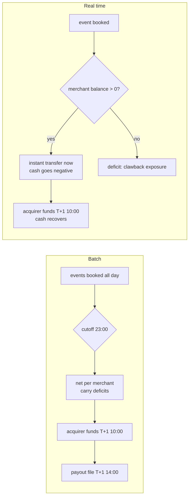

# Batch vs Real-Time Settlement Pipelines

> The nightly job that moves the actual money.

**Type:** Build
**Languages:** Java, Python, Go
**Prerequisites:** Phase 10 Lesson 01 (Representing Money), Phase 10 Lesson 03 (The Double-Entry Ledger), Phase 10 Lesson 10 (Fees and Splits), Phase 11 Lesson 08 (ACH and the NACHA File Format), Phase 11 Lesson 15 (Settlement and Clearing), Phase 12 Lesson 08 (Payouts and Balances), Phase 14 Lesson 04 (Reconciliation at Scale)
**Time:** ~90 minutes

## Learning Objectives

- Explain the difference between authorization, clearing, and settlement, and why a platform's payouts to merchants are a separate settlement leg from the acquirer's payment to the platform
- Build a batch settler that applies a cutoff, nets every merchant's captures, refunds, chargebacks, and fees into one payout, and carries negative or below-minimum balances forward
- Render a payout batch as a settlement file with a control record (count, total, entry hash) that the receiving bank can validate independently
- Prove the run ties out: every merchant's ledger balance equals what was carried plus the effect of events not yet settled, and the trial balance is zero
- Compare batch and real-time payout on the same events in transfers sent, prefunding required, and clawback exposure, and state which business conditions justify each

## The Problem

A marketplace platform takes card payments for 4,000 merchants. The acquirer authorizes and captures each payment in real time, so the merchant dashboard shows "paid" within a second of checkout. None of that has moved a cent. The acquirer will pay the platform tomorrow, net of refunds and chargebacks, in one wire. The platform must then pay each merchant what it is owed, net of its fees, by ACH. The job that decides those 4,000 numbers and writes the file the bank executes is the settlement pipeline, and it is the only code in the company that actually moves money out of the building.

The first version is a cron job that runs at midnight and sums each merchant's captures from the `payments` table. It goes wrong in four ways in its first quarter. A capture at 23:59:58 is committed after the query started and is in no batch at all, because the query used `created_at < now()` and the next run used `created_at > last_run`. A merchant with a 60.00 chargeback and only 45.50 of sales gets a payout of 45.50, because the job ignored chargebacks; the platform's bank account now funds the dispute. An engineer reruns the job after a timeout and every merchant is paid twice, because "rerun" meant "run again" rather than "finish what was started." And the bank rejects one file outright because the control total in the trailer did not match the sum of the detail lines after someone patched an amount by hand.

Leadership then asks the obvious question: the card network is real time, the instant payment rails are real time, why are merchants waiting until tomorrow at all? A pilot pays every merchant the moment a capture lands. Within a week the platform's operating account is overdrawn by the entire day's sales volume, because the acquirer still pays tomorrow, and it is chasing 95.00 of refunds and chargebacks from merchants who were already paid out in full.

This lesson builds both pipelines over one double-entry ledger. The batch settler has an explicit cutoff, nets every event type, carries deficits forward, uses the batch id as an idempotency key, writes a file with a verifiable control record, and proves it ties out. The real-time settler sweeps each merchant's positive balance immediately. Running both over the same events shows exactly what real time costs: transfers, prefunding, and clawback exposure, to the cent.

## The Concept

### Three legs, three timelines

A card payment has three distinct money events that are routinely conflated:

| Stage | What happens | When | Moves money? |
|-------|--------------|------|--------------|
| Authorization | Issuer approves and places a hold on the cardholder's funds | Checkout, ~1 s | No; a hold only |
| Clearing | Merchant's acquirer submits the capture; the network routes it to the issuer, which posts it to the cardholder's account | Same day batch (networks clear in cycles) | No; it establishes the obligation |
| Settlement (network) | Issuers pay the network, the network pays acquirers, net per currency per settlement cycle | T+0 to T+2 depending on network and region | Yes, between banks |
| Settlement (payout) | Acquirer or platform pays the merchant its net amount | T+1 to T+3 batch; seconds on an instant rail | Yes, to the merchant's bank |

Phase 11, Lesson 15 covered the network leg. This lesson is the last row: the platform (or acquirer, or payment facilitator) holding funds on behalf of merchants and paying them out. The platform is both a creditor of the acquirer (`processor_receivable`) and a debtor of every merchant (`merchant_payable:<id>`), and the settlement pipeline converts those two balances into cash at the right time and in the right order.

### The ledger model

Every event is booked when it happens, not when it settles. The accounts, with debits positive and credits negative:

| Event | Debit | Credit |
|-------|-------|--------|
| Capture of `G` with fee `F` | `processor_receivable` G | `merchant_payable:M` G-F, `fee_revenue` F |
| Refund of `R` | `merchant_payable:M` R | `processor_receivable` R |
| Chargeback of `C` with dispute fee `D` | `merchant_payable:M` C+D | `processor_receivable` C, `fee_revenue` D |
| Acquirer funding of `X` | `cash` X | `processor_receivable` X |
| Payout instruction of `P` | `merchant_payable:M` P | `payouts_in_transit` P |
| Bank confirms payout file | `payouts_in_transit` P | `cash` P |

Two consequences matter. First, the merchant's payable account is always the authoritative answer to "what do we owe this merchant," and the payout is a transfer out of it, not a computation beside it. Second, `payouts_in_transit` is a separate account because an instruction is not a payment: between writing the file and the bank's confirmation (or return), the money is neither the merchant's nor ours to spend. Phase 11, Lesson 08 showed that an ACH credit can be returned days later; when that happens the return reverses the in-transit entry back into the merchant's payable.

### Cutoff: which events belong to a batch

A batch for business date `D` contains every booked, not-yet-settled event with `at < cutoff(D)`. Three properties make this safe:

1. **Half-open interval.** `at < cutoff` and never `at <= cutoff`. An event exactly at the cutoff belongs to the next batch, deterministically.
2. **Selection by settlement status, not by time range.** The batch selects "unsettled and before cutoff," not "between the last cutoff and this one." A late-arriving event with an old timestamp is picked up by the next batch instead of falling into the gap between two time ranges. This is the 23:59:58 bug, fixed by state rather than by clock.
3. **Settled-by marker.** Each included event records the batch id that settled it. An event is in at most one batch, and the tie-out can always explain where every event went.

### Netting

Netting replaces many gross obligations with one net obligation per counterparty. For merchant `M` in batch `B`:

```text
net(M, B) = carried(M) + sum over included events e of effect(e)
effect(capture)    = G - fee(G)
effect(refund)     = -R
effect(chargeback) = -(C + dispute fee)
```

Then:

- `net >= minimum` and positive: one payout instruction for `net`, carry resets to zero.
- `0 < net < minimum`: carried forward as a positive amount. Sending a 0.67 ACH costs more than it is worth.
- `net <= 0`: carried forward as a deficit. The merchant owes the platform; the next batch's captures pay it down first. Platforms with large deficits debit the merchant's bank account or draw on a reserve (Phase 12, Lesson 08), but netting against future sales is always the first line.
- Merchant on hold (KYC review, fraud investigation): its events are not included and stay unsettled, so they flow into the first batch after the hold lifts.

Netting is why batch settlement is cheap: 50,000 events across 200 merchants become 200 transfers. It is also why it is safe: a refund is subtracted before money leaves, not chased afterwards.

### Worked example by hand

Fee schedule: 2.9% (rounded half-even to the cent) plus 0.30 per capture; refunds return no fee; chargebacks cost a 15.00 dispute fee. Cutoff 2026-03-31 23:00 UTC.

| Time | Event | Merchant | Amount | Fee | Effect on merchant |
|------|-------|----------|--------|-----|--------------------|
| 09:15 | c1 capture | m_acme | 120.00 | 3.48 + 0.30 = 3.78 | +116.22 |
| 10:05 | c3 capture | m_bolt | 45.50 | 1.3195 -> 1.32 + 0.30 = 1.62 | +43.88 |
| 11:40 | c2 capture | m_acme | 80.00 | 2.32 + 0.30 = 2.62 | +77.38 |
| 12:30 | c4 capture | m_cora | 1,000.00 | 29.00 + 0.30 = 29.30 | +970.70 |
| 13:45 | c6 capture | m_cora | 250.00 | 7.25 + 0.30 = 7.55 | +242.45 |
| 15:05 | r1 refund | m_acme | 20.00 | 0.00 | -20.00 |
| 16:20 | cb1 chargeback | m_bolt | 60.00 | 15.00 | -75.00 |
| 23:30 | c5 capture | m_cora | 10.00 | 0.29 + 0.30 = 0.59 | +9.41 (after cutoff) |

Netting the seven events before the cutoff:

```text
m_acme: 116.22 + 77.38 - 20.00           = 173.60   -> pay
m_bolt: 43.88 - 75.00                    = -31.12   -> carry (merchant owes us)
m_cora: 970.70 + 242.45                  = 1213.15  -> pay
payouts: 173.60 + 1213.15                = 1386.75
acquirer owes: 120 + 45.50 + 80 + 1000 + 250 - 20 - 60 = 1415.50
fees earned on included events: 3.78 + 1.62 + 2.62 + 29.30 + 7.55 + 15.00 = 59.87
check: payouts + fees - bolt deficit = 1386.75 + 59.87 - 31.12 = 1415.50
```

The last line is the batch's own conservation law: what the acquirer pays us equals what we pay merchants plus what we keep, minus what merchants owe us. If it does not hold, an event was counted on one side and not the other.

After the acquirer funds 1,415.50 on T+1 morning and the payout file executes on T+1 afternoon, the settlement bank account holds `1415.50 - 1386.75 = 28.75`, which is `59.87 - 31.12`: our fees, less the chargeback we have fronted for m_bolt. The cash balance never went below zero, because payouts left after funding arrived.

### The settlement file and its control record

The bank does not trust our arithmetic and neither should we. A Nacha ACH file ends each batch with a Batch Control record containing the entry count, the total debit and credit amounts, and an **entry hash**: the sum of the first eight digits of every receiving routing number, truncated to ten digits. The receiving bank recomputes all three from the detail records and rejects the batch if any differs. The hash is not cryptographic; it catches a dropped line, a duplicated line, or a routing number edited in place, which are the failures a file actually suffers.

This lesson's file uses the same structure in a readable pipe-delimited layout:

```text
H|BATCH-2026-03-31|2026-03-31|USD
D|000001|m_acme|021000021|100200300|17360
D|000002|m_cora|011000138|987654321|121315
T|2|138675|0003200015
```

The entry hash is `02100002 + 01100013 = 03200015`. Amounts are in minor units: no decimal point to misplace. ISO 20022 `pain.001` carries the same controls as `NbOfTxs` and `CtrlSum` in the group header.

### Idempotency: the batch id is the key

`BATCH-2026-03-31` is derived from the business date, not from a counter or a timestamp. Running the batch for the same date a second time returns the stored batch and posts nothing. Every payout journal id is `payout:<batchId>:<merchantId>`, so even a crash halfway through writing instructions is safe to resume: the ledger refuses the journals already posted. The file is a pure function of the stored batch, so regenerating it after a crash produces the same bytes, which matters because banks also deduplicate on file content and identifiers.

### Real-time payout

An instant rail (RTP, FedNow, Faster Payments, UPI, SEPA Instant; Phase 11, Lesson 10) lets the platform pay each merchant within seconds. The simplest real-time policy is a **sweep**: after booking each event, if the merchant's payable balance is positive, pay all of it.

Over the same seven events before the cutoff:

| Time | Event | Balance after event | Swept | Cash position |
|------|-------|---------------------|-------|---------------|
| 09:15 | c1 | acme +116.22 | 116.22 | -116.22 |
| 10:05 | c3 | bolt +43.88 | 43.88 | -160.10 |
| 11:40 | c2 | acme +77.38 | 77.38 | -237.48 |
| 12:30 | c4 | cora +970.70 | 970.70 | -1,208.18 |
| 13:45 | c6 | cora +242.45 | 242.45 | -1,450.63 |
| 15:05 | r1 | acme -20.00 | 0 | -1,450.63 |
| 16:20 | cb1 | bolt -75.00 | 0 | -1,450.63 |

Five transfers instead of two. The platform paid out 1,450.63 before receiving a cent from the acquirer, so it must prefund that amount from its own capital or a credit line. The refund and chargeback arrived after the merchants were paid, leaving 95.00 that must be clawed back. After T+1 funding of 1,415.50, cash is `-35.13`: our 59.87 of fees minus the 95.00 we are owed by merchants. The batch platform is up 28.75; the real-time platform is down 35.13 on identical business.



### Comparison

| Property | Batch (T+1) | Real-time sweep |
|----------|-------------|-----------------|
| Transfers | One per merchant per day | One per positive event |
| Prefunding | Zero if payouts follow funding | Up to a full day of net sales (plus the acquirer's lag) |
| Refund and chargeback risk | Netted before money leaves | Arrive after payout; exposure = sum of negative balances |
| Rail cost | ACH: cents per item | Instant: higher per item, and many more items |
| Returns and recalls | ACH returns up to 2 banking days (60 for unauthorized consumer debits) | Instant credits are final; mistakes are recovered by request, not by return |
| Merchant experience | Next day | Seconds |
| Control points | One file, one approval, one reconciliation | Continuous; needs per-transfer limits and monitoring |

The seeded run in Step 8 makes the scale visible: 50,000 events across 200 merchants become 200 batch transfers or 43,711 real-time transfers, and the real-time platform must prefund 10.46 million USD.

Real-time payout is still the right answer for some businesses: gig-economy earnings where workers need cash today, marketplaces competing on payout speed, and platforms whose acquirer also settles in real time. The production designs that make it work are hybrids: pay out instantly only up to an **available balance** that excludes a rolling reserve (Phase 10, Lesson 07); charge for instant payout so the fee covers the prefunding cost; cap instant payouts per merchant by risk tier; and keep a nightly batch that nets everything the instant path did not.

### Invariants and complexity

The settler maintains one invariant, checked by `tiesOut()`:

```text
for every merchant M:
  owedTo(M) == carried(M) + sum of effect(e) over booked events e of M not yet settled
and the ledger's trial balance is zero
```

If a payout was posted twice, the left side is lower than the right. If an event was settled without being netted, the right side is lower. If a journal did not balance, the trial balance is non-zero. The test suite checks this after every operation in the scenario.

Running a batch is `O(E + M log M)` for `E` unsettled events and `M` merchants: one pass to net, a sorted map for deterministic instruction order. Memory is `O(M)` for the nets plus the event-id list. Real-time is `O(1)` per event plus one ledger post, which is cheap per event and expensive in aggregate because every post is a transfer on a rail.

### What this pipeline does not do

It does not handle multiple currencies; a real settler runs one batch per currency per bank account and never nets across currencies without an explicit FX conversion (Phase 10, Lesson 09). It does not model the acquirer paying net of interchange and scheme fees; that belongs to the reconciliation of the funding wire (Lesson 04). It does not process ACH returns, though the in-transit account is where they would land. It does not compute reserves, rolling holds, or payout schedules longer than daily. And it does not decide whether a merchant should be on hold; it obeys the flag.

## Build It

The code is one file, `code/java/Main.java`. Each step below is a chunk of it.

### Step 1: Money, copied

```java
record Money(long minorUnits, Currency currency) implements Comparable<Money> {
    Money times(long numerator, long denominator, Rounding rounding) {
        return new Money(divideRounded(Math.multiplyExact(minorUnits, numerator), denominator, rounding), currency);
    }
    // plus, minus, negate, parse, compareTo, toString as in Phase 10, Lesson 01
}
```

The `Money`, `Currency`, and `Rounding` types are the Phase 10, Lesson 01 design, trimmed to what settlement needs. `times` is kept because fees are a rate: 2.9% is `29/1000`, and the remainder is resolved with `HALF_EVEN` exactly once per capture.

**Predict:** the fee on 45.50 is `4550 * 29 / 1000 = 131950 / 1000`. What does `HALF_EVEN` return, and would `DOWN` change the merchant's payout?

### Step 2: Events and the fee schedule

```java
record SettlementEvent(String id, String merchantId, EventType type, Money amount, Instant at) {
    SettlementEvent {
        if (!amount.isPositive()) throw new IllegalArgumentException("event amounts are positive; the type gives the sign: " + id);
    }
}

Money merchantEffect(SettlementEvent e) {
    return switch (e.type()) {
        case CAPTURE -> e.amount().minus(feeFor(e));
        case REFUND -> e.amount().negate();
        case CHARGEBACK -> e.amount().plus(chargebackFee).negate();
    };
}
```

Amounts on events are always positive and the type carries the direction. A negative capture or a "refund of -20.00" is rejected at construction, because sign conventions that differ between producers are a classic source of payouts that are off by twice the amount. `merchantEffect` is the single place that defines what an event does to a merchant's balance; the netting loop and the tie-out both call it, so they cannot disagree.

**Predict:** a refund of a capture that has already been paid out lands in tomorrow's batch. What is its effect on tomorrow's net, and what happens if tomorrow the merchant has no captures?

### Step 3: The ledger

```java
boolean post(String journalId, List<Posting> postings) {
    if (journals.containsKey(journalId)) return false;
    long sum = 0;
    for (Posting p : postings) sum = Math.addExact(sum, p.minor());
    if (sum != 0) throw new UnbalancedJournalException(journalId, sum);
    for (Posting p : postings) balances.merge(p.account(), p.minor(), Math::addExact);
    journals.put(journalId, List.copyOf(postings));
    minCash = Math.min(minCash, balances.getOrDefault(CASH, 0L));
    return true;
}
```

A journal is posted at most once per id and must sum to zero. That is the whole double-entry contract from Phase 10, Lesson 03, in eight lines. `minCash` records the lowest balance the settlement bank account ever reached; its negation is `peakPrefunding()`, the number the treasury team needs to size a credit line. `owedTo(merchant)` negates the payable's credit balance so that "we owe 173.60" reads as a positive number.

**Predict:** the batch posts `payout:BATCH-2026-03-31:m_acme`, crashes, and is rerun. What does the second `post` return, and does the second run produce a different instruction list?

### Step 4: Booking events as they happen

```java
List<Posting> postings = switch (e.type()) {
    case CAPTURE -> List.of(
            new Posting(Ledger.PROCESSOR_RECEIVABLE, amount),
            new Posting(payable, -(amount - fee)),
            new Posting(Ledger.FEE_REVENUE, -fee));
    case REFUND -> List.of(
            new Posting(payable, amount),
            new Posting(Ledger.PROCESSOR_RECEIVABLE, -amount));
    case CHARGEBACK -> List.of(
            new Posting(payable, amount + fee),
            new Posting(Ledger.PROCESSOR_RECEIVABLE, -amount),
            new Posting(Ledger.FEE_REVENUE, -fee));
};
boolean fresh = ledger.post("evt:" + e.id(), postings);
```

`Platform.book` is the table from The Concept turned into code. It runs at event time, not at settlement time, so the merchant dashboard and the ledger agree at every moment about what is owed. The journal id `evt:<id>` makes booking idempotent: a webhook delivered twice books once. Booking also rejects unknown merchants and foreign-currency events before anything is posted.

**Predict:** if booking happened at settlement time instead, what would `owedTo("m_acme")` return at 16:00 on the business date, and what would a merchant dashboard built on it show?

### Step 5: Selecting and netting the batch

```java
for (SettlementEvent e : platform.events) {
    if (settledBy.containsKey(e.id()) || !e.at().isBefore(cutoff)) continue;
    Merchant m = platform.merchants.get(e.merchantId());
    if (m.onHold()) continue;
    net.merge(e.merchantId(), platform.fees.merchantEffect(e), Money::plus);
    included.computeIfAbsent(e.merchantId(), k -> new ArrayList<>()).add(e.id());
    funding = funding.plus(FeeSchedule.processorEffect(e));
}
for (Map.Entry<String, Money> entry : carry.entrySet()) {
    if (!platform.merchants.get(entry.getKey()).onHold()) net.merge(entry.getKey(), entry.getValue(), Money::plus);
}
```

Selection is "not yet settled and strictly before the cutoff", the half-open rule. Held merchants are skipped entirely, so their events stay unsettled. The carry map adds in yesterday's deficits and small balances. `funding` accumulates what the acquirer owes for exactly these events, which is the number to reconcile against tomorrow's funding wire. `net` is a `TreeMap`, so instruction order is deterministic by merchant id and a rerun of the generator produces the same file byte for byte.

**Predict:** an event at exactly `23:00:00` and an event timestamped yesterday that was booked late today. Which batch does each land in?

### Step 6: Instructions and carries

```java
if (amount.isPositive() && amount.compareTo(minimumPayout) >= 0) {
    PayoutInstruction p = new PayoutInstruction(instructions.size() + 1, merchantId, m.routing(), m.account(), amount);
    instructions.add(p);
    platform.ledger.post("payout:" + batchId + ":" + merchantId, List.of(
            new Posting(Ledger.merchantPayable(merchantId), amount.minorUnits()),
            new Posting(Ledger.PAYOUTS_IN_TRANSIT, -amount.minorUnits())));
    carry.remove(merchantId);
} else if (amount.minorUnits() != 0) {
    carry.put(merchantId, amount);
    carriedOut.put(merchantId, amount);
} else {
    carry.remove(merchantId);
}
```

Every positive net at or above the minimum becomes an instruction and a journal that moves the amount from the merchant's payable into `payouts_in_transit`. Everything else is carried. After the loop, every included event is marked with the batch id and the batch is stored under its id, so `run` with the same date returns it.

**Predict:** m_bolt carries `-31.12`. On April 1 it captures 100.00. What does it get paid, and what is its carry afterwards?

### Step 7: The file and the tie-out

```java
static long entryHash(List<PayoutInstruction> instructions) {
    long hash = 0;
    for (PayoutInstruction p : instructions) hash += Long.parseLong(p.routing().substring(0, 8));
    return hash % 10_000_000_000L;
}

boolean tiesOut() {
    Map<String, Money> expected = new TreeMap<>();
    for (String id : platform.merchants.keySet()) expected.put(id, carried(id));
    for (SettlementEvent e : platform.events) {
        if (!settledBy.containsKey(e.id())) expected.merge(e.merchantId(), platform.fees.merchantEffect(e), Money::plus);
    }
    for (Map.Entry<String, Money> entry : expected.entrySet()) {
        if (!platform.ledger.owedTo(entry.getKey()).equals(entry.getValue())) return false;
    }
    return platform.ledger.trialBalance() == 0;
}
```

`SettlementFile.render` writes header, details, and trailer; `validate` plays the receiving bank and recomputes count, total, and hash from the detail lines. The test changes one amount by a cent and confirms validation fails. `tiesOut` is the invariant from The Concept, computed from first principles (events and carries) and compared with the ledger (journals). Two independent derivations agreeing is what lets the treasury team sign the file.

**Predict:** if `run` posted the payout journal but crashed before marking the events settled, which side of `tiesOut` would be wrong, and by how much?

### Step 8: The real-time settler

```java
void onEvent(SettlementEvent e) {
    if (!platform.book(e)) return;
    Money owed = platform.ledger.owedTo(e.merchantId());
    if (!owed.isPositive()) return;
    transfers++;
    grossPaid = grossPaid.plus(owed);
    String id = "rt:" + e.id();
    platform.ledger.post(id, List.of(
            new Posting(Ledger.merchantPayable(e.merchantId()), owed.minorUnits()),
            new Posting(Ledger.CASH, -owed.minorUnits())));
}
```

The real-time path posts straight to cash because an instant credit is final on send: there is no in-transit state. It uses the same `Platform.book`, so the same journals describe the same events. `clawbackExposure` sums negative merchant balances. `LiquidityComparison.run` builds two fresh platforms, runs the batch path (book, run, fund, confirm) and the real-time path (sweep per event, then fund) over the same events in the same cutoff scope, and reports transfers, value paid, peak prefunding, exposure, and the final cash position.

**Predict:** if the real-time sweep paid only the event's own effect instead of the whole positive balance, would m_acme's refund still create exposure?

### Step 9: Run it

```bash
cd phases/14-payments-at-scale/05-batch-vs-real-time-settlement/code/java
javac -d .out *.java && java -cp .out Main
java -cp .out MainTest
```

Expected output, abbreviated:

```console
batch BATCH-2026-03-31: 7 events, 2 payouts totalling 1386.75 USD
  pay m_acme 173.60 USD
  pay m_cora 1213.15 USD
  carry m_bolt -31.12 USD (merchant owes the platform)
  c5 at 23:30 settled? false (after cutoff: next batch)
acquirer owes for this batch: 1415.50 USD

== Settlement file ==
H|BATCH-2026-03-31|2026-03-31|USD
D|000001|m_acme|021000021|100200300|17360
D|000002|m_cora|011000138|987654321|121315
T|2|138675|0003200015
receiver validation: true
...
trial balance: 0   ties out: true
rerun of BATCH-2026-03-31 returns the same batch: true, journals still 12

== Batch vs real time over the same events ==
                             batch (T+1)        real time
  transfers sent             2                  5
  value paid to merchants    1386.75 USD        1450.63 USD
  peak prefunding            0.00 USD           1450.63 USD
  clawback exposure          0.00 USD           95.00 USD
  cash after T+1 funding     28.75 USD          -35.13 USD

== 200 merchants, 50,000 events, seed 7 ==
payouts 200, total 10451307.57 USD, carried 0, ties out true, file valid true
  transfers sent             200                43711
  peak prefunding            0.00 USD           10456712.42 USD
  clawback exposure          0.00 USD           5404.85 USD
```

`MainTest` runs 42 assertions: the fee arithmetic, the worked example, the cutoff, idempotent reruns and rebooking, file validation and tamper detection, a second day that nets the carried deficit (`96.80 - 31.12 = 65.68`), holds and minimum payouts, ledger safety, the liquidity comparison numbers, and a 5,000-event seeded day that ties out.

### In Python

`code/python/main.py` has the same classes (`FeeSchedule`, `Ledger`, `Platform`, `BatchSettler`, `SettlementFile`, `RealTimeSettler`, `LiquidityComparison`) and prints the same demo, down to the 43,711 real-time transfers of the seeded day. What differs:

- **Half-even division works on magnitudes.** `//` floors toward negative infinity, so `divide_rounded` uses `divmod(abs(dividend), abs(divisor))` and reapplies the sign, exactly as Phase 10, Lesson 01 does; otherwise a negative fee would round the wrong way. The fee on 45.50 is 1.62 in both languages because of this.
- **Instants are aware `datetime`s.** Event times and the cutoff are `datetime` objects with `timezone.utc`; comparing one with a naive `datetime` raises `TypeError`, which is better than the silent offset Java's `LocalDateTime` would give. `instant("2026-03-31T23:00:00Z")` is the port's `Instant.parse`.
- **Sorted iteration is explicit.** Java's `TreeMap` gives the netting loop and the ledger view their deterministic order for free; the port keeps plain dicts and iterates `sorted(net)` and `sorted(self._balances)` where the order is visible (instruction sequence numbers, the ledger printout).

```python
for merchant_id in sorted(net):  # TreeMap order: one deterministic sequence per merchant id
    amount = net[merchant_id]
    if amount.is_positive() and amount >= self.minimum_payout:
        instructions.append(PayoutInstruction(len(instructions) + 1, merchant_id, m.routing, m.account, amount))
```

- **The seeded day uses `java.util.Random`, reimplemented.** `generated_day` draws from a 20-line `JavaRandom` (the JDK's 48-bit LCG with the exact `nextInt(bound)` rejection loop), so seed 7 yields the same 50,000 events and the same totals as the Java run. `UnbalancedJournalException` is a `RuntimeError`, `CurrencyMismatchError` a `ValueError`, and the idempotent rerun is checked with `is`, the identity test behind Java's `==` on references.

```bash
cd phases/14-payments-at-scale/05-batch-vs-real-time-settlement/code/python
python3 main.py
python3 -m unittest -v
```

The Python tests port every Java check (51 assertions) and the demo output is identical to the Java run.

### In Go

`code/go/main.go` has the same types (`FeeSchedule`, `Ledger`, `Platform`, `BatchSettler`, `SettlementFile`, `RealTimeSettler`, `LiquidityComparison`) and prints the same demo, down to the 43,711 real-time transfers of the seeded day (`javarandom.go` is the JDK generator). What differs:

- **Errors are values, identity is a pointer.** `Ledger.Post` returns `(bool, error)` with `ErrUnbalancedJournal`; `Platform.Book` returns `ErrUnknownMerchant` or `ErrCurrencyMismatch`; `BatchSettler.Run` returns `(*SettlementBatch, error)`, and because the batch is a pointer the idempotent rerun check is the same `again == batch` the Java writes. `NewMerchant` and `NewSettlementEvent` validate where the Java compact constructors threw. Inside `Run` a `need(...)` helper panics on an error and a deferred `catch` converts it to the return value, so the netting loop stays readable.
- **Sorted iteration is explicit.** Java's `TreeMap` orders the netting loop, the carried-forward map, and the ledger printout for free; Go maps are unordered, so `Run` sorts the merchant ids before assigning instruction sequence numbers and `BalancesView` returns a sorted slice:

```go
sort.Strings(merchantIds) // TreeMap order: one deterministic sequence per merchant id
for _, merchantId := range merchantIds {
    amount := net[merchantId]
    if amount.IsPositive() && amount.Compare(s.minimumPayout) >= 0 {
        instructions = append(instructions, PayoutInstruction{len(instructions) + 1, merchantId, m.Routing, m.Account, amount})
```

- **Half-even division needs no sign dance.** Go's `/` and `%` truncate toward zero like Java's, so `DivideRounded` is a line-for-line port and the fee on 45.50 is 1.62; `Times` and `Plus` go through `mulChecked`/`addChecked` where Java used `Math.multiplyExact`/`addExact`.
- **Instants are UTC `time.Time`.** `e.At.Before(cutoff)` is `Instant.isBefore`, and the seeded day's timestamps come from `time.Unix(dayStart+int64(i)*86_400/int64(count), 0)`, the same integer arithmetic as the Java. The file validator returns `false` on a malformed number instead of throwing `NumberFormatException`.

```bash
cd phases/14-payments-at-scale/05-batch-vs-real-time-settlement/code/go
go run .
go test ./...
```

The Go tests port every Java check (47 assertions) and the demo output is identical to the Java run.

## Use It

**Card acquirers and platforms.** Stripe, Adyen, and Braintree all expose this lesson's model in their APIs: a balance per connected account, balance transactions for each charge, refund, dispute, and fee, and payouts that move an amount from the available balance to a bank account. Stripe's payout reconciliation report groups balance transactions by the payout that settled them, which is the `settledBy` map. Adyen's settlement details report is the acquirer-side batch with per-transaction fees. What they add: per-merchant payout schedules (daily, weekly, manual), rolling reserves, and automatic debits of negative balances from the merchant's bank account.

**ACH and Nacha.** The settlement file in production is a Nacha file (Phase 11, Lesson 08): File Header, Batch Header, Entry Detail records with standard entry class `CCD` or `PPD`, Batch Control with entry/addenda count, entry hash, and totals, and a File Control record that repeats the controls across batches. Same Day ACH windows (three submission deadlines per day in the US) let a batch settler run several cutoffs a day without changing its design.

**ISO 20022.** Outside the US, the instruction file is a `pain.001` Customer Credit Transfer Initiation with `GrpHdr/NbOfTxs` and `GrpHdr/CtrlSum` as the control record, and the bank answers with `pain.002` status reports per instruction. SEPA Credit Transfer batches settle next business day; SEPA Instant settles in ten seconds, with the prefunding and finality trade-offs from the comparison table.

**Instant rails.** RTP and FedNow in the US, Faster Payments in the UK, UPI in India, and Pix in Brazil settle each credit individually and irrevocably. Platforms that offer instant payout typically fund a prefunded account at the rail or their sponsor bank, which is the peak-prefunding number turned into a balance sheet line.

## Ship It

`outputs/runbook-settlement-batch.md` is a runbook for the person who owns the nightly batch: the pre-flight checks before release (tie-out, control totals, funding expected versus received, held merchants, deficits over threshold), what to do when the bank rejects the file, when an ACH return arrives, and when someone asks for the batch to be "just rerun." It also has the decision table for offering instant payout to a merchant segment.

## Exercises

1. **Reinforce.** Add a `PAYOUT_RETURN` path: `BatchSettler.onReturn(batchId, merchantId, reasonCode)` posts `Dr payouts_in_transit, Cr merchant_payable` for the returned amount and puts the merchant on hold. Write a test that returns m_cora's 1,213.15 after confirmation (you will need to decide where that money is sitting once confirmed, and post accordingly) and shows `tiesOut()` still holds.
2. **Apply.** Multi-currency: give each merchant a settlement currency and run one batch per currency. A merchant that sells in EUR and USD gets two instructions. Show that `SettlementFile` must be one file per currency and that the entry hash and totals never mix currencies. Use the Phase 10, Lesson 09 multi-currency ledger as the model for per-currency balances.
3. **Extend.** Build the hybrid: instant payout up to an available balance that excludes a rolling reserve of 10% of the last seven days of captures, with everything else in the nightly batch. Using the 50,000-event seeded day, report peak prefunding and clawback exposure for reserves of 0%, 5%, 10%, and 20%, and find the smallest reserve that keeps exposure under 1,000.00 USD. Combine with Phase 10, Lesson 07 (Holds and Available Balance).

## Key Terms

| Term | What people say | What it actually means |
|------|-----------------|------------------------|
| Settlement | "the payment went through" | The actual transfer of funds between accounts that discharges an obligation; for a merchant, the payout to its bank, days after authorization |
| Cutoff | "the end of the day" | The instant that bounds a batch, applied as a half-open interval (`at < cutoff`) together with a not-yet-settled status check |
| Netting | "adding it up" | Replacing many gross obligations with one signed amount per counterparty per batch: captures minus fees, refunds, chargebacks, and carried balances |
| Carry forward | "rolled over" | A deficit or below-minimum net kept on the merchant's payable and added into the next batch's net |
| Control record | "the trailer" | Count, total, and entry hash at the end of a file, recomputed by the receiving bank to detect dropped, duplicated, or altered lines |
| Payouts in transit | "paid" | Money instructed to the bank but not yet confirmed or possibly returned; neither the merchant's balance nor the platform's cash |
| Prefunding | "float" | Capital the platform must provide when it pays merchants before the acquirer pays it; the peak negative cash position |
| Clawback exposure | "negative balances" | Refunds and chargebacks booked after a merchant was already paid, which the platform must recover from the merchant |

## Further Reading

- [Nacha Operating Rules and the ACH file format](https://www.nacha.org/rules) — the Batch Control and File Control records, the entry hash definition, Same Day ACH windows, and return timeframes.
- [ISO 20022 message definitions: pain.001 and pain.002](https://www.iso20022.org/iso-20022-message-definitions) — customer credit transfer initiation with `NbOfTxs`/`CtrlSum` and the bank's per-instruction status report.
- [Bank for International Settlements, CPMI: Principles for Financial Market Infrastructures (2012)](https://www.bis.org/cpmi/publ/d101a.pdf) — Principle 8 (settlement finality) and Principle 7 (liquidity risk) define the vocabulary for the batch versus real-time trade-off.
- [Federal Reserve: FedNow Service operating procedures](https://www.frbservices.org/financial-services/fednow) — what irrevocable, 24x7 settlement means operationally, and the prefunded master-account model.
- [Stripe API reference: Balance Transactions and Payouts](https://docs.stripe.com/api/balance_transactions) — a production balance-and-payout model whose objects map one to one onto this lesson's journals and instructions.
