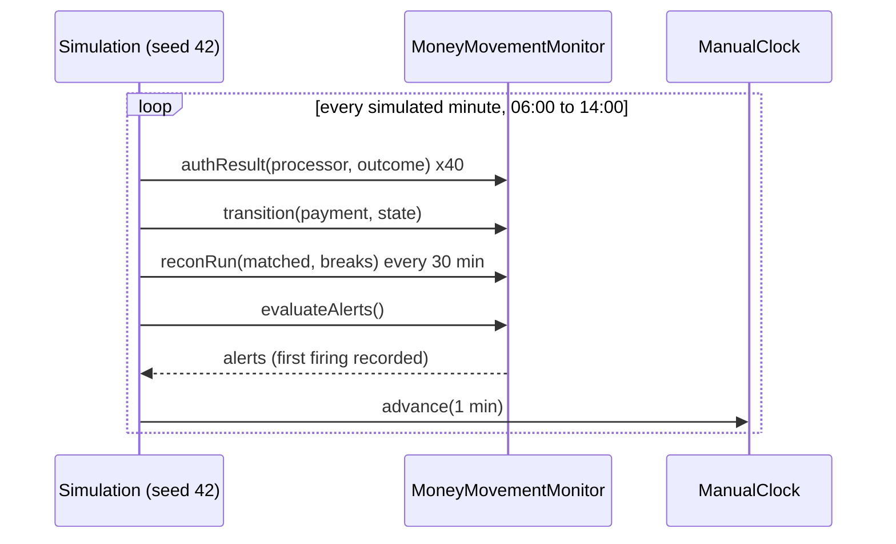

# Observability for Money Movement

> Metrics that detect a stuck payment before a customer does.

**Type:** Build
**Languages:** Java, Python
**Prerequisites:** Phase 9, Lesson 01 (SLIs, SLOs, and Error Budgets), Phase 9, Lesson 06 (Metrics and Histograms), Phase 12, Lesson 02 (Payment State Machine), Phase 14, Lesson 04 (Reconciliation at Scale), Phase 14, Lesson 05 (Batch vs Real-Time Settlement)
**Time:** ~90 minutes

## Learning Objectives

- Explain why request-level metrics (latency, 5xx rate) miss the most expensive payment failures, and name the four money-movement signals that catch them
- Build a stuck-payment detector that measures each payment's age in its current state against a per-state limit, using an injected clock
- Compute in-flight exposure by state, authorization rate by processor over sliding windows, and reconciliation break rate, all in exact integer arithmetic
- Implement multiwindow, multi-burn-rate SLO alerts and explain why each rule needs both a long and a short window and full coverage of the long one
- Separate issuer declines from processor errors in an availability SLI, and show how mixing them hides a processor outage or pages on a bank holiday

## The Problem

At 12:00 a payment processor's capture webhook stops reaching a marketplace's platform for three payments: a network change on the processor side drops the callbacks, the captures succeed at the processor, and the platform's state machine sits at `CAPTURE_PENDING`. Every dashboard is green. The API's p99 latency is 180 ms, the 5xx rate is 0.02%, the Kafka consumer lag is zero, and the database has headroom. The three payments, worth 1,050.00 USD, do not appear in the next settlement batch because the batch only settles `CAPTURED` payments. The merchant notices two days later when its payout is short and opens a support ticket. Engineering finds the cause on day three.

At 13:00 the same day, one of the platform's two processors starts timing out a quarter of its authorization requests. The platform's "payment success rate" dashboard drops from 91% to 81%, which the on-call engineer reads as normal afternoon variation: the success rate has always been noisy because it counts issuer declines, and declines move with the time of day, the merchant mix, and whatever the issuers' fraud models are doing. A quarter of the timeouts were actually approved at the processor; the platform marked them failed and the customers retried, so some of them were charged twice. Reconciliation finds those the next morning.

Nothing in either story is a request failing. Requests succeed, quickly, and return wrong or incomplete answers about money. The signals that catch them are about **payments**, not requests: how long each payment has been in its current state, how much money is sitting in non-final states, what fraction of attempts each processor approves compared with the fleet, how fast the availability error budget is burning, and how many records reconciliation could not match. This lesson builds a monitor that computes all of them from the event stream, with time injected so that every alert can be replayed in a test, and runs it over a seeded eight-hour day in which both failures happen. The stuck captures page 16 minutes after the webhook was lost; the processor outage pages in 3.

## The Concept

### Four signals that are about money

| Signal | Question it answers | Why request metrics miss it |
|--------|--------------------|-----------------------------|
| Stuck payments by state age | Is any payment older than it should be in its current state? | A stuck payment generates no requests at all; silence looks healthy |
| In-flight exposure | How much money is committed but not final, and where? | Exposure is a sum of amounts, not a count of calls |
| Auth rate by processor | Is one processor approving less than the fleet? | Declines are 200 OK responses; a processor that wrongly declines is "up" |
| Reconciliation break rate | What fraction of records could not be matched with the other side? | Breaks are discovered hours later by a batch job, not on the request path |

They share a design rule: **the unit of observation is the payment, and the dimension that matters is time in state.** A payment state machine (Phase 12, Lesson 02) moves through `CREATED`, `AUTHORIZED`, `CAPTURE_PENDING`, `CAPTURED`, and ends in `SETTLED` or `FAILED`. Each non-terminal state has an expected dwell time, and a payment that exceeds it is either stuck or about to cost money.

### Stuck by state age

Each state gets a limit, chosen from the business process rather than from the latency distribution:

| State | Limit | What exceeding it means |
|-------|-------|-------------------------|
| `CREATED` | 30 min | Authorization response lost, or customer abandoned; either way, clean it up |
| `AUTHORIZED` | 6 days | Card authorizations expire around 7 days (shorter for some MCCs); capture or lose the sale |
| `CAPTURE_PENDING` | 15 min | Capture sent, no answer; the processor may have captured and the platform does not know |
| `CAPTURED` | 3 days | Should be in a settlement file by now; if not, the merchant's payout is short |

The detector needs exactly one timestamp per payment: when it **entered its current state**, not when it was created. A payment created yesterday and captured a minute ago is healthy; a payment created a minute ago that has been `CAPTURE_PENDING` for 16 minutes is not. Tracking entered-at per state makes the age a subtraction against the injected clock.

The comparison is strict: age `> limit`. A payment at exactly 15:00 in `CAPTURE_PENDING` is not stuck; at 16:00 it is. Writing the boundary down matters because the test suite checks it, and because two services that disagree on `>` versus `>=` produce alerts that flicker.

Stuck payments are counted, and their amounts are summed. Severity comes from the sum: one 4.00 payment stuck is a ticket; 1,050.00 stuck pages. Count-based paging trains on-call engineers to ignore pages for tiny amounts; amount-based paging ranks by what is at risk.

### In-flight exposure and the age histogram

In-flight exposure is the sum of amounts in each non-terminal state. It answers two questions a count cannot: how much the platform would have to explain if every in-flight payment failed now, and where the money is piling up. A healthy system's exposure is dominated by `CAPTURED` (waiting for the settlement run) and resets after each run; a growing `CAPTURE_PENDING` balance means captures are not completing.

Exposure alone hides shape. The state-age histogram splits each state by age band (`<1m`, `1-5m`, `5-15m`, `15-60m`, `1-24h`, `>24h`). In the simulation at 12:20:

```text
  state            amount            <1m   1-5m  5-15m 15-60m  1-24h   >24h
  CAPTURE_PENDING  12198.94 USD       38      0      0      3      0      0
```

Thirty-eight payments under a minute old are normal flow. Three in the 15-60 minute band are the lost webhooks. A gauge of "CAPTURE_PENDING count = 41" would not show the difference; the histogram makes the tail visible.

### Authorization rate by processor

Authorization rate is approvals divided by attempts over a window. Two choices determine whether it is useful:

1. **Compare processors with the fleet, not with a fixed target.** Approval rates vary by time of day, merchant mix, card mix, and issuer behaviour, so a static threshold either pages constantly or never. The question is whether one processor approves materially less than the others for the same traffic. This lesson pages when a processor's 15-minute rate is at least 500 basis points below the fleet's.
2. **Require a minimum sample.** With 50 attempts, a 5-point drop is two or three declines, which is noise. Rates computed from fewer than 100 attempts are reported as `n/a` and never alert.

Rates are computed in **basis points** with integer division: `10,000 * approvals / attempts`. 9,000 bps is 90.00%. No floating point appears in any comparison, so an alert threshold either fires or does not, identically on every machine and in every replay.

### Availability SLO: declines are good events

An SLO needs a definition of a bad event. For authorization, the tempting definition is "not approved," which counts issuer declines as failures. That is wrong for two reasons. Declines are the issuer doing its job (insufficient funds, suspected fraud) and are outside the platform's control. And their rate moves by several points with no fault anywhere, so a decline-polluted SLI has so much variance that real faults disappear into it, which is what happened at 13:00 in The Problem.

The availability SLI for authorization is: **of attempts that reached a processor, what fraction got a definitive answer (approved or declined)?** Bad events are timeouts, connection failures, and processor 5xx responses. A 99.9% SLO allows 1,000 bad events per million attempts (`budgetPpm = 1000`).

### Burn rate and the multiwindow rule

The **burn rate** is how fast the error budget is being spent relative to the rate that would exactly exhaust it over the SLO period:

```text
burn = (bad / total) / budget
```

A burn rate of 1 spends the 30-day budget in 30 days. A burn rate of 14.4 spends 2% of it in one hour (`14.4 * 1h / 720h = 0.02`). The Google SRE Workbook recommends alerting on burn rate with pairs of windows:

| Severity | Long window | Short window | Burn threshold | Budget consumed when it fires |
|----------|-------------|--------------|----------------|-------------------------------|
| Page | 1 h | 5 min | 14.4 | 2% |
| Page | 6 h | 30 min | 6 | 5% |
| Ticket | 1 d | 2 h | 3 | 10% |
| Ticket | 3 d | 6 h | 1 | 10% |

Both windows must exceed the threshold. The long window gives significance: one bad minute does not page. The short window gives a fast reset: when the incident ends, the 5-minute burn drops to zero within five minutes and the page clears, even though the 1-hour window is still elevated. The test suite proves this with a ten-minute spike that has ended: 1-hour burn 16.66, 5-minute burn 0, no page.

Worked example. In the five minutes to 13:05 the platform made 200 attempts with 6 processor errors; in the hour, 2,400 attempts with 40 errors:

```text
5m burn = (6 / 200) / 0.001     = 0.03 / 0.001  = 30.00
1h burn = (40 / 2400) / 0.001   = 0.01666 / 0.001 = 16.66
both >= 14.40 -> page
```

The code computes `bad * 10^8 / (total * budgetPpm)`, which is the burn rate times 100 as an exact integer: 3000 and 1666. Thresholds are stored the same way (1440 for 14.4).

### Coverage: a half-empty long window is a short window

Burn rate is a ratio of events in the window. If the monitor started 90 minutes ago, the "6-hour" window contains 90 minutes of data, and its burn rate is the 90-minute burn rate. The first version of this lesson's simulation started at noon; the 3-day ticket rule fired one minute into the outage, before the 1-hour page, because its "3-day" window held ninety minutes. The fix is to arm a rule only when the counter has data reaching back the whole long window. After a deploy or a counter reset, the slow rules stay quiet until coverage is complete and the fast rules carry the load. Production systems get the same effect from long metric retention, but a freshly created metric (a new processor, a new region) has the same cold-start problem.

### Reconciliation break rate

Lesson 04 produces breaks; this lesson counts them. Break rate is `breaks / (matched + breaks)` over the last four runs, in basis points, with a ticket at 50 bps (0.5%). It is a lagging signal, hours behind the event, but it is the only one that sees money moving without the platform's knowledge: in the simulation, one in five processor timeouts was actually approved at the processor, and those surface only as breaks. It is the backstop for everything the real-time signals miss.

### The simulation, end to end



Forty attempts a minute across two processors, 92% approved, 8% issuer declines, 0.05% processor errors. Captures complete two minutes after authorization, an hourly settlement run moves `CAPTURED` to `SETTLED`. At 12:00 three capture webhooks are lost. At 13:00 `proc_b` starts failing 25% of its attempts.

| Alert | First fired | Delay | Why that delay |
|-------|-------------|-------|----------------|
| `stuck-payments` (page) | 12:16 | 16 min | 15-minute `CAPTURE_PENDING` limit, strict comparison |
| `auth-rate-drop:proc_b` (page) | 13:03 | 3 min | 15-minute window needs a few bad minutes to open a 5-point gap |
| `slo-burn-60m` (page) | 13:05 | 5 min | 1-hour burn crosses 14.4 once ~1.44% of the hour's attempts failed |
| `slo-burn-360m` (page) | 13:16 | 16 min | 6-hour burn crosses 6 later because six quiet hours dilute it |
| `recon-break-rate` (ticket) | 13:29 | 29 min | Reconciliation runs every 30 minutes |

Without this monitor the first signal would have been the merchant's support ticket two days later. That is the lesson's hook made concrete.

### Failure modes of money metrics

Money metrics fail in ways request metrics do not. Each of these has shipped to production somewhere:

1. **Retries counted as attempts.** A customer who retries a declined card three times produces three attempts and three declines. If the platform also retries timeouts automatically, one checkout can produce six attempts. Auth rate per attempt and auth rate per checkout are different numbers and both are useful; label which one a dashboard shows. The SLI in this lesson counts attempts, because each attempt is a call the processor either answered or did not.
2. **Unknown outcomes recorded as failures.** A timeout is not a decline. Recording it as `FAILED` makes the auth-rate drop visible, which is good, but it also lets the customer retry and be charged twice, which is the reconciliation break in the simulation. The state machine should record `UNKNOWN` and resolve it with a status query (Lesson 07); the monitor should count `UNKNOWN` age like any other state.
3. **Label cardinality.** A label per merchant, per card BIN, or per payment id turns one counter into millions of series and takes down the metrics backend during the incident you need it for. Use bounded labels (processor, brand, region, outcome) on counters and put per-payment detail in the stuck query and the logs.
4. **Summing currencies.** An exposure gauge that adds JPY and USD minor units is off by a factor of 100 for one of them. Export one series per currency, as `Money` forces in code.
5. **Averages of rates.** The fleet auth rate is total approvals over total attempts, not the mean of each processor's rate. With 1,000 attempts at 90% on one processor and 10 at 50% on another, the mean of rates is 70% and the fleet rate is 89.6%. `authRateBps(null, ...)` sums counts first for this reason.
6. **Silence as success.** A reconciliation job that did not run reports zero breaks. A missing run must be its own alert, and a counter that has stopped increasing must be distinguishable from one at zero.

### Choosing limits and thresholds

| Knob | Starting value | How to tune it |
|------|----------------|----------------|
| `CAPTURE_PENDING` limit | 15 min | p99.9 of capture completion time over 30 days, times 3, rounded up |
| Stuck page amount | 1,000.00 | Below the amount that would justify waking someone if it were lost |
| Auth-drop gap | 500 bps over 15 min | Largest gap seen between processors on a healthy week, plus a margin |
| Minimum sample | 100 attempts | Large enough that one decline moves the rate by at most 1 point |
| Break-rate ticket | 50 bps over 4 runs | The steady-state break rate from Lesson 04, times 5 |

Every value in the table is a business decision written down in code, which is the point: when an alert fires or fails to, the review asks whether the number was right, not whether someone remembered to look.

Revisit the table after every incident review (Lesson 07). An alert that fired late is a threshold to tighten; an alert that paged for nothing is a threshold to loosen or a rule to delete. Keep the history of changes next to the rule, because the next person to tune it needs to know why it is where it is.

### Complexity and cost

Each event is `O(log B)` for `B` minute buckets (a `TreeMap` insert), and each window query is `O(W)` for `W` minutes in the window: 60 for one hour, 4,320 for three days. Stuck detection scans all tracked payments, `O(P)`, which is fine for an in-process monitor of tens of thousands of in-flight payments and wrong for millions. Production systems keep a secondary index (or a database query on `state, entered_at`) so the scan is `O(stuck)`. Memory is `O(P + B * processors)`.

### What this monitor does not do

It does not deduplicate or route alerts; that is the alert manager's job. It does not compute latency percentiles (Phase 9, Lesson 06 does that with histograms). It does not distinguish soft from hard declines; Lesson 08 does. It holds all state in memory, so a restart loses window history and the coverage rule correctly silences the slow alerts until history rebuilds. And it does not fix anything: a stuck `CAPTURE_PENDING` payment needs a status query to the processor, which is Lesson 07's playbook.

## Build It

The code is `code/java/Main.java`. Time comes from a `Clock` interface; nothing reads the wall clock.

### Step 1: Injected time

```java
interface Clock { Instant now(); }

final class ManualClock implements Clock {
    private Instant now;
    ManualClock(Instant start) { this.now = start; }
    @Override public Instant now() { return now; }
    void advance(Duration d) {
        if (d.isNegative()) throw new IllegalArgumentException("time does not go backwards");
        now = now.plus(d);
    }
}
```

Every age, window, and alert is a function of `clock.now()`. The tests advance the clock by exactly 15 and then 16 minutes to pin the stuck boundary, and the simulation advances it one minute per tick so eight hours run in under a second. A monitor that called `Instant.now()` directly could not be tested for "fires at 16 minutes" without waiting 16 minutes.

**Predict:** if the monitor used `Instant.now()` and the test ran on a slow CI machine, which assertions would become flaky?

### Step 2: Tracking state entry

```java
void transition(String paymentId, String processor, Money amount, PaymentState to) {
    if (!amount.currency().equals(currency)) throw new CurrencyMismatchException(currency, amount.currency());
    if (to.terminal()) payments.remove(paymentId);
    else payments.put(paymentId, new Tracked(processor, amount, to, clock.now()));
}
```

Each transition replaces the payment's record with a new state and a new `enteredAt`. Terminal states remove it, so the tracked set is exactly the in-flight set and exposure is a sum over it. Amounts are `Money` in one currency; an event in another currency is rejected, because summing USD and EUR into one exposure number is the bug the `Money` type exists to prevent.

**Predict:** a payment goes `CAPTURE_PENDING` at 12:00 and `CAPTURED` at 12:14. At 12:20, how old is it, and is it stuck?

### Step 3: Stuck detection

```java
List<StuckPayment> stuck() {
    List<StuckPayment> out = new ArrayList<>();
    for (Map.Entry<String, Tracked> e : payments.entrySet()) {
        Tracked t = e.getValue();
        Duration age = Duration.between(t.enteredAt(), clock.now());
        Duration limit = stuckAfter.get(t.state());
        if (limit != null && age.compareTo(limit) > 0) {
            out.add(new StuckPayment(e.getKey(), t.processor(), t.state(), age, t.amount()));
        }
    }
    out.sort(Comparator.comparing(StuckPayment::age).reversed().thenComparing(StuckPayment::paymentId));
    return out;
}
```

The sort puts the oldest first and breaks ties by id, so the alert text names the same payment on every evaluation and in every replay. `stuckExposure()` sums the amounts, and the alert rule pages when that sum reaches the threshold (1,000.00 USD by default) and tickets otherwise.

**Predict:** 400.00 is stuck for 16 minutes (ticket). A second payment of 700.00 enters `CAPTURE_PENDING` and 16 minutes pass. What is the severity now, and which payment does the alert name as oldest?

### Step 4: Minute buckets and windows

```java
void add(Instant at, int slot, long n) {
    long minute = Math.floorDiv(at.getEpochSecond(), 60);
    buckets.computeIfAbsent(minute, k -> new long[width])[slot] += n;
}

long[] sum(Instant now, Duration window) {
    long nowMinute = Math.floorDiv(now.getEpochSecond(), 60);
    long from = nowMinute - window.toMinutes() + 1;
    long[] total = new long[width];
    for (long[] counts : buckets.subMap(from, true, nowMinute, true).values()) {
        for (int i = 0; i < width; i++) total[i] += counts[i];
    }
    return total;
}
```

`MinuteCounter` keeps one array of counts per epoch minute, one slot per `AuthOutcome`. A window of `w` minutes sums the `w` buckets ending at the current minute, inclusive. This is the same structure as a Prometheus counter queried with `increase(...[1h])`, minus the interpolation. `covers(now, window)` reports whether the oldest bucket reaches back the whole window; Step 6 uses it.

**Predict:** at 12:00:30 with a 5-minute window, which minute buckets are summed? Does an event at 11:55:59 count?

### Step 5: Auth rate and burn rate

```java
long authRateBps(String processor, Duration window) {
    long[] c = counts(processor, window);
    long total = c[0] + c[1] + c[2];
    return total < minAttemptsForRate ? -1 : Ratio.bps(c[AuthOutcome.APPROVED.ordinal()], total);
}

long burnRateX100(Duration window) {
    long[] c = authAll.sum(clock.now(), window);
    return slo.burnRateX100(c[AuthOutcome.PROCESSOR_ERROR.ordinal()], c[0] + c[1] + c[2]);
}
```

Auth rate counts approvals over all attempts and refuses to answer below the minimum sample. Burn rate counts only `PROCESSOR_ERROR` as bad; `ISSUER_DECLINE` is in the denominator as a good event. `Slo.burnRateX100` is `bad * 10^8 / (total * budgetPpm)` with `multiplyExact`, so the value is exact and overflow is an exception.

**Predict:** a bank holiday doubles issuer declines from 8% to 16% and nothing else changes. What happens to the auth rate, the fleet comparison, and the burn rate?

### Step 6: Alert rules

```java
for (BurnRule r : burnRules) {
    if (!authAll.covers(clock.now(), r.longWindow())) continue; // a half-empty long window is a short window
    long lng = burnRateX100(r.longWindow()), shrt = burnRateX100(r.shortWindow());
    if (lng >= r.thresholdX100() && shrt >= r.thresholdX100()) {
        out.add(new Alert(r.severity(), "slo-burn-" + r.longWindow().toMinutes() + "m", ...));
    }
}
```

Four alert families are evaluated in order: the burn-rate rules from the SRE Workbook table, stuck payments (severity by amount), processor auth-rate drop against the fleet's 15-minute rate (page at 500 bps), and reconciliation break rate over the last four runs (ticket at 50 bps). `evaluateAlerts` returns the currently firing set; it is stateless, which is what an alert manager expects from a rule evaluator.

**Predict:** the monitor restarts at 13:10, in the middle of the outage. Which rules can fire at 13:11, and which stay silent until when?

### Step 7: The dashboard

`dashboard()` renders one screen: the time, total in-flight exposure, a row per non-terminal state with amount and age histogram, auth rate per processor at 5 minutes and 1 hour with attempt counts, burn rates at 5 minutes, 1 hour, and 6 hours, the reconciliation break rate, and the firing alerts. The order is the order an on-call engineer reads it in: how much money, where it is stuck, who is failing, how fast the budget is going, what is paging.

### Step 8: The simulation

```java
double errorP = degraded ? 0.25 : 0.0005;
AuthOutcome outcome = u < errorP ? AuthOutcome.PROCESSOR_ERROR : u < errorP + 0.08 ? AuthOutcome.ISSUER_DECLINE : AuthOutcome.APPROVED;
...
case PROCESSOR_ERROR -> {
    monitor.transition(id, processor, amount, PaymentState.FAILED);
    if (rnd.nextInt(5) == 0) reconBreaks++;
}
```

`Simulation` drives the monitor with a seeded `Random`, schedules captures one and two minutes after approval, runs an hourly settlement, injects the lost webhooks and the outage, and records the first minute each alert name fires. One in five processor errors becomes a reconciliation break, modelling a timeout that the processor actually approved.

### Step 9: Run it

```bash
cd phases/14-payments-at-scale/06-observability-for-money-movement/code/java
javac -d .out *.java && java -cp .out Main
java -cp .out MainTest
```

Expected output, abbreviated:

```console
== Burn rate by hand: 99.9% SLO, budget 1,000 ppm ==
5m: 6 errors / 200 attempts   -> burn 30.00
1h: 40 errors / 2,400 attempts -> burn 16.66

== Eight hours of traffic, seed 42 ==
lost capture webhooks injected at minute 360; proc_b outage starts at minute 420
  first fired stuck-payments         minute 376 (12:16)
  first fired auth-rate-drop:proc_b  minute 423 (13:03)
  first fired slo-burn-60m           minute 425 (13:05)
  first fired slo-burn-360m          minute 436 (13:16)
  first fired recon-break-rate       minute 449 (13:29)

-- dashboard at minute 430 --
MONEY MOVEMENT  2026-03-31T13:10:00Z
in flight 101752.68 USD
  CAPTURE_PENDING  10065.45 USD       34      0      0      0      3      0
auth rate        5m         1h         attempts 1h
  proc_a         90.00%     93.08%     1200
  proc_b         69.00%     87.16%     1200
slo burn         5m 115.00  1h 25.00  6h 4.72
ALERT PAGE slo-burn-60m: auth availability 99.9% burning 25.00 over 60m and 115.00 over 5m (threshold 14.40)
ALERT PAGE stuck-payments: 3 stuck, 1050.00 USD; oldest pay_lost_30000 in CAPTURE_PENDING for 70m
ALERT PAGE auth-rate-drop:proc_b: proc_b approves 74.00% vs fleet 83.50% over 15m
```

`MainTest` runs 39 assertions: exact burn-rate and basis-point arithmetic, the stuck boundary at 15 versus 16 minutes, severity by amount, age reset on transition, exposure by state, histogram bands, windowed auth rates and the minimum sample, declines excluded from the SLI, the ended-spike case where the short window keeps the page quiet, the coverage rule, reconciliation break rate, and the seeded simulation's alert order and determinism.

### In Python

`code/python/main.py` keeps `ManualClock`, `MinuteCounter`, `Ratio`, `Slo`, `BurnRule`, `MoneyMovementMonitor`, and `Simulation`, and prints the same three dashboards. What differs:

- **Time is `datetime` with `timezone.utc` and `timedelta`.** The clock hands out aware datetimes; `MinuteCounter.minute` buckets by `int(at.timestamp()) // 60`, which is `Math.floorDiv(epochSecond, 60)`. `minutes_of` reproduces `Duration.toMinutes` (truncation toward zero), and `iso_z` prints the `2026-03-31T13:10:00Z` form `Instant.toString` uses. A naive `datetime` compared with the clock raises `TypeError`, which is the right failure.

```python
def sum(self, now: datetime, window: timedelta) -> list[int]:
    now_minute = self.minute(now)
    start = now_minute - minutes_of(window) + 1
    total = [0] * self.width
    for minute, counts in self.buckets.items():
        if start <= minute <= now_minute:
            for i in range(self.width):
                total[i] += counts[i]
    return total
```

- **Dicts replace `TreeMap` and `EnumMap`.** The counter keeps a plain dict of minute buckets and filters by range (a few hundred buckets, so a scan beats a sorted structure); `processors()` returns `sorted(...)` so alerts and the dashboard list processors in the same order as Java; the exposure and histogram maps iterate `PaymentState` in declaration order, which is what `EnumMap` did.
- **Integer arithmetic is exact and unbounded.** `burn_rate_x100` and `Ratio.bps` use `//`; the inputs are non-negative, so floor division equals Java's truncation, and there is no `multiplyExact` to port because Python integers do not overflow.
- **The simulation's randomness is `java.util.Random`, reimplemented.** `Simulation` draws from a `JavaRandom` with the JDK's 48-bit LCG (`next_int` with its rejection loop, `next_double` from 53 bits), so seed 42 produces the same amounts, outcomes, first-fired minutes, and dashboards as the Java demo. The scheduled callbacks are closures created inside `_attempt`, one scope per call, so they capture the right payment id without the `final` dance Java needs.

```bash
cd phases/14-payments-at-scale/06-observability-for-money-movement/code/python
python3 main.py
python3 -m unittest -v
```

The Python tests port every Java check (54 assertions) and the demo output is identical to the Java run.

### Porting notes

Go: `time.Time` and a `Clock` interface, `int64` everywhere, `sort.Slice` with a tie-break on id for the stuck list. If ingestion and evaluation run on different goroutines, guard the monitor with a `sync.Mutex` and run the tests with `-race`; Prometheus's Go client does the equivalent with atomic counters.

## Use It

**Prometheus and the SRE Workbook rules.** In production the counters are Prometheus counters (`payments_auth_attempts_total{processor, outcome}`), the windows are `increase(...[1h])`, and the burn-rate rules are recording rules plus alerting rules in exactly the two-window form above. What Prometheus adds: durable history (so coverage is rarely a problem), label-based fan-out across processors, regions, and card brands, and Alertmanager for routing, grouping, and silencing. What it does not do: track per-payment state. A counter cannot tell you which payment is stuck.

**Stuck-payment queries.** Per-payment age lives in the payment database: `SELECT state, count(*), sum(amount_minor) FROM payments WHERE state NOT IN ('SETTLED','FAILED') AND state_entered_at < now() - interval '15 minutes' GROUP BY state`, run every minute with an index on `(state, state_entered_at)`. Exported as a gauge per state and age band, it becomes the histogram on the dashboard. Teams that run Temporal or similar workflow engines get the same signal from workflow timers that fire when a step exceeds its deadline.

**Processor dashboards.** Adyen, Stripe, Checkout.com, and Worldpay all expose authorization-rate reporting by card brand, issuer country, and decline code, and status pages for their own incidents. The platform's own by-processor metric is what tells you before their status page does. Datadog and Grafana both ship SLO features that implement multi-burn-rate alerting from the Workbook.

**Distributed tracing.** Phase 9, Lesson 07 traces a request. A payment spans many requests over days; teams that try to trace a payment end to end usually use the payment id as a correlation attribute on every span and log line (Phase 9, Lesson 08) and query by it, rather than one long trace.

## Ship It

`outputs/checklist-money-movement-observability.md` is a review checklist for a payment service's monitoring: the per-state limits, the exposure and histogram gauges, the SLI definition that excludes declines, the burn-rate rule table, coverage after deploys, the processor-versus-fleet rule, and the reconciliation backstop. Run it against your service's dashboards and alert rules before the next on-call rotation.

## Exercises

1. **Reinforce.** Add a `latency` SLI: record each authorization's duration and treat any attempt slower than 2 seconds as a bad event for a second SLO (99% under 2 s). Add the four burn rules for it and show in a test that a slow-but-successful processor pages on latency and not on availability.
2. **Apply.** Make the auth-rate-drop rule dimensional: break the fleet comparison down by card brand (Visa, Mastercard, Amex) so that an outage at one network on one processor is detected even when it is 30% of that processor's traffic. Generate traffic with a brand mix in `Simulation` and inject an outage only for `proc_b` + Amex. Report how many minutes earlier the per-brand rule fires than the per-processor rule.
3. **Extend.** Connect this monitor to Lesson 05's settlement pipeline: emit `CAPTURED -> SETTLED` transitions from the batch run, add a `settlement-batch-late` alert when the batch has not run by 02:00 on T+1, and expose `payouts_in_transit` from the ledger as a gauge. Then inject an ACH file rejection and show which alerts fire, in which order, and which human first learns that merchants will not be paid.

## Key Terms

| Term | What people say | What it actually means |
|------|-----------------|------------------------|
| State age | "how long it's been" | Time since the payment entered its current state, compared with a per-state limit derived from the business process |
| In-flight exposure | "pending volume" | The sum of amounts in non-terminal states, by state: money committed but not yet final |
| Availability SLI | "success rate" | Of attempts that reached a processor, the fraction that got a definitive answer; issuer declines are good events |
| Error budget | "allowed failures" | `1 - SLO` of events over the SLO period; 99.9% allows 1,000 bad events per million |
| Burn rate | "how bad it is" | Observed bad-event ratio divided by the budget ratio; 1 exhausts the budget exactly at the period's end, 14.4 spends 2% per hour |
| Multiwindow alert | "two thresholds" | A rule that fires only when both a long window (significance) and a short window (recency) exceed the same burn threshold |
| Coverage | "enough history" | Whether the counter holds data for the whole long window; without it, a long-window rule behaves like a short one |
| Break rate | "recon failures" | Unmatched records over all records across recent reconciliation runs; the lagging backstop for money that moved without the platform knowing |

## Further Reading

- [Google SRE Workbook, Chapter 5: Alerting on SLOs](https://sre.google/workbook/alerting-on-slos/) — the derivation of the burn-rate table, the reasons for two windows, and the failure modes of the simpler alternatives.
- [Google SRE Book, Chapter 6: Monitoring Distributed Systems](https://sre.google/sre-book/monitoring-distributed-systems/) — symptoms versus causes, and why pages should be about user-visible harm.
- [Prometheus documentation: Alerting rules and `increase()`](https://prometheus.io/docs/prometheus/latest/configuration/alerting_rules/) — how windowed counters and alert rules are expressed in the most common open-source stack.
- [Visa Core Rules and Visa Product and Service Rules](https://usa.visa.com/support/consumer/visa-rules.html) — authorization validity periods and processing timeframes that set the `AUTHORIZED` and `CAPTURED` limits.
- [Beyer, Murphy, Rensin, Kawahara, Thorne (eds.), "The Site Reliability Workbook" (O'Reilly, 2018)](https://sre.google/workbook/table-of-contents/) — Chapter 2 on implementing SLOs, including choosing the SLI and the bad-event definition.
