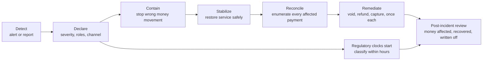

# Incident Management for Payments

> Stop the bleeding, then reconcile.

**Type:** Learn
**Languages:** —
**Prerequisites:** Phase 9, Lesson 12 (Incident Response), Phase 9, Lesson 13 (Graceful Degradation), Phase 12, Lesson 02 (Payment State Machine), Phase 12, Lesson 04 (Smart Routing and Retries), Phase 12, Lesson 06 (Refunds and Partial Refunds), Phase 14, Lesson 04 (Reconciliation at Scale), Phase 14, Lesson 06 (Observability for Money Movement)
**Time:** ~60 minutes

## Learning Objectives

- Order the phases of a payment incident (declare, contain, stabilize, reconcile, remediate, report, learn) and explain why containment comes before diagnosis when money is moving wrongly
- Apply a playbook for each of four failure classes: processor outage, duplicate charges, stuck captures, and a reconciliation break storm, including the action that each one must not take
- Choose a severity from money at risk and customer impact, and staff the roles a payment incident needs beyond a generic incident commander
- Write customer and merchant communications that are accurate when the outcome of a payment is unknown
- Identify the regulatory notification clocks that may start during a payment incident and who must be told when
- Run the post-incident reconciliation that closes an incident: every affected payment enumerated, matched with the processor, and remediated exactly once

## The Problem

At 19:40 on a Friday, the primary card processor of an online retailer begins timing out a third of authorization requests. The checkout service treats a timeout as a failure and shows "Payment failed, please try again." Customers try again; the retry goes to the same processor with a new idempotency key, because the key is generated per click. Some retries time out too; some succeed. The on-call engineer sees the error rate, opens the processor's status page (green), and starts reading logs to find the bug in the retailer's code. Forty minutes later a second engineer notices that the errors are all on one processor and flips traffic to the backup. The outage at the processor ends at 20:31.

Nothing has been stopped yet; it has only started to be visible. A fifth of the timeouts were approved at the processor: those customers have an authorization hold for an order the retailer thinks failed, plus a second, successful authorization from their retry. On Monday the capture job captures every authorization in the retailer's database, which includes neither the orphaned holds (fine, they expire) nor 140 orders whose capture webhook was lost during the outage (not fine: those orders ship and are never charged). Customer service is flooded with screenshots of two pending charges. An agent refunds one of them for 300 customers, and then the finance team, reconciling, refunds the same "duplicates" again from the processor dashboard. Reconciliation on Tuesday shows 4,200 breaks against a normal 30, and someone proposes auto-resolving them to clear the queue. And because the retailer is also a licensed payment institution for its marketplace sellers, a major-incident report was due to the regulator within hours of classifying the incident. Nobody classified it.

Each of these was a reasonable action by someone acting alone. Together they turned a 51-minute processor problem into a week of double refunds, unbilled shipments, and a regulatory finding. The discipline this lesson teaches is ordering: **stop money from moving wrongly first, establish exactly what happened to every payment second, remediate each customer once, and report on the clocks that apply.** The playbooks below encode that order for the four failure classes that cause most payment incidents.

## The Concept

### The lifecycle of a payment incident



Generic incident response (Phase 9, Lesson 12) has detect, declare, mitigate, resolve, review. Payments adds two phases that cannot be skipped and one that runs in parallel:

- **Contain is distinct from stabilize.** Containment stops money moving wrongly: disable the retry path that is creating duplicates, pause the payout batch that would pay merchants from broken balances, route away from the failing processor. It can make service worse (fewer approvals, delayed payouts) and that is acceptable. Stabilization restores service afterwards.
- **Reconcile is distinct from resolve.** When the dashboards are green, the incident is not over. The set of payments touched during the incident must be enumerated and each one's true state established against the processor and the bank, because the platform's own records are exactly what the incident corrupted.
- **Regulatory reporting runs in parallel from declaration.** Some clocks start when the incident is classified as major or when the firm becomes aware of it, not when it ends.

### Severity from money at risk

Severity determines who is woken up and which clocks may apply. A generic matrix uses user impact; payments needs a money axis too.

| Severity | Money at risk (wrongly moved or unmovable) | Customer impact | Examples |
|----------|-------------------------------------------|-----------------|----------|
| SEV1 | Over 1,000,000 or unbounded and growing | Most customers cannot pay or are charged wrongly | Duplicate captures in a loop; payouts sent from wrong balances; total processor outage with no failover |
| SEV2 | 50,000 to 1,000,000, bounded | A segment cannot pay, or a cohort is charged wrongly | One processor down with failover working; stuck captures for a day's cohort |
| SEV3 | Under 50,000, bounded | Individual customers affected, workaround exists | A merchant's payouts delayed; a small batch of breaks |
| SEV4 | None | Internal only | Reconciliation job late, data complete |

"Unbounded and growing" is the most important phrase in the table. A bug that double-charged 200 customers and has stopped is a SEV2 to clean up. A bug that double-charges every retry and is still running is a SEV1 even if the count so far is 20, because containment is urgent.

### Roles

| Role | Owns | Payments-specific duty |
|------|------|------------------------|
| Incident commander | Decisions and priorities | Calls containment actions even when they cost approvals |
| Operations lead | Hands on the systems | Executes kill switches, routing changes, status queries |
| Reconciliation lead | The list of affected payments | Builds the authoritative set from ledger, processor, and bank records; owns remediation idempotency |
| Communications lead | Customers, merchants, status page | Uses approved wording for unknown outcomes; coordinates with support so agents do not remediate ad hoc |
| Compliance liaison | Regulatory classification and reports | Starts the clocks, drafts initial notifications |
| Scribe | Timeline | Timestamps every containment action and every money-moving remediation |

The reconciliation lead and the compliance liaison are the two roles generic incident processes lack, and their absence is what produced the double refunds and the missed report in The Problem.

### Containment levers

Every payment system should have these as tested, documented switches that the operations lead can flip in under a minute without a deploy:

| Lever | What it stops | What it costs |
|-------|---------------|---------------|
| Route away from processor X | Requests into a failing processor | Approvals on cards only X can serve; higher fees on the backup |
| Disable automatic retries | Duplicate attempts during ambiguous failures | Recoverable soft declines go unrecovered |
| Mark timeouts UNKNOWN, not FAILED | Customers retrying into duplicates | Checkout shows "processing" instead of a clear answer |
| Pause capture job | Captures of a corrupted authorization set | Revenue recognition delayed; auth expiry clock keeps running |
| Pause payout batch | Paying merchants from wrong balances | Merchants paid late |
| Freeze a merchant or account | Money moving for one counterparty | That counterparty is blocked |
| Read-only mode | All writes | Full outage of payments, last resort |

The pause levers have their own clocks. Authorizations expire (about seven days for most card-not-present transactions, shorter for some merchant categories), so pausing captures for long enough converts a delay into a loss. Write the expiry deadline into the incident channel when the capture pause is flipped.

### Is it us or them?

The first diagnostic question in most payment incidents is whether the fault is in the platform or in a counterparty (processor, network, bank, issuer). The answer decides the containment lever, and the evidence is usually already on the Lesson 06 dashboard:

| Evidence | Points to |
|----------|-----------|
| One processor's auth rate drops against the fleet; others normal | That processor |
| All processors drop together, declines (not timeouts) rise | Issuers or a network, or the platform's own request content (a malformed field after a deploy) |
| Drop begins within minutes of a platform deploy or config change | The platform; roll back first, investigate second |
| One card brand or one issuer country drops across processors | The network or that issuer group |
| Timeouts rise but the processor's status page is green | Usually the processor; status pages lag by tens of minutes |
| Breaks rise but auth and capture metrics are normal | The reconciliation inputs or the reconciler |

Rolling back a recent change is a containment action, not a diagnosis, and it is cheap. If a deploy happened in the hour before the fault, roll it back while the rest of the table is being read.

### Building the switches before you need them

Containment is only fast if the levers exist, are reachable, and are known to work. Treat them as product features:

1. **Configuration, not code.** Each lever is a flag in a configuration service with an audit log, readable by every instance within seconds, changeable without a deploy.
2. **Scoped.** Levers take a scope (processor, merchant, region, currency, card brand) so containment is no wider than the fault.
3. **Tested on a schedule.** Flip each lever in production at low traffic once a month (a game day, Phase 9, Lesson 09) and confirm the effect on the Lesson 06 dashboard. A lever that has never been flipped does not work.
4. **Owned.** Each lever has an owning team and a runbook entry that states what it stops, what it costs, and how to undo it.
5. **Logged as money events.** Flipping a lever writes an entry to the incident timeline automatically, because regulators and the post-incident review both need the timestamps.

### Playbook 1: Processor outage

**Symptoms.** Auth-rate drop on one processor compared with the fleet, availability burn rate paging, timeouts rather than declines (Lesson 06).

**Contain.**
1. Route new traffic away from the processor if a backup exists and the backup path is idempotent.
2. Treat timeouts as `UNKNOWN`. Show the customer "We are confirming your payment" and keep the idempotency key bound to the order, not the click, so a retry is the same payment.
3. Disable automatic retries to the failing processor.

**Stabilize.** Restore traffic gradually when the processor recovers (canary percentage, watch auth rate against the fleet).

**Reconcile.** For every `UNKNOWN`, query the processor's status endpoint by the original reference; resolve to approved or declined. Pull the processor's authorization report for the incident window and match it against the ledger (Lesson 04). Authorizations the processor approved that the platform thinks failed are orphans.

**Remediate.** Void orphaned authorizations the customer did not complete through a retry (a void releases the hold with no statement line and, unlike a refund, no fee). Where the customer retried successfully elsewhere, void the orphan and keep the retry.

**Do not:** let customers retry with new idempotency keys; capture orphaned authorizations "to be safe."

### Playbook 2: Duplicate charges

**Symptoms.** Customer complaints of two charges, reconciliation breaks of type duplicate, two successful authorizations or captures with the same card fingerprint, amount, and merchant within minutes.

**Contain.** Find and stop the source of duplication first: a retry path, a consumer reprocessing a topic, a capture job run twice. Until it is stopped, every remediation is chasing a moving set.

**Reconcile.** Build the duplicate set with an explicit, reviewed rule, for example:

```sql
SELECT card_fingerprint, merchant_id, amount_minor, currency,
       array_agg(payment_id ORDER BY created_at) AS payments
  FROM payments
 WHERE created_at BETWEEN :incident_start AND :incident_end
   AND state IN ('AUTHORIZED', 'CAPTURED')
 GROUP BY card_fingerprint, merchant_id, amount_minor, currency, order_id
HAVING count(*) > 1;
```

Group by the order as well as the card and amount: two genuine purchases of the same item are not duplicates. Keep the first payment of each group; the rest are the remediation set. Have a second person review the rule and a sample of 20 groups before any money moves.

**Remediate.** Void if not yet captured; refund if captured. Run remediation as a batch job with an idempotency key per payment (`remediation:<incident>:<payment_id>`), so running it twice refunds once. Tell customer service to stop issuing manual refunds for the incident cohort and route those tickets to the batch.

**Do not:** let support agents and finance refund independently; refund before the source is stopped.

### Playbook 3: Stuck captures

**Symptoms.** `CAPTURE_PENDING` payments past their age limit (Lesson 06), stuck exposure paging, settlement batch short.

**Contain.** Usually nothing is moving wrongly; the risk is money not moving. Check whether the capture job is still sending (if captures are failing silently, pause the job so the stuck set stops growing).

**Reconcile.** For each stuck payment, query the processor by capture reference. Three outcomes: captured (the webhook was lost; mark `CAPTURED` with the processor's data), not captured but authorization still valid (re-send the capture with the same idempotency key), authorization expired (the money is lost unless the customer re-authorizes).

The resolution loop is short enough to write in the incident, and it should already exist as a tool:

```java
for (Payment p : stuckSet) {
    ProcessorStatus st = processor.queryCapture(p.captureReference());   // read-only, safe to repeat
    switch (st.state()) {
        case CAPTURED -> ledger.markCaptured(p.id(), st.capturedAmount(), st.capturedAt());
        case NOT_FOUND -> {
            if (clock.now().isBefore(p.authorizationExpiresAt())) {
                processor.capture(p.captureReference(), p.amount(), p.idempotencyKey()); // same key as the first try
            } else {
                ledger.markAuthorizationExpired(p.id());                     // a decision for the business
            }
        }
        case DECLINED -> ledger.markCaptureFailed(p.id(), st.reason());
    }
}
```

Every branch is idempotent: the query is read-only, `markCaptured` is keyed by payment id, and the re-sent capture carries the original idempotency key, so running the loop twice cannot capture twice.

**Remediate.** Re-send captures only with the original idempotency key so a capture that actually landed is not taken twice. For expired authorizations, the business decides: ask the customer to pay again, or write off. Record the written-off amount.

**Do not:** bulk re-capture without status queries; let the auth expiry deadline pass while investigating root cause.

### Playbook 4: Reconciliation break storm

**Symptoms.** Break rate jumps by an order of magnitude (Lesson 06), usually after a nightly run.

**Contain.** First decide whether money or the reconciliation is broken. Most storms are the reconciler: a processor changed its file format, a file arrived late or twice, a timezone or cutoff shifted, a currency exponent was misread. Check the input files' own control totals (Lesson 04). If the breaks touch merchant balances and the payout batch is due, pause payouts until the cause is known.

**Reconcile.** Triage by break type and by date: a single cause usually shows up as one type and one date. Fix the input or the reconciler and re-run; the storm should collapse to the normal break count. Breaks that remain after the re-run are real and go through the normal break process with owners.

**Remediate.** Only for real breaks, through the normal path (adjusting journal entries, processor disputes), never by bulk "auto-resolve," which writes the discrepancy into the books permanently and destroys the evidence.

**Do not:** auto-resolve breaks to clear the queue; release payouts while breaks touch merchant balances.

### Failure modes of incident response itself

1. **Diagnosing before containing.** Forty minutes of log reading while retries create duplicates. If money is moving wrongly, the first five minutes are for levers.
2. **Parallel remediation.** Support, finance, and engineering each fix the same customers. One reconciliation lead, one remediation batch, one key per payment.
3. **Closing on green dashboards.** The service recovered; the money did not. An incident closes when the reconciliation lead signs off on the affected set, not when the error rate returns to normal.
4. **Trusting your own records.** The platform's database is the thing the incident corrupted. The processor's report, the bank statement, and the network's settlement file are the sources of truth for what happened to money.
5. **Unrecorded clocks.** Nobody wrote down when the firm became aware. The deadline is then computed from the earliest timestamp a regulator can find, which is usually earlier than yours.

### Communications when the outcome is unknown

The hardest message in payments is the one where the platform does not yet know whether the customer was charged. Rules:

1. **Never tell a customer a payment failed when it timed out.** Say it is being confirmed, and when they will hear.
2. **Tell customers what not to do.** "Please do not retry; you will not be charged twice for this order" is only true if the idempotency key is bound to the order, which is why containment does that first.
3. **Name pending authorizations correctly.** "You may see a pending authorization from us; it will disappear within N days and you have not been charged" is accurate for an orphaned hold; "refund" is not.
4. **Merchants get numbers.** Platforms owe merchants a count and amount of affected payments, the expected payout impact, and the date of the next update.
5. **One source of wording.** The communications lead publishes the approved text; support agents use it verbatim.

### Regulatory clocks

Payment incidents can start statutory notification clocks. The exact obligations depend on the firm's licences and jurisdictions and must be confirmed with compliance; the common ones engineers should recognise:

| Regime | Applies to | Trigger | Deadline (initial notification) |
|--------|------------|---------|---------------------------------|
| EU DORA (Regulation 2022/2554) | EU financial entities, including payment and e-money institutions | Major ICT-related incident | 4 hours after classification as major, no later than 24 hours after awareness; intermediate within 72 hours; final within one month |
| US federal bank regulators' incident notification rule (2021) | Banking organizations; their service providers notify the bank | Notification incident materially disrupting operations | 36 hours for the bank; providers notify affected banks as soon as possible when disruption lasts 4 hours or more |
| India CERT-In directions (2022) | Service providers and intermediaries in India | Specified cyber incidents | 6 hours |
| GDPR Article 33 | Controllers of EU personal data | Personal data breach | 72 hours after awareness |
| Card network rules | Merchants, acquirers, processors | Suspected or confirmed card data compromise | Immediately, per the network's rules |

Two engineering consequences. The incident timeline must record when the firm became aware and when the incident was classified, because the deadlines are computed from those timestamps. And the data a report needs (number of customers affected, transaction count and value, duration, services affected) is the output of the reconciliation phase, so reconciliation has to produce a first estimate within hours, not days.

## Worked Example

### The Friday outage, reconciled

Returning to The Problem, with the numbers the reconciliation lead assembles on Saturday morning. Incident window: 19:40 to 20:31 (51 minutes). Checkout volume in the window: 12,600 authorization attempts to the primary processor before the routing change at 20:20, plus retries.

| Population | Count | Source of truth | True state |
|------------|-------|-----------------|------------|
| Attempts that timed out | 4,150 | Platform logs, joined to processor auth report | |
| ...approved at the processor (orphans) | 830 | Processor authorization report | Hold on customer's card, platform thinks failed |
| ...of which customer retried successfully | 610 | Platform payments with same order id | Two holds for one order |
| ...of which customer did not retry | 220 | No second payment for the order | One hold, no order |
| Capture webhooks lost | 140 | `CAPTURE_PENDING` age report | Captured at processor, not marked captured |
| Duplicate refunds issued by support and finance | 300 | Refund ledger grouped by original payment | 300 customers refunded twice |

Remediation, each a batch with per-payment idempotency keys:

| Action | Count | Amount | Notes |
|--------|-------|--------|-------|
| Void orphaned holds where customer retried | 610 | 41,236.00 | Void, not refund: no statement line, no fee |
| Void orphaned holds with no order | 220 | 14,872.00 | Plus an email: "you were not charged" |
| Mark lost-webhook captures as captured | 140 | 9,415.20 | Status query confirmed each; no money moves, ledger corrected |
| Recover second refund from customers | 300 | 20,280.00 | Business decision: write off 300 x average 67.60 rather than claw back |
| Total written off | | 20,280.00 | Reported in the review |

The mistake that cost money was not the processor outage; it was the uncontained retry path (which created the 610 double holds) and uncoordinated remediation (which created the 300 double refunds). The lost-webhook captures would have become 9,415.20 of unbilled shipments if the capture job had not been paused while the stuck set was resolved.

### The same incident with the playbook

| Time | Action | Effect |
|------|--------|--------|
| 19:43 | Auth-rate drop alert on primary processor (Lesson 06) | Page |
| 19:46 | IC declares SEV2, assigns reconciliation lead and compliance liaison | Clocks noted |
| 19:48 | Route away from primary; timeouts as UNKNOWN; idempotency key bound to order | Duplicates stop; new orphans stop |
| 19:55 | Comms publishes "confirming your payment" text to checkout and support | No ad hoc refunds |
| 20:31 | Processor recovers; 5% canary, then 100% by 21:00 | Stabilized |
| 21:30 | Reconciliation lead runs status queries on about 840 UNKNOWNs (8 minutes of exposure instead of 40) | Orphan set is about 170, not 830 |
| Sat 10:00 | Void batch, capture correction, customer emails | Remediated once |
| Sat 12:00 | Compliance confirms the incident is not major under the firm's thresholds; records the assessment | Report decision documented |

About a fifth of the orphans, every one resolved by status query rather than by a customer's retry, no double refunds, and a documented regulatory decision, from switches that already existed.

### The post-incident review

A payment post-incident review is blameless (Phase 9, Lesson 12) and adds a money section that every review must fill in:

- **Money affected**: total value of payments whose state was wrong at any point, by currency.
- **Money recovered**: voids, corrected captures, refunds reversed.
- **Money written off**: what the business absorbed, with the decision and the approver.
- **Customers affected**: count, and how each was contacted.
- **Regulatory**: which regimes were assessed, the classification decision and its timestamp, reports filed.
- **Detection gap**: minutes from fault to page, and which metric caught it. If a customer caught it first, the first action item is a Lesson 06 metric.

## Exercises

1. **Reinforce.** Write the containment section of a runbook for "payout batch sent twice to the bank" using the levers table. Which lever do you flip first, what does it cost, and which external party must you call before any reconciliation can start?
2. **Apply.** Design the duplicate-detection query for a platform whose orders can legitimately contain two identical line items paid in two separate payments (for example, a split-tender order). Explain which columns separate a duplicate from a split tender, and how you would validate the rule on last month's data before an incident needs it.
3. **Extend.** Combine with Phase 14, Lesson 06: add an `UNKNOWN` state to the observability monitor with a 5-minute stuck limit, and a containment hook that flips "disable automatic retries" when the processor auth-rate-drop alert fires. Then use Phase 14, Lesson 04's reconciler to produce the orphan set for the Friday incident from a simulated processor report, and show that the remediation batch is idempotent by running it twice.

## Key Terms

| Term | What people say | What it actually means |
|------|-----------------|------------------------|
| Containment | "mitigation" | Actions that stop money from moving wrongly, taken before diagnosis and accepted even when they reduce service |
| Orphaned authorization | "ghost charge" | An authorization approved at the processor that the platform recorded as failed or unknown; a hold on the customer's card with no order |
| Void | "cancel" | Releasing an authorization before capture; leaves no settled charge, unlike a refund, and usually costs nothing |
| Unknown outcome | "it failed" | A request whose result was not received; must be resolved by status query or reconciliation, never assumed |
| Remediation batch | "the refund script" | An idempotent job that applies one correcting action per affected payment, keyed so it can be run twice safely |
| Break storm | "recon is broken" | A sudden increase in reconciliation breaks by orders of magnitude, usually caused by the inputs or the reconciler rather than money |
| Major incident classification | "is it reportable" | The regulatory assessment that starts statutory notification deadlines; its timestamp must be recorded |

## Further Reading

- [Google SRE Book, Chapter 14: Managing Incidents](https://sre.google/sre-book/managing-incidents/) — roles, a single incident commander, and the communication discipline this lesson extends with payments roles.
- [Regulation (EU) 2022/2554 (Digital Operational Resilience Act)](https://eur-lex.europa.eu/eli/reg/2022/2554/oj) — the EU framework for classifying and reporting major ICT-related incidents at financial entities, including payment institutions.
- [Computer-Security Incident Notification Requirements for Banking Organizations and Their Bank Service Providers (Federal Register, 2021)](https://www.federalregister.gov/documents/2021/11/23/2021-25510/computer-security-incident-notification-requirements-for-banking-organizations-and-their-bank) — the US 36-hour rule and service-provider obligations.
- [CERT-In Directions under Section 70B(6) of the IT Act (April 2022)](https://www.cert-in.org.in/Directions70B.jsp) — the six-hour reporting requirement for specified cyber incidents in India.
- [Visa Core Rules and Visa Product and Service Rules](https://usa.visa.com/support/consumer/visa-rules.html) — authorization validity periods, reversal requirements for authorizations not captured, and duplicate-processing dispute rights that shape the remediation choices.
