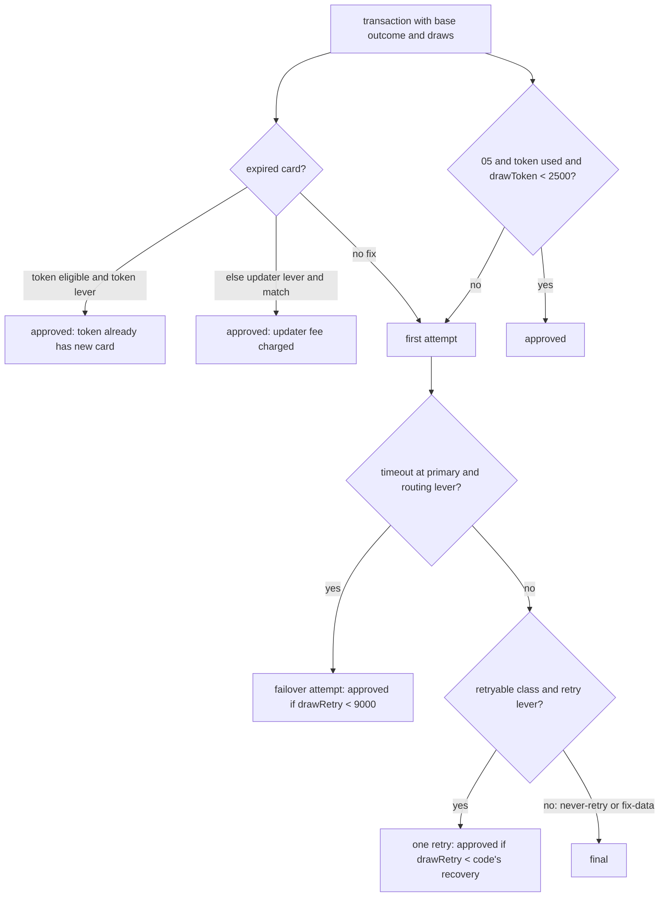

# Cost and Authorization-Rate Optimization

> Network tokens, retries, and routing that lifts approvals.

**Type:** Build
**Languages:** Java, Python, Go
**Prerequisites:** Phase 10 Lesson 01 (Representing Money), Phase 11 Lesson 02 (The Card Lifecycle State Machine), Phase 11 Lesson 03 (ISO 8583), Phase 11 Lesson 05 (Tokenization and PCI DSS Scope Reduction), Phase 11 Lesson 07 (Interchange, Scheme Fees, and Merchant Pricing), Phase 12 Lesson 04 (Smart Routing, Cascading, and Retry Policies), Phase 14 Lesson 06 (Observability for Money Movement)
**Time:** ~75 minutes

## Learning Objectives

- Classify decline response codes into never-retry, retry-later, fix-data, and generic, and explain why re-sending a hard decline costs money and network standing
- Build a seeded experiment that measures four authorization levers (network tokens, account updater, soft-decline retry, routing) over the same population with common random numbers, so every uplift is exact
- Compute the cost side of each lever in integer minor units (per-attempt fees, token fees, updater fees, network fees, interchange) and report net value at a stated margin
- Show that lever uplifts overlap and do not add, and identify which population each lever recovers
- Calculate the interchange saving from sending level 2 and level 3 data on commercial cards, and the network-fee saving from least-cost routing of regulated debit

## The Problem

A subscription billing platform charges 100,000 stored cards a month for consumer and business plans. 83.7% are approved on the first attempt. The other 16.3% are 16,300 failed renewals, and the finance team's model says about half of those customers churn instead of updating their card. With an average charge of about 353 USD, every percentage point of authorization rate is roughly 353,000 USD of monthly volume, before counting the churn it prevents. Raising it is the cheapest growth the company has.

The team's first attempt is a retry job: every declined charge is retried daily for a week. Approvals rise by about 2.8 points. So do processor fees, because every retry is a billable authorization. Then the acquirer forwards a letter from the card network: the merchant is retrying "do not reattempt" responses, including lost and stolen cards, more than the permitted number of times in thirty days, and per-attempt penalties will apply from next month. The retry job did not distinguish an issuer that is temporarily down from an issuer that has closed the account. Meanwhile a third of the declines were expired cards, which no number of retries will ever approve, because the card number on file no longer exists.

The second attempt is better targeted but impossible to evaluate. Network tokens are turned on for half the merchants in March; approvals rise; but March also had fewer bank holidays and a different merchant mix, and two issuers changed their fraud models. Nobody can say whether tokens added 1 point or 4, or whether they paid for their fees.

This lesson builds the tool that answers that question: an experiment over a seeded population of 100,000 transactions in which every transaction carries its own fixed random draws, so that turning a lever on or off changes exactly the transactions the lever touches and nothing else. Each lever's uplift in approvals, volume, and cost is then an exact integer, the overlap between levers is visible, and the rules that keep you out of trouble with the networks (never re-send a hard decline) are enforced by the code and checked by a test.

## The Concept

### Why a transaction is declined

An authorization response carries a two-character response code in ISO 8583 field 39 (Phase 11, Lesson 03). The networks group codes by what the merchant may do next. This lesson uses five classes:

| Class | Example codes | What the issuer is saying | What the merchant may do |
|-------|---------------|---------------------------|--------------------------|
| Approved | 00 | Yes | Capture |
| Never retry | 43 lost/stolen, 57 not permitted, 04 pick up | This card will never be approved for you | Stop. Ask the customer for another method |
| Retry later | 51 insufficient funds, 91 issuer unavailable, 96 system error | Not now | Retry after a delay, a bounded number of times |
| Fix data | 54 expired card, 14 invalid card number | The credential is wrong | Get a new credential (updater, token, customer), then retry |
| Generic | 05 do not honor | No reason given | One retry is tolerated; repeated retries are treated as abuse |

Visa's rules group decline codes into four categories with explicit reattempt limits (no reattempts for "issuer will never approve"; up to 15 reattempts in 30 days for the others), and Mastercard returns Merchant Advice Codes alongside the response (for example `03`, "do not try again") that the acquirer must honour. Excessive reattempts are charged per attempt by both networks. The classification is therefore a compliance control, not just an optimization.

### The four authorization levers

**Network tokens.** A network token (EMVCo Payment Tokenisation Specification) replaces the card number with a network-issued token bound to one merchant, plus a per-transaction cryptogram. Two effects matter. The network maintains the token when the underlying card is reissued, so a stored token survives card expiry and replacement: the stale-credential decline disappears without any lookup. And issuers see a cryptogram proving the token was used by the merchant it was issued to, which lowers fraud risk and lets them approve some transactions they would otherwise decline with a generic `05`. Tokens cost a small per-transaction fee and require the card to be eligible (issuer participation, merchant enrolment).

**Account updater.** Visa Account Updater and Mastercard Automatic Billing Updater let a merchant ask, in batch or in real time, whether a stored card has been replaced, and receive the new number and expiry date. A match recovers an expired-card decline; a miss leaves it declined. Updaters charge per match (and sometimes per inquiry). The updater and the token recover **the same population**: stale credentials. Running both pays twice for the overlap unless the token runs first.

**Soft-decline retry.** Re-send a retryable decline once. Recovery depends on the code: an issuer that was briefly unavailable (91) approves most retries; insufficient funds (51) recovers a few percent within a day; a generic 05 recovers rarely. Every retry is a billable attempt. Hard declines and fix-data declines are never re-sent unchanged.

**Routing.** Two separate mechanisms share the name. *Failover routing* re-sends a request that timed out at the primary processor through a secondary processor; the issuer never saw the first attempt, so most failovers approve. *Least-cost routing* sends a regulated US debit transaction over the cheaper of the networks enabled on the card, which Regulation II requires issuers to support (at least two unaffiliated networks). Failover lifts approvals; least-cost routing lowers network fees.

### Interchange and level 2/3 data

Interchange is the fee the acquirer pays the issuer on every approved transaction (Phase 11, Lesson 07). For commercial and purchasing cards, the networks publish lower rates when the merchant sends enhanced data: level 2 adds the tax amount and customer reference; level 3 adds line items (product code, quantity, unit price, unit of measure). The issuer's corporate customer uses that data for expense management, and the network rewards the merchant for providing it.

| Data level | Example commercial rate (illustrative) | On a 1,000.00 USD purchase |
|------------|----------------------------------------|----------------------------|
| Level 1 (amount only) | 2.65% + 0.10 | 26.60 |
| Level 2 (tax, reference) | 2.05% + 0.10 | 20.60 |
| Level 3 (line items) | 1.85% + 0.10 | 18.60 |

The code models level 1 and level 3. The saving is `26.60 - 18.60 = 8.00` per 1,000.00, or 0.80% of commercial volume, and it costs nothing in approvals: the lever only changes cost. Published rates differ by network, card product, merchant category, and region, and change twice a year; the shape (lower rate for richer data, and a penalty rate if the data is missing or inconsistent) is stable.

Regulated US debit interchange is capped by Regulation II at 0.21 USD plus 5 basis points, plus a 0.01 fraud-prevention adjustment. The code uses `0.05% + 0.22`: on 50.00 that is `2.5 + 22 = 24.5` minor units, rounded half-even to 24.

### Measuring levers: common random numbers

A live A/B test of a lever compares two groups of different customers in the same period. The difference in approval rate has a standard error of roughly `sqrt(2 p (1-p) / n)`. With `p = 0.837` and 100,000 transactions per arm:

```text
sqrt(2 * 0.837 * 0.163 / 100000) = sqrt(0.00000273) = 0.00165  -> 0.165 points
95% interval: about +/- 0.32 points
```

That is fine for a 3-point lever and useless for a 0.2-point one, and it assumes the arms are randomized properly (by card, not by merchant or by day).

A simulation can do better. Each transaction in this lesson is generated once with its base outcome and three uniform draws in basis points: `drawToken`, `drawRetry`, `drawUpdater`. Every arm of the experiment replays the **same** transactions with the **same** draws. If the token lever recovers a `05` when `drawToken < 2500`, then exactly the same `05` transactions are recovered every time the token lever is on, regardless of what else is on. The difference between arms is entirely caused by the levers. This is the common-random-numbers technique from simulation practice, and it turns uplifts into exact integers that tests can assert.

The simulation's job is to make the mechanics and the accounting exact. The probabilities in it (25% of eligible `05`s recovered by tokens, 80% updater match, 70% retry recovery for `91`) are inputs you replace with your own measured numbers; the levers, their ordering, their overlap, and their costs are the lesson.

### The order of operations



Credential fixes come first because they are cheapest and because a retry of a stale credential is wasted. Failover precedes retry because a timeout means the issuer never saw the request. A transaction is retried at most once, and never after a failover. Never-retry and fix-data classes are never re-sent.

### Worked example by hand

One stored card, 49.99 USD, token-eligible, expired. Auth fee 0.05 per attempt, token fee 0.01 per tokenized attempt, updater fee 0.15 per match.

| Arm | Path | Attempts | Fees | Outcome |
|-----|------|----------|------|---------|
| Control | send, `54` | 1 | 0.05 | declined |
| Soft retry | `54` is fix-data: not retried | 1 | 0.05 | declined |
| Account updater | match (`drawUpdater` 1000 < 8000), send new card | 1 | 0.05 + 0.15 = 0.20 | approved |
| Network token | token holds the reissued card | 1 | 0.05 + 0.01 = 0.06 | approved |
| Token + updater | token fixes it first; updater not called | 1 | 0.06 | approved |

The token recovers the same transaction for 0.14 less. Over the population that is the overlap: 2,861 of the 4,096 expired cards in the 100,000-transaction population are token-eligible.

Now the full population, seed 2026: 83.7% base approvals, 4.1% expired cards, 3.9% `05`, 3.0% `51`, 1.6% `91`, 1.6% timeouts, 2.1% hard declines. Control approves 83,737 transactions (83.73%) with 100,000 attempts and costs 724,537.11 USD in fees and interchange. Each lever alone:

| Arm | Extra approvals | Rate delta | Extra volume | Extra cost | Net at 30% margin |
|-----|-----------------|-----------|--------------|------------|-------------------|
| Network token | 3,501 | 3.50% | 1,171,634.18 | 28,982.53 | 322,507.72 |
| Account updater | 3,208 | 3.21% | 1,115,907.98 | 27,509.60 | 307,262.79 |
| Soft-decline retry | 2,785 | 2.79% | 1,037,785.20 | 26,039.88 | 285,295.68 |
| Routing | 1,447 | 1.45% | 531,025.99 | 11,186.29 | 148,121.51 |
| Level 3 data | 0 | 0.00% | 0.00 | -173,153.76 | 173,153.76 |
| All five | 7,823 | 7.83% | 2,775,158.10 | -122,454.57 | 955,002.00 |

Three things to read from it.

First, the token uplift is exactly explainable: 2,861 token-eligible expired cards plus 640 of the 2,754 token-eligible `05` declines whose `drawToken` is under 2,500. The test asserts this identity.

Second, "extra cost" for the approval levers is mostly interchange and network fees on the newly approved volume, not lever fees. Approving 1.17 million USD more costs about 27,000 USD more in interchange. That is a cost worth paying, which is why net value at a margin is the number to decide on, not cost.

Third, the single-lever uplifts sum to 10,941 but all levers together give 7,823. Token and updater recover the same expired cards; failover and retry recover the same timeouts. A business case that adds up single-lever pilots overstates the combined effect by 40% here.

### Retry economics per response code

The retry lever's 2,785 recovered approvals are not spread evenly. Breaking the soft-decline arm down by the code that was retried, on the same seeded population:

| Code | Declines | Retried | Recovered | Recovery | Retry fees | Recovered volume |
|------|----------|---------|-----------|----------|------------|------------------|
| 05 do not honor | 3,935 | 3,935 | 409 | 10.4% | 196.75 | 156,300.96 |
| 51 insufficient funds | 2,982 | 2,982 | 473 | 15.9% | 149.10 | 183,644.16 |
| 91 issuer unavailable | 1,574 | 1,574 | 1,089 | 69.2% | 78.70 | 396,572.56 |
| 96 processor timeout | 1,594 | 1,594 | 814 | 51.1% | 79.70 | 301,267.52 |
| 43, 57 hard | 2,082 | 0 | 0 | n/a | 0.00 | 0.00 |
| 54 expired | 4,096 | 0 | 0 | n/a | 0.00 | 0.00 |

Every retryable code pays for its own retry fees many times over at these inputs, which is why the decision about retries is rarely about the auth fee. It is about the network's reattempt limits, the customer experience of a second charge attempt, and the timing: a `51` retried immediately recovers far less than one retried on the next payday, which this lesson does not model and Exercise 2 does.

### Stored credentials and merchant-initiated transactions

Most of the levers in this lesson act on stored cards, and issuers treat a charge on a stored card differently depending on how it is labelled. The card networks' stored-credential framework distinguishes a **customer-initiated transaction** (the cardholder is present and clicks pay) from a **merchant-initiated transaction** (a renewal, an instalment, an unscheduled top-up, a delayed charge). An MIT carries an indicator of its type and the network transaction id of the original customer-initiated transaction that established consent. Issuers approve correctly labelled MITs at higher rates, because the chain back to a cardholder-authenticated transaction is visible, and in regions with Strong Customer Authentication (Phase 13, Lesson 09) a correctly labelled MIT is out of scope for SCA where an unlabelled one would be soft-declined with a request for authentication.

Two consequences for the experiment. First, every retry in this lesson is an MIT and must carry the same indicators and original transaction id as the first attempt; a retry that drops them is a different, worse transaction. Second, "labelling" is itself a lever with zero marginal cost, and a platform that has never audited its stored-credential flags often finds a full point of authorization rate there before paying for anything else.

### What to optimize: cost per approval, not cost

| Metric | Control | All levers | Why it misleads alone |
|--------|---------|-----------|------------------------|
| Total cost | 724,537.11 | 602,082.54 | Falls with level 3 data, rises with every recovered sale |
| Attempts per transaction | 1.000 | 1.094 | More attempts look bad but buy approvals |
| Cost per approval | 8.65 | 6.57 | Better, but hides which lever paid for which approval |
| Net value at margin | 0 | 955,002.00 | Depends on a margin someone has to own |

Total cost is the wrong objective because the cheapest payment system declines everything. Cost per approval is better but still blends interchange (which scales with volume) and lever fees (which scale with attempts). The decision number is net value at the business's contribution margin, reported per lever and for the combination, with every cost line visible so finance can challenge the inputs.

### Failure modes

1. **Retrying into a penalty.** A retry loop without the never-retry table, or one per service rather than per card, exceeds network reattempt limits. The limit is per card per merchant across all your systems, so the counter must live where every retrier can see it.
2. **Double-counting levers.** Pilots run separately and their uplifts are added in the business case. This lesson's population overstates the combination by 40% that way.
3. **Approving fraud.** A lever that recovers declines also recovers some of the issuer's fraud declines. Measure chargeback rate on recovered transactions separately; a lever whose recovered sales charge back at 3% can be net negative.
4. **Measuring by merchant or by day.** A holdout that assigns merchants or days to arms confounds the lever with the merchant mix and the calendar. Randomize by card.
5. **Stale price lists.** Interchange tables change twice a year. A savings claim computed against last year's table is fiction; keep the rates in data with an effective date.

### Invariants

- A transaction is attempted at most twice, and a never-retry or fix-data response is never re-sent unchanged.
- With no levers, attempts equal transactions and approvals equal base approvals.
- No lever lowers approvals.
- Every amount is `Money` in minor units; every rate is basis points; every rounding is named. The arm results are reproducible bit for bit from the seed.

### Complexity

The experiment is `O(N * A)` for `N` transactions and `A` arms, each transaction's path being `O(1)`. 100,000 transactions times seven arms run in about a second. Memory is `O(N)` for the population, which must be held (or regenerated from the seed) so every arm sees the same draws.

### What this experiment does not do

It does not model time: real retries of insufficient funds succeed on payday, so a production retry scheduler (Phase 12, Lesson 04) picks *when* as well as *whether*. It does not model issuer-specific behaviour, 3-D Secure (Phase 11, Lesson 06), or fraud: lifting approvals on stolen cards is a loss, not a win, and the never-retry rule exists partly for that reason. It does not know real prices; every fee except the Regulation II cap is illustrative. And it measures a simulation: before claiming an uplift in production, run a properly randomized holdout and compare the observed numbers with these.

## Build It

The code is `code/java/Main.java`.

### Step 1: Money, copied

```java
record Money(long minorUnits, Currency currency) implements Comparable<Money> {
    Money times(long numerator, long denominator, Rounding rounding) {
        return new Money(divideRounded(Math.multiplyExact(minorUnits, numerator), denominator, rounding), currency);
    }
}
```

The Phase 10, Lesson 01 design. Interchange is `amount.times(bps, 10_000, HALF_EVEN)` plus a fixed fee, so 1.85% of 1,000.00 is `100000 * 185 / 10000 = 1850` minor units exactly. Probabilities are integers too: draws and thresholds are basis points, so "approved if `drawRetry < 7000`" has no floating-point edge.

**Predict:** what is interchange on a 50.00 regulated debit transaction at 5 bps + 0.22, and which rounding mode decides the answer?

### Step 2: Response codes and their classes

```java
enum ResponseCode {
    APPROVED("00", DeclineClass.NONE),
    DO_NOT_HONOR("05", DeclineClass.GENERIC),
    LOST_OR_STOLEN("43", DeclineClass.NEVER_RETRY),
    INSUFFICIENT_FUNDS("51", DeclineClass.RETRY_LATER),
    EXPIRED_CARD("54", DeclineClass.FIX_DATA),
    NOT_PERMITTED("57", DeclineClass.NEVER_RETRY),
    ISSUER_UNAVAILABLE("91", DeclineClass.RETRY_LATER),
    PROCESSOR_TIMEOUT("96", DeclineClass.RETRY_LATER);
```

The class is attached to the code once, in the type, so the retry rule cannot be bypassed by a caller that forgets to check. `AuthExperiment.retryable` returns true only for `RETRY_LATER` and `GENERIC`. A production system keeps this table per network, because the same two characters can mean different things on different networks and acquirers sometimes remap them.

**Predict:** an issuer returns `54`. Which levers can recover it, and why does the retry lever not even try?

### Step 3: The transaction and its draws

```java
record Txn(String id, Money amount, CardType cardType, boolean tokenEligible, ResponseCode baseOutcome,
           int drawToken, int drawRetry, int drawUpdater) {
    Txn {
        for (int d : new int[] {drawToken, drawRetry, drawUpdater}) {
            if (d < 0 || d >= 10_000) throw new IllegalArgumentException("draws are basis points in [0, 10000)");
        }
    }
}
```

Everything random about a transaction is decided when it is generated and stored on it. `population(n, seed, currency)` draws the card type, amount, token eligibility, base outcome, and the three draws from one seeded `Random` in a fixed order, so the same seed always yields the same population. Each lever reads its own draw, so turning one lever on does not shift the random stream that another lever sees.

**Predict:** if the retry lever and the failover lever both read a fresh `rnd.nextInt()` at decision time instead of a stored draw, what would happen to the "routing alone" arm when you also turned on tokens?

### Step 4: The path of one transaction

```java
if (outcome == ResponseCode.EXPIRED_CARD) {
    if (useToken) {
        outcome = ResponseCode.APPROVED;
    } else if (levers.contains(Lever.ACCOUNT_UPDATER) && t.drawUpdater() < prices.updaterMatchBps()) {
        outcome = ResponseCode.APPROVED;
        updaterHit = true;
        fees = fees.plus(prices.updaterHitFee());
    }
}
if (useToken && outcome == ResponseCode.DO_NOT_HONOR && t.drawToken() < prices.tokenRecoverDoNotHonorBps()) {
    outcome = ResponseCode.APPROVED;
}
```

`simulate(txn, levers)` is a pure function returning a `TxnTrace`: final outcome, attempts, which levers acted, and fees. Credential fixes come first and the token takes precedence over the updater, so the overlap is paid for once.

**Predict:** a token-eligible expired card with `drawUpdater = 9000`. Under token alone, updater alone, and both, what is the outcome and fee?

### Step 5: Failover and retry

```java
if (outcome == ResponseCode.PROCESSOR_TIMEOUT && levers.contains(Lever.ROUTING)) {
    attempts++;
    failedOver = true;
    fees = fees.plus(prices.authFee());
    if (useToken) fees = fees.plus(prices.tokenFee());
    outcome = t.drawRetry() < prices.failoverTimeoutBps() ? ResponseCode.APPROVED : ResponseCode.ISSUER_UNAVAILABLE;
}
boolean retried = false;
if (!failedOver && levers.contains(Lever.SOFT_DECLINE_RETRY) && retryable(outcome)) {
    attempts++;
    retried = true;
    fees = fees.plus(prices.authFee());
    if (useToken) fees = fees.plus(prices.tokenFee());
    if (t.drawRetry() < retrySuccessBps(outcome)) outcome = ResponseCode.APPROVED;
}
```

Every extra attempt adds the auth fee, and the token fee when a token is in use. The `!failedOver` guard caps a transaction at two attempts. A failed failover becomes `ISSUER_UNAVAILABLE`, which is honest: the request reached an issuer and was not answered.

**Predict:** a timeout with `drawRetry = 8999` under routing plus retry. How many attempts, and is it approved? With `drawRetry = 9000`?

### Step 6: Running an arm

```java
if (tr.finalOutcome().approved()) {
    approvals++;
    volume = volume.plus(t.amount());
    network = network.plus(networkFee(t.amount(), t.cardType(), leastCost));
    ic = ic.plus(interchange(t.amount(), t.cardType(), level3));
}
```

`run(population, levers)` sums the trace of every transaction into an `ArmResult`: attempts, approvals, approved volume, and five cost lines (auth fees, token fees, updater fees, network fees, interchange). Network fees and interchange are charged only on approvals. `ROUTING` also turns on least-cost routing for regulated debit; `LEVEL3_DATA` switches commercial interchange to the level 3 rate.

**Predict:** why does `LEVEL3_DATA` show zero extra approvals but the largest single cost reduction?

### Step 7: Uplift and net value

```java
static Uplift of(String arm, ArmResult control, ArmResult treatment, long marginBps) {
    Money extraVolume = treatment.approvedVolume().minus(control.approvedVolume());
    Money extraCost = treatment.totalCost().minus(control.totalCost());
    Money value = extraVolume.times(marginBps, 10_000, Rounding.HALF_EVEN).minus(extraCost);
    return new Uplift(arm, treatment.approvals() - control.approvals(),
            treatment.approvalRateBps() - control.approvalRateBps(), extraVolume, extraCost, value);
}
```

Net value is the contribution margin on recovered sales minus the extra cost. Margin is an input (30% in the demo), because a lever that recovers 1,000 USD of sales is worth 300 USD to a merchant with 30% margins and 50 USD to one with 5%.

The rate delta is computed from each arm's own basis-point rate rather than from the approval delta, so the column always matches what a dashboard would show for the two arms side by side. Both are integers, and the test checks they agree.

**Predict:** at a 5% margin instead of 30%, which single lever has the highest net value, and does the soft-decline retry still pay for itself once interchange on the recovered volume is counted?

### Step 8: Run it

```bash
cd phases/14-payments-at-scale/08-cost-and-authorization-optimization/code/java
javac -d .out *.java && java -cp .out Main
java -cp .out MainTest
```

```console
== Level 2/3 data on one 1,000.00 USD commercial card purchase ==
level 1 interchange 26.60 USD, level 3 18.60 USD, saved 8.00 USD

== One expired card, three ways ==
  control                -> EXPIRED_CARD   attempts 1 fees 0.05 USD
  [SOFT_DECLINE_RETRY]   -> EXPIRED_CARD   attempts 1 fees 0.05 USD
  [ACCOUNT_UPDATER]      -> APPROVED       attempts 1 fees 0.20 USD
  [NETWORK_TOKEN]        -> APPROVED       attempts 1 fees 0.06 USD

== 100,000 transactions, seed 2026, same draws in every arm ==
control: 83737 approvals of 100000 (83.73%), 100000 attempts, volume 29554906.35 USD, cost 724537.11 USD
  NETWORK_TOKEN            3501    3.50%     1171634.18 USD   28982.53 USD    322507.72 USD
  ...
  ALL                      7823    7.83%     2775158.10 USD -122454.57 USD    955002.00 USD
sum of single-lever uplifts 10941 vs all levers together 7823
cost per approval: control 8.65 USD, all levers 6.57 USD
hard declines re-sent under ALL: 0
```

Seven arms over 100,000 transactions take about a second, so the experiment can sit in CI and fail a pull request that changes a lever's uplift without anyone noticing.

`MainTest` runs 33 assertions: exact interchange and network fees, the never-retry and fix-data rules, each lever's effect on hand-built transactions at the draw boundaries, the two-attempt cap, reproducibility, monotonicity of every lever, non-additivity, the exact token-uplift identity, and the net-value formula.

### In Python

The Python port (`code/python/main.py`, tests in `test_main.py`) keeps `PriceList`, `Txn`, `TxnTrace`, `ArmResult`, `AuthExperiment`, and `Uplift`, and prints the same table: 83,737 control approvals, 7,823 extra under ALL, 10,941 as the sum of singles. What differs: **The population comes from `java.util.Random`, reimplemented.** `random.Random(seed)` is a Mersenne Twister and would give different draws, so `AuthExperiment.population` uses a 20-line `JavaRandom` (the JDK's 48-bit LCG with the exact `nextInt(bound)` rejection loop); seed 2026 therefore builds the same 100,000 transactions, and every arm's totals match the Java demo to the cent, with a test pinning the sequence to values taken from the JDK. **Enums carry their data:** `ResponseCode` members are `("05", DeclineClass.GENERIC)` tuples unpacked in `__init__`, so `r.code` and `r.decline_class` read as in Java; lever sets are `frozenset`s of `Lever`, with `levers_str` reproducing `EnumSet.toString` in declaration order for the demo. **Integer arithmetic:** basis points and minor units are `int`; `//` replaces Java's truncating `/` wherever the operands are non-negative (approval rate, cost per approval), and `divide_rounded` works on magnitudes so `HALF_EVEN` agrees with Java for negative deltas such as the LEVEL3_DATA cost saving; `run` accumulates its six totals as ints over the 700,000 simulated attempts and wraps them in `Money` once, which keeps the seven arms under five seconds on CPython. **Exceptions:** a draw outside `[0, 10000)` raises `ValueError` where Java throws `IllegalArgumentException`; `TxnTrace` equality, which the "same txn, same levers, same trace" test relies on, comes from `@dataclass(frozen=True)`. The Python tests port every Java check (41 assertions).

Run it from `code/python/` with `python3 main.py`; test with `python3 -m unittest -v`.

#### Step 1: Money, copied

`times` multiplies the exact rational and rounds once through `divide_rounded`, which works on magnitudes because `//` floors; Python ints make `multiplyExact` unnecessary.

```python
def divide_rounded(dividend: int, divisor: int, rounding: Rounding) -> int:
    """Integer division with an explicit rounding rule, on magnitudes so Python's floor division matches Java."""
    sign = -1 if (dividend < 0) != (divisor < 0) else 1
    quotient, remainder = divmod(abs(dividend), abs(divisor))
    abs_divisor = abs(divisor)
    if remainder == 0:
        return sign * quotient
    twice = remainder * 2
    if rounding is Rounding.UP:
        quotient += 1
    elif rounding is Rounding.HALF_UP:
        if twice >= abs_divisor:
            quotient += 1
    elif rounding is Rounding.HALF_EVEN:
        if twice > abs_divisor or (twice == abs_divisor and quotient % 2 == 1):
            quotient += 1
    return sign * quotient


@total_ordering

    def times(self, numerator: int, denominator: int, rounding: Rounding) -> "Money":
        return Money(divide_rounded(self.minor_units * numerator, denominator, rounding), self.currency)
```

#### Step 2: Response codes and their classes

Each `ResponseCode` value is a `(code, decline_class)` tuple that `Enum.__init__` unpacks, so the class is attached to the code once, in the type.

```python
class ResponseCode(Enum):
    """ISO 8583 field 39 response codes used in this lesson."""

    APPROVED = ("00", DeclineClass.NONE)
    DO_NOT_HONOR = ("05", DeclineClass.GENERIC)
    LOST_OR_STOLEN = ("43", DeclineClass.NEVER_RETRY)
    INSUFFICIENT_FUNDS = ("51", DeclineClass.RETRY_LATER)
    EXPIRED_CARD = ("54", DeclineClass.FIX_DATA)
    NOT_PERMITTED = ("57", DeclineClass.NEVER_RETRY)
    ISSUER_UNAVAILABLE = ("91", DeclineClass.RETRY_LATER)
    PROCESSOR_TIMEOUT = ("96", DeclineClass.RETRY_LATER)

    def __init__(self, code: str, decline_class: DeclineClass) -> None:
        self.code = code
        self.decline_class = decline_class

    def approved(self) -> bool:
        return self is ResponseCode.APPROVED

    def __str__(self) -> str:
        return self.name
```

#### Step 3: The transaction and its draws

`Txn` is a frozen dataclass whose `__post_init__` checks the three draws are basis points in `[0, 10000)`; everything random about a transaction is fixed when the population is generated.

```python
class Txn:
    """One transaction in the experiment. Its base outcome and three uniform draws in [0, 10000) are fixed when the
    population is generated, so every arm of the experiment sees the same customer, the same card, and the same
    luck. This is the common-random-numbers technique: differences between arms are caused by the levers only."""

    id: str
    amount: Money
    card_type: CardType
    token_eligible: bool
    base_outcome: ResponseCode
    draw_token: int
    draw_retry: int
    draw_updater: int

    def __post_init__(self) -> None:
        for d in (self.draw_token, self.draw_retry, self.draw_updater):
            if d < 0 or d >= 10_000:
                raise ValueError("draws are basis points in [0, 10000)")
```

#### Step 4: The path of one transaction

`simulate` is pure. Credential levers run first, with the token taking precedence over the updater; then the first attempt is charged, with the token fee when a token is in use.

```python
    def simulate(self, t: Txn, levers: frozenset) -> TxnTrace:
        """Decide one transaction's path under a set of levers. Pure: same txn, same levers, same trace."""
        prices = self.prices
        outcome = t.base_outcome
        use_token = Lever.NETWORK_TOKEN in levers and t.token_eligible
        updater_hit = False
        fees = Money.zero(self.currency)

        # 1. Credential levers run before the first attempt.
        if outcome is ResponseCode.EXPIRED_CARD:
            if use_token:
                outcome = ResponseCode.APPROVED  # the token's lifecycle management already holds the new card
            elif Lever.ACCOUNT_UPDATER in levers and t.draw_updater < prices.updater_match_bps:
                outcome = ResponseCode.APPROVED
                updater_hit = True
                fees = fees.plus(prices.updater_hit_fee)
        if use_token and outcome is ResponseCode.DO_NOT_HONOR and t.draw_token < prices.token_recover_do_not_honor_bps:
            outcome = ResponseCode.APPROVED  # issuers approve more tokenized card-not-present traffic

        # 2. First attempt.
        attempts = 1
        fees = fees.plus(prices.auth_fee)
        if use_token:
            fees = fees.plus(prices.token_fee)
```

#### Step 5: Failover and retry

A timeout under `ROUTING` adds an attempt and resolves against `failover_timeout_bps`; the `not failed_over` guard caps a transaction at two attempts, and `retryable` admits only `RETRY_LATER` and `GENERIC`.

```python
        # 3. Timeout at the primary: fail over to the secondary processor.
        failed_over = False
        if outcome is ResponseCode.PROCESSOR_TIMEOUT and Lever.ROUTING in levers:
            attempts += 1
            failed_over = True
            fees = fees.plus(prices.auth_fee)
            if use_token:
                fees = fees.plus(prices.token_fee)
            outcome = ResponseCode.APPROVED if t.draw_retry < prices.failover_timeout_bps else ResponseCode.ISSUER_UNAVAILABLE

        # 4. One retry for soft declines only. NEVER_RETRY and FIX_DATA are never re-sent unchanged.
        retried = False
        if not failed_over and Lever.SOFT_DECLINE_RETRY in levers and AuthExperiment.retryable(outcome):
            attempts += 1
            retried = True
            fees = fees.plus(prices.auth_fee)
            if use_token:
                fees = fees.plus(prices.token_fee)
            if t.draw_retry < self.retry_success_bps(outcome):
                outcome = ResponseCode.APPROVED
        return TxnTrace(outcome, attempts, use_token, updater_hit, failed_over, retried, fees)
```

#### Step 6: Running an arm

`run` accumulates six minor-unit ints across the population and wraps them in `Money` once at the end; network fees and interchange are charged only on approvals, with `least_cost` and `level3` derived from the lever set.

```python
    def run(self, population: list, levers: frozenset) -> ArmResult:
        c = self.currency
        attempts = approvals = 0
        # Accumulated as minor-unit ints inside the loop (700,000 simulate calls in the demo); wrapped as Money once.
        volume = auth = token = updater = network = ic = 0
        token_fee, auth_fee, updater_fee = self.prices.token_fee.minor_units, self.prices.auth_fee.minor_units, self.prices.updater_hit_fee.minor_units
        level3, least_cost = Lever.LEVEL3_DATA in levers, Lever.ROUTING in levers
        for t in population:
            tr = self.simulate(t, levers)
            attempts += tr.attempts
            token_attempts = tr.attempts if tr.token_used else 0
            token += token_fee * token_attempts
            if tr.updater_hit:
                updater += updater_fee
            auth += auth_fee * tr.attempts
            if tr.final_outcome.approved():
                approvals += 1
                volume += t.amount.minor_units
                network += self.network_fee(t.amount, t.card_type, least_cost).minor_units
                ic += self.interchange(t.amount, t.card_type, level3).minor_units
        return ArmResult(frozenset(levers), len(population), attempts, approvals, Money.of_minor(volume, c), Money.of_minor(auth, c),
                         Money.of_minor(token, c), Money.of_minor(updater, c), Money.of_minor(network, c), Money.of_minor(ic, c))
```

#### Step 7: Uplift and net value

`Uplift.of` computes extra volume, extra cost, and net value as `extra_volume * margin - extra_cost` with `HALF_EVEN`; the rate delta is taken from each arm's own basis-point rate.

```python
    def of(arm: str, control: ArmResult, treatment: ArmResult, margin_bps: int) -> "Uplift":
        extra_volume = treatment.approved_volume.minus(control.approved_volume)
        extra_cost = treatment.total_cost().minus(control.total_cost())
        value = extra_volume.times(margin_bps, 10_000, Rounding.HALF_EVEN).minus(extra_cost)
        return Uplift(arm, treatment.approvals - control.approvals,
                      treatment.approval_rate_bps() - control.approval_rate_bps(), extra_volume, extra_cost, value)
```

#### Step 8: Run it

```bash
cd phases/14-payments-at-scale/08-cost-and-authorization-optimization/code/python
python3 main.py
python3 -m unittest -v
```

The output is identical to the Java run:

```console
== Level 2/3 data on one 1,000.00 USD commercial card purchase ==
level 1 interchange 26.60 USD, level 3 18.60 USD, saved 8.00 USD

== One expired card, three ways ==
  control                -> EXPIRED_CARD   attempts 1 fees 0.05 USD
  [SOFT_DECLINE_RETRY]   -> EXPIRED_CARD   attempts 1 fees 0.05 USD
  [ACCOUNT_UPDATER]      -> APPROVED       attempts 1 fees 0.20 USD
  [NETWORK_TOKEN]        -> APPROVED       attempts 1 fees 0.06 USD
```

### In Go

The Go port (`code/go/main.go`, `money.go`, `javarandom.go`, tests in `main_test.go`) keeps `PriceList`, `Txn`, `TxnTrace`, `ArmResult`, `AuthExperiment`, and `Uplift`; `money.go` is the Phase 10 `Money` and `javarandom.go` the JDK generator. The demo prints the same table: 83,737 control approvals, 7,823 extra under ALL, 10,941 as the sum of singles. What differs: **`EnumSet<Lever>` is a bitmask.** `LeverSet` is a `uint8` with `Of(levers...)`, `AllLevers()`, `Has`, and a `String` that walks `Levers` in declaration order, so it prints `[NETWORK_TOKEN, ROUTING]` exactly as `EnumSet.toString` does; enums with data (`ResponseCode`'s field 39 value and `DeclineClass`) are `iota` constants indexing a table, read through `Code()` and `DeclineClass()`. **Validation returns an error, arithmetic that cannot fail panics:** `NewTxn` returns `ErrBadDraw` for a draw outside `[0, 10000)` where Java's compact constructor throws, and the test checks it with `errors.Is`; `Money.Plus`, `Minus`, and `Times` return `(Money, error)` as in Phase 10, and inside `Simulate` and `Run` every amount is the same currency and far below `int64`, so the calls go through a `need` helper that panics on the error instead of threading `if err != nil` through the hot loop. **Equality is structural:** `TxnTrace` and `ArmResult` are plain structs of comparable fields, so "same txn, same levers, same trace" and "control is reproducible" are `==`; `Money.Compare` panics on a currency mismatch, as `compareTo` throws. **Integer arithmetic:** basis points and minor units are `int64`; Go's `/` truncates toward zero like Java's, so the approval rate, the cost per approval, and `DivideRounded` with `HalfEven` agree with the Java to the cent, including the negative LEVEL3_DATA cost delta. The Go tests port all 33 Java checks (40 assertions, plus a pin on the seed-2026 demo figures).

Run it from `code/go/` with `go run .`; test with `go test ./...`.

#### Step 1: Money, copied

`Times` in `money.go` rejects a non-positive denominator, multiplies through `mulChecked`, and rounds once with `DivideRounded`.

```go
func (m Money) Times(numerator, denominator int64, rounding Rounding) (Money, error) {
	if denominator <= 0 {
		return Money{}, errors.New("denominator must be positive")
	}
	product, err := mulChecked(m.MinorUnits, numerator)
	if err != nil {
		return Money{}, err
	}
	return Money{DivideRounded(product, denominator, rounding), m.Currency}, nil
}
```

#### Step 2: Response codes and their classes

`ResponseCode` is an `iota` enum indexing the `responseCodes` table, which holds the name, the ISO 8583 code, and the decline class side by side; `Code()` and `DeclineClass()` read from it.

```go
type ResponseCode int

const (
	Approved ResponseCode = iota
	DoNotHonor
	LostOrStolen
	InsufficientFunds
	ExpiredCard
	NotPermitted
	IssuerUnavailable
	ProcessorTimeout
)

var responseCodes = [...]struct {
	name         string
	code         string
	declineClass DeclineClass
}{
	{"APPROVED", "00", None},
	{"DO_NOT_HONOR", "05", Generic},
	{"LOST_OR_STOLEN", "43", NeverRetry},
	{"INSUFFICIENT_FUNDS", "51", RetryLater},
	{"EXPIRED_CARD", "54", FixData},
	{"NOT_PERMITTED", "57", NeverRetry},
	{"ISSUER_UNAVAILABLE", "91", RetryLater},
	{"PROCESSOR_TIMEOUT", "96", RetryLater},
}

func (r ResponseCode) String() string             { return responseCodes[r].name }
func (r ResponseCode) Code() string               { return responseCodes[r].code }
func (r ResponseCode) DeclineClass() DeclineClass { return responseCodes[r].declineClass }
func (r ResponseCode) Approved() bool             { return r == Approved }
```

#### Step 3: The transaction and its draws

`NewTxn` returns `ErrBadDraw` for a draw outside `[0, 10000)`; the struct carries the base outcome and the three draws so every arm sees the same luck.

```go
type Txn struct {
	Id            string
	Amount        Money
	CardType      CardType
	TokenEligible bool
	BaseOutcome   ResponseCode
	DrawToken     int
	DrawRetry     int
	DrawUpdater   int
}

// ErrBadDraw is returned for a draw outside [0, 10000).
var ErrBadDraw = errors.New("draws are basis points in [0, 10000)")

func NewTxn(id string, amount Money, cardType CardType, tokenEligible bool, baseOutcome ResponseCode,
	drawToken, drawRetry, drawUpdater int) (Txn, error) {
	for _, d := range []int{drawToken, drawRetry, drawUpdater} {
		if d < 0 || d >= 10_000 {
			return Txn{}, ErrBadDraw
		}
	}
	return Txn{id, amount, cardType, tokenEligible, baseOutcome, drawToken, drawRetry, drawUpdater}, nil
}
```

#### Step 4: The path of one transaction

`Simulate` reads the lever bitmask with `Has`; credential levers come first, token before updater, then the first attempt is charged, with `need` unwrapping the checked `Plus`.

```go
func (e *AuthExperiment) Simulate(t Txn, levers LeverSet) TxnTrace {
	outcome := t.BaseOutcome
	useToken := levers.Has(NetworkToken) && t.TokenEligible
	updaterHit := false
	fees := Zero(e.Currency)

	// 1. Credential levers run before the first attempt.
	if outcome == ExpiredCard {
		if useToken {
			outcome = Approved // the token's lifecycle management already holds the new card
		} else if levers.Has(AccountUpdater) && int64(t.DrawUpdater) < e.Prices.UpdaterMatchBps {
			outcome = Approved
			updaterHit = true
			fees = need(fees.Plus(e.Prices.UpdaterHitFee))
		}
	}
	if useToken && outcome == DoNotHonor && int64(t.DrawToken) < e.Prices.TokenRecoverDoNotHonorBps {
		outcome = Approved // issuers approve more tokenized card-not-present traffic
	}

	// 2. First attempt.
	attempts := 1
	fees = need(fees.Plus(e.Prices.AuthFee))
	if useToken {
		fees = need(fees.Plus(e.Prices.TokenFee))
	}
```

#### Step 5: Failover and retry

The same two blocks: a timeout under `Routing` fails over and resolves against `FailoverTimeoutBps`; the `!failedOver` guard caps attempts at two and `Retryable` admits only the soft classes.

```go
	// 3. Timeout at the primary: fail over to the secondary processor.
	failedOver := false
	if outcome == ProcessorTimeout && levers.Has(Routing) {
		attempts++
		failedOver = true
		fees = need(fees.Plus(e.Prices.AuthFee))
		if useToken {
			fees = need(fees.Plus(e.Prices.TokenFee))
		}
		if int64(t.DrawRetry) < e.Prices.FailoverTimeoutBps {
			outcome = Approved
		} else {
			outcome = IssuerUnavailable
		}
	}

	// 4. One retry for soft declines only. NeverRetry and FixData are never re-sent unchanged.
	retried := false
	if !failedOver && levers.Has(SoftDeclineRetry) && Retryable(outcome) {
		attempts++
		retried = true
		fees = need(fees.Plus(e.Prices.AuthFee))
		if useToken {
			fees = need(fees.Plus(e.Prices.TokenFee))
		}
		if int64(t.DrawRetry) < e.RetrySuccessBps(outcome) {
			outcome = Approved
		}
	}
	return TxnTrace{outcome, attempts, useToken, updaterHit, failedOver, retried, fees}
}
```

#### Step 6: Running an arm

`Run` accumulates `Money` totals through `need(...Plus)` and `mulChecked` for the per-attempt fees; network fees and interchange are added only on approvals.

```go
func (e *AuthExperiment) Run(population []Txn, levers LeverSet) ArmResult {
	attempts, approvals := 0, 0
	volume, auth, token := Zero(e.Currency), Zero(e.Currency), Zero(e.Currency)
	updater, network, ic := Zero(e.Currency), Zero(e.Currency), Zero(e.Currency)
	level3, leastCost := levers.Has(Level3Data), levers.Has(Routing)
	for _, t := range population {
		tr := e.Simulate(t, levers)
		attempts += tr.Attempts
		tokenAttempts := 0
		if tr.TokenUsed {
			tokenAttempts = tr.Attempts
		}
		tokenCost := OfMinor(need(mulChecked(e.Prices.TokenFee.MinorUnits, int64(tokenAttempts))), e.Currency)
		token = need(token.Plus(tokenCost))
		if tr.UpdaterHit {
			updater = need(updater.Plus(e.Prices.UpdaterHitFee))
		}
		auth = need(auth.Plus(OfMinor(need(mulChecked(e.Prices.AuthFee.MinorUnits, int64(tr.Attempts))), e.Currency)))
		if tr.FinalOutcome.Approved() {
			approvals++
			volume = need(volume.Plus(t.Amount))
			network = need(network.Plus(e.NetworkFee(t.Amount, t.CardType, leastCost)))
			ic = need(ic.Plus(e.Interchange(t.Amount, t.CardType, level3)))
		}
	}
	return ArmResult{levers, len(population), attempts, approvals, volume, auth, token, updater, network, ic}
}
```

#### Step 7: Uplift and net value

`UpliftOf` is the same three subtractions and one `Times` with `HalfEven`, unwrapped with `need`.

```go
func UpliftOf(arm string, control, treatment ArmResult, marginBps int64) Uplift {
	extraVolume := need(treatment.ApprovedVolume.Minus(control.ApprovedVolume))
	extraCost := need(treatment.TotalCost().Minus(control.TotalCost()))
	value := need(need(extraVolume.Times(marginBps, 10_000, HalfEven)).Minus(extraCost))
	return Uplift{arm, treatment.Approvals - control.Approvals,
		treatment.ApprovalRateBps() - control.ApprovalRateBps(), extraVolume, extraCost, value}
}
```

#### Step 8: Run it

```bash
cd phases/14-payments-at-scale/08-cost-and-authorization-optimization/code/go
go run .
go test ./...
```

The output is identical to the Java run, ending with:

```console
sum of single-lever uplifts 10941 vs all levers together 7823
(token and updater recover the same expired cards; routing and retry the same timeouts)
cost per approval: control 8.65 USD, all levers 6.57 USD
hard declines re-sent under ALL: 0
```

## Use It

**Processors' authorization-optimization products.** Adyen (RevenueAccelerate), Stripe (Adaptive Acceptance, card account updater, network tokens), Checkout.com, and Worldpay all bundle the levers in this lesson: automatic network tokens with lifecycle updates, real-time account updater calls on expired-card declines, retry logic keyed by decline code and issuer, and failover between acquiring connections. What they add: per-issuer learned retry timing and message tweaks (for example, flagging a transaction as a merchant-initiated recurring charge with the original transaction id), at a volume no single merchant sees. What you still own: the never-retry rules for your own retries, the measurement, and the decision whether the fees are worth it for your margins.

**Network programs.** Visa Token Service and Mastercard Digital Enablement Service issue and maintain network tokens. Visa Account Updater and Mastercard Automatic Billing Updater serve stored-credential updates. Both networks publish reattempt rules and the fees for violating them, and Mastercard's Merchant Advice Codes tell the merchant when not to retry and when to update credentials.

**Payment orchestration.** Orchestration layers (Phase 12, Lesson 03) such as Spreedly, Primer, and in-house routers implement failover routing across processors and least-cost debit routing. They are where this lesson's `ROUTING` lever lives in production, alongside the circuit breakers from Phase 5.

**Level 2/3 data.** Commercial-card merchants send enhanced data through the processor's API (line-item fields on the capture request) or in the clearing record. Processors document the fields per network; missing or inconsistent line items (line totals that do not sum to the amount) downgrade the transaction to the level 1 rate, which is why the data is validated before it is sent.

**Holdouts in production.** Once a lever is live, keep a small permanent holdout (1% to 5% of cards, assigned by a hash of the card fingerprint so a card stays in its arm) with the lever off. The holdout is the production version of this lesson's control arm: it tells you the lever's current uplift as issuer behaviour drifts, it catches the day a processor silently stops sending tokens, and it is the only defensible answer when finance asks whether the fees are still worth paying. Report it with the same table as Step 8, with real numbers in place of simulated ones.

**Observability.** Every lever needs its own metrics from Lesson 06: approvals by response code before and after the lever, attempts per transaction, token usage rate, updater match rate, failover rate, and reattempt-limit violations (which must stay at zero). A lever without those metrics cannot be distinguished from a lucky month.

## Ship It

`outputs/design-doc-auth-optimization.md` is a one-page design-doc template for proposing an authorization lever: the population it targets, the response codes it acts on, the never-retry guarantees, the cost lines, the overlap with existing levers, the holdout design and sample size, and the metrics from Lesson 06 that will show whether it worked.

## Exercises

1. **Reinforce.** Add a `LEVEL2_DATA` lever at 2.05% + 0.10 and make `LEVEL3_DATA` imply level 2. Show the saving on the seeded population for level 2 only, level 3 only, and both, and assert that both equals level 3.
2. **Apply.** Replace the single retry with a schedule: up to four retries of `51` at +1, +3, +5, and +7 days, with recovery probability by attempt (15%, 8%, 5%, 3%), and a hard limit of 15 attempts per card per 30 days across all your systems. Report the marginal approvals and marginal cost of each extra retry, and find where the fourth retry stops paying for itself at a 30% margin.
3. **Extend.** Add `Simulation`-style per-minute processor outages from Lesson 06 to the population: 1.5% timeouts become 25% for one processor during one hour. Show that the `ROUTING` lever's uplift is concentrated in that hour, and wire its failover decisions to a circuit breaker (Phase 5, Lesson 11) so that the router stops sending to the failing processor at all once the breaker opens. Report attempts saved.

## Key Terms

| Term | What people say | What it actually means |
|------|-----------------|------------------------|
| Authorization rate | "approval rate" | Approved transactions over transactions (or over attempts; say which), usually in basis points |
| Soft decline | "retryable" | A response that permits a later reattempt (insufficient funds, issuer unavailable); bounded by network reattempt limits |
| Hard decline | "don't retry" | A response that forbids reattempting the same credential (lost, stolen, closed, not permitted); re-sending it incurs network fees |
| Network token | "a token" | A network-issued substitute for the card number, bound to one merchant, kept current by the network when the card is reissued, used with a per-transaction cryptogram |
| Account updater | "VAU/ABU" | A network service that returns the new card number and expiry for a stored card that was replaced; charged per match |
| Least-cost routing | "debit routing" | Sending a regulated debit transaction over the cheaper of the unaffiliated networks enabled on the card |
| Level 2/3 data | "enhanced data" | Tax, customer reference, and line-item detail on commercial-card transactions that qualifies them for lower interchange |
| Common random numbers | "same seed" | Running every experimental arm over the same population with the same per-item random draws, so differences are caused only by the treatment |

## Further Reading

- [EMVCo Payment Tokenisation Specification](https://www.emvco.com/emv-technologies/payment-tokenisation/) — the technical framework for network tokens, token requestors, domain restrictions, and cryptograms.
- [Visa Core Rules and Visa Product and Service Rules](https://usa.visa.com/support/consumer/visa-rules.html) — decline-code categories, reattempt limits, and the fees for excessive reattempts.
- [Federal Reserve Regulation II (12 CFR Part 235)](https://www.ecfr.gov/current/title-12/chapter-II/subchapter-A/part-235) — the debit interchange cap and the requirement that issuers enable two unaffiliated networks, which makes least-cost routing possible.
- [Mastercard Interchange Rates and Criteria](https://www.mastercard.us/en-us/business/overview/support/merchant-interchange-rates.html) — published interchange tables, including commercial-card rates that depend on level 2 and level 3 data.
- [Law and Kelton, "Simulation Modeling and Analysis" (McGraw-Hill), chapter on variance-reduction techniques](https://www.mheducation.com/highered/product/simulation-modeling-analysis-law/M9780073401324.html) — common random numbers and why they make comparisons between alternatives exact.
