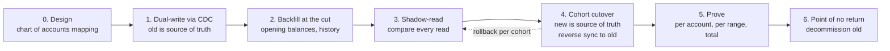

# Migrating a Live Ledger

> Dual-write, shadow-read, cut over, and prove the balances match.

**Type:** Learn
**Languages:** —
**Prerequisites:** Phase 7 Lesson 11 (Change Data Capture), Phase 7 Lesson 13 (The Transactional Outbox), Phase 7 Lesson 14 (Schema Migrations at Scale), Phase 10 Lesson 03 (The Double-Entry Ledger), Phase 10 Lesson 04 (Chart of Accounts), Phase 10 Lesson 05 (Balances and Snapshots), Phase 10 Lesson 08 (Reconciliation), Phase 14 Lesson 03 (Exactly-Once Money Movement)
**Time:** ~90 minutes

## Learning Objectives

- Sequence a live ledger migration into dual-write, backfill, shadow-read, cohort cutover, proof, and decommission, and state the exit criterion for each phase
- Define the migration cut as a single log position so that the backfilled opening balances and the replicated changes neither overlap nor leave a gap
- Translate a legacy balance table's in-place updates into balanced double-entry journals, routing unexplained changes to a suspense account that must be cleared before cutover
- Prove equality between the old and new systems per account, per range by checksum, and in aggregate by trial balance, and explain why each proof catches failures the others miss
- Write a rollback plan with an explicit point of no return, and keep the old system usable until that point

## The Problem

A wallet company started with a table called `account_balances`: one row per customer, a `balance` column of type `NUMERIC(12,2)`, and application code that runs `UPDATE account_balances SET balance = balance - :amount WHERE id = :id`. There is also a `transfers` table that most code paths write to, but not all: fee deductions, interest credits, and every manual correction made by the operations team in seven years were direct `UPDATE`s with no row anywhere else. The company now needs a double-entry ledger (Phase 10, Lesson 03) for its e-money licence, auditable history, and multi-currency support.

The first plan is a weekend cutover. On Saturday at 02:00 the team stops the API, exports every balance, imports each as an opening entry in the new ledger, switches the application to post journals, and restarts at 06:00. Monday brings three problems. The export ran while a delayed batch of interest credits was still committing, so 0.3% of accounts were exported before their credit and the credit was then written to the old table after the export: those customers are short in the new ledger. A customer disputes a card payment from last month; the refund code looks for the original journal entry to reverse, and there is none, because history before Saturday does not exist in the new ledger. And when the team wants to roll back on Monday afternoon, they cannot: the new ledger has 36 hours of postings that the old table never saw.

A ledger migration has the same shape as any live data migration (Phase 7, Lesson 14), with two differences that make it harder. The data must be exactly right, not approximately right: one cent per account across ten million accounts is a hundred thousand dollars. And the old system is not a clean model of the new one: an in-place balance table records *results* without *reasons*, so translating it into journals forces every unexplained change into the open. This lesson walks the migration that works: the new ledger is fed from the old one's change log from a single defined cut; reads are compared in shadow until they agree; accounts move to the new ledger in cohorts with a reverse sync so each move can be undone; and equality is proved per account, per range, and in total before the old table is retired.

## The Concept

### The phases and their exit criteria



| Phase | Source of truth | Exit criterion |
|-------|-----------------|----------------|
| 0. Design | Old | Every legacy write path and balance type mapped to accounts and journal templates; mapping reviewed by finance |
| 1. Dual-write | Old | Every change to the old table produces a journal in the new ledger within seconds, idempotently |
| 2. Backfill | Old | Opening balances for every account as of the cut; history imported where needed; suspense account explained |
| 3. Shadow-read | Old | Mismatch rate zero for an agreed period (for example 14 consecutive days) across all read paths |
| 4. Cohort cutover | New for migrated cohorts | Each cohort runs on the new ledger with zero mismatches against the reverse-synced old table |
| 5. Prove | New | Per-account equality, range checksums, and trial balance all pass at a common position |
| 6. Decommission | New | Rollback window expired, sign-off from finance and audit, old table archived read-only |

Nothing in phases 0 to 3 changes what customers see. That is the point: the risky part of the migration is spread over weeks in which the old system remains authoritative and every disagreement is a log line, not an incident.

### Dual-write: from the log, not from the application

The tempting implementation of dual-write is in the application: after `UPDATE account_balances`, also call `ledger.post(...)`. It fails in three ways. The two writes are not atomic, so a crash between them leaves the systems diverged with no record of which write was lost. Direct `UPDATE`s from operations scripts, cron jobs, and other services bypass the application entirely. And every write path in the codebase has to be found and changed, which is the inventory the team in The Problem never completed.

Change data capture (Phase 7, Lesson 11) avoids all three. The database's write-ahead log already records every committed change to `account_balances`, from every source, in commit order. A CDC consumer (PostgreSQL logical decoding, MySQL binlog, Debezium on either) reads each change as `(lsn, account_id, old_balance, new_balance, transaction_id, commit_time)` and translates it into a journal. If the application also writes a `transfers` row in the same transaction, the consumer sees both and can use the transfer's type to choose the journal template. If it does not, the consumer sees a bare balance change and must still post something.

The consumer is idempotent on the log position: the journal id is `legacy:<lsn>:<account_id>`, so replaying a stretch of the log after a consumer crash posts nothing twice (Phase 14, Lesson 03).

### Translating results into journals

The old table records that a balance changed, not why. The translation rules, in order of preference:

1. **The change has a reason row in the same transaction** (a `transfers` row, a `fees` row). Use the reason's type to choose the journal template: a transfer between two wallet accounts becomes `Dr wallet:A, Cr wallet:B`; a fee becomes `Dr wallet:A, Cr fee_revenue`.
2. **The change has no reason row but matches a known pattern** (the interest job runs at 00:05 with a recognisable transaction name). Map it with a documented rule: `Dr interest_expense, Cr wallet:A`.
3. **Neither.** Post it against a suspense account: `Dr migration:unexplained, Cr wallet:A` for an increase, the reverse for a decrease. The new ledger still balances and the account balance still matches, but the suspense account accumulates every change nobody can explain.

The suspense account is a deliberate design choice. It makes the unexplained changes visible, countable, and assignable to owners, and its balance must be explained (reclassified into proper accounts by correcting journals) or formally accepted by finance before cutover. In a seven-year-old system it is common for the first week of dual-write to route a few percent of changes to suspense; most turn out to be one or two scripts nobody remembered.

The consumer's core, in Java-flavoured pseudocode, groups the changes of one source transaction and picks a template:

```java
void onTransaction(LegacyTxn tx) {                       // all row changes with one source transaction id
    for (BalanceChange c : tx.balanceChanges()) {
        String journalId = "legacy:" + c.lsn() + ":" + c.accountId();
        if (ledger.exists(journalId)) continue;          // replay after a crash posts nothing twice
        long delta = c.newMinor() - c.oldMinor();         // integer minor units, never floats
        Template t = tx.reasonRow()
                .map(templates::forReason)               // rule 1: transfers, fees
                .or(() -> patterns.match(tx))            // rule 2: interest job, known batch names
                .orElse(Template.SUSPENSE);              // rule 3: migration:unexplained
        ledger.post(journalId, t.postings(c.accountId(), delta));
    }
    checkpoint.save(tx.commitLsn());                     // only after every change in tx is posted
}
```

A transfer touches two balance rows in one source transaction; the template for a transfer posts both sides in the journal for the first row and treats the second row's change as already explained, which is why changes are grouped by transaction before translation. The checkpoint is saved after the whole transaction, so a crash in the middle replays it from the start and the idempotency check skips what was already posted.

### The cut

The backfill establishes each account's opening balance in the new ledger. The dual-write stream applies every change after that. If the opening balance is taken at one moment and the stream starts at another, changes in between are either missed (the interest credits in The Problem) or counted twice. The fix is to define both by **one log position, the cut `L`**:

- The opening balance of every account is its balance **as of `L`**: read from a consistent snapshot of the database at `L` (PostgreSQL exports a snapshot with a logical replication slot; MySQL's consistent snapshot with the binlog coordinates does the same).
- The dual-write consumer starts **at `L`**, exclusive: it applies exactly the changes committed after the snapshot.

Each opening balance is posted as `Dr migration:opening_equity, Cr wallet:A` (for a positive customer balance, which is a liability of the company). After the backfill, the opening-equity account holds the negated sum of all opening balances; it is the bridge between "the ledger started at zero" and "customers already had money."

### Worked trace

Three accounts, the cut at LSN 1000:

| LSN | Event in the old system | Balances after (A, B, C) |
|-----|-------------------------|--------------------------|
| 990 | (state at snapshot) | 100.00, 250.00, 0.00 |
| 1000 | Cut: snapshot taken, slot created | 100.00, 250.00, 0.00 |
| 1004 | Transfer A to B 30.00, with a `transfers` row | 70.00, 280.00, 0.00 |
| 1009 | Interest job credits C 0.42, no reason row, known pattern | 70.00, 280.00, 0.42 |
| 1013 | Ops script sets B = 279.50, no reason row | 70.00, 279.50, 0.42 |
| 1020 | Fee 0.50 from A with a `fees` row | 69.50, 279.50, 0.42 |

New-ledger journals (debits positive; customer wallets are liabilities, so a positive customer balance is a credit balance):

| Journal | Postings |
|---------|----------|
| `opening:A` | `migration:opening_equity` +100.00, `wallet:A` -100.00 |
| `opening:B` | `migration:opening_equity` +250.00, `wallet:B` -250.00 |
| `opening:C` | no journal (zero balance) |
| `legacy:1004` | `wallet:A` +30.00, `wallet:B` -30.00 |
| `legacy:1009:C` | `interest_expense` +0.42, `wallet:C` -0.42 |
| `legacy:1013:B` | `wallet:B` +0.50, `migration:unexplained` -0.50 |
| `legacy:1020` | `wallet:A` +0.50, `fee_revenue` -0.50 |

Resulting new-ledger balances, negated for wallets to compare with the old table:

```text
wallet:A   -(-100.00 + 30.00 + 0.50)      = 69.50   old table 69.50   match
wallet:B   -(-250.00 - 30.00 + 0.50)      = 279.50  old table 279.50  match
wallet:C   -(-0.42)                       = 0.42    old table 0.42    match
migration:opening_equity                  = +350.00 = sum of opening balances
migration:unexplained                     = -0.50   one change to explain
```

Spelled out: `opening_equity +350.00, wallet:A -69.50, wallet:B -279.50, wallet:C -0.42, interest_expense +0.42, unexplained -0.50, fee_revenue -0.50` sums to zero. Every account matches, the ledger balances, and the 0.50 reduction of B by an ops script is now a line item that someone must explain (it turns out to be a goodwill credit reversed by hand) before cutover.

Had the snapshot been taken at LSN 1000 but the consumer started at 1010, the transfer at 1004 would be missing and A would show 99.50 in the new ledger against 69.50 in the old. Had the consumer started at 990, the snapshot's balances would already include nothing after 1000, so no double count here, but any change between 990 and 1000 would be applied twice. Shadow-read finds both errors on the first comparison; defining the cut correctly means it never has to.

### History

Opening balances are enough to run the ledger forward. They are not enough for refunds, disputes, statements, and audits that reference transactions before the cut. Three options:

| Option | What is imported | Cost | When to choose it |
|--------|------------------|------|-------------------|
| Opening balances only | One journal per account at the cut | Lowest | History is served from the old system, read-only, for its retention period |
| Recent history | Journals for the last N months (dispute window plus statement period), then an opening balance at the start of the window | Moderate | The common choice: refunds and disputes of recent payments find their originals |
| Full history | Every legacy change as a journal from day one | Highest; exposes every unexplained change ever | Required by the regulator or auditor, or the old system must be deleted |

For recent history, the opening balance is taken at the start of the window (from a backup or by replaying the log backwards from the cut), and the window's changes are imported as journals using the same translation rules, ending exactly at the cut. The proof below must then also pass at the window's start.

### Shadow-read

During shadow-read, every read the product makes is still served from the old system, and the same read is computed from the new ledger and compared. The comparison must be made at the same logical point: the new ledger lags the old by the consumer's delay, so each comparison carries the LSN the old read saw and waits (or retries later) until the consumer has applied it.

What to compare:

- **Balances**, on every balance read, at the read's LSN.
- **Derived values**: available balance after holds, statement totals, interest accrued. These exercise logic, not just storage.
- **Decisions**: whenever the old system declines or approves a debit, compute what the new ledger would have decided. A mismatch in decisions is the most important one, because it is what customers will feel at cutover.

Mismatches are logged with both values and the LSN, classified (translation rule wrong, consumer lag, rounding, unexplained), and fixed at the source. The exit criterion is zero unexplained mismatches over an agreed period that includes at least one month-end, one interest run, and one statement cycle, because those are the code paths that run rarely.

### Cohort cutover with reverse sync

Cutover moves accounts, not the whole system, to the new ledger as source of truth: first internal test accounts, then 1%, 10%, 50%, 100%, chosen by a stable hash of the account id. For each cohort:

1. Briefly block writes to the cohort's accounts (seconds), wait until the CDC consumer has applied everything up to the current LSN, and verify equality for those accounts.
2. Flip the cohort's flag in the routing table: writes for these accounts now go to the new ledger.
3. Start a **reverse sync** for the cohort: every journal posted in the new ledger updates the old table's balance (through an outbox, idempotently by journal id). The old table stays correct for migrated accounts.
4. Unblock.

The reverse sync is what makes rollback possible. While it runs, the old table holds correct balances for every account, migrated or not, so flipping a cohort back is the same procedure in the other direction. Transfers between a migrated and an unmigrated account post in whichever system owns the debited account and are synced to the other, exactly like the clearing pattern in Phase 14, Lesson 02.

### Proving the balances match

Three proofs, each catching what the others miss, all computed at a common position (an LSN in the old system and the corresponding applied position in the new):

1. **Per-account equality.** For every account, `old.balance == -(new wallet balance)`. Catches any single-account error. Costs one comparison per account; at ten million accounts this is a few minutes of scanning, and it should run nightly from cutover to decommission.
2. **Range checksums.** Partition accounts by id range; for each range compute a hash over the sorted `(account_id, balance_minor)` pairs on both sides; compare the hashes. Equal hashes skip the range; unequal ranges are compared row by row. This is how the per-account proof scales across two databases without shipping every row (the bucket-digest idea from Phase 14, Lesson 04), and it is cheap enough to run every hour.
3. **Aggregate trial balance.** The new ledger's postings sum to zero; the sum of all wallet balances equals the sum of old balances; `opening_equity` equals the sum of opening balances; `unexplained` is zero or formally accepted. Catches errors that are invisible per account: a journal that credited a customer correctly but debited the wrong internal account, which leaves every wallet right and the books wrong.

Per-account equality without the trial balance misses wrong internal postings. The trial balance without per-account equality misses two offsetting errors on two customers. Checksums without the per-account fallback tell you a range is wrong but not which account. Run all three.

In SQL, the per-account proof and the range checksum look like this (the two queries run in different databases; a job compares their outputs):

```sql
-- old system, at the proof position
SELECT account_id, (balance * 100)::bigint AS balance_minor
  FROM account_balances ORDER BY account_id;

-- new ledger, at the corresponding applied position
SELECT account_id, -sum(amount_minor) AS balance_minor
  FROM journal_lines WHERE account_id LIKE 'wallet:%'
 GROUP BY account_id ORDER BY account_id;

-- range checksum, same expression on both sides: 10,000 ranges by hash of account id
SELECT abs(hashtext(account_id)) % 10000 AS range_id,
       md5(string_agg(account_id || ':' || balance_minor, ',' ORDER BY account_id)) AS digest,
       count(*) AS accounts, sum(balance_minor) AS total
  FROM balances_at_position GROUP BY 1;
```

Ranges whose digest, count, and total agree are done. A mismatching range is a few hundred accounts compared row by row.

Money values are compared in integer minor units. If the old column was `NUMERIC(12,2)`, conversion is exact; if it was `FLOAT` or `DOUBLE` (it happens), every legacy value must be converted with an explicit rounding rule (Phase 10, Lesson 01), the residues summed per account, and the total residue posted to a named rounding account and reported, never silently absorbed.

### The rollback plan and the point of no return

| Stage | How to roll back | Data at risk |
|-------|------------------|--------------|
| Before cutover (phases 1-3) | Stop the consumer; drop the new ledger | None; the old system was always authoritative |
| During cohort cutover | Flip the cohort back; reverse sync has kept the old table current | None if reverse sync is current; verify equality before flipping |
| After 100% cutover, reverse sync still running | Flip all cohorts back | None, but features the old table cannot represent must be disabled first |
| After new-only features ship (holds, multi-currency, sub-accounts) | Not possible without data loss: the old table cannot represent them | Everything those features recorded |
| After the old table is decommissioned | Not possible | All |

The **point of no return** is the first of: the reverse sync is stopped, a feature the old model cannot represent is used by a customer, or the old table is dropped. Write it down as a dated decision with an approver, and do not let it happen by accident: the most common accidental crossing is a product team shipping a feature on the new ledger the week after 100% cutover.

### State the old table never had

A balance table often hides state in other tables or in other systems: pending card authorizations tracked by the card processor integration, scheduled transfers in a job queue, holds implemented as a separate `reserved` column. The new ledger models these explicitly (Phase 10, Lesson 07), so the migration must decide for each one:

| Legacy state | New-ledger representation | Migration approach |
|--------------|---------------------------|--------------------|
| `reserved` column next to `balance` | Hold postings against a holds account | Backfill holds at the cut from the column; dual-write changes to it like balance changes |
| Pending authorizations in the card integration | Holds keyed by authorization id | Backfill from the integration's open authorizations at the cut; captures and expiries after the cut arrive through the normal path |
| Scheduled future transfers | Not ledger state | Leave in the scheduler; they post through whichever system owns the account when they run |
| Negative balances allowed by the old table | Forbidden by a ledger constraint | Find during backfill; correct with explained journals before cutover, or grant an explicit overdraft account |

### Sign-off

| Gate | Who signs | On what evidence |
|------|-----------|------------------|
| Translation rules | Finance controller | Mapping table and a sample of 100 translated transactions |
| End of shadow-read | Engineering lead and finance | Mismatch log at zero for the agreed period, covering month-end |
| Each cohort | On-call engineer | Per-cohort equality check before and after the flip |
| Suspense cleared | Finance controller | Reclassification journals and acceptance memo |
| Point of no return | Head of engineering, CFO or delegate | Three proofs passing nightly for the rollback window; audit informed |

### Failure modes

1. **Dual-write in the application.** A crash between the two writes; a script that bypasses the code. Use the log.
2. **Two cuts.** Snapshot and stream defined by different moments. Use one LSN.
3. **Suspense ignored.** `migration:unexplained` grows quietly and is cleared by one big journal at the end. Each unexplained change needs an owner and a correcting entry, or the new ledger's history is no better than the old table's.
4. **Comparing at different points.** Shadow-read compares the old balance now with the new balance a second ago and reports thousands of false mismatches, which trains everyone to ignore it. Compare at the same LSN.
5. **Rounding residue.** A float legacy column produces sub-cent residues that are rounded per account and never totalled.
6. **No rollback rehearsal.** The reverse sync exists but no cohort has ever been flipped back. Flip the 1% cohort back once, on purpose, before going to 10%.
7. **Constraints the old system did not have.** The new ledger forbids negative wallet balances; the old table has 212 accounts at -0.01 from a rounding bug years ago. Find them during backfill, not at cutover.

### Strategies compared

| Strategy | Downtime | Proof before switching | Rollback | Suits |
|----------|----------|------------------------|----------|-------|
| Big-bang export/import | Hours | Only after the fact | Restore from backup, losing post-cutover writes | Small ledgers with an acceptable maintenance window |
| Application dual-write | None | Shadow-read possible | Possible while dual-write runs | Systems with one write path and no direct updates (rare) |
| CDC dual-write + shadow-read + cohort cutover | Seconds per cohort | Weeks of shadow comparison | Per cohort, until the point of no return | Any live ledger where correctness matters more than speed |

## Worked Example

### A migration plan for ten million accounts

The wallet from The Problem has 10.2 million accounts, 1,400 balance changes per second at peak, and a 120-day dispute window. The plan the team executes instead of the weekend cutover:

| Week | Phase | Activity | Measured result |
|------|-------|----------|-----------------|
| 1-2 | 0 | Inventory write paths from the database log (not the codebase): 11 distinct sources, 4 not in the application | Mapping reviewed by finance |
| 3 | 1 | CDC consumer live from a test cut; translation rules v1 | 3.1% of changes to suspense |
| 4 | 1 | Two forgotten scripts identified (goodwill credits, dormancy fees); rules v2 | 0.02% to suspense |
| 5 | 2 | Production cut at LSN `7F3A/1C00`; backfill of opening balances at the window start (120 days earlier) plus 120 days of history | 10.2 M opening journals, 61 M history journals; 212 accounts at -0.01 found and corrected |
| 6-8 | 3 | Shadow-read on balances, available balance, statements, debit decisions | Day 1: 1,840 mismatches (comparison at different LSNs); day 3: 37 (rounding in interest); day 9 onward: 0 |
| 9 | 4 | Cutover: internal accounts, then 1%; rollback rehearsal on the 1% cohort | Flip back and forward in 40 s each, zero mismatches |
| 10-11 | 4 | 10%, 50%, 100% | Write block per cohort under 2 s |
| 12 | 5 | Three proofs nightly; suspense cleared: 1,903 unexplained changes reclassified, 14 accepted by finance with a memo | All pass |
| 16 | 6 | Point of no return approved; reverse sync stopped; holds feature enabled | Old table archived read-only for its retention period |

Sixteen weeks instead of one weekend, with no customer-visible incident, a ledger whose history explains every cent for the last 120 days, and an audit trail of every decision. The 1,840 false mismatches on day 1 are typical: the first bug in every shadow-read is comparing at different positions, and it must be fixed before the comparison can be trusted.

### The interest credit, done right

The Problem's lost interest credits happened because the export and the interest batch overlapped. Under this lesson's design the batch's commit lands at some LSN after the cut and the consumer applies it as `legacy:<lsn>:<account>` with the interest template, or before the cut and it is already in the snapshot's balance. There is no third possibility, which is the whole value of defining the cut as a log position rather than a wall-clock time.

## Exercises

1. **Reinforce.** Extend the worked trace with an LSN 1025 event: an ops script sets C's balance to 0.00 with no reason row, then at LSN 1030 the interest job credits C 0.42 again. Write the journals, the resulting balances, and the suspense balance, and say what the finance team should ask the operations team.
2. **Apply.** Design the range-checksum proof for ten million accounts in two different databases. Choose the range size, the hash (and how to make it order-independent or sort first), and the fallback; estimate the bytes transferred when 0.01% of accounts mismatch, and compare with shipping every row.
3. **Extend.** Combine with Phase 14, Lesson 03 and Phase 7, Lesson 11: sketch the CDC consumer that reads `account_balances` and `transfers` changes, groups them by source transaction id, chooses a journal template, posts idempotently on `legacy:<lsn>:<account>`, and routes unexplained changes to suspense. List the tests that prove a crash and replay at any point produces the same ledger, and that a snapshot at LSN `L` plus the stream from `L` equals a snapshot taken later.

## Key Terms

| Term | What people say | What it actually means |
|------|-----------------|------------------------|
| Dual-write | "write to both" | Keeping the new ledger updated from every change to the old system; done safely from the change log, not from application code |
| The cut | "migration time" | One log position that defines both the snapshot for opening balances and the start of the change stream, so nothing is missed or double-counted |
| Opening balance | "the import" | A journal per account at the cut, against an opening-equity account, that brings pre-existing balances into the new ledger |
| Suspense account | "misc" | A ledger account that receives every legacy change the translation rules cannot explain; must be cleared or accepted before cutover |
| Shadow-read | "dark launch" | Computing every read from the new system alongside the old one, at the same log position, and logging mismatches without serving them |
| Reverse sync | "backfill the old one" | Applying new-ledger journals to the old table for migrated cohorts so a cohort can be rolled back |
| Point of no return | "go-live" | The first moment rollback would lose data: reverse sync stopped, a new-only feature used, or the old system removed |
| Range checksum | "hash compare" | A per-range digest of account balances on both sides, compared to skip equal ranges and localize mismatches |

## Further Reading

- [Stripe Engineering, "Online migrations at scale" (2017)](https://stripe.com/blog/online-migrations) — the four-phase dual-write, read-switch, write-switch, remove pattern, from a production payments migration.
- [PostgreSQL documentation: Logical Decoding and exported snapshots](https://www.postgresql.org/docs/current/logicaldecoding-explanation.html) — how a replication slot's creation exports a snapshot consistent with the slot's start position, which is exactly the cut.
- [Debezium documentation: initial snapshots and the binlog/WAL position](https://debezium.io/documentation/reference/stable/connectors/postgresql.html) — a production CDC tool's handling of snapshot-then-stream without gaps or duplicates.
- [Fowler, "Parallel Change" (martinfowler.com)](https://martinfowler.com/bliki/ParallelChange.html) — the expand, migrate, contract pattern that cohort cutover applies to data.
- [Kleppmann, "Designing Data-Intensive Applications" (O'Reilly, 2017), Chapter 11](https://dataintensive.net/) — change data capture, log-based derived data, and why dual writes from application code diverge.
