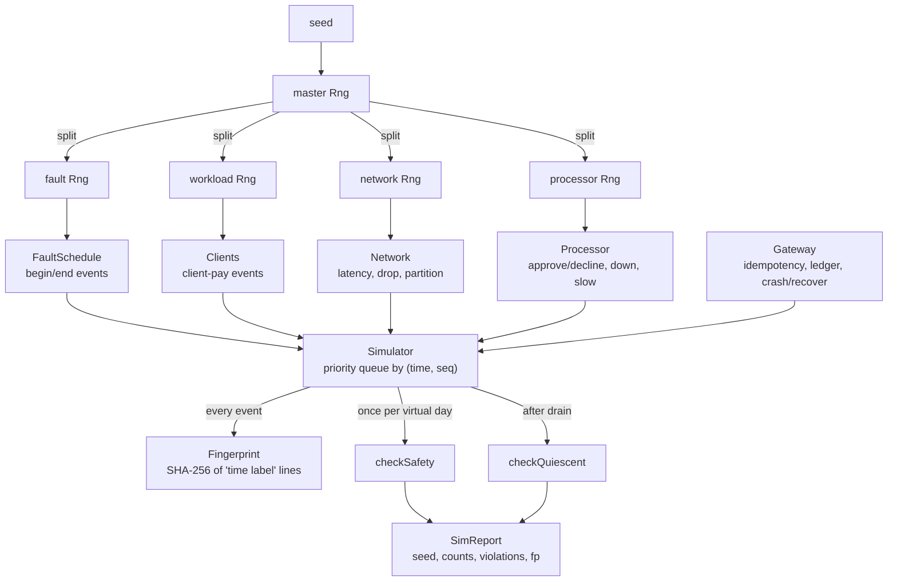

# Deterministic Simulation Testing of Payment Systems

> Run a year of payments in a minute with a seeded network.

**Type:** Build
**Languages:** Java, Python, Go
**Prerequisites:** Phase 5 Lesson 02 (Failure Models), Phase 5 Lesson 09 (Idempotency Keys), Phase 12 Lesson 14 (Testing Payment Systems), Phase 14 Lesson 03 (Exactly-Once Money Movement)
**Time:** ~120 minutes

## Learning Objectives

- Explain why a payment system's hardest bugs are scheduling bugs, and why a test that cannot control the scheduler cannot find them
- Build a deterministic simulator: a seeded SplitMix64 generator, a virtual clock that is also the event loop, and a network with seeded latency, loss, and partitions
- Generate a fault schedule from the seed and inject processor outages, slowdowns, partitions, and gateway crashes into a running payment system
- Separate safety invariants (true at every instant) from quiescence invariants (true only once the network has drained) and check each at the right moment
- Fingerprint an event trace so two runs can be proven identical, and produce a failing-seed report a colleague can replay in one line
- Compare the from-scratch harness with FoundationDB's simulator, TigerBeetle's VOPR, Jepsen, and Antithesis, and say what each one controls that the others do not

## The Problem

A gateway team ships a retry fix. When the processor does not answer within three seconds, the gateway re-sends the authorization. Code review approves it; the integration suite passes; the processor sandbox approves every test card. Four days later finance reports 212 customers charged twice for one order each. The duplicate charges all happened between 02:10 and 02:14 UTC on the night the processor's data centre failed over, when their response times rose to seven seconds.

The retry fix had a second change nobody noticed in review: it generated a fresh processor idempotency key on each attempt, because the first attempt's key "might have been consumed by a failed request". Under seven-second latency, the first attempt was approved at the processor, the three-second timer fired, the second attempt with a new key was also approved, and the gateway posted the first response it received and ignored the second. The gateway's ledger was clean. The processor had two authorizations. The bug needed four things to line up: a slow processor, a timeout, a retry, and two approvals racing back. The integration test could not produce a slow processor, and even if it could, the race between the two responses depended on thread scheduling that no test controls.

This is the normal shape of a serious payments bug. The code is not wrong in the sense a unit test detects; it is wrong only under a particular interleaving of timeouts, retries, crashes, and message delays, and the interleaving happens once in ten thousand payments on a bad night. The team's answer, before this incident, was a chaos engineering stage that killed pods at random. It found nothing, because the failure also needs a specific ordering, and random real-time chaos produces a different ordering each run, cannot be replayed, and runs at the speed of real time: four days of production traffic is four days of chaos.

Deterministic simulation turns the problem around. Instead of hoping a bad interleaving appears, the test owns every source of nondeterminism: time is a counter, the network is a priority queue, the processor's decisions and the fault schedule come from a seeded generator. A seed is a complete universe. Run seed 1 twice and you get the same 9,435 events in the same order and the same SHA-256 over the trace. Run seeds 1 to 40 and you have forty universes, each with its own faults, in a few seconds. When seed 17 breaks the `no-double-authorization` invariant at virtual time 86,400,000 ms, the bug report is one line, and it reproduces on every laptop on the team forever. FoundationDB has tested this way since 2010 and TigerBeetle since its first commit; this lesson builds the smallest version of their harnesses that still catches the double-charge above.

## The Concept

### Three sources of nondeterminism, one seed

A distributed program's output depends on its input plus three things the program does not control:

| Source | In production | In a conventional test | In the simulator |
|--------|---------------|------------------------|------------------|
| Time | wall clock, timers, timeouts | real clock; `sleep` in tests | `Simulator.now`, advanced only by processing events |
| Scheduling and the network | thread interleaving, message latency, loss, partitions | OS scheduler, loopback TCP | `Network.send` draws latency and loss from a seeded stream and enqueues the delivery as an event |
| Randomness | UUIDs, processor decisions, retry jitter | `java.util.Random` without a seed | `Rng(seed)` split into one child stream per component |

Remove all three and a run is a pure function: `trace = f(code, seed)`. That is the whole idea. Everything else in the lesson is engineering to make the function cheap to evaluate and its failures easy to read.

The simulator is single-threaded. Concurrency is modelled, not executed: a message in flight is an event in a priority queue, a timer is an event in the same queue, and "the gateway and the processor are running at the same time" means their events are interleaved by timestamp. There is no `Thread`, no lock, and no `sleep` anywhere in the code, which is why a 48-hour virtual run of 1,147 payments takes under 200 milliseconds.

### The virtual clock is the event loop

`Simulator` holds a priority queue of `Event(time, seq, label, action)` ordered by `(time, seq)`. `schedule(delayMs, label, action)` inserts an event at `now + delayMs`. `step()` pops the earliest event, sets `now` to its time, appends `"<time> <label>"` to the trace fingerprint, and runs the action. Time never advances except by popping an event, so a run with one event at `t = 86,400,000` finishes instantly: the simulator does not wait a day, it sets `now = 86,400,000`.

The `seq` tiebreak matters more than it looks. Two events at the same virtual millisecond must run in a defined order or the trace is not deterministic; `PriorityQueue` makes no promise about equal keys, so the scheduling sequence number is part of the key. Every later component inherits determinism from this one rule.

### The simulated network

`Network.send(from, to, label, deliver)` does three things in order, each drawing from the network's own `Rng`:

1. If the link `from>to` is partitioned, count the message as blocked and drop it.
2. With probability `dropBasisPoints / 10000`, count it as dropped.
3. Otherwise draw a latency uniformly in `[minLatencyMs, maxLatencyMs]` and schedule `deliver` that far in the future.

The default `NetworkConfig.LAN` is 20 to 200 ms with 1% loss. Note the asymmetry a real network has and this one models: partitioning `a` from `b` blocks both directions, but a message already in the queue when the partition begins is still delivered, because it was "on the wire". That is exactly the case that catches a gateway which assumes a partition means silence.

### Fault schedules drawn from the seed

The `FaultSchedule` is a list of `(startMs, endMs, kind)` triples generated up front from the fault stream: a kind chosen uniformly from five, a start time anywhere in the horizon, and a duration specific to the kind (partitions 5 to 120 seconds, processor outages 5 to 90 seconds, slowdowns 1 to 10 minutes, crashes instantaneous). Each fault is armed as two events, `fault-begin` and `fault-end`, so the fault schedule is just more events in the same queue and interleaves naturally with payments.

One fault kind is deliberately not random in time. `GATEWAY_CRASH` arms a crash that fires the moment a payment is in flight. A crash at 03:00 with nothing pending tests nothing; a crash between "payment persisted, authorization sent" and "response received" tests the recovery path that matters. TigerBeetle's VOPR does the same thing under the name of biasing faults toward interesting states.

### Why the RNG is split into streams

A single generator shared by everything would make the test fragile: adding one draw in the network code (say, jitter on retransmit) would shift every later draw, change which payments the workload generates, and change which faults occur. A bug found with seed 17 would stop reproducing after an unrelated refactor.

`Harness.run` therefore takes one master `Rng(seed)` and calls `split()` four times, in a fixed order, to produce independent streams for the network, the processor, the fault schedule, and the workload. `split()` is just `new Rng(nextLong())`: the child's seed is a draw from the parent. Now the workload stream never sees a fault draw and the fault stream never sees a latency draw. The processor's approve/decline decisions are the same for seed 17 whether or not the network drops a message.

The generator is SplitMix64 (Steele, Lea, and Flood, 2014), not `java.util.Random`. It is six lines of 64-bit arithmetic with published test vectors: seed 0 produces `e220a8397b1dcdaf` then `6e789e6aa1b965f4`. `java.util.Random` is a 48-bit linear congruential generator whose exact sequence is a JDK implementation detail; a port of this harness to another language could not reproduce its draws. Probabilities are integers in basis points (`chance(100)` is 1%) so there is no floating-point comparison whose result could differ between platforms.

### Safety invariants and quiescence invariants

An invariant checker is a function over the whole system state that returns a list of violations. The harness has two kinds, and confusing them is the most common mistake in simulation testing.

**Safety invariants** must hold at every instant. The harness checks them once per virtual day during the run and once more at the end:

| Invariant | Statement | What it catches |
|-----------|-----------|-----------------|
| `no-double-authorization` | the processor approved each payment id at most once | a fresh idempotency key per retry |
| `approval-posted-once` | every ledger entry corresponds to exactly one processor approval, and every `APPROVED` payment has exactly one entry | double posting; posting without approval |
| `trial-balance` | the ledger's postings sum to zero | an unbalanced entry slipped past the ledger |
| `money-conserved` | receivables in the ledger equal the sum of amounts the gateway marked `APPROVED` | a status flipped without a posting, or vice versa |
| `one-payment-per-key` | each client idempotency key maps to one payment | the idempotency store lost a key across a crash |
| `client-gateway-agree` | every outcome a client believes matches the gateway's record | a reply from a stale attempt, or two different answers for one key |

**Quiescence invariants** are true only when nothing is in flight: no message on the wire, no timer armed, every fault ended. `no-stuck-payments` (no payment still `PENDING`) is one. Checking it during the run would be a false positive on every payment whose response is still 150 ms away. The harness therefore stops generating load at the horizon, drains the queue to empty with `runUntilIdle`, and only then checks that every payment reached a terminal state and that the processor's approvals equal the ledger's receivables to the cent.

The distinction is the same one Phase 5, Lesson 05 made between safety and liveness, applied to testing: safety is "nothing bad ever happens" and is checkable at any instant; liveness is "something good eventually happens" and is only checkable once "eventually" has arrived, which in a simulator is a precise moment.

### Worked example: one retry, traced by hand

Seed and configuration aside, here is what the queue looks like when a processor outage overlaps one payment. Client 0 submits key `key-7` at `t = 600,000`. Network latency draws are 80 ms and 120 ms; the gateway's processor timeout is 3,000 ms; the processor is down from `t = 600,050` to `t = 603,000`.

```text
t=600000  client-pay client-0            client sends payment key-7 (latency 80)
t=600050  fault-begin PROCESSOR_OUTAGE   processor.down = true
t=600080  deliver gateway<-client-0      gateway: new payment pay-000041, authKey=auth-pay-000041, sendAuth a1 (latency 120)
                                         timer armed: auth-timeout pay-000041 a1 at t=603080
t=600200  deliver processor<-gateway     processor is down: swallowed (received=1, swallowed=1), no reply
t=603000  fault-end PROCESSOR_OUTAGE     processor.down = false
t=603080  auth-timeout pay-000041 a1     still PENDING, attempt still 1 -> authTimeouts=1, sendAuth a2 with the SAME authKey
t=603xxx  deliver processor<-gateway     decisions has no auth-pay-000041 yet: decide once (approved), reply
t=603yyy  deliver gateway<-processor     onAuthResponse: PENDING -> APPROVED, post pay-000041, run waiting replies
t=603zzz  deliver client-0<-gateway      client records APPROVED for key-7
```

Count the invariants at `t = 604,000`: one approval for `pay-000041`, one ledger entry, trial balance zero, receivables equal the approved amount, `key-7` maps to one payment, the client and gateway agree. Now replace "the SAME authKey" with a fresh key and the processor has no record of `auth-pay-000041-2`, so if the first attempt had been delayed rather than swallowed, both would be approved. That is the planted defect `FRESH_AUTH_KEY_ON_RETRY`, and seed 1 finds it within 24 virtual hours.



### Complexity and the cost of checking

Each event costs `O(log n)` to enqueue and dequeue, where `n` is the queue size (bounded by in-flight messages plus armed timers plus remaining faults, a few hundred here). A 48-hour run is about 9,400 events; the 480-hour run in the demo is 94,000. The invariant checkers are `O(payments)` because they walk every payment and every ledger entry, so running them after every event would make the run quadratic. Once per virtual day plus once at the end is the compromise; the first violation's time is still recorded, and the trace fingerprint lets you bisect to the exact event if you need to.

### Comparison with the alternatives

| Technique | Controls time | Controls ordering | Replayable | Finds | Misses |
|-----------|---------------|-------------------|------------|-------|--------|
| Unit tests with mocks | yes (fake clock) | no (one path per test) | yes | logic errors in one component | every interaction between components |
| Integration tests against sandboxes | no | no | no | API contract mismatches | timing, retries, crashes |
| Chaos engineering in staging | no | no | no | missing alarms, slow recovery | specific interleavings; cannot replay |
| Jepsen | no | partially (nemesis schedules) | partially (logs) | consistency anomalies in real binaries | bugs that need millions of runs |
| Deterministic simulation | yes | yes | yes, from a seed | interleaving bugs, recovery bugs, invariant breaks | bugs in code the simulator replaces: real TCP, real disks, real JVM scheduling |

The last cell is the honest limit. The simulator replaces the network and the clock with models, so a bug in how the real `SocketChannel` behaves under a half-open connection is invisible to it. FoundationDB's answer is to make the simulated and real implementations share one interface and run the real one through Jepsen-style tests as well. Deterministic simulation is the first line, not the only one.

### What this harness does not do

- It does not test concurrency primitives. The gateway has no locks because it has no threads; a production gateway's lock ordering is tested in Phase 4 and its concurrent ledger in `phases/15-capstone-projects/01-capstone-ledger-service`.
- It does not model disks. "Durable" state in the gateway is a `Map` that `crash()` does not clear; a real system's fsync and torn-write behaviour is Phase 7, Lesson 02.
- It does not generate adversarial workloads. Payments are uniform random amounts to random customers. Property-based generation of nasty request sequences (same key, different body; refunds racing captures) is Exercise 3.
- It does not prove the absence of bugs. Forty passing seeds mean forty universes passed. TigerBeetle runs the VOPR continuously on dedicated machines for exactly this reason.

## Build It

The implementation is `code/java/Main.java`, about 750 lines, with every type package-private in one file so `javac -d .out *.java` works. The walkthrough follows the file top to bottom.

### Step 1: A portable seeded generator

```java
final class Rng {
    private long state;
    long draws = 0;

    Rng(long seed) { this.state = seed; }

    long nextLong() {
        draws++;
        state += 0x9E3779B97F4A7C15L;
        long z = state;
        z = (z ^ (z >>> 30)) * 0xBF58476D1CE4E5B9L;
        z = (z ^ (z >>> 27)) * 0x94D049BB133111EBL;
        return z ^ (z >>> 31);
    }

    int nextInt(int bound) {
        if (bound <= 0) throw new IllegalArgumentException("bound must be positive");
        return (int) ((nextLong() >>> 32) % bound);
    }

    boolean chance(int basisPoints) { return nextInt(10_000) < basisPoints; }

    Rng split() { return new Rng(nextLong()); }
}
```

SplitMix64: add the golden-ratio constant to the state, then mix with two xor-shift-multiply rounds. Java's `long` wraps on overflow, which is exactly the modular arithmetic the algorithm specifies, and `>>>` is the unsigned shift the mixing steps need. `nextInt` uses the top 32 bits of the draw: the low bits of any additive generator are weaker, and taking the top half avoids `Math.floorMod` ambiguity on negative values.

**Predict:** `new Rng(7).nextLong()` and a second `new Rng(7).nextLong()` are equal. Are `new Rng(7).split().nextLong()` and `new Rng(7).nextLong()` equal?

### Step 2: The virtual clock

```java
record Event(long time, long seq, String label, Runnable action) {}

final class Simulator {
    private final PriorityQueue<Event> queue = new PriorityQueue<>(
            (a, b) -> a.time() != b.time() ? Long.compare(a.time(), b.time()) : Long.compare(a.seq(), b.seq()));
    private long seq = 0;
    long now = 0;
    long processed = 0;
    final Fingerprint trace = new Fingerprint();

    void schedule(long delayMs, String label, Runnable action) {
        if (delayMs < 0) throw new IllegalArgumentException("delay must be non-negative");
        queue.add(new Event(now + delayMs, seq++, label, action));
    }

    boolean step() {
        Event e = queue.poll();
        if (e == null) return false;
        now = e.time();
        processed++;
        trace.add(now + " " + e.label());
        e.action().run();
        return true;
    }

    void runUntilIdle(long maxEvents) {
        long budget = maxEvents;
        while (step()) if (--budget < 0) throw new IllegalStateException("simulation did not reach quiescence");
    }
}
```

`runUntil(timeMs)` (in the file) pops events while the head is at or before `timeMs` and then sets `now = timeMs` even if nothing was scheduled, so "advance a day" works on an idle system. `runUntilIdle` drains to empty with a budget, because a component that reschedules itself forever (a retry loop with no cap) would otherwise hang the test; the budget turns that bug into an `IllegalStateException` with a clear message.

**Predict:** three events are scheduled with delays 50, 10, 50 and labels `b`, `a`, `c`. In what order do they run, and what is `now` afterwards?

### Step 3: The network

```java
final class Network {
    private final Set<String> partitioned = new HashSet<>();
    int sent = 0, delivered = 0, dropped = 0, blocked = 0;

    void send(String from, String to, String label, Runnable deliver) {
        sent++;
        if (partitioned.contains(from + ">" + to)) { blocked++; return; }
        if (rng.chance(cfg.dropBasisPoints())) { dropped++; return; }
        int latency = rng.between(cfg.minLatencyMs(), cfg.maxLatencyMs());
        sim.schedule(latency, "deliver " + to + "<-" + from + " " + label, () -> { delivered++; deliver.run(); });
    }

    void partition(String a, String b) { partitioned.add(a + ">" + b); partitioned.add(b + ">" + a); }
    void heal(String a, String b) { partitioned.remove(a + ">" + b); partitioned.remove(b + ">" + a); }
}
```

A message is a closure scheduled for later. The partition check comes before the drop draw so that a partitioned message does not consume a random draw: otherwise the number of partitioned messages would shift every later latency, and partitions would be entangled with the loss pattern. Ordering of draws is a design decision in a deterministic system, and each one should have a reason.

**Predict:** `send` is called while the link is healthy, then `partition` is called before the latency elapses. Is the message delivered?

### Step 4: Faults as events

```java
record Fault(long startMs, long endMs, FaultKind kind) {
    static Fault draw(Rng rng, long horizonMs) {
        FaultKind kind = FaultKind.values()[rng.nextInt(FaultKind.values().length)];
        long start = rng.nextLongBounded(horizonMs);
        long duration = switch (kind) {
            case PARTITION_CLIENT_GATEWAY, PARTITION_GATEWAY_PROCESSOR -> rng.between(5, 120) * 1000L;
            case PROCESSOR_OUTAGE -> rng.between(5, 90) * 1000L;
            case PROCESSOR_SLOW -> rng.between(1, 10) * MINUTE;
            case GATEWAY_CRASH -> 0;
        };
        return new Fault(start, Math.min(horizonMs, start + duration), kind);
    }
}
```

`nextLongBounded` exists because a 3,000-hour horizon is 1.08 x 10^10 ms, beyond `int`. The test checks that fault start times on a long horizon do exceed 2^31, because a harness that silently never injects a fault in the second half of a long run is a harness that lies.

`FaultSchedule.arm` schedules `fault-begin` and `fault-end` for each fault. `begin` for `PROCESSOR_OUTAGE` sets `processor.down = true`; the processor then counts incoming requests as `swallowed` and never replies, which is what an outage looks like from the caller's side: a timeout, not an error.

**Predict:** `GATEWAY_CRASH` has duration 0, so no `fault-end` is scheduled. What ends a crash?

### Step 5: The processor and its idempotency

```java
void receive(AuthRequest req, Gateway gateway) {
    received++;
    if (down) { swallowed++; return; }
    AuthResponse decision = decisions.get(req.authKey());
    if (decision != null) {
        replayed++;
    } else {
        boolean approved = !rng.chance(declineBasisPoints);
        decision = new AuthResponse(req.authKey(), req.paymentId(), approved);
        decisions.put(req.authKey(), decision);
        if (approved) approvals.add(decision);
    }
    AuthResponse reply = decision;
    sim.schedule(extraLatencyMs, "processor-respond " + req.paymentId(),
            () -> net.send(NAME, Gateway.NAME, "auth-response " + reply.paymentId(), () -> gateway.onAuthResponse(reply)));
}
```

The processor is idempotent on `authKey`, the same way a real card processor is idempotent on the request id the gateway supplies. `approvals` is append-only and records every approval ever granted, including a second approval for the same payment under a different key, which is exactly what `no-double-authorization` counts. `extraLatencyMs` is how `PROCESSOR_SLOW` manifests: a five-second think time before the reply even reaches the network.

### Step 6: The gateway, its crash, and its recovery

```java
private void sendAuth(Payment p) {
    p.attempts++;
    if (defect == Defect.FRESH_AUTH_KEY_ON_RETRY && p.attempts > 1) p.authKey = "auth-" + p.paymentId + "-" + p.attempts;
    authSends++;
    AuthRequest req = new AuthRequest(p.authKey, p.paymentId, p.customerId, p.amount, p.attempts);
    net.send(NAME, Processor.NAME, "auth-request " + p.paymentId + " a" + p.attempts, () -> processor.receive(req, this));
    int armedEpoch = epoch, armedAttempt = p.attempts;
    sim.schedule(processorTimeoutMs, "auth-timeout " + p.paymentId + " a" + armedAttempt, () -> {
        if (armedEpoch != epoch || p.status != Status.PENDING || p.attempts != armedAttempt) return;
        authTimeouts++;
        sendAuth(p);
    });
}
```

Three guards on the timeout, each one a bug when missing. `p.status != PENDING`: the response arrived, do nothing. `p.attempts != armedAttempt`: a later attempt already superseded this one. `armedEpoch != epoch`: the gateway crashed since this timer was armed, and in a real system a timer armed in memory does not survive a restart, so the simulator must invalidate it too. Without the epoch guard the simulation would be more reliable than reality, which is the worst property a simulator can have.

```java
void crash() {
    crashes++;
    epoch++;
    crashArmed = false;
    waiting = new HashMap<>();
    if (defect == Defect.RECOVERY_SKIPS_PENDING) return;
    sim.schedule(recoveryDelayMs, "gateway-recover", () -> {
        for (Payment p : payments.values()) if (p.status == Status.PENDING) { recovered++; sendAuth(p); }
    });
}
```

`crash` throws away volatile state (the table of clients waiting for a reply) and keeps durable state (`payments`, `idempotencyKeys`, `ledger`), then schedules a recovery sweep that re-drives every `PENDING` payment with its original `authKey`. The planted defect `RECOVERY_SKIPS_PENDING` skips the sweep, which is what a gateway does when its recovery job only looks at a "needs retry" flag that the crash prevented it from setting. The client whose reply was lost in the crash will retry with the same key, find the payment via the idempotency map, and either get the final status or be parked in `waiting` until the re-driven authorization answers.

**Predict:** with `RECOVERY_SKIPS_PENDING`, is `no-stuck-payments` the only invariant that can break, or could `approval-posted-once` break first? (Think about a response that arrives after the crash for a payment that is still `PENDING`.)

### Step 7: The client that retries

```java
private void attempt(PaymentRequest req, int n) {
    boolean[] answered = {false};
    net.send(name, Gateway.NAME, "payment " + req.key() + " a" + n, () -> gateway.handle(req, status ->
            net.send(Gateway.NAME, name, "payment-reply " + req.key() + " " + status, () -> {
                answered[0] = true;
                Status previous = outcomes.putIfAbsent(req.key(), status);
                if (previous != null && previous != status) disagreements.add(req.key() + " saw " + previous + " then " + status);
            })));
    sim.schedule(cfg.timeoutMs(), "client-timeout " + req.key() + " a" + n, () -> {
        if (answered[0] || outcomes.containsKey(req.key())) return;
        if (n >= cfg.maxAttempts()) { unknown.add(req.key()); return; }
        retries++;
        sim.schedule(cfg.backoffMs() * n, "client-retry " + req.key() + " a" + (n + 1), () -> attempt(req, n + 1));
    });
}
```

The client is part of the system under test. It retries with the same idempotency key, backs off linearly, gives up after six attempts and records the key as `unknown` (a real client would then query the gateway), and records a disagreement if two attempts return different statuses. `unknown` is not a violation: a client that gave up during a two-minute partition is behaving correctly. A client that believes `DECLINED` while the gateway holds `APPROVED` is the violation `client-gateway-agree` catches.

### Step 8: The harness and its two checkers

```java
static SimReport run(SimConfig cfg) {
    Simulator sim = new Simulator();
    Rng master = new Rng(cfg.seed());
    Rng netRng = master.split(), processorRng = master.split(), faultRng = master.split(), workloadRng = master.split();
    Network net = new Network(sim, netRng, NetworkConfig.LAN);
    Processor processor = new Processor(sim, net, processorRng, 500);
    Gateway gateway = new Gateway(sim, net, processor, cfg.defect(), 3_000, 2_000);
    // ... clients, fault schedule, workload ...
    for (long t = CHECK_INTERVAL; t <= cfg.horizonMs(); t += CHECK_INTERVAL) {
        sim.schedule(t, "invariant-check", () -> {
            if (!violations.isEmpty()) return;
            violations.addAll(checkSafety(gateway, processor, clients));
            if (!violations.isEmpty()) firstViolation[0] = sim.now;
        });
    }
    sim.runUntil(cfg.horizonMs());
    sim.runUntilIdle(5_000_000);
    if (violations.isEmpty()) {
        violations.addAll(checkSafety(gateway, processor, clients));
        violations.addAll(checkQuiescent(gateway, processor));
    }
    // ... build SimReport ...
}
```

The order of the four `split()` calls is part of the contract: change it and every seed means something different. The safety checks run as ordinary events once per virtual day; `checkQuiescent` runs only after `runUntilIdle` returns, which is the moment the simulator can prove nothing is in flight. The `SimReport` carries the seed, the horizon, every counter, the first violation and its time, and the trace fingerprint; `reproduction()` renders the one line to paste into a bug report.

```java
static SimReport findFailingSeed(SimConfig cfg, long firstSeed, int maxSeeds) {
    for (long seed = firstSeed; seed < firstSeed + maxSeeds; seed++) {
        SimReport r = run(cfg.withSeed(seed));
        if (!r.passed()) return r;
    }
    return null;
}
```

**Predict:** `checkSafety` is called at `t = 86,400,000` while a response for an approved payment is still on the wire. Does `approval-posted-once` fire? Does `money-conserved`? Read both checks in the file before answering; the answer is why `money-conserved` compares receivables with the gateway's approved set during the run and with the processor's approved set only at quiescence.

### Step 9: Run it

```bash
cd phases/14-payments-at-scale/10-simulation-testing-of-payment-systems/code/java
javac -d .out *.java && java -cp .out Main
java -cp .out MainTest
```

Expected output, abbreviated:

```console
== SplitMix64: the same seed is the same universe, on every machine and every run ==
seed 0 first draw = e220a8397b1dcdaf (reference value e220a8397b1dcdaf)

== Same seed twice: identical event trace ==
seed=1 hours=48 events=9435 payments=1147 approved=1083 declined=64 pending=0 unknown=0 retries=35 authTimeouts=61 dropped=51 blocked=4 crashes=2 faults=12 trial=0.00 USD violations=0 fp=ff8801a677b7abd9
fingerprints equal: true

== 480 virtual hours (20 days) of payments under injected faults, seed 2 ==
PASS seed=2 hours=480 events=94183 payments=11478 approved=10909 declined=569 pending=0 unknown=7 retries=374 authTimeouts=575 dropped=468 blocked=243 crashes=22 faults=120 trial=0.00 USD violations=0 fp=ae8e8ad2cf04901f

== Plant a defect; the harness finds a failing seed and prints how to replay it ==
FRESH_AUTH_KEY_ON_RETRY -> seed 1 breaks [no-double-authorization]
  [no-double-authorization] pay-000020 approved 2 times by the processor
  reproduce with: Harness.run(SimConfig.standard(1, 24)); first violation at t=86400000ms: ...
RECOVERY_SKIPS_PENDING -> seed 4 breaks [no-stuck-payments]
  [no-stuck-payments] pay-000124 still PENDING after quiescence (1 auth attempts)
  reproduce with: Harness.run(SimConfig.standard(4, 24)); first violation at t=87057653ms: ...
```

Twenty virtual days, 11,478 payments, 22 gateway crashes, 120 faults, zero violations, in about two seconds of wall-clock time. The two planted defects are each caught by the first or fourth seed. The test file (`MainTest.java`, 36 checks) asserts the SplitMix64 vectors, event ordering, partition semantics, the ledger's trial balance, processor and gateway idempotency, the crash-when-busy window, the epoch guard on timers, fingerprint equality for equal seeds and inequality for different ones, and that both defects are found with the right invariant named.

### In Python

`code/python/main.py` is the same harness: `Rng`, `Fingerprint`, `Simulator`, `Network`, `FaultSchedule`, `Processor`, `Gateway`, `Client`, `Harness`. Seed 1 over 48 virtual hours produces the same 9,435 events and the same fingerprint `ff8801a677b7abd9` as the Java run, which is the whole point of choosing SplitMix64 and integer probabilities. What differs:

- **SplitMix64 must be masked.** Python integers never wrap, so every addition and multiplication in `next_long` is followed by `& 0xFFFFFFFFFFFFFFFF`, and the state is kept unsigned so that `>>` is the logical shift Java spells `>>>`. The reference vectors (`e220a8397b1dcdaf`, `6e789e6aa1b965f4`) are the check that the masking is right; `next_long_bounded` is then a plain `%` because the value is already unsigned.

```python
def next_long(self) -> int:
    self.draws += 1
    self.state = (self.state + 0x9E3779B97F4A7C15) & MASK64
    z = self.state
    z = ((z ^ (z >> 30)) * 0xBF58476D1CE4E5B9) & MASK64
    z = ((z ^ (z >> 27)) * 0x94D049BB133111EB) & MASK64
    return z ^ (z >> 31)
```

- **`heapq` is the event queue.** Events are pushed as `(time, seq, Event)` tuples, so ordering is by virtual time with the scheduling sequence as the tie-break and the two `Event` objects themselves are never compared. `hashlib.sha256` replaces `MessageDigest`; `Fingerprint.hex` takes `copy().hexdigest()[:16]` where Java clones the digest.
- **Closures replace `Runnable` and `Consumer`.** The timer in `_send_auth` and the reply callback in `Client._attempt` are nested functions that close over `p`, `armed_epoch`, and the `answered` list; in `FaultSchedule.arm` the loop variable is bound with a default argument (`lambda f=f: ...`) because a bare lambda in a loop would see the last fault for every event.
- **Ordering that Java gets from `TreeMap` is explicit.** `approvals_per_payment` and the per-key count in `check_safety` are sorted before iteration so the first violation reported is the same one the Java reports; everything else uses insertion-ordered dicts, which match `LinkedHashMap`. `IllegalArgumentException` becomes `ValueError`, and the quiescence guard raises `RuntimeError`.

```bash
cd phases/14-payments-at-scale/10-simulation-testing-of-payment-systems/code/python
python3 main.py
python3 -m unittest -v
```

The Python tests port every Java check (63 assertions, one of them pinning the seed-1 fingerprint to the Java value) and the demo output is identical to the Java run, fingerprints included.

### In Go

`code/go/main.go` is the same harness: `Rng`, `Fingerprint`, `Simulator`, `Network`, `FaultSchedule`, `Processor`, `Gateway`, `Client`, `Harness`, with the Phase 10 `Money` in `money.go`. Seed 1 over 48 virtual hours produces the same 9,435 events and the same fingerprint `ff8801a677b7abd9` as the Java and Python runs, and the planted defects fall on the same seeds (1 and 4). What differs:

- **SplitMix64 on `uint64` needs no masks and no `>>>`.** Unsigned multiplication wraps and `>>` is the logical shift, so `NextLong` is the six lines of the paper verbatim. `NextInt` takes the top 32 bits with `%` on unsigned words and `NextLongBounded` is a plain unsigned remainder, which is what `Long.remainderUnsigned` spells out in Java.

```go
func (r *Rng) NextLong() uint64 {
    r.Draws++
    r.state += 0x9E3779B97F4A7C15
    z := r.state
    z = (z ^ (z >> 30)) * 0xBF58476D1CE4E5B9
    z = (z ^ (z >> 27)) * 0x94D049BB133111EB
    return z ^ (z >> 31)
}
```

- **`container/heap` is the event queue.** `eventHeap` orders by `(Time, Seq)`, so ties run in scheduling order exactly as the Java comparator does; `crypto/sha256` replaces `MessageDigest`, and because `hash.Hash.Sum` leaves the running state untouched, `Fingerprint.Hex` needs no clone.
- **Errors are values, programming errors panic.** `Transfer` returns `ErrNonPositiveTransfer`, `Ledger.Post` returns `ErrUnbalancedEntry`, `RunUntilIdle` returns `ErrNoQuiescence`, and `FindFailingSeed` returns `(SimReport, bool)` where Java returns `null`; the tests use `errors.Is`. A negative delay or a non-positive RNG bound is a bug in the caller, so `Schedule` and `NextInt` panic as the Java throws `IllegalArgumentException`. `Money.Plus` on amounts the harness itself produced goes through `need`, which panics on the error that cannot happen.
- **Insertion order is explicit, and there are no goroutines.** `Gateway.PaymentIds` and `Client.OutcomeKeys` keep the `LinkedHashMap` order next to the maps, `ApprovalsPerPayment` returns its ids sorted (the `TreeMap`), so the first violation reported is the one the Java reports. Closures capture the per-iteration loop variable (Go 1.22) where Python needed a default argument. Every component runs on the one event loop; `go test -race` passes trivially because nothing is shared, which is the point.

```bash
cd phases/14-payments-at-scale/10-simulation-testing-of-payment-systems/code/go
go run .
go test ./...
```

The Go tests port all 36 Java checks (43 assertions, one of them pinning the seed-1 fingerprint and event count to the Java values) and the demo output is identical to the Java run, fingerprints included.

## Use It

### FoundationDB and Flow

FoundationDB wrote its own actor language, Flow, so that every piece of the database (network, disk, clock, randomness) is behind an interface with a real implementation and a simulated one. In simulation, a single process runs an entire cluster plus the test workload plus a fault injector, deterministically, from a seed. The team's rule is that a bug found in production that the simulator could have found is a simulator bug, and the simulator is extended until it would have found it. Their public talks report running the equivalent of trillions of CPU-hours of cluster time. The harness in this lesson is the same architecture at one thousandth the size: the `Network` and `Simulator` are the interfaces, the gateway and processor are the actors.

### TigerBeetle's VOPR

TigerBeetle (a financial accounting database) runs the Viewstamped Operation Replicator, a simulator that drives a replicated cluster with a seeded workload of ledger transfers, injects partitions, crashes, disk corruption, and clock drift, and checks invariants including that every committed transfer is reflected in exactly one balance change. Two ideas from the VOPR are in this lesson: biasing crashes toward moments with work in flight (`crashWhenBusy`), and the seed as the bug report. TigerBeetle's issue tracker contains issues whose entire reproduction is a seed and a commit hash.

### Antithesis and Jepsen

Antithesis runs unmodified binaries inside a deterministic hypervisor, so a system that was never designed for simulation can still be replayed from a seed. Jepsen runs real binaries on real nodes with a nemesis that partitions and kills, and checks histories for linearizability (Phase 6, Lesson 12). Jepsen cannot replay, but it tests the real network stack; Antithesis can replay but is a commercial service. A payments team that can afford one of them should still have the in-process harness from this lesson, because it runs in the unit-test suite on every commit.

### What the standard libraries give you

Java has no built-in simulator, but two JDK types are the seams: inject a `java.time.InstantSource` (Java 17+) rather than calling `Instant.now()`, and inject a `java.util.random.RandomGenerator` rather than constructing `new Random()` inline. With those two seams, production code can be driven by `Simulator.now` and `Rng` without change. Go's `testing/synctest` (experimental in 1.24, generally available in 1.25) gives a fake clock and a bubble of goroutines that is deterministic for timers, which is a partial standard-library version of `Simulator`. Python's `asyncio` lets you install a custom event loop whose `time()` is virtual, which is how libraries such as `pytest-asyncio`'s fake clocks work.

### Processor sandboxes

Stripe, Adyen, and Braintree sandboxes each publish magic card numbers that force a decline, a timeout, or a 3-D Secure challenge. They are useful for contract testing and useless for interleaving bugs, because the sandbox decides when to respond and you cannot make it respond twice, slowly, or after your crash. The `Processor` in this lesson is the sandbox you own.

## Ship It

`outputs/checklist-deterministic-simulation.md` is a review checklist for adding a simulation harness to an existing payment service, and for reviewing a pull request that claims to fix an interleaving bug: does the fix come with the seed that found the bug, does the test assert the invariant by name, and are time, randomness, and the network all injected. Use it when a postmortem says "could not reproduce".

## Exercises

1. **Reinforce.** Add a sixth fault kind, `DUPLICATE_DELIVERY`, that makes the network deliver one in fifty messages twice with independent latencies. Run seeds 1 to 40 and confirm the correct gateway still passes. Then explain in two sentences which existing guard in `onAuthResponse` makes duplicate delivery harmless.
2. **Apply.** The client currently gives up after six attempts and records the key as `unknown`. Add a `GET /payments?key=` query (a new message type through the same network) that a client issues after giving up, and extend `client-gateway-agree` so that an `unknown` key is a violation if the gateway has a terminal status for it. Find the first seed where the old client would have been wrong.
3. **Extend.** Replace the uniform workload with a property-based generator (Phase 12, Lesson 14) that, with 5% probability, re-sends an earlier key with a different amount. Add the invariant `idempotency-conflict-rejected`: the gateway must answer such a request with a conflict and leave the original payment untouched. The current `Gateway.handle` does not check the body; make the invariant fail first, then fix the gateway, then confirm the fingerprint of a defect-free seed is unchanged by your fix (it should be: the fix touches no random draw).

## Key Terms

| Term | What people say | What it actually means |
|------|-----------------|------------------------|
| Deterministic simulation | "we test with a fake clock" | Every source of nondeterminism (time, scheduling, network, randomness) is replaced by a model driven from one seed, so a run is a pure function of the seed and can be replayed exactly |
| Virtual clock | "mocked time" | A counter advanced only by processing the next scheduled event; a day of idle time costs nothing and a timer is just an event |
| Fault schedule | "chaos" | A list of `(start, end, kind)` faults generated from the seed before the run, armed as events, so faults interleave with the workload deterministically |
| Split RNG streams | "seeded random" | Independent child generators, one per component, derived from a master in a fixed order, so adding a draw in one component does not change another's sequence |
| Safety invariant | "the check" | A predicate over system state that must hold at every instant; can be checked during the run |
| Quiescence invariant | "eventual consistency check" | A predicate that holds only once every message has been delivered or dropped and every timer has fired; checked after the queue drains |
| Trace fingerprint | "the run hash" | SHA-256 over the ordered `time label` lines of every processed event; equal fingerprints prove two runs took the same path |
| Failing seed | "repro steps" | The seed and configuration that produce a violation; replaces a page of reproduction steps with one line |

## Further Reading

- [Will Wilson, "Testing Distributed Systems with Deterministic Simulation" (Strange Loop, 2014)](https://www.youtube.com/watch?v=4fFDFbi3toc) — the FoundationDB talk that defined the technique; the sections on making the simulator strictly harsher than reality are the reason for the epoch guard on timers.
- [FoundationDB, "Simulation and Testing"](https://apple.github.io/foundationdb/testing.html) — the official description of Flow's simulated network, disk, and process model, and of the "buggify" macro that injects faults at code sites.
- [TigerBeetle, "VOPR: The Viewstamped Operation Replicator"](https://docs.tigerbeetle.com/concepts/safety/) — the design notes for a simulator built around ledger invariants, including fault biasing and seeds as bug reports.
- [Guy L. Steele Jr., Doug Lea, Christine H. Flood, "Fast Splittable Pseudorandom Number Generators" (OOPSLA 2014)](https://doi.org/10.1145/2660193.2660195) — the SplitMix algorithm and why splitting streams is sound; the constants in `Rng` come from here.
- [Ding Yuan et al., "Simple Testing Can Prevent Most Critical Failures" (OSDI 2014)](https://www.usenix.org/conference/osdi14/technical-sessions/presentation/yuan) — an analysis of 198 production failures showing that most catastrophic ones needed a specific sequence of three or fewer events, which is what a fault schedule enumerates.
- [Go `testing/synctest` package documentation](https://pkg.go.dev/testing/synctest) — a standard-library fake clock and goroutine bubble; compare its `Wait` with `runUntilIdle`.
