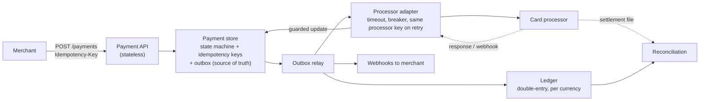
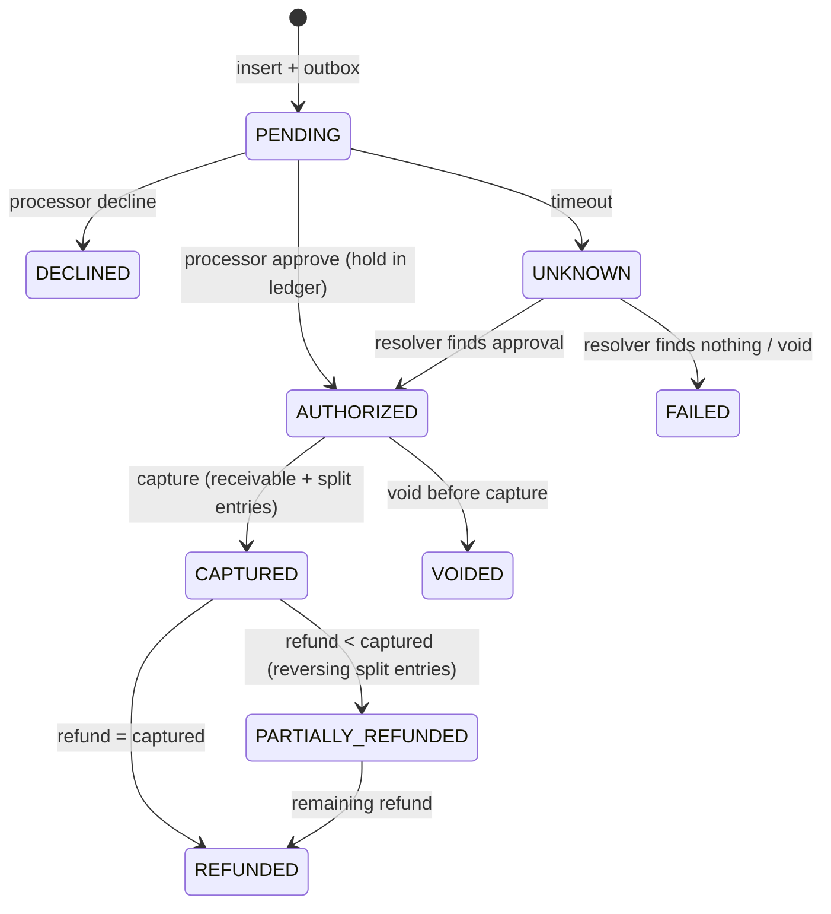
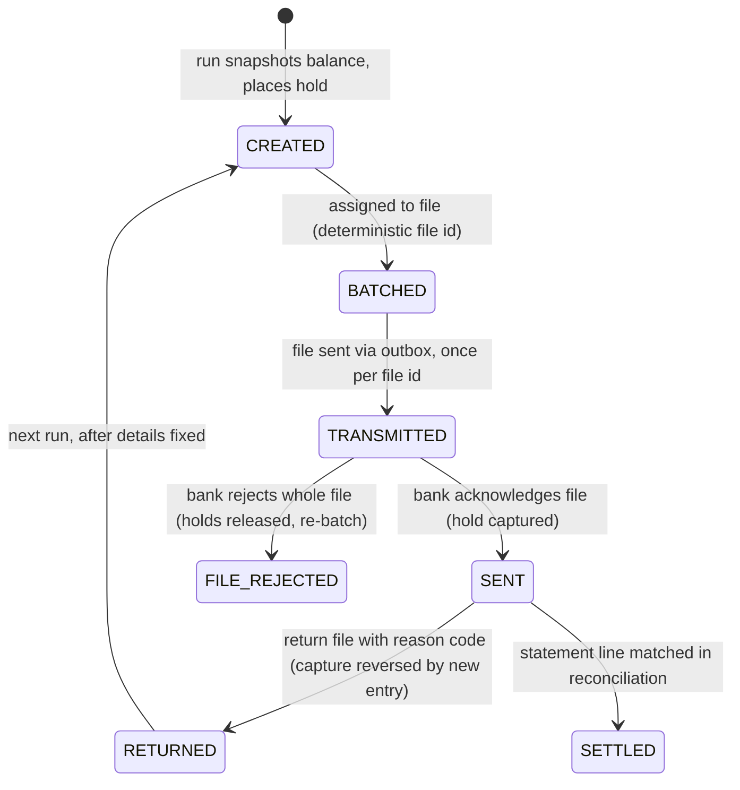

# Payments System Design: Interview Patterns

> Design a payment system in 45 minutes, with the questions interviewers actually ask.

**Type:** Learn
**Languages:** —
**Prerequisites:** Phase 12, Lesson 01 (Idempotent Payment API), Phase 12, Lesson 02 (Payment State Machine), Phase 10, Lesson 03 (Double-Entry Ledger), Phase 10, Lesson 08 (Reconciliation), Phase 14, Lesson 01 (Architecture of a High-Availability Payment Gateway)
**Time:** ~90 minutes

## Learning Objectives

- Run a 45-minute payments design interview to a fixed clock: five minutes of clarifying questions, ten of architecture, twenty-five of probes, five of wrap-up
- Ask the eight clarifying questions that change the design, and skip the ones that do not
- Draw the standard payments architecture from memory and know which box each of the five probes is aimed at
- Answer the five probes (idempotency, balance consistency, failure handling, reconciliation, scale) with a mechanism, an invariant, and a failure the mechanism prevents
- Recognise the six weak answers interviewers hear most, say why each is weak, and give the strong version
- Grade a design answer against a rubric that separates "knows the words" from "has run the system"

## The Problem

A strong backend engineer with eight years of experience interviews for a payments team. The prompt is "design a system that lets merchants charge customers' cards". She draws a load balancer, an API service, a database, a queue, and a worker that calls the card processor. The interviewer asks what happens if the worker crashes after the processor approves but before the database is updated. She says the queue will redeliver the message and the worker will retry. The interviewer asks whether the customer is charged twice. She pauses, then says the processor "probably" deduplicates. The interviewer asks how the processor would know the two requests are the same. Silence.

She knows the material. She has read about idempotency keys. But the interview format rewards something more specific than knowledge: the ability to name, under time pressure, the exact row, key, or message that makes a particular failure safe, and to volunteer it before being asked. Payments interviews differ from general system design interviews in that the interviewer is not evaluating whether the system scales; they are evaluating whether the candidate has internalised that every arrow in the diagram is a place money can be lost or duplicated, and whether they have a reflex for closing each one.

The reverse failure is as common. A candidate who has built a payment system recites idempotency, outbox, double-entry, and reconciliation in the first five minutes, before asking what the system is for. When the interviewer reveals it is an internal wallet with no external processor, half of the recited design is irrelevant and the candidate has spent the clarifying-question budget on a monologue. The format has a clock, and the clock is part of the test.

This lesson is the format, the clock, the probes, and the answers. It assumes the mechanisms from Phases 10 to 14 and shows how to present them in 45 minutes.

## The Concept

### The clock

| Minutes | Phase | What the interviewer is scoring |
|---------|-------|---------------------------------|
| 0 to 5 | Clarifying questions | Does the candidate know which questions change the design? |
| 5 to 15 | Core architecture | Can they draw the standard shape and name the source of truth? |
| 15 to 40 | The five probes | Mechanism, invariant, and failure prevented, for each |
| 40 to 45 | Wrap-up | Trade-offs stated as decisions, not hedges; what they would build first |

The candidate controls the first fifteen minutes and should move on at minute 15 even if the diagram is incomplete, because the probes are where the score is. An interviewer who has to drag a candidate out of the architecture phase at minute 25 has already decided.

### The eight clarifying questions

Not every question is worth asking. These eight each change the architecture; ask them in this order and write the answers on the board.

| Question | Why it changes the design |
|----------|---------------------------|
| Who moves the money: an external processor, a bank rail, or our own ledger? | Determines whether there is an external source of truth to reconcile against and an unknown-outcome problem |
| Is this card, bank transfer, or wallet-to-wallet? | Cards have authorization and capture; bank rails have returns days later; wallets are synchronous ledger transfers |
| Which operations: charge only, or refund, partial capture, dispute, payout? | Each is a state-machine branch and a ledger entry type |
| Volume: payments per second average and peak, and what is the largest single merchant's share? | Sizing, and whether a single hot merchant needs its own partition |
| Latency expectation: synchronous approval at checkout, or asynchronous with notification? | Decides whether the edge waits or returns `202` |
| Multi-currency? | Money type, FX, per-currency trial balance |
| Regulatory scope: PCI (do we touch PANs), sanctions screening, regional data residency? | Tokenization boundary, screening step in the state machine, region model |
| What is the cost of a duplicate charge versus a missed charge for this business? | Sets the bias when the outcome is unknown: void aggressively, or resolve by query first |

Questions that do not change the design and should not be asked: "should I use SQL or NoSQL" (decide it yourself from the answers above), "do we need authentication" (yes), "how many engineers are on the team".

### The standard architecture

The diagram the candidate should be able to draw in four minutes, with the source of truth marked.



Nine boxes. Each probe below is aimed at one or two of them, and a candidate who has drawn the diagram can point at the box while answering, which is worth more than it sounds: it shows the answer is located in the design rather than recited.

The one sentence to say while drawing: "The payment store is the only source of truth; the API holds nothing, the processor is told nothing until the store has a durable record, and everything downstream learns about changes through the outbox." That sentence pre-empts three of the five probes.

### The five probes

Each probe has a surface question, the deeper question behind it, and the shape of a strong answer: a mechanism, the invariant it maintains, and the failure it prevents.

**Probe 1: Idempotency.** Surface: "What if the merchant sends the same request twice?" Behind it: "Where does the key live, what is it compared against, and what happens to a concurrent duplicate?"

Strong answer: the key is a column with a unique index on the payments table, scoped to the merchant, inserted in the same transaction as the payment row. The request body's hash is stored with it. A duplicate after commit replays the stored response; a duplicate during the open transaction blocks on the index and then replays; a duplicate with a different body gets a conflict. The processor side has its own key, assigned at insert and reused on every retry. Invariant: one key, one payment, one processor authorization. Failure prevented: the retry storm during a processor slowdown creating two charges per order.

**Probe 2: Balance consistency.** Surface: "How do you make sure balances are right?" Behind it: "Is a balance a column you update or a fold over an immutable journal, and what do you do when two transfers race on one account?"

Strong answer: double-entry journal; every entry's postings sum to zero per currency; balances are derived (materialized with a checkpoint LSN for speed) and never written directly; a correction is a new reversing entry, never an update. For races: serialize per account with a row lock or a single-writer partition, check available balance (posted minus holds) inside that critical section, reject with a code if insufficient. Invariant: trial balance is zero at every instant and the sum of all customer balances equals the funding account. Failure prevented: the two concurrent withdrawals that both read balance 100, both subtract 80, and leave the account at 20 with 160 gone.

**Probe 3: Failure handling.** Surface: "What if the processor times out?" Behind it: "Do you know the difference between failed and unknown, and what does the system do with unknown?"

Strong answer: a timeout is not a decline. The payment moves to `UNKNOWN` by guarded update, keeping its processor key; a resolver queries the processor by that key on a schedule, and moves the payment to the processor's answer. If the processor has no query API, the adapter voids by key, which is itself idempotent. The timeout value is the processor's measured p99 plus margin; the breaker opens on a window of timeouts and routes to a secondary processor only for payments that have not yet been sent anywhere. Invariant: a payment is never in a terminal state the processor disagrees with. Failure prevented: declining a customer whose card was actually charged, who then pays again by another method.

**Probe 4: Reconciliation.** Surface: "How do you know the numbers are right at the end of the day?" Behind it: "Do you understand that the processor is a different company with different bugs, and that your ledger being internally consistent proves nothing about the money?"

Strong answer: daily (or continuous) three-way match between the payment store, the ledger, and the processor's settlement file, keyed on processor reference first, then on amount and date. Every unmatched item is a break with a type (in ledger not in file, in file not in ledger, amount mismatch) and an owner. Breaks age; aged breaks page. The reconciliation job is the only component allowed to say the system is correct, and it is the one that catches the case where both the payment store and the ledger were wrong together. Invariant: matched plus breaks equals both input sizes. Failure prevented: the duplicate-charge bug from Phase 14, Lesson 10 running for four days unnoticed, because the gateway's own ledger was clean.

**Probe 5: Scale.** Surface: "How does this handle Black Friday?" Behind it: "Do you size for the slow case, and do you know which component saturates first?"

Strong answer: start from the peak rate and the processor's p99, apply Little's law to get in-flight requests during a processor slowdown, size edge concurrency and connection pools for that number rather than the average. The payment store's write rate is payments times transitions; partition the outbox by payment id; keep the hot path to one transaction per transition. The first thing to saturate is usually the processor's rate limit, not anything you own, so the design needs load shedding at the edge with a priority order that never starves the relay or the resolver. Invariant: a slow dependency degrades one processor's traffic, not the gateway. Failure prevented: processor slowdown turning into edge thread exhaustion turning into total outage.

### The shape of a probe answer

Every strong probe answer has the same three parts, in this order, in under ninety seconds: the mechanism (a noun: a unique index, a guarded update, a resolver job), the invariant it maintains (a sentence that is true at every instant), and the failure it prevents (a concrete story with a number). Then stop and let the interviewer follow up. A fourth part, the trade-off, is offered only if asked or if it is the reason the mechanism was chosen over an obvious alternative.

A strong exchange on Probe 3:

```text
Interviewer: The processor call times out after two seconds. What does your system do?
Candidate:   The payment moves from PENDING to UNKNOWN with a guarded update; it keeps the
             processor key we assigned before the call. A resolver job queries the processor
             by that key every thirty seconds and moves the payment to whatever the processor
             says. The invariant is that no payment is ever terminal in our store while the
             processor disagrees. The failure this prevents is telling the merchant "declined"
             for a card that was charged, so the customer pays again by another method and we
             have a double charge and a chargeback.
Interviewer: And if the processor has no query endpoint?
Candidate:   Then the resolver sends a void with the same key. Void is idempotent at every
             processor I know of, so voiding something that never existed is a no-op, and
             voiding something that was approved releases it. We lose the sale; we never
             double charge. Given that you said duplicates cost more than delays, that is
             the right bias.
```

The same probe, answered weakly:

```text
Interviewer: The processor call times out after two seconds. What does your system do?
Candidate:   We retry. If the retry fails too, we return an error to the merchant and they
             can try again later.
Interviewer: Could the first call have succeeded?
Candidate:   Possibly, but the processor would probably dedupe the retry.
Interviewer: How?
Candidate:   ...by the amount and card, I think.
```

The weak answer has no mechanism the candidate controls, no invariant, and a failure story that it causes rather than prevents. The difference is not vocabulary; both candidates know the word "retry". The difference is that the strong candidate has a durable state for not knowing.

### Signals in the first ten minutes

Interviewers form a provisional score before the first probe. These are the observable behaviours that move it:

| Positive signal | Negative signal |
|-----------------|-----------------|
| Asks who moves the money before drawing anything | Draws a load balancer before asking anything |
| Writes "amounts: integer minor units + currency" on the board unprompted | Says "amount: decimal" or "float" anywhere |
| Marks one box as the source of truth | Has two databases with no statement of which one wins |
| Draws the processor call after a durable write | Draws the processor call inside the API request handler with no explanation |
| Names `UNKNOWN` as a state before being asked about timeouts | Has a state machine with only success and failure |
| Mentions reconciliation while drawing the ledger | Mentions reconciliation only when asked, or not at all |
| Moves on at minute 15 with "I'll come back to webhooks if we have time" | Is still drawing at minute 22 |

### The rubric

Interviewers at most companies score on four to six axes. This one is specific to payments and distinguishes three levels on each.

| Criterion | Developing | Solid | Exemplary |
|-----------|------------|-------|-----------|
| Clarifying questions | Asks generic questions or none | Asks who moves the money, the operations, and the volume | Asks the duplicate-versus-missed cost question and uses the answer later to decide the unknown-outcome policy |
| Architecture | Boxes with arrows, no source of truth named | Names the source of truth; processor called only after durable write | Draws the outbox and says in one sentence why the edge holds no state |
| Idempotency | "Use an idempotency key" | Key in the same transaction as the payment; body hash; replay versus conflict | Covers the concurrent duplicate, the processor-side key, and key scope per merchant |
| Money and balances | Balance is a column; floats somewhere | Integer minor units; double-entry; derived balances | Per-currency trial balance; holds versus posted; correction by reversal; names the race and the serialization unit |
| Failure handling | Timeout equals decline, or "retry" | Distinguishes failed from unknown; resolver by processor key | Timeout derived from p99; breaker only for unsent payments; void as the fallback when query is unavailable |
| Reconciliation | Not mentioned, or "we have logs" | Daily match against settlement file; break types | Three-way match; break ageing and ownership; says the ledger being balanced proves nothing about the money |
| Scale | Adds caches and shards | Peak rate, Little's law, sizes for slow case | Identifies the processor's rate limit as the first bottleneck; degradation ladder that never starves convergence paths |
| Communication | Monologue; cannot be redirected | Moves on at minute 15; answers the probe asked | States trade-offs as decisions with the reason; says what they would build first and what they would skip for v1 |

A candidate who is Solid across the board is a hire for a senior payments role at most companies. Exemplary on failure handling and reconciliation, in particular, is what distinguishes someone who has operated a payment system from someone who has read about one.

### What this format does not measure

It does not measure coding, and a candidate who starts writing code is losing time. It does not measure knowledge of a specific processor's API; naming Stripe's `Idempotency-Key` header is a nice touch, not a requirement. It does not measure regulatory depth beyond knowing that PANs must not touch the payment store and that some flows need screening. And it does not reward a perfect diagram: an interviewer who sees a flawless architecture with no engagement on the probes learns nothing and scores accordingly.

## Worked Example

Three prompts, each with the clarifying answers an interviewer would give, a model answer compressed to its load-bearing sentences, and the probe where candidates most often lose the room.

### Prompt 1: "Design the payment API for a marketplace"

Clarifying answers: cards via an external processor; charge, refund, and split payout to sellers; 300 payments per second peak; synchronous approval expected at checkout; USD and EUR; we never see PANs (processor tokenizes); a duplicate charge is far worse than a delayed one.

Model answer, minutes 5 to 15: the standard architecture. Payment store with `(merchant_id, idempotency_key)` unique, state machine `PENDING -> AUTHORIZED -> CAPTURED -> (PARTIALLY_)REFUNDED`, plus `DECLINED`, `FAILED`, `UNKNOWN`. Outbox relay drives the processor adapter and the ledger. Synchronous approval is an edge-side wait of up to 8 seconds on the payment's state, falling back to `202`. Splits are computed at capture with the largest-remainder allocation (Phase 10, Lesson 01) so seller shares plus platform fee equal the capture exactly; they are ledger entries, not processor calls, and payouts run later from the ledger's seller balances.

The state machine the candidate should draw for this prompt, with the transitions that carry money marked:



A minute-by-minute script for the first fifteen minutes of this prompt:

| Minute | Say or draw |
|--------|-------------|
| 0 to 4 | The eight questions, answers written on the board; repeat back "cards via processor, charge/refund/split, 300 per second peak, sync approval, USD and EUR, tokenized, duplicates worse than delays" |
| 4 to 5 | "Amounts are integer minor units with a currency. The payment store is the source of truth." |
| 5 to 8 | Draw API, payment store, outbox, relay, adapter, processor. Say the one sentence about the edge holding nothing and the processor being called only after commit. |
| 8 to 10 | Draw the state machine above. Point at `UNKNOWN`. |
| 10 to 12 | Draw the ledger and the split allocation at capture; say "largest remainder, so the parts sum to the capture". |
| 12 to 14 | Draw webhooks and reconciliation against the settlement file. |
| 14 to 15 | "Open items I would cover if time allows: multi-currency clearing, disputes, payout schedule. Which would you like to probe?" |

Where candidates lose the room: Probe 2, when asked how a refund of 30.00 on a 100.00 payment that was split 85/15 affects the seller's balance. Strong answer: the refund is a new entry that reverses the split proportionally with the same allocation rule (25.50 from the seller, 4.50 from the platform), posted against the seller's balance even if that drives it negative; a negative seller balance is netted from the next payout, and the payout job refuses to pay out while it is negative. Weak answer: "we deduct it from the seller". The interviewer wants the rounding rule, the ledger entry, and the negative-balance policy.

Wrap-up: build first the payment store with the state machine and idempotency, then the adapter with `UNKNOWN` handling, then the ledger, then splits; defer multi-currency to v2 but store currency on every amount from day one.

### Prompt 2: "Design a peer-to-peer wallet"

Clarifying answers: internal ledger only; funding by bank transfer (ACH, with returns up to 60 days); operations are top-up, send, withdraw; 2,000 transfers per second peak with one viral event that could triple it; transfers must be instant; USD only; sanctions screening on withdrawals; no external processor for the send path.

Model answer: there is no `UNKNOWN` state on the send path because there is no external party; the hard problems move to balance consistency and the ACH return. Double-entry ledger with one liability account per user and an asset account per bank; a send is one entry with two postings, executed in one transaction that locks both accounts in a fixed order (lower id first) to avoid deadlock. Available balance equals posted minus holds; a top-up by ACH credits the user but places a hold for the return window on a risk-scored fraction, released on a schedule. Withdrawals pass sanctions screening synchronously and are written as holds, then captured when the bank file is acknowledged. Idempotency on the client key as always.

Numbers the candidate should produce for this prompt when Probe 5 arrives, derived rather than guessed:

| Quantity | Value | Derivation |
|----------|-------|------------|
| Peak sends per second | 2,000 normal, 6,000 during the viral event | given |
| Ledger write transactions per second | 6,000 | one entry per send, one transaction each |
| Rows locked per transaction | 2 | sender and receiver, fixed order |
| In-flight sends at 6,000 per second with 15 ms transaction residence | 90 | Little's law; small, because there is no external call |
| Hot account threshold | roughly 1,000 writes per second on one row | single-row lock serialization on a typical relational primary |
| ACH top-ups per day | 1.2 million | given volume times a stated ratio; confirm with the interviewer |
| Returns to process per day at a 0.5% return rate | 6,000 | each a reversing entry and a possible negative balance |

Where candidates lose the room: Probe 3, when asked what happens when a 500.00 ACH top-up is returned on day 4 after the user has already sent 450.00 to a friend. Strong answer: the return is a new entry debiting the user and crediting the bank asset account, taking the user to -450.00 (or to the extent the hold did not cover it); the friend's money is not clawed back because the ledger does not reverse completed transfers between users; the negative balance is a receivable, collected from future top-ups or sent to collections, and the risk hold policy is tuned so this is rare. Weak answer: "we reverse the send". The interviewer wants to hear that completed transfers are final and that the loss is a credit decision the system models explicitly.

Where candidates also lose the room: Probe 5, when asked how the fixed-order two-account lock behaves when a celebrity receives 10,000 sends per second. Strong answer: that account is a hot row; move it to a single-writer partition with a queue and batch its credits, or use the sharded-counter pattern from Phase 9 for inbound credits only, since credits never fail the available-balance check. Weak answer: "add read replicas", which does not help a write hotspot.

### Prompt 3: "Design a payout system for a gig platform"

Clarifying answers: pay 400,000 workers weekly by bank transfer across US (ACH) and EU (SEPA); worker balances come from an existing ledger; a payout must never be sent twice; files go to two banks; banks return rejections asynchronously; late and missed payouts cost trust more than money.

Model answer: a batch pipeline, not a request path. A payout run has an id and a window; it snapshots each worker's balance at a ledger LSN, places a hold for the payout amount, creates one `payout` row per worker in state `CREATED`, groups them into files per bank with a deterministic file id derived from the run id, and writes the file through an outbox so it is transmitted exactly once per file id. Acknowledgement moves payouts to `SENT`; the hold is captured as a transfer from the worker liability to the bank asset account. A rejection file days later moves a payout to `RETURNED` with a reason code, reverses the capture by a new entry, and re-queues it for the next run after the worker fixes their details. Idempotency is at three levels: the run id (a re-run of the same window produces the same payouts), the file id (the bank rejects a duplicate file name), and the per-payout end-to-end reference carried into the bank file.

The payout state machine, which is the thing to draw for this prompt instead of the standard card diagram:



Where candidates lose the room: Probe 4. Asked how they know Friday's run was correct, weak candidates say the job logged success. Strong answer: three totals must agree: the sum of payout rows in state `SENT` for the run, the sum of the file control totals the bank acknowledged, and the net change in the bank asset account in the ledger between the run's start and end LSNs; plus, by the next week, the bank statement's debits reconciled against the per-payout references, with every return matched to a `RETURNED` row. Any difference is a break with an owner before the next run is allowed to start.

Wrap-up: build the run and hold mechanism first because it is where double payment comes from, then one bank's file format end to end including returns, then the second bank, then the reconciliation report; do not start with the scheduler.

### Running the interview from the other side

Most readers of this lesson will also conduct these interviews. The interviewer's job is to get the candidate to the probes with enough design on the board to point at, and then to probe one level deeper than the candidate's first answer, every time.

1. Give the prompt in one sentence and say nothing else for sixty seconds. A candidate who starts drawing has told you something.
2. Answer clarifying questions with the prepared answers; do not volunteer the ones they did not ask. Note which of the eight they skipped.
3. At minute 15, if they are still drawing, say "let's pause there; I want to ask about a few scenarios" and start Probe 1. This is not rude; it is the format.
4. Ask the probes in the order idempotency, failure handling, balance consistency, reconciliation, scale. The first two are where most candidates separate; if both are weak, spend the remaining time on balance consistency and skip scale, because scale answers are the easiest to rehearse and tell you the least.
5. After every answer, ask one of: "where does that live?", "what if that fails?", or "how would you know?" until the candidate either reaches a mechanism they own or says "I don't know". Both are useful; the second, said promptly, is a positive signal about how they will behave in an incident.
6. Never ask trivia (ISO 8583 field numbers, a specific processor's error codes). Ask for the mechanism and accept any correct one.
7. In the last five minutes ask "what would you build first and what would you cut from v1?" A candidate who cuts reconciliation from v1 has told you they have not run one of these.
8. Score on the rubric within ten minutes of the end, criterion by criterion, before talking to anyone else on the panel.

### The six weak answers

| What candidates say | Why it is weak | The strong version |
|---------------------|----------------|--------------------|
| "The queue guarantees exactly-once delivery" | No queue does; delivery is at-least-once and exactly-once is a property of the consumer's idempotent write | "The queue is at-least-once; the consumer dedupes on the outbox id with a unique index, so the effect is once" |
| "We'll retry until it succeeds" | A retry without the same key is a duplicate; a retry without a cap is a storm; a retry of an unknown outcome without a query is a coin flip | "Retry with the same processor key, capped, with backoff; after the cap, mark unknown and resolve by query" |
| "If the processor times out we return an error" | An error to the merchant for a charge that may have succeeded is the double-charge path | "A timeout is unknown, not failed; the payment stays non-terminal until we know" |
| "We store the balance in the users table and update it in a transaction" | A balance column has no history, cannot answer point-in-time questions, and makes every correction a mutation | "Balances are a fold over an immutable journal; the column, if any, is a cache with a checkpoint LSN" |
| "We use a distributed transaction across the payment service and the ledger service" | Two-phase commit across services is slow, fragile, and still leaves the in-doubt window; nobody runs it for this | "The payment store is the truth; the ledger is downstream via the outbox and is eventually consistent; reconciliation proves they agree" |
| "Reconciliation: we compare our database with the processor's dashboard if there's a complaint" | Reactive, manual, and it accepts that the system is wrong until a customer notices | "A daily three-way match with typed breaks that age and page; the system is not correct until the match is clean" |

## Exercises

1. **Reinforce.** Take the standard architecture diagram and, for each of the five probes, write on it the exact box and the exact mechanism (one phrase) that answers the probe. Then cover the labels and redraw it from memory in four minutes.
2. **Apply.** Run Prompt 2 as a mock interview with a colleague playing the interviewer, with the clock enforced. Have them ask the ACH-return probe at minute 22 regardless of where you are. Afterwards, grade yourself on the rubric and write down the one sentence you wish you had said earlier.
3. **Extend.** Write a fourth prompt: "design the refund and dispute flow for Prompt 1's marketplace", combining Phase 12, Lesson 06 (Refunds) and Phase 12, Lesson 07 (Disputes and Chargebacks). Include the clarifying answers, the model answer in at most twelve sentences, the probe where candidates lose the room, and the strong and weak versions of that probe's answer.

## Key Terms

| Term | What people say | What it actually means |
|------|-----------------|------------------------|
| Probe | "follow-up question" | A question aimed at one box of the design whose purpose is to find out whether the candidate knows the mechanism, the invariant, and the failure it prevents |
| Source of truth | "the main database" | The one store whose record of a payment is authoritative; naming it in the first ten minutes pre-empts three of the five probes |
| Unknown outcome | "timeout" | A durable non-terminal state for a payment whose external result is not known; the strongest single signal that a candidate has operated a payment system |
| Three-way match | "reconciliation" | Comparing the payment store, the ledger, and the external party's statement, keyed on external reference then amount and date, with typed breaks |
| Hot account | "scaling problem" | A single ledger account receiving a write rate that exceeds one row's serialization capacity; solved by single-writer partitioning or sharded credits, not by read replicas |
| Degradation ladder | "load shedding" | A pre-decided order in which request classes are refused under overload, which never includes the paths that converge in-flight money |
| Rubric | "the scorecard" | A per-criterion scale that distinguishes knowing the vocabulary from having run the system; the interviewer's actual instrument |

## Further Reading

- [Stripe API documentation, "Idempotent requests"](https://docs.stripe.com/api/idempotent_requests) — the most-cited production idempotency contract; be able to describe its key scope, retention, and mismatch behaviour from memory.
- [Stripe Engineering, "Ledger: Stripe's system for tracking and validating money movement"](https://stripe.com/blog/ledger-stripe-system-for-tracking-and-validating-money-movement) — a public description of a production ledger with reconciliation as a first-class component; the source for Probe 4's three-way match.
- [Pat Helland, "Life beyond Distributed Transactions: an Apostate's Opinion" (CIDR 2007)](https://www.cidrdb.org/cidr2007/papers/cidr07p15.pdf) — why the strong answer to the fifth weak answer is "no distributed transactions"; entities, idempotent messages, and the outbox before it had the name.
- [Nacha Operating Rules, "ACH Return Reason Codes" overview](https://www.nacha.org/rules) — the return window and reason codes behind Prompt 2's ACH-return probe; know that R01 and R10 exist and that returns can arrive up to 60 days later.
- [Google SRE Workbook, Chapter "Managing Load"](https://sre.google/workbook/managing-load/) — load shedding and priority, the basis for the degradation ladder in Probe 5.
- [Martin Kleppmann, "Designing Data-Intensive Applications" (O'Reilly, 2017), Chapter 12, "The Future of Data Systems"](https://dataintensive.net/) — the clearest written argument that end-to-end correctness comes from idempotent operations plus an immutable log plus checking, which is the thesis of every strong payments interview answer.
