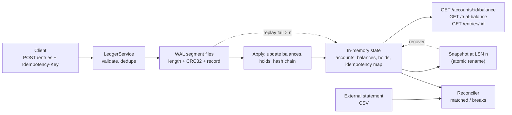

# Capstone: A Durable Double-Entry Ledger Service

> WAL, snapshots, multi-currency, reconciliation, and an API.

**Type:** Capstone
**Languages:** Java, Python, or Go (pick one; the spec is language-neutral)
**Prerequisites:** Phase 10 (all lessons), Phase 7 Lesson 02 (Write-Ahead Logs), Phase 5 Lesson 09 (Idempotency Keys), Phase 12 Lesson 13 (API Design for Money), Phase 13 Lesson 11 (Auditability)
**Time:** ~480 minutes

## Learning Objectives

- Compose the Phase 10 ledger mechanisms (money type, postings, balances, holds, reversals, multi-currency) into one service with a single durable source of truth
- Make the ledger survive a kill at any instruction boundary by writing every entry through a checksummed write-ahead log and recovering from snapshot plus log tail
- Expose the ledger through an idempotent API whose every response is reproducible from the log alone
- Prove the three ledger invariants (every entry balances per currency, no posting is ever mutated, trial balance is zero) with tests you can run after every milestone
- Reconcile the ledger against an external statement and produce a break report an auditor could act on

## The Problem

A lending startup keeps customer balances in a `wallets` table with a `balance_cents` column. Transfers are two `UPDATE` statements inside a database transaction. For two years this is fine. Then three things happen in one quarter.

First, a deploy adds a fee: the transfer now runs three `UPDATE`s, and a bug in the retry wrapper re-runs only the third when the connection drops. Fees are collected twice on 0.3% of transfers. Nobody notices for six weeks because the `wallets` table has no history: a balance is a number, and a number cannot tell you how it got there. Second, finance asks for the balance of every wallet as of 23:59:59 on the last day of the quarter. The answer requires replaying an `events` table that was added later, was never checked against `wallets`, and disagrees with it by 41,207.18 USD. Third, the company launches in Mexico. Someone adds MXN wallets, and a currency-blind `SUM(balance_cents)` in the treasury dashboard reports total customer funds as a single number that is neither dollars nor pesos.

Every one of those failures is a missing invariant. The fee double-charge is a missing idempotency guarantee and a missing per-entry balance check: a journal entry that debits a customer twice while crediting fee revenue once does not sum to zero and should have been rejected. The point-in-time balance question is a missing immutable journal: a balance must be a fold over postings, not a column, and the fold must be replayable to any point. The MXN disaster is a missing currency on the amount type.

The Phase 10 lessons built each of these mechanisms in isolation: `phases/10-money-and-ledgers/01-representing-money` gave you a `Money` type that refuses to mix currencies, `phases/10-money-and-ledgers/03-double-entry-ledger` gave you entries that must balance, `phases/10-money-and-ledgers/05-balances-and-snapshots` gave you balances as folds with checkpoints, `phases/10-money-and-ledgers/06-immutability-and-reversals` taught you to correct by appending, and `phases/10-money-and-ledgers/07-holds-and-available-balance` separated what is posted from what is spendable. `phases/07-storage-and-transactions/02-write-ahead-logs` taught you how to make any of this survive a crash. This capstone is where you put them in one process and prove they still hold under concurrency, crashes, and an auditor's questions.

## What You Will Build

A single-process ledger service with a durable journal, in-memory balances derived from that journal, and an API. It does not need a network listener to pass the acceptance tests (an in-process `LedgerService` object with request and response types is enough), but Milestone 4 describes the HTTP shape so you can add `com.sun.net.httpserver`, `http.server`, or `net/http` if you want a demo.



The components, each traceable to a lesson you have already built:

| Component | Composes | What it owns |
|-----------|----------|--------------|
| `Money`, `Currency` | `phases/10-money-and-ledgers/01-representing-money` | integer minor units, ISO 4217 exponent, rounding modes, allocation |
| `Account`, `AccountType` | `phases/10-money-and-ledgers/04-chart-of-accounts` | asset, liability, equity, revenue, expense; normal balance side |
| `Posting`, `JournalEntry` | `phases/10-money-and-ledgers/03-double-entry-ledger` | debits equal credits per currency; entry id; effective time |
| `Wal`, `WalRecord` | `phases/07-storage-and-transactions/02-write-ahead-logs` | append, CRC, fsync, torn-tail truncation, segment rotation |
| `Snapshot` | `phases/10-money-and-ledgers/05-balances-and-snapshots` | balances at an LSN, written atomically |
| `Hold` | `phases/10-money-and-ledgers/07-holds-and-available-balance` | reserve, capture, release; available = posted minus active holds |
| `Reversal` | `phases/10-money-and-ledgers/06-immutability-and-reversals` | a new entry that references and negates an old one |
| `IdempotencyStore` | `phases/05-distributed-foundations/09-idempotency-keys` | key to (request hash, response), persisted through the WAL |
| `FxClearing` | `phases/10-money-and-ledgers/09-multi-currency-ledgers` | two balanced entries through a clearing account per currency pair |
| `Reconciler` | `phases/10-money-and-ledgers/08-reconciliation` | match ledger postings to statement lines; classify breaks |
| `HashChain` | `phases/13-risk-fraud-and-compliance/11-auditability-and-evidence` | SHA-256 over (previous hash, entry bytes); verifiable export |

The whole thing is standard library only: `java.nio.channels.FileChannel`, `java.util.zip.CRC32`, `java.security.MessageDigest`; Python `os`, `zlib`, `hashlib`, `struct`, `threading`; Go `os`, `hash/crc32`, `crypto/sha256`, `encoding/binary`, `sync`.

### One entry, end to end

Trace a single request through the design before you write any code. A client posts a deposit of 100.00 USD into a customer wallet with a 2.90 fee:

```json
{
  "idempotencyKey": "dep-7f3a",
  "effectiveAt": "2026-03-01T10:15:00Z",
  "postings": [
    {"account": "CASH",              "side": "DEBIT",  "amount": {"minor": 10000, "currency": "USD"}},
    {"account": "CUSTOMER_DEPOSITS", "side": "CREDIT", "amount": {"minor": 9710,  "currency": "USD"}},
    {"account": "FEE_REVENUE",       "side": "CREDIT", "amount": {"minor": 290,   "currency": "USD"}}
  ]
}
```

Validation: all three accounts exist and are USD; debits per currency are 10000, credits are 9710 + 290 = 10000; balanced. The service assigns `entryId = e-000041`, `lsn = 41`, computes `hash = SHA-256(prevHash || canonicalBytes)`, and builds the WAL record:

| Offset | Bytes | Field | Value for this entry |
|--------|-------|-------|----------------------|
| 0 | 4 | payload length, big-endian | `0x00000127` (295) |
| 4 | 4 | CRC32 of payload | computed over bytes 8..302 |
| 8 | 1 | record type | `0x01` = ENTRY |
| 9 | 8 | LSN | 41 |
| 17 | 32 | prevHash | head before this record |
| 49 | 32 | hash | head after this record |
| 81 | 32 | sha256(requestBody) | for idempotency conflict checks |
| 113 | var | canonical entry bytes | key, effectiveAt, postings in given order |

Only after `fsync` returns does the service apply the postings to memory: `CASH` debit-normal balance goes from 0 to 10000, `CUSTOMER_DEPOSITS` credit-normal from 0 to 9710, `FEE_REVENUE` from 0 to 290. Trial balance per currency is `10000 - (9710 + 290) = 0`. The response is `{"entryId": "e-000041", "lsn": 41}`. If the process dies between `fsync` and the in-memory apply, recovery replays record 41 and reaches the same state; if it dies before `fsync`, the client never got an acknowledgement and the torn record is truncated. Every milestone below is one more guarantee layered onto this trace.

## Requirements

Each requirement is a sentence you can turn into a test. The milestone that first satisfies it is in brackets.

1. Every amount in the system is a `Money` value: a signed 64-bit integer count of minor units plus a currency with an ISO 4217 exponent. No `double`, `float`, or `float64` appears in any type that holds an amount. [M1]
2. A `JournalEntry` has at least two postings, and for each currency present the sum of debit postings equals the sum of credit postings. An unbalanced entry is rejected before anything is written. [M1]
3. Every account has an `AccountType` with a normal balance side. The service exposes a signed balance where a debit-normal account (asset, expense) reports debits minus credits and a credit-normal account (liability, equity, revenue) reports credits minus debits. [M1]
4. The trial balance, defined as the sum of all debit-normal balances minus the sum of all credit-normal balances per currency, is zero after every accepted entry. [M1]
5. Every accepted entry is appended to a write-ahead log as `length (4 bytes) | crc32 (4 bytes) | payload` and flushed (`force(true)`, `os.fsync`, `File.Sync`) before the service acknowledges it. [M2]
6. On startup the service reads the WAL, verifies every CRC, stops at the first corrupt or truncated record, truncates the file to the last good record, and rebuilds state from the surviving records. State after recovery equals state before the crash for every acknowledged entry. [M2]
7. The service can write a snapshot of all balances, holds, hash-chain head, and idempotency map at a given log sequence number, using write-to-temp-then-atomic-rename. Recovery loads the newest valid snapshot and replays only records with LSN greater than the snapshot's. [M3]
8. Recovery time from a snapshot plus a 1,000-record tail is under one second on a laptop, measured by a test. [M3]
9. `postEntry` takes an idempotency key. Two calls with the same key and byte-identical request body return the same `entryId` and post once. The same key with a different body is rejected with a conflict error. The idempotency map survives restart because it is rebuilt from the WAL. [M4]
10. Every API error is one of a closed set of codes (`UNBALANCED`, `CURRENCY_MISMATCH`, `UNKNOWN_ACCOUNT`, `INSUFFICIENT_AVAILABLE`, `IDEMPOTENCY_CONFLICT`, `ENTRY_NOT_FOUND`, `HOLD_NOT_FOUND`, `ALREADY_REVERSED`) with a machine-readable field, and no error leaks a stack trace or an internal file path. [M4]
11. A hold reserves an amount against an account without posting it. `available = posted - sum(active holds)`. A capture converts a hold (or part of one) into a posted entry and releases the remainder; a release removes it. An entry that would take `available` below zero on an account flagged `noOverdraft` is rejected. [M5]
12. No posting is ever updated or deleted. A reversal is a new entry whose postings are the exact negation of the original, carrying `reverses: <originalEntryId>`. Reversing an already-reversed entry is rejected. [M6]
13. Balances are tracked per currency per account. A conversion between currencies is two entries: one debiting the source account and crediting `FX_CLEARING:<SRC>`, one debiting `FX_CLEARING:<DST>` and crediting the destination account, with the rate, rounding mode, and resulting remainder recorded on both entries. The trial balance is zero in each currency independently. [M7]
14. Every entry's hash is `SHA-256(previousHash || canonicalBytes(entry))`. `GET /audit/head` returns the current head, and `verifyChain()` recomputes from genesis and reports the first mismatch, if any. [M8]
15. `reconcile(statement)` matches statement lines to ledger postings on an external account by (external reference) first, then by (amount, date within tolerance), and classifies the leftovers as `IN_LEDGER_NOT_STATEMENT`, `IN_STATEMENT_NOT_LEDGER`, or `AMOUNT_MISMATCH`. The report totals reconcile: matched plus breaks equals both input sizes. [M8]
16. Under 8 concurrent writers posting 1,000 transfers each across 10 accounts, the final trial balance is zero, the sum of all account balances equals the initial funding, and the WAL contains exactly 8,000 entry records. [M9]

## Milestones

Work the milestones in order. Each one ends with a test you run before moving on. Name the tests as shown so your test output reads as a checklist. Commands assume the layout `capstone/ledger/{java,python,go}`; adapt to yours.

```bash
# Java
cd capstone/ledger/java && javac -d .out *.java && java -cp .out LedgerTest
# Python
cd capstone/ledger/python && python3 -m unittest -v
# Go
cd capstone/ledger/go && go test -race ./...
```

### Milestone 1: Balanced entries in memory

Copy `Money` and `Currency` from `phases/10-money-and-ledgers/01-representing-money` into the project. Add `AccountType` with a `normalSide` of `DEBIT` or `CREDIT`, `Account(id, type, currency, noOverdraft)`, `Posting(accountId, side, money)`, and `JournalEntry(id, effectiveAt, postings, metadata)`. Implement `Ledger.post(entry)` that validates and applies in memory only, `Ledger.balance(accountId)`, and `Ledger.trialBalance()` returning a map from currency to signed total.

Validation order matters and is testable: unknown account first, then currency mismatch between posting and account, then balance per currency. Return the first failure; do not partially apply.

Acceptance test `m1_balanced_entry_posts_and_trial_balance_is_zero`:

1. Create `CASH` (asset, USD), `CUSTOMER_DEPOSITS` (liability, USD), `FEE_REVENUE` (revenue, USD).
2. Post an entry: debit `CASH` 100.00, credit `CUSTOMER_DEPOSITS` 97.10, credit `FEE_REVENUE` 2.90.
3. Assert `balance(CASH) == 100.00`, `balance(CUSTOMER_DEPOSITS) == 97.10`, `balance(FEE_REVENUE) == 2.90`, `trialBalance()[USD] == 0`.
4. Post an entry that debits `CASH` 10.00 and credits `FEE_REVENUE` 9.99. Assert it is rejected with `UNBALANCED` and that no balance changed.
5. Post an entry that credits `CASH` 10.00 EUR. Assert `CURRENCY_MISMATCH`.

The Java shape, using the same `check(name, condition)` harness as every Build lesson:

```java
static void m1_balanced_entry_posts_and_trial_balance_is_zero() {
    Ledger ledger = Ledger.inMemory();
    ledger.openAccount("CASH", AccountType.ASSET, Currency.USD, false);
    ledger.openAccount("CUSTOMER_DEPOSITS", AccountType.LIABILITY, Currency.USD, true);
    ledger.openAccount("FEE_REVENUE", AccountType.REVENUE, Currency.USD, false);
    ledger.post(entry("dep-1",
        debit("CASH", usd(10000)), credit("CUSTOMER_DEPOSITS", usd(9710)), credit("FEE_REVENUE", usd(290))));
    check("cash balance", ledger.balance("CASH").equals(usd(10000)));
    check("trial balance zero", ledger.trialBalance().get(Currency.USD) == 0L);
    LedgerError e = expectError(() -> ledger.post(entry("bad-1", debit("CASH", usd(1000)), credit("FEE_REVENUE", usd(999)))));
    check("unbalanced rejected", e.code() == ErrorCode.UNBALANCED);
    check("nothing applied", ledger.balance("CASH").equals(usd(10000)));
}
```

### Milestone 2: The write-ahead log

Implement `Wal` with `append(bytes) -> lsn`, `readAll() -> records`, and `recoverTruncatingTail()`. Record format: 4-byte big-endian length, 4-byte CRC32 of the payload, payload. Encode a `JournalEntry` as canonical bytes (sorted keys if you use JSON; fixed field order if you use a hand-rolled binary format from `phases/03-systems-data-structures/15-serialization-formats`). `Ledger.post` now appends and flushes before applying in memory; if validation fails, nothing is written.

Acceptance test `m2_crash_after_fsync_loses_nothing_and_torn_tail_is_truncated`:

1. Post 50 entries. Close the ledger. Open a new `Ledger` on the same directory. Assert all 50 balances match and `trialBalance()` is zero.
2. Open the WAL file directly and append 7 random bytes (a torn write). Open a new `Ledger`. Assert recovery succeeds, the file length is back to the length after the 50th record, and balances match.
3. Flip one byte inside record 30's payload. Assert recovery stops at record 29 and the service reports `recoveredLsn == 29` rather than silently applying record 30.

Step 3 is a design decision: a corrupt record in the middle is not a torn tail and a real system would refuse to start. For this capstone, stopping at the last good record and surfacing the LSN is acceptable; document which you chose.

In Python the torn-tail step is a few lines because the test can open the file the service wrote:

```python
def test_m2_torn_tail_is_truncated(self):
    ledger = Ledger.open(self.dir)
    for i in range(50):
        ledger.post(deposit(f"k{i}", usd(10_000)))
    good_length = os.path.getsize(self.dir / "wal-000001.log")
    ledger.close()
    with open(self.dir / "wal-000001.log", "ab") as f:
        f.write(b"\x00\x00\x00\x2a\xde\xad\xbe")   # length prefix with no payload
    recovered = Ledger.open(self.dir)
    self.assertEqual(os.path.getsize(self.dir / "wal-000001.log"), good_length)
    self.assertEqual(recovered.balance("CASH"), usd(500_000))
    self.assertEqual(recovered.trial_balance()[USD], 0)
```

### Milestone 3: Snapshots and bounded recovery

Implement `Ledger.snapshot()` that writes `snapshot-<lsn>.bin` to a temp name and renames it, containing every account balance per currency, every active hold, the hash head (added in M8; leave a placeholder), and the idempotency map (M4). On open, load the newest snapshot whose checksum verifies, then replay WAL records with `lsn > snapshot.lsn`. Add `Wal.truncateBefore(lsn)` or segment rotation so old records can be dropped once a snapshot covers them.

Acceptance test `m3_snapshot_plus_tail_equals_full_replay`:

1. Post 2,000 entries. Snapshot at LSN 1,000. Post 1,000 more.
2. Open ledger A with snapshots enabled and ledger B with snapshots ignored (full replay). Assert identical balances and trial balance for every account.
3. Delete WAL records up to 1,000 (rotate segments). Open again. Assert balances still match.
4. Time the open with snapshot plus 1,000-record tail. Assert it is under 1,000 ms.

### Milestone 4: Idempotent API

Add `PostEntryRequest(idempotencyKey, postings, metadata)` and `PostEntryResponse(entryId, lsn, balances)`. The `IdempotencyStore` maps key to `(sha256(requestBody), response)`. The store is not a side table: the key and request hash are fields of the WAL record, so recovery rebuilds it. If you add HTTP, the shape is `POST /entries` with header `Idempotency-Key`, returning `201` on first post, `200` with the identical body on replay, and `409` with code `IDEMPOTENCY_CONFLICT` on mismatch, following `phases/12-payment-systems-design/01-idempotent-payment-api` and `phases/12-payment-systems-design/13-api-design-for-money`.

The API surface, whether in-process or HTTP:

| Operation | HTTP shape | Success | Errors |
|-----------|------------|---------|--------|
| Post entry | `POST /entries` + `Idempotency-Key` | `201` first time, `200` replay | `UNBALANCED`, `CURRENCY_MISMATCH`, `UNKNOWN_ACCOUNT`, `INSUFFICIENT_AVAILABLE`, `IDEMPOTENCY_CONFLICT` |
| Read entry | `GET /entries/{id}` | `200` with postings, hash, `reverses` | `ENTRY_NOT_FOUND` |
| Balance | `GET /accounts/{id}/balance` | posted and available per currency | `UNKNOWN_ACCOUNT` |
| Trial balance | `GET /trial-balance` | map currency to signed total (all zero) | none |
| Place hold | `POST /holds` + `Idempotency-Key` | `201` with `holdId` | `INSUFFICIENT_AVAILABLE`, `UNKNOWN_ACCOUNT` |
| Capture / release | `POST /holds/{id}/capture`, `POST /holds/{id}/release` | `200` with resulting entry | `HOLD_NOT_FOUND` |
| Reverse | `POST /entries/{id}/reverse` | `201` with reversal entry | `ENTRY_NOT_FOUND`, `ALREADY_REVERSED` |
| Audit head | `GET /audit/head` | `{lsn, hash}` | none |

Acceptance test `m4_same_key_same_body_posts_once_and_survives_restart`:

1. Post with key `k1`. Post again with `k1` and the same body. Assert the same `entryId`, that `CASH` moved once, and that the WAL has one entry record.
2. Post with `k1` and a different amount. Assert `IDEMPOTENCY_CONFLICT`.
3. Restart. Post `k1` with the original body. Assert the original `entryId` comes back without a new WAL record.
4. Assert every error response has a `code` from the closed set and no field containing a file path or stack trace.

### Milestone 5: Holds and available balance

Add `placeHold(accountId, money, reference) -> holdId`, `captureHold(holdId, money?)`, `releaseHold(holdId)`, and `availableBalance(accountId)`. Holds are WAL records too (`HOLD_PLACED`, `HOLD_CAPTURED`, `HOLD_RELEASED`), so they survive restart. A capture writes one `HOLD_CAPTURED` record and one `ENTRY` record atomically from the service's point of view: either both are in the log or neither is (write them as one WAL record containing both, or write the entry record with a `capturesHold` field).

Acceptance test `m5_available_tracks_holds_and_overdraft_is_refused`:

1. Fund `WALLET_A` (liability, noOverdraft) with 50.00 USD.
2. Place a hold for 30.00. Assert `balance == 50.00`, `available == 20.00`.
3. Post an entry debiting `WALLET_A` 25.00. Assert `INSUFFICIENT_AVAILABLE`.
4. Capture 28.00 of the hold. Assert `balance == 22.00`, `available == 22.00`, and no hold remains active.
5. Restart. Assert the same numbers.

### Milestone 6: Reversals

Add `reverse(entryId, reason) -> entryId`. The reversal is a new entry with every posting's side flipped and `metadata.reverses = original`. Reversing an entry twice is `ALREADY_REVERSED`. Attempting to delete or modify a posting has no API; your test proves it by checking that the record count in the WAL only grows.

Acceptance test `m6_reversal_restores_balances_and_log_only_grows`:

1. Post the 100.00 / 97.10 / 2.90 entry from M1. Record WAL record count `n`.
2. Reverse it. Assert all three balances are zero, trial balance is zero, the WAL has `n + 1` records, and `GET /entries/<reversalId>` shows `reverses` pointing at the original.
3. Reverse it again. Assert `ALREADY_REVERSED` and WAL count still `n + 1`.

### Milestone 7: Multi-currency and FX

Balances become a map from currency to minor units per account, or accounts are single-currency and the service enforces it; either design is acceptable if the trial balance is zero per currency. Implement `convert(fromAccount, toAccount, Money amount, Rate rate, Rounding mode)` producing two entries through `FX_CLEARING:<SRC>` and `FX_CLEARING:<DST>`, both carrying `rate`, `rounding`, and `remainderMinorUnits`. Add `revalue(account, newRate)` from `phases/10-money-and-ledgers/09-multi-currency-ledgers` only if you have time; it is not in the acceptance test.

Acceptance test `m7_fx_balances_per_currency_and_records_rounding`:

1. Convert 100.00 USD to EUR at `0.91837` with `HALF_EVEN`. Assert the EUR credit is 91.84 and both entries carry `rate = 0.91837`, `remainderMinorUnits = -0.003` (or your chosen representation of the dropped fraction).
2. Assert `trialBalance()[USD] == 0` and `trialBalance()[EUR] == 0`.
3. Assert `FX_CLEARING:USD` holds 100.00 USD debit and `FX_CLEARING:EUR` holds 91.84 EUR credit, so treasury can see the open position.
4. Assert an entry mixing USD and EUR postings without going through clearing is rejected (the per-currency sum check from M1 already does this; the test proves it still holds).

### Milestone 8: Audit chain and reconciliation

Add the hash chain: each `ENTRY` WAL record stores `prevHash` and `hash`. `verifyChain()` walks the log and returns the LSN of the first mismatch or `OK`. Add `Reconciler.reconcile(externalAccountId, statementLines)` where a `StatementLine` is `(externalRef, amount, bookedDate)`. Matching passes: exact `externalRef` match, then `(amount, date within 1 day)` for lines without references. Produce a `ReconciliationReport` with `matched`, `breaks` grouped by type, and totals per currency.

Acceptance test `m8_tampering_is_detected_and_breaks_are_classified`:

1. Post 10 entries against `BANK_OPERATING`. Assert `verifyChain() == OK`.
2. Flip one byte in the payload of entry 4 on disk (not the CRC region). Reopen with CRC checking temporarily disabled for this test, or re-seal the CRC. Assert `verifyChain()` returns LSN 4.
3. Build a 12-line statement: 9 lines matching ledger postings by reference, 1 line with a matching amount and no reference dated one day later, 1 line with an amount 0.01 off from posting 7, 1 line with no counterpart. Assert `matched == 10`, one `AMOUNT_MISMATCH`, one `IN_STATEMENT_NOT_LEDGER`, and zero or one `IN_LEDGER_NOT_STATEMENT` depending on whether posting 7 is counted as matched or broken (document the rule you chose; the AMOUNT_MISMATCH consumes both sides in the reference design).
4. Assert `matched + breaks == 12` on the statement side.

### Milestone 9: Concurrency

Make `Ledger.post` safe under concurrent callers. The simplest correct design serializes all writes through one lock or one single-writer goroutine/thread fed by a bounded queue (`phases/04-concurrency/05-producers-consumers-and-bounded-queues`), which also gives you a natural place to batch fsyncs (group commit). A striped design per account is harder and is the exemplary rubric row.

Acceptance test `m9_concurrent_transfers_conserve_money`:

1. Fund 10 wallets with 1,000.00 USD each from `CASH`.
2. Start 8 workers; each posts 1,000 transfers of a seeded-random 0.01 to 5.00 between two seeded-random distinct wallets, using unique idempotency keys.
3. Join. Assert sum of wallet balances is 10,000.00, `trialBalance()[USD] == 0`, WAL entry-record count is `accepted + 10` (the 10 funding entries), and no wallet is below zero if you flagged them `noOverdraft` (expect some `INSUFFICIENT_AVAILABLE` rejections; count them and assert `accepted + rejected == 8,000`). Rejected requests must leave no WAL record, which is what makes the count a real check.
4. In Go, run under `-race`. In Java and Python, run the test 20 times in a loop in CI mode.

The Go version, which is also the one the race detector checks:

```go
func TestM9ConcurrentTransfersConserveMoney(t *testing.T) {
    ledger := OpenLedger(t.TempDir())
    fundWallets(ledger, 10, USD(100_000))
    var wg sync.WaitGroup
    var accepted, rejected atomic.Int64
    for w := 0; w < 8; w++ {
        wg.Add(1)
        go func(worker int) {
            defer wg.Done()
            rng := rand.New(rand.NewSource(int64(worker)))
            for i := 0; i < 1000; i++ {
                from, to := pickDistinct(rng, 10)
                amt := USD(int64(1 + rng.Intn(500)))
                key := fmt.Sprintf("w%d-%d", worker, i)
                if _, err := ledger.Post(transfer(key, from, to, amt)); err == nil {
                    accepted.Add(1)
                } else if IsCode(err, InsufficientAvailable) {
                    rejected.Add(1)
                } else {
                    t.Errorf("unexpected error: %v", err)
                }
            }
        }(w)
    }
    wg.Wait()
    if got := sumWallets(ledger, 10); got != 1_000_000 {
        t.Fatalf("money not conserved: %d", got)
    }
    if ledger.TrialBalance()[USD] != 0 || accepted.Load()+rejected.Load() != 8000 {
        t.Fatal("trial balance or accounting of attempts is wrong")
    }
    if n := ledger.wal.CountRecords(RecordEntry); n != int(accepted.Load())+10 {
        t.Fatalf("wal has %d entry records", n)
    }
}
```

## Acceptance Criteria

The capstone is complete when all of the following are true on a clean checkout of your project:

- All nine milestone tests pass in your chosen language with one command, and the Go version passes under `go test -race ./...`.
- A `make demo` or equivalent script starts the service, posts 20 entries including one hold capture, one reversal, and one FX conversion, kills the process with `SIGKILL` mid-run (or simulates it by skipping `close`), restarts, prints the trial balance per currency (all zero), and prints `verifyChain: OK`.
- `README.md` in your project states the WAL record format in a table, the snapshot format, the recovery algorithm in numbered steps, and the decisions you made where this spec offered a choice (corrupt mid-log record, AMOUNT_MISMATCH consumption rule, single-writer vs striped).
- No floating-point type appears in any amount field. `grep -rn "double\|float" --include=*.java --include=*.py --include=*.go` in your amount-bearing types returns only comments or the FX rate type, which must be a scaled integer or decimal, never a binary float.
- Every error returned by the service carries a code from the closed set in Requirement 10.
- The reconciliation report for the M8 statement is written to `reports/reconciliation-<date>.md` and totals add up.

Where the spec leaves a choice, your README records which option you took and why. The reviewer checks the decision against the test that exercises it:

| Decision | Options | What the reference design does | Test that exposes it |
|----------|---------|--------------------------------|----------------------|
| Corrupt record mid-log | refuse to start; stop at last good LSN and report | stop and report `recoveredLsn` | M2 step 3 |
| Idempotency key scope | global; per account; per (account, key) | global, because the key is a client contract | M4 step 1 |
| Hold capture atomicity | one combined WAL record; two records with a recovery rule | one record carrying both the capture and the entry | M5 step 5 |
| Multi-currency accounts | one currency per account; balance map per account | one currency per account; clearing accounts per currency | M7 step 3 |
| `AMOUNT_MISMATCH` consumption | counts as matched on both sides; leaves both sides as breaks | consumes both sides, reports one break | M8 step 3 |
| Write path | global lock; single-writer queue; per-account striping | single-writer queue with group commit | M9 |

## Rubric

| Criterion | Developing | Solid | Exemplary |
|-----------|------------|-------|-----------|
| Invariants | Entries balance in happy-path tests only | Per-currency balance, trial balance zero, and immutability each have a dedicated negative test | Property test posts 10,000 random entries (including rejected ones) and asserts the invariants after every one |
| Durability | WAL appends but no CRC or fsync; recovery replays blindly | CRC per record, fsync before ack, torn tail truncated, corrupt record stops recovery with its LSN | Group commit batches fsyncs under load with a measured throughput gain; segment rotation and snapshot GC are tested |
| Idempotency | Keys stored in a map that is lost on restart | Key and request hash in the WAL record; conflict detection; survives restart | Keys expire by policy with the expiry itself logged, and the test shows a replay after expiry is treated as new |
| Holds and reversals | Holds change the posted balance; reversals mutate the original | Available balance separate from posted; reversal is a linked new entry; double reversal rejected | Partial captures release the remainder atomically; reversal of a captured hold is modelled and tested |
| Multi-currency | Single currency, or a float rate | Per-currency trial balance; FX through clearing accounts with rate and rounding recorded | Revaluation entries bring clearing accounts to a reporting currency with unrealized gain/loss accounts |
| Audit and reconciliation | Hash chain present but not verified; reconciliation matches on amount only | Tampering detected at the right LSN; two-pass matching; break classification sums to input | Report includes a per-break suggested action, and reconciliation handles a statement that spans a snapshot boundary |
| Concurrency | Tests pass single-threaded only | Single writer or global lock; concurrent test conserves money; Go passes `-race` | Per-account striping with deadlock-free lock ordering (`phases/04-concurrency/07-deadlocks-and-lock-ordering`) and a throughput comparison against the single-writer design |
| Engineering hygiene | No README; tests named by number | README documents formats, algorithms, and decisions; tests read as a checklist | Demo script reproduces a crash and recovery end to end; design decisions each cite the lesson that informed them |

## Further Reading

- [C. Mohan et al., "ARIES: A Transaction Recovery Method Supporting Fine-Granularity Locking and Partial Rollbacks Using Write-Ahead Logging" (ACM TODS, 1992)](https://dl.acm.org/doi/10.1145/128765.128770) — the canonical description of WAL, checkpoints, and redo, and the reason your snapshot carries an LSN.
- [SQLite, "Write-Ahead Logging"](https://www.sqlite.org/wal.html) — a production WAL with checksums and checkpointing explained in a few pages; compare its frame header with your record format.
- [PostgreSQL documentation, "Reliability and the Write-Ahead Log"](https://www.postgresql.org/docs/current/wal.html) — what `fsync` does and does not guarantee on real disks, and why `full_page_writes` exists.
- [ISO 4217 currency codes (ISO maintenance agency)](https://www.iso.org/iso-4217-currency-codes.html) — the exponents your `Currency` type encodes.
- [Stripe Engineering, "Ledger: Stripe's system for tracking and validating money movement"](https://stripe.com/blog/ledger-stripe-system-for-tracking-and-validating-money-movement) — a production double-entry ledger that treats reconciliation and immutability as first-class, with the same break taxonomy you built in M8.
- [RFC 7807, "Problem Details for HTTP APIs"](https://www.rfc-editor.org/rfc/rfc7807) — the error-response shape behind Requirement 10's closed set of codes.
