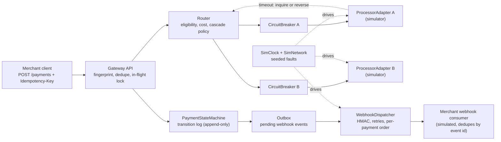
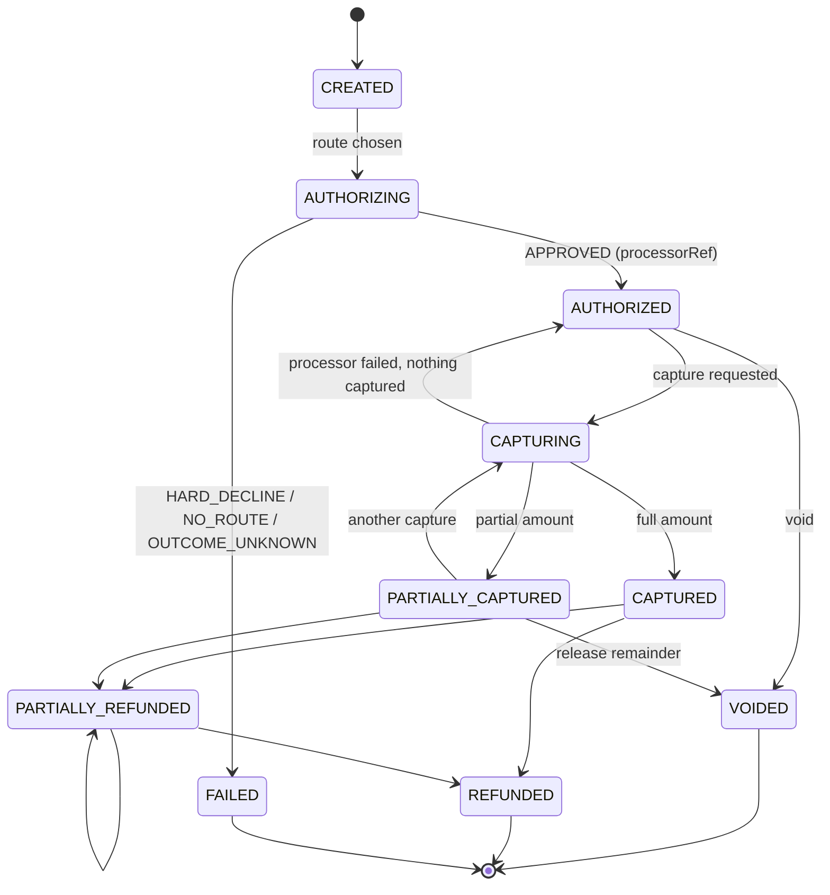

# Capstone: An Idempotent Multi-Processor Payment Gateway

> Idempotency, state machine, routing, webhooks, and simulators.

**Type:** Capstone
**Languages:** Java, Python, or Go (pick one; the spec is language-neutral)
**Prerequisites:** Phase 5 Lesson 09 (Idempotency Keys), Phase 5 Lesson 10 (Retries, Exponential Backoff, and Jitter), Phase 5 Lesson 11 (Circuit Breakers and Bulkheads), Phase 7 Lesson 12 (The Saga Pattern), Phase 7 Lesson 13 (The Transactional Outbox), Phase 11 Lesson 02 (The Card Lifecycle State Machine), Phase 12 Lesson 01 (Designing an Idempotent Payment API), Phase 12 Lesson 02 (The Payment State Machine), Phase 12 Lesson 03 (Payment Orchestration Across Processors), Phase 12 Lesson 04 (Smart Routing, Cascading, and Retry Policies), Phase 12 Lesson 05 (Webhooks), Phase 12 Lesson 10 (Payment Method Abstraction), Phase 12 Lesson 14 (Testing Payment Systems), Phase 14 Lesson 10 (Deterministic Simulation Testing), Phase 15 Lesson 01 (A Durable Double-Entry Ledger Service)
**Time:** ~480 minutes

## Learning Objectives

- Compose the Phase 12 payment mechanisms (idempotent API, state machine, orchestration, routing, webhooks) into one gateway process that fronts several simulated card processors
- Guarantee that a payment is authorized at most once across processors even when a processor times out, by resolving every ambiguous outcome before cascading
- Persist every state transition as an append-only record so the gateway's view of a payment can be rebuilt and compared against each processor's view
- Deliver webhooks at least once with HMAC signatures, per-payment ordering, and a replay endpoint, through a transactional outbox so no acknowledged transition is ever unannounced
- Drive the whole gateway with a seeded deterministic simulation of 10,000 payments and prove the money invariants hold under timeouts, 5xx storms, and processor outages

## The Problem

A marketplace runs its checkout through a single card processor. The integration is a function `charge(card, amount)` that calls the processor's REST API and stores the response in a `payments` table with a `status` column. The processor has a good year and then a bad Tuesday: its authorization endpoint starts returning 504 after eleven seconds on 20% of calls. The checkout's HTTP client has a ten-second timeout and a retry-once wrapper. For six hours every timed-out authorization is retried and, about half the time, both the original and the retry are approved by the issuer. Customers see two pending charges. The marketplace's own records show one `AUTHORIZED` payment, so nobody can see the duplicates until cardholders call their banks. Voiding the orphan authorizations takes a week of manual work and a spreadsheet of processor references matched by amount and timestamp.

The post-incident plan is to add a second processor "for redundancy". The first design cascades: if processor A fails, try processor B. That makes the duplicate problem worse, not better. A timeout from A is not a failure; it is an unknown outcome. Sending the same authorization to B without first learning what A did is exactly how one payment becomes two holds on a cardholder's funds, now across two acquirers with two different reversal procedures. Add webhooks that fire from the application code after the database write, and a crash between the write and the webhook means the merchant's order system never learns a capture happened. Add a refund endpoint that reads `status` and writes `REFUNDED` and two concurrent refund requests both see `CAPTURED`, both call the processor, and the customer is refunded twice.

Each of these failures is a missing mechanism you have already built. `phases/05-distributed-foundations/09-idempotency-keys` and `phases/12-payment-systems-design/01-idempotent-payment-api` make a retried request return the original result instead of a new charge. `phases/12-payment-systems-design/02-payment-state-machine` makes `CAPTURED -> REFUNDED` a transition that can happen once, under a lock, and is persisted before it is announced. `phases/12-payment-systems-design/04-smart-routing-and-retries` distinguishes a hard decline from a soft one and a soft one from an unknown outcome. `phases/07-storage-and-transactions/13-transactional-outbox` and `phases/12-payment-systems-design/05-webhooks-and-callbacks` make the webhook a consequence of the committed transition, not a side effect of the request handler. `phases/14-payments-at-scale/10-simulation-testing-of-payment-systems` lets you run that bad Tuesday ten thousand times in a minute before it happens. This capstone puts them in one process and makes the simulation the acceptance test.

## What You Will Build

A single-process payment gateway with an in-process API (HTTP optional), an append-only transition log, a router over several processor adapters, an outbox-driven webhook dispatcher, and a simulation harness in which the processors, the clock, and the network are all seeded fakes.



The components, each traceable to a lesson you have already built:

| Component | Composes | What it owns |
|-----------|----------|--------------|
| `Money`, `Currency` | `phases/10-money-and-ledgers/01-representing-money` | integer minor units with currency; no float ever holds an amount |
| `IdempotencyStore` | `phases/05-distributed-foundations/09-idempotency-keys`, `phases/12-payment-systems-design/01-idempotent-payment-api` | key to (request fingerprint, in-flight marker or final response); concurrent duplicates wait or get `409` |
| `Payment`, `PaymentState`, `Transition` | `phases/12-payment-systems-design/02-payment-state-machine`, `phases/11-payment-rails/02-card-authorization-lifecycle` | the closed set of states and legal transitions; the append-only transition log |
| `ProcessorAdapter` | `phases/12-payment-systems-design/10-payment-method-abstraction` | one interface (`authorize`, `capture`, `void`, `refund`, `inquire`) over every processor; normalizes response codes |
| `ProcessorSimulator` | `phases/12-payment-systems-design/14-testing-payment-systems`, `phases/14-payments-at-scale/10-simulation-testing-of-payment-systems` | a fake processor with its own ledger of authorizations and a seeded fault profile |
| `Router`, `RoutingTable`, `CascadePolicy` | `phases/12-payment-systems-design/04-smart-routing-and-retries` | eligible processors by BIN and currency, cost ranking, when to cascade and when to stop |
| `RetryPolicy` | `phases/05-distributed-foundations/10-retries-backoff-and-jitter` | capped exponential backoff with seeded jitter, in simulated time |
| `CircuitBreaker` | `phases/05-distributed-foundations/11-circuit-breakers-and-bulkheads` | closed, open, half-open per processor; opens on consecutive timeouts |
| `Orchestrator` | `phases/12-payment-systems-design/03-payment-orchestration`, `phases/07-storage-and-transactions/12-saga-pattern` | the saga per request: attempt, resolve unknowns, compensate, move on |
| `Outbox`, `WebhookDispatcher`, `WebhookSigner` | `phases/07-storage-and-transactions/13-transactional-outbox`, `phases/12-payment-systems-design/05-webhooks-and-callbacks` | events written with the transition; delivered at least once in order per payment; HMAC-SHA256 signed |
| `SimClock`, `SimNetwork` | `phases/14-payments-at-scale/10-simulation-testing-of-payment-systems` | virtual time and seeded latency, drops, and duplicate responses |

Standard library only: `java.security.MessageDigest`, `javax.crypto.Mac`, `java.util.concurrent`; Python `hmac`, `hashlib`, `threading`, `random.Random(seed)`; Go `crypto/hmac`, `crypto/sha256`, `math/rand` with a fixed source, `sync`.

### One payment, end to end

Trace one authorization before writing code. A merchant posts:

```json
{
  "idempotencyKey": "order-8812-auth",
  "amount": {"minor": 4999, "currency": "USD"},
  "card": {"token": "tok_4111", "bin": "411111"},
  "captureMethod": "MANUAL"
}
```

The API computes `fingerprint = SHA-256(canonical(body))`, finds no entry for `order-8812-auth`, and writes an in-flight marker. The state machine creates payment `pay_0001` in `CREATED` and appends `Transition(pay_0001, CREATED -> AUTHORIZING, attempt=1, processor=?)`. The router consults the table: BIN `411111` is Visa, currency USD, both processors eligible. Cost: A charges 1.80% + 0.10 = 0.8998 + 0.10, rounded to 1.00 USD; B charges 1.95% + 0.05 = 1.02 USD. A is tried first. The simulated network delays A's response past the 3,000 ms deadline. The orchestrator now holds an unknown outcome: it calls `A.inquire(reference)`; the simulator answers `NOT_FOUND` because, in this seeded run, the request was dropped before A processed it. Only now does the router cascade to B, which approves with authorization code `A1B2C3`. The state machine appends `AUTHORIZING -> AUTHORIZED` with `processor=B`, in the same write as an outbox event `payment.authorized` with `sequence=1`. The idempotency entry is completed with the response `{"paymentId": "pay_0001", "state": "AUTHORIZED", "processor": "B"}`. The dispatcher later signs and delivers the event; the merchant replays `order-8812-auth` an hour later and gets the identical response without touching any processor. Every milestone below is one of those guarantees made testable.

### The payment lifecycle

The state machine is the spine of the gateway. Every other component either asks it for permission (the API, the orchestrator) or reacts to what it recorded (the outbox, the reconciler). Terminal states have no outgoing edges; that is what makes a webhook for them safe to treat as final.



Note what the diagram does not contain: there is no `TIMED_OUT` state. A timeout is not a fact about the payment; it is a fact about the gateway's knowledge of the payment. The orchestrator resolves it (Milestone 5) and only then records a state the processors would agree with.

## Requirements

Each requirement is a sentence you can turn into a test. The milestone that first satisfies it is in brackets.

1. Every amount is a `Money` value (integer minor units plus ISO 4217 currency). No `double`, `float`, or `float64` appears in any type that holds an amount; processor fee rates are scaled integers (basis points) or decimals. [M1]
2. `PaymentState` is a closed enum: `CREATED`, `AUTHORIZING`, `AUTHORIZED`, `CAPTURING`, `CAPTURED`, `PARTIALLY_CAPTURED`, `VOIDED`, `REFUNDED`, `PARTIALLY_REFUNDED`, `FAILED`. The legal transitions are a static table, and any other transition is rejected with `INVALID_TRANSITION` before anything is written. [M1]
3. Every accepted transition is appended to a transition log record `(paymentId, sequence, from, to, at, processor, processorRef, amount, reason)` before the in-memory `Payment` changes. Replaying the log from empty reproduces every payment's state. [M1]
4. `captured <= authorized` and `refunded <= captured` hold per payment at all times, enforced at the transition, with errors `AMOUNT_EXCEEDS_AUTHORIZED` and `REFUND_EXCEEDS_CAPTURED`. [M1]
5. Every mutating API call carries an idempotency key. Same key and same fingerprint returns the stored response and makes no processor call. Same key and different fingerprint is `IDEMPOTENCY_CONFLICT`. [M2]
6. Two concurrent requests with the same key result in exactly one processor call; the second either waits for the first's response or receives `IN_FLIGHT` (`409`) and retries. Which you choose is documented. [M2]
7. `ProcessorAdapter` exposes `authorize`, `capture`, `void`, `refund`, `inquire`, and every adapter maps processor-specific codes to the closed `Outcome` set: `APPROVED`, `HARD_DECLINE`, `SOFT_DECLINE`, `TIMEOUT`, `PROCESSOR_ERROR`. [M3]
8. Each `ProcessorSimulator` keeps its own ledger of authorizations, captures, voids, and refunds keyed by the gateway's reference, applies at most one of each per reference (idempotent at the processor), and answers `inquire` from that ledger. Its faults are drawn from a seeded profile and are reproducible from the seed. [M3]
9. The router selects processors eligible by BIN range and currency and ranks them by computed cost for the amount; ties break by a stable processor order. `NO_ROUTE` is returned when none is eligible. [M4]
10. Cascading happens only on `SOFT_DECLINE` and `PROCESSOR_ERROR`, never on `HARD_DECLINE`, and is bounded by `maxAttempts`. A hard decline moves the payment to `FAILED` with the decline reason. [M4]
11. A `TIMEOUT` on `authorize` is an unknown outcome. Before cascading, the orchestrator must either confirm via `inquire` that no authorization exists at that processor or send a `void` for the same reference and receive `APPROVED` or `NOT_FOUND`. If neither succeeds within the retry budget, the payment ends in `FAILED` with `OUTCOME_UNKNOWN` and is listed for reconciliation. At no point do two live authorizations exist for one payment. [M5]
12. Retries use capped exponential backoff with jitter from a seeded source and run in simulated time; the test asserts the schedule, not wall-clock sleeps. [M5]
13. Each processor has a circuit breaker. After `failureThreshold` consecutive `TIMEOUT` or `PROCESSOR_ERROR` outcomes it opens, the router skips it, and after `openDuration` of simulated time one trial request is allowed through. Breaker state changes are logged events. [M6]
14. Every transition that changes a payment's state writes an outbox event in the same atomic step. Events carry `(eventId, paymentId, sequence, type, payload)`. The dispatcher delivers them in `sequence` order per payment, retries failures with backoff, and never delivers sequence `n+1` for a payment before `n` has been acknowledged. [M7]
15. Webhook requests carry `Webhook-Signature: t=<unixSeconds>,v1=<hex HMAC-SHA256(secret, t + "." + body)>`. The consumer rejects a signature whose `t` is more than 300 seconds from its clock or whose HMAC does not verify in constant time, and deduplicates by `eventId`. A `POST /webhooks/replay?paymentId=` endpoint re-emits every event for a payment. [M7]
16. A seeded simulation of 10,000 payments with timeouts, 5xx storms, and a 10-minute processor outage finishes with: no payment having more than one live authorization across all simulators; every `CAPTURED` payment captured exactly once at exactly one processor; the gateway's state for every payment equal to the processors' combined view; and every terminal payment having exactly one terminal webhook delivered. Changing the seed changes the faults; re-running the same seed reproduces the same log byte for byte. [M8]

## Milestones

Work the milestones in order. Each ends with a test you run before moving on. Name the tests as shown so your output reads as a checklist. Commands assume `capstone/gateway/{java,python,go}`.

```bash
# Java
cd capstone/gateway/java && javac -d .out *.java && java -cp .out GatewayTest
# Python
cd capstone/gateway/python && python3 -m unittest -v
# Go
cd capstone/gateway/go && go test -race ./...
```

### Milestone 1: The state machine and its log

Copy `Money` and `Currency` from `phases/10-money-and-ledgers/01-representing-money`. Define `PaymentState`, a `TRANSITIONS` table (a map from state to the set of states reachable from it), and `Payment(id, amount, authorized, captured, refunded, state, processor, processorRef)`. Implement `TransitionLog.append(Transition)` and `PaymentStore.apply(Transition)`, where `apply` validates the transition against the table and the amount invariants, appends, then mutates. Add `PaymentStore.replay(log)` that rebuilds from an empty store.

The legal transitions, which your table must encode exactly:

| From | To | Guard |
|------|----|-------|
| `CREATED` | `AUTHORIZING` | none |
| `AUTHORIZING` | `AUTHORIZED`, `FAILED` | `AUTHORIZED` requires `processorRef` |
| `AUTHORIZED` | `CAPTURING`, `VOIDED` | none |
| `CAPTURING` | `CAPTURED`, `PARTIALLY_CAPTURED`, `AUTHORIZED` | `captured + amount <= authorized`; back to `AUTHORIZED` on processor failure |
| `PARTIALLY_CAPTURED` | `CAPTURING`, `VOIDED` | void releases only the uncaptured remainder |
| `CAPTURED`, `PARTIALLY_CAPTURED` | `PARTIALLY_REFUNDED`, `REFUNDED` | `refunded + amount <= captured` |
| `PARTIALLY_REFUNDED` | `PARTIALLY_REFUNDED`, `REFUNDED` | same guard |
| `VOIDED`, `REFUNDED`, `FAILED` | none | terminal |

Acceptance test `m1_transitions_are_guarded_logged_and_replayable`:

1. Create a payment for 49.99 USD. Move it `CREATED -> AUTHORIZING -> AUTHORIZED` with `processorRef = "A-0001"`.
2. Capture 30.00. Assert state `PARTIALLY_CAPTURED`, `captured == 30.00`. Capture 25.00. Assert `AMOUNT_EXCEEDS_AUTHORIZED` and `captured` unchanged.
3. Capture 19.99. Assert `CAPTURED`. Refund 60.00. Assert `REFUND_EXCEEDS_CAPTURED`.
4. Attempt `CAPTURED -> AUTHORIZING`. Assert `INVALID_TRANSITION` and the log length unchanged.
5. Replay the log into a fresh store. Assert the rebuilt payment equals the original field for field, and assert the exact record count. The reference design writes 7 records for this sequence (create, authorizing, authorized, capturing, partially captured, capturing, captured); if your design folds `CAPTURING` into the capture record it writes 5. Document the number and assert it, because the rejected transitions in steps 2 to 4 must not have added any.

```java
static void m1_transitions_are_guarded_logged_and_replayable() {
    TransitionLog log = TransitionLog.inMemory();
    PaymentStore store = new PaymentStore(log);
    Payment p = store.create("pay_1", usd(4999));
    store.apply(Transition.to(p.id(), PaymentState.AUTHORIZING));
    store.apply(Transition.authorized(p.id(), "A", "A-0001"));
    store.apply(Transition.capture(p.id(), usd(3000)));
    check("partial", store.get("pay_1").state() == PaymentState.PARTIALLY_CAPTURED);
    GatewayError e = expectError(() -> store.apply(Transition.capture("pay_1", usd(2500))));
    check("over-capture refused", e.code() == ErrorCode.AMOUNT_EXCEEDS_AUTHORIZED);
    check("captured unchanged", store.get("pay_1").captured().equals(usd(3000)));
    int n = log.size();
    e = expectError(() -> store.apply(Transition.to("pay_1", PaymentState.AUTHORIZING)));
    check("illegal transition", e.code() == ErrorCode.INVALID_TRANSITION && log.size() == n);
    PaymentStore rebuilt = PaymentStore.replay(log);
    check("replay equal", rebuilt.get("pay_1").equals(store.get("pay_1")));
}
```

### Milestone 2: The idempotent API

Add `GatewayApi` with `createPayment(key, request)`, `capture(key, paymentId, amount)`, `refund(key, paymentId, amount)`, `voidPayment(key, paymentId)`. Each computes a fingerprint over the canonical request body and consults `IdempotencyStore`, whose entries are `(fingerprint, status: IN_FLIGHT | DONE, response)`. The store is persisted as records in the same log as transitions (or a sibling log), so a replayed key after restart still returns the original response. Concurrent duplicates: the reference design has the second caller wait on the first's completion with a bounded timeout; the alternative returns `409 IN_FLIGHT` immediately.

Acceptance test `m2_same_key_same_body_calls_processor_once`:

1. Wire a `CountingProcessor` fake that approves everything and counts calls. Create a payment with key `k1`. Create again with `k1` and the same body. Assert equal responses and `calls == 1`.
2. Create with `k1` and a different amount. Assert `IDEMPOTENCY_CONFLICT`.
3. Start 16 threads (or goroutines) that each call `createPayment("k2", sameBody)`. Join. Assert `calls == 1` and all 16 responses are identical.
4. Restart the gateway from the log. Replay `k1`. Assert the original `paymentId` and no new processor call.

```python
def test_m2_concurrent_duplicates_call_processor_once(self):
    proc = CountingProcessor()
    gw = Gateway.open(self.dir, processors=[proc], clock=SimClock())
    body = create_request(usd(4999), bin="411111")
    results = []
    def worker():
        results.append(gw.create_payment("k2", body))
    threads = [threading.Thread(target=worker) for _ in range(16)]
    for t in threads: t.start()
    for t in threads: t.join()
    self.assertEqual(proc.calls, 1)
    self.assertEqual(len({r.payment_id for r in results}), 1)
    self.assertEqual(len({r.state for r in results}), 1)
```

### Milestone 3: Processor adapters and simulators

Define `ProcessorAdapter` with the five operations from Requirement 7 and a `ProcessorResponse(outcome, processorRef, code, message)`. Build `ProcessorSimulator(name, profile, rng, clock)` whose `profile` is a table of probabilities for each outcome plus a latency distribution, all drawn from the injected `rng`. The simulator holds `Map<reference, AuthRecord>` and refuses to authorize the same reference twice (returns the original). `inquire(reference)` returns the record or `NOT_FOUND`. Processor-specific codes differ on purpose: simulator A returns ISO 8583-style `"05"`, `"51"`, `"91"`; simulator B returns strings like `"do_not_honor"`, `"insufficient_funds"`, `"issuer_unavailable"`. Each adapter maps them to the shared `Outcome`.

Acceptance test `m3_simulators_are_idempotent_and_seed_reproducible`:

1. Build simulator A with seed 7 and a profile of 80% approve, 10% hard decline, 5% soft decline, 5% timeout. Run 1,000 authorizations with distinct references. Record the sequence of outcomes.
2. Rebuild with seed 7. Assert the identical outcome sequence. Rebuild with seed 8. Assert it differs.
3. Authorize reference `r-1` twice. Assert the second response equals the first and the simulator's ledger has one record.
4. Assert `A.inquire("r-1")` returns that record and `A.inquire("nope")` returns `NOT_FOUND`.
5. Assert every response from both simulators maps to one of the five `Outcome` values and that `"51"` and `"insufficient_funds"` both map to `HARD_DECLINE`.

### Milestone 4: Routing and cascading

Implement `RoutingTable` with rows `(processor, binRanges, currencies, feeBasisPoints, feeFixedMinor)` and `Router.rank(request) -> List<Processor>` ordered by computed fee, ties by table order. Implement `CascadePolicy(maxAttempts, cascadeOn = {SOFT_DECLINE, PROCESSOR_ERROR})`. The orchestrator walks the ranked list, stopping on `APPROVED` or `HARD_DECLINE`, moving on for cascadeable outcomes, and ending in `FAILED` when the list or `maxAttempts` is exhausted. Fee computation uses integer arithmetic: `fee = amount * bps / 10_000 (HALF_UP) + fixed`.

Acceptance test `m4_cascade_follows_cost_and_stops_on_hard_decline`:

1. Table: A = 180 bps + 10, B = 195 bps + 5, C = 150 bps + 30, all Visa and USD; C is Visa only. For 49.99 USD assert ranking `[A, B, C]` (fees 1.00, 1.02, 1.05). For 500.00 USD assert `[C, A, B]` (7.80, 9.10, 9.80). For a Mastercard BIN assert `[A, B]`.
2. Script A to `SOFT_DECLINE` and B to `APPROVED`. Authorize. Assert state `AUTHORIZED`, `processor == B`, and the transition log shows attempt 1 at A and attempt 2 at B.
3. Script A to `HARD_DECLINE`. Authorize a new payment. Assert `FAILED` with reason `HARD_DECLINE:51`, B was never called, and the merchant response code is `DECLINED`.
4. Script A, B, C all `SOFT_DECLINE` with `maxAttempts = 2`. Assert `FAILED`, exactly two attempts logged.
5. For an AMEX BIN with no eligible row assert `NO_ROUTE` and no transition past `CREATED`.

### Milestone 5: Timeouts and the unknown outcome

This is the milestone the Tuesday incident was about. A `TIMEOUT` from `authorize` means the processor may or may not hold a live authorization. Implement `Orchestrator.resolveUnknown(processor, reference)`: call `inquire` with the `RetryPolicy` (base 200 ms, factor 2, cap 3,200 ms, full jitter, 5 attempts, all in `SimClock` time). If `inquire` returns a record, adopt it: the payment is `AUTHORIZED` at that processor and no cascade happens. If it returns `NOT_FOUND`, cascade is safe. If `inquire` itself keeps timing out, send `void(reference)`; `APPROVED` or `NOT_FOUND` from the void makes cascading safe. If the retry budget is exhausted with the outcome still unknown, the payment goes to `FAILED` with `OUTCOME_UNKNOWN` and is appended to an `unresolved` list the reconciliation job reads.

Acceptance test `m5_timeout_never_produces_two_live_authorizations`:

1. Script A: the authorization is processed by the simulator but the response is dropped by `SimNetwork` (a "late approve"). Authorize. Assert the orchestrator's `inquire` finds the record, the payment is `AUTHORIZED` at A, and B was never called.
2. Script A: the request is dropped before processing. Authorize. Assert `inquire` returns `NOT_FOUND`, cascade reaches B, final state `AUTHORIZED` at B, and A's ledger has zero records for that reference.
3. Script A: authorize processed, response dropped, `inquire` times out 5 times, `void` succeeds. Assert final `AUTHORIZED` at B, A's ledger shows the authorization voided, and the retry schedule in simulated time is `[200, 400, 800, 1600, 3200]` ms before jitter, with every jittered delay in `[0, scheduled]`.
4. Script A: everything times out. Assert `FAILED` with `OUTCOME_UNKNOWN`, the payment appears in `unresolved()`, and B was never called.
5. Across all four cases, assert `countLiveAuthorizations(allSimulators, paymentId) <= 1`.

The resolution procedure in Java, which the test above exercises path by path:

```java
Resolution resolveUnknown(ProcessorAdapter p, String reference) {
    for (long delay : retryPolicy.schedule(rng)) {          // [200, 400, 800, 1600, 3200] before jitter
        ProcessorResponse r = p.inquire(reference);
        if (r.outcome() == Outcome.APPROVED) return Resolution.adopt(r);   // the auth exists: keep it
        if (r.outcome() == Outcome.NOT_FOUND) return Resolution.safeToCascade();
        clock.advance(delay);                               // simulated time, never Thread.sleep
    }
    ProcessorResponse v = p.voidAuth(reference);            // last resort: make the unknown false
    if (v.outcome() == Outcome.APPROVED || v.outcome() == Outcome.NOT_FOUND) {
        return Resolution.safeToCascade();
    }
    return Resolution.unresolved(p.name(), reference);      // FAILED + OUTCOME_UNKNOWN, listed for humans
}
```

Predict: in step 1 the simulator processed the authorization but dropped the response. Which branch returns, and how many simulated milliseconds elapse before it does? (The first `inquire` finds the record; zero delay is consumed.)

### Milestone 6: Circuit breakers

Wrap each adapter in a `CircuitBreaker(failureThreshold = 5, openDuration = 30 s simulated, halfOpenTrials = 1)`. `TIMEOUT` and `PROCESSOR_ERROR` count as failures; declines of either kind do not, because a decline is the processor working correctly. The router skips open breakers; if every eligible breaker is open the API returns `PROCESSOR_UNAVAILABLE` without touching any processor. Breaker transitions are events in the log so the simulation can assert on them.

Acceptance test `m6_breaker_opens_skips_and_recovers`:

1. Script A to `TIMEOUT` for the next 5 calls. Authorize 5 payments. Assert all 5 resolved at B (via M5's inquire path) and A's breaker is `OPEN` after the fifth.
2. Authorize 10 more payments. Assert A was not called, all 10 went to B, and the ranking log shows A as `SKIPPED_OPEN`.
3. Advance `SimClock` by 30 s. Script A to approve. Authorize one payment. Assert exactly one trial call reached A, it succeeded, and the breaker is `CLOSED`.
4. Open both breakers. Authorize. Assert `PROCESSOR_UNAVAILABLE` and no transition past `CREATED`.
5. Script A to `HARD_DECLINE` 20 times. Assert the breaker stays `CLOSED`.

### Milestone 7: Outbox and webhooks

Every state-changing transition writes an `OutboxEvent(eventId, paymentId, sequence, type, payload, createdAt)` in the same append as the transition (one log record containing both, or two records with a recovery rule that a transition without its event is re-emitted). `WebhookDispatcher.tick()` reads pending events ordered by `(paymentId, sequence)`, signs each, delivers through a `WebhookTarget` interface (the simulated merchant consumer), and marks delivered on a `2xx`. On failure it schedules a retry with the `RetryPolicy`; while sequence `n` for a payment is undelivered, `n+1` for that payment is held. Different payments proceed independently. The consumer verifies the signature with a constant-time comparison, checks `t` within 300 s, and keeps a `seen` set of `eventId`.

Acceptance test `m7_webhooks_are_signed_ordered_and_at_least_once`:

1. Authorize, capture, and refund one payment. Assert the outbox holds 3 events with sequences 1, 2, 3 and types `payment.authorized`, `payment.captured`, `payment.refunded`.
2. Script the consumer to fail the first delivery of sequence 2. Tick until drained. Assert the consumer received sequences in order `1, 2, 3`, received sequence 2 twice (at-least-once), and processed it once (dedupe by `eventId`).
3. Tamper one byte of a delivered body and re-verify. Assert the consumer rejects it. Set the consumer clock 301 s ahead. Assert it rejects a fresh event for `t` skew.
4. Kill the gateway (skip `close`) after a transition is logged but before `tick`. Reopen. Assert the event is still pending and gets delivered exactly as if no crash happened.
5. Call `replay(paymentId)`. Assert the consumer receives all 3 events again with the same `eventId` values and processes none of them.

```go
func TestM7WebhookSignatureVerifies(t *testing.T) {
    signer := NewWebhookSigner([]byte("whsec_test"))
    body := []byte(`{"eventId":"evt_1","paymentId":"pay_1","sequence":1,"type":"payment.authorized"}`)
    header := signer.Sign(body, 1_700_000_000)
    if !strings.HasPrefix(header, "t=1700000000,v1=") {
        t.Fatalf("header shape: %s", header)
    }
    consumer := NewConsumer([]byte("whsec_test"), FixedClock(1_700_000_100))
    if err := consumer.Verify(header, body); err != nil {
        t.Fatalf("valid signature rejected: %v", err)
    }
    body[10] ^= 0x01
    if err := consumer.Verify(header, body); err == nil {
        t.Fatal("tampered body accepted")
    }
}
```

### Milestone 8: The deterministic simulation

Build `Simulation(seed, config)` that wires three simulators with distinct fault profiles, the router, the breakers, the dispatcher, and a `MerchantScript` that generates 10,000 payments (random amounts 1.00 to 999.99 USD and EUR, BINs across Visa, Mastercard, and 5% AMEX with no route) with captures on 90% and refunds on 20% of captures. The config includes a scheduled outage: processor A returns `TIMEOUT` for every call between simulated minutes 20 and 30. The whole run uses `SimClock`; nothing sleeps. After the run, `Simulation.check()` evaluates the invariants in Requirement 16 and `Simulation.reconcile()` compares the gateway's `(paymentId, state, processor, captured, refunded)` with each simulator's ledger.

Acceptance test `m8_ten_thousand_payments_conserve_the_invariants`:

1. Run seed 42. Assert zero invariant violations, zero reconciliation differences outside the `unresolved` list, and that the `unresolved` list is non-empty (the outage guarantees some `OUTCOME_UNKNOWN`) with every entry having at most one live authorization.
2. Run seed 42 again. Assert the transition log is byte-identical to the first run.
3. Run seeds 1 through 20 in a loop. Assert zero violations for each; print per-seed counts of approved, declined, cascaded, unknown, and breaker openings.
4. Introduce a deliberate bug behind a flag (skip the `inquire` step on timeout). Run seed 42. Assert the checker reports at least one payment with two live authorizations. This proves the checker can see the Tuesday incident.
5. Assert the whole test file runs in under 60 s wall-clock in your language.

The checker is the heart of this milestone. It reads the gateway's store and every simulator's ledger and counts violations by category; a run is green only when every count is zero:

```python
def check(self) -> dict[str, int]:
    violations = {"live_auth_violations": 0, "double_capture": 0,
                  "state_mismatch": 0, "unannounced_terminal": 0}
    for payment in self.gateway.store.all():
        live = sum(sim.ledger.live_auth_count(payment.id) for sim in self.simulators)
        if live > 1:
            violations["live_auth_violations"] += 1
        captures = [sim.ledger.captures_for(payment.id) for sim in self.simulators]
        if sum(len(c) for c in captures) > 1:
            violations["double_capture"] += 1
        if payment.id not in self.gateway.unresolved() and not self.agrees(payment, captures):
            violations["state_mismatch"] += 1
        if payment.state.is_terminal() and self.consumer.terminal_events_for(payment.id) != 1:
            violations["unannounced_terminal"] += 1
    return violations
```

Predict: a payment ended `FAILED` with `OUTCOME_UNKNOWN` and processor A's ledger shows one live authorization for it. Which counters, if any, does this payment increment? (None. One live authorization is allowed, the payment is in `unresolved` so `agrees` is skipped, and `FAILED` is terminal with exactly one `payment.failed` event.)

## Acceptance Criteria

The capstone is complete when all of the following are true on a clean checkout:

- All eight milestone tests pass in your chosen language with one command, and the Go version passes under `go test -race ./...`.
- A `make demo` or equivalent runs seed 42 for 2,000 payments, prints a per-processor summary (attempts, approvals, declines, timeouts, breaker openings), prints the invariant checker's report (`live_auth_violations: 0`, `double_capture: 0`, `unannounced_terminal: 0`), and then runs the bug flag from M8 step 4 and prints the violation it finds.
- `README.md` in your project includes the state transition table, the webhook signature scheme with a worked example (secret, timestamp, body, resulting header), the unknown-outcome resolution algorithm as numbered steps, and your decisions in the table below.
- `grep -rn "double\|float" --include=*.java --include=*.py --include=*.go` in amount-bearing types returns only comments; fee rates are basis points.
- Every API error carries a code from the closed set: `IDEMPOTENCY_CONFLICT`, `IN_FLIGHT`, `INVALID_TRANSITION`, `AMOUNT_EXCEEDS_AUTHORIZED`, `REFUND_EXCEEDS_CAPTURED`, `PAYMENT_NOT_FOUND`, `NO_ROUTE`, `PROCESSOR_UNAVAILABLE`, `DECLINED`, `OUTCOME_UNKNOWN`.
- The `unresolved` list after a run is written to `reports/unresolved-<seed>.md` with, for each entry, the processor, reference, last known outcome, and the action a human should take.

| Decision | Options | What the reference design does | Test that exposes it |
|----------|---------|--------------------------------|----------------------|
| Concurrent duplicate requests | wait for the in-flight result; return `409 IN_FLIGHT` | wait, with a 5 s bound, then `IN_FLIGHT` | M2 step 3 |
| Unknown outcome with `inquire` unsupported | void with the same reference; mark unresolved immediately | void, then unresolved | M5 step 3 |
| Breaker failure counting | count declines as failures; count only timeouts and errors | timeouts and errors only | M6 step 5 |
| Outbox atomicity | one record with transition and event; two records plus recovery rule | one record | M7 step 4 |
| Partial capture void | void releases remainder automatically on capture; explicit void required | explicit void | M1 table |
| Cost ranking cadence | per request; cached per (BIN, currency, amount bucket) | per request (the table is small) | M4 step 1 |

## Rubric

| Criterion | Developing | Solid | Exemplary |
|-----------|------------|-------|-----------|
| State machine | States as strings; transitions checked ad hoc in handlers | Closed enum, static transition table, amount guards, append-only log that replays | Transition table is data (JSON) validated at startup for unreachable and dead-end states; a property test fires random transitions and asserts the guards |
| Idempotency | Key stored in memory; duplicates both reach the processor | Fingerprint, in-flight marker, conflict detection, survives restart, concurrent duplicates make one call | Keys scoped per merchant with expiry logged; a stale replay after expiry is shown to be treated as new |
| Processor abstraction | One adapter with processor-specific codes leaking into the orchestrator | Shared `Outcome`, two simulators with different native codes, idempotent processor ledgers | A third adapter type (ACH-like, asynchronous outcome) fits the interface without changing the orchestrator |
| Routing and cascading | Fixed order; cascades on every non-approval | Cost ranking with integer fees, cascade only on soft outcomes, bounded attempts, `NO_ROUTE` | Routing weights adjust from observed approval rates per processor (`phases/14-payments-at-scale/08-cost-and-authorization-optimization`) with a test showing the shift |
| Unknown outcomes | Timeout treated as decline and cascaded | Inquire, then void, then unresolved; checker proves at most one live authorization | Background reconciler drains `unresolved` against processor ledgers and the simulation shows it converging to zero |
| Resilience | Retries with real sleeps; no breaker | Seeded jittered backoff in simulated time; per-processor breaker with half-open trial; events logged | Bulkhead per processor bounding concurrent in-flight calls, with a test that a slow processor cannot starve the others |
| Webhooks | Sent from the handler after the write; unsigned | Outbox in the same append; HMAC with timestamp; ordered per payment; at-least-once; replay endpoint | Secret rotation with two active secrets and a consumer that accepts either during the window |
| Simulation | Tests use wall-clock time and random seeds | `SimClock` and `SimNetwork`; 10,000 payments; byte-identical logs per seed; checker catches a planted bug | Shrinking: on a violation, the harness bisects the payment script to the smallest reproducing prefix and prints it |

## Further Reading

- [Stripe API reference, "Idempotent requests"](https://docs.stripe.com/api/idempotent_requests) — the production contract behind Requirements 5 and 6: key scope, fingerprint conflict, and how long keys live.
- [Stripe Docs, "Webhook signatures"](https://docs.stripe.com/webhooks#verify-official-libraries) — the `t=...,v1=...` scheme, timestamp tolerance, and the constant-time comparison Requirement 15 follows.
- [RFC 2104, "HMAC: Keyed-Hashing for Message Authentication"](https://www.rfc-editor.org/rfc/rfc2104) — what the signature construction actually guarantees and why the secret length matters.
- [Visa, "Visa Core Rules and Visa Product and Service Rules"](https://usa.visa.com/support/consumer/visa-rules.html) — the reversal and authorization-hold rules that make the M5 unknown-outcome procedure a compliance matter, not just hygiene.
- [Michael Nygard, *Release It!* (2nd ed., Pragmatic Bookshelf, 2018), chapters on Circuit Breaker and Bulkheads](https://pragprog.com/titles/mnee2/release-it-second-edition/) — the stability patterns M6 implements, with the failure counting decision discussed explicitly.
- [Hector Garcia-Molina and Kenneth Salem, "Sagas" (SIGMOD 1987)](https://dl.acm.org/doi/10.1145/38713.38742) — the original compensation model the orchestrator applies when a capture or void fails midway.
