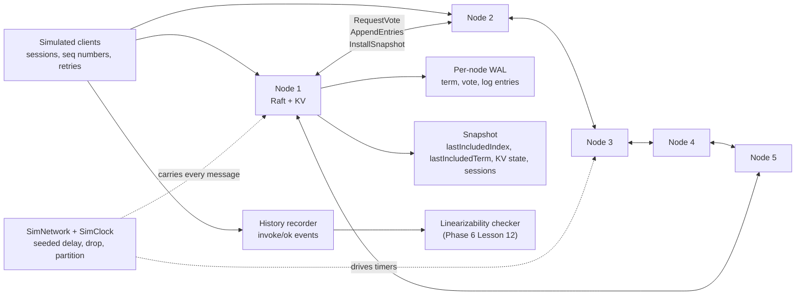

# Capstone: A Raft-Replicated Key-Value Store

> Election, replication, snapshots, and a linearizability checker.

**Type:** Capstone
**Languages:** Java, Python, or Go (pick one; the spec is language-neutral)
**Prerequisites:** Phase 6 Lesson 05 (Raft I: Leader Election), Phase 6 Lesson 06 (Raft II: Log Replication), Phase 6 Lesson 07 (Raft III: Safety and Membership), Phase 6 Lesson 12 (Linearizability Checking), Phase 7 Lesson 02 (Write-Ahead Logs), Phase 5 Lesson 07 (RPC and Serialization), Phase 5 Lesson 08 (Timeouts and Deadline Propagation), Phase 5 Lesson 09 (Idempotency Keys), Phase 5 Lesson 12 (Leases, Fencing Tokens, and Distributed Locks), Phase 15 Lesson 01 (A Durable Double-Entry Ledger Service)
**Time:** ~480 minutes

## Learning Objectives

- Compose the three Raft lessons (election, log replication, safety and membership) into one replicated state machine that keeps a key-value store consistent across five nodes
- Run the whole cluster on a deterministic simulated network so that every election, partition, and message reordering is reproducible from a seed
- Persist the Raft state (current term, vote, log) through a checksummed write-ahead log and compact it with snapshots that a lagging follower can install
- Expose a client API with session-scoped idempotency so that a retried write is applied exactly once even across leader changes
- Prove linearizability by recording every client operation's invocation and response and checking the history with the algorithm from Phase 6 Lesson 12

## The Problem

A payments company keeps its idempotency keys in a single-node Redis. The key is the client's `Idempotency-Key` header, the value is the stored response, and the API checks the key before calling the processor. One Thursday the Redis host loses power. The warm standby is promoted with asynchronous replication that was 400 milliseconds behind. About 1,100 keys written in that window are gone. Clients that timed out during the failover retry, the gateway sees no key, and 1,100 payments are authorized a second time. The post-incident review asks a simple question: which component promised that an acknowledged write would survive the loss of one machine? None did. Asynchronous replication acknowledges before the standby has the data, and promotion does not know what it is missing.

The second attempt is a three-node setup with a leader elected by a health-check script. The script watches TCP connectivity, and during a network partition both sides think the other is dead. Two leaders accept writes for ninety seconds. When the partition heals, the idempotency store holds two different responses for the same key, and the team has to decide which processor call was the real one by reading processor logs. The health check has no notion of a term, so there is nothing that makes the old leader stop; and the writes had no quorum, so there is nothing that makes two acknowledged writes conflict-free.

Both failures are the absence of a consensus protocol. `phases/06-replication-and-consensus/05-raft-leader-election` built terms, randomized timeouts, and the voting rule that lets at most one leader exist per term. `phases/06-replication-and-consensus/06-raft-log-replication` built the `AppendEntries` exchange and the commit index that only advances when a majority has the entry. `phases/06-replication-and-consensus/07-raft-safety-and-membership` built the election restriction that keeps a committed entry from ever being overwritten, and the joint-consensus membership change. `phases/06-replication-and-consensus/12-linearizability-checking` built the checker that can look at a history of client operations and say whether any sequential order explains it. This capstone puts them into one process, under a simulated network you control, and makes the checker the acceptance test.

## What You Will Build

A five-node Raft cluster where each node hosts a key-value state machine, all running in one process on a `SimNetwork` with seeded delay, drop, duplication, and partition behavior. Clients are also simulated: they issue `put`, `get`, `cas`, and `delete` operations, retry on timeout, and record every invocation and response into a history. The cluster has no real sockets; a `net/http` or `com.sun.net.httpserver` front door on the leader is optional for a demo and is not part of the acceptance tests.



The components, each traceable to a lesson you have already built:

| Component | Composes | What it owns |
|-----------|----------|--------------|
| `SimClock`, `SimNetwork` | `phases/14-payments-at-scale/10-simulation-testing-of-payment-systems`, `phases/05-distributed-foundations/02-failure-models` | virtual time, message queue ordered by delivery time, seeded delay/drop/duplicate, partitions by node set |
| `Rpc` envelopes | `phases/05-distributed-foundations/07-rpc-and-serialization` | `RequestVote`, `AppendEntries`, `InstallSnapshot` and their replies as plain records with a canonical byte encoding |
| `Election` | `phases/06-replication-and-consensus/05-raft-leader-election` | follower, candidate, leader roles; randomized election timeout; term rules; vote persistence |
| `LogReplication` | `phases/06-replication-and-consensus/06-raft-log-replication` | `nextIndex`, `matchIndex`, consistency check, commit index as the majority `matchIndex`, applying to the state machine |
| `Safety`, `Membership` | `phases/06-replication-and-consensus/07-raft-safety-and-membership` | election restriction (up-to-date log), leader commits only entries of its own term, joint consensus for adding a node |
| `RaftLog`, `RaftWal` | `phases/07-storage-and-transactions/02-write-ahead-logs` | `currentTerm`, `votedFor`, entries persisted with length + CRC32; torn tail truncation; snapshot and log compaction |
| `KvStateMachine` | `phases/01-complexity-and-core-structures/06-hash-maps-from-scratch` | `put`, `get`, `cas`, `delete`; deterministic apply; serializes to and from a snapshot |
| `SessionTable` | `phases/05-distributed-foundations/09-idempotency-keys` | per-client `(lastSeq, lastResponse)` replicated through the log so a retried command applies once |
| `ReadIndex` | `phases/05-distributed-foundations/12-leases-and-fencing-tokens` | a leader confirms leadership with a heartbeat round before serving a read, or routes the read through the log |
| `HistoryRecorder`, `LinearizabilityChecker` | `phases/06-replication-and-consensus/12-linearizability-checking` | invoke/response events with client ids; the search for a sequential witness |

Standard library only: `java.util.PriorityQueue`, `java.util.zip.CRC32`, `java.security.MessageDigest`, `java.util.Random(seed)`; Python `heapq`, `zlib`, `random.Random(seed)`, `struct`; Go `container/heap`, `hash/crc32`, `math/rand` with a fixed source, `encoding/binary`.

### One write, end to end

Trace a single `put("idem:order-8812", "AUTH:ok")` before writing code. Five nodes, node 3 is leader in term 4, log has entries 1 through 17 committed and applied, `commitIndex = 17`.

1. Client `c1` with session `s-c1` sends `ClientRequest(seq=9, PUT, key, value)` to node 3 at simulated time 10,000 ms. The leader checks the session table: `lastSeq[s-c1] = 8`, so this is new. It appends entry 18 `(term=4, cmd=PUT, session=s-c1, seq=9)` to its log and WAL, then sends `AppendEntries(term=4, prevLogIndex=17, prevLogTerm=4, entries=[18], leaderCommit=17)` to nodes 1, 2, 4, 5.
2. `SimNetwork` delivers to nodes 1, 2, 4 at 10,012 ms, 10,018 ms, 10,035 ms; the message to node 5 is dropped by the seeded profile. Each receiving node checks `prevLogIndex=17` has `term=4` locally, appends entry 18, persists it, and replies `success=true, matchIndex=18`.
3. At 10,018 ms the leader has `matchIndex = {1: 18, 2: 18, 3: 18, 4: 17, 5: 17}`. Three of five have index 18, and entry 18 is from the current term, so `commitIndex` advances to 18. The leader applies entry 18 to its `KvStateMachine`, records `lastSeq[s-c1] = 9` and the response `OK` in the session table, and replies to `c1` at 10,019 ms.
4. The client's history now contains `invoke(c1, PUT, key, value, t=10000)` and `ok(c1, OK, t=10019)`. Any other client's `get` whose invocation starts after 10,019 must see `AUTH:ok` or a later value; one that overlaps 10,000 to 10,019 may see either.
5. The next heartbeat carries `leaderCommit=18`, so followers apply entry 18 too. Node 5 receives a heartbeat with `prevLogIndex=18` and replies `success=false`; the leader decrements `nextIndex[5]` to 18 and resends entry 18.

If the client's reply is dropped and `c1` retries `seq=9` at a new leader after an election, the new leader finds `lastSeq[s-c1] = 9` in its replicated session table and returns the stored `OK` without appending. That is what makes the write exactly-once from the client's view. Every milestone below is one guarantee in this trace.

### The messages

Three RPCs and their replies are the whole protocol. Encode them with the canonical byte format from `phases/05-distributed-foundations/07-rpc-and-serialization` so that two runs with the same seed produce the same bytes on the wire and in the WAL.

| Message | Fields | Receiver's first check |
|---------|--------|------------------------|
| `RequestVote` | `term, candidateId, lastLogIndex, lastLogTerm` | adopt a higher term; refuse if already voted this term |
| `RequestVoteReply` | `term, voteGranted` | ignore if `term` is stale or the node is no longer a candidate |
| `AppendEntries` | `term, leaderId, prevLogIndex, prevLogTerm, entries[], leaderCommit` | adopt a higher term; refuse if `log[prevLogIndex].term != prevLogTerm` |
| `AppendEntriesReply` | `term, success, matchIndex, conflictTerm, conflictIndex` | ignore if stale; advance `matchIndex` or back off `nextIndex` |
| `InstallSnapshot` | `term, leaderId, lastIncludedIndex, lastIncludedTerm, data` | adopt a higher term; discard if the snapshot is older than local state |
| `InstallSnapshotReply` | `term` | set `nextIndex[f] = lastIncludedIndex + 1` |
| `ClientRequest` | `sessionId, seq, op, key, expected, value` | redirect if not leader; dedupe against the session table |
| `ClientReply` | `code, value, leaderHint` | the client retries at `leaderHint` on `NOT_LEADER` |

What the design does not promise: it does not survive the loss of a majority (three of five nodes down means no progress, by construction), it does not give linearizable reads to a client that talks to a follower without redirection, and it does not protect against a disk that lies about `fsync`. Each of those is a different system or a different lesson.

## Requirements

Each requirement is a sentence you can turn into a test. The milestone that first satisfies it is in brackets.

1. All time comes from an injected `SimClock`; all messages travel through a `SimNetwork` that orders delivery by scheduled time, applies seeded delay, drop, and duplication, and supports partitions as sets of nodes that cannot exchange messages. No `Thread.sleep`, `time.sleep`, or `time.Sleep` appears in cluster code. Two runs with the same seed produce byte-identical logs on every node. [M1]
2. A node is `FOLLOWER`, `CANDIDATE`, or `LEADER`. A follower that hears nothing for its election timeout (randomized in `[150, 300]` ms of simulated time) increments `currentTerm`, votes for itself, and requests votes. A node grants at most one vote per term and only to a candidate whose last log entry is at least as up-to-date as its own. [M2]
3. At most one leader exists per term in any run. A node that receives any message with a higher term adopts that term and reverts to follower. [M2]
4. `currentTerm`, `votedFor`, and every log entry are written to the node's WAL and flushed before the node acts on them (replies to a vote request, acknowledges an `AppendEntries`, or sends one). A node restarted from its WAL has the same `currentTerm`, `votedFor`, and log as before the crash. [M2, M3]
5. `AppendEntries` carries `prevLogIndex` and `prevLogTerm`; a follower rejects an append whose preceding entry does not match and the leader backs `nextIndex` down until it does. Conflicting follower entries are truncated and replaced. [M3]
6. The leader's `commitIndex` is the largest index `N` such that a majority of `matchIndex` values are at least `N` and `log[N].term == currentTerm`. An entry is applied to the state machine only once `commitIndex` reaches it, and entries are applied in index order on every node. [M3]
7. A committed entry is never removed from any node's log, and every node that applies index `i` applies the same command. The test checks this after every seeded run by comparing the applied-command sequences of all nodes up to the minimum applied index. [M3]
8. The `KvStateMachine` supports `put(key, value)`, `get(key)`, `cas(key, expected, value)`, and `delete(key)`, is deterministic, and serializes to bytes and back such that `deserialize(serialize(s))` equals `s`. [M4]
9. Every client command carries `(sessionId, seq)`. The session table is part of the state machine (and therefore of the log and snapshot). A command with `seq <= lastSeq[session]` is not re-applied; the stored response is returned. Session registration is itself a log entry. [M4]
10. Reads are linearizable. The reference design uses `ReadIndex`: the leader records its `commitIndex`, confirms it is still leader by receiving a majority of heartbeat replies in the current term, waits until `lastApplied >= readIndex`, then reads. The alternative, appending a no-op read entry to the log, is acceptable and documented. A read served by a stale leader is a test failure. [M5]
11. A node whose log exceeds `snapshotThreshold` entries past its last snapshot writes a snapshot `(lastIncludedIndex, lastIncludedTerm, stateMachineBytes, sessionTableBytes)` atomically and truncates its log prefix. A leader whose `nextIndex[f]` is below its own first log index sends `InstallSnapshot` to follower `f`, which replaces its state and log with the snapshot. [M6]
12. Adding a node uses joint consensus from `phases/06-replication-and-consensus/07-raft-safety-and-membership`: a `C(old,new)` entry under which majorities of both configurations are required, followed by a `C(new)` entry. A new node is caught up with `InstallSnapshot` before it can vote. [M7]
13. Every client operation is recorded as `invoke(client, op, args, t)` and `ok(client, result, t)` or `timeout(client, t)`; a timed-out operation may or may not have taken effect and the checker must treat it that way. After every seeded run, the history is linearizable with respect to the sequential key-value specification. [M8]
14. A seeded run of 60 simulated seconds with 10 clients, 5% message drop, 1% duplication, two 5-second partitions, one leader crash-and-restart, and one snapshot per node finishes with a linearizable history, identical applied-command sequences on all nodes, and a `putCount` on the state machine equal to the number of distinct `(session, seq)` PUT commands acknowledged, with no duplicates. [M8]

## Milestones

Work the milestones in order. Each one ends with a test you run before moving on. Name the tests as shown so your test output reads as a checklist. Commands assume the layout `capstone/raftkv/{java,python,go}`; adapt to yours.

```bash
# Java
cd capstone/raftkv/java && javac -d .out *.java && java -cp .out RaftKvTest
# Python
cd capstone/raftkv/python && python3 -m unittest -v
# Go
cd capstone/raftkv/go && go test -race ./...
```

### Milestone 1: The simulated world

Build `SimClock` (`now()`, `advanceTo(t)`), `SimNetwork` (`send(from, to, msg)`, `partition(setA, setB)`, `heal()`, `step()` which delivers the next scheduled message, `runUntil(t)`), and a `Node` interface with `onMessage(from, msg)` and `onTimer()`. Delivery time is `now + baseDelay + rng.nextInt(jitter)`; a message is dropped with probability `dropRate` and duplicated with `dupRate`, both drawn from the injected `Random(seed)`. Timers are scheduled on the same queue, so there is one ordering of events in the whole system.

Acceptance test `m1_same_seed_same_schedule`:

1. Build a network with seed 11 and 5 nodes that each echo received messages to a recorder. Send 1,000 messages from random nodes. Run until drained. Record the delivery sequence `(time, from, to, msgId)`.
2. Rebuild with seed 11. Assert the identical sequence. Rebuild with seed 12. Assert it differs.
3. Partition `{1,2}` from `{3,4,5}`. Send 100 messages across the cut. Run. Assert none delivered. Heal. Assert nothing queued during the partition is delivered later (dropped, not delayed); document this as your partition semantics.
4. Assert that with `dropRate = 0.05` the delivered count over 10,000 sends is within `[9,350, 9,650]`.

### Milestone 2: Leader election

Implement the `RaftNode` roles and the `RequestVote` exchange from `phases/06-replication-and-consensus/05-raft-leader-election`. Persist `currentTerm` and `votedFor` in a tiny WAL before replying. Election timeout is drawn from `[150, 300]` ms via the node's own seeded `Random`; heartbeats go every 50 ms from a leader.

Acceptance test `m2_exactly_one_leader_per_term_under_partitions`:

1. Start 5 nodes at `t = 0`. Run until a leader exists. Assert exactly one `LEADER` and that its term is 1 or 2 (a split vote may force a second round; assert the term is below 5 to catch pathological timeouts).
2. Partition the leader alone. Run 1 s. Assert a new leader exists in a higher term on the majority side and the old leader is still `LEADER` in its old term (it cannot know). Heal. Run 500 ms. Assert the old leader stepped down to `FOLLOWER` and adopted the new term.
3. Over a 30 s run with 10% drop and three random partitions, collect `(term, leaderId)` pairs from every node's point of view at every event. Assert no term has two distinct leader ids.
4. Crash node 2 (stop delivering to it), then restart it from its WAL. Assert its `currentTerm` and `votedFor` are what they were, and that it does not grant a second vote in a term where it already voted.

The vote-granting rule, which steps 3 and 4 both lean on:

```java
RequestVoteReply onRequestVote(RequestVote rv) {
    if (rv.term() > currentTerm) becomeFollower(rv.term());      // persist term first
    boolean upToDate = rv.lastLogTerm() > lastLogTerm()
        || (rv.lastLogTerm() == lastLogTerm() && rv.lastLogIndex() >= lastLogIndex());
    boolean grant = rv.term() == currentTerm
        && (votedFor == null || votedFor.equals(rv.candidateId()))
        && upToDate;
    if (grant) { votedFor = rv.candidateId(); wal.persistTermAndVote(currentTerm, votedFor); resetElectionTimer(); }
    return new RequestVoteReply(currentTerm, grant);
}
```

Predict: node 4 restarts from a WAL that says `term=7, votedFor=2`. It receives `RequestVote(term=7, candidate=5)` whose log is longer than its own. Does it grant? (No. `votedFor` is already 2 in term 7; the log check never runs.)

### Milestone 3: Log replication and commit

Implement `AppendEntries` with the consistency check, `nextIndex`/`matchIndex` per follower, the commit rule from Requirement 6, and `applyCommitted()` that feeds entries to a state machine in order. Log entries go through the WAL (`length | crc32 | term | index | command bytes`), and the WAL is truncated when a follower discards conflicting entries. The state machine for this milestone can be a counter; the KV store arrives in M4.

Acceptance test `m3_committed_entries_survive_leader_change`:

1. Elect a leader. Propose 100 commands. Run until `commitIndex == 100` on the leader. Assert every node's applied sequence is a prefix of the leader's and at least 3 nodes have applied all 100.
2. Partition the leader with one follower (minority). Propose 20 more commands at the old leader; assert none commits (it cannot reach a majority). On the majority side, run until a new leader exists and propose 30 commands. Heal. Run 2 s. Assert the old leader's 20 uncommitted entries are gone from every log, all nodes have the 30 new entries at indexes 101 to 130, and applied sequences are identical across all 5 nodes.
3. Crash and restart a follower mid-replication. Assert its log after restart equals its WAL content and that it catches up to `commitIndex` within 1 s of simulated time.
4. Append 7 random bytes to one node's WAL file. Restart it. Assert the torn tail is truncated and the node rejoins.

The commit rule in Go, including the current-term condition that M8 step 5 later removes to reproduce Figure 8:

```go
func (n *RaftNode) advanceCommitIndex() {
    for N := n.log.LastIndex(); N > n.commitIndex; N-- {
        if n.log.TermAt(N) != n.currentTerm {
            continue // an older-term entry is committed only indirectly, by a later current-term entry
        }
        count := 1 // the leader itself
        for _, peer := range n.peers {
            if n.matchIndex[peer] >= N {
                count++
            }
        }
        if count*2 > len(n.peers)+1 {
            n.commitIndex = N
            n.applyCommitted()
            return
        }
    }
}
```

Predict: the leader in term 5 has entry 12 from term 3 replicated on four of five nodes but no term-5 entry yet. Is entry 12 committed? (Not yet. It becomes committed the moment a term-5 entry at a higher index reaches a majority, because that entry's commit carries everything before it.)

The Python shape of the divergence check, which is what Requirement 7 means operationally:

```python
def assert_applied_sequences_agree(self, cluster):
    seqs = [node.state_machine.applied for node in cluster.nodes]
    n = min(len(s) for s in seqs)
    for i in range(n):
        cmds = {s[i] for s in seqs}
        self.assertEqual(len(cmds), 1, f"index {i+1} applied differently: {cmds}")
```

### Milestone 4: The key-value state machine and sessions

Implement `KvStateMachine` with `put`, `get`, `cas`, `delete`, and `applied` (the list from M3). Commands are `Command(sessionId, seq, op, key, expected, value)`. Add `RegisterSession` as a command type that allocates a session id. The session table maps `sessionId -> (lastSeq, lastResponse)` and lives inside the state machine so it is replicated and snapshotted for free. `apply(cmd)` returns the stored response when `cmd.seq <= lastSeq`, otherwise applies and stores.

Acceptance test `m4_retried_command_applies_once_across_leaders`:

1. Register a session. `put("k", "v1")` with `seq=1`. Assert `get("k") == "v1"`.
2. Send `put("k", "v2")` with `seq=2` to the leader and drop the reply with the `SimNetwork`. The client times out and retries `seq=2` at the same leader. Assert `get("k") == "v2"` and `applied` contains exactly one `seq=2` command for that session.
3. Partition the leader after it has appended but before it has committed a `put` with `seq=3`. Let a new leader win. Retry `seq=3` at the new leader. Heal. Assert exactly one `seq=3` command is applied on every node and `get("k")` is the `seq=3` value.
4. `cas("k", expected="wrong", value="x")` returns `false` and leaves the value alone; `cas` with the right expectation succeeds. `delete("k")` makes `get("k")` return absent.
5. Assert `deserialize(serialize(sm))` equals `sm` including the session table.

### Milestone 5: Linearizable reads

Implement `ReadIndex` per Requirement 10. A `get` arriving at the leader records `readIndex = commitIndex`, sends a heartbeat round, and once a majority replies with the same term and `lastApplied >= readIndex` it answers from the state machine. A `get` arriving at a follower is redirected to the leader (or rejected with `NOT_LEADER`, which the client handles by retrying elsewhere). A leader that has been partitioned must not answer a read.

Acceptance test `m5_stale_leader_cannot_serve_a_read`:

1. Elect a leader. `put("x", "1")`. Partition the leader alone, but do not tell it. The majority elects a new leader and applies `put("x", "2")`.
2. Issue `get("x")` to the old leader. Assert it does not answer `"1"`: it either times out (no heartbeat majority) or returns `NOT_LEADER` after learning the new term. Document which.
3. Issue `get("x")` to the new leader. Assert `"2"`.
4. Heal and run a 20 s mixed workload of 10 clients. Assert the recorded history is linearizable (the checker from M8 is reused here; build it early if you prefer).

### Milestone 6: Snapshots and log compaction

Implement `Snapshot(lastIncludedIndex, lastIncludedTerm, stateBytes)` written with write-to-temp-then-rename and covered by a CRC32. A node snapshots when `log.size() - snapshot.lastIncludedIndex > snapshotThreshold` (use 50 in tests), then drops log entries up to `lastIncludedIndex`. The leader sends `InstallSnapshot(term, lastIncludedIndex, lastIncludedTerm, data)` to a follower whose `nextIndex` is below the leader's first retained index; the follower replaces its state machine and log and sets `lastApplied = lastIncludedIndex`.

Acceptance test `m6_lagging_follower_catches_up_from_snapshot`:

1. Crash node 5. Propose 200 commands with threshold 50. Assert the leader has taken at least 3 snapshots and its log starts after index 150.
2. Restart node 5 from an empty disk. Run 2 s. Assert it received an `InstallSnapshot`, its `lastApplied >= 150`, and its `get` results for 20 random keys match the leader's.
3. Restart the leader from its snapshot plus WAL tail. Assert its state machine equals a fresh replay of the full history kept by the test.
4. Assert that restarting any node 10 times in a row (snapshot + tail each time) yields the same state bytes every time.

### Milestone 7: Membership change

Implement joint consensus: `addNode(id)` appends `C(old,new)`, and while that entry is the latest configuration, elections and commits require majorities of both the old and new sets. Once `C(old,new)` commits, the leader appends `C(new)`. A new node joins as a non-voting learner and is caught up (M6) before the configuration change is proposed; this is the spec's chosen approach and the single-server change from the Raft dissertation is the documented alternative.

Acceptance test `m7_add_node_without_two_majorities`:

1. Start with 3 nodes. Add nodes 4 and 5 one at a time. Assert during each change there is never a moment where two disjoint sets could each form a majority (check by asserting every commit during the change was acknowledged by a majority of both configurations).
2. During the `C(old,new)` phase, partition `{1,2}` from `{3,4,5}`. Assert no new entry commits on either side (old config `{1,2,3}` has a majority on the right, new config `{1,2,3,4,5}` has a majority on the right, but the right side needs both and the left side has neither; make sure your assertion matches your partition shape).
3. Heal. Assert the change completes and a 5-node leader is elected.
4. Remove node 1 the same way. Assert node 1 stops participating and the 4-node cluster commits.

### Milestone 8: The linearizability checker and the long run

Record every client operation into a `History` as `(clientId, invokeTime, op, args)` and either `(okTime, result)` or `timeout`. Implement the checker from `phases/06-replication-and-consensus/12-linearizability-checking` for the KV specification: a linearization is a total order of the completed operations, plus any subset of the timed-out operations, that respects real-time order (if `ok(a) < invoke(b)` then `a` precedes `b`) and under which every `get` returns the value of the latest preceding `put` or `cas` for that key, and every `cas` succeeds exactly when the preceding value equals its expectation. Partition the history by key, since the specification is per-key independent, which makes the search tractable.

Acceptance test `m8_sixty_seconds_of_chaos_is_linearizable`:

1. Run seed 42 for 60 s with the workload of Requirement 14. Assert `checker.check(history) == LINEARIZABLE` and print the number of operations, timeouts, elections, and snapshots.
2. Run seed 42 again. Assert every node's WAL is byte-identical to the first run.
3. Run seeds 1 to 20. Assert all linearizable.
4. Plant a bug behind a flag: let a follower serve `get` from its local state without redirecting. Run seed 42. Assert the checker reports `NOT_LINEARIZABLE` and prints the minimal offending pair (a `get` that returned a value older than a `put` that completed before it was invoked).
5. Plant a second bug: skip the `log[N].term == currentTerm` check in the commit rule. Run seeds 1 to 20 with a leader crash scheduled just after an election. Assert at least one seed produces disagreeing applied sequences (this is Figure 8 of the Raft paper reproduced on your laptop).

```go
func TestM8PlantedFollowerReadIsCaught(t *testing.T) {
    cfg := DefaultConfig()
    cfg.BugFollowerServesReads = true
    run := RunScenario(42, 60*time.Second, cfg)   // simulated duration, returns instantly
    result := CheckLinearizable(run.History)
    if result.OK {
        t.Fatal("checker accepted a history with stale follower reads")
    }
    if result.Witness == nil || result.Witness.Kind != "stale-read" {
        t.Fatalf("expected a stale-read witness, got %+v", result.Witness)
    }
}
```

Predict: a `put` times out at 12,000 ms and no later `get` ever observes its value. Is the history linearizable? (Yes. A timed-out operation may be treated as never having happened; the checker must try both possibilities and this one succeeds with it omitted.)

## Acceptance Criteria

The capstone is complete when all of the following are true on a clean checkout of your project:

- All eight milestone tests pass in your chosen language with one command, and the Go version passes under `go test -race ./...`.
- A `make demo` or equivalent runs seed 42 for 60 simulated seconds, prints each election with its term and winner, each partition with its node sets, each snapshot with its index, the final `commitIndex` on every node, and `linearizable: true`; then runs the planted follower-read bug and prints the witness.
- `README.md` in your project states the WAL record format for term/vote and entries, the snapshot format, the commit rule, the read path you chose, the membership approach, and your decisions in the table below.
- `grep -rn "sleep\|Sleep" --include=*.java --include=*.py --include=*.go` in cluster code returns nothing; all waiting is simulated.
- Every client-visible error is one of `NOT_LEADER`, `TIMEOUT`, `SESSION_UNKNOWN`, `CAS_FAILED`, `KEY_NOT_FOUND`.
- The linearizability report for the seed-42 run is written to `reports/linearizability-42.md` with operation counts and the search time.

| Decision | Options | What the reference design does | Test that exposes it |
|----------|---------|--------------------------------|----------------------|
| Partition semantics | drop messages across the cut; hold and deliver on heal | drop, because delayed delivery on heal is a different and rarer failure | M1 step 3 |
| Read path | ReadIndex with heartbeat round; read as a log entry; leader lease | ReadIndex, because a lease needs bounded clock drift the simulator would have to model | M5 step 2 |
| Stale leader answering a read | time out; return `NOT_LEADER` after learning the term | time out until the heartbeat round fails, then `NOT_LEADER` | M5 step 2 |
| Membership | joint consensus; single-server changes | joint consensus with a learner catch-up phase | M7 step 2 |
| Session expiry | never; by simulated time; by LRU count | never, within a 60 s run; documented as a production gap | M4 step 3 |
| Checker search | brute-force per key; Wing and Gong; P-compositionality with pruning | per-key partition plus Wing and Gong with a cache of visited states | M8 step 1 |

## Rubric

| Criterion | Developing | Solid | Exemplary |
|-----------|------------|-------|-----------|
| Simulation | Real sockets or real sleeps; runs are not reproducible | One event queue for messages and timers; seed reproduces every run byte for byte; partitions and drops configurable | Fault schedule is itself data (JSON) and a shrinker finds the shortest fault schedule that breaks a planted bug |
| Election | A leader emerges in the happy path only | Term rules, one vote per term persisted, randomized timeouts, at most one leader per term proven over seeded chaos | Pre-vote phase prevents a partitioned node from disrupting the cluster on heal, with a test that counts disruptions with and without it |
| Replication | Entries copied without the consistency check | `prevLogIndex` check, `nextIndex` backoff, majority commit, current-term commit rule, identical applied sequences | Fast backoff using the follower's conflicting term, with a measured reduction in round trips on a divergent log |
| Durability | Raft state in memory only | Term, vote, and entries in a CRC-checked WAL flushed before acting; torn tail truncated | Group commit of entries under load with a measured throughput gain and a crash test at every record boundary |
| State machine and sessions | Retried writes apply twice | Session table in the state machine; `seq` dedupe survives leader change and snapshot | Session expiry replicated through the log with a test that an expired session is rejected identically on every node |
| Reads | Any node answers from local state | ReadIndex or log-read; stale leader proven unable to answer | Leader lease with explicit clock-drift bound, and a test that violates the bound and catches the stale read |
| Snapshots and membership | No compaction; fixed membership | Threshold snapshots, `InstallSnapshot` to a lagging follower, joint consensus with learner catch-up | Snapshot streamed in chunks with offsets; concurrent membership change and leader crash handled and tested |
| Linearizability | No checker, or a checker that only compares final states | Per-key Wing and Gong checker; timed-out operations handled; planted bugs caught | Checker reports a minimal witness and the run's history is exported in a format another checker can consume |

## Further Reading

- [Diego Ongaro and John Ousterhout, "In Search of an Understandable Consensus Algorithm (Extended Version)" (USENIX ATC 2014)](https://raft.github.io/raft.pdf) — the paper your cluster implements; Figure 2 is the specification and Figure 8 is the bug M8 step 5 reproduces.
- [Diego Ongaro, "Consensus: Bridging Theory and Practice" (PhD dissertation, Stanford, 2014)](https://web.stanford.edu/~ouster/cgi-bin/papers/OngaroPhD.pdf) — chapters 4 (membership changes), 5 (log compaction), and 6 (client interaction, including sessions and ReadIndex) are the source for M4 through M7.
- [Maurice Herlihy and Jeannette Wing, "Linearizability: A Correctness Condition for Concurrent Objects" (ACM TOPLAS 1990)](https://dl.acm.org/doi/10.1145/78969.78972) — the definition the M8 checker tests.
- [Jeannette Wing and Chun Gong, "Testing and Verifying Concurrent Objects" (JPDC 1993)](https://doi.org/10.1006/jpdc.1993.1015) — the search algorithm the reference checker uses.
- [Kyle Kingsbury, "Jepsen: etcd 3.4.3" (2020)](https://jepsen.io/analyses/etcd-3.4.3) — a production Raft store tested with exactly the method you built, including a stale-read finding in a lease-based read path.
- [etcd documentation, "Raft learners"](https://etcd.io/docs/v3.5/learning/design-learner/) — why a production system catches a new node up as a non-voter before it joins the configuration, the approach M7 takes.
