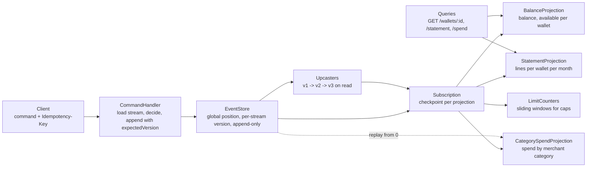

# Capstone: An Event-Sourced Wallet with CQRS

> Commands, events, projections, and replay.

**Type:** Capstone
**Languages:** Java, Python, or Go (pick one; the spec is language-neutral)
**Prerequisites:** Phase 8 Lesson 01 (The Append-Only Log), Phase 8 Lesson 05 (Event Sourcing), Phase 8 Lesson 06 (CQRS and Projections), Phase 8 Lesson 11 (Schema Registries and Compatible Evolution), Phase 10 Lesson 01 (Representing Money), Phase 10 Lesson 05 (Balances and Snapshots), Phase 10 Lesson 07 (Holds and Available Balance), Phase 11 Lesson 12 (Wallets and Stored Value), Phase 12 Lesson 09 (Limits and Velocity Controls), Phase 15 Lesson 01 (A Durable Double-Entry Ledger Service)
**Time:** ~360 minutes

## Learning Objectives

- Model a stored-value wallet as an aggregate whose only persistent truth is an ordered stream of events, and whose balance is a fold over that stream
- Separate commands (intent, may be rejected) from events (facts, never rejected) and enforce every business rule at the command boundary with optimistic concurrency on the stream version
- Build read models as projections that consume the event stream through a checkpointed subscription, can be deleted and rebuilt from scratch, and are allowed to lag
- Replay the full history to answer a point-in-time question, to rebuild a corrupted projection, and to run a new projection against old events
- Evolve an event schema with upcasters so that events written by version 1 of the system are readable by version 3 without rewriting the log

## The Problem

A ride-hailing company runs a rider wallet. The schema is `wallets(id, balance_minor, currency, updated_at)` and a `transactions` table written by application code after each balance update. A promotion credits 500.00 INR to 2 million riders over a weekend. On Sunday the fraud team notices that 3,400 riders have balances above the 10,000.00 INR regulatory cap for a semi-closed prepaid instrument. The code that applied the promotion checked the cap, but a concurrent top-up on the same wallet read the balance before the promotion and wrote after it, and the check passed on a stale number. Nobody can say which 3,400 transactions to reverse, because `transactions` was written best-effort after the `UPDATE` and 0.2% of rows are missing where the request timed out between the two statements.

The regulator asks a second question: for each affected wallet, what was the balance at 23:59:59 on Saturday? The `transactions` table cannot answer it reliably because it is incomplete, and `wallets` cannot answer it at all because it holds only the current number. A third request arrives from the product team: they want a "monthly spend by merchant category" screen. It needs a new table, a backfill job that reads `transactions`, and three weeks of reconciling the backfill against balances that it will never fully agree with.

Every one of these is the same missing idea: the balance is derived data and should never be the source of truth. `phases/08-messaging-and-streams/05-event-sourcing` built an aggregate that is rebuilt from its events and a store that appends with an expected version so two concurrent writers cannot both succeed. `phases/08-messaging-and-streams/06-cqrs-and-projections` built read models that follow the stream through a checkpointed position and can be discarded and recreated. `phases/10-money-and-ledgers/05-balances-and-snapshots` showed that a fold over history can be checkpointed without losing the ability to replay. `phases/10-money-and-ledgers/07-holds-and-available-balance` separated posted from available, which a wallet needs for ride holds. `phases/12-payment-systems-design/09-limits-and-velocity-controls` built the sliding-window counters that the regulatory cap and the daily limit need. This capstone composes them into a wallet whose history is complete by construction and whose cap check cannot race.

## What You Will Build

A single-process wallet service with an append-only event store, a command handler per aggregate, several projections fed by a subscription, a replay facility, and a schema-evolution layer. HTTP is optional; the acceptance tests drive an in-process `WalletService`.



The components, each traceable to a lesson you have already built:

| Component | Composes | What it owns |
|-----------|----------|--------------|
| `Money`, `Currency` | `phases/10-money-and-ledgers/01-representing-money` | integer minor units with currency; INR has exponent 2 |
| `EventStore` | `phases/08-messaging-and-streams/01-the-append-only-log`, `phases/08-messaging-and-streams/05-event-sourcing` | `append(streamId, expectedVersion, events)`, `read(streamId)`, `readAll(fromPosition)`; durable through a CRC-checked log |
| `WalletAggregate` | `phases/08-messaging-and-streams/05-event-sourcing`, `phases/11-payment-rails/12-wallets-and-stored-value` | `decide(state, command) -> events or rejection`; `evolve(state, event) -> state`; no I/O |
| `CommandHandler` | `phases/05-distributed-foundations/09-idempotency-keys` | load, decide, append with `expectedVersion`, retry on `VERSION_CONFLICT`, dedupe by command id |
| `Hold` events | `phases/10-money-and-ledgers/07-holds-and-available-balance` | `HoldPlaced`, `HoldCaptured`, `HoldReleased`; available = balance minus active holds |
| `Projection`, `Subscription`, `Checkpoint` | `phases/08-messaging-and-streams/06-cqrs-and-projections` | `handle(event, position)`; checkpoint written after the handler; rebuild by resetting to 0 |
| `LimitCounters` | `phases/12-payment-systems-design/09-limits-and-velocity-controls` | rolling 24 h credit total and regulatory balance cap, both derived from events |
| `Snapshotter` | `phases/10-money-and-ledgers/05-balances-and-snapshots` | aggregate state at version `v`; load snapshot then events after `v` |
| `Upcaster` chain | `phases/08-messaging-and-streams/11-schema-registry-and-evolution` | `(eventType, version) -> function` that rewrites an old event shape into the current one on read |
| `Replayer` | `phases/08-messaging-and-streams/05-event-sourcing` | rebuild any projection from position 0; compute state as of a timestamp or position |

Standard library only: `java.util.zip.CRC32`, `java.nio.channels.FileChannel`, `java.util.concurrent`; Python `zlib`, `struct`, `json`, `threading`; Go `hash/crc32`, `encoding/json`, `encoding/binary`, `sync`.

### One command, end to end

Trace a top-up before writing code. Wallet `w-7781` (INR) has 6 events, version 6, balance 9,200.00, one active hold of 300.00 for a ride in progress. A client sends:

```json
{
  "commandId": "topup-2f91",
  "type": "TopUp",
  "walletId": "w-7781",
  "amount": {"minor": 120000, "currency": "INR"},
  "source": "UPI:ref-88213"
}
```

1. `CommandHandler` checks the command-id table: `topup-2f91` is unseen. It loads the stream: 6 events, folds them into `WalletState(balance=920000, holds={h-1: 30000}, dailyCredits=0, version=6)`.
2. `WalletAggregate.decide` checks the rules in order: currency matches; amount is positive; `balance + amount = 1,040,000 minor` which exceeds the cap of `1,000,000` minor (10,000.00 INR). The decision is a rejection `BALANCE_CAP_EXCEEDED` with `headroom = 80000`. No event is written. The handler stores the rejection against `topup-2f91` so a retry gets the same answer.
3. The client sends a corrected top-up of 800.00 INR with a new command id. `decide` now returns `[Credited(amount=80000, source="UPI:ref-88213", at=T)]`. `append("w-7781", expectedVersion=6, [Credited])` succeeds, the event gets stream version 7 and global position 4,118.
4. The subscription wakes the projections. `BalanceProjection` sets `w-7781` to `balance=1,000,000, available=970,000`. `StatementProjection` appends a line to `w-7781/2026-03`. `LimitCounters` adds 80,000 to the 24 h credit window. Each writes its checkpoint to 4,118 after handling.
5. A concurrent `Debit` on the same wallet that loaded version 6 before step 3 now calls `append(expectedVersion=6)` and gets `VERSION_CONFLICT`. The handler reloads (version 7), re-decides against the new balance, and either appends at version 7 or rejects. The cap can no longer be passed on a stale read, because the decision and the append are tied to the same version.

The command never touches a balance column. The balance is whatever the fold says, and the fold is deterministic, so two machines reading the same stream get the same number. Every milestone below is one more guarantee in this trace.

### Commands versus events

| | Command | Event |
|---|---------|-------|
| Tense | imperative: `TopUp`, `Debit`, `PlaceHold` | past: `Credited`, `Debited`, `HoldPlaced` |
| Can be rejected | yes, by `decide` | never; it already happened |
| Carries | intent and parameters | the facts needed to evolve state, plus `at`, `causationId`, `correlationId` |
| Idempotent by | `commandId` | position in the stream |
| Who reads it | one aggregate | every projection, forever |

What the design does not do: it is not a double-entry ledger. A wallet stream records what happened to one wallet; the ledger from `phases/15-capstone-projects/01-capstone-ledger-service` records where the money came from and went to. In production the wallet service emits events and a ledger integration posts balanced entries from them (Exercise 3 of the ledger capstone). It also does not give you cross-aggregate transactions: a transfer between two wallets is two streams and a saga, not one append.

### Failure modes the design must close

Each row is a way the Problem section's wallet lost money or history, the mechanism in this capstone that closes it, and the milestone test that proves it closed.

| Failure | What goes wrong in the mutable-balance design | Mechanism here | Proven by |
|---------|-----------------------------------------------|----------------|-----------|
| Stale-read cap breach | two writers read 9,600.00, each adds 500.00, both pass a 10,000.00 cap check | `append` with `expectedVersion`; loser reloads and re-decides | M2 step 2 |
| Lost history row | `UPDATE wallets` commits, `INSERT transactions` times out | the event is the only write; there is no second statement to lose | M2 step 3 |
| Retried top-up credits twice | client times out and resends; balance moves twice | `commandId` table returns the stored outcome | M2 step 4 |
| Torn write after crash | half a record at the end of the log is read as garbage | CRC per batch; truncate the torn tail on open | M2 step 5 |
| Projection double-counts on restart | crash after `handle`, before checkpoint; event handled twice | handlers idempotent on `(streamId, version)` | M4 step 2 |
| Old events unreadable after a deploy | v1 `Credited` lacks `currency`; new code throws on load | upcaster chain applied on read | M6 step 1 |

The first row is worth working by hand. Wallet at version 12, balance 9,600.00 INR, cap 10,000.00. Writer A decides `TopUp(300.00)` at version 12 and appends with `expectedVersion=12`: success, version 13, balance 9,900.00. Writer B also decided `TopUp(300.00)` at version 12, so its append with `expectedVersion=12` fails with `VERSION_CONFLICT`. B reloads (version 13, balance 9,900.00), re-decides, and gets `BALANCE_CAP_EXCEEDED` with `headroom = 10000` minor (100.00 INR, too little for 300.00). The final balance is 9,900.00, and the stream contains exactly one `Credited` for the pair.

## Requirements

Each requirement is a sentence you can turn into a test. The milestone that first satisfies it is in brackets.

1. Every amount is a `Money` value (integer minor units plus ISO 4217 currency). No `double`, `float`, or `float64` appears in any type that holds an amount. [M1]
2. `WalletAggregate.decide(state, command)` is a pure function returning either a non-empty list of events or a rejection with a code from the closed set `CURRENCY_MISMATCH`, `NON_POSITIVE_AMOUNT`, `INSUFFICIENT_AVAILABLE`, `BALANCE_CAP_EXCEEDED`, `DAILY_CREDIT_LIMIT_EXCEEDED`, `HOLD_NOT_FOUND`, `WALLET_CLOSED`, `WALLET_NOT_FOUND`. `evolve(state, event)` is a pure function. Neither performs I/O. [M1]
3. `balance(state)` equals the sum of credits minus the sum of debits and captures over the stream, and `available(state) = balance - sum(active holds)`. Both are recomputed from events in tests and compared to the incrementally evolved state after every command. [M1]
4. `EventStore.append(streamId, expectedVersion, events)` succeeds only if the stream's current version equals `expectedVersion`, assigns consecutive stream versions and a monotonically increasing global position, and persists the batch atomically through a CRC-checked log before returning. A failed append writes nothing. [M2]
5. Every event record carries `(position, streamId, version, type, schemaVersion, at, commandId, payload)`. Events are never updated or deleted; the store has no API for either. [M2]
6. The `CommandHandler` dedupes by `commandId`: the same id returns the stored outcome (success or rejection) without re-deciding. On `VERSION_CONFLICT` it reloads and re-decides up to 3 times, then returns `CONFLICT`. [M2]
7. Under 8 concurrent writers issuing 500 top-ups each against one wallet with a 10,000.00 cap, the final balance never exceeds the cap, `balance == sum of accepted credits`, and `accepted + rejected == 4,000`. [M2]
8. Holds reduce `available` but not `balance`. `CaptureHold(holdId, amount <= held)` emits `HoldCaptured` and reduces balance; the remainder of a partial capture is released in the same event batch. `ReleaseHold` emits `HoldReleased`. [M3]
9. The regulatory cap applies to `balance` after the command; the daily credit limit (50,000.00 INR per rolling 24 h) applies to the sum of `Credited` events with `at` in `(now - 24h, now]`. Both are derived from events, not stored counters, and both use the injected clock. [M3]
10. Each projection consumes events from a `Subscription` that delivers `(event, position)` in global order, and the projection persists its checkpoint only after handling. A projection killed between handling and checkpointing re-handles the event on restart, so every projection handler is idempotent on `(streamId, version)`. [M4]
11. `Projection.rebuild()` resets the checkpoint to 0, clears the read model, and replays. After rebuild the read model is byte-identical to the one built incrementally. [M4]
12. `Replayer.stateAt(walletId, timestamp)` folds only events with `at <= timestamp` and returns the balance and available at that instant. `Replayer.stateAt(walletId, position)` does the same by global position. [M5]
13. A snapshot of aggregate state at version `v` is stored outside the stream; loading uses the snapshot plus events after `v`, and the result equals a full fold. Deleting all snapshots changes nothing observable. [M5]
14. Events carry `schemaVersion`. An `Upcaster` chain rewrites older shapes on read, so the aggregate and projections only ever see the current shape. Appending a v1-shaped event in a test and reading it back yields the v3 shape, and a stream mixing v1, v2, and v3 events folds correctly. [M6]
15. A wallet is closed by `CloseWallet`, which is rejected while any hold is active or the balance is non-zero; after `WalletClosed` every command except queries is rejected with `WALLET_CLOSED`. [M6]

## Milestones

Work the milestones in order. Each one ends with a test you run before moving on. Commands assume `capstone/wallet/{java,python,go}`.

```bash
# Java
cd capstone/wallet/java && javac -d .out *.java && java -cp .out WalletTest
# Python
cd capstone/wallet/python && python3 -m unittest -v
# Go
cd capstone/wallet/go && go test -race ./...
```

### Milestone 1: The pure aggregate

Copy `Money` and `Currency` from `phases/10-money-and-ledgers/01-representing-money`. Define the commands `OpenWallet`, `TopUp`, `Debit`, `PlaceHold`, `CaptureHold`, `ReleaseHold`, `CloseWallet` and the events `WalletOpened`, `Credited`, `Debited`, `HoldPlaced`, `HoldCaptured`, `HoldReleased`, `WalletClosed`. Define `WalletState(id, currency, balance, holds, credits24h, closed, version)` and implement `decide` and `evolve` with no dependencies on storage or clock beyond a `now` parameter.

Acceptance test `m1_decide_and_evolve_are_pure_and_balance_is_a_fold`:

1. `decide(empty, OpenWallet("w-1", INR))` yields `[WalletOpened]`. `decide(state, TopUp(500.00))` yields `[Credited(50000)]`. Evolve both. Assert `balance == 50000`, `available == 50000`.
2. `decide(state, Debit(600.00))` yields rejection `INSUFFICIENT_AVAILABLE`. Assert state unchanged (it is a value, so this is a tautology in Go and Python with copies; in Java make `WalletState` a record).
3. `decide(state, TopUp(-1))` yields `NON_POSITIVE_AMOUNT`; `TopUp(10.00 USD)` yields `CURRENCY_MISMATCH`.
4. Generate 1,000 random commands with a seeded `Random`. For each, decide, evolve the accepted events, and assert `balance(state) == foldFromScratch(allEvents).balance`.

```java
static void m1_decide_and_evolve_are_pure_and_balance_is_a_fold() {
    WalletState s = WalletState.empty();
    for (Event e : WalletAggregate.decide(s, new OpenWallet("w-1", Currency.INR), T0).events()) s = WalletAggregate.evolve(s, e);
    for (Event e : WalletAggregate.decide(s, new TopUp(inr(50000)), T0).events()) s = WalletAggregate.evolve(s, e);
    check("balance", s.balance().equals(inr(50000)));
    Decision d = WalletAggregate.decide(s, new Debit(inr(60000), "ride-1"), T0);
    check("insufficient", d.isRejected() && d.code() == RejectionCode.INSUFFICIENT_AVAILABLE);
    check("state untouched", s.balance().equals(inr(50000)));
}
```

### Milestone 2: The event store and optimistic concurrency

Implement `EventStore` over a single append-only log file: each batch is `length | crc32 | payload` where the payload encodes the stream id, expected version, and the events. Keep an in-memory index `streamId -> [positions]` rebuilt on open. `append` takes the store lock, checks the version, writes, flushes, updates the index, and releases; this is the single-writer design, which is enough for the acceptance test. Add `CommandHandler.handle(command)` with the command-id table (also events in a system stream, so it survives restart) and the reload-on-conflict loop.

Acceptance test `m2_concurrent_topups_cannot_pass_the_cap`:

1. Open wallet `w-1` with cap 10,000.00. Start 8 workers each issuing 500 `TopUp(7.00)` with unique command ids. Join.
2. Assert `balance <= 1,000,000`, `balance == 700 * accepted`, `accepted + rejected == 4,000`, and the rejected ones all carry `BALANCE_CAP_EXCEEDED` or `CONFLICT`.
3. Reopen the store from disk. Assert the same balance and that the stream version equals `1 + accepted` (the `WalletOpened` event plus one `Credited` per success).
4. Replay a command id from step 1. Assert the stored outcome returns and the stream version does not change.
5. Append 5 random bytes to the log file. Reopen. Assert the torn tail is truncated and all accepted events are present.

```python
def test_m2_concurrent_topups_cannot_pass_the_cap(self):
    svc = WalletService.open(self.dir, clock=SimClock(T0), cap=inr(1_000_000))
    svc.handle(OpenWallet("w-1", INR), command_id="open-1")
    accepted, rejected, lock = 0, 0, threading.Lock()
    def worker(w):
        nonlocal accepted, rejected
        for i in range(500):
            r = svc.handle(TopUp("w-1", inr(700)), command_id=f"t-{w}-{i}")
            with lock:
                if r.ok: accepted += 1
                else: rejected += 1
    threads = [threading.Thread(target=worker, args=(w,)) for w in range(8)]
    for t in threads: t.start()
    for t in threads: t.join()
    state = svc.load("w-1")
    self.assertLessEqual(state.balance.minor, 1_000_000)
    self.assertEqual(state.balance.minor, 700 * accepted)
    self.assertEqual(accepted + rejected, 4000)
```

Predict: with a 10,000.00 cap and 7.00 top-ups, what is the maximum `accepted`? (1,428, leaving a balance of 9,996.00; the 1,429th would reach 10,003.00.)

### Milestone 3: Holds and limits

Add the hold commands and events. `available = balance - sum(holds.values())`. `Debit` and `PlaceHold` check `available`; `CaptureHold(h, amount)` emits `HoldCaptured(h, amount)` and, if `amount < held`, a `HoldReleased(h, held - amount)` in the same batch, so the version advances by two and the two facts are atomic. Add the rolling daily credit limit: `decide` receives `now` and the state carries the list of `(at, amount)` credits in the last 24 h (prune on evolve).

Acceptance test `m3_holds_and_limits_are_derived_from_events`:

1. Top up 1,000.00. `PlaceHold(300.00, "ride-9")`. Assert `balance == 1,000.00`, `available == 700.00`.
2. `Debit(750.00)` is rejected `INSUFFICIENT_AVAILABLE`. `Debit(700.00)` succeeds. Assert `available == 0`.
3. `CaptureHold("ride-9", 280.00)`. Assert two events appended, `balance == 20.00`, `available == 20.00`, no active hold.
4. At `T0`, top up 49,000.00 in a fresh wallet with cap 100,000.00. At `T0 + 23h` top up 1,000.00 (total 50,000.00, allowed). At `T0 + 23h30m` top up 0.01: rejected `DAILY_CREDIT_LIMIT_EXCEEDED`. At `T0 + 24h01m`, the first credit has left the window: top up 1,000.00 succeeds.
5. Rebuild the state from events alone with a fresh fold and assert it equals the evolved state field for field, including the pruned credit window.

### Milestone 4: Projections and the subscription

Implement `Subscription.poll(checkpoint) -> [(position, event)]` over `EventStore.readAll`. Implement `BalanceProjection` (`walletId -> balance, available`), `StatementProjection` (`(walletId, yyyy-mm) -> lines`), and `CategorySpendProjection` (`(walletId, category) -> total`, where category comes from the `Debit` command's metadata). Each has `handle(position, event)`, `checkpoint()`, `saveCheckpoint(position)`, and `rebuild()`. Projections run on a `ProjectionRunner` that polls, handles, then saves the checkpoint, in that order.

Acceptance test `m4_projections_are_idempotent_and_rebuildable`:

1. Run 300 random commands across 20 wallets. Run the projections to the head. For each wallet assert `BalanceProjection.get(w) == fold(stream(w)).balance`.
2. Kill the runner between `handle` and `saveCheckpoint` (inject a fault that throws after `handle` on position 150). Restart. Assert position 150 is handled twice and the projection values equal step 1's: the handler must be idempotent on `(streamId, version)`.
3. Delete `CategorySpendProjection`'s state. `rebuild()`. Assert byte-identical to the incremental build.
4. Add a new `MerchantCountProjection` after the fact. Run it from checkpoint 0. Assert it sees all 300 commands' events. This is the three-week backfill from the Problem section done in one call.

The runner loop that steps 2 and 3 depend on:

```go
func (r *ProjectionRunner) Tick() error {
    for _, p := range r.projections {
        batch := r.store.ReadAll(p.Checkpoint(), 256)
        for _, rec := range batch {
            ev := r.upcasters.Apply(rec.Event)        // M6: projections see only the current shape
            if err := p.Handle(rec.Position, ev); err != nil {
                return err
            }
            if r.faultAfterHandle != nil && r.faultAfterHandle(rec.Position) {
                return ErrInjectedCrash                   // checkpoint not saved: the event is re-handled
            }
            if err := p.SaveCheckpoint(rec.Position); err != nil {
                return err
            }
        }
    }
    return nil
}
```

### Milestone 5: Replay, point-in-time, and snapshots

Implement `Replayer.stateAt(walletId, at)` and `stateAt(walletId, position)`. Implement `Snapshotter.maybeSnapshot(walletId, state)` every 100 events, stored as `snapshot-<walletId>-<version>.bin` with a CRC, and `load(walletId)` that uses the newest valid snapshot plus the tail. The regulator's question is now one function call.

Acceptance test `m5_point_in_time_and_snapshots_agree_with_full_fold`:

1. Build a wallet with 1,000 events spread over 30 simulated days. For 50 random timestamps assert `stateAt(w, t).balance == foldFromScratch(events where at <= t).balance`.
2. Assert `stateAt(w, position)` for the position of event 500 equals the fold of the first 500 events.
3. Assert at least 9 snapshots exist and `load(w)` equals the full fold. Corrupt the newest snapshot's CRC; assert `load` falls back to the previous one and still equals the full fold. Delete all snapshots; assert `load` still equals the full fold.
4. Time `load` with snapshot versus without over the 1,000-event stream and print both; assert the snapshot path reads fewer than 100 events.

### Milestone 6: Schema evolution and closing

Introduce three shapes of `Credited`: v1 `{amount: 50000}` (currency implied by the wallet, no source), v2 `{amount: {minor, currency}, source}`, v3 adds `channel` (`UPI`, `CARD`, `PROMO`) derived from the `source` prefix. Write `Upcaster(Credited, 1 -> 2)` and `Upcaster(Credited, 2 -> 3)`. The store records `schemaVersion` per event; the reader applies the chain. Add `CloseWallet` and `WalletClosed` with the guard from Requirement 15.

Acceptance test `m6_old_events_are_upcast_and_closed_wallets_refuse_commands`:

1. Write a stream by hand containing a v1 `Credited`, a v2 `Credited`, and a v3 `Credited`. Load the wallet. Assert the balance is the sum of all three and every event seen by `evolve` has the v3 shape with a `channel`.
2. Assert the raw bytes on disk still contain the v1 shape (upcasting is on read; the log is not rewritten).
3. Run `StatementProjection.rebuild()` over the mixed stream. Assert lines carry channels `UPI`, `CARD`, `PROMO` as derived by the upcaster.
4. `CloseWallet` with a 20.00 balance is rejected; `Debit(20.00)` then `CloseWallet` succeeds; `TopUp(1.00)` after that is `WALLET_CLOSED`; `stateAt` still works for the closed wallet.

Predict: a v1 `Credited` has no `source`. What `channel` does the v2-to-v3 upcaster assign, and where is that rule written down? (`UNKNOWN`, and the rule lives in the upcaster, which is the only place in the system that knows v1 ever existed.)

## Acceptance Criteria

The capstone is complete when all of the following are true on a clean checkout of your project:

- All six milestone tests pass in your chosen language with one command, and the Go version passes under `go test -race ./...`.
- A `make demo` or equivalent opens 3 wallets, runs 50 commands including a rejected cap breach, a partial hold capture, and a rejected daily-limit top-up, prints every projection's read model, kills the process (or skips `close`) between a handle and a checkpoint, restarts, and prints that the projections converge to the same values; then prints `stateAt` for one wallet at a timestamp in the middle of the run.
- `README.md` in your project lists every command, every event with its current schema version and all upcasters, the rejection codes, the checkpoint rule, and the decisions in the table below.
- `grep -rn "double\|float" --include=*.java --include=*.py --include=*.go` in amount-bearing types returns only comments.
- No code path updates or deletes an event record; the store exposes only `append` and reads.
- `reports/point-in-time-<walletId>.md` shows the balance at five timestamps with the position and count of events folded for each.

| Decision | Options | What the reference design does | Test that exposes it |
|----------|---------|--------------------------------|----------------------|
| Rejection persistence | store rejections against `commandId`; re-decide on retry | store, so a retry gets the same answer even if state moved | M2 step 4 |
| Partial capture | one `HoldCaptured` with a `released` field; two events in one batch | two events, one batch | M3 step 3 |
| Daily window state | list of recent credits in state; a separate counter projection | list in state (the aggregate must decide without I/O) | M3 step 4 |
| Checkpoint granularity | per event; per batch | per event in tests, per batch allowed in production | M4 step 2 |
| Upcasting | on read; rewrite the log once | on read; the log is never rewritten | M6 step 2 |
| Snapshot cadence | every N events; on size; never | every 100 events | M5 step 4 |

## Rubric

| Criterion | Developing | Solid | Exemplary |
|-----------|------------|-------|-----------|
| Aggregate | Rules checked in the handler against a stored balance | `decide` and `evolve` pure; closed rejection set; balance proven equal to a fold under random commands | Property test shrinks a failing command sequence to the minimal one; invariants documented as predicates over state |
| Event store | Appends without version check or durability | Expected version, atomic batch, CRC, torn-tail recovery, global position | Per-stream and global indexes persisted; store survives a crash test at every record boundary |
| Concurrency | Cap can be exceeded under contention | Optimistic concurrency with bounded retry; concurrent test proves the cap; Go passes `-race` | Contention measured and a per-stream queue compared against the global lock with throughput numbers |
| Holds and limits | Holds change the balance; limit is a mutable counter | Available separate from balance; partial capture atomic; rolling window derived from events | Limits are configurable per wallet tier and the configuration change is itself an event |
| Projections | Read models updated inline with the command | Checkpointed subscription; idempotent handlers; rebuild proven identical; new projection added after the fact | Projections run in their own thread with lag metrics and a test that a slow projection does not block commands |
| Replay and snapshots | No point-in-time capability | `stateAt` by time and position; snapshots verified against a full fold and safe to delete | Point-in-time queries served from a time-indexed projection in O(log n) |
| Schema evolution | Old events break the fold | Versioned events, upcaster chain on read, mixed streams fold correctly | Upcasters are tested with a golden file of every historical shape and a check that no shape is unreachable |
| Engineering hygiene | No README | README documents events, upcasters, checkpoints, and decisions | Demo reproduces the Problem section's race and shows the cap holding |

## Further Reading

- [Martin Fowler, "Event Sourcing" (2005)](https://martinfowler.com/eaaDev/EventSourcing.html) — the original description of state as a fold over events, including the replay and snapshot ideas M5 implements.
- [Greg Young, "CQRS Documents" (2010)](https://cqrs.files.wordpress.com/2010/11/cqrs_documents.pdf) — the separation of command and query models and the argument for eventually consistent projections that Requirement 10 adopts.
- [Greg Young, *Versioning in an Event Sourced System* (Leanpub, 2017)](https://leanpub.com/esversioning) — upcasters, weak schema, and why you never rewrite the log, which M6 follows.
- [EventStoreDB documentation, "Optimistic concurrency and idempotence"](https://developers.eventstore.com/clients/grpc/appending-events.html) — a production store's `expectedRevision` contract, the same shape as Requirement 4.
- [Reserve Bank of India, "Master Directions on Prepaid Payment Instruments" (2021, as amended)](https://www.rbi.org.in/Scripts/BS_ViewMasDirections.aspx?id=12156) — the balance caps and KYC tiers behind the regulatory limit in the Problem section.
- [Pat Helland, "Immutability Changes Everything" (CIDR 2015)](https://www.cidrdb.org/cidr2015/Papers/CIDR15_Paper16.pdf) — why an append-only history is simpler to reason about than mutable state, with the derived-data framing this capstone relies on.
