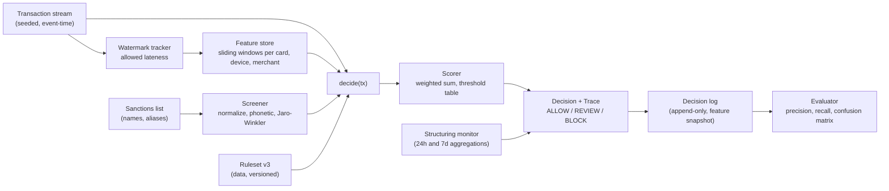

# Capstone: Real-Time Fraud Decisioning

> Streams, windows, rules, scores, and explainable decisions.

**Type:** Capstone
**Languages:** Java, Python, or Go (pick one; the spec is language-neutral)
**Prerequisites:** Phase 13 Lesson 01 (Fraud Patterns), Phase 13 Lesson 02 (A Rules Engine with Velocity Checks), Phase 13 Lesson 03 (Risk Scoring and Thresholds), Phase 13 Lesson 04 (Sanctions Screening), Phase 13 Lesson 06 (AML Transaction Monitoring), Phase 8 Lesson 07 (Stream Processing and Windows), Phase 8 Lesson 08 (Watermarks, Event Time, and Late Data), Phase 3 Lesson 02 (Count-Min Sketch and HyperLogLog), Phase 3 Lesson 11 (Rate Limiter Algorithms), Phase 12 Lesson 09 (Limits and Velocity Controls), Phase 14 Lesson 10 (Deterministic Simulation Testing), Phase 15 Lesson 02 (An Idempotent Multi-Processor Payment Gateway)
**Time:** ~360 minutes

## Learning Objectives

- Compose the Phase 13 risk mechanisms (declarative rules, sliding-window velocity, weighted scoring with thresholds, fuzzy sanctions matching, structuring detection) into one decision service that answers every authorization inside a latency budget
- Compute every velocity feature from an event-time stream with watermarks, so that a late or replayed event changes the same windows it would have changed had it arrived on time
- Return a decision that is a closed enum plus a trace an analyst can read: which rules fired, which features they read, and the score arithmetic that crossed the threshold
- Keep every decision reproducible: the same transaction, the same feature snapshot, and the same ruleset version produce the same decision, byte for byte, months later
- Measure the engine against labelled outcomes and tune thresholds with precision and recall rather than intuition

## The Problem

A marketplace runs its fraud checks as a chain of `if` statements inside the payment handler. One check counts a card's attempts in the last hour with `SELECT COUNT(*) FROM payments WHERE card = ? AND created_at > now() - interval '1 hour'`. At 400 authorizations per second the query takes 180 milliseconds on a hot card, the handler's 150 millisecond budget is blown, and the check is wrapped in a timeout that defaults to "allow". A card-testing ring finds this within a week: they push 2,000 attempts per minute from one BIN range, every velocity query times out, every attempt is allowed, and the merchant pays 0.10 USD in network fees per attempt plus a scheme fine for an authorization-to-approval ratio under 20%.

Three months later a regulator asks why a customer flagged by a sanctions list on 14 March was allowed to receive four payouts on 15 March. The answer is in nobody's hands. The sanctions check lived in a nightly batch that wrote a `blocked` boolean on the customer row; the payout job read a cached copy of the row from before the batch ran. There is no record of what the decision engine knew at the moment it decided, so the compliance team cannot say whether the failure was a data problem, a rules problem, or a caching problem. The investigation takes eleven days.

Both incidents are missing mechanisms you have built. `phases/13-risk-fraud-and-compliance/02-rules-engine-and-velocity-checks` gave you a sliding-window counter that answers in constant time and a rule trace that records why. `phases/13-risk-fraud-and-compliance/03-risk-scoring-and-thresholds` gave you weighted scores and the precision-recall arithmetic that chooses a threshold. `phases/13-risk-fraud-and-compliance/04-sanctions-screening` gave you Jaro-Winkler and phonetic keys that find "Mohammad Al-Rashid" when the list says "Muhammad Alrashid". `phases/13-risk-fraud-and-compliance/06-aml-transaction-monitoring` gave you the structuring detector that sees ten deposits of 9,900. `phases/08-messaging-and-streams/07-stream-processing-windows` and `phases/08-messaging-and-streams/08-watermarks-and-late-data` gave you the event-time windows that make a replayed stream produce the same counts. This capstone puts them behind one `decide(transaction)` call with a latency budget, a feature snapshot, and a trace, and makes a labelled simulation the acceptance test.

## What You Will Build

A single-process decision service: an event-time feature pipeline fed by a transaction stream, a versioned ruleset, a scorer, a sanctions screener, a structuring monitor, and a `decide` entry point that returns `ALLOW`, `REVIEW`, or `BLOCK` with a trace. The stream, the clock, and the labelled fraud ground truth are seeded fakes, so every run is reproducible.



The components, each traceable to a lesson you have already built:

| Component | Composes | What it owns |
|-----------|----------|--------------|
| `Money`, `Currency` | `phases/10-money-and-ledgers/01-representing-money` | integer minor units; every threshold amount is `Money`, never a float |
| `Transaction`, `Decision`, `RuleTrace` | `phases/13-risk-fraud-and-compliance/02-rules-engine-and-velocity-checks` | the input record, the closed decision set, the per-rule record of what was read and what fired |
| `SlidingWindowCounter`, `FeatureStore` | `phases/13-risk-fraud-and-compliance/02-rules-engine-and-velocity-checks`, `phases/03-systems-data-structures/11-rate-limiter-algorithms` | count and sum per key over 1 minute, 1 hour, 24 hours; constant-time read |
| `WatermarkTracker`, `WindowAssigner` | `phases/08-messaging-and-streams/07-stream-processing-windows`, `phases/08-messaging-and-streams/08-watermarks-and-late-data` | event-time windows, allowed lateness, late-event handling that updates the right window |
| `CountMinSketch`, `HyperLogLog` | `phases/03-systems-data-structures/02-count-min-sketch-and-hyperloglog` | distinct cards per device and per IP without storing every pair |
| `Rule`, `Ruleset`, `RulesEngine` | `phases/13-risk-fraud-and-compliance/02-rules-engine-and-velocity-checks` | declarative conditions over features; a versioned, hashed ruleset |
| `Scorer`, `ThresholdTable` | `phases/13-risk-fraud-and-compliance/03-risk-scoring-and-thresholds` | weighted sum of fired rules, two thresholds (review, block), precision-recall evaluation |
| `Screener`, `NameNormalizer` | `phases/13-risk-fraud-and-compliance/04-sanctions-screening` | normalize, phonetic key, Jaro-Winkler, match threshold, hit explanations |
| `StructuringMonitor` | `phases/13-risk-fraud-and-compliance/06-aml-transaction-monitoring` | per-customer aggregations below a reporting threshold over 24 hours and 7 days |
| `LimitChecker` | `phases/12-payment-systems-design/09-limits-and-velocity-controls` | hard per-card and per-merchant limits that short-circuit scoring |
| `DecisionLog` | `phases/13-risk-fraud-and-compliance/11-auditability-and-evidence` | append-only; each record holds the feature snapshot, ruleset hash, and decision |
| `SimStream`, `SimClock`, `LabelledOracle` | `phases/14-payments-at-scale/10-simulation-testing-of-payment-systems` | seeded transactions with planted fraud patterns and ground-truth labels |

Standard library only: `java.util.concurrent`, `java.security.MessageDigest`; Python `collections.deque`, `hashlib`, `random.Random(seed)`; Go `container/ring` or slices, `crypto/sha256`, `math/rand` with a fixed source.

### One decision, end to end

Trace a single transaction before writing code. The stream delivers:

```json
{
  "txId": "tx-0048812",
  "eventTime": "2026-04-02T14:03:17.250Z",
  "amount": {"minor": 4850, "currency": "USD"},
  "card": "tok_9f31", "bin": "411111", "device": "dev_77a1", "ip": "203.0.113.9",
  "merchant": "m_2210", "customerName": "Muhammad Alrashid", "country": "US"
}
```

The watermark is at `14:03:16.900Z`, so the event is on time. The feature store updates the card's 1-minute window (attempts 1 to 7), the device's 1-hour distinct-card sketch (estimate 1 to 6), and the merchant's 24-hour approval ratio. `decide` first runs `LimitChecker`: the card's daily limit of 2,000.00 USD has 1,951.50 remaining, so 48.50 fits. Then the rules evaluate against the feature snapshot:

| Rule | Condition | Feature value | Fired | Weight |
|------|-----------|---------------|-------|--------|
| `card_velocity_1m` | `card.attempts_1m >= 5` | 7 | yes | 35 |
| `device_card_spread_1h` | `device.distinct_cards_1h >= 5` | 6 | yes | 30 |
| `amount_above_card_p95` | `amount > card.p95_amount_30d` | 48.50 vs 61.20 | no | 20 |
| `new_device_for_card` | `card.devices_seen_30d` does not contain `device` | contains | no | 15 |
| `sanctions_hit` | `screener.best_score >= 0.92` | 0.94 ("Mohammad Al-Rashid", alias list entry 1182) | yes | 100 |

The score is 35 + 30 + 100 = 165. The threshold table says `REVIEW` at 60 and `BLOCK` at 120, so the decision is `BLOCK`. The trace records the five rows above, the ruleset hash `sha256:4c1e...`, the feature snapshot, the watermark, and the elapsed time of 1.8 milliseconds. The decision log appends it. Two weeks later a compliance officer asks why `tx-0048812` was blocked and reads the five rows; the engine is not consulted. Every milestone below is one more of those guarantees made testable.

### Why rules and a score, not one or the other

A rule alone is binary and brittle: `attempts_1m >= 5` blocks a family sharing a card at a theme park. A score alone is opaque: "0.87" tells an analyst nothing. The design here fires rules as evidence and sums their weights into a score, so the trace is a list of named facts and the threshold is one tunable number. The sanctions rule carries a weight above the block threshold on its own because a sanctions hit is not a probability of fraud; it is a legal obligation. Your ruleset must make that distinction visible as data, not as a special case in code.

## Requirements

Each requirement is a sentence you can turn into a test. The milestone that first satisfies it is in brackets.

1. Every amount and threshold amount is a `Money` value. Scores and weights are integers. Similarity scores from the screener are scaled integers in `[0, 10000]` or decimals, never binary floats stored in a decision record. [M1]
2. `Decision` is a closed enum: `ALLOW`, `REVIEW`, `BLOCK`. Every `decide` call returns a `DecisionRecord(txId, decision, score, trace, featureSnapshot, rulesetHash, watermark, elapsedMicros)`. [M1]
3. Velocity features are sliding-window counts and sums over 1 minute, 1 hour, and 24 hours per card, device, IP, and merchant, keyed by event time. A read is O(number of buckets), independent of transaction volume. [M1]
4. The feature pipeline tracks a watermark equal to the maximum event time seen minus an allowed lateness of 30 seconds. An event behind the watermark but within lateness updates the window its event time belongs to. An event beyond lateness is routed to a `late` counter and does not change any window. [M2]
5. Replaying the same transaction stream in any arrival order that respects the watermark rule produces identical feature values at every `decide` call. [M2]
6. Distinct-count features (`distinct_cards_1h` per device, `distinct_devices_24h` per card) use a sketch with bounded memory; the test asserts the estimate is within 5% of the true count at 10,000 distinct values. [M2]
7. A `Ruleset` is data (JSON or an equivalent structure), has a version and a SHA-256 hash over its canonical bytes, and is loaded at startup. Adding or changing a rule never requires a code change to the engine. [M3]
8. Each `Rule` has `id`, `condition` (field, operator, operand), `weight`, and `action` of `SCORE` or `HARD_BLOCK`. A `HARD_BLOCK` rule that fires produces `BLOCK` regardless of score. Every fired and unfired rule appears in the trace with the feature value it read. [M3]
9. `ThresholdTable(review, block)` maps a score to a decision. `Scorer.evaluate(records, labels)` returns precision, recall, and the confusion matrix for a given table, and `Scorer.sweep` returns the same for every candidate threshold. [M4]
10. The screener normalizes names (case, diacritics, punctuation, token order), computes a phonetic key, and scores Jaro-Winkler similarity against list entries and their aliases. A hit above 0.92 fires `sanctions_hit` as `HARD_BLOCK`; a hit between 0.85 and 0.92 fires a `SCORE` rule with weight 50. Every hit names the list entry and the similarity. [M5]
11. The structuring monitor aggregates per-customer deposits in `[9000, 10000)` USD over 24 hours and 7 days and fires `structuring_24h` at 3 or more and `structuring_7d` at 6 or more. It is driven by the same event-time pipeline as velocity. [M5]
12. `decide` completes in under 5 milliseconds at p99 over 100,000 calls on a laptop, measured by the test with the simulated clock excluded from the measurement. No `decide` call performs I/O other than appending to the decision log. [M6]
13. The decision log is append-only and each record is self-contained: a reviewer can recompute the score from the trace alone and the recomputation equals the stored score for every record. [M6]
14. A seeded simulation of 200,000 transactions with planted card testing, account takeover, and structuring, each labelled, finishes with recall at least 0.90 on card testing, at least 0.80 on structuring, false-positive rate under 2% on legitimate traffic, and every `BLOCK` with a `sanctions_hit` traced to a list entry. Re-running the seed reproduces the decision log byte for byte. [M7]

## Milestones

Work the milestones in order. Each ends with a test you run before moving on. Name the tests as shown so your output reads as a checklist. Commands assume `capstone/fraud/{java,python,go}`.

```bash
# Java
cd capstone/fraud/java && javac -d .out *.java && java -cp .out FraudTest
# Python
cd capstone/fraud/python && python3 -m unittest -v
# Go
cd capstone/fraud/go && go test -race ./...
```

### Milestone 1: The feature store

Copy `Money` and `Currency` from `phases/10-money-and-ledgers/01-representing-money` and `SlidingWindowCounter` from `phases/13-risk-fraud-and-compliance/02-rules-engine-and-velocity-checks`. Build `FeatureStore.observe(tx)` and `FeatureStore.snapshot(tx) -> FeatureSnapshot`, where the snapshot is an immutable map from feature name to value computed at the transaction's event time. Windows use fixed buckets (1-second buckets for the 1-minute window, 1-minute buckets for the hour, 15-minute buckets for the day) so a read sums at most 60 + 60 + 96 buckets.

Acceptance test `m1_velocity_windows_count_and_expire_by_event_time`:

1. Observe 7 transactions on card `c1` at event times `t0 + 0s, 5s, 10s, ..., 30s`. Assert `card.attempts_1m == 7` and `card.sum_1m == ` the sum of the seven amounts as `Money`.
2. Take a snapshot at `t0 + 95s`. Assert `card.attempts_1m == 0` (the newest event, at `t0 + 30s`, is 65 seconds old) and `card.attempts_1h == 7`. Then snapshot at `t0 + 85s` and assert `card.attempts_1m == 1`: the window is `(t - 60s, t]`, so `t0 + 30s` is inside at 85 and outside at 95. Work the arithmetic by hand before running the test.
3. Observe 100,000 transactions across 10,000 cards. Assert a snapshot takes under 50 microseconds on average, which proves reads do not scan history.
4. Assert `snapshot` returns the same values when called twice with no intervening `observe`.

```java
static void m1_velocity_windows_count_and_expire_by_event_time() {
    FeatureStore store = new FeatureStore(WindowConfig.standard());
    Instant t0 = Instant.parse("2026-04-02T14:00:00Z");
    for (int i = 0; i <= 6; i++) {
        store.observe(tx("c1", "d1", usd(1000 + i), t0.plusSeconds(5L * i)));
    }
    FeatureSnapshot s = store.snapshot(tx("c1", "d1", usd(100), t0.plusSeconds(30)));
    check("attempts in minute", s.getLong("card.attempts_1m") == 7);
    check("sum in minute", s.getMoney("card.sum_1m").equals(usd(7000 + 21)));
    FeatureSnapshot later = store.snapshot(tx("c1", "d1", usd(100), t0.plusSeconds(95)));
    check("minute window expired", later.getLong("card.attempts_1m") == 0);
    check("hour window still full", later.getLong("card.attempts_1h") == 7);
}
```

### Milestone 2: Event time, watermarks, and sketches

Add `WatermarkTracker(allowedLateness = 30 s)` in front of the store. `ingest(tx)` advances the watermark to `max(eventTime) - lateness`, routes on-time and within-lateness events to `observe`, and counts events older than the watermark as late without applying them. Replace exact distinct counts with `HyperLogLog` (precision 14) for `distinct_cards_1h` per device and `distinct_devices_24h` per card, and `CountMinSketch` for per-IP attempt counts across the whole day, both from `phases/03-systems-data-structures/02-count-min-sketch-and-hyperloglog`.

Acceptance test `m2_late_events_land_in_their_window_and_replay_is_order_independent`:

1. Ingest events at `t0 + 0s` through `t0 + 59s` for card `c1`, one per second. Then ingest one event with event time `t0 + 20s` (39 seconds late, within lateness). Assert `card.attempts_1m` at `t0 + 59s` is 61 and the late counter is 0.
2. Ingest an event with event time `t0 + 0s` when the watermark is at `t0 + 29s` (that is, after seeing `t0 + 59s`). Assert it is counted as late and no window changed.
3. Generate 10,000 events, shuffle them with a seeded RNG under the constraint that no event arrives more than 25 seconds after a later-timestamped one, ingest, and assert every feature value at the final snapshot equals the values from ingesting in timestamp order.
4. Insert 10,000 distinct cards on one device. Assert `distinct_cards_1h` is within 5% of 10,000 and the sketch's memory is under 32 KiB.

```python
def test_m2_replay_is_order_independent(self):
    ordered = generate_events(seed=11, n=10_000)
    a = FeaturePipeline(lateness_s=30)
    for e in ordered:
        a.ingest(e)
    shuffled = bounded_shuffle(ordered, max_skew_s=25, rng=random.Random(11))
    b = FeaturePipeline(lateness_s=30)
    for e in shuffled:
        b.ingest(e)
    probe = ordered[-1]
    self.assertEqual(a.snapshot(probe), b.snapshot(probe))
    self.assertEqual(b.late_count, 0)
```

### Milestone 3: The ruleset as data

Define `Rule(id, field, operator, operand, weight, action)` with operators `GE`, `GT`, `LE`, `LT`, `EQ`, `IN`, `NOT_IN`, `CONTAINS`, and `Ruleset(version, rules)` loaded from JSON with `hash = SHA-256(canonicalBytes)`. `RulesEngine.evaluate(snapshot) -> List<RuleTrace>` evaluates every rule, recording `(ruleId, fieldValue, fired)`. A rule whose field is missing from the snapshot records `fired = false` and `reason = MISSING_FEATURE`; it never throws. Validate at load: duplicate ids, unknown operators, and operands whose type does not match the field are rejected before the engine starts.

Acceptance test `m3_rules_are_data_and_every_rule_is_traced`:

1. Load a ruleset with the five rules from the worked trace. Assert `hash` equals a value you computed once and pinned, and that changing one weight changes the hash.
2. Evaluate the worked snapshot. Assert exactly three rules fired, the trace has five rows, and the row for `amount_above_card_p95` records `fieldValue = 48.50` and `fired = false`.
3. Load a ruleset with a duplicate id. Assert `RULESET_INVALID` and that the engine still runs the previous version.
4. Evaluate a snapshot missing `device.distinct_cards_1h`. Assert the trace row says `MISSING_FEATURE` and the other rules evaluated normally.

### Milestone 4: Scoring and thresholds

Implement `Scorer.score(traces) -> int` as the sum of weights of fired `SCORE` rules, `ThresholdTable(review, block).decide(score, traces)` returning `BLOCK` if any `HARD_BLOCK` rule fired or `score >= block`, `REVIEW` if `score >= review`, else `ALLOW`. Add `Evaluator.confusion(records, labels)` producing true and false positives and negatives where a positive is `REVIEW` or `BLOCK`, and `Evaluator.sweep(records, labels, candidates)` returning precision and recall for each candidate `(review, block)` pair, following `phases/13-risk-fraud-and-compliance/03-risk-scoring-and-thresholds`.

Acceptance test `m4_thresholds_are_chosen_by_precision_and_recall`:

1. Build 1,000 synthetic records with known scores: 900 legitimate with scores drawn from `[0, 70]`, 100 fraudulent from `[50, 200]`, seeded. Label them.
2. Sweep `block` over `{80, 100, 120, 140}` with `review = 60`. Assert recall is monotonically non-increasing and precision non-decreasing as `block` rises.
3. Assert that at `block = 120` the confusion matrix sums to 1,000 and that `precision = tp / (tp + fp)` and `recall = tp / (tp + fn)` match a hand calculation on the first 20 records you print.
4. Fire a `HARD_BLOCK` rule on a record with score 0. Assert `BLOCK`.

```go
func TestM4HardBlockOverridesScore(t *testing.T) {
    table := ThresholdTable{Review: 60, Block: 120}
    traces := []RuleTrace{
        {RuleID: "sanctions_hit", Fired: true, Weight: 0, Action: HardBlock},
    }
    if got := table.Decide(Score(traces), traces); got != Block {
        t.Fatalf("hard block ignored: %v", got)
    }
    if got := table.Decide(59, nil); got != Allow {
        t.Fatalf("59 should allow: %v", got)
    }
    if got := table.Decide(60, nil); got != Review {
        t.Fatalf("60 should review: %v", got)
    }
}
```

### Milestone 5: Sanctions and structuring

Plug in `Screener` from `phases/13-risk-fraud-and-compliance/04-sanctions-screening`: `screen(name) -> List<Hit(entryId, matchedAlias, similarity)>` with normalization (lowercase, strip diacritics and punctuation, sort tokens), a phonetic pre-filter so that only candidates sharing a key are compared, and Jaro-Winkler on the survivors. Publish `screener.best_score` and `screener.best_entry` as features so the sanctions rules are ordinary rules. Add `StructuringMonitor` from `phases/13-risk-fraud-and-compliance/06-aml-transaction-monitoring` publishing `customer.deposits_9k_24h` and `customer.deposits_9k_7d` through the same event-time pipeline.

Acceptance test `m5_fuzzy_sanctions_hits_and_structuring_are_explained`:

1. Load a 500-entry list with aliases. Screen `"Muhammad Alrashid"`. Assert the best hit is entry 1182 alias `"Mohammad Al-Rashid"` with similarity at least 0.92, and that the trace names both.
2. Screen `"Michael Alvarez"`. Assert no hit above 0.85, so neither sanctions rule fires.
3. Assert the phonetic pre-filter compared fewer than 5% of the 500 entries for each of the two names.
4. Ingest 3 deposits of 9,500.00 USD for customer `u9` within 20 hours, then a fourth 30 hours after the first. Assert `structuring_24h` fired on the third and not on the fourth, and `customer.deposits_9k_7d == 4` after the fourth.
5. Ingest a 10,000.00 deposit. Assert it is not counted (the band is `[9000, 10000)`).

### Milestone 6: The decision log and latency budget

Wire `DecisionService.decide(tx)`: ingest, snapshot, limits, rules, score, threshold, append `DecisionRecord` to `DecisionLog` with `rulesetHash`, `watermark`, and `elapsedMicros`. The log is the same `length | crc32 | payload` format you built in `phases/15-capstone-projects/01-capstone-ledger-service`. Add `DecisionLog.verify()` that re-scores every record from its trace and compares with the stored score. Measure `decide` latency with a monotonic clock around the call, excluding the simulated event clock.

Acceptance test `m6_decisions_are_fast_reproducible_and_self_describing`:

1. Run 100,000 seeded transactions. Assert p99 of `elapsedMicros` under 5,000 and p50 under 500.
2. Call `DecisionLog.verify()`. Assert zero score mismatches.
3. Pick record 50,000. Reconstruct the decision from its `featureSnapshot`, `rulesetHash`, and the ruleset with that hash, without the feature store. Assert identical `decision` and `score`.
4. Change one rule weight, reload the ruleset, decide the same transaction. Assert a different `rulesetHash` in the new record and that the old record is unchanged.

### Milestone 7: The labelled simulation

Build `Simulation(seed, config)` with a `SimStream` that generates 200,000 transactions over a simulated 24 hours: 97% legitimate traffic with realistic per-card cadence, plus planted patterns from `phases/13-risk-fraud-and-compliance/01-fraud-patterns`: card testing (one device, 300 cards, 2 attempts each, small amounts, 10 minutes), account takeover (a card suddenly used on a new device in a new country at 3 times its 30-day p95), and structuring (five customers depositing 9,100 to 9,900 repeatedly). The `LabelledOracle` knows which transactions were planted. Run every transaction through `decide`, then evaluate.

Acceptance test `m7_planted_fraud_is_caught_and_legitimate_traffic_passes`:

1. Run seed 42. Assert recall at least 0.90 on card testing, at least 0.80 on structuring, and at least 0.70 on account takeover; assert false-positive rate (REVIEW or BLOCK on legitimate) under 2%.
2. Assert every `BLOCK` whose trace contains `sanctions_hit` names a list entry, and that no legitimate transaction was blocked by `sanctions_hit` unless its name scored above 0.92 against the list (print those; they are the false-positive flood the Phase 13 lesson warned about, and your threshold choice should keep them under 10).
3. Run seed 42 again. Assert the decision log is byte-identical.
4. Disable the watermark (treat every event as on time, processing-time windows) behind a flag. Run seed 42 with 20% of events delayed by 10 to 25 seconds. Assert card-testing recall drops measurably and the logs differ; this proves the event-time pipeline is load-bearing.
5. Assert the whole test file runs in under 90 seconds wall-clock.

```python
def check(self) -> dict[str, float]:
    by_pattern = defaultdict(lambda: {"tp": 0, "fn": 0})
    fp = legit = 0
    for rec in self.log.records():
        label = self.oracle.label(rec.tx_id)
        positive = rec.decision in (Decision.REVIEW, Decision.BLOCK)
        if label is None:
            legit += 1
            fp += positive
        else:
            by_pattern[label]["tp" if positive else "fn"] += 1
    recall = {p: c["tp"] / (c["tp"] + c["fn"]) for p, c in by_pattern.items()}
    return {"fpr": fp / legit, **{f"recall_{p}": r for p, r in recall.items()}}
```

Predict: a legitimate customer named "Mohammed Rashid" buys a coffee. Which rules fire, what is the score, and what is the decision? (Jaro-Winkler against "Mohammad Al-Rashid" after normalization lands near 0.88 in the reference implementation; the weight-50 `SCORE` rule fires, nothing else does, score 50 is below `review = 60`, decision `ALLOW`. If your normalizer strips the hyphen differently you may land above 0.92; that is the threshold decision the rubric asks you to defend.)

## Acceptance Criteria

The capstone is complete when all of the following are true on a clean checkout:

- All seven milestone tests pass in your chosen language with one command, and the Go version passes under `go test -race ./...`.
- A `make demo` or equivalent runs seed 42 for 20,000 transactions, prints the confusion matrix per planted pattern, prints the three worst false positives with their full traces, and prints `log verify: OK`.
- `README.md` in your project includes the feature catalogue (name, key, window, type), the ruleset JSON schema with the five worked rules, the threshold table with the precision and recall you measured for each candidate, and your decisions in the table below.
- `grep -rn "double\|float" --include=*.java --include=*.py --include=*.go` in amount-bearing and score-bearing types returns only comments or the similarity type, which is a scaled integer or decimal.
- Every decision record can be re-scored from its own trace with no access to the feature store.
- The sanctions false positives from the M7 run are written to `reports/sanctions-review-<seed>.md` with the name, the matched entry, the similarity, and the decision, formatted for a compliance reviewer.

| Decision | Options | What the reference design does | Test that exposes it |
|----------|---------|--------------------------------|----------------------|
| Window implementation | exact event list per key; fixed buckets | fixed buckets (60 + 60 + 96 per key) | M1 step 3 |
| Late beyond lateness | drop and count; apply to the current window | drop and count | M2 step 2 |
| Missing feature | rule throws; rule records `MISSING_FEATURE` | records and continues | M3 step 4 |
| Sanctions threshold | single cut at 0.90; two bands (hard block, score) | two bands at 0.92 and 0.85 | M5 steps 1-2, M7 step 2 |
| Score for `HARD_BLOCK` rules | weight contributes; weight ignored | ignored (decision is by action) | M4 step 4 |
| Decision log format | JSON lines; length-prefixed CRC records | length-prefixed CRC records | M6 step 2 |

## Rubric

| Criterion | Developing | Solid | Exemplary |
|-----------|------------|-------|-----------|
| Feature pipeline | Counts via scans over history; processing time only | Bucketed sliding windows; event time with watermark and lateness; replay order-independent | Windows are checkpointed and restored from a snapshot plus stream tail, with a test that recovery yields identical features |
| Sketches | Exact sets that grow without bound | HLL and CMS with error bounds asserted at 10,000 values | Sketch parameters chosen from a stated memory budget with the error trade-off documented and measured |
| Rules | Conditions in code | Ruleset as hashed data; validated at load; every rule traced including misses | Rules support composite conditions (`AND`, `OR`, `NOT`) with the trace showing the sub-expression tree |
| Scoring | A single threshold chosen by feel | Two thresholds; precision-recall sweep; hard-block override | Threshold chosen by a stated cost model (fraud loss vs review cost per decision) with the arithmetic in the README |
| Sanctions | Exact string match | Normalization, phonetic pre-filter, Jaro-Winkler, two bands, explained hits | Pre-filter effectiveness measured; list updates applied without restart and the update itself logged |
| Structuring | Not implemented or uses wall-clock | Band aggregation over 24 hours and 7 days through the event-time pipeline | Detects split deposits across linked accounts (same device or beneficiary) and explains the link |
| Reproducibility | Decisions depend on wall-clock or map iteration order | Byte-identical log per seed; records re-scorable from trace | Decisions re-run against a new ruleset version in shadow mode with a diff report of changed outcomes |
| Engineering hygiene | No README; no latency measurement | README documents features, rules, thresholds, decisions; p99 measured | Demo reproduces the card-testing attack from the Problem section and shows the first blocked attempt with its trace |

## Further Reading

- [Tyler Akidau et al., "The Dataflow Model: A Practical Approach to Balancing Correctness, Latency, and Cost in Massive-Scale, Unbounded, Out-of-Order Data Processing" (VLDB 2015)](https://www.vldb.org/pvldb/vol8/p1792-Akidau.pdf) — the event-time, watermark, and allowed-lateness model Requirements 4 and 5 implement.
- [Philippe Flajolet et al., "HyperLogLog: the analysis of a near-optimal cardinality estimation algorithm" (AofA 2007)](https://algo.inria.fr/flajolet/Publications/FlFuGaMe07.pdf) — the sketch behind the distinct-count features and the error bound the M2 test asserts.
- [Graham Cormode and S. Muthukrishnan, "An Improved Data Stream Summary: The Count-Min Sketch and its Applications" (J. Algorithms 2005)](https://dimacs.rutgers.edu/~graham/pubs/papers/cm-full.pdf) — the per-IP counter with bounded memory and a one-sided error.
- [William E. Winkler, "String Comparator Metrics and Enhanced Decision Rules in the Fellegi-Sunter Model of Record Linkage" (1990)](https://files.eric.ed.gov/fulltext/ED325505.pdf) — the Jaro-Winkler comparator the screener uses and the reasoning behind the prefix bonus.
- [OFAC, "Sanctions List Search" and the SDN list file specifications](https://ofac.treasury.gov/sanctions-list-service) — the real list structure (entries, aliases, weak aliases) your 500-entry fixture imitates.
- [FinCEN, "Suspicious Activity Report (SAR) Electronic Filing Instructions" and 31 CFR 1010.311 (Currency Transaction Reports)](https://www.fincen.gov/resources/filing-information) — the 10,000 USD reporting threshold that makes the `[9000, 10000)` band meaningful.
- [Visa, "Visa Acquirer Monitoring Program" overview in the Visa Core Rules](https://usa.visa.com/support/consumer/visa-rules.html) — the authorization-to-approval ratios behind the card-testing fines in the Problem section.
