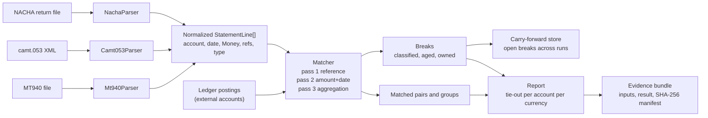

# Capstone: A Reconciliation Engine

> Parse statements, match, surface breaks, and report.

**Type:** Capstone
**Languages:** Java, Python, or Go (pick one; the spec is language-neutral)
**Prerequisites:** Phase 10 Lesson 08 (Reconciliation), Phase 11 Lessons 08, 09, 14 (NACHA, ISO 20022, Bank Statement Formats), Phase 14 Lesson 04 (Reconciliation at Scale), Phase 3 Lesson 15 (Serialization), Phase 2 Lesson 01 (Sorting), Phase 1 Lesson 06 (Hash Maps), Phase 13 Lesson 11 (Auditability), Phase 15 Lesson 01
**Time:** ~360 minutes

## Learning Objectives

- Parse three real statement formats (SWIFT MT940, ISO 20022 camt.053, NACHA return and settlement files) into one normalized `StatementLine` model with every amount as `Money`
- Match statement lines to ledger postings in deterministic passes (reference, then amount and date tolerance, then one-to-many aggregation) and prove that every input line ends up in exactly one bucket
- Classify every unmatched item into a closed break taxonomy with an age, an owner, and a suggested action
- Reconcile at the scale of a processor's daily file (one million lines) in bounded memory by bucketing on sorted keys instead of nested loops
- Produce a report whose totals tie out arithmetically: opening balance plus matched movements plus breaks equals closing balance, per account, per currency

## The Problem

A payments company receives a daily settlement file from its acquirer, a daily MT940 from its sponsor bank, and a NACHA return file three days after each ACH origination. A finance analyst reconciles them in a spreadsheet: export the ledger, paste the statement, `VLOOKUP` on amount. On a normal day there are 12 unmatched rows and she clears them by hand. On the first business day after a long weekend the acquirer file carries three days of activity plus two days of fee adjustments posted as single aggregate lines, and the spreadsheet shows 4,118 unmatched rows. The `VLOOKUP` on amount has also matched 97 refunds to unrelated sales of the same amount, which nobody notices until month-end close, when the bank balance and the ledger cash account disagree by 23,440.17 USD and the fees account is short by the same number with the sign flipped.

The post-mortem finds four root causes, none of them human error. First, matching on amount alone is wrong whenever two movements share an amount, and amounts cluster: 9.99, 19.99, 49.00. The acquirer's line carries a reference the ledger also has, but the spreadsheet never used it. Second, the acquirer nets fees out of settlement, so one statement line of 9,870.30 corresponds to 1,000 ledger sales of 10.00 less 129.70 of fees; nothing in a one-to-one matcher can see that. Third, the three formats disagree about signs, dates, and references: MT940 puts the reference in a `:86:` free-text field with bank-specific tags, camt.053 nests it in `<EndToEndId>`, and NACHA returns carry the original trace number in an addenda record. Fourth, there is no notion of a break's age or owner, so an item unmatched since Tuesday looks identical to one from this morning and nobody is accountable for it.

You have built every piece this needs. `phases/10-money-and-ledgers/08-reconciliation` gave you the two-sided match with a break taxonomy. `phases/11-payment-rails/14-bank-statements-and-formats` gave you MT940 and camt.053 parsers; `phases/11-payment-rails/08-ach-and-nacha` gave you the NACHA fixed-width records and return reason codes; `phases/11-payment-rails/09-sepa-and-iso-20022` gave you the ISO 20022 element names. `phases/14-payments-at-scale/04-reconciliation-at-scale` gave you bucketing by sorted key so that a million lines do not need a million-squared comparisons. `phases/13-risk-fraud-and-compliance/11-auditability-and-evidence` gave you the evidence bundle an auditor accepts. This capstone composes them into one engine with one normalized model, one matching algorithm, and one report that ties out.

## What You Will Build

A single-process reconciliation engine: parsers for three statement formats into a normalized model, a ledger adapter that reads the postings from your Phase 15 Lesson 01 ledger (or a CSV export of one), a multi-pass matcher, a break classifier with ageing, and a report generator. Inputs are files; outputs are a machine-readable result and a Markdown report. No network, no database.



The components, each traceable to a lesson you have already built:

| Component | Composes | What it owns |
|-----------|----------|--------------|
| `Money`, `Currency` | `phases/10-money-and-ledgers/01-representing-money` | integer minor units; signs normalized so a credit to the account is positive |
| `StatementLine`, `Statement` | `phases/11-payment-rails/14-bank-statements-and-formats` | the normalized model: account, booking date, value date, `Money`, references, type code, raw source pointer |
| `Mt940Parser` | `phases/11-payment-rails/14-bank-statements-and-formats` | `:20:`, `:25:`, `:28C:`, `:60F:`, `:61:`, `:86:`, `:62F:` tags; sub-field extraction from `:86:` |
| `Camt053Parser` | `phases/11-payment-rails/14-bank-statements-and-formats`, `phases/11-payment-rails/09-sepa-and-iso-20022` | `Stmt`, `Bal` with `OPBD` and `CLBD`, `Ntry`, `NtryDtls`, `EndToEndId`, `CdtDbtInd` |
| `NachaParser` | `phases/11-payment-rails/08-ach-and-nacha` | record types 1, 5, 6, 7, 8, 9; trace numbers; return reason codes in addenda 99 |
| `LedgerAdapter` | `phases/15-capstone-projects/01-capstone-ledger-service`, `phases/10-money-and-ledgers/03-double-entry-ledger` | postings on external accounts with `externalRef`, amount, effective date |
| `Matcher`, `MatchPass` | `phases/10-money-and-ledgers/08-reconciliation`, `phases/14-payments-at-scale/04-reconciliation-at-scale` | three ordered passes; bucketing by sorted key; every item consumed once |
| `Break`, `BreakType`, `BreakClassifier` | `phases/10-money-and-ledgers/08-reconciliation` | closed taxonomy; age; owner; suggested action |
| `CarryForwardStore` | `phases/07-storage-and-transactions/02-write-ahead-logs` | open breaks persisted between daily runs; resolved when a later file matches them |
| `TieOut`, `Report` | `phases/10-money-and-ledgers/12-audit-trails-and-financial-close` | opening + movements + breaks = closing, per account per currency |
| `EvidenceBundle` | `phases/13-risk-fraud-and-compliance/11-auditability-and-evidence` | input file hashes, result hash, manifest an auditor can verify |

Standard library only: `javax.xml.parsers`, `java.security.MessageDigest`; Python `xml.etree.ElementTree`, `hashlib`, `decimal`; Go `encoding/xml`, `crypto/sha256`, `bufio`.

### One statement line, end to end

Trace one line before writing code. The sponsor bank's MT940 for account `GB29NWBK60161331926819` on 2026-03-03 contains:

```text
:61:2603030303C9870,30NTRFACQ-SETTLE-20260302//BNK7781
:86:/ORDP/ACQUIRER LTD/REMI/SETTLEMENT 20260302 NET OF FEES
```

`Mt940Parser` reads value date `260303`, entry date `0303`, credit mark `C`, amount `9870,30`, transaction type `NTRF`, customer reference `ACQ-SETTLE-20260302`, bank reference `BNK7781`, and the `:86:` tags `ORDP` and `REMI`. The normalized line is `StatementLine(account=GB29..., bookingDate=2026-03-03, valueDate=2026-03-03, amount=+987030 GBP, refs={customer: ACQ-SETTLE-20260302, bank: BNK7781}, type=NTRF, source=mt940:line 41)`.

The ledger has no single posting of 9,870.30. It has 1,000 postings of 10.00 to `BANK_OPERATING` dated 2026-03-02 with `externalRef` values `sale-...`, and 1,000 fee postings of 0.1297 rounded per sale to 0.13 or 0.12 summing to 129.70, all tagged `batch=ACQ-SETTLE-20260302`. Pass 1 (reference) finds no posting whose `externalRef` equals the statement reference. Pass 2 (amount and date within 1 day) finds no single posting of 9,870.30. Pass 3 (aggregation) groups ledger postings by their `batch` tag, sums the group to 10,000.00 minus 129.70 = 9,870.30, and matches the statement line to the group of 2,000 postings with `matchType = AGGREGATE`. The report shows one matched statement line, 2,000 matched postings, and a tie-out row where the bank's movement of 9,870.30 equals the ledger's net. If the fee rounding had produced 129.71, pass 3 would have produced an `AMOUNT_MISMATCH` break of 0.01 with the group and the line both attached, and the suggested action `review fee rounding for batch ACQ-SETTLE-20260302`. Every milestone below is one more of those steps made testable.

### The three formats, side by side

| Concept | MT940 | camt.053 | NACHA |
|---------|-------|----------|-------|
| Account | `:25:` | `Acct/Id/IBAN` or `Othr/Id` | batch header company id and entry DFI account |
| Opening balance | `:60F:` or `:60M:` | `Bal` with `Tp/CdOrPrtry/Cd = OPBD` | none (returns only) |
| Closing balance | `:62F:` or `:62M:` | `Bal` with `Cd = CLBD` | none |
| Movement | `:61:` | `Ntry` | type 6 entry detail |
| Sign | `C`, `D`, `RC`, `RD` marks | `CdtDbtInd` and `RvslInd` | transaction code (22, 27, 32, 37 and their return forms) |
| Amount | `9870,30` with comma decimal | `<Amt Ccy="GBP">9870.30</Amt>` | 10 digits, implied two decimals |
| Reference | `:61:` sub-field 7 and `:86:` tags | `NtryDtls/TxDtls/Refs/EndToEndId` | trace number and addenda 99 original trace |
| Date | `YYMMDD` value date, `MMDD` entry date | `BookgDt`, `ValDt` as ISO dates | `YYMMDD` settlement date in batch header |

Your parsers' job is to make this table disappear: after parsing, nothing downstream knows which format a line came from except the `source` pointer kept for the evidence bundle.

### A full run by hand: five lines, five postings

Before the million-line run, work a whole account through every pass and both tie-out identities. USD operating account, statement opening balance 5,000.00, date tolerance 1 day.

| Statement line | Date | Amount | Reference | Ledger posting | Date | Amount | `externalRef` |
|----------------|------|--------|-----------|----------------|------|--------|---------------|
| L1 | 03-03 | +250.00 | S-1 | P1 | 03-03 | +250.00 | S-1 |
| L2 | 03-03 | +49.00 | none | P2 | 03-03 | +49.00 | sale-881 |
| L3 | 03-04 | +49.00 | none | P3 | 03-04 | +49.00 | sale-907 |
| L4 | 03-04 | -1,200.00 | PO-77 | P4 | 03-04 | -1,200.00 | PO-77 |
| L5 | 03-04 | +19.99 | none | P5 | 03-04 | +75.00 | S-9 |

The statement's closing balance is 5,000.00 + 250.00 + 49.00 + 49.00 - 1,200.00 + 19.99 = 4,167.99.

1. **Pass 1 (reference).** L1 pairs with P1 on `S-1`; L4 pairs with P4 on `PO-77`. `S-9` appears on no line, so P5 falls through.
2. **Pass 2 (amount and date).** L2 and L3 are both 49.00 and both P2 and P3 are within tolerance of each. Lines are walked in `(date, id)` order: L2 (03-03) picks P2 at distance 0 over P3 at distance 1; L3 then picks P3 at distance 0. A spreadsheet `VLOOKUP` on amount returns the first 49.00 for both lines and matches P2 twice, which is the Problem section's refund-to-sale mistake in miniature.
3. **Pass 3 (aggregation).** No `batch` tag is present, so nothing groups.
4. **Breaks.** L5 becomes `IN_STATEMENT_NOT_LEDGER` (+19.99). P5 becomes `IN_LEDGER_NOT_STATEMENT` (+75.00). Counts: 4 + 1 = 5 lines, 4 + 1 = 5 postings.

Identity 1, over the statement alone: opening 5,000.00 + matched lines (250.00 + 49.00 + 49.00 - 1,200.00 = -852.00) + unmatched lines (19.99) = 4,167.99, which equals the closing balance. It holds by construction whenever every line lands in exactly one bucket, so it catches parser bugs, not matcher bugs.

Identity 2, ledger against statement: the ledger's movement is 250.00 + 49.00 + 49.00 - 1,200.00 + 75.00 = -777.00. Removing what only the ledger has and adding what only the statement has gives -777.00 - 75.00 + 19.99 = -832.01, which equals the statement movement of 4,167.99 - 5,000.00. Now plant the M6 bug on a run with an aggregate group of 9,870.30: pass 3 marks the line matched but leaves its postings unconsumed, so they also appear as `IN_LEDGER_NOT_STATEMENT`. The ledger side subtracts 9,870.30 that the statement side still contains, and identity 2 is off by exactly 9,870.30. That is why the second identity is the one that catches engine bugs.

### How each failure surfaces

| Failure in the inputs or the engine | What the engine reports | Where it is caught |
|-------------------------------------|-------------------------|--------------------|
| Two lines share an amount and only one has a counterpart | one pass 2 match by date distance, one `IN_STATEMENT_NOT_LEDGER` | M2 step 5 |
| Acquirer nets fees and rounding drifts by 0.01 | `AMOUNT_MISMATCH` of 0.01 on the aggregate group | M3 step 1 |
| Bank sends the same line twice | `DUPLICATE_IN_STATEMENT`; the first copy still matches | M2 step 2 |
| NACHA file truncated in transit | `FILE_CONTROL_MISMATCH`; no lines enter the matcher | M1 step 4 |
| Matcher consumes one side of a pair but not the other | `TIE_OUT_FAILED` with the discrepancy | M6 step 2 |
| Re-run after a crash between result and store write | identical result; no break opened twice | M3 step 3 |
| Input file edited after the run | `verify` names the file whose hash changed | M6 step 3 |

### Deciding where a new break type belongs

When a real file produces a difference the taxonomy does not name, resist adding an enum value first. Ask in order: does one side lack the item entirely (`IN_*_NOT_*`)? Do both sides have it with a different amount or date (`*_MISMATCH`)? Does one side have it twice (`DUPLICATE_*`)? Did money come back (`RETURNED`)? Only if all four answers are no is it a new type, and then it needs an owner, an action, and a classifier-table row before it ships.

## Requirements

Each requirement is a sentence you can turn into a test. The milestone that first satisfies it is in brackets.

1. Every amount is a `Money` value with the statement's currency. Signs are normalized so that a credit to the statement account is positive and a debit is negative; MT940 `RC` and `RD` reversal marks flip the sign of the original movement's type. No float holds an amount at any point, including during parsing of `9870,30`. [M1]
2. `Mt940Parser` handles multi-line `:86:` fields, `:60M:` and `:62M:` intermediate balances across pages, and the `//` bank reference separator in `:61:`. Parsing a file and re-serializing the normalized lines yields the same opening and closing balances as the file states. [M1]
3. `Camt053Parser` reads `OPBD` and `CLBD` balances, every `Ntry`, and the first `EndToEndId` in `NtryDtls`; a `Ntry` with multiple `TxDtls` (a batch entry) yields one line per `TxDtls` with the `Ntry` amount as a group total that must equal the sum. [M1]
4. `NachaParser` validates record counts, entry hash, and total debit and credit amounts against the type 9 file control record, and for return entries extracts the return reason code and the original trace number from the type 7 addenda. A file whose control totals disagree with its entries is rejected with `FILE_CONTROL_MISMATCH`. [M1]
5. The `Matcher` runs exactly three passes in order: reference equality, then amount equality with booking date within a configurable tolerance (default 1 day), then aggregation by a group key. An item consumed by an earlier pass is invisible to later passes. [M2]
6. Matching is deterministic: given the same inputs, the same pairs are produced regardless of input order. Ties in pass 2 (two postings with the same amount within tolerance) are broken by smallest date distance, then by posting id. [M2]
7. Every statement line and every ledger posting ends up in exactly one of: a match, or a break. `matchedLines + breakLines == statementLines` and `matchedPostings + breakPostings == ledgerPostings` hold for every run. [M2]
8. `BreakType` is a closed enum: `IN_STATEMENT_NOT_LEDGER`, `IN_LEDGER_NOT_STATEMENT`, `AMOUNT_MISMATCH`, `DATE_MISMATCH`, `DUPLICATE_IN_STATEMENT`, `DUPLICATE_IN_LEDGER`, `RETURNED`. Each break has `ageDays`, `owner`, and `suggestedAction` derived from a classifier table that is data. [M3]
9. Open breaks persist between runs in a `CarryForwardStore`. A break opened on day D that matches a line in day D+2's file is closed with `resolvedOn = D+2`, and the report lists it under resolved, not under new. [M3]
10. A NACHA return (reason `R01`, `R02`, `R03`, `R10`, `R29`, and the rest of the table) matches the original origination posting by trace number and produces a `RETURNED` break carrying the reason code, with the suggested action from the reason table (`R01` retry after balance check, `R02` block account, `R10` do not retry and investigate authorization). [M4]
11. One million statement lines against one million postings reconcile in under 60 seconds and under 1 GiB of memory on a laptop, which rules out nested loops: the matcher sorts or hashes on the pass key and walks buckets. [M5]
12. The `TieOut` for each account and currency satisfies `opening + sum(matched movements) + sum(break amounts by side) == closing` using the statement's own balances, and the report prints the arithmetic. A run whose tie-out does not hold fails loudly with `TIE_OUT_FAILED` and the discrepancy. [M6]
13. The engine writes an evidence bundle: every input file's SHA-256, the normalized line set's hash, the result's hash, the engine version, and the matcher configuration, in a manifest that `verify(bundle)` checks. [M6]
14. The Markdown report lists, per account: counts and totals matched by pass, breaks by type with age buckets (0-1, 2-5, 6-30, over 30 days), the ten largest open breaks by absolute amount, and the resolved carry-forwards. Every number in the report is reproducible from the machine-readable result. [M6]

## Milestones

Work the milestones in order. Each ends with a test you run before moving on. Name the tests as shown. Commands assume `capstone/recon/{java,python,go}`, with fixtures under `capstone/recon/fixtures/`.

```bash
# Java
cd capstone/recon/java && javac -d .out *.java && java -cp .out ReconTest
# Python
cd capstone/recon/python && python3 -m unittest -v
# Go
cd capstone/recon/go && go test -race ./...
```

### Milestone 1: Three parsers, one model

Copy `Money` and `Currency` from `phases/10-money-and-ledgers/01-representing-money`. Define `StatementLine(id, account, currency, bookingDate, valueDate, amount, refs, typeCode, source)` and `Statement(account, currency, opening, closing, lines)`. Port the MT940 and camt.053 parsers from `phases/11-payment-rails/14-bank-statements-and-formats` and the NACHA parser from `phases/11-payment-rails/08-ach-and-nacha`, each producing a `Statement`. Write fixtures by hand: a 40-line MT940 across two pages, a camt.053 with a batch `Ntry` of three `TxDtls`, and a NACHA return file with four returns.

Acceptance test `m1_three_formats_normalize_to_one_model_and_balances_agree`:

1. Parse the MT940 fixture. Assert 40 lines, `opening == 12,004.10 GBP`, `closing == 21,874.40 GBP`, and `opening + sum(lines) == closing`.
2. Assert the line from the worked example has `amount == +987030`, `refs.customer == "ACQ-SETTLE-20260302"`, `refs.bank == "BNK7781"`, and that a line with mark `RD` has a positive amount (a reversed debit is a credit).
3. Parse the camt.053 fixture. Assert the batch `Ntry` yields three lines whose amounts sum to the `Ntry` amount, and each carries its own `EndToEndId`.
4. Parse the NACHA fixture. Assert four lines of type `RETURNED` with reason codes `R01, R01, R02, R10` and the original trace numbers. Corrupt the type 9 total and assert `FILE_CONTROL_MISMATCH`.
5. Assert that no parser output has a field whose runtime type is a binary float.

```java
static void m1_mt940_signs_and_balances() {
    Statement s = new Mt940Parser().parse(fixture("sponsor-20260303.mt940"));
    check("line count", s.lines().size() == 40);
    check("opening", s.opening().equals(gbp(1_200_410)));
    Money sum = s.lines().stream().map(StatementLine::amount).reduce(gbp(0), Money::plus);
    check("ties to closing", s.opening().plus(sum).equals(s.closing()));
    StatementLine settle = s.lineWithCustomerRef("ACQ-SETTLE-20260302");
    check("credit positive", settle.amount().equals(gbp(987_030)));
    check("bank ref", settle.refs().bank().equals("BNK7781"));
    StatementLine reversedDebit = s.lineWithBankRef("BNK7790");
    check("RD is positive", reversedDebit.amount().minor() > 0);
}
```

### Milestone 2: The three-pass matcher

Implement `Matcher.match(List<StatementLine>, List<Posting>, Config) -> MatchResult` with passes as separate classes sharing an interface `MatchPass.run(unmatchedLines, unmatchedPostings) -> (pairs, stillUnmatchedLines, stillUnmatchedPostings)`. Pass 1 indexes postings by `externalRef`. Pass 2 indexes by `(currency, amount)` and resolves ties by date distance then id. Pass 3 groups postings by `groupKey` (a configurable tag such as `batch`) and matches a line to a group whose sum equals the line amount within the date tolerance.

Acceptance test `m2_passes_consume_once_and_results_are_order_independent`:

1. Build 1,000 postings and a 1,003-line statement: 900 lines with matching references, 60 lines with no reference but a unique amount within 1 day, 40 lines whose postings carry `batch=B1` summing to one aggregate line, 2 lines with no counterpart, and 1 line duplicating another's reference.
2. Assert pass 1 matched 900 (the duplicate reference matches once; the second occurrence falls through), pass 2 matched 60, pass 3 matched 1 line to 40 postings, and the unmatched remainder is 2 lines with no counterpart plus 1 duplicate.
3. Assert `matchedLines + unmatchedLines == 1003` and `matchedPostings + unmatchedPostings == 1000`.
4. Shuffle both inputs with three different seeds. Assert the identical set of pairs each time.
5. Add two postings with the same amount and date 0 and 1 days from a reference-less line. Assert pass 2 picks the 0-day posting and the 1-day posting remains unmatched.

```python
def test_m2_pass2_tie_breaks_by_date_then_id(self):
    line = line_without_ref(amount=usd(4_999), date=d("2026-03-03"))
    near = posting(id="p-0002", amount=usd(4_999), date=d("2026-03-03"))
    far = posting(id="p-0001", amount=usd(4_999), date=d("2026-03-04"))
    result = Matcher(Config(date_tolerance_days=1)).match([line], [far, near])
    self.assertEqual(result.pairs[0].posting.id, "p-0002")
    self.assertEqual([p.id for p in result.unmatched_postings], ["p-0001"])
```

### Milestone 3: Breaks, ageing, and carry-forward

Implement `BreakClassifier.classify(unmatchedLines, unmatchedPostings, nearMisses) -> List<Break>`. A near miss is a pass 2 candidate that failed on amount by at most a configurable epsilon (default 1.00) or on date by more than tolerance but at most 5 days; these become `AMOUNT_MISMATCH` and `DATE_MISMATCH` and consume both sides. Duplicates are detected by identical `(externalRef, amount)` within one side. The classifier table maps `BreakType` to `owner` and `suggestedAction` and is loaded from data. `CarryForwardStore` persists open breaks as `length | crc32 | payload` records; `Engine.run(day, files)` loads open breaks, includes them as candidates in matching, and marks the ones that match as resolved.

Acceptance test `m3_breaks_are_classified_aged_and_resolved_across_runs`:

1. Run day 1 with a statement that has one line 0.01 off a posting, one line dated 3 days off, one line twice, and one line with no counterpart. Assert one `AMOUNT_MISMATCH`, one `DATE_MISMATCH`, one `DUPLICATE_IN_STATEMENT`, one `IN_STATEMENT_NOT_LEDGER`, each with `ageDays == 0`, the owner from the table, and a non-empty action.
2. Run day 3 with a ledger that now contains the missing posting. Assert the `IN_STATEMENT_NOT_LEDGER` break is `resolvedOn == day 3`, `ageDays == 2`, and appears under resolved, while the other three are still open with `ageDays == 2`.
3. Kill the engine between writing the result and updating the store (simulate by skipping the store write). Re-run day 3. Assert the outcome is identical, which proves the store update is idempotent on `(breakId, resolvedOn)`.

### Milestone 4: Returns and reason codes

Teach the engine that a NACHA return is a statement line of type `RETURNED` whose `refs.originalTrace` matches the origination posting's `externalRef`. Returns always produce a `RETURNED` break (money came back; the ledger needs a reversing entry) with the reason code, the days since origination, and the action from a `ReturnReasonTable` ported from `phases/11-payment-rails/08-ach-and-nacha`. `R10` and `R29` (unauthorized) also set `owner = compliance`.

Acceptance test `m4_returns_match_originations_and_carry_actions`:

1. Originate 50 ACH debits on day 0 as ledger postings with trace numbers. On day 3 parse a return file with 4 returns. Assert 4 `RETURNED` breaks pointing at the right postings with reasons `R01, R01, R02, R10`.
2. Assert the `R10` break has `owner == compliance` and action contains "do not retry".
3. Parse a return whose original trace matches nothing. Assert `IN_STATEMENT_NOT_LEDGER` with a note that the trace is unknown, not a crash.
4. Assert the 46 originations without returns are `IN_LEDGER_NOT_STATEMENT` only if the engine is configured to expect settlement lines for them; with the default configuration (returns file only), assert they are not reported as breaks. Document the rule.

### Milestone 5: A million lines

Generate a synthetic day: one million postings and one million statement lines with 99.2% reference matches, 0.5% amount-and-date matches, 0.2% aggregate groups, and 0.1% breaks of mixed types, seeded. Replace any `for line in lines: for posting in postings` with the bucketing from `phases/14-payments-at-scale/04-reconciliation-at-scale`: sort both sides by the pass key (or hash them), then walk. Stream the parse so the full raw file is never in memory twice.

Acceptance test `m5_million_lines_reconcile_in_bounded_time_and_memory`:

1. Run the synthetic day. Assert wall-clock under 60 seconds and peak heap under 1 GiB (`Runtime.totalMemory`, `tracemalloc`, `runtime.MemStats`).
2. Assert the exact expected counts per pass and per break type from the generator's own bookkeeping.
3. Assert `matchedLines + breakLines == 1,000,000` and the same for postings.
4. Run with 100,000 lines and assert the time is under one-eighth of the million-line time, which is consistent with `O(n log n)` and inconsistent with `O(n^2)`.

```go
func TestM5ScalesLinearithmically(t *testing.T) {
    small := timeRun(t, generateDay(42, 100_000))
    large := timeRun(t, generateDay(42, 1_000_000))
    if large > 60*time.Second {
        t.Fatalf("million lines took %v", large)
    }
    if large > 8*small+2*time.Second {
        t.Fatalf("scaling looks quadratic: small=%v large=%v", small, large)
    }
}
```

### Milestone 6: Tie-out, report, and evidence

Implement `TieOut.compute(statement, result)`: `opening + sum(matched line amounts) + sum(unmatched line amounts) == closing` must hold trivially because every line is in one bucket; the second identity `ledgerMovement - sum(IN_LEDGER_NOT_STATEMENT) + sum(IN_STATEMENT_NOT_LEDGER) + sum(mismatch differences, statement minus ledger) == statementMovement` is the one that catches engine bugs. Print both as arithmetic. Generate `reports/recon-<account>-<date>.md` with the sections in Requirement 14. Build `EvidenceBundle.write(dir)` with `manifest.json` listing every input hash, the result hash, config, and engine version, and `EvidenceBundle.verify(dir)`.

Acceptance test `m6_report_ties_out_and_evidence_verifies`:

1. Run the M2 fixture. Assert both tie-out identities hold and the report's totals equal the result's totals field by field.
2. Introduce a deliberate bug behind a flag (pass 3 consumes the line but not the postings). Assert `TIE_OUT_FAILED` with the discrepancy equal to the aggregate amount.
3. Write the evidence bundle. Assert `verify` passes. Change one byte in an input file. Assert `verify` names that file.
4. Assert the report lists the ten largest open breaks in descending absolute amount and that age buckets sum to the open break count.

Predict: the sponsor bank restates Tuesday's closing balance on Wednesday by posting a `:60M:`-to-`:62M:` correction page. Which identity fails first in your engine if you ingest Wednesday's file without Tuesday's correction, and what does the report show? (The first identity still holds on Wednesday's own file; the second shows a ledger-versus-statement movement gap equal to the correction, surfaced as an `IN_STATEMENT_NOT_LEDGER` break on the correction line. If the bank instead silently changes Tuesday's closing, Wednesday's opening no longer equals the stored Tuesday closing, and the exemplary rubric row asks you to detect that.)

## Acceptance Criteria

The capstone is complete when all of the following are true on a clean checkout:

- All six milestone tests pass in your chosen language with one command, and the Go version passes under `go test -race ./...`.
- A `make demo` or equivalent reconciles the three fixture files against a fixture ledger for three consecutive days, prints the tie-out arithmetic for each account, prints the open and resolved break counts per day, and prints `evidence: OK`.
- `README.md` in your project includes the normalized model, a format comparison table, the three matcher passes with their keys and tie-break rules, the break taxonomy with owners and actions, and your decisions in the table below.
- `grep -rn "double\|float" --include=*.java --include=*.py --include=*.go` in amount-bearing types returns only comments.
- Every break has a type from the closed set, an age, an owner, and a suggested action.
- The million-line run's report is written to `reports/recon-synthetic-<seed>.md` and its totals tie out.

| Decision | Options | What the reference design does | Test that exposes it |
|----------|---------|--------------------------------|----------------------|
| `AMOUNT_MISMATCH` consumption | consumes both sides; leaves both as separate breaks | consumes both, reports one break | M3 step 1 |
| Duplicate reference in statement | first wins; both unmatched | first wins by file order, second is `DUPLICATE_IN_STATEMENT` | M2 step 2 |
| Aggregation key | ledger tag; date plus counterparty | ledger `batch` tag, falling back to `(date, counterparty)` | M2 step 2 |
| Originations without settlement lines | breaks; not breaks unless configured | not breaks for a returns-only run | M4 step 4 |
| Carry-forward identity | `(breakId)`; `(breakId, resolvedOn)` | `(breakId, resolvedOn)` so re-runs are idempotent | M3 step 3 |
| Opening balance continuity | trust each file; check against stored prior closing | check and raise `BALANCE_DISCONTINUITY` | Exemplary rubric row |

## Rubric

| Criterion | Developing | Solid | Exemplary |
|-----------|------------|-------|-----------|
| Parsers | One format; amounts parsed through a float | Three formats to one model; signs normalized; control totals validated; balances tie | Streaming parsers with position-accurate error messages; a fuzz test that no malformed line crashes the parser |
| Matching | Amount-only matching; nested loops | Three ordered passes; deterministic tie-breaks; every item consumed exactly once | Pass 3 handles many-to-many (fees netted across several statement lines) with a documented search bound |
| Breaks | A single "unmatched" list | Closed taxonomy; age; owner; action from a data table; near-miss detection | Breaks link to a suggested ledger adjustment entry (debit, credit, amount) that a reviewer can post with one click |
| Carry-forward | Each day reconciled in isolation | Open breaks persisted; resolved across runs; idempotent re-run | Breaks escalate by age with an SLA table and the report shows breaches |
| Returns | Returns treated as ordinary debits | `RETURNED` break with reason code, days since origination, owner, action | Return rates per reason per originator computed and compared against NACHA's unauthorized return thresholds |
| Scale | Works on fixtures; untested at volume | A million lines in under 60 s and 1 GiB; scaling test | Partitioned by account and run in parallel with per-partition tie-outs that sum to the global one |
| Tie-out and evidence | Totals printed without a check | Two identities checked; `TIE_OUT_FAILED` on a planted bug; verifiable manifest | Opening-balance continuity across days; bundle includes a signed hash chain over daily results |
| Engineering hygiene | No README; fixtures missing | README documents model, passes, taxonomy, decisions; fixtures readable | Demo reproduces the Problem section's 4,118-break day and shows the three passes clearing it |

## Further Reading

- [SWIFT, "MT940 Customer Statement Message" in the Category 9 Cash Management and Customer Status message reference](https://www.swift.com/our-solutions/compliance-and-shared-services/swift-standards/standards-mt) — the field tags, the `:61:` sub-field layout, and the `C`, `D`, `RC`, `RD` marks your parser decodes.
- [ISO 20022, "camt.053.001 BankToCustomerStatement" message definition report](https://www.iso20022.org/iso-20022-message-definitions) — the element names (`Bal`, `Ntry`, `NtryDtls`, `EndToEndId`) and the balance type codes `OPBD` and `CLBD`.
- [Nacha, "2026 Nacha Operating Rules and Guidelines" and the ACH file format specification (Appendix Three)](https://www.nacha.org/rules) — record types, field positions, the entry hash, and the return reason code table behind Requirement 10.
- [Stripe Engineering, "Ledger: Stripe's system for tracking and validating money movement"](https://stripe.com/blog/ledger-stripe-system-for-tracking-and-validating-money-movement) — how a production system makes reconciliation continuous and treats every break as a first-class object with an owner.
- [Federal Reserve Financial Services, "FedACH Services: Return Reason Codes"](https://www.frbservices.org/resources/financial-services/ach) — the operator's view of return codes and the timing windows that make the M4 days-since-origination field matter.
- [Jon Bentley, *Programming Pearls* (2nd ed., Addison-Wesley, 2000), Column 2 "Aha! Algorithms"](https://www.oreilly.com/library/view/programming-pearls-second/9780134498038/) — the sort-then-walk idea that turns the M5 nested loop into a linearithmic pass.
