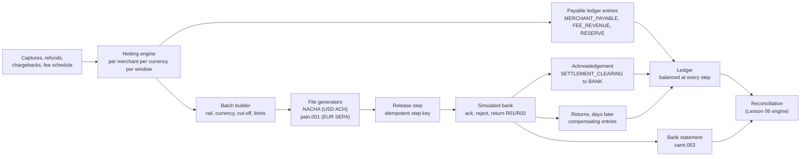

# Capstone: A Settlement and Payout Pipeline

> Net, batch, file, and pay out, with a ledger that balances.

**Type:** Capstone
**Languages:** Java, Python, or Go (pick one; the spec is language-neutral)
**Prerequisites:** Phase 11 Lesson 08 (ACH and the NACHA File Format), Phase 11 Lesson 09 (SEPA, Wires, and ISO 20022), Phase 11 Lesson 11 (IBAN, BIC, and Account Number Validation), Phase 11 Lesson 15 (Settlement and Clearing), Phase 12 Lesson 08 (Payouts and Balances), Phase 10 Lesson 03 (The Double-Entry Ledger), Phase 10 Lesson 07 (Holds and Available Balance), Phase 10 Lesson 10 (Fees and Splits), Phase 14 Lesson 03 (Exactly-Once Money Movement), Phase 14 Lesson 05 (Batch vs Real-Time Settlement Pipelines), Phase 7 Lesson 13 (The Transactional Outbox), Phase 15 Lesson 01 (A Durable Double-Entry Ledger Service), Phase 15 Lesson 06 (A Reconciliation Engine)
**Time:** ~360 minutes

## Learning Objectives

- Compute each merchant's settlement from captured transactions, refunds, chargebacks, fees, and reserves as a deterministic netting over a settlement window, with every intermediate figure as `Money`
- Group payable balances into batches by rail, currency, and cut-off, and generate syntactically and arithmetically valid NACHA and ISO 20022 pain.001 files whose control totals equal the ledger postings they represent
- Post every stage of the pipeline (netting, batching, file release, bank acknowledgement, return) as balanced ledger entries so the merchant payable, the settlement clearing account, and the bank account tie out at every step
- Make the pipeline restartable at any step without double-paying anyone, using idempotent step keys and a reconciliation back against the bank statement from Phase 15 Lesson 06
- Handle the asynchronous outcomes a payout rail produces (returns, rejections, late files) with compensating entries and a payout state machine with no dead ends

## The Problem

A marketplace pays its 40,000 sellers every Tuesday. The payout job is a script: `SELECT seller_id, SUM(amount) FROM captures WHERE settled = false GROUP BY seller_id`, then one API call per seller to the bank, then `UPDATE captures SET settled = true`. One Tuesday the bank's API returns 502 for eleven minutes in the middle of the run. The script has no notion of a batch; it has a loop. The operator restarts it. The `SELECT` runs again, finds every capture still unsettled because the `UPDATE` runs at the end, and sends 9,200 sellers a second payout. Reclaiming the money takes three weeks and the marketplace funds the gap from its own operating account, because the sellers' money was already in the sellers' bank accounts.

The audit that follows finds that the problem is wider than one restart. Refunds issued after a capture was paid out were deducted from the seller's next payout by a different script that sometimes ran before and sometimes after the payout script, so some sellers were charged twice and others never. Chargebacks were handled by email. The 2.9% + 0.30 fee was computed per payout as a float on the summed amount, so the fee the seller saw never equalled the sum of the per-transaction fees in the ledger, and finance wrote off the difference every month. Nobody could say, for any given dollar in the operating bank account, which seller it belonged to, because the payout script wrote to a bank API and a `settled` flag, not to a ledger. When the bank returned 310 payouts a week later with `R03` (no account), the returned money landed in the bank account and sat there, unattributed, for a month.

Every one of those failures is a mechanism you have built. `phases/11-payment-rails/15-settlement-and-clearing` explained netting and cut-offs. `phases/10-money-and-ledgers/10-fees-and-splits` computed fees per transaction in integer minor units with a documented allocation of the rounding remainder. `phases/12-payment-systems-design/08-payouts-and-balance-management` built the payout state machine and negative-balance handling. `phases/11-payment-rails/08-ach-and-nacha` and `phases/11-payment-rails/09-sepa-and-iso-20022` generated the files a bank accepts. `phases/14-payments-at-scale/03-exactly-once-money-movement` made a multi-step money movement restartable with step keys. `phases/15-capstone-projects/01-capstone-ledger-service` gave you a ledger where every one of these steps is a balanced entry. This capstone composes them into a pipeline where a restart at any point pays every seller exactly once and the ledger can tell you, for every cent in the bank, whose it is.

## What You Will Build

A single-process settlement pipeline driven by a simulated clock: a netting engine over a transaction stream, a batch builder, two file generators, a payout state machine, a simulated bank that acknowledges files and returns some payouts days later, and a ledger (your Phase 15 Lesson 01 service, or an in-memory double-entry ledger with the same API) that every stage posts to.



The components, each traceable to a lesson you have already built:

| Component | Composes | What it owns |
|-----------|----------|--------------|
| `Money`, `Currency` | `phases/10-money-and-ledgers/01-representing-money` | integer minor units; fee rates as basis points; allocation of remainders |
| `Ledger`, `JournalEntry` | `phases/15-capstone-projects/01-capstone-ledger-service`, `phases/10-money-and-ledgers/03-double-entry-ledger` | balanced entries; trial balance zero; idempotent `post` |
| `FeeSchedule`, `FeeCalculator` | `phases/10-money-and-ledgers/10-fees-and-splits` | per-transaction fee in minor units, `HALF_UP`, remainder allocation across splits |
| `SettlementWindow`, `NettingEngine` | `phases/11-payment-rails/15-settlement-and-clearing`, `phases/14-payments-at-scale/05-batch-vs-real-time-settlement` | window boundaries by cut-off; net = captures - refunds - chargebacks - fees - reserve hold + reserve release |
| `Reserve`, `Hold` | `phases/10-money-and-ledgers/07-holds-and-available-balance` | rolling reserve as a hold against payable; release after N days |
| `Batch`, `BatchBuilder` | `phases/11-payment-rails/15-settlement-and-clearing` | group payables by rail and currency; per-batch and per-entry limits; minimum payout |
| `NachaWriter` | `phases/11-payment-rails/08-ach-and-nacha` | file header, batch header, entry detail (CCD or PPD credits), batch control, file control, blocking to 10 records |
| `Pain001Writer` | `phases/11-payment-rails/09-sepa-and-iso-20022` | `GrpHdr` with `NbOfTxs` and `CtrlSum`, `PmtInf`, `CdtTrfTxInf` with IBAN and BIC |
| `IbanValidator`, `RoutingNumberValidator` | `phases/11-payment-rails/11-iban-bic-and-account-validation`, `phases/11-payment-rails/08-ach-and-nacha` | mod-97 and ABA check digits before a destination is allowed into a batch |
| `Payout`, `PayoutState`, `PayoutStore` | `phases/12-payment-systems-design/08-payouts-and-balance-management`, `phases/12-payment-systems-design/02-payment-state-machine` | `PENDING`, `BATCHED`, `RELEASED`, `ACKNOWLEDGED`, `SETTLED`, `RETURNED`, `REJECTED`, `CANCELLED` |
| `StepKey`, `PipelineRunner` | `phases/14-payments-at-scale/03-exactly-once-money-movement`, `phases/07-storage-and-transactions/13-transactional-outbox` | each step keyed by `(windowId, batchId, step)`; replay-safe; outbox for file release |
| `SimBank`, `SimClock` | `phases/14-payments-at-scale/10-simulation-testing-of-payment-systems` | accepts files, validates them, acknowledges, returns a seeded fraction days later, emits a camt.053 statement |
| `Reconciler` | `phases/15-capstone-projects/06-capstone-reconciliation-engine` | ties the bank statement to the ledger's `BANK_OPERATING` account |

Standard library only: `javax.xml.stream` or string building for XML, `java.security.MessageDigest`; Python `xml.etree.ElementTree`, `decimal`, `hashlib`; Go `encoding/xml`, `crypto/sha256`, `text/template` if you like.

### One merchant, one window, end to end

Trace a single merchant's Tuesday before writing code. Merchant `m_2210` (USD, ACH, rolling reserve 5% for 7 days) had the following activity in the window `2026-03-02T00:00Z` to `2026-03-09T00:00Z`:

| Item | Count | Gross | Fee rule | Fee |
|------|-------|-------|----------|-----|
| Captures | 1,000 | 10,000.00 | 2.9% + 0.30 per capture, `HALF_UP` | 1,000 x (0.29 + 0.30) = 590.00 |
| Refunds | 20 | 200.00 | fee not returned | 0.00 |
| Chargebacks | 2 | 150.00 | 15.00 each | 30.00 |
| Reserve hold (5% of captures) | | 500.00 | | |
| Reserve release (window of 2026-02-23) | | 480.00 | | |

Net payable: `10,000.00 - 200.00 - 150.00 - 590.00 - 30.00 - 500.00 + 480.00 = 9,010.00 USD`. The netting engine posts one settlement entry:

```text
DEBIT  MERCHANT_CLEARING:m_2210        10,000.00   captures captured this window
CREDIT MERCHANT_PAYABLE:m_2210          9,010.00   net owed
CREDIT FEE_REVENUE                        620.00   590.00 processing + 30.00 chargeback
CREDIT REFUNDS_PAYABLE                    200.00   already paid to cardholders; recovered from merchant
CREDIT CHARGEBACK_CLEARING                150.00   already debited by the network; recovered from merchant
CREDIT MERCHANT_RESERVE:m_2210            500.00   new hold
DEBIT  MERCHANT_RESERVE:m_2210            480.00   release of the 2026-02-23 hold
```

Debits: 10,480.00. Credits: 9,010.00 + 620.00 + 200.00 + 150.00 + 500.00 = 10,480.00. Balanced. The batch builder puts `m_2210`'s 9,010.00 into batch `ACH-USD-20260309-01` as a PPD credit to routing `021000021`, account `12345678`, trace number `0210000210000001`. The release step posts `DEBIT MERCHANT_PAYABLE:m_2210 9,010.00 / CREDIT SETTLEMENT_CLEARING 9,010.00`, writes the NACHA file, and records step key `(W-20260309, ACH-USD-20260309-01, RELEASE)`. The bank acknowledges the file: `DEBIT SETTLEMENT_CLEARING / CREDIT BANK_OPERATING` for the batch total. Six days later the bank returns the payout with `R03`: `DEBIT BANK_OPERATING 9,010.00 / CREDIT MERCHANT_PAYABLE:m_2210 9,010.00`, the payout moves to `RETURNED`, and the merchant is asked for new bank details. At every one of those points the trial balance is zero and `MERCHANT_PAYABLE:m_2210` says exactly what the marketplace owes. Every milestone below is one of those steps made testable.

### Why the fee is computed per transaction

Compute 2.9% + 0.30 on the summed 10,000.00 and you get 290.00 + 0.30 = 290.30. Compute it per capture and you get 1,000 x 0.59 = 590.00. The second is the contract; the first is the bug from the Problem section. Per-transaction fees also make the ledger's `FEE_REVENUE` equal to the sum of fee postings on individual captures, which is what the reconciliation against the processor's fee report needs. Your netting engine must sum fees that were already computed and posted per transaction, never recompute them on a total.

## Requirements

Each requirement is a sentence you can turn into a test. The milestone that first satisfies it is in brackets.

1. Every amount is a `Money` value; fee rates are basis points plus a fixed minor-unit amount; reserve percentages are basis points. No float appears in any amount, fee, or rate type. [M1]
2. A `SettlementWindow` is `[start, end)` in UTC determined by a merchant's schedule (`DAILY`, `WEEKLY(dayOfWeek)`) and a cut-off time. A transaction belongs to exactly one window by its capture time; a refund or chargeback belongs to the window in which it occurred, not the window of its original capture. [M1]
3. `NettingEngine.net(merchant, window)` produces a `Settlement` with gross, refunds, chargebacks, fees, reserve held, reserve released, and net, where `net = gross - refunds - chargebacks - fees - reserveHeld + reserveReleased`, and posts exactly one balanced ledger entry per merchant per currency per window. Running it twice for the same `(merchant, window)` posts nothing the second time. [M1]
4. Fees are summed from per-transaction fee postings already in the ledger, never recomputed on a total. The test proves `FEE_REVENUE` movement for the window equals the sum of per-capture fees. [M1]
5. A negative net (refunds and chargebacks exceed captures) does not produce a payout. It produces a `MERCHANT_PAYABLE` debit balance (the merchant owes the platform) that is carried forward and netted against the next window, following `phases/12-payment-systems-design/08-payouts-and-balance-management`. [M2]
6. The rolling reserve holds `reserveBps` of gross as a hold on `MERCHANT_PAYABLE` and releases each hold `reserveDays` after the window that created it; holds and releases are entries, and `available payable = payable - active reserve holds`. [M2]
7. `BatchBuilder.build(settlements, rail, currency, cutOff)` groups positive payables by `(rail, currency)` into batches, refuses destinations that fail IBAN mod-97 or ABA check-digit validation (those payouts become `REJECTED` with `INVALID_DESTINATION` before any file is written), skips payables under the configured minimum, and splits batches at a configurable maximum entry count. [M3]
8. Each `Payout` has a state from the closed set `PENDING`, `BATCHED`, `RELEASED`, `ACKNOWLEDGED`, `SETTLED`, `RETURNED`, `REJECTED`, `CANCELLED`, and transitions are a static table with no dead ends: every non-terminal state has a path to a terminal one. [M3]
9. `NachaWriter.write(batch)` produces a file with record types 1, 5, 6, 8, 9, 94-character lines, blocked to a multiple of 10 with `9`-filled lines, correct entry hash (sum of the first 8 digits of each routing number, modulo 10^10), batch and file control totals equal to the sum of entries, and trace numbers that are unique and sequential. The file re-parses with the Phase 11 parser into the same entries. [M4]
10. `Pain001Writer.write(batch)` produces a `pain.001.001.09` document whose `GrpHdr/NbOfTxs` equals the entry count, `GrpHdr/CtrlSum` equals the sum of `InstdAmt` values as a decimal string with two places, and every `CdtTrfTxInf` carries a unique `EndToEndId`. The file re-parses into the same entries. [M4]
11. The release step is idempotent under `(windowId, batchId, RELEASE)`: it posts the `MERCHANT_PAYABLE` to `SETTLEMENT_CLEARING` entries, writes the file through an outbox record, and marks payouts `RELEASED` as one logical step. Re-running after a crash at any point in the step produces one file, one set of entries, and no duplicate payouts. [M5]
12. A bank acknowledgement moves the batch total from `SETTLEMENT_CLEARING` to `BANK_OPERATING` and payouts to `ACKNOWLEDGED`; a bank rejection of the whole file reverses the release entries and returns payouts to `PENDING` for the next batch. A per-payout return days later posts a compensating entry from `BANK_OPERATING` back to `MERCHANT_PAYABLE` and moves the payout to `RETURNED` with the reason code. [M6]
13. After any sequence of windows, releases, acknowledgements, returns, and crashes, the trial balance is zero per currency, `SETTLEMENT_CLEARING` is zero whenever no file is in flight, and the sum of all `MERCHANT_PAYABLE` balances equals what the platform owes merchants. [M6]
14. The bank's camt.053 statement for the simulated run reconciles against `BANK_OPERATING` with the Lesson 06 engine with zero unexplained breaks: every statement line matches a release or return entry by reference. [M7]

## Milestones

Work the milestones in order. Each ends with a test you run before moving on. Commands assume `capstone/settlement/{java,python,go}`.

```bash
# Java
cd capstone/settlement/java && javac -d .out *.java && java -cp .out SettlementTest
# Python
cd capstone/settlement/python && python3 -m unittest -v
# Go
cd capstone/settlement/go && go test -race ./...
```

### Milestone 1: Windows and netting

Copy `Money`, `Currency`, and the ledger from Phase 15 Lesson 01 (or build a minimal in-memory double-entry ledger with `post`, `balance`, `trialBalance`, and idempotency keys). Port `FeeCalculator` from `phases/10-money-and-ledgers/10-fees-and-splits`. Define `Merchant(id, currency, rail, schedule, cutOff, reserveBps, reserveDays, destination)`, `Capture`, `Refund`, `Chargeback`, and `SettlementWindow.of(merchant, instant)`. Implement `NettingEngine.net(merchant, window)` that reads captures, refunds, chargebacks, and existing fee postings in the window, computes the `Settlement`, and posts the entry with idempotency key `settle:<merchant>:<windowId>`.

Acceptance test `m1_netting_is_balanced_fee_exact_and_idempotent`:

1. Load the worked example's activity for `m_2210`. Call `net`. Assert `net == 9,010.00`, the entry has seven postings, and `trialBalance()[USD] == 0`.
2. Assert `FEE_REVENUE` moved by 620.00 and that 590.00 equals the sum of 1,000 per-capture fee postings of 0.59, not 290.30.
3. Call `net` again for the same window. Assert no new entry and identical `Settlement`.
4. Add a capture at `2026-03-09T00:00:00Z` exactly. Assert it belongs to the next window (`[start, end)`), and a refund at `2026-03-08T23:59:59Z` of a capture from January belongs to this window.

```java
static void m1_netting_is_balanced_fee_exact_and_idempotent() {
    Ledger ledger = Ledger.inMemory();
    Merchant m = Merchant.usdAchWeekly("m_2210", DayOfWeek.MONDAY, bps(500), 7);
    loadWorkedExample(ledger, m);                       // 1,000 captures with per-capture fee postings, etc.
    SettlementWindow w = SettlementWindow.of(m, Instant.parse("2026-03-08T12:00:00Z"));
    Settlement s = new NettingEngine(ledger).net(m, w);
    check("net", s.net().equals(usd(901_000)));
    check("fees summed per capture", s.fees().equals(usd(62_000)));
    check("balanced", ledger.trialBalance().get(Currency.USD) == 0L);
    long entries = ledger.entryCount();
    Settlement again = new NettingEngine(ledger).net(m, w);
    check("idempotent", ledger.entryCount() == entries && again.equals(s));
}
```

### Milestone 2: Negative balances and reserves

Extend netting so that a negative net leaves `MERCHANT_PAYABLE` with a debit balance and produces no payout; the next window's netting consumes the carried balance first. Implement the reserve as holds from `phases/10-money-and-ledgers/07-holds-and-available-balance`: `net` places a hold of `reserveBps` of gross with `releaseAt = window.end + reserveDays`, and a `ReserveReleaser.run(now)` posts release entries for holds whose `releaseAt <= now`.

Acceptance test `m2_negative_net_carries_forward_and_reserves_release_on_time`:

1. Window 1: captures 100.00, refunds 400.00. Assert `net == -300.00` (minus fees), no payout created, `MERCHANT_PAYABLE` has a debit balance of the shortfall, and the merchant is flagged `NEGATIVE_BALANCE`.
2. Window 2: captures 1,000.00. Assert the payout is `1,000.00 - fees - reserve - carried shortfall`, and `MERCHANT_PAYABLE` is back to a credit balance equal to the payout.
3. Advance `SimClock` to `window1.end + 6 days`. Run the releaser. Assert nothing released. Advance one more day. Assert window 1's reserve released as an entry and `available payable` rose by exactly that amount.
4. Assert that `trialBalance()` is zero after every step above.

### Milestone 3: Batches, validation, and the payout state machine

Implement `IbanValidator` (mod-97 from `phases/11-payment-rails/11-iban-bic-and-account-validation`) and `RoutingNumberValidator` (ABA weights 3, 7, 1). Implement `BatchBuilder` per Requirement 7 and `PayoutStore` with the transition table below. Payouts are created in `PENDING` by netting, move to `BATCHED` by the builder, and are driven onward by later milestones.

| From | To | Trigger |
|------|----|---------|
| `PENDING` | `BATCHED`, `REJECTED`, `CANCELLED` | builder accepts; destination invalid; merchant closed |
| `BATCHED` | `RELEASED`, `PENDING` | file written; batch dissolved before release |
| `RELEASED` | `ACKNOWLEDGED`, `PENDING` | bank accepts file; bank rejects file |
| `ACKNOWLEDGED` | `SETTLED`, `RETURNED` | return window passes; return received |
| `SETTLED`, `RETURNED`, `REJECTED`, `CANCELLED` | none | terminal |

Acceptance test `m3_batches_group_validate_and_split`:

1. Build 2,600 USD ACH payables and 400 EUR SEPA payables with `maxEntries = 1,000`, `minimum = 1.00`. Assert 3 ACH batches (1,000, 1,000, 600) and 1 SEPA batch.
2. Include 5 payables with invalid routing numbers and 3 with invalid IBANs. Assert 8 payouts `REJECTED` with `INVALID_DESTINATION`, none in any batch, and their `MERCHANT_PAYABLE` balances untouched.
3. Include 10 payables of 0.50. Assert they stay `PENDING` with reason `BELOW_MINIMUM` and roll into the next window.
4. Assert every non-terminal state in the table reaches a terminal state (compute reachability over the table in the test) and that `SETTLED -> PENDING` is rejected with `INVALID_TRANSITION`.

### Milestone 4: Two file formats

Implement `NachaWriter` per Requirement 9 and `Pain001Writer` per Requirement 10. Both take a `Batch` and return bytes plus a `FileSummary(entryCount, totalCredits, hash)`. Then parse each file with the Phase 11 parsers (or your Lesson 06 parsers) and compare.

Acceptance test `m4_files_round_trip_and_control_totals_equal_the_ledger`:

1. Write the 600-entry ACH batch. Assert line length 94 everywhere, record count a multiple of 10, type 8 total credits equal to the batch total, entry hash correct (compute independently in the test), and trace numbers `ODFI(8) + 0000001..0000600`.
2. Parse the file back. Assert 600 entries with the same `(routing, account, amount, individualName, individualId)` as the batch.
3. Write the SEPA batch. Assert `NbOfTxs == 400`, `CtrlSum` equals the sum formatted with exactly two decimals (no float formatting: build the string from `Money`), every `EndToEndId` unique, and the document validates against the element order you ported from Phase 11.
4. Assert the file's total credits equal the ledger's `SETTLEMENT_CLEARING` movement for the batch once M5 posts it (write the assertion now, enable it after M5).

```python
def test_m4_nacha_entry_hash_and_blocking(self):
    batch = self.ach_batches[2]                      # the 600-entry batch
    data, summary = NachaWriter(odfi="02100002", company=self.company).write(batch)
    lines = data.decode("ascii").split("\n")
    self.assertTrue(all(len(l) == 94 for l in lines if l))
    self.assertEqual(len([l for l in lines if l]) % 10, 0)
    expected_hash = sum(int(e.routing[:8]) for e in batch.entries) % 10**10
    control = next(l for l in lines if l.startswith("8"))
    self.assertEqual(int(control[4:14]), expected_hash)
    self.assertEqual(int(control[32:44]), batch.total.minor)   # total credit amount, implied decimals
```

### Milestone 5: Idempotent release through an outbox

Implement `PipelineRunner.release(batch)` as one step under `StepKey(windowId, batchId, RELEASE)`: post the `MERCHANT_PAYABLE -> SETTLEMENT_CLEARING` entry per payout (or one entry with one posting per merchant) with the step key as idempotency key, write an outbox record `FILE_READY(batchId, fileHash)`, and mark payouts `RELEASED`, all as one WAL-logged unit the way Phase 15 Lesson 01's hold capture was. A `FileSender.tick()` drains the outbox to `SimBank.receive(file)`, which deduplicates by file hash. Use `phases/14-payments-at-scale/03-exactly-once-money-movement` for the step-key discipline.

Acceptance test `m5_release_survives_a_crash_at_every_boundary`:

1. Release a batch normally. Assert entries posted once, outbox drained once, bank holds one file, payouts `RELEASED`.
2. For each of the four crash points (after entries, after outbox write, after state update, after send but before outbox mark), inject a crash, restart the runner, re-run `release`. Assert the end state equals step 1 exactly: entry count, outbox state, one file at the bank, no payout released twice.
3. Run `release` three times in a row without crashes. Assert identical state.
4. Assert `SETTLEMENT_CLEARING` equals the batch total while the file is in flight and `trialBalance()` is zero.

```go
func TestM5ReleaseIsIdempotentAcrossCrashes(t *testing.T) {
    for _, crash := range []CrashPoint{AfterEntries, AfterOutbox, AfterState, AfterSendBeforeMark} {
        env := newEnv(t, 42)
        batch := env.buildOneBatch()
        env.runner.CrashAt(crash)
        _ = env.runner.Release(batch)          // panics or returns an error at the crash point
        env.restart()                           // new runner over the same ledger, outbox, store
        if err := env.runner.Release(batch); err != nil {
            t.Fatalf("%v: second release failed: %v", crash, err)
        }
        env.sender.Tick()
        if n := env.bank.FilesReceived(); n != 1 {
            t.Fatalf("%v: bank has %d files", crash, n)
        }
        if n := env.ledger.EntryCount(); n != env.expectedEntries {
            t.Fatalf("%v: %d entries", crash, n)
        }
    }
}
```

### Milestone 6: Acknowledgements, rejections, and returns

Implement `SimBank` behaviour: on receiving a file it validates control totals and either acknowledges (`ACK(batchId)`) or rejects (`NACK(batchId, reason)`); for acknowledged files it schedules per-payout returns from a seeded profile (2% `R01`, 1% `R03`, 0.5% `R02`) at `settlementDate + 1..5 days`. Implement handlers: `onAck` posts `SETTLEMENT_CLEARING -> BANK_OPERATING` and moves payouts to `ACKNOWLEDGED`; `onNack` reverses the release entries and returns payouts to `PENDING` with the batch dissolved; `onReturn` posts `BANK_OPERATING -> MERCHANT_PAYABLE:<merchant>` with `reverses` pointing at the release entry and moves the payout to `RETURNED(reason)`. A `Settler.run(now)` moves `ACKNOWLEDGED` payouts past the return window to `SETTLED`.

Acceptance test `m6_async_outcomes_keep_the_ledger_balanced`:

1. Release and acknowledge the 600-entry batch. Assert `SETTLEMENT_CLEARING == 0`, `BANK_OPERATING` decreased by the batch total, all 600 `ACKNOWLEDGED`.
2. Corrupt the control total of the next file before sending. Assert `NACK`, release entries reversed, 1,000 payouts back in `PENDING`, `SETTLEMENT_CLEARING == 0`.
3. Advance the clock 5 days, processing returns. Assert about 21 returns (2% + 1% + 0.5% of 600, seeded; assert the exact seeded count), each with a compensating entry whose `reverses` points at the release entry, the merchant's `MERCHANT_PAYABLE` restored, and payout state `RETURNED` with the right code.
4. Advance to day 6. Assert the remaining payouts are `SETTLED`, and the sum of `MERCHANT_PAYABLE` balances equals the sum of returned amounts plus any carried shortfalls.
5. Assert `trialBalance()` is zero after every event above.

### Milestone 7: Four weeks, reconciled

Build `Simulation(seed)` with 500 merchants across USD ACH and EUR SEPA, daily and weekly schedules, 50,000 captures per week with 2% refunds and 0.3% chargebacks, reserves on 20% of merchants, and a bank that returns payouts per the M6 profile. Run four weeks of simulated time with a crash injected at a random step each week. Then ask `SimBank` for the camt.053 statement of `BANK_OPERATING` and reconcile it with the Lesson 06 engine.

Acceptance test `m7_four_weeks_tie_out_and_reconcile`:

1. Run seed 42. Assert `trialBalance()` zero per currency at the end of every simulated day.
2. Assert `SETTLEMENT_CLEARING == 0` at the end of every day on which no file is in flight.
3. Assert the sum of `MERCHANT_PAYABLE` balances equals the sum over merchants of (unpaid net + returned amounts - carried shortfalls), computed independently by the test from the generator's bookkeeping.
4. Reconcile the bank statement against `BANK_OPERATING`. Assert zero `IN_STATEMENT_NOT_LEDGER`, zero `IN_LEDGER_NOT_STATEMENT`, zero `AMOUNT_MISMATCH`; every statement line matched by reference to a release or return entry.
5. Run seed 42 again. Assert the ledger's WAL is byte-identical. Run seed 43. Assert the invariants still hold with different numbers.

Predict: a weekly merchant has captures of 50.00 and a chargeback of 300.00 in week 1, nothing in week 2, and captures of 400.00 in week 3. When is the merchant first paid, and how much? (Week 1 nets to a shortfall of roughly 251.45 after fees and the 15.00 chargeback fee; week 2 produces no entry because nothing happened; week 3 nets 400.00 minus fees minus reserve minus the carried shortfall, and the payout is that remainder if positive. Compute the exact number with your fee schedule and assert it.)

## Acceptance Criteria

The capstone is complete when all of the following are true on a clean checkout:

- All seven milestone tests pass in your chosen language with one command, and the Go version passes under `go test -race ./...`.
- A `make demo` or equivalent runs seed 42 for one week with 50 merchants, prints each merchant's settlement statement (gross, refunds, chargebacks, fees, reserve held, reserve released, net), writes the NACHA and pain.001 files to `out/`, prints the bank's acknowledgements and returns, prints the trial balance per currency (all zero), and prints the reconciliation summary (zero breaks).
- `README.md` in your project includes the netting formula, the chart of accounts the pipeline uses with the normal side of each, the payout state table, the step keys and the crash points they protect, and your decisions in the table below.
- `grep -rn "double\|float" --include=*.java --include=*.py --include=*.go` in amount-bearing types returns only comments; `CtrlSum` is built from `Money`, not formatted from a float.
- Both generated files re-parse into the batches that produced them, and their control totals equal the ledger entries posted at release.
- The merchant settlement statements for the demo are written to `reports/settlement-<merchant>-<window>.md`, and each one's net equals the `MERCHANT_PAYABLE` credit posted for that window.

| Decision | Options | What the reference design does | Test that exposes it |
|----------|---------|--------------------------------|----------------------|
| Refund window attribution | window of the original capture; window of the refund | window of the refund | M1 step 4 |
| Negative net | pay zero and forget; carry forward as a debit payable | carry forward and net against the next window | M2 steps 1-2 |
| Reserve mechanism | separate liability account; hold against payable | hold against payable, released as an entry | M2 step 3 |
| Release entry granularity | one entry per payout; one entry per batch with a posting per merchant | one entry per batch | M5 step 1 |
| File rejection | retry the same file; dissolve the batch and rebuild | dissolve and return payouts to `PENDING` | M6 step 2 |
| Return accounting | reverse the original release entry; new compensating entry with `reverses` | new entry with `reverses` | M6 step 3 |

## Rubric

| Criterion | Developing | Solid | Exemplary |
|-----------|------------|-------|-----------|
| Netting | Fee recomputed on the total; windows by wall-clock day | Per-transaction fees summed; `[start, end)` windows by merchant schedule; one balanced entry per window; idempotent | Netting handles multi-currency merchants with FX through clearing accounts and the settlement statement shows the rate used |
| Balances and reserves | Negative nets paid as zero and lost | Shortfalls carried forward; reserve as holds with timed release; available payable distinct from payable | Reserve policy adjusts by merchant risk tier from the Lesson 05 engine's scores, with the change itself an entry |
| Batching and validation | One batch per run; destinations unvalidated | Grouping by rail and currency; IBAN and ABA validation; minimum and split rules; state table with no dead ends | Batches respect per-rail cut-off calendars including bank holidays, with a test around a holiday weekend |
| File generation | Files written by string concatenation without totals | NACHA and pain.001 with correct control totals, blocking, hashes, unique ids; round-trip parsed | Files signed and the signature recorded in the ledger entry's metadata; a tampered file is detected at the bank |
| Exactly-once release | Restart double-pays | Step keys, outbox, WAL-logged step; crash at every boundary tested | Concurrent runners for different batches with a lease per batch, and a test that two runners cannot release the same batch |
| Async outcomes | Returns handled manually | Ack, nack, and return handlers post balanced entries; payouts reach terminal states; clearing is zero when idle | Return rates per merchant computed and a merchant exceeding a threshold is paused with the pause as an entry and a webhook |
| Reconciliation | Bank balance compared by eye | Four-week simulation reconciles with the Lesson 06 engine to zero breaks; byte-identical WAL per seed | Reconciliation runs daily inside the simulation and a planted bank-side discrepancy is caught the day it happens |
| Engineering hygiene | No README; no statements | README documents formula, accounts, states, step keys, decisions; statements generated per merchant | Demo reproduces the Problem section's restart and shows every merchant paid once |

## Further Reading

- [Nacha, "2026 Nacha Operating Rules and Guidelines" and the ACH file format specification (Appendix Three)](https://www.nacha.org/rules) — the record layouts, entry hash, blocking, and return reason codes Requirement 9 and Milestone 6 implement.
- [ISO 20022, "pain.001.001.09 CustomerCreditTransferInitiation" message definition report](https://www.iso20022.org/iso-20022-message-definitions) — the `GrpHdr`, `PmtInf`, and `CdtTrfTxInf` elements and the `CtrlSum` rule behind Requirement 10.
- [European Payments Council, "SEPA Credit Transfer Scheme Rulebook" and the Customer-to-PSP Implementation Guidelines](https://www.europeanpaymentscouncil.eu/what-we-do/sepa-credit-transfer) — the field usage rules a bank will actually enforce on your pain.001.
- [ISO 13616, "Financial services: International bank account number (IBAN)"](https://www.iso.org/standard/81090.html) — the mod-97 check the batch builder applies before a destination is accepted.
- [Federal Reserve Financial Services, "FedACH Processing Schedule" and return timing](https://www.frbservices.org/resources/financial-services/ach) — the settlement and return windows that determine when `ACKNOWLEDGED` becomes `SETTLED`.
- [Stripe Docs, "Connect: Payouts and the balance" and "Negative balances"](https://docs.stripe.com/connect/account-balances) — a production platform's handling of negative balances and reserves, the behaviour Requirement 5 reproduces.
- [Pat Helland, "Life beyond Distributed Transactions: an Apostate's Opinion" (CIDR 2007)](https://www.cidrdb.org/cidr2007/papers/cidr07p15.pdf) — the argument for idempotent, keyed steps across independent systems that Milestone 5's release step applies to a bank.
