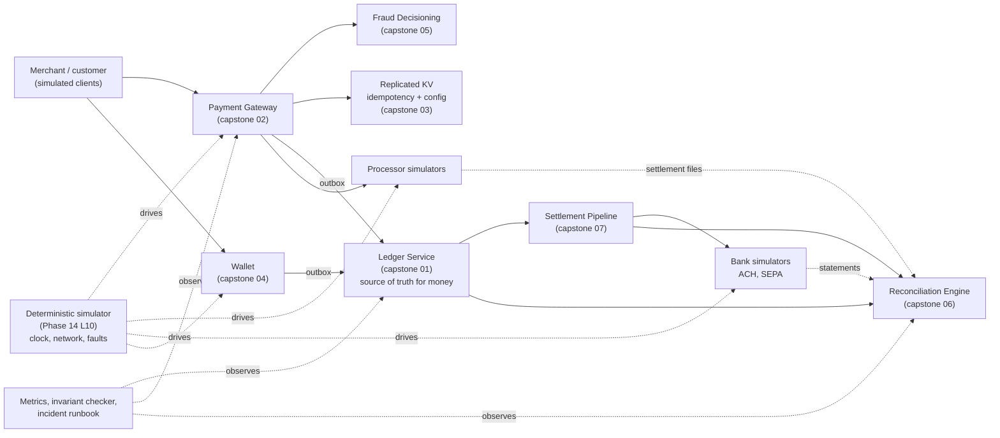

# Capstone: End-to-End Payments Platform

> Compose everything you built into one system you can demo.

**Type:** Capstone
**Languages:** Java, Python, or Go (pick one; the spec is language-neutral)
**Prerequisites:** Phase 15 Lesson 01 (A Durable Double-Entry Ledger Service), Phase 15 Lesson 02 (An Idempotent Multi-Processor Payment Gateway), Phase 15 Lesson 03 (A Raft-Replicated Key-Value Store), Phase 15 Lesson 04 (An Event-Sourced Wallet with CQRS), Phase 15 Lesson 05 (Real-Time Fraud Decisioning), Phase 15 Lesson 06 (A Reconciliation Engine), Phase 15 Lesson 07 (A Settlement and Payout Pipeline), Phase 14 Lesson 01 (Architecture of a High-Availability Payment Gateway), Phase 14 Lesson 06 (Observability for Money Movement), Phase 14 Lesson 07 (Incident Management for Payments), Phase 14 Lesson 10 (Deterministic Simulation Testing)
**Time:** ~720 minutes

## Learning Objectives

- Compose the seven earlier capstones (ledger, gateway, replicated store, event-sourced wallet, fraud decisioning, reconciliation, settlement) into one process with one source of truth per kind of fact and explicit contracts between them
- Drive a payment from checkout through authorization, fraud decision, capture, ledger posting, settlement, payout, and reconciliation, and prove by test that every minor unit is accounted for at every step
- Run the whole platform inside the deterministic simulator from Phase 14, Lesson 10, with faults injected at every boundary, and keep the platform-wide invariants green for a 30-virtual-day run
- Write and rehearse a ten-minute demo script and an operational runbook that a second engineer can execute without you
- Instrument the platform so that a stuck payment, a reconciliation break, or a breached invariant pages before a customer notices

## The Problem

Each earlier capstone was correct alone. The ledger balanced; the gateway never double-charged; the wallet replayed; the fraud engine explained itself; the reconciler found every break; the settlement pipeline paid out exactly once. Put them in one process and new failures appear that no single component can see.

The gateway authorizes a 48.50 USD card payment and asks the fraud engine for a decision. The fraud engine, under a watermark delay, returns `REVIEW`. The gateway holds the payment. Forty minutes later a reviewer approves it, the gateway captures, and the capture posts to the ledger. Meanwhile the settlement pipeline's window closed at 23:00; the capture landed at 23:04 and is netted into tomorrow's window. Tomorrow's reconciliation matches the processor's settlement file (which includes today's capture, because the processor's cut-off is midnight) against the ledger (which has it) and against the settlement batch (which does not, yet). The reconciler reports a break. It is not a break; it is a window boundary. Nobody wrote down which cut-off wins, so the on-call engineer spends an hour discovering that three correct components disagree about what "today" means.

A second composition failure is more dangerous. The wallet capstone is event-sourced and holds customer balances; the ledger capstone is double-entry and holds the books. A top-up credits the wallet aggregate and posts a ledger entry. If those are two writes, there is an instant where one has happened and the other has not, and a crash there leaves a customer who can spend money the books do not show. Each capstone's own invariant is intact (the wallet's events are consistent; the ledger's trial balance is zero), and the platform is wrong. The fix is a contract: exactly one of the two is the source of truth for "the customer has this balance", and the other is a projection of it with a measured lag. Deciding which, and proving the lag is bounded, is a platform-level requirement that no component test covers.

This capstone is the integration: contracts between components, platform-wide invariants that span them, one simulation that drives all of them, a demo you can run for a stakeholder in ten minutes, and a runbook for the night it breaks. It is the last thing in the course because it is the thing a payments engineer actually ships.

## What You Will Build

A single-process payments platform composed from the seven earlier capstones, with an in-process API, one deterministic simulation that drives it end to end, a demo script, and an operational runbook. The components are the ones you already built; the new code is the contracts between them, the platform invariants, the composed simulation, and the operations surface.



The components and what each owns in the composed system:

| Component | From | Source of truth for | Consumes | Produces |
|-----------|------|---------------------|----------|----------|
| `LedgerService` | `phases/15-capstone-projects/01-capstone-ledger-service` | every balance and every posting; the only place money is | posting requests via outbox from gateway, wallet, settlement | trial balance, account balances, audit chain |
| `PaymentGateway` | `phases/15-capstone-projects/02-capstone-payment-gateway` | payment state (the state machine), merchant idempotency keys | client requests, processor responses, fraud decisions | transitions on an outbox; webhooks |
| `ReplicatedKv` | `phases/15-capstone-projects/03-capstone-replicated-kv-store` | processor-side idempotency references and routing configuration, replicated across three simulated nodes | gateway writes | linearizable reads for the gateway |
| `WalletService` | `phases/15-capstone-projects/04-capstone-event-sourced-wallet` | customer wallet events and the commands that produced them | top-ups, sends, spends | `WalletCredited`, `WalletDebited` events to the ledger via outbox |
| `FraudDecisioning` | `phases/15-capstone-projects/05-capstone-fraud-decisioning` | the decision for each attempt and the evidence behind it | transaction features from the gateway, event-time stream | `ALLOW`, `REVIEW`, `BLOCK` with rule trace |
| `ReconciliationEngine` | `phases/15-capstone-projects/06-capstone-reconciliation-engine` | breaks and their ageing | ledger postings, processor settlement files, bank statements, settlement batches | daily report, tie-out, evidence bundle |
| `SettlementPipeline` | `phases/15-capstone-projects/07-capstone-settlement-pipeline` | payout state and batch files | ledger payable balances per merchant | NACHA and pain.001 files, payout transitions, ledger postings via outbox |
| `Simulator`, `Network`, `FaultSchedule` | `phases/14-payments-at-scale/10-simulation-testing-of-payment-systems` | virtual time, every message, every fault | the whole platform | trace fingerprint, failing-seed report |
| `PlatformInvariants` | new in this capstone | nothing; it reads everything | every component's state | violations by name, with the first virtual time |
| `Runbook`, `DemoScript` | new in this capstone | the operations surface | metrics, invariant output | human actions |

### The contracts

Three contracts resolve the composition failures from The Problem, and the acceptance tests check each.

**Contract 1: money lives in the ledger.** The wallet's balance is a projection of ledger postings on the customer's liability account, not the other way round. A top-up command is accepted by the wallet aggregate (which enforces limits and produces events) and becomes spendable only when the ledger posting it caused has been applied back into the wallet's `available` projection. The lag between the wallet event and the ledger posting is measured, and `available` never exceeds the ledger's posted balance minus holds.

**Contract 2: every cross-component message is an outbox record with a stable key.** Gateway to ledger, wallet to ledger, settlement to ledger, gateway to fraud, settlement to bank: each is `(sourceComponent, sourceRecordId, kind)` and the consumer dedupes on that key with a unique index. There is no direct method call between two components that changes state; there is only "write to my store with an outbox row, and a relay delivers it".

**Contract 3: the platform has one calendar.** A `SettlementCalendar` defines the cut-off for every window in UTC and is the only source of "which day does this capture belong to". The gateway stamps each capture with its settlement date from the calendar at capture time; the settlement pipeline and the reconciler read that stamp rather than computing their own. A processor file whose cut-off differs is normalized to the platform's calendar at parse time, with the processor's original date kept on the line for the break report.

### One payment, end to end

A customer pays 48.50 USD at a merchant with a 2.9% plus 0.30 fee, paid out by ACH on a T+2 schedule. The row is what each component records; the invariant column is what `PlatformInvariants` checks at that moment.

| Step | Component | Record | Ledger effect | Invariant checked |
|------|-----------|--------|---------------|-------------------|
| 1 | Gateway | `pay_9c1` `PENDING`, key `ord-7781` | none | one payment per key |
| 2 | Fraud | decision `ALLOW`, score 22, two rules read, none fired | none | every attempt has a decision before authorization is sent |
| 3 | Gateway, KV | processor reference `m42:pay_9c1` written to KV, then `authorize` sent | none | reference exists in KV before any processor call |
| 4 | Processor sim | approved, auth `A-5520` | none | at most one live authorization per payment |
| 5 | Gateway | `AUTHORIZED`; outbox `(gateway, pay_9c1, AUTHORIZED)` | hold 48.50 on `RECEIVABLE:PROC_A` memo, no posting | state matches processor's ledger |
| 6 | Gateway | `CAPTURED`, settlement date 2026-03-02; outbox `(gateway, pay_9c1, CAPTURED)` | debit `RECEIVABLE:PROC_A` 48.50; credit `MERCHANT_PAYABLE:m42` 46.79; credit `FEE_REVENUE` 1.71 | entry balances; receivables equal captured-not-settled |
| 7 | Settlement | window 2026-03-02 closes; payable 46.79 netted; payout `po_311` `BATCHED` in NACHA file `F-0302-ACH-1` | debit `MERCHANT_PAYABLE:m42` 46.79; credit `BANK_ACH_OUT` 46.79 | one payout per payable per window |
| 8 | Bank sim | file acknowledged; two virtual days later statement shows debit 46.79 ref `po_311` | none | file control total equals sum of entries |
| 9 | Processor sim | settlement file for 2026-03-02 shows `A-5520` 48.50 | debit `BANK_PROC_A_IN` 48.50; credit `RECEIVABLE:PROC_A` 48.50 | receivable returns to zero for this payment |
| 10 | Reconciler | three-way match: ledger, processor file, bank statement; zero breaks for `pay_9c1` | none | matched plus breaks equals inputs |

The fee is computed as `4850 x 29 / 1000 = 140.65 -> 141` minor units plus 30, giving 171, with `HALF_UP` recorded on the entry (`phases/10-money-and-ledgers/01-representing-money`). The platform invariant at step 10 is the one that matters most: for every captured payment older than the settlement horizon, the processor file, the ledger receivable movement, and the merchant payout agree to the minor unit, or there is a named break with an owner.

## Requirements

Each requirement is a sentence you can turn into a test. The milestone that first satisfies it is in brackets.

1. The platform runs as one process with one entry point (`Platform.start(config)`), composing the seven capstones as in-process services; each service keeps its own store and exposes only its public API and its outbox. No service reads another's tables. [M1]
2. `LedgerService` is the only component that holds a balance. Wallet `available` is a projection of ledger postings minus active holds, and a test proves `available <= ledgerPosted - holds` at every checkpoint of a 10,000-command run. [M2]
3. Every cross-component effect travels as an outbox record keyed by `(sourceComponent, sourceRecordId, kind)`; every consumer dedupes on that key; a relay that redelivers every record twice produces an identical final state (same trial balance, same payment states, same payout states). [M2]
4. A `SettlementCalendar` with explicit UTC cut-offs stamps each capture with its settlement date; the settlement pipeline and reconciler consume the stamp and never recompute it. A processor file with a different cut-off is normalized at parse time and the original date is retained. [M3]
5. A card payment flows checkout to reconciled with no manual step: `PENDING -> AUTHORIZED -> CAPTURED`, ledger postings, netting, payout file, bank acknowledgement, processor settlement file, three-way match. The end-to-end test asserts the ledger effects in the table above to the minor unit. [M3]
6. Every authorization attempt obtains a fraud decision before the processor is called; `BLOCK` ends the payment as `DECLINED` with reason `FRAUD_BLOCK` and no processor call; `REVIEW` holds it in `PENDING_REVIEW` with a timeout after which it is declined; `ALLOW` proceeds. The decision log entry references the payment id. [M4]
7. The gateway writes its processor reference to `ReplicatedKv` with a linearizable write before the first processor call, and reads it back on recovery; a test kills the KV leader during a batch of 500 payments and asserts no payment is sent to the processor without a stored reference. [M4]
8. Wallet spend at a merchant is a payment with the wallet as the funding source: the wallet places a hold, the gateway marks the payment `AUTHORIZED` without a processor, capture converts the hold into a ledger transfer from the customer's liability account to the merchant payable. The platform invariant `sum(customer liabilities) + sum(merchant payables) + fee revenue = sum(funding assets)` holds. [M5]
9. Settlement runs daily on the virtual clock; each merchant's payable is netted per window; payouts are released once per `(windowId, batchId)` through the outbox; returns from the bank simulator reverse the payout by a new ledger entry and re-queue it. [M6]
10. Reconciliation runs daily after settlement, consuming processor files, bank statements, ledger postings, and settlement batches; it produces a report with matched counts, typed breaks, and a tie-out per account per currency; a window-boundary difference is never classified as a break. [M6]
11. `PlatformInvariants` checks, once per virtual day and at quiescence: trial balance zero per currency; one payment per merchant key; at most one live processor authorization per payment; every captured payment has exactly one capture entry; `available <= posted - holds` for every wallet; one payout per payable per window; every payout `SETTLED` has a matching statement line; no payment in a non-terminal state longer than its timeout plus the recovery delay; reconciliation breaks older than two virtual days are zero or have an owner. Each violation is named and carries the first virtual time. [M7]
12. The entire platform runs inside the Phase 14, Lesson 10 simulator with faults at every boundary (processor outage and slowdown, bank file rejection, KV leader crash, gateway crash with work in flight, relay crash between deliver and mark, partition between gateway and fraud); a 30-virtual-day run with the standard fault density passes all invariants for seeds 1 to 20, and the trace fingerprint is identical across two runs of the same seed. [M7]
13. Two planted defects (`RELAY_MARKS_BEFORE_DELIVER`, `WALLET_CREDITS_BEFORE_LEDGER`) are each caught by a named invariant within 40 seeds of 24 virtual hours, and the failing-seed report reproduces the violation. [M7]
14. The platform exposes metrics (`phases/14-payments-at-scale/06-observability-for-money-movement`): payments by state, oldest non-terminal payment age, relay lag per outbox, unknown-outcome count, breaker state per processor, reconciliation breaks by type and age, wallet projection lag, invariant violations. A test asserts that a stuck payment raises `oldest_pending_age_ms` above its alert threshold within one virtual minute. [M8]
15. `demo.sh` (or `make demo`) runs the ten-minute demo script in under 60 seconds of wall-clock time: one payment traced end to end with every record printed, a 7-virtual-day simulation summary, one injected processor outage and its resolution, one planted defect and the invariant that catches it, and the final reconciliation report with zero breaks. [M8]
16. `RUNBOOK.md` covers at least the eight scenarios in Milestone 8, each with detection (which metric or invariant), diagnosis (which query or report), action (which command, with its idempotency argument), and verification (which invariant must be green afterwards); a second person executes two scenarios from the runbook against the running demo without help from the author. [M8]

## Milestones

Work the milestones in order. Each ends with a test you run before moving on. Commands assume the layout `capstone/platform/{java,python,go}` with the earlier capstones vendored in as source directories or modules; adapt to yours.

```bash
# Java
cd capstone/platform/java && javac -d .out $(find . -name '*.java') && java -cp .out PlatformTest
# Python
cd capstone/platform/python && python3 -m unittest -v
# Go
cd capstone/platform/go && go test -race ./...
```

### Milestone 1: One process, seven services, zero shared tables

Create `Platform` with a constructor that takes a `PlatformConfig` (seed, calendar, fee schedule, processor and bank configurations) and instantiates the seven services, each with its own storage directory or in-memory store and its own outbox. Write the `ServiceRegistry` through which services obtain each other's public API and nothing else. Add an architectural test that scans each service's source for references to another service's store type and fails if it finds one.

Acceptance test `m1_platform_starts_and_services_are_isolated`:

1. Start the platform with seed 1. Assert all seven services report `healthy` and each has an empty outbox.
2. Run the source-scan test: zero cross-service store references.
3. Stop and restart the platform on the same directories. Assert every service recovers (ledger from WAL plus snapshot, wallet from event store, gateway from its transition log, KV from its Raft log) and reports the same state hash as before the stop.

### Milestone 2: The outbox fabric and the money contract

Implement `OutboxRelay` as a platform service: it polls every service's outbox in a fixed order, delivers each record to the registered consumer, and marks it delivered only after the consumer's write has returned. Each consumer dedupes on `(sourceComponent, sourceRecordId, kind)` with a unique index in its own store. Wire wallet events to the ledger (customer liability accounts), gateway transitions to the ledger (receivables, payables, fees), and ledger postings back to the wallet's `available` projection.

Acceptance test `m2_double_delivery_is_harmless_and_wallet_never_exceeds_ledger`:

1. Issue 10,000 wallet commands (top-ups, sends, spends) from a seeded generator with a relay configured to deliver every record exactly twice.
2. Assert the ledger trial balance is zero, each wallet's `available` equals its ledger posted balance minus active holds, and the ledger has exactly one posting per wallet event.
3. Set the relay to deliver once; rerun with the same seed; assert the final state hash is identical to step 2.
4. At 100 checkpoints during the run, assert `available <= ledgerPosted - holds` for every wallet (never greater; equal once the relay has caught up).

The Python shape of the checkpoint assertion:

```python
def assert_wallet_contract(self, platform):
    for wallet_id in platform.wallets.ids():
        available = platform.wallets.available(wallet_id)
        posted = platform.ledger.balance(f"CUSTOMER_LIABILITY:{wallet_id}")
        holds = platform.ledger.active_holds(f"CUSTOMER_LIABILITY:{wallet_id}")
        self.assertLessEqual(available.minor_units, (posted - holds).minor_units,
                             f"{wallet_id}: available {available} exceeds ledger {posted - holds}")
```

### Milestone 3: A card payment, checkout to reconciled

Implement `SettlementCalendar` and stamp captures with it. Connect the gateway's `CAPTURED` outbox record to the ledger entry in the table above (receivable, payable, fee with the fee schedule's rounding). Connect the ledger's payable balances to the settlement pipeline's window netting. Connect the settlement pipeline's file release to the bank simulator, and the bank simulator's acknowledgements and statements, plus the processor simulator's settlement files, to the reconciliation engine.

Acceptance test `m3_one_payment_end_to_end_to_the_minor_unit`:

1. Advance the virtual clock to 2026-03-02T10:00Z. Submit the 48.50 USD payment with key `ord-7781`. Capture it.
2. Assert the ledger entry: `RECEIVABLE:PROC_A` debit 4850, `MERCHANT_PAYABLE:m42` credit 4679, `FEE_REVENUE` credit 171, rounding `HALF_UP` recorded, settlement date `2026-03-02`.
3. Advance past the window cut-off. Assert payout `po_311` is `BATCHED` in a NACHA file whose control total is 4679 and whose entry carries `po_311` in the addenda or individual id field.
4. Advance two virtual days with the bank and processor simulators producing their files. Assert the payout is `SETTLED`, `RECEIVABLE:PROC_A` is zero for this payment, and the reconciliation report shows three matches and zero breaks.
5. Change the processor simulator's cut-off to 23:00 (one hour earlier than the platform's). Submit a capture at 23:30. Assert the reconciler normalizes the processor's date, matches the capture, and reports zero breaks with one `WINDOW_SHIFT` annotation (informational, not a break).

### Milestone 4: Fraud in the path and references in the KV

Insert the fraud decision between `PENDING` and the processor call. Map `ALLOW`, `REVIEW`, `BLOCK` to the gateway's state machine with `PENDING_REVIEW` and its timeout. Route the processor reference write through `ReplicatedKv` with a linearizable write, and make gateway recovery read the KV before re-driving any `PENDING` payment.

Acceptance test `m4_fraud_gates_the_processor_and_references_survive_leader_loss`:

1. Submit 1,000 payments from a generator with 3% planted card-testing bursts. Assert every `BLOCK` payment is `DECLINED` with `FRAUD_BLOCK` and the processor simulator received no authorization for it.
2. Assert every `REVIEW` payment is in `PENDING_REVIEW`; approve half through the review API and let the rest time out; assert the first half reach `AUTHORIZED` and the rest `DECLINED` with `REVIEW_TIMEOUT`.
3. During a batch of 500 payments, crash the KV leader at virtual second 20. Assert a new leader is elected, no payment reached the processor without a stored reference (compare the processor's received set with the KV's key set), and every payment reaches a terminal state after the drain.
4. Crash the gateway with 30 payments in flight. Assert recovery reads each reference from the KV and re-drives with the same reference; the processor simulator's live-authorization count per payment is at most one.

### Milestone 5: Wallet-funded payments and the platform balance sheet

Add the wallet as a funding source: a payment with `source = wallet:<id>` places a hold in the wallet, moves to `AUTHORIZED` without a processor, and on capture converts the hold into a ledger transfer from the customer liability account to the merchant payable plus fee revenue. Add the platform balance-sheet invariant.

Acceptance test `m5_wallet_payments_conserve_the_balance_sheet`:

1. Top up 200 wallets with 100.00 USD each by simulated bank transfer (funding asset `BANK_FUNDING_IN` 20,000.00).
2. Run 5,000 mixed wallet spends, card payments, and wallet-to-wallet sends from a seeded generator, including 2% insufficient-funds attempts.
3. Assert at 50 checkpoints: `sum(CUSTOMER_LIABILITY:*) + sum(MERCHANT_PAYABLE:*) + FEE_REVENUE = BANK_FUNDING_IN + RECEIVABLE:* net of settled`, to the minor unit, in USD.
4. Assert every insufficient-funds attempt is `DECLINED` with `INSUFFICIENT_AVAILABLE`, left no hold, and produced no ledger entry.

The Java shape of the balance-sheet check, using the same `check(name, condition)` harness as the Build lessons:

```java
static void checkBalanceSheet(Platform p, String label) {
    Money liabilities = p.ledger().sumBalances("CUSTOMER_LIABILITY:");
    Money payables = p.ledger().sumBalances("MERCHANT_PAYABLE:");
    Money fees = p.ledger().balance("FEE_REVENUE");
    Money funding = p.ledger().balance("BANK_FUNDING_IN");
    Money receivables = p.ledger().sumBalances("RECEIVABLE:");
    Money left = liabilities.plus(payables).plus(fees);
    Money right = funding.plus(receivables);
    check("balance sheet conserved at " + label + ": " + left + " vs " + right, left.equals(right));
}
```

### Milestone 6: Daily settlement and daily reconciliation

Schedule the settlement pipeline and the reconciler on the virtual clock: settlement at each window cut-off, reconciliation one virtual hour after the bank and processor simulators publish their files. Handle bank returns (reverse the payout's ledger entry, re-queue the payout, surface a break if the merchant's details were not fixed by the next window).

Acceptance test `m6_seven_days_settle_and_reconcile_clean`:

1. Run 7 virtual days with 300 card payments and 200 wallet payments per day across 40 merchants, with the bank simulator returning 1% of payouts with `R03` on day 3.
2. Assert each day's reconciliation report: matched plus breaks equals inputs on every side; tie-out holds per account; the only breaks on day 4 are the `R03` returns, typed `RETURNED_PAYOUT`, each with an owner.
3. Assert returned payouts are re-released on day 5 for merchants whose details were fixed and remain as aged breaks for the others.
4. Assert no `WINDOW_SHIFT` annotation was ever classified as a break.

### Milestone 7: The composed simulation and the planted defects

Run the entire platform inside the Phase 14, Lesson 10 simulator. Add fault kinds for every boundary and arm them from the seed. Implement `PlatformInvariants` with the nine checks in Requirement 11, scheduled once per virtual day and at quiescence. Plant the two defects behind flags.

Acceptance test `m7_thirty_days_of_faults_pass_and_planted_defects_are_caught`:

1. Run seeds 1 to 20 for 30 virtual days each with the standard fault density. Assert zero violations, zero non-terminal payments after the drain, and that each run exercised at least one of every fault kind.
2. Run seed 1 twice. Assert identical trace fingerprints.
3. Enable `RELAY_MARKS_BEFORE_DELIVER` and search seeds 1 to 40 at 24 virtual hours. Assert a failing seed is found and the first broken invariant is `every-capture-posted-once` or `wallet-available-bounded`.
4. Enable `WALLET_CREDITS_BEFORE_LEDGER` and search likewise. Assert the first broken invariant is `wallet-available-bounded`.
5. Assert the failing-seed report for each contains the seed, the virtual time, the invariant name, and a one-line reproduction command.

The Go shape of the seed sweep:

```go
func TestM7ThirtyDaysOfFaults(t *testing.T) {
    for seed := int64(1); seed <= 20; seed++ {
        report := RunPlatformSimulation(PlatformSimConfig{Seed: seed, VirtualDays: 30, Faults: StandardDensity})
        if len(report.Violations) != 0 {
            t.Fatalf("seed %d: %s", seed, report.Reproduction())
        }
        if report.Pending != 0 {
            t.Fatalf("seed %d: %d payments non-terminal after drain", seed, report.Pending)
        }
        for kind, n := range report.FaultCounts {
            if n == 0 {
                t.Fatalf("seed %d never exercised fault %s", seed, kind)
            }
        }
    }
}
```

### Milestone 8: Metrics, the demo, and the runbook

Add the metrics in Requirement 14 as a `Metrics` registry readable in-process and printable as text. Write `demo.sh` and `RUNBOOK.md`.

The demo script, which must run in under 60 seconds and print each section header:

1. **One payment.** Submit `ord-7781`, print every record it creates in order (gateway transition, fraud decision, KV reference, processor authorization, ledger entry, payout, bank statement line, processor file line, reconciliation match), each with its id and amount.
2. **Seven days.** Run 7 virtual days at the standard load; print payments by state, trial balance per currency, payouts settled, breaks by type (zero), and the trace fingerprint.
3. **An outage.** Inject a 10-virtual-minute processor outage at day 3; print the breaker opening, the count of `UNKNOWN` payments, the resolver's actions, and the count returning to zero.
4. **A defect.** Enable `WALLET_CREDITS_BEFORE_LEDGER`; print the failing seed, the invariant, the virtual time, and the reproduction line; disable it.
5. **The books.** Print the final reconciliation report and the balance-sheet check.

The runbook, one page per scenario, each with Detection, Diagnosis, Action, Verification:

| Scenario | Detection | Action (idempotent) | Verification |
|----------|-----------|---------------------|--------------|
| Payment stuck in `PENDING` past timeout | `oldest_pending_age_ms` alert | run resolver for that payment id | payment terminal; `no-stuck-payments` green |
| `UNKNOWN` count rising | `unknown_outcome_count` | check breaker; run resolver; if processor has no query, void by reference | count falls to zero; `at-most-one-live-auth` green |
| Relay lag growing | `relay_lag_ms` per outbox | confirm lease holder; restart relay; it resumes from unpublished rows | lag under threshold; double-delivery test still green |
| Wallet projection lag | `wallet_projection_lag_ms` | restart projection from its checkpoint | `wallet-available-bounded` green |
| Reconciliation break aged over two days | `breaks_by_age` | open the break, follow its suggested action (re-request file, post correcting entry with reference) | break resolved in next run; tie-out holds |
| Bank file rejected | payout state `FILE_REJECTED` | fix the validation error, re-batch; file id changes, payouts do not | payouts `SENT`; `one-payout-per-payable-per-window` green |
| KV leader lost | KV `leader_changes` | nothing; confirm election under 10 s; if no leader, check partitions | gateway writes succeed; references present |
| Invariant violation in production | `invariant_violations` with name | freeze the affected flow (stop relay for that outbox), capture state hash, page the owner; do not post correcting entries until root cause is known | violation count stable; postmortem opened |

Acceptance test `m8_metrics_detect_a_stuck_payment_and_the_demo_runs`:

1. Submit a payment and partition the gateway from the processor permanently. Advance one virtual minute. Assert `oldest_pending_age_ms` exceeds its threshold and the alert fires.
2. Run `demo.sh`. Assert exit code 0, wall-clock under 60 seconds, and that the output contains the five section headers and `breaks: 0`.
3. Have a second person execute the "payment stuck" and "bank file rejected" runbook scenarios against the demo platform without the author present. Record what they could not find; fix the runbook; repeat until both complete.

## Acceptance Criteria

The capstone is complete when all of the following are true on a clean checkout of your project:

- All eight milestone tests pass in your chosen language with one command, and the Go version passes under `go test -race ./...`.
- `demo.sh` runs in under 60 seconds and prints the five sections, ending with a reconciliation report of zero breaks and a balance-sheet check that holds to the minor unit.
- Seeds 1 to 20 at 30 virtual days pass every platform invariant; seed 1 produces the same fingerprint on two machines.
- Both planted defects are caught with the expected invariant names and a reproduction line.
- `RUNBOOK.md` has the eight scenarios with Detection, Diagnosis, Action, Verification, and a line recording who executed which scenario without the author and on what date.
- `README.md` states the three contracts, the settlement calendar, the outbox key format, the fault kinds and their densities, the invariant list with the component each one indicts, and your decisions in the table below.
- `grep -rn "double\|float" --include=*.java --include=*.py --include=*.go` in amount-bearing types returns only comments; fee rates are basis points; FX rates, if any, are scaled integers.
- No service reads another service's store; the architectural test from M1 is part of the suite.

| Decision | Options | What the reference design does | Test that exposes it |
|----------|---------|--------------------------------|----------------------|
| Source of truth for customer balance | wallet events; ledger postings | ledger; wallet `available` is a bounded projection | M2 step 4 |
| Relay delivery order across outboxes | round-robin; fixed priority | fixed order: ledger consumers first, then settlement, then webhooks | M2 step 3 |
| `REVIEW` timeout outcome | decline; void if authorized; escalate | decline before authorization (no processor call has been made) | M4 step 2 |
| Window boundary difference | break; informational annotation | `WINDOW_SHIFT` annotation, never a break | M3 step 5 |
| Returned payout with unfixed details | retry each window; age as break | age as break with owner after one retry | M6 step 3 |
| Invariant violation response | auto-correct; freeze and page | freeze the affected outbox and page | M8 runbook |
| Fault density | fixed count; per-component rate | per-component rate per virtual day, seeded | M7 step 1 |

## Rubric

| Criterion | Developing | Solid | Exemplary |
|-----------|------------|-------|-----------|
| Composition and contracts | Services call each other's methods and read each other's tables | Outbox between every pair; one source of truth per fact; architectural test enforces isolation | Contracts documented with the failure each prevents; a contract-violation test per contract that fails when the contract is broken |
| Money conservation | Trial balance zero in the happy path | Balance-sheet invariant at checkpoints under mixed load; wallet bounded by ledger | Invariant holds under double delivery, crashes, and partitions for 20 seeds; the lag between wallet event and ledger posting is measured and bounded |
| End-to-end correctness | A payment reaches `CAPTURED` | Checkout to reconciled with ledger effects asserted to the minor unit; calendar stamped at capture | Window-boundary and cut-off differences handled and annotated; three-way match clean across 7 days with returns |
| Fraud and references | Fraud called after authorization, or not at all | Decision gates the processor; references in KV before the call; leader loss survives | Review queue with timeout; recovery re-drives from KV with at most one live authorization proven by the processor simulator's ledger |
| Simulation | Components tested individually | Whole platform in one simulator; faults at every boundary; 20 seeds at 30 days | Planted defects caught with named invariants; fault schedule biased toward in-flight work; fingerprint reproducible across machines |
| Observability | Logs only | Metrics for every convergence path; stuck-payment alert tested | Each invariant maps to a metric and a runbook page; alert thresholds derived from measured p99s in the simulation |
| Demo | Runs by hand with explanation | `demo.sh` under 60 s with the five sections | Demo narrates each record's id and amount; includes the outage and the defect; a stakeholder can follow it without the author speaking |
| Runbook and operations | Missing or generic | Eight scenarios with Detection, Diagnosis, Action, Verification; actions idempotent | Executed by a second person without the author; gaps found and fixed; each action's idempotency argument stated |
| Engineering hygiene | No README; tests by number | README with contracts, calendar, key format, invariant list, decisions | Every decision cites the lesson that informed it; the architectural test and the seed sweep run in CI |

## Further Reading

- [Pat Helland, "Life beyond Distributed Transactions: an Apostate's Opinion" (CIDR 2007)](https://www.cidrdb.org/cidr2007/papers/cidr07p15.pdf) — entities, idempotent messages between them, and no cross-entity transactions: the theory behind Contract 2.
- [Chris Richardson, "Pattern: Transactional outbox"](https://microservices.io/patterns/data/transactional-outbox.html) — the mechanism behind every arrow in the composed diagram.
- [Stripe Engineering, "Ledger: Stripe's system for tracking and validating money movement"](https://stripe.com/blog/ledger-stripe-system-for-tracking-and-validating-money-movement) — a production ledger as the single source of truth for money with reconciliation as a first-class component, which is Contract 1 at scale.
- [FoundationDB, "Simulation and Testing"](https://apple.github.io/foundationdb/testing.html) — composing an entire distributed system into one deterministic process, the model for Milestone 7.
- [Google SRE Book, Chapter 14, "Managing Incidents"](https://sre.google/sre-book/managing-incidents/) and [Chapter 15, "Postmortem Culture"](https://sre.google/sre-book/postmortem-culture/) — the structure behind the runbook's Detection, Diagnosis, Action, Verification and the freeze-and-page decision.
- [Nacha Operating Rules, return reason codes](https://www.nacha.org/rules) — `R03` and its neighbours, which Milestone 6 simulates.
- [ISO 20022 message definitions, `pain.001` and `camt.053`](https://www.iso20022.org/iso-20022-message-definitions) — the file formats the settlement pipeline writes and the reconciler reads.
