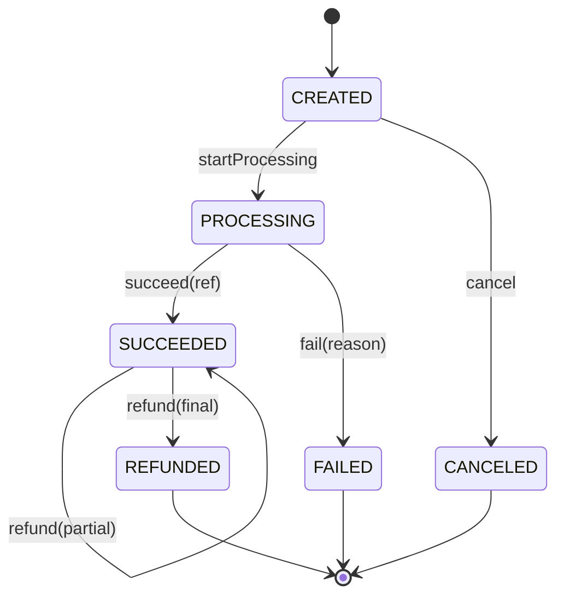

# Payment State Machine

**Stage 2 of 4.** Plan about 2 hours.

Stage 1 made sure a request is processed once. This stage makes sure that once it is processed, the payment can only move in directions that make sense. A payment that is `SUCCEEDED` must never become `PROCESSING` again; a payment that was `DECLINED` must never be refunded; a refund must never exceed what was captured. Every one of these is a real incident class: a retry handler that re-ran capture on an already captured payment, a refund endpoint that did not check the state and sent money to a customer who was never charged, a "refund the full amount" button pressed twice.

The fix is a single, explicit **transition table** and a `Payment` object that refuses to do anything the table does not list. Every accepted move is appended to a history log with the clock time and a reason, and bumps a `version` counter. The version is what a database row would carry for optimistic locking (`UPDATE payments SET state=?, version=version+1 WHERE id=? AND version=?`), and the history is what support, finance and the auditor read. Partial refunds are the subtle part: a refund of 20.00 on a 50.00 payment keeps the payment `SUCCEEDED` (there is still 30.00 to refund) but is still a recorded, versioned event; only the refund that brings the refunded total to the captured total moves the payment to `REFUNDED`, which is terminal.

The invariant: **`state` is always reachable from `CREATED` through table-listed moves only, `version - 1` equals `history.size()`, and `0 <= refunded <= captured <= amount` with `captured` equal to `amount` exactly when the payment has succeeded.** Amounts are `Money` in integer minor units from Phase 10, so `29.99 + 0.01` is exactly `30.00` and the "last cent" refund closes the payment without any rounding question.

## Worked example

The transition table, which is the single source of truth. Anything not in it is illegal.

| From | Allowed next states | Notes |
|---|---|---|
| `CREATED` | `PROCESSING`, `CANCELED` | A merchant may cancel before the processor is called |
| `PROCESSING` | `SUCCEEDED`, `FAILED` | Nothing else: you cannot cancel a call that is in flight |
| `SUCCEEDED` | `REFUNDED` | Reached only when refunded equals captured |
| `FAILED` | — | terminal |
| `CANCELED` | — | terminal |
| `REFUNDED` | — | terminal |



A 50.00 USD payment on a `FakeClock` starting at t = 5,000 ms:

| Step | Call | State after | Version | Captured | Refunded | Refundable | History entry appended |
|---|---|---|---|---|---|---|---|
| 0 | `new Payment("pay_1", 50.00 USD, clock)` | `CREATED` | 1 | 0.00 | 0.00 | 0.00 | — |
| 1 | `startProcessing()` | `PROCESSING` | 2 | 0.00 | 0.00 | 0.00 | `CREATED -> PROCESSING "sent to processor" @5000` |
| 2 | `clock.advance(250)`; `succeed("auth-77")` | `SUCCEEDED` | 3 | 50.00 | 0.00 | 50.00 | `PROCESSING -> SUCCEEDED "approved auth-77" @5250` |
| 3 | `succeed("again")` | `SUCCEEDED` | 3 | 50.00 | 0.00 | 50.00 | **throws** `IllegalTransitionException`; nothing appended |
| 4 | `refund(20.00, "customer request")` returns 30.00 | `SUCCEEDED` | 4 | 50.00 | 20.00 | 30.00 | `SUCCEEDED -> SUCCEEDED "customer request (20.00 USD)"` |
| 5 | `refund(30.01, "too much")` | `SUCCEEDED` | 4 | 50.00 | 20.00 | 30.00 | **throws** `IllegalArgumentException`; nothing appended |
| 6 | `refund(29.99, "goodwill")` returns 0.01 | `SUCCEEDED` | 5 | 50.00 | 49.99 | 0.01 | `SUCCEEDED -> SUCCEEDED "goodwill (29.99 USD)"` |
| 7 | `refund(0.01, "last cent")` returns 0.00 | `REFUNDED` | 6 | 50.00 | 50.00 | 0.00 | `SUCCEEDED -> REFUNDED "last cent (0.01 USD)"` |
| 8 | `refund(0.01, "again")` | `REFUNDED` | 6 | 50.00 | 50.00 | 0.00 | **throws** `IllegalTransitionException` |

Read the version column against the history: after step 7 the history has 5 entries and the version is 6. Rejected calls (steps 3, 5, 8) change nothing: not the state, not the version, not the money. That is the property a database transaction gives you for free and an in-memory object has to earn by validating *before* mutating.

Two other payments in the same test: `pay_2` is canceled from `CREATED` (`version` 2, terminal), and `pay_3` is declined: `startProcessing()` then `fail("declined decl-3")`, after which `captured()` is zero and `refund` throws `IllegalTransitionException` because a `FAILED` payment never captured anything.

## Your task

Add `Payments.java` to the workspace. Nothing from Stage 1 changes shape; the grader runs `Stage01Test` again first. The Python port has the same surface in snake_case in one `main.py`, and the Go port the same surface in exported CamelCase (signatures below).

```java
enum PaymentState {
    CREATED, PROCESSING, SUCCEEDED, FAILED, CANCELED, REFUNDED;
    boolean isTerminal();     // FAILED, CANCELED, REFUNDED
    String wire();            // lower-case name for API bodies: "succeeded"
}

final class IllegalTransitionException extends IllegalStateException {
    IllegalTransitionException(String paymentId, PaymentState from, PaymentState to);
}

record Transition(PaymentState from, PaymentState to, String reason, long atMillis) {}

final class PaymentStateMachine {
    static boolean canTransition(PaymentState from, PaymentState to);
    static Set<PaymentState> nextStates(PaymentState from);     // unmodifiable; empty for terminal states
}

final class Payment {
    Payment(String id, Money amount, Clock clock);   // blank id or non-positive amount -> IllegalArgumentException

    String id();  Money amount();  PaymentState state();
    Money captured();  Money refunded();  Money refundable();   // refundable = captured - refunded
    String processorReference();                               // "" until succeed()
    long version();                                            // starts at 1
    List<Transition> history();                                // unmodifiable

    void startProcessing();                 // CREATED -> PROCESSING
    void succeed(String reference);         // PROCESSING -> SUCCEEDED; captured = amount; keeps the reference
    void fail(String reason);               // PROCESSING -> FAILED
    void cancel(String reason);             // CREATED -> CANCELED
    Money refund(Money amount, String reason);   // returns what is still refundable
}
```

The same surface in Python (one `main.py` module; methods and fields are snake_case, exceptions end in `Error`, read-only views are tuples):

```python
class PaymentState(Enum):     # CREATED, PROCESSING, SUCCEEDED, FAILED, CANCELED, REFUNDED
    def is_terminal(self) -> bool: ...                 # FAILED, CANCELED, REFUNDED
    def wire(self) -> str: ...                         # self.name.lower(): "succeeded"

class IllegalTransitionError(RuntimeError):
    def __init__(self, payment_id: str, from_state: PaymentState, to_state: PaymentState) -> None: ...

@dataclass(frozen=True)
class Transition:             # from_state: PaymentState, to_state: PaymentState, reason: str, at_millis: int

class PaymentStateMachine:
    TABLE: dict[PaymentState, frozenset[PaymentState]]
    @staticmethod
    def can_transition(from_state: PaymentState, to_state: PaymentState) -> bool: ...
    @staticmethod
    def next_states(from_state: PaymentState) -> frozenset[PaymentState]: ...

class Payment:
    def __init__(self, id: str, amount: Money, clock: Clock) -> None: ...   # blank id / non-positive amount -> ValueError
    def id(self) -> str; amount() -> Money; state() -> PaymentState; captured() -> Money; refunded() -> Money
    def refundable(self) -> Money; processor_reference() -> str; version() -> int; history() -> tuple[Transition, ...]
    def start_processing(self) -> None; succeed(reference: str); fail(reason: str); cancel(reason: str)
    def refund(self, refund_amount: Money, reason: str) -> Money: ...      # returns what is still refundable
```

The same surface in Go (`payments.go`; moves return `error`, and `ErrIllegalTransition` wraps `ErrIllegalState` the way `IllegalTransitionException extends IllegalStateException`):

```go
type PaymentState int
const ( Created PaymentState = iota; Processing; Succeeded; Failed; Canceled; Refunded )
func (s PaymentState) IsTerminal() bool
func (s PaymentState) Wire() string                             // "succeeded"

var ErrIllegalTransition = fmt.Errorf("%w: illegal transition", ErrIllegalState)
var ErrInvalidRefund = errors.New("invalid refund")              // non-positive, or more than refundable
type Transition struct{ From, To PaymentState; Reason string; AtMillis int64 }
func CanTransition(from, to PaymentState) bool                  // the table is a package-level map
func NextStates(from PaymentState) []PaymentState               // a copy

func NewPayment(id string, amount Money, clock Clock) (*Payment, error)   // blank id / non-positive amount -> error
func (p *Payment) ID() string; Amount() Money; State() PaymentState; Captured() Money; Refunded() Money
func (p *Payment) Refundable() Money; ProcessorReference() string; Version() int64; History() []Transition   // a copy
func (p *Payment) StartProcessing() error; Succeed(reference string) error; Fail(reason string) error; Cancel(reason string) error
func (p *Payment) Refund(refundAmount Money, reason string) (Money, error)   // ErrIllegalTransition / ErrInvalidRefund / ErrCurrencyMismatch
```

`Money.Compare` panics on a currency mismatch (a programming error in the lesson's Money), so `Refund` checks `refundAmount.Currency != remaining.Currency` itself and returns `ErrCurrencyMismatch` before comparing.

Rules the tests pin down:

- The table is a `Map<PaymentState, Set<PaymentState>>` (an `EnumMap` of `EnumSet`s is the natural shape) and `canTransition` is a lookup, not a chain of `if`s. `nextStates(PROCESSING).size()` is 2; `nextStates(FAILED).isEmpty()` is true.
- Every move goes through one private `apply(to, reason)` that checks the table, throws `IllegalTransitionException` if the move is not listed, and otherwise appends a `Transition(state, to, reason, clock.nowMillis())`, increments `version`, and sets `state`. Validate first, mutate second.
- `succeed` sets `captured = amount` and stores the processor reference; `fail` and `cancel` leave `captured` at zero.
- `refund` is only legal in `SUCCEEDED`; from any other state it throws `IllegalTransitionException` (with `to = REFUNDED`). The amount must be positive and no greater than `refundable()`, else `IllegalArgumentException`. A refund in another currency fails inside `Money` arithmetic with `CurrencyMismatchException`. A refund that leaves something refundable records `SUCCEEDED -> SUCCEEDED` with the amount in the reason (`"customer request (20.00 USD)"`); the refund that brings `refunded` to `captured` moves to `REFUNDED` through the table.
- `history()` returns an unmodifiable view: `history().add(...)` throws `UnsupportedOperationException`.
- Reasons and references are required (`Objects.requireNonNull`); timestamps come from the injected `Clock`, never from `System.currentTimeMillis()`.

What must fail and how:

| Situation | Expected |
|---|---|
| `succeed` or `fail` from `CREATED`; `cancel` from `PROCESSING`; anything from a terminal state | `IllegalTransitionException` (which is an `IllegalStateException`) |
| `refund` on a `FAILED`, `CANCELED`, `CREATED`, `PROCESSING` or `REFUNDED` payment | `IllegalTransitionException` |
| `refund` of zero, a negative amount, or more than `refundable()` | `IllegalArgumentException` |
| `refund` in a different currency | `CurrencyMismatchException` |
| `new Payment(" ", …)` or amount `0.00` | `IllegalArgumentException` |
| Any rejected call | state, version, captured and refunded are unchanged |

## Build it

**1. The table.** Build it once in a static initializer; `EnumMap` and `EnumSet` give you O(1) lookups and a `toString` you can read in a debugger.

```java
private static final Map<PaymentState, Set<PaymentState>> TABLE = new EnumMap<>(PaymentState.class);
static {
    TABLE.put(PaymentState.CREATED, EnumSet.of(PaymentState.PROCESSING, PaymentState.CANCELED));
    TABLE.put(PaymentState.PROCESSING, EnumSet.of(PaymentState.SUCCEEDED, PaymentState.FAILED));
    TABLE.put(PaymentState.SUCCEEDED, EnumSet.of(PaymentState.REFUNDED));
    // FAILED, CANCELED, REFUNDED -> EnumSet.noneOf(PaymentState.class)
}
```

**2. One choke point.** Every public move calls `apply(to, reason)`; `apply` is the only place that reads the table, appends to the history, bumps the version and assigns `state`, in that order. If you find yourself writing `state = …` anywhere else, stop.

**3. Money fields.** `captured` and `refunded` start as `Money.ofMinor(0, amount.currency())`, so `refundable()` is always a same-currency subtraction and a refund in EUR against a USD payment fails inside `Money.plus`/`compareTo` with `CurrencyMismatchException` before any state changes.

**4. `refund` branches.** Check state, check sign, check `refundAmount.compareTo(refundable()) <= 0`, *then* add to `refunded`. If `refunded.equals(captured)` go through `apply(REFUNDED, …)`; otherwise append a `SUCCEEDED -> SUCCEEDED` transition directly (it is not in the table, and should not be: the table lists state *changes*).

## Design notes

**Why a table and not `if` statements in each method.** With six states and five operations there are thirty possible (state, operation) pairs; a table lists the legal ones in six lines and makes the illegal ones illegal by omission. When product asks for a new state (`DISPUTED`, `AUTHORIZED` before capture), you add a row and the compiler, the tests and the diagram all follow. Scattered `if (state == …)` checks drift: one method gets updated, another does not, and the gap is where the double capture lives.

**Why partial refunds stay `SUCCEEDED`.** From the merchant's point of view a partially refunded payment is still a successful payment with money captured; reporting, settlement and disputes all treat it that way. A separate `PARTIALLY_REFUNDED` state is a common alternative; it adds a row to the table and a second refund path. Either is fine as long as `refundable()` is derived from the money and not from the state name.

**Why the version counter.** Two operators click "refund" at the same moment. Each reads the payment at version 4, computes a refund, and writes. With `WHERE version = 4` in the update, the second write affects zero rows and the application retries from the fresh state, where it discovers there is nothing left to refund. Without it, both refunds succeed. The in-memory `Payment` cannot show the race, but it keeps the counter so the Stage 3 gateway and any persistence layer you add later have it.

**Why the history records partial refunds as `SUCCEEDED -> SUCCEEDED`.** The log has to be complete: every money movement, not just every state change. Recording a self-transition is the simplest way to keep one append-only list that answers both "what state was this in at 14:02" and "how much had been refunded by 14:02".

## Run the grader

```bash
python3 scripts/project_test.py idempotent-payment-gateway --lang java --stage 2 --path my-gateway
python3 scripts/project_test.py idempotent-payment-gateway --lang python --stage 2 --path my-gateway
python3 scripts/project_test.py idempotent-payment-gateway --lang go --stage 2 --path my-gateway
```

Stage 1's 43 assertions run again, then Stage 2's 46.

## Check yourself

1. `PROCESSING -> CANCELED` is not in the table. What happens in the real world if a merchant cancels while the processor call is in flight and the processor then approves? Which state should the payment end in, and what operation handles the customer's money?
2. Why does a rejected transition leave the version unchanged? Describe a bug that would appear if it bumped the version anyway.
3. `refundable()` is computed from `captured - refunded`, not stored. What invariant would you have to maintain by hand if you stored it, and where could it drift?
4. A payment of 0.01 USD is refunded in full. Walk the `refund` call: which branch runs, what is appended to the history, what is the final state?
