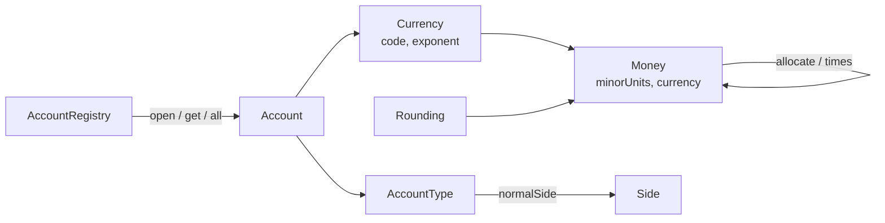

# Money and the Chart of Accounts

**Stage 1 of 4.** Plan about 2 hours.

A ledger is only as trustworthy as the numbers it stores and the accounts it stores them in. This stage builds both foundations. First, `Money`: an exact amount of one currency held as a signed count of minor units (cents, paise, fils), where every operation that could produce a fraction is told explicitly how to round, and where splitting an amount can never lose or invent a unit. Second, the chart of accounts: five account classes, each of which knows which side (debit or credit) makes it grow, and a registry that hands out accounts by id and refuses duplicates.

The invariant you are protecting is simple to state and easy to break: **an amount in this system is always a whole number of minor units of exactly one currency.** No `double`, no `float`, no `0.1 + 0.2`. Adding USD to EUR is an error, not a number. Multiplying 10.05 by one half yields 5.02 or 5.03 depending on the rounding you asked for, never 5.025 and never "whatever the FPU felt like". And splitting 100.00 three ways gives back 33.34 + 33.33 + 33.33, because the ledger in stage 2 will refuse an entry whose legs do not sum to the whole.

Real systems use exactly this design. Stripe's API, ISO 20022 messages, and card network clearing files all carry amounts as integers plus a currency code with an ISO 4217 exponent; the "normal balance side" of an account type is the rule every general ledger from a bank core to QuickBooks encodes so that a trial balance can be produced in stage 3. You already met `Money` in `phases/10-money-and-ledgers/01-representing-money`; the starter copies that design, with the interesting methods stubbed for you to implement again from memory.

## Worked example

A marketplace charges a buyer 100.00 USD. The platform fee is 2.9% + 0.30. Trace what the finished stage computes.

```text
Money.parse("100.00", USD)                    -> 10000 minor units
  .times(29, 1000, HALF_EVEN)                 -> 10000 * 29 = 290000; 290000 / 1000 = 290 exactly -> 2.90 USD
  .plus(Money.ofMinor(30, USD))               -> 3.20 USD          (the fee)
Money.parse("100.00", USD).minus(fee)         -> 96.80 USD         (what the seller is owed)
```

Now a tie. Half of 10.05 USD is 502.5 minor units:

| Rounding | `Money.parse("10.05", USD).times(1, 2, _)` | Why |
|---|---|---|
| `HALF_EVEN` | 5.02 | 502 is even; 503 is odd; ties go to even |
| `HALF_UP` | 5.03 | ties go away from zero |
| `DOWN` | 5.02 | truncate toward zero |
| `UP` | 5.03 | away from zero |

And for `-10.05`: `HALF_UP` gives `-5.03` (away from zero), `DOWN` gives `-5.02` (toward zero). The sign of the result follows the sign of the dividend, and "away from zero" means more negative.

Allocation by largest remainder. Split 100.00 USD in ratios 1 : 1 : 1:

```text
magnitude 10000, total ratio 3
share[i] = floor(10000 * 1 / 3) = 3333, remainder 1 for each      -> distributed 9999, leftover 1
sort indexes by remainder descending (all tie) -> keep index order 0,1,2
give the leftover unit to index 0                                  -> 3334, 3333, 3333
sum = 10000  ✓
```

Split 0.05 USD 70 : 30: shares floor(5*70/100)=3 (rem 50), floor(5*30/100)=1 (rem 50); distributed 4, leftover 1; tie on remainder, index 0 wins: **4, 1**. Split -1.00 USD 1 : 2: work on the magnitude (33 rem 1, 66 rem 2 → leftover 1 goes to index 1 → 33, 67), then reapply the sign: **-0.33, -0.67**.

Normal balance side:

| Account type | Grows on | Example |
|---|---|---|
| ASSET | DEBIT | `bank`, `receivable` |
| EXPENSE | DEBIT | `ops`, `expense:chargebacks` |
| LIABILITY | CREDIT | `payable:sellers` |
| EQUITY | CREDIT | `capital` |
| REVENUE | CREDIT | `revenue:fees` |

Opening the chart: `open("bank", ASSET, USD)` returns the account; `open("bank", LIABILITY, EUR)` throws `DuplicateAccountException` and leaves the first `bank` untouched; `get("nope")` throws `UnknownAccountException`; `all()` returns `[bank, sellers, eur-bank]` in opening order and cannot be modified by the caller.

## Your task

Run `--init` to create a workspace; it contains `Money.java`, `Accounts.java`, and `Main.java`. `Currency`, `Rounding`, `CurrencyMismatchException`, `Money.ofMinor`, `negate`, `abs`, `isZero/isNegative/isPositive`, `sum`, `compareTo`, and `toString` are given. The exception classes are given. Everything below throws `UnsupportedOperationException` until you replace it.

Signatures (Java 21; Python and Go ports follow later):

```java
record Money(long minorUnits, Currency currency) implements Comparable<Money> {
    static Money parse(String text, Currency currency);
    Money plus(Money other);
    Money minus(Money other);
    Money times(long numerator, long denominator, Rounding rounding);
    static long divideRounded(long dividend, long divisor, Rounding rounding);
    Money[] allocate(long... ratios);
}

enum Side { DEBIT, CREDIT; Side opposite(); }
enum AccountType { ASSET, LIABILITY, EQUITY, REVENUE, EXPENSE; Side normalSide(); }
record Account(String id, AccountType type, Currency currency) { Side normalSide(); }

final class AccountRegistry {
    Account open(String id, AccountType type, Currency currency);
    Account get(String id);
    boolean contains(String id);
    int size();
    List<Account> all();
}
```

What each must do:

- `Money.parse` accepts an optional sign, digits, an optional `.` and fraction digits: `"12.34"`, `"12"`, `".99"`, `"-0.07"`, `"1200"` (JPY), `"1.250"` (KWD). Pad the fraction to the currency exponent. **Must fail:** more fraction digits than the exponent allows (`"1.005"` in USD) → `ArithmeticException`; anything that is not a decimal (`"12,34"`, `"abc"`, `""`) → `NumberFormatException`. Use `Math.multiplyExact`/`Math.addExact` so a huge input overflows loudly.
- `plus` / `minus` call `requireSameCurrency` (given) and use `Math.addExact` / `Math.subtractExact`. **Must fail:** different currency → `CurrencyMismatchException`; `Long.MAX_VALUE + 1` → `ArithmeticException`.
- `times(n, d, rounding)` computes `minorUnits * n` exactly (`multiplyExact`), then `divideRounded(product, d, rounding)`. **Must fail:** `d <= 0` → `ArithmeticException`.
- `divideRounded` is integer division with the four rounding rules. Java's `/` and `%` truncate toward zero and the remainder takes the dividend's sign; use that. `HALF_EVEN` on an exact tie goes to whichever neighbour is even: `7/2 → 4`, `5/2 → 2`, `-7/2 HALF_UP → -4`.
- `allocate(ratios...)`: largest-remainder method on the absolute value, ties broken by lower index (a stable sort of indexes by remainder descending), sign reapplied at the end. The parts must sum to `this` exactly. **Must fail:** no ratios, any negative ratio, or all-zero ratios → `IllegalArgumentException`.
- `Side.opposite`, `AccountType.normalSide`, `Account.normalSide` as in the table above. The `Account` compact constructor must reject a null or blank id (`IllegalArgumentException`) and a null type or currency (`NullPointerException` via `Objects.requireNonNull`; the tests accept either, and `IllegalArgumentException` for the id).
- `AccountRegistry` keeps a `LinkedHashMap` so `all()` is in opening order and returns `List.copyOf(...)` (unmodifiable; `add` throws `UnsupportedOperationException`). `open` of an existing id → `DuplicateAccountException` **before** anything changes; `get` of an unknown id → `UnknownAccountException`, never `null`. Both exceptions already extend `LedgerException`; keep that hierarchy, later stages rely on it.

Keep every name exactly as written: the graders for all four stages construct these types directly.

What is deliberately *not* in `Money`: no `double` constructor, no `multiply(double)`, no implicit currency conversion, no `equals` across currencies (two `Money` values are equal only when both the minor units and the currency match; records give you that for free). If you find yourself wanting one of these, the stage is telling you that the caller should be doing exact rational arithmetic with `times` or an explicit FX step (Phase 10, Lesson 02) instead.

### How the pieces fit



Nothing in this stage knows about postings or balances yet. Stage 2 will combine a `Money`, a `Side`, and an account id into a `Posting`; stage 3 will use `Account.normalSide()` to decide whether a debit makes a balance go up or down. Get the foundations exact now and the later stages become bookkeeping.

### Suggested build order

1. **`divideRounded` first.** It is a pure function of three arguments and the easiest to test by hand. Write the truncating quotient and remainder, return early when the remainder is zero, then handle the four cases. Remember that the sign of the correction (`+1` or `-1`) depends on the signs of *both* operands.
2. **`times`** is one `multiplyExact` plus a call to `divideRounded`. Check the `10.05 * 1/2` table above with each rounding before moving on.
3. **`plus` / `minus`.** Two lines each once `requireSameCurrency` is called first.
4. **`parse`.** Strip whitespace, peel off the sign, split on the first `.`, validate that both halves are all digits (an empty whole part means `0`; an empty fraction means no decimals), compare the fraction length with `currency.exponent()`, right-pad with zeros, and combine with exact arithmetic. Resist the temptation to use `Double.parseDouble` or `BigDecimal` here; the point is to see that the string already *is* an integer with a decimal point drawn on it.
5. **`allocate`.** Compute the floor shares and remainders on the magnitude, count the leftover, sort an `Integer[]` of indexes by remainder descending (`Arrays.sort` on objects is stable, so ties keep index order), hand out the leftover one unit at a time, reapply the sign.
6. **`Side`, `AccountType`, `Account`.** Three one-liners and a constructor guard.
7. **`AccountRegistry`.** Check for the duplicate *before* `put`; return `List.copyOf(accounts.values())` from `all()`.

### Common mistakes the grader catches

| Symptom | Cause |
|---|---|
| `half-even tie goes to even (10.05 * 50%)` fails with 503 | Treating `HALF_EVEN` as `HALF_UP`; you must look at the parity of the truncated quotient on an exact tie |
| `negative half-up rounds away from zero` fails with -502 | Adding `+1` instead of `sign` to the quotient |
| `allocate thirds gives 33.34/33.33/33.33` fails with 33.33/33.33/33.34 | Giving the leftover to the *last* index, or using an unstable sort |
| `allocate negative keeps sign and sums` fails | Running the algorithm on the signed value; `floor` of a negative goes the wrong way |
| `money parse excess precision` throws `NumberFormatException` | Checking digits before checking the fraction length is fine, but the length check must throw `ArithmeticException` |
| `all() is a read-only view` fails | Returning the live `values()` collection or `new ArrayList<>(...)` instead of `List.copyOf` |
| `failed open does not change size` fails | Calling `put` and then checking for the duplicate |

## Run the grader

```bash
python3 scripts/project_test.py ledger-engine --lang java --init ~/ledger-engine-java   # once
python3 scripts/project_test.py ledger-engine --lang java --stage 1 --path ~/ledger-engine-java
```

The stage-1 suite has 64 checks. A failing check prints as `FAIL: <name>`; the names are sentences ("half-even tie goes to even (10.05 * 50%)") so you can find the case without opening the test file. Run your own `Main` with `javac -d .out *.java && java -cp .out Main` from the workspace at any time.

## Check yourself

1. `Money.parse("0.1", USD).plus(Money.parse("0.2", USD))` equals `Money.parse("0.3", USD)`. Why does the same expression with `double` not, and which line of your code makes the difference?
2. `divideRounded(5, 2, HALF_EVEN)` is 2 but `divideRounded(7, 2, HALF_EVEN)` is 4. If a payout system split a million 0.05 USD fees in half with `HALF_UP` instead, roughly how much money would move compared with `HALF_EVEN`, and in whose favour?
3. Why does `allocate` sort *indexes* by remainder instead of sorting the shares themselves, and what would break in stage 2 if two calls with the same inputs could return the parts in a different order?
4. An account's normal side is a property of its *type*, not of any individual posting. Give one posting that *decreases* an asset account and name the side it is on.
