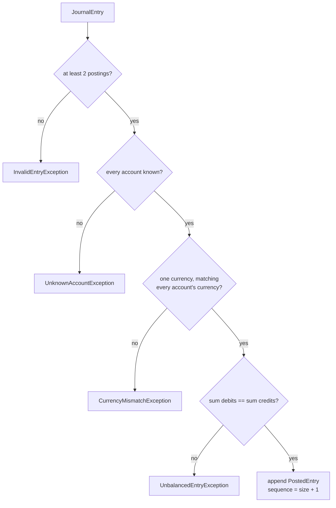

# Balanced Journal Entries

**Stage 2 of 4.** Plan about 2 hours.

Stage 1 gave you exact amounts and a chart of accounts. This stage adds the thing that makes it a *ledger*: an append-only journal of entries, where each entry is a group of postings that move money between accounts, and where the journal accepts an entry only if it is balanced. "Balanced" means the sum of the debit legs equals the sum of the credit legs, in one currency, to the minor unit. An entry that fails any check is refused whole; the journal is left exactly as it was and no sequence number is consumed.

The invariant is the one every double-entry system is named after: **debits equal credits, per entry, per currency, or the entry does not exist.** Because every entry that gets in is balanced, every derived number in stage 3 (balances, trial balance) is guaranteed to tie out, and every reconciliation in stage 4 starts from books that are internally consistent. You enforce the rule at exactly one choke point, `Ledger.post`, and nothing else in the system ever needs to re-check it.

Two more properties come along. The journal is **append-only**: entries get dense sequence numbers 1, 2, 3, ... in arrival order and are never edited or removed (corrections are new entries, which is stage 3). And posting is **idempotent on the entry id**: the id is a caller-chosen idempotency key, so a client that retries after a timeout posts the same id twice and gets the original record back instead of a second copy. This is how payment processors avoid double-booking a retried capture: the ledger, not the HTTP layer, is the last line of defence.

## Worked example

Chart: `bank` (ASSET, USD), `sellers` (LIABILITY, USD), `fees` (REVENUE, USD), `eur-bank` (ASSET, EUR), `eur-fees` (REVENUE, EUR).

A buyer pays 100.00 USD; the platform keeps a 3.20 fee and owes the seller 96.80:

```text
post(JournalEntry "sale-2" 2026-10-02
     DEBIT  bank     100.00 USD
     CREDIT sellers   96.80 USD
     CREDIT fees       3.20 USD)

debits  = 100.00
credits =  96.80 + 3.20 = 100.00    -> balanced, accepted as sequence 2 (sequence 1 was "sale-1")
```

The same client retries the request with the same id but a different body (it should not, but clients do):

```text
post(JournalEntry "sale-1" 2026-12-31  DEBIT bank 1.00 / CREDIT fees 1.00)
  -> id "sale-1" already in the journal
  -> return the existing PostedEntry(sequence 1, original "sale-1" dated 2026-10-01)
  -> journal size still 2; the content was NOT replaced
```

Now the rejections, each of which leaves `size() == 2` and consumes no sequence number:

| Entry | Check that fires | Exception |
|---|---|---|
| `DEBIT bank 100.00 / CREDIT fees 99.99` | debits 100.00 != credits 99.99 | `UnbalancedEntryException` |
| one posting only | fewer than two postings | `InvalidEntryException` |
| empty posting list | fewer than two postings | `InvalidEntryException` |
| `DEBIT ghost 1.00 / CREDIT fees 1.00` | `ghost` is not in the chart | `UnknownAccountException` |
| `DEBIT bank 1.00 USD / CREDIT eur-fees 1.00 EUR` | second posting's currency differs from the first | `CurrencyMismatchException` |
| `DEBIT eur-bank 1.00 USD / CREDIT fees 1.00 USD` | USD posting into an EUR account | `CurrencyMismatchException` |

After the rejections, the next good entry (`eur-sale`, 10.00 EUR in and out) gets **sequence 3**, not 9: rejected entries never touch the counter. Two currencies now live in one journal, which is fine because the balance rule is applied per entry and each entry is single-currency.



The id check (`already posted? return it`) happens *before* all of this: a replay of a valid id must succeed even if the retried body would have failed validation.

## Your task

Keep editing the workspace from stage 1. Add a new file `Journal.java` for the value types and exceptions, and a new file `Ledger.java` for the journal. (Any file layout works as long as the names match; the solution uses these two.) `Money`, `Side`, `Account`, `AccountRegistry`, and `LedgerException` come from stage 1 unchanged.

Signatures (Java 21; Python and Go ports follow later):

```java
/** One leg: a positive amount on one side of one account. */
record Posting(String accountId, Side side, Money amount) {
    Posting mirrored();                       // same account and amount, opposite side
}

/** An atomic group of postings with a caller-chosen id and an ISO-8601 date. */
record JournalEntry(String id, String date, List<Posting> postings) {
    JournalEntry(String id, String date, Posting... postings);
    Currency currency();                      // the first posting's currency
}

/** What the journal stores: the entry plus the sequence number it received. */
record PostedEntry(long sequence, JournalEntry entry) {
    String id();                              // entry.id()
}

final class InvalidEntryException     extends LedgerException { InvalidEntryException(String id, String why); }
final class UnbalancedEntryException  extends LedgerException { UnbalancedEntryException(String id, Money debits, Money credits); }
final class UnknownEntryException     extends LedgerException { UnknownEntryException(String id); }

final class Ledger {
    Ledger(AccountRegistry accounts);
    AccountRegistry accounts();
    PostedEntry post(JournalEntry entry);
    List<PostedEntry> journal();              // sequence order, unmodifiable copy
    PostedEntry entry(String id);             // UnknownEntryException if absent
    boolean hasEntry(String id);
    int size();
}
```

What each must do:

- `Posting` compact constructor: blank or null `accountId` → `IllegalArgumentException`; null `side` or `amount` → `NullPointerException`; a zero or negative amount → `IllegalArgumentException`. A posting's direction is its `Side`; its amount is always positive. `mirrored()` flips the side and nothing else; stage 3 builds reversals from it.
- `JournalEntry` compact constructor: blank id or blank date → `IllegalArgumentException`; `postings = List.copyOf(postings)` so the entry owns an unmodifiable snapshot (the test clears the caller's list after constructing and expects the entry to still have two postings; it also expects `postings().add(...)` to throw `UnsupportedOperationException`). Constructing an unbalanced entry is **allowed**; only posting it is not. `currency()` returns the first posting's currency and throws `IllegalStateException` on an empty list.
- `Ledger(null)` → `IllegalArgumentException`. Keep an `ArrayList<PostedEntry>` as the journal and a `HashMap<String, PostedEntry>` by id.
- `post`: (1) if the id is already present, return the stored `PostedEntry` and do nothing else; (2) validate in this order: posting count (`< 2` → `InvalidEntryException`), then for each posting: account exists (`accounts.get` throws `UnknownAccountException` for you), posting currency equals the entry currency (`CurrencyMismatchException`), account currency equals the entry currency (`CurrencyMismatchException`); accumulate debits and credits as `Money`; finally `debits.equals(credits)` or `UnbalancedEntryException`; (3) only then create `new PostedEntry(journal.size() + 1, entry)`, append it, index it by id, and return it. Validation must finish before any write so a rejection leaves the journal untouched.
- `journal()` returns `List.copyOf(journal)`; `entry(id)` throws `UnknownEntryException` rather than returning null; `hasEntry` and `size` are what they sound like.
- All three new exceptions extend `LedgerException` (which extends `IllegalArgumentException`), so a caller can `catch (LedgerException e)` once for "the ledger said no" while `CurrencyMismatchException` and plain `IllegalArgumentException` remain catchable separately.

Also extend `Main.java` so your demo posts a couple of entries and prints one rejection; the grader does not run `Main`, but keeping it alive is how you will exercise the stage-4 reconciliation with your own data later.

### Suggested build order

1. **`Posting` and `JournalEntry` records** with their guards. Compile and run `Main` once before touching `Ledger`.
2. **The three exceptions.** They are one-liners; put them in `Journal.java` next to the records they describe.
3. **`Ledger` skeleton**: fields, constructor guard, `journal()`, `entry()`, `hasEntry()`, `size()`. Have `post` do nothing but append, then watch the stage-2 grader tell you which rules you have not written yet.
4. **`validate(JournalEntry)`** as a private method that throws and returns nothing. Build the debit and credit sums with `Money.ofMinor(0, currency)` as the seed so the comparison is a `Money.equals`, never a `long` comparison that forgets the currency.
5. **The idempotency short-circuit** at the top of `post`.

### A note on what "balanced" means with three or more legs

The rule is on *sums*, not on pairs. `DEBIT bank 100.00 / CREDIT sellers 96.80 / CREDIT fees 3.20` has one debit leg and two credit legs, and it balances because 100.00 == 96.80 + 3.20. An entry may also touch the same account twice (`DEBIT bank 10.00 / CREDIT bank 4.00 / CREDIT fees 6.00`); stage 4 relies on that being legal, so do not de-duplicate account ids inside an entry. The only grouping that matters for the balance check is by `Side`.

### Common mistakes the grader catches

| Symptom | Cause |
|---|---|
| `duplicate id does not replace the content` fails | Looking up the id *after* validating, or overwriting the map entry on replay |
| `rejections consume no sequence numbers` fails | Computing the sequence (or incrementing a counter) before validation finishes |
| `entry copies its postings` fails | Storing the caller's `List` by reference instead of `List.copyOf` |
| `mixed currencies rejected` throws `UnbalancedEntryException` | Summing debits and credits in `long` without comparing currencies first; `Money.plus` would have thrown for you |
| `USD posting to EUR account rejected` passes silently | Checking the posting currency against the entry but never against the account's own currency |
| `no postings rejected` throws `IllegalStateException` | Calling `entry.currency()` before the posting-count check |
| `unknown entry id` returns null | `entry(id)` must throw `UnknownEntryException`; stage 3's `reverse` relies on it |

## Run the grader

```bash
python3 scripts/project_test.py ledger-engine --lang java --stage 2 --path ~/ledger-engine-java
```

The grader runs `Stage01Test` and then `Stage02Test` (38 checks). If stage 1 regresses while you edit, you see it immediately.

## Check yourself

1. The duplicate-id check runs before validation. Describe a client retry scenario where running it *after* validation would return the wrong answer to the client, and a scenario where it would return a confusing exception for an operation that had in fact already succeeded.
2. `JournalEntry` does not validate balance in its constructor, but `Posting` does validate that its amount is positive. Why is one rule a property of the value and the other a property of the journal? What would you lose if `JournalEntry` refused to be constructed unbalanced?
3. Sequence numbers are dense (1, 2, 3, ...) and only ever assigned to accepted entries. Stage 3 reads balances "as of sequence N". What goes wrong for that feature if a rejected entry were allowed to consume a number?
4. A three-leg entry `DEBIT bank 100.00 / CREDIT sellers 96.80 / CREDIT fees 3.20` is balanced. Rewrite it as two separate two-leg entries that have the same total effect on every account. Which representation would you prefer in a ledger that must later answer "what did sale-2 do?", and why?
