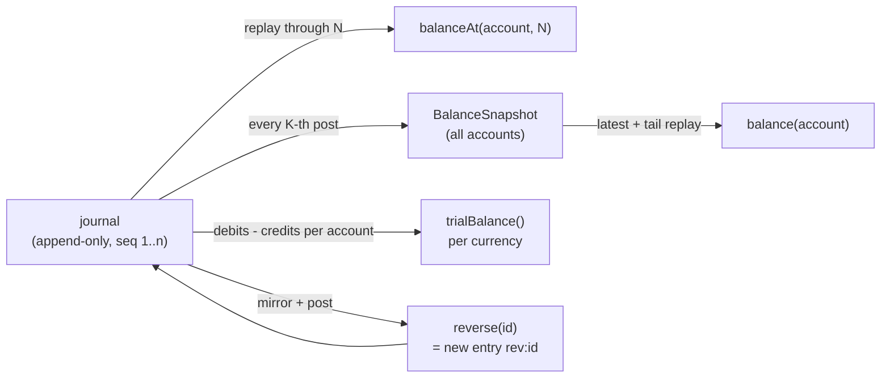

# Balances, Trial Balance, and Reversals

**Stage 3 of 4.** Plan about 2 hours.

The journal from stage 2 is the only truth the ledger holds. This stage teaches it to *answer questions* without ever storing a second copy of the truth that could drift from the first. An account's balance is the signed sum of every posting that touched it; a balance "as of sequence N" is the same sum stopped early; a trial balance lists every account's balance in a debit or a credit column and proves the two columns agree; and a reversal corrects a mistake by posting its mirror image, so history still shows the mistake *and* the correction.

The invariant is: **derived state is a pure function of the journal.** `balance(account)` must equal what you would get by replaying the journal from the beginning, always. Snapshots exist only as a cache: after every K-th entry the ledger records every account's balance, and `balance()` replays from the latest snapshot instead of from sequence 1. If a snapshot and a full replay ever disagree, the snapshot is wrong by definition. The trial balance then gives you a cheap end-to-end check: because stage 2 only admitted balanced entries, the debit column total equals the credit column total for each currency; if it does not, something bypassed `post`.

Two conventions matter. First, **sign follows the normal side**: a balance is positive when the account has more on its normal side, so a bank (asset) with 100.00 of debits and 60.00 of credits has balance +40.00, and a sellers (liability) account with 96.80 of credits and 50.00 of debits has balance +46.80. Second, the trial balance uses raw **debits minus credits** per account and places a positive net in the debit column, a negative net in the credit column. A liability driven below zero (a seller who was overpaid) therefore shows up in the *debit* column, which is exactly how an accountant would spot it. This is the design in `phases/10-money-and-ledgers/05-balances-and-snapshots` and `06-immutability-and-reversals`, now applied to your own journal.

## Worked example

Chart: `bank` ASSET, `receivable` ASSET, `sellers` LIABILITY, `fees` REVENUE, `ops` EXPENSE (all USD), plus `eur-bank` ASSET and `eur-capital` EQUITY (EUR). Snapshot every **2** entries.

| Seq | Entry | Postings |
|---|---|---|
| 1 | `sale-1` 2026-10-01 | DEBIT bank 100.00 / CREDIT sellers 96.80 / CREDIT fees 3.20 |
| 2 | `payout-1` 2026-10-03 | DEBIT sellers 50.00 / CREDIT bank 50.00 |
| 3 | `rent` 2026-10-04 | DEBIT ops 30.00 / CREDIT bank 30.00 |
| 4 | `sale-2` 2026-10-05 | DEBIT bank 20.00 / CREDIT fees 20.00 |

Signed balances after sequence 4 (positive on the account's normal side):

```text
bank    (ASSET,  normal DEBIT ): +100.00 -50.00 -30.00 +20.00 = 40.00
sellers (LIAB,   normal CREDIT): +96.80  -50.00                = 46.80
fees    (REV,    normal CREDIT): +3.20   +20.00                = 23.20
ops     (EXP,    normal DEBIT ): +30.00                        = 30.00
receivable, eur-bank, eur-capital: 0.00 in their own currency
```

`balanceAt("bank", n)` for n = 0..4: `0.00, 100.00, 50.00, 20.00, 40.00`. For n = 999 it is still 40.00 (no entries past the end).

Snapshots were taken after sequences 2 and 4 (K = 2). Snapshot 2 holds all seven accounts: `bank 50.00, sellers 46.80, fees 3.20, ops 0.00, receivable 0.00, eur-bank 0.00 EUR, eur-capital 0.00 EUR`. Post a fifth entry (`sale-3`: DEBIT bank 5.00 / CREDIT fees 5.00); no snapshot is taken (5 is not a multiple of 2) and `balance("bank")` = snapshot-4 value 40.00 + replay of sequence 5 = **45.00**, which equals `balanceAt("bank", 5)`.

Trial balance, USD, after sequence 4 (net = debits minus credits per account):

| Account | Debits | Credits | Net | Debit column | Credit column |
|---|---|---|---|---|---|
| bank | 120.00 | 80.00 | +40.00 | 40.00 | |
| receivable | 0 | 0 | 0 | 0.00 | 0.00 |
| sellers | 50.00 | 96.80 | -46.80 | | 46.80 |
| fees | 0 | 23.20 | -23.20 | | 23.20 |
| ops | 30.00 | 0 | +30.00 | 30.00 | |
| **Totals** | | | | **70.00** | **70.00** |

Difference 0.00, `isBalanced()` true. The EUR trial balance has two lines, both zero, totals 0.00 EUR, also balanced. The result list is ordered by currency code (`EUR` before `USD`).

Now overpay the seller: `over-payout` DEBIT sellers 60.00 / CREDIT bank 60.00. `balance("sellers")` becomes 46.80 - 60.00 = **-13.20** (a liability that is now owed *to* us), and in the trial balance sellers moves to the debit column with 13.20 while bank (40.00 - 60.00 = -20.00) moves to the credit column with 20.00. Totals: debit 13.20 + 30.00 = 43.20; credit 20.00 + 23.20 = 43.20. Still balanced.

Reverse the rent:

```text
reverse("rent")
  original: seq 3, 2026-10-04, DEBIT ops 30.00 / CREDIT bank 30.00
  posts:    id "rev:rent", date 2026-10-04, CREDIT ops 30.00 / DEBIT bank 30.00   -> sequence 5
  after:    balance(ops) = 0.00, balance(bank) = 70.00
  history:  balanceAt(ops, 3) = 30.00 still; balanceAt(ops, 5) = 0.00
reverse("rent") again -> returns the same PostedEntry(5); size stays 5 (post() de-duplicates on "rev:rent")
reverse("rev:rent")   -> id "rev:rev:rent", sequence 6; balance(ops) back to 30.00
```

How the three reads relate to the journal:



Nothing on the right can disagree with the journal for long: the next `balanceAt` or `trialBalance` call recomputes from scratch and exposes any drift in the snapshot cache.

## Your task

Keep editing the workspace. Everything new goes in `Ledger.java` (the records can sit above the `Ledger` class). Stage 2's `post` gains one line: take a snapshot when the new sequence number is a multiple of K.

Signatures (Java 21 first, then the same surface in Python; Go port follows later):

```java
/** Every account's signed balance after the entry with this sequence number. */
record BalanceSnapshot(long sequence, Map<String, Money> balances) {}   // balances = Map.copyOf(balances)

record TrialBalanceLine(Account account, Money debit, Money credit) {}

record TrialBalance(Currency currency, List<TrialBalanceLine> lines, Money totalDebits, Money totalCredits) {
    Money difference();                      // totalDebits - totalCredits
    boolean isBalanced();                    // difference().isZero()
}

final class Ledger {
    static final int DEFAULT_SNAPSHOT_EVERY = 100;
    Ledger(AccountRegistry accounts);                       // = this(accounts, DEFAULT_SNAPSHOT_EVERY)
    Ledger(AccountRegistry accounts, int snapshotEvery);    // snapshotEvery < 1 -> IllegalArgumentException
    int snapshotEvery();

    Money balance(String accountId);                        // latest snapshot + replay of the tail
    Money balanceAt(String accountId, long sequence);       // full replay through `sequence` inclusive
    List<BalanceSnapshot> snapshots();                      // unmodifiable copy, oldest first
    List<TrialBalance> trialBalance();                      // one per currency, ordered by currency code

    static String reversalId(String entryId);               // "rev:" + entryId
    PostedEntry reverse(String entryId);                    // posts the mirror; idempotent
    boolean isReversed(String entryId);
}
```

The same surface in Python (one `main.py` module; methods and fields are snake_case, exceptions end in `Error`, read-only views are tuples):

```python
@dataclass(frozen=True)
class BalanceSnapshot:            # sequence: int, balances: Mapping[str, Money] (wrapped in MappingProxyType: read-only)

@dataclass(frozen=True)
class TrialBalanceLine:           # account: Account, debit: Money, credit: Money

@dataclass(frozen=True)
class TrialBalance:               # currency: Currency, lines: tuple[TrialBalanceLine, ...], total_debits: Money, total_credits: Money
    def difference(self) -> Money: ...        # total_debits.minus(total_credits)
    def is_balanced(self) -> bool: ...        # difference().is_zero()

class Ledger:
    DEFAULT_SNAPSHOT_EVERY = 100
    def __init__(self, accounts: AccountRegistry, snapshot_every: int = DEFAULT_SNAPSHOT_EVERY) -> None: ...   # < 1 -> ValueError
    def snapshot_every(self) -> int: ...

    def balance(self, account_id: str) -> Money: ...                     # latest snapshot + replay of the tail
    def balance_at(self, account_id: str, sequence: int) -> Money: ...   # full replay through `sequence` inclusive
    def snapshots(self) -> tuple[BalanceSnapshot, ...]: ...             # oldest first
    def trial_balance(self) -> list[TrialBalance]: ...                   # one per currency, ordered by currency code

    @staticmethod
    def reversal_id(entry_id: str) -> str: ...                           # "rev:" + entry_id
    def reverse(self, entry_id: str) -> PostedEntry: ...                 # posts the mirror; idempotent
    def is_reversed(self, entry_id: str) -> bool: ...
```

What each must do:

- **Signed effect of a posting** on its account: `+amount` when `posting.side() == account.normalSide()`, else `-amount`. Write this once as a private helper; `balance`, `balanceAt`, and stage 4's `lines` all use it.
- `balance(accountId)`: `accounts.get` first (unknown → `UnknownAccountException`). Start from the latest snapshot's value for this account (or the currency's zero if there is no snapshot, or the account is missing from it), then replay journal entries with sequence greater than the snapshot's sequence. The result must equal `balanceAt(accountId, size())` always.
- `balanceAt(accountId, sequence)`: zero of the account's currency, then every posting of every entry with `sequence <= N`, ignoring snapshots entirely. `balanceAt(x, 0)` is zero; a sequence past the end returns the current balance.
- **Snapshots**: in `post`, after appending, `if (sequence % snapshotEvery == 0)` record a `BalanceSnapshot(sequence, balancesAt(sequence))` holding **every** account in the registry (untouched accounts included, each at its own currency's zero). `snapshots()` returns `List.copyOf`; the map inside is `Map.copyOf`, so `clear()` on it throws `UnsupportedOperationException`. The one-argument constructor uses `DEFAULT_SNAPSHOT_EVERY = 100`; K < 1 is an `IllegalArgumentException`.
- `trialBalance()`: per account compute net = debits - credits from the full journal (not the signed balance; the column placement does the sign work). Net ≥ 0 → `TrialBalanceLine(account, net, zero)`; net < 0 → `TrialBalanceLine(account, zero, -net)`. Group lines by currency, accounts in opening order within a group, and sum both columns. Return one `TrialBalance` per currency present in the *registry* (an untouched currency still gets a trial balance of zeros), ordered by currency code. `lines` must be unmodifiable.
- `reverse(entryId)`: `entry(entryId)` (unknown → `UnknownEntryException`), build the mirrored postings with `Posting.mirrored()` in the same order, and `post(new JournalEntry(reversalId(entryId), original.entry().date(), mirrored))`. Because `post` is idempotent on id, reversing twice returns the first reversal and the journal does not grow. The original is never modified; a reversal can itself be reversed (`rev:rev:rent`). `isReversed(id)` is `hasEntry(reversalId(id))`.

### Suggested build order

1. The signed-effect helper and `balanceAt`. Verify the `0.00, 100.00, 50.00, 20.00, 40.00` sequence by hand with `Main`.
2. `balance` as a plain full replay (temporarily identical to `balanceAt(id, size())`), then the two-argument constructor, `balancesAt`, the snapshot line in `post`, and finally make `balance` start from the latest snapshot.
3. `trialBalance`. Use a `TreeMap<String, List<TrialBalanceLine>>` keyed by currency code to get the ordering for free.
4. `reversalId`, `reverse`, `isReversed`: about eight lines on top of stage 2's `post`.

### Common mistakes the grader catches

| Symptom | Cause |
|---|---|
| `liability balance grows on credit` gives -46.80 | Treating debit as plus for every account instead of using the normal side |
| `snapshot covers every account` fails | Snapshotting only accounts that have postings |
| `balance after snapshot + tail` is 85.00 | Replaying from the snapshot's sequence *inclusive*, so entry K is counted twice |
| `no snapshot at an odd sequence` fails | Snapshotting on every post, or on `size() >= K` instead of `% K == 0` |
| `negative liability shows in the debit column` fails | Building the trial balance from the signed balance instead of from debits minus credits |
| `one trial balance per currency, in code order` has one element | Grouping by currency of posted entries instead of by currency of accounts in the registry |
| `reversing twice returns the first reversal` grows the journal | Generating a fresh id per reversal instead of the deterministic `rev:<id>` |
| `reversal keeps the original date` fails | Using "today" or the latest entry's date for the reversal |

## Run the grader

```bash
python3 scripts/project_test.py ledger-engine --lang java --stage 3 --path ~/ledger-engine-java
python3 scripts/project_test.py ledger-engine --lang python --stage 3 --path ~/ledger-engine-py
```

Stages 1 and 2 run first, then `Stage03Test` (59 checks).

## Check yourself

1. `balance()` reads from the latest snapshot, `balanceAt()` always replays from the start. Which one would you use to *verify* the other in a nightly job, and what does it mean operationally if they ever disagree?
2. With K = 100 and a million entries, how many entries does `balance()` replay in the worst case? What does a snapshot cost in memory for a chart of 10,000 accounts, and how would you change the design if that cost were too high?
3. A reversal keeps the original entry's *date*. Give one reporting question for which that is exactly right, and one for which you would also want to know *when* the reversal was posted. Where in the current design would you record the second date?
4. After `over-payout`, sellers shows 13.20 in the *debit* column of the trial balance even though it is a liability account. Why is the trial balance still correct, and what does that line tell an operator about the business?
