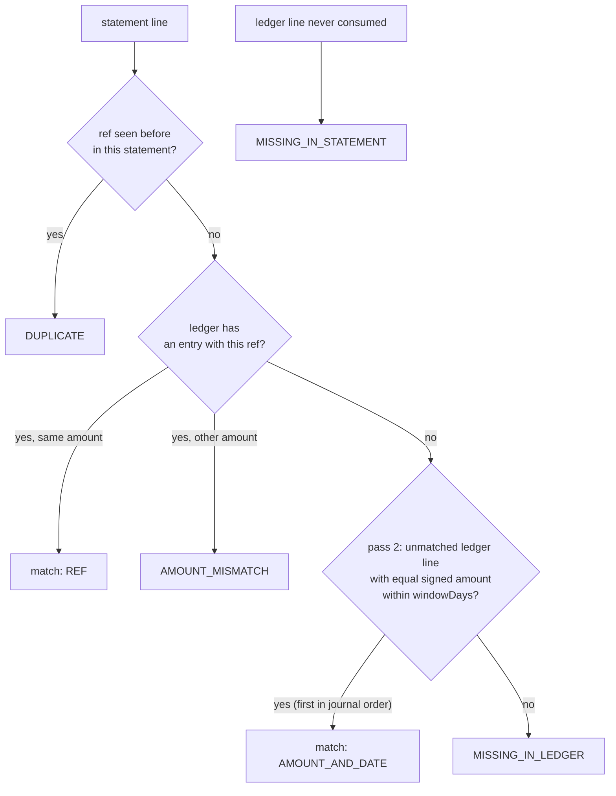

# Reconcile Against a Statement

**Stage 4 of 4.** Plan about 2 hours.

Your ledger is internally consistent: every entry balanced, every balance derived, every trial balance tied. None of that proves it agrees with the *outside world*. The bank says what landed in your account; the card processor says what it settled; and sooner or later their list and yours differ by two lines out of ten thousand. Reconciliation is the routine that finds those two lines, says what kind of difference each one is, and proves by arithmetic that it has not quietly lost a third one while looking. In this stage you build it for one account at a time: take the journal's view of that account, take the external statement, match them in two passes, and report every break by category with totals that tie out.

The invariant is a conservation law: **every minor unit on both sides lands in exactly one match or exactly one break.** Concretely, `ledgerTotal == matchedTotal + ledgerBreakTotal` and `statementTotal == matchedTotal + statementBreakTotal`. A reconciliation that reports "3 matched, 2 breaks" without those equations can be wrong in a way nobody notices; one that ties out can still be *disputed* (maybe a line was matched to the wrong partner) but cannot have dropped anything. Operations teams at every processor run exactly this check daily, and `tiesOut()` is the first thing an auditor asks to see.

Two passes, in a fixed order, keep the result deterministic. **Pass 1 matches by reference**: the statement's reference equals one of our entry ids. Same amount → match; different amount → `AMOUNT_MISMATCH`; the same statement reference seen a second time → `DUPLICATE`. **Pass 2 matches what is left by equal signed amount within a date window**, first unmatched ledger line in journal order wins, for the common case where the counterparty invents its own reference (`PO-77` for our `payout-1`) and settles a day or two later. Whatever remains is `MISSING_IN_LEDGER` (they have it, we do not) or `MISSING_IN_STATEMENT` (we have it, they do not). The lesson `phases/10-money-and-ledgers/08-reconciliation` motivates these categories; here you wire them to your own journal.

## Worked example

Chart: `bank` ASSET USD, `sellers` LIABILITY USD, `fees` REVENUE USD, `eur-bank` ASSET EUR. Seven entries:

| Seq | Id | Date | Postings | Effect on `bank` |
|---|---|---|---|---|
| 1 | sale-1 | 10-01 | DEBIT bank 100.00 / CREDIT sellers 96.80 / CREDIT fees 3.20 | +100.00 |
| 2 | payout-1 | 10-03 | DEBIT sellers 50.00 / CREDIT bank 50.00 | -50.00 |
| 3 | sale-2 | 10-04 | DEBIT bank 20.00 / CREDIT fees 20.00 | +20.00 |
| 4 | fee-adj | 10-04 | DEBIT fees 1.00 / CREDIT sellers 1.00 | (none) |
| 5 | refund-1 | 10-06 | DEBIT sellers 7.50 / CREDIT bank 7.50 | -7.50 |
| 6 | sale-3 | 10-08 | DEBIT bank 15.00 / CREDIT fees 15.00 | +15.00 |
| 7 | multi | 10-09 | DEBIT bank 10.00 / CREDIT bank 4.00 / CREDIT fees 6.00 | +6.00 (netted) |

`lines("bank")` is six `LedgerLine`s in journal order (`fee-adj` never touched bank; `multi` touched it twice and nets to one line of +6.00). `ledgerTotal` = 100 - 50 + 20 - 7.50 + 15 + 6 = **83.50**.

The processor's statement for the same period, in its own order:

| # | ref | amount | date | What will happen |
|---|---|---|---|---|
| a | sale-1 | +100.00 | 10-01 | pass 1: match by REF |
| b | PO-77 | -50.00 | 10-05 | no such ref; pass 2: -50.00 within 3 days of payout-1 (10-03) → match |
| c | sale-2 | +25.00 | 10-04 | ref found, amount differs from our 20.00 → AMOUNT_MISMATCH |
| d | sale-1 | +100.00 | 10-01 | second time this ref appears → DUPLICATE |
| e | chargeback-3 | -12.00 | 10-07 | no ref, no -12.00 anywhere → MISSING_IN_LEDGER |
| f | sale-3 | +15.00 | 10-08 | pass 1: match by REF |
| g | RF-9 | -7.50 | 10-20 | no ref; -7.50 exists (refund-1, 10-06) but 14 days away → MISSING_IN_LEDGER |

`statementTotal` = 100 - 50 + 25 + 100 - 12 + 15 - 7.50 = **170.50** (duplicates included: the total is what the statement *claims*).

Report for `reconcile("bank", statement, 3)`:

```text
matches (pass 1 first, then pass 2):
  sale-1   ~ sale-1   100.00  REF
  sale-3   ~ sale-3    15.00  REF
  payout-1 ~ PO-77    -50.00  AMOUNT_AND_DATE
breaks:
  AMOUNT_MISMATCH      sale-2        ledger  20.00   statement  25.00
  DUPLICATE            sale-1        ledger   0.00   statement 100.00
  MISSING_IN_LEDGER    chargeback-3  ledger   0.00   statement -12.00
  MISSING_IN_LEDGER    RF-9          ledger   0.00   statement  -7.50
  MISSING_IN_STATEMENT refund-1      ledger  -7.50   statement   0.00
  MISSING_IN_STATEMENT multi         ledger   6.00   statement   0.00

matchedTotal        = 100.00 + 15.00 - 50.00                 =  65.00
ledgerBreakTotal    = 20.00 - 7.50 + 6.00                    =  18.50
statementBreakTotal = 25.00 + 100.00 - 12.00 - 7.50          = 105.50
ledgerTotal    83.50  == 65.00 + 18.50    ✓
statementTotal 170.50 == 65.00 + 105.50   ✓     tiesOut() = true, isClean() = false
```

Widen the window to 14 days and `RF-9` matches `refund-1` (four matches, four breaks, matched total 57.50, still ties out). At 13 days it does not: the window is inclusive and symmetric, measured in whole calendar days with `java.time`. With a 0-day window, `PO-77` dated 10-03 matches `payout-1` on the same day, and dated 10-02 it does not. Pass 2 compares *signed* amounts: a statement line of +50.00 never matches our -50.00 payout.



## Your task

Keep editing the workspace. Put the new value types in `Reconciliation.java`; add `lines` and `reconcile` to `Ledger`.

Signatures (Java 21 first, then the same surface in Python; Go port follows later):

```java
record StatementLine(String ref, Money amount, String date) {}   // blank ref or date -> IllegalArgumentException
record LedgerLine(String ref, Money amount, String date) {}       // ref = entry id; amount signed on the account's normal side

enum BreakType { MISSING_IN_LEDGER, MISSING_IN_STATEMENT, AMOUNT_MISMATCH, DUPLICATE }
enum MatchedBy { REF, AMOUNT_AND_DATE }

record ReconciliationMatch(String ledgerRef, String statementRef, Money amount, MatchedBy by) {}
record ReconciliationBreak(BreakType type, String ref, Money ledgerAmount, Money statementAmount) {}

record ReconciliationReport(String accountId, Currency currency, List<ReconciliationMatch> matches,
                            List<ReconciliationBreak> breaks, Money ledgerTotal, Money statementTotal) {
    Money matchedTotal();
    Money ledgerBreakTotal();                 // sum of breaks' ledgerAmount
    Money statementBreakTotal();              // sum of breaks' statementAmount
    List<ReconciliationBreak> breaksOf(BreakType type);
    boolean tiesOut();
    boolean isClean();                        // breaks.isEmpty()
}

final class Ledger {
    List<LedgerLine> lines(String accountId);
    ReconciliationReport reconcile(String accountId, List<StatementLine> statement, int windowDays);
}
```

The same surface in Python (one `main.py` module; methods and fields are snake_case, exceptions end in `Error`, read-only views are tuples):

```python
@dataclass(frozen=True)
class StatementLine:              # ref: str, amount: Money, date: str; blank ref or date -> ValueError
@dataclass(frozen=True)
class LedgerLine:                 # ref: str, amount: Money, date: str; ref = entry id, amount signed on the account's normal side

class BreakType(Enum): MISSING_IN_LEDGER, MISSING_IN_STATEMENT, AMOUNT_MISMATCH, DUPLICATE
class MatchedBy(Enum): REF, AMOUNT_AND_DATE

@dataclass(frozen=True)
class ReconciliationMatch:        # ledger_ref: str, statement_ref: str, amount: Money, by: MatchedBy
@dataclass(frozen=True)
class ReconciliationBreak:        # type: BreakType, ref: str, ledger_amount: Money, statement_amount: Money

@dataclass(frozen=True)
class ReconciliationReport:       # account_id, currency, matches: tuple[...], breaks: tuple[...], ledger_total: Money, statement_total: Money
    def matched_total(self) -> Money: ...
    def ledger_break_total(self) -> Money: ...          # sum of breaks' ledger_amount
    def statement_break_total(self) -> Money: ...       # sum of breaks' statement_amount
    def breaks_of(self, type: BreakType) -> list[ReconciliationBreak]: ...
    def ties_out(self) -> bool: ...
    def is_clean(self) -> bool: ...                     # not self.breaks

class Ledger:
    def lines(self, account_id: str) -> list[LedgerLine]: ...
    def reconcile(self, account_id: str, statement: Sequence[StatementLine], window_days: int) -> ReconciliationReport: ...
    # window_days < 0 -> ValueError; wrong currency -> CurrencyMismatchError; bad date -> LedgerError (datetime.date.fromisoformat)
```

What each must do:

- `lines(accountId)`: `accounts.get` (unknown → `UnknownAccountException`), then one `LedgerLine` per journal entry that has at least one posting on this account, in journal order, with `ref = entry id`, `amount = sum of the signed effects` of that entry's postings on the account (reuse the stage-3 helper), `date = entry date`. Entries that never touch the account produce no line; an untouched account produces an empty list.
- `reconcile(accountId, statement, windowDays)`: `accounts.get` first; `windowDays < 0` → `IllegalArgumentException`; every statement line's currency must equal the account's (`CurrencyMismatchException`) and its date must parse as ISO-8601 (`LedgerException` with a clear message; use `LocalDate.parse` and translate `DateTimeParseException`). Compute `ledgerTotal` as the sum of the lines and `statementTotal` as the sum of *every* statement line, duplicates included. Then:
  1. **Pass 1**, over the statement in order: a ref already seen in this statement → `DUPLICATE` with `ledgerAmount = zero`, `statementAmount = line amount`; else look the ref up among the ledger lines: absent → set aside for pass 2; present with equal amount → `ReconciliationMatch(ref, ref, amount, REF)` and mark the ledger line consumed; present with a different amount → `AMOUNT_MISMATCH` carrying both amounts and mark the ledger line consumed.
  2. **Pass 2**, over the set-aside lines in statement order: the first *unconsumed* ledger line in journal order with `amount.equals(line.amount())` and `|days between dates| <= windowDays` → `ReconciliationMatch(ledgerRef, statementRef, amount, AMOUNT_AND_DATE)`, consume it; none → `MISSING_IN_LEDGER` with `ledgerAmount = zero`.
  3. Every ledger line still unconsumed → `MISSING_IN_STATEMENT` with `statementAmount = zero`.
  Matches are listed pass 1 first, then pass 2; breaks in the order they were discovered. `reconcile` never modifies the journal.
- `ReconciliationReport`: copy `matches` and `breaks` with `List.copyOf`. `tiesOut()` is the two equations above; `isClean()` is "no breaks". `breaksOf` filters by type.
- `StatementLine` rejects a blank `ref` or `date` with `IllegalArgumentException` and a null amount with `NullPointerException`.

### Suggested build order

1. `lines`. Check the six bank lines and the netted `multi` line in `Main` before writing any matching code.
2. The records and enums, and `ReconciliationReport` with its totals. These are pure data.
3. Pass 1 only; return a report with the leftovers as `MISSING_IN_LEDGER` / `MISSING_IN_STATEMENT`. Confirm `tiesOut()` is already true: the conservation law does not depend on how clever the matching is.
4. Pass 2 with the date window (`ChronoUnit.DAYS.between`, absolute value, `<=`).
5. The input validations (currency, window, date format).

### Common mistakes the grader catches

| Symptom | Cause |
|---|---|
| `an entry touching the account twice nets to one line` gives two lines | Emitting one `LedgerLine` per posting instead of per entry |
| `statement total is the sum of every statement line, duplicates included` is 70.50 | Skipping duplicates when summing; the total must describe the statement as received |
| `pass 1 matches come first` fails | Running pass 2 inside the pass-1 loop, or sorting matches afterwards |
| `first unmatched ledger line wins` picks `a2` | Iterating ledger lines in reverse, or by date instead of journal order |
| `pass 1 consumes before pass 2 runs` fails | Pass 2 considering ledger lines that pass 1 already matched by ref |
| `13-day window does not` fails | Using `<` on one side and `<=` on the other, or comparing strings instead of dates |
| `zero window rejects the day before` fails | Treating `windowDays == 0` as "no window" |
| `pass 2 compares signed amounts` matches | Comparing `abs()` of the amounts |
| `report ties out but is not clean` fails on `tiesOut` | A break that carries the amount on the wrong side, or a dropped `MISSING_IN_STATEMENT` |
| `statement date must be ISO-8601` throws `DateTimeParseException` | Not translating the `java.time` exception into a `LedgerException` |

## Run the grader

```bash
python3 scripts/project_test.py ledger-engine --lang java --stage 4 --path ~/ledger-engine-java
python3 scripts/project_test.py ledger-engine --lang python --stage 4 --path ~/ledger-engine-py
# or everything:
python3 scripts/project_test.py ledger-engine --lang java --all --path ~/ledger-engine-java
python3 scripts/project_test.py ledger-engine --lang python --all --path ~/ledger-engine-py
```

Stages 1 to 3 run first, then `Stage04Test` (50 checks). When all four pass, run your own `Main` and feed `reconcile` a statement you wrote yourself (see the README's "Run with your own inputs").

## Check yourself

1. `tiesOut()` can be true while a match is wrong (two 10.00 lines on consecutive days swapped between two statement lines). What property does tie-out actually guarantee, and which *additional* report would you give an operator so they can find a mis-pairing?
2. Why does `statementTotal` include duplicate lines? What would an operator conclude if the report's statement total disagreed with the total printed at the bottom of the bank's own PDF?
3. Pass 2 breaks ties by journal order. Suggest one alternative tie-break rule (closest date, for example), and describe an input where the two rules produce different matches but the same `matchedTotal`. Which rule is easier to explain in an audit?
4. `reconcile` compares one account's lines against one statement. A processor settlement file usually covers *gross sales, fees, and the net payout* in one document. Which three accounts would you reconcile it against, and in what order, so that a break in fees does not masquerade as a break in the bank balance?

## Going further

Make the ledger durable and concurrent. Persist the journal as an append-only file of JSON lines, one `PostedEntry` per line, and rebuild snapshots on startup by replaying it (Phase 7's write-ahead log is the same idea with the same recovery rule). Then let many threads call `post` on the same ledger: a single lock keeps the invariant but serialises every payment through one account; `phases/10-money-and-ledgers/11-ledger-concurrency` shows how hot accounts are sharded into sub-accounts whose balances are summed on read, which is where `allocate` from stage 1 and `balanceAt` from stage 3 meet again.
