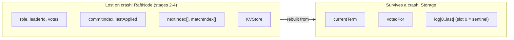

# Term, Vote, and the Log

**Stage 1 of 4.** Plan about 2 hours.

Everything Raft promises rests on three values a server writes to stable storage *before* it answers anyone: `currentTerm`, `votedFor`, and `log[]` (Figure 2 of the Raft paper, "Persistent state on all servers"). A node that forgets its vote after a crash can vote twice in one term and the cluster can elect two leaders. A node that forgets a log entry it acknowledged can let a committed write disappear. This stage builds that persistent state as a `Storage` class and nothing else, so that every later stage can treat it as a black box with exact rules.

The log is **1-indexed**, as in the paper. Slot 0 holds a sentinel entry with term 0 that is never shipped, truncated, or applied. The sentinel makes two later rules trivial: an `AppendEntries` whose `prevLogIndex` is 0 always passes the consistency check, and the "last log term" of an empty log is 0, so a fresh candidate compares correctly against a fresh voter. Two invariants hold on every `Storage`: `currentTerm` never decreases, and the terms in `log[]` are non-decreasing from index 1 onward (Leader Append-Only plus the fact that a follower only ever accepts entries from the current leader).

The simulation substrate is **provided** in `Sim.java` and you will not edit it: an injected `Clock` counting integer ticks, a hand-written SplitMix64 `Rng` so the same seed replays identically, the `Message` record for both RPCs, `Config` for the timing constants, the `Node` interface, and the `Network` that delays and drops messages from the seeded RNG and supports partitions, crashes, and restarts. It is the same design as the two Raft lessons; the grader tests it in this stage so you learn its exact behaviour before you build on it. Real systems have the same split: etcd's WAL and TiKV's RaftEngine are the `Storage`; the network is whatever gRPC does to you that day.



## The substrate you are building on

Read `Sim.java` once, top to bottom; it is about 200 lines and every later stage depends on these facts.

| Piece | What it guarantees | Where a real system differs |
|---|---|---|
| `Clock` | Integer ticks; `advance()` is the only way time moves | Wall clocks drift and jump; Raft only needs *relative* timeouts |
| `Rng` | SplitMix64; `nextInt(bound)` uses the top 31 bits, `nextDouble()` the top 53 | A production node uses `SecureRandom` or `/dev/urandom` for its timeout |
| `Message` | One record for both RPCs and both replies; every message carries the sender's `term` | gRPC/protobuf with four message types |
| `Config` | `(150, 300, 50)` ticks by default; rejects a heartbeat that is not well below the minimum timeout | etcd defaults to 1000 ms election / 100 ms heartbeat |
| `Network.send` | Drops if either end is down or the pair is cut by a partition; otherwise draws a drop roll **and** a delay, in that order, even when it will drop | Loss and reordering are the network's business, not yours |
| `Network.tick` | `clock.advance()`, then every live node's `tick(now)`, then deliver everything whose `deliverAt <= now` in `(deliverAt, seq)` order | Threads and sockets interleave arbitrarily; here the order is a function of the seed |
| `Network.crash/restart` | A down node neither ticks nor receives; in-flight messages to it are dropped on delivery | A real crash also loses the page cache, which is why `fsync` matters |

The delivery loop is the heart of it:

```java
void tick() {
    clock.advance();
    int now = clock.now();
    for (Node n : new ArrayList<>(nodes.values())) if (!down.contains(n.id())) sendAll(n.tick(now));
    while (!inFlight.isEmpty() && inFlight.peek().deliverAt() <= now) deliver(inFlight.poll());
}
```

A message handed to `handle()` may produce replies, which are `send()`-ed inside the same tick and therefore get their own delay; nothing is ever delivered in the tick it was sent. Because `deliver()` also runs the harness observer (the invariant checks you meet in stage 2), a bug surfaces at the exact delivery that caused it, with the full trace behind it.

Each `RaftNode` gets its **own** `Rng` derived from the cluster seed and its id (`Cluster.nodeRng`), separate from the network's. That is deliberate: if nodes and network shared one stream, adding a single trace statement that drew a random number would change every election timeout afterwards and the "same seed, same trace" property would be fragile. You will use the node's `Rng` for exactly one thing in stage 2: the election timeout.

## Worked example

Start with a fresh `Storage` and trace what each call does. `writes` counts stable-storage writes; a real implementation would `fsync` on each one.

| Step | Call | currentTerm | votedFor | log (index: term, command) | lastIndex | lastTerm | writes |
|---|---|---|---|---|---|---|---|
| 0 | `new Storage()` | 0 | -1 | 0: sentinel | 0 | 0 | 0 |
| 1 | `save(1, 2)` (saw term 1, voted for n2) | 1 | 2 | 0: sentinel | 0 | 0 | 1 |
| 2 | `append(t1 "PUT a 1")` | 1 | 2 | 1: t1 PUT a 1 | 1 | 1 | 2 |
| 3 | `append(t1 "PUT b 2")` | 1 | 2 | 1: t1, 2: t1 | 2 | 1 | 3 |
| 4 | `save(3, -1)` (saw term 3, no vote yet) | 3 | -1 | unchanged | 2 | 1 | 4 |
| 5 | `append(t3 "NOOP")` | 3 | -1 | 1: t1, 2: t1, 3: t3 | 3 | 3 | 5 |
| 6 | `truncate(2)` (leader said index 2 conflicts) | 3 | -1 | 1: t1 | 1 | 1 | 6 |
| 7 | `truncate(9)` (nothing there) | 3 | -1 | 1: t1 | 1 | 1 | 6 |
| 8 | `save(2, 0)` | **throws** `IllegalArgumentException` | | | | | 6 |
| 9 | `append(t0 "late")` | **throws** `IllegalArgumentException` (0 < lastTerm 1) | | | | | 6 |

Now the up-to-date comparison from section 5.4.1, which a voter runs against a candidate's `(lastLogIndex, lastLogTerm)`. Voter log ends at `(3, t2)`:

| Candidate ends at | Rule that decides | upToDate? |
|---|---|---|
| (1, t3) | higher last term wins, length irrelevant | true |
| (4, t2) | same term, longer log | true |
| (3, t2) | same term, same length ("at least as") | true |
| (2, t2) | same term, shorter log | false |
| (10, t1) | lower last term loses, length irrelevant | false |

Predict `entriesFrom(2)` on the log `[t1, t2, t2]`: a copy of indexes 2 and 3. `entriesFrom(4)` is an empty list, which is exactly what a heartbeat ships. `entriesFrom(0)` is an error, because the sentinel is never sent.

Finally the scaffolding. With `new Network(clock, 7, 0.0, 5)` (seed 7, no drops, delay 1..5 ticks), two `AppendEntries` sent from n0 to n1 at tick 0 are both delivered at tick 3, in send order, and the two replies reach n0 at ticks 4 and 6. Change the seed and the ticks change; keep it and they never do. Nothing is delivered in the tick it was sent, because the delay is `1 + rng.nextInt(maxDelay)`.

## Your task

Implement every method of `Storage` in `Storage.java`. The fields are already declared and must keep their names and visibility: the harness and the tests read them directly. (Python: the `Storage` class in your `main.py`; the provided parts and the later-stage stubs sit in the same file.)

```java
final class Storage {
    long currentTerm = 0;
    int votedFor = -1;                                   // -1 means null
    final List<LogEntry> log = new ArrayList<>(List.of(new LogEntry(0, "<sentinel>")));
    int writes = 0;                                      // stable-storage writes

    void save(long term, int votedFor);                  // persist (term, vote); writes++
    void append(LogEntry e);                             // log.add(e); writes++
    void truncate(int fromIndex);                        // drop log[fromIndex..last]; writes++ only if something was dropped
    int lastIndex();                                     // log.size() - 1
    long lastTerm();                                     // term of the last entry (0 when empty)
    long termAt(int index);                              // term of log[index], sentinel included
    List<LogEntry> entriesFrom(int fromIndex);           // copy of log[fromIndex..last]
    boolean upToDate(int candidateLastIndex, long candidateLastTerm);
    String describe();                                   // log[1..last].toString(), e.g. "[t1:PUT a 1, t3:NOOP]"
}
```

The same surface in Python (one `main.py` module; methods and fields are snake_case, exceptions end in `Error`, read-only views are tuples):

```python
class Storage:                 # fields keep their names: current_term, voted_for (-1 means null), log (list, slot 0 = sentinel), writes
    def save(self, term: int, voted_for: int) -> None: ...          # term < current_term -> ValueError; writes += 1
    def append(self, e: LogEntry) -> None: ...                      # e.term < last_term() -> ValueError; writes += 1
    def truncate(self, from_index: int) -> None: ...                # from_index < 1 -> ValueError; past the end is a no-op (no write)
    def last_index(self) -> int: ...                                # len(log) - 1
    def last_term(self) -> int: ...                                 # 0 when empty
    def term_at(self, index: int) -> int: ...                       # out of range -> IndexError
    def entries_from(self, from_index: int) -> list[LogEntry]: ...  # a copy of log[from_index:]; range 1..last_index()+1 else IndexError
    def up_to_date(self, candidate_last_index: int, candidate_last_term: int) -> bool: ...
    def describe(self) -> str: ...                                  # "[t1:PUT a 1, t3:NOOP]"

# Provided in the same main.py (do not edit): Clock().now()/advance(); Rng(seed).next_long()/next_int(bound)/next_double();
# Message.request_vote / vote_reply / append_entries / append_reply (fields from_, to, term, prev_log_index, prev_log_term,
# entries, leader_commit, success, match_index); Config(election_timeout_min, election_timeout_max, heartbeat_interval) and
# DEFAULT_CONFIG (also Config.DEFAULT); Network(clock, seed, drop_rate, max_delay) with add / send / send_all / tick / partition /
# heal / crash / restart / is_down / in_flight and the counters sent / delivered / dropped; a Node is any object with an `id`
# attribute plus tick(now) and handle(m, now); no_trace is the Python Tracer.NONE.
```

Rules, including what must fail and how:

- `save(term, votedFor)`: `term < currentTerm` throws `IllegalArgumentException` and changes nothing. Saving the same pair again still counts as a write (it is a persist, not a cache). `votedFor` may be any node id or -1.
- `append(e)`: `e.term() < lastTerm()` throws `IllegalArgumentException` and changes nothing. Equal terms are fine.
- `truncate(fromIndex)`: `fromIndex < 1` throws `IllegalArgumentException` (the sentinel stays forever). `fromIndex > lastIndex()` is a no-op and does **not** count as a write. Otherwise remove `log[fromIndex..last]` and count one write.
- `termAt(index)`: `index < 0` or `index > lastIndex()` throws `IndexOutOfBoundsException`. `termAt(0)` is 0.
- `entriesFrom(fromIndex)`: valid range is `1..lastIndex()+1`; anything else throws `IndexOutOfBoundsException`. Return a fresh list: a caller clearing it must not change the log.
- `upToDate(idx, term)`: `term > lastTerm() || (term == lastTerm() && idx >= lastIndex())`.
- `describe()`: the `toString()` of `log.subList(1, log.size())`; `LogEntry.toString()` already renders `t1:PUT a 1`.

A reference shape for the two methods people most often get subtly wrong (the rest are one-liners once these are right):

```java
void truncate(int fromIndex) {
    if (fromIndex < 1) throw new IllegalArgumentException("cannot truncate the sentinel at index 0");
    if (fromIndex > lastIndex()) return;                 // nothing to drop: not a write
    while (log.size() > fromIndex) log.remove(log.size() - 1);
    writes++;                                            // one stable write for the whole suffix
}

boolean upToDate(int candidateLastIndex, long candidateLastTerm) {
    return candidateLastTerm > lastTerm()
        || (candidateLastTerm == lastTerm() && candidateLastIndex >= lastIndex());
}
```

Common mistakes the tests are designed to catch:

| Mistake | Symptom in the grader |
|---|---|
| `lastIndex()` returns `log.size()` | "fresh lastIndex is 0" fails; every later index is off by one |
| `truncate` clears the whole list | "truncate(1) empties the log but keeps the sentinel" fails, then `termAt(0)` throws in stage 3 |
| `entriesFrom` returns `subList` directly | "entriesFrom returns a copy, not a view" fails; in stage 3 a follower's truncation would corrupt the leader's outgoing message |
| `upToDate` compares length first | "higher last term wins even with a shorter log" fails; in stage 2 a node with stale entries could win an election |
| `save` allows a lower term | "term must never go backwards" fails; in stage 2 a delayed reply could roll a node back in time |

`Sim.java`, `Cluster.java`, `Linearizability.java` (the `Op`, `History`, `CheckResult` types), and the stubbed `RaftNode.java`, `KVStore.java`, and `Checker` are in your workspace from `--init`. Leave `Sim.java` and `Cluster.java` alone; the other stubs are yours in later stages. The starter `Main` only drives the scaffolding; it runs as-is and you may replace it at any time.

The Python port has the same surface in snake_case in one `main.py` (signatures above); Go port follows later.

## Run the grader

```bash
python3 scripts/project_test.py raft-kv --lang java --init my-raft-kv     # once
python3 scripts/project_test.py raft-kv --lang python --init my-raft-kv     # once
python3 scripts/project_test.py raft-kv --lang java --stage 1 --path my-raft-kv
python3 scripts/project_test.py raft-kv --lang python --stage 1 --path my-raft-kv
```

The stage-1 test has about 70 assertions: fresh state, every `Storage` rule above including the three exception cases, the SplitMix64 stream (`new Rng(1).nextLong() == 0x910A2DEC89025CC1L`, `new Rng(42).nextInt(1000)` gives 451, 953, 371), the `Network` delivery schedule for seed 7, drops at rate 1.0, partitions, crash and restart, and the `Message` and `Config` helpers.

## Check yourself

1. Why does Raft persist `votedFor` at all, when `currentTerm` is also persisted? Describe the two-leader schedule that becomes possible if a node restarts with `votedFor = null` in the same term.
2. The up-to-date rule compares the *last* term before the length. Give two logs where the longer one is *less* up-to-date, and say which one could hold an entry the other has already committed.
3. `truncate` is a single stable write even when it drops ten entries, but `append` is one write per entry. Where in a real WAL does that difference show up, and why does the sentinel never move?
