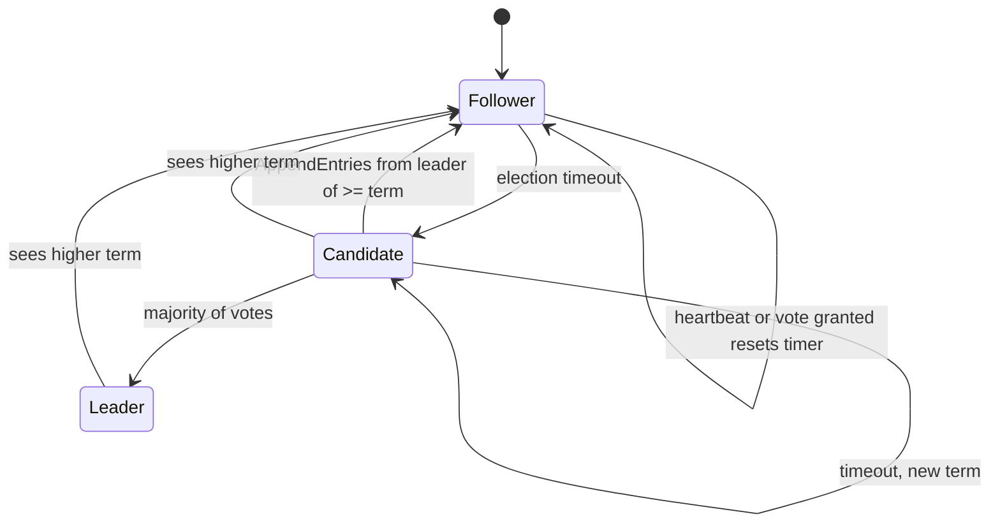

# Leader Election

**Stage 2 of 4.** Plan about 4 hours.

A Raft cluster does nothing until it has a leader, and it is only safe if it never has two leaders in the same term (Election Safety, Figure 3). This stage turns the stubbed `RaftNode` into a server that follows, times out, campaigns, votes, wins, and heartbeats, exactly as Figure 2 describes for Followers, Candidates, Leaders, and the RequestVote RPC. You built this once in the Raft I lesson against a log summarised as two integers; here the log is the real `Storage` from stage 1 and the vote check is `storage.upToDate(...)`.

Three mechanisms carry all the weight. **Terms** are a logical clock: every message carries the sender's term, and any node that sees a higher term adopts it and becomes a follower, whatever it was doing. **One vote per term**, persisted before the reply leaves, is what makes a majority exclusive: two candidates cannot both collect three of five votes in the same term because each voter gives its one vote away once. **Randomized timeouts** drawn from each node's own seeded `Rng` break the symmetry that would otherwise make every follower time out together and split the vote forever.

The stage ends with the test the paper itself relies on: run 40 lossy seeds (20 % drops, delays up to 10 ticks) for 2500 ticks each, record `(term, leaderId)` after every tick, and assert that no term ever has two leaders. The provided `Cluster` harness checks the same thing after every single delivery and throws the moment it is violated, so a bug shows up with the seed and tick that triggered it.



## Worked example

Five nodes, `Config.DEFAULT` (timeouts 150..300, heartbeat 50), seed 7, no drops, delay 1..5 ticks. `Cluster.nodeRng(7, id, 0)` gives the first deadlines n0 = 211, n1 = 179, n2 = 286, n3 = 183, n4 = 178. Two of them are one tick apart, so this seed shows a near split vote resolved by the one-vote-per-term rule. This is the real trace (`Cluster.events`):

| Tick | Event | What the rules did |
|---|---|---|
| 178 | n4 election timeout -> candidate for term 1 | `save(1, 4)`, votes {4}, RequestVote(term 1, last (0, t0)) to n0..n3 |
| 179 | n1 election timeout -> candidate for term 1 | n1 has not yet heard from n4; `save(1, 1)`, votes {1}, its own RequestVotes go out |
| 179 | n2 sees term 1 -> follower; n2 grants vote to n4 | n4's message arrived first: `save(1, -1)` then `save(1, 4)`, timer reset |
| 180 | n0 sees term 1 -> follower; n0 grants vote to n1 | n1's message reached n0 before n4's did |
| 181 | n3 sees term 1 -> follower; n3 grants vote to n4 | n4 now has {4, 2, 3} once the replies arrive |
| 183 | n4 wins 3/5 votes -> LEADER of term 1 | majority is 3; first AppendEntries leave at once |
| 186 | n1 hears leader n4 for term 1 -> candidate steps down | same term, so `becomeFollower` does not touch storage; `leaderId = 4` |
| 186 | `runUntilStableLeader` returns 186 | one leader, every live node in term 1 with `leaderId = 4` |

When n4's RequestVote finally reaches n0, n0 has `votedFor = 1` and denies it; when n1's reaches n2 or n3 they deny it too. Neither candidate can reach three votes from the other's voters: that is Election Safety in one sentence. Running 2000 more ticks changes nothing; heartbeats every 50 ticks keep every follower's timer from expiring and `maxTerm()` stays 1.

Now partition `{n4, n0}` from `{n1, n2, n3}`. n4 keeps heartbeating n0 and believes it leads term 1. On the majority side n2's timer expires first:

| Tick | Event |
|---|---|
| 344 | n2 election timeout -> candidate for term 2 |
| 346 | n3 sees term 2 -> follower; grants vote to n2 |
| 349 | n1 sees term 2 -> follower; grants vote to n2 |
| 350 | n2 wins 3/5 votes -> LEADER of term 2 |
| 886 | network heals |
| 903 | n0 sees term 2 -> follower |
| 904 | n4 sees term 2 -> follower (was LEADER) |

Between 350 and 904 there are two leaders, in **different terms**: allowed, and exactly why a client must never trust a leader's own opinion of itself (stage 4). On heal, the first message across the cut carries term 2; n4 sees `2 > 1`, calls `becomeFollower(2)`, persists `(2, -1)`, and re-arms an election timer it had not been running.

Finally the vote that must survive a crash. n1 (term 0) receives RequestVote(term 1) from n0 and grants it: `storage` now says `(1, votedFor 0)`. n1 crashes and restarts from the same `Storage`; RequestVote(term 1) from n2 arrives. `votedFor` is 0, not null and not 2: denied. Had `votedFor` been volatile, n2 would get the vote, and with n0's three votes elsewhere the cluster could have two leaders for term 1.

## Your task

Implement the election half of `RaftNode.java`. The fields and the trivial accessors are already there; keep every name, because `Cluster` and the tests read `role`, `leaderId`, `electionDeadline`, `nextHeartbeat`, `votesGranted`, `electionsStarted`, `commitIndex`, and the accessors directly.

```java
final class RaftNode implements Node {
    RaftNode(int id, List<Integer> peers, Storage storage, Rng rng, Config config, int now, Tracer tracer);
                                                   // must call resetElectionTimer(now)
    void resetElectionTimer(int now);              // electionDeadline = now + min + rng.nextInt(max - min + 1)
    public List<Message> tick(int now);            // leader: heartbeats when now >= nextHeartbeat; else election when now >= electionDeadline
    List<Message> startElection(int now);          // candidate: term+1, vote self, persist, reset timer, RequestVote to every peer
    public List<Message> handle(Message m, int now); // higher term -> becomeFollower, then dispatch on m.kind()
    void becomeFollower(long term, int now);       // role FOLLOWER, leaderId -1, votes cleared; if term > currentTerm: save(term, -1); if was leader: reset timer
    List<Message> onRequestVote(Message m, int now);
    List<Message> onVoteReply(Message m, int now);
    List<Message> becomeLeader(int now);           // role LEADER, leaderId = id, then replicateAll(now)
    List<Message> replicateAll(int now);           // nextHeartbeat = now + heartbeatInterval; one AppendEntries per peer
    List<Message> onAppendEntries(Message m, int now);  // stage 2 subset, see below
}
```

The same surface in Python (one `main.py` module; methods and fields are snake_case, exceptions end in `Error`, read-only views are tuples):

```python
class RaftNode:                # fields: id, peers, storage, role, leader_id, commit_index, last_applied, state_machine, next_index, match_index,
                               #         votes_granted, election_deadline, next_heartbeat, elections_started, consistency_rejections
    def __init__(self, id: int, peers: Sequence[int], storage: Storage, rng: Rng, config: Config, now: int, tracer: Tracer | None = None) -> None
    current_term, voted_for, log      # read-only properties over storage (no parentheses)
    def votes(self) -> int; cluster_size() -> int; majority() -> int; last_log_index() -> int; last_log_term() -> int

    def reset_election_timer(self, now: int) -> None: ...          # now + min + rng.next_int(max - min + 1)
    def tick(self, now: int) -> list[Message]: ...
    def start_election(self, now: int) -> list[Message]: ...
    def handle(self, m: Message, now: int) -> list[Message]: ...
    def become_follower(self, term: int, now: int) -> None: ...
    def on_request_vote(self, m: Message, now: int) -> list[Message]: ...
    def on_vote_reply(self, m: Message, now: int) -> list[Message]: ...
    def become_leader(self, now: int) -> list[Message]: ...
    def replicate_all(self, now: int) -> list[Message]: ...
    def on_append_entries(self, m: Message, now: int) -> list[Message]: ...   # a second leader in the same term -> RuntimeError

# Cluster(size, seed, drop_rate, max_delay) is provided: run / run_until_stable_leader / stable_leader / leaders / max_term /
# partition / heal / crash / restart / expire_timer, plus nodes, storages, events, leaders_by_term and network.
```

The same surface in Go (`raftnode.go`; exported CamelCase; the fields `Role`, `LeaderID`, `CommitIndex`, `LastApplied`, `StateMachine`, `NextIndex`, `MatchIndex`, `VotesGranted`, `ElectionDeadline`, `NextHeartbeat`, `ElectionsStarted`, `ConsistencyRejections`, `Peers`, and `Storage` are exported because `Cluster` and the tests read them directly):

```go
func NewRaftNode(id int, peers []int, storage *Storage, rng *Rng, config Config, now int, tracer Tracer) *RaftNode
                                                        // given; calls n.ResetElectionTimer(now); nil tracer -> TracerNone
func (n *RaftNode) ID() int; CurrentTerm() int64; VotedFor() int; ClusterSize() int; Majority() int; Votes() int
func (n *RaftNode) Log() []LogEntry; LastLogIndex() int; LastLogTerm() int64        // given accessors
func NodeName(id int) string                                                        // "n3"

func (n *RaftNode) ResetElectionTimer(now int)              // ElectionDeadline = now + min + rng.NextInt(max - min + 1)
func (n *RaftNode) Tick(now int) []Message                  // leader: heartbeats when now >= NextHeartbeat; else election when now >= ElectionDeadline
func (n *RaftNode) StartElection(now int) []Message         // candidate: term+1, vote self, persist, reset timer, RequestVote to every peer
func (n *RaftNode) Handle(m Message, now int) []Message     // higher term -> BecomeFollower, then switch m.Kind
func (n *RaftNode) BecomeFollower(term int64, now int)      // Role Follower, LeaderID -1, votes cleared; if term > CurrentTerm: Save(term, -1); if was leader: reset timer
func (n *RaftNode) OnRequestVote(m Message, now int) []Message
func (n *RaftNode) OnVoteReply(m Message, now int) []Message
func (n *RaftNode) BecomeLeader(now int) []Message          // Role Leader, LeaderID = id, then ReplicateAll(now)
func (n *RaftNode) ReplicateAll(now int) []Message          // NextHeartbeat = now + HeartbeatInterval; one AppendEntries per peer
func (n *RaftNode) OnAppendEntries(m Message, now int) []Message   // stage 2 subset; a second leader in the same term -> panic

// Roles are Follower, Candidate, Leader; kinds are RequestVote, RequestVoteReply, AppendEntries, AppendEntriesReply.
// VotesGranted is a map[int]bool, so a duplicate grant is harmless and Votes() is len(VotesGranted). An empty reply is nil.
// NewCluster(size, seed, dropRate, maxDelay) is provided in cluster.go: Run / RunUntilStableLeader / StableLeader (nil when none) /
// Leaders / MaxTerm / Partition([]int) / Heal / Crash / Restart / ExpireTimer, plus Nodes, Storages, Events, LeadersByTerm and Network.
```

Exact rules, in the paper's words where it has them:

- **`resetElectionTimer(now)`**: draw from `rng`, this node's own stream, uniformly in `[electionTimeoutMin, electionTimeoutMax]`. With `min == max` the deadline is exactly `now + min`. Never read a wall clock.
- **`tick(now)`**: a leader sends heartbeats when `now >= nextHeartbeat` and otherwise returns an empty list; a follower or candidate starts an election when `now >= electionDeadline`. A node never does both in one tick.
- **`startElection(now)`** (Figure 2, Candidates, "on conversion to candidate"): `role = CANDIDATE`, `storage.save(currentTerm + 1, id)`, `leaderId = -1`, `votesGranted = {id}`, `electionsStarted++`, `resetElectionTimer(now)`, and return one `Message.requestVote(id, peer, currentTerm, lastLogIndex(), lastLogTerm())` per peer. Persist **before** building the messages.
- **`handle(m, now)`** (Figure 2, All Servers): if `m.term() > currentTerm` call `becomeFollower(m.term(), now)` first, then `switch (m.kind())` to `onRequestVote`, `onVoteReply`, `onAppendEntries`, `onAppendReply`. For this stage `onAppendReply` may simply return an empty list, but it must exist: a leader receives replies.
- **`onRequestVote`** (RequestVote RPC, receiver implementation): if `m.term() < currentTerm` reply `voteReply(id, m.from(), currentTerm, false)`. Otherwise grant iff `(votedFor == -1 || votedFor == m.from()) && storage.upToDate(m.prevLogIndex(), m.prevLogTerm())`; on grant, `storage.save(currentTerm, m.from())` **then** `resetElectionTimer(now)` **then** reply true. A denied vote does not reset the timer. The same candidate asking twice is granted twice.
- **`onVoteReply`**: ignore unless `role == CANDIDATE && m.term() == currentTerm`. Add `m.from()` to `votesGranted` when `m.success()`; the set makes duplicates harmless. When `votesGranted.size() >= majority()` return `becomeLeader(now)`.
- **`becomeLeader(now)`** (Figure 2, Leaders, "upon election"): `role = LEADER`, `leaderId = id`, initialise `nextIndex[p] = lastLogIndex() + 1` and `matchIndex[p] = 0` for every peer (you need them in stage 3; set them now), then `return replicateAll(now)` so the first heartbeat leaves immediately.
- **`replicateAll(now)`**: `nextHeartbeat = now + heartbeatInterval`, then one `AppendEntries` per peer. For this stage a heartbeat is `Message.appendEntries(id, p, currentTerm, lastLogIndex(), lastLogTerm(), List.of(), commitIndex)`. Stage 3 replaces the `(prev, entries)` part with `nextIndex`-driven values; the heartbeat timer logic stays.
- **`onAppendEntries`** (stage 2 subset): if `m.term() < currentTerm` reply `appendReply(id, m.from(), currentTerm, false, 0)`. Otherwise: if you are a LEADER in this same term, throw `IllegalStateException` (two leaders in one term is a bug you want to see, not survive); if CANDIDATE, step down to FOLLOWER and clear votes; set `leaderId = m.from()`, `resetElectionTimer(now)`, reply `appendReply(id, m.from(), currentTerm, true, m.prevLogIndex())`. Rules 2 to 5 of the receiver implementation arrive in stages 3 and 4.
- **`becomeFollower(term, now)`**: `role = FOLLOWER`, `leaderId = -1`, clear votes; if `term > currentTerm` then `storage.save(term, -1)` (a new term means the vote is free again); if the node *was* the leader, `resetElectionTimer(now)`, because a leader keeps no election timer running.

A suggested build order, each step runnable against the standalone tests before the cluster ones:

1. `resetElectionTimer` and the constructor. Test: deadline in `[150, 300]`.
2. `tick` and `startElection`. Test: the candidate transition, term 1, four RequestVotes.
3. `handle` with the higher-term rule and `becomeFollower`. Everything else dispatches from here.
4. `onRequestVote`. Test: the receiver rules and the up-to-date guard.
5. `onVoteReply`, `becomeLeader`, `replicateAll`. Test: majority, stale and duplicate replies, heartbeat cadence.
6. `onAppendEntries` subset. Test: follower adopts leader, candidate steps down, stale leader refused.
7. Only now run the cluster scenarios.

The dispatcher is small enough to show whole; it does not change again in later stages:

```java
@Override
public List<Message> handle(Message m, int now) {
    if (m.term() > storage.currentTerm) becomeFollower(m.term(), now);   // All Servers rule, before anything else
    return switch (m.kind()) {
        case REQUEST_VOTE -> onRequestVote(m, now);
        case REQUEST_VOTE_REPLY -> onVoteReply(m, now);
        case APPEND_ENTRIES -> onAppendEntries(m, now);
        case APPEND_ENTRIES_REPLY -> onAppendReply(m, now);
    };
}
```

And the vote, where the order of the three side effects is the whole point:

```java
List<Message> onRequestVote(Message m, int now) {
    if (m.term() < storage.currentTerm) return List.of(Message.voteReply(id, m.from(), storage.currentTerm, false));
    boolean canVote = storage.votedFor == -1 || storage.votedFor == m.from();
    boolean logOk = storage.upToDate(m.prevLogIndex(), m.prevLogTerm());
    if (canVote && logOk) {
        storage.save(storage.currentTerm, m.from());   // 1. persist the vote
        resetElectionTimer(now);                       // 2. a live candidate exists; do not compete with it
        return List.of(Message.voteReply(id, m.from(), storage.currentTerm, true));   // 3. only now reply
    }
    return List.of(Message.voteReply(id, m.from(), storage.currentTerm, false));
}
```

The harness you drive in the cluster tests (`Cluster.java`, provided):

| Call | Meaning |
|---|---|
| `new Cluster(size, seed, dropRate, maxDelay)` | N nodes with fresh `Storage`, one `Network`, `Config.DEFAULT` |
| `tick()`, `run(n)` | advance; after every tick the Figure 3 invariants are checked |
| `runUntilStableLeader(max)` | tick until exactly one live leader and every live node agrees on its term and id; returns the tick or -1 |
| `stableLeader()`, `leaders()`, `maxTerm()` | read the cluster's view |
| `partition(Set)`, `heal()`, `crash(id)`, `restart(id)` | faults; `restart` builds a new `RaftNode` on the old `Storage` with a fresh node `Rng` |
| `expireTimer(id)` | force a node's next tick to start an election (scripted scenarios) |
| `events`, `leadersByTerm` | the trace and the per-term leader map the harness enforces |

What must fail and how: a `RequestVote` or `AppendEntries` with a term lower than yours is answered with your term and `false`, never ignored (the sender needs your term to step down). A vote reply from an older term, or any vote reply when you are no longer a candidate, is silently ignored. A second candidate in a term you already voted in is denied even if its log is better. Two leaders in one term throw.

Bugs this stage's tests are built to expose:

| Bug | What you will see |
|---|---|
| Timer not reset on heartbeat | followers keep timing out; `maxTerm()` climbs during the "2000 quiet ticks" test |
| Timer not reset on granting a vote | the voter campaigns against the candidate it just voted for; split votes on quiet seeds |
| `votedFor` not cleared on a new term | a node refuses every candidate after its first term; 3-node clusters never elect |
| Vote reply counted without checking the term | a grant from last term pushes a candidate over the line: ELECTION SAFETY thrown by the harness |
| Leader does not re-arm its timer on step-down | after a partition heals the old leader sits as a follower forever, which is harmless here but hides the bug the next scenario needs |
| `becomeFollower` saves even for an equal term | `writes` climbs on every heartbeat; the restart test still passes, but your `fsync` budget in a real system is gone |

The Python port has the same surface in snake_case in one `main.py`, and the Go port the same surface in exported CamelCase in `raftnode.go` (signatures above). In Go the two-leaders case panics (there is no caller who could handle it), and `Handle` returns `nil` where Java returns `List.of()`.

## Run the grader

```bash
python3 scripts/project_test.py raft-kv --lang java --stage 2 --path my-raft-kv
python3 scripts/project_test.py raft-kv --lang python --stage 2 --path my-raft-kv
python3 scripts/project_test.py raft-kv --lang go --stage 2 --path my-raft-kv
```

The grader re-runs stage 1 first. Stage 2 has about 65 assertions: timeout range and determinism, the candidate transition, vote counting with stale and duplicate replies, every RequestVote receiver rule, the up-to-date guard, follower and candidate reactions to `AppendEntries`, leader step-down and heartbeat cadence, the seed-7 election, same-seed-same-trace, 40 lossy seeds with explicit at-most-one-leader-per-term tracking, 20 three-node clusters at 30 % loss, the partition and heal, and the crash-restart vote test. The cluster scenarios run in under two seconds; if yours take much longer, a node is probably starting an election every tick because `resetElectionTimer` was not called.

## Check yourself

1. In the many-seed test the harness throws on two leaders in one term, yet the test also tracks `(term, leader)` pairs itself. What class of bug would the harness miss that the per-tick tracking catches, and vice versa?
2. A follower grants a vote and resets its election timer, but a follower that *denies* a vote does not. What goes wrong in a partitioned minority if denials also reset the timer? (Think about the healed cluster and a candidate with a stale log that keeps asking.)
3. `becomeLeader` initialises `nextIndex` to `lastLogIndex() + 1` and `matchIndex` to 0 even though stage 2 never reads them. Why can `matchIndex` not be initialised optimistically, and why can `nextIndex`?
