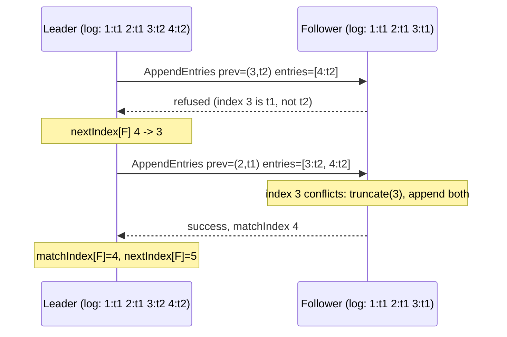

# Log Replication

**Stage 3 of 4.** Plan about 4 hours.

A leader exists to order client commands. This stage makes `AppendEntries` carry real entries: the leader appends a client command to its own log, ships everything a follower is missing, and tracks per follower how far its log is known to match (`matchIndex`) and what to send next (`nextIndex`). The follower runs the consistency check from Figure 2, rule 2, which is the whole mechanism behind the **Log Matching** property (Figure 3): if two logs contain an entry with the same index and term, then the logs are identical in all entries up to that index. Everything in stage 4 (commit, apply, linearizable reads) is built on that property being unbreakable.

The consistency check is an induction. Every `AppendEntries` names the entry just before the ones it carries, as `(prevLogIndex, prevLogTerm)`. The follower accepts only if it holds that exact entry. Since the leader's log is append-only during its term and a follower only appends after a matching prefix, an accepted entry extends an already-matching prefix. When a follower refuses, the leader decrements `nextIndex` for it and retries one entry earlier, walking back until the two logs agree, then ships the whole missing suffix. When a follower holds a *different* entry at an index the leader is overwriting (a stale leader's leftover), rule 3 deletes that entry and everything after it before rule 4 appends.

Nothing in this stage commits or applies anything. `commitIndex` stays 0 and `KVStore` is untouched. That separation is deliberate: a replicated log can be perfectly consistent and still unsafe to apply if the commit rule is wrong, which is stage 4's subject. Real systems keep the same split: etcd's raft library hands you a `Ready` struct with entries to persist and, separately, entries to apply.



## Worked example

Leader n0 in term 2 with log `[1:t1 PUT a 1, 2:t1 PUT b 2, 3:t2 NOOP, 4:t2 PUT c 3]`. After its election it set `nextIndex[p] = 3` for every peer (its log ended at index 2 when it won; the NOOP came right after) and `matchIndex[p] = 0`. Follower n1 is a stale ex-leader whose log is `[1:t1 PUT a 1, 2:t1 PUT b 2, 3:t1 PUT x 9]`: index 3 was a term-1 write that never reached a majority.

| Step | Leader sends to n1 | n1 checks | n1 does | n1 replies | Leader updates |
|---|---|---|---|---|---|
| 1 | prev=(2, t1), entries=[3:t2 NOOP, 4:t2 PUT c 3] | `termAt(2) == 1`: match | index 3: has t1, gets t2: conflict -> `truncate(3)`, append both | success, matchIndex 4 | `matchIndex[1] = 4`, `nextIndex[1] = 5` |

n1's log is now identical to the leader's. The stale `PUT x 9` is gone; no client was ever told it succeeded, because it never committed (stage 4 makes the client learn that explicitly).

Follower n2 is far behind: its log is `[1:t1 PUT a 1]`.

| Step | Leader sends to n2 | n2 checks | n2 replies | Leader updates |
|---|---|---|---|---|
| 1 | prev=(2, t1), entries=[3, 4] | `prevLogIndex 2 > lastIndex 1`: refuse | false | `nextIndex[2] = 2`, resend at once |
| 2 | prev=(1, t1), entries=[2, 3, 4] | `termAt(1) == 1`: match | success, matchIndex 4 | `matchIndex[2] = 4`, `nextIndex[2] = 5` |

Two round trips for a three-entry gap; in general one refusal per missing entry, which is why the paper mentions (and etcd implements) a hint in the refusal. Keep the simple decrement here; the tests are sized for it.

Now the duplicate. The network re-delivers step 1's message to n1 (a delayed copy). n1 already holds `3:t2` and `4:t2`. Rule 4 says append only entries *not already in the log*: both match by term, so n1 skips both, truncates nothing, and replies success with matchIndex 4 again. `Storage.writes` does not change. An implementation that truncates on every `AppendEntries` would here delete and re-add two entries; harmless in this case, but if a *newer* entry 5 had arrived in between, the stale duplicate would have destroyed it. The test "an old, shorter batch that matches a prefix does not truncate the newer tail" is exactly that case.

Finally the leader's view after one more proposal `PUT d 4` at index 5. `propose` appends it and the harness calls `replicateAll` immediately; each follower gets `prev=(4, t2), entries=[5:t2 PUT d 4]`. When n1 and n2 reply, `replicatedCount(5)` is 3 (the leader plus two followers); `replicatedCount(6)` is 1. Those counts are what stage 4 turns into a commit decision.

## Your task

Implement the replication half of `RaftNode.java` and upgrade two stage-2 methods. `Storage` provides every log primitive you need; do not touch `storage.log` directly except to read it.

```java
int propose(String command);                 // not leader -> -1; else append LogEntry(currentTerm, command), return its index
Message appendEntriesFor(int peer);          // next = nextIndex[peer]; prev = next - 1;
                                             // appendEntries(id, peer, currentTerm, prev, termAt(prev), entriesFrom(next), commitIndex)
List<Message> replicateAll(int now);         // nextHeartbeat = now + interval; appendEntriesFor(p) for every peer  (replaces stage 2's heartbeat)
List<Message> becomeLeader(int now);         // as stage 2, then storage.append(new LogEntry(currentTerm, "NOOP")) before replicateAll
List<Message> onAppendEntries(Message m, int now);   // full receiver implementation, rules 1-4 (rule 5 in stage 4)
List<Message> onAppendReply(Message m, int now);     // success -> matchIndex/nextIndex forward; failure -> nextIndex back, resend
int replicatedCount(int index);              // 1 + number of peers with matchIndex >= index
```

The same surface in Python (one `main.py` module; methods and fields are snake_case, exceptions end in `Error`, read-only views are tuples):

```python
class RaftNode:
    def propose(self, command: str) -> int: ...                     # -1 unless leader; else append and return the new index
    def append_entries_for(self, peer: int) -> Message: ...         # prev = next_index[peer] - 1; ships storage.entries_from(next)
    def on_append_reply(self, m: Message, now: int) -> list[Message]: ...
    def replicated_count(self, index: int) -> int: ...             # 1 + peers with match_index >= index

    # upgraded: become_leader appends LogEntry(current_term, "NOOP"); replicate_all returns append_entries_for(p) per peer;
    # on_append_entries adds rules 2-4 and replies match_index = prev_log_index + len(entries)

# Cluster additions used by the tests: propose(command) -> int, propose_to(node_id, command) -> int,
# run_until_logs_converged(max_ticks) -> int, logs_converged() -> bool, Cluster.check_log_matching(a, b, ia, ib) (raises RuntimeError).
```

The same surface in Go (`raftnode.go`):

```go
func (n *RaftNode) Propose(command string) int              // not leader -> -1; else Append(LogEntry{CurrentTerm, command}), return its index
func (n *RaftNode) AppendEntriesFor(peer int) Message       // next := NextIndex[peer]; prev := next - 1;
                                                            // NewAppendEntries(id, peer, CurrentTerm, prev, TermAt(prev), EntriesFrom(next), CommitIndex)
func (n *RaftNode) OnAppendReply(m Message, now int) []Message   // success -> MatchIndex/NextIndex forward; failure -> NextIndex back, resend
func (n *RaftNode) ReplicatedCount(index int) int           // 1 + number of peers with MatchIndex >= index

// upgraded: BecomeLeader appends LogEntry{CurrentTerm, "NOOP"} after initialising NextIndex/MatchIndex; ReplicateAll returns
// AppendEntriesFor(p) per peer; OnAppendEntries adds rules 2-4 and replies MatchIndex = PrevLogIndex + len(Entries).

// Cluster additions used by the tests: Propose(command) int, ProposeTo(nodeID, command) int, RunUntilLogsConverged(maxTicks) int,
// LogsConverged() bool, and CheckLogMatching(a, b []LogEntry, ia, ib int) error (nil when the property holds; the error wraps ErrInvariant).
```

Rules:

- **`becomeLeader`**: initialise `nextIndex[p] = lastLogIndex() + 1` and `matchIndex[p] = 0` **first**, then append the no-op `LogEntry(currentTerm, "NOOP")`, then `replicateAll`. The order matters: with `nextIndex` pointing at the no-op's slot, the very first `AppendEntries` carries it. The no-op is section 8 of the paper and becomes essential in stage 4 (a new leader cannot commit older-term entries by counting, so it commits one of its own at once).
- **`propose`**: a follower or candidate returns -1 and appends nothing. A leader appends and returns `lastLogIndex()`. It does not send anything; the caller (`Cluster.proposeTo`) calls `replicateAll` so that heartbeat timing and proposals share one path.
- **`appendEntriesFor(peer)`**: as the signature comment says. `entriesFrom(next)` is empty when the follower is up to date, which is the heartbeat; there is no separate heartbeat message any more.
- **`onAppendEntries`**, Figure 2 receiver implementation, in this order:
  1. `m.term() < currentTerm` -> reply `false, 0`. (A higher term was already handled by `handle`.)
  2. The stage-2 bookkeeping: throw if you are the leader of this term; a candidate steps down; `leaderId = m.from()`; `resetElectionTimer(now)`. This happens even if the consistency check fails below: the sender *is* the legitimate leader, its message just missed.
  3. Consistency check: `m.prevLogIndex() > lastLogIndex() || termAt(m.prevLogIndex()) != m.prevLogTerm()` -> `consistencyRejections++`, reply `false, 0`, change nothing.
  4. For each entry at `index = prevLogIndex + 1, +2, ...`: if `index <= lastLogIndex()` and `termAt(index) == e.term()` skip it; if the terms differ, `storage.truncate(index)` and then append; if `index > lastLogIndex()` append.
  5. Reply `true` with `matchIndex = m.prevLogIndex() + m.entries().size()`. Not `lastLogIndex()`: a stale, shorter batch must report what *it* confirmed, or the leader's `matchIndex` could jump ahead of what the leader actually knows.
- **`onAppendReply`**: ignore unless `role == LEADER && m.term() == currentTerm`. On success, only if `m.matchIndex() > matchIndex[from]`: set `matchIndex[from] = m.matchIndex()` and `nextIndex[from] = m.matchIndex() + 1` (stage 4 adds `advanceCommitIndex` here). On failure: `nextIndex[from] = max(1, nextIndex[from] - 1)` and return `List.of(appendEntriesFor(from))` so the retry does not wait for the next heartbeat.
- **`replicatedCount(index)`**: the leader counts itself.

The receiver loop, which is where most Raft implementations have had a bug at some point. Read it against the rules above before you type your own:

```java
int index = m.prevLogIndex();
for (LogEntry e : m.entries()) {
    index++;
    if (index <= lastLogIndex()) {
        if (storage.termAt(index) == e.term()) continue;    // rule 4: already have it, skip
        storage.truncate(index);                             // rule 3: conflict, drop it and everything after
    }
    storage.append(e);                                       // rule 4: append the new entry
}
int lastNew = m.prevLogIndex() + m.entries().size();
return List.of(Message.appendReply(id, m.from(), storage.currentTerm, true, lastNew));
```

And the leader's side of the conversation:

```java
List<Message> onAppendReply(Message m, int now) {
    if (role != Role.LEADER || m.term() != storage.currentTerm) return List.of();
    if (m.success()) {
        if (m.matchIndex() > matchIndex.get(m.from())) {
            matchIndex.put(m.from(), m.matchIndex());
            nextIndex.put(m.from(), m.matchIndex() + 1);
            // stage 4: advanceCommitIndex(now);
        }
        return List.of();
    }
    nextIndex.put(m.from(), Math.max(1, nextIndex.get(m.from()) - 1));
    return List.of(appendEntriesFor(m.from()));              // retry now, not at the next heartbeat
}
```

How the provided harness checks Log Matching after every delivery (`Cluster.checkLogMatching`): for each pair of nodes it finds the highest index where the two logs have the same term, then demands that every entry at or below that index is identical. It runs on *all* nodes, crashed ones included, because a crashed node's `Storage` is still part of the cluster's history and must still agree with everyone else wherever it overlaps.

```java
static void checkLogMatching(List<LogEntry> a, List<LogEntry> b, int ia, int ib) {
    int limit = Math.min(a.size(), b.size()) - 1;
    for (int k = limit; k >= 1; k--) {
        if (a.get(k).term() == b.get(k).term()) {
            for (int i = 1; i <= k; i++) if (!a.get(i).equals(b.get(i))) throw new IllegalStateException("LOG MATCHING: ...");
            return;
        }
    }
}
```

Bugs this stage's tests are built to expose:

| Bug | What you will see |
|---|---|
| Truncate on every `AppendEntries` | "an old, shorter batch that matches a prefix does not truncate the newer tail" fails; under 20 % loss, logs flap and the lossy-seed scenario never converges |
| Reply `matchIndex = lastLogIndex()` | the standalone duplicate test passes by luck, but the lossy seeds eventually show LEADER APPEND-ONLY or a commit of an entry the follower does not hold in stage 4 |
| Consistency check uses `>=` instead of `>` | a heartbeat to an up-to-date follower is refused forever; `nextIndex` walks to 1 and the whole log is reshipped every heartbeat |
| `nextIndex` allowed to reach 0 | `termAt(-1)` throws `IndexOutOfBoundsException` from `appendEntriesFor` |
| Refusal does not resend | the lagging follower catches up one entry per heartbeat; the catch-up test runs out of ticks |
| `matchIndex` moves backwards on an old reply | `replicatedCount` flickers; in stage 4 `commitIndex` can stall below an index a majority holds |
| No-op appended before `nextIndex` is initialised | the first `AppendEntries` skips the no-op; followers refuse the next one because `prev` names an entry they never got |

What must fail and how: `propose` on a non-leader returns -1 (not an exception; clients are expected to be redirected). A refused `AppendEntries` never modifies the log, and the follower still adopts the sender as leader. `matchIndex` never moves backwards; `nextIndex` never drops below 1 (index 0 is the sentinel and always matches). Two leaders in the same term still throw. The provided `Cluster.checkInvariants` runs after every delivery and throws `IllegalStateException` naming the pair of nodes and the index if Log Matching or Leader Append-Only is violated; the tests also call `Cluster.checkLogMatching` on the final logs. If you see `LOG MATCHING: nodes 1 and 3 agree at index 4 (term 2) but differ at index 2`, a follower appended without a matching prefix: re-read rule 3 of the list above.

The Python port has the same surface in snake_case in one `main.py`, and the Go port the same surface in exported CamelCase in `raftnode.go` (signatures above). In Go `CheckLogMatching` returns an `error` instead of throwing, and `Cluster.CheckInvariants` panics with it after a delivery.

## Run the grader

```bash
python3 scripts/project_test.py raft-kv --lang java --stage 3 --path my-raft-kv
python3 scripts/project_test.py raft-kv --lang python --stage 3 --path my-raft-kv
python3 scripts/project_test.py raft-kv --lang go --stage 3 --path my-raft-kv
```

Stages 1 and 2 run again first; stage 2's heartbeat assertions still hold because `appendEntriesFor` on an up-to-date follower *is* a heartbeat. Stage 3 has about 48 assertions: `propose` on followers and leaders, `nextIndex`/`matchIndex` initialisation and the shape of the first `AppendEntries`, every branch of the consistency check, truncation and duplicate handling with exact `describe()` strings, the back-off walk with the `max(1, ...)` floor, convergence on a quiet cluster, a crashed follower catching up, the stale-leader partition from the Raft II lesson (the `PUT alice 999` that must vanish from every log), and 12 lossy seeds with a leader crash where every log must converge with Log Matching intact.

## Check yourself

1. Rule 4 skips an entry whose term matches instead of comparing commands. Why is comparing the term alone enough, and which property guarantees it?
2. A follower that refuses an `AppendEntries` still resets its election timer and records `leaderId`. What happens to a far-behind follower during catch-up if a refusal does *not* reset the timer?
3. The success reply carries `prevLogIndex + entries.size()` rather than the follower's `lastLogIndex()`. Construct a delivery order with one stale duplicate where the two differ, and show what the leader's `matchIndex` would wrongly claim.
